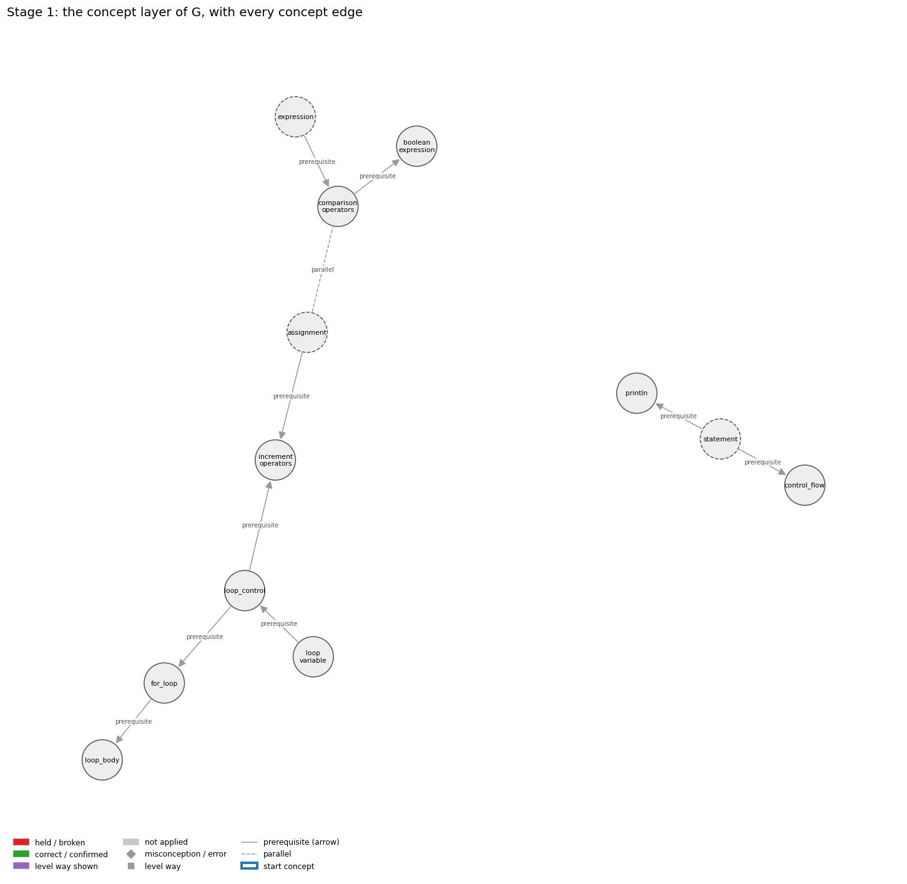
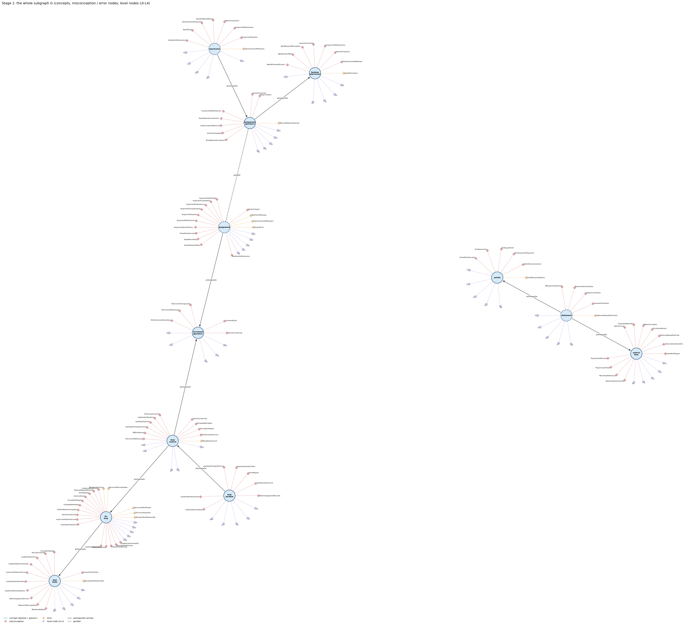
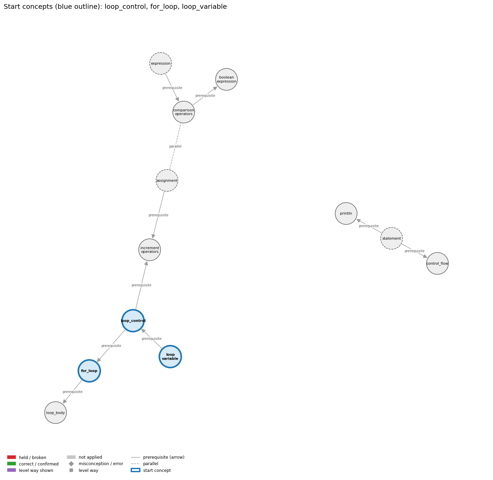
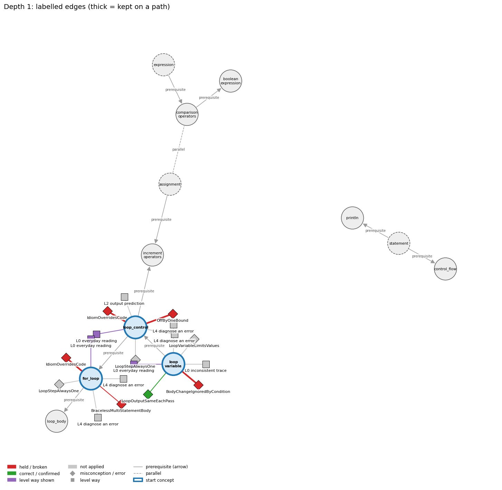
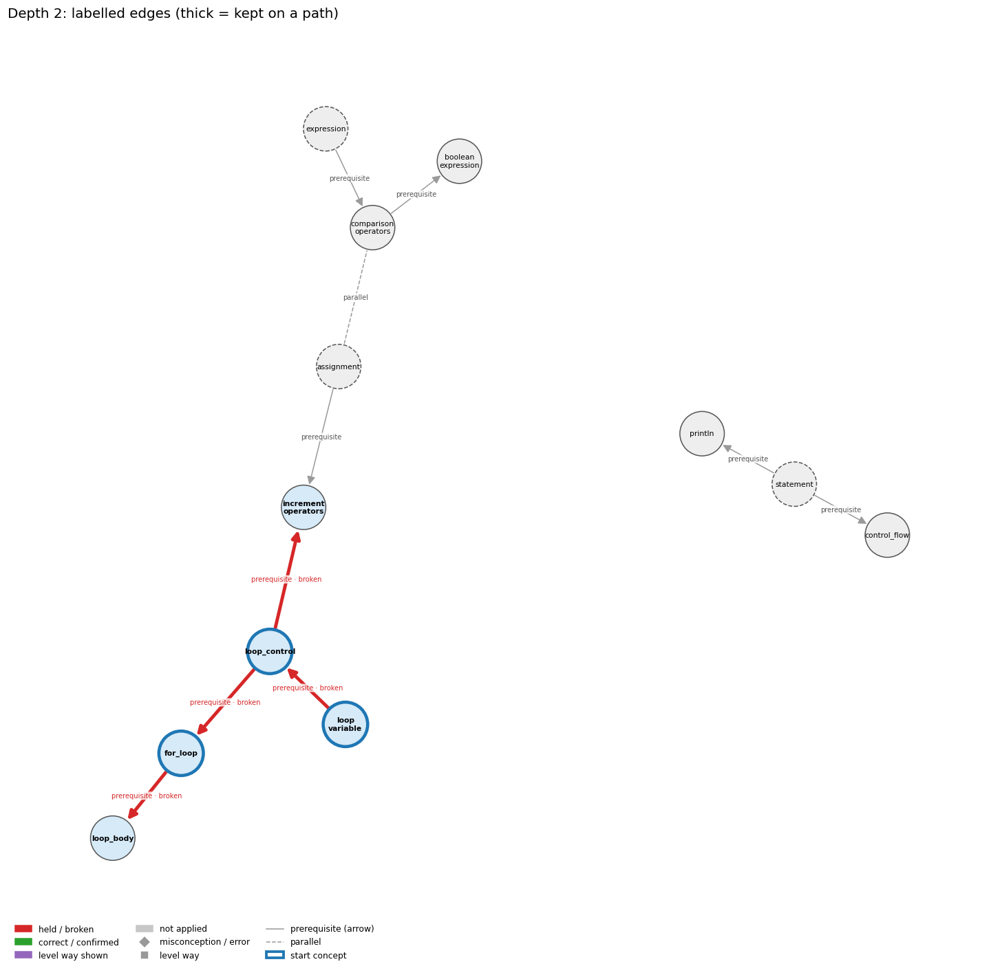
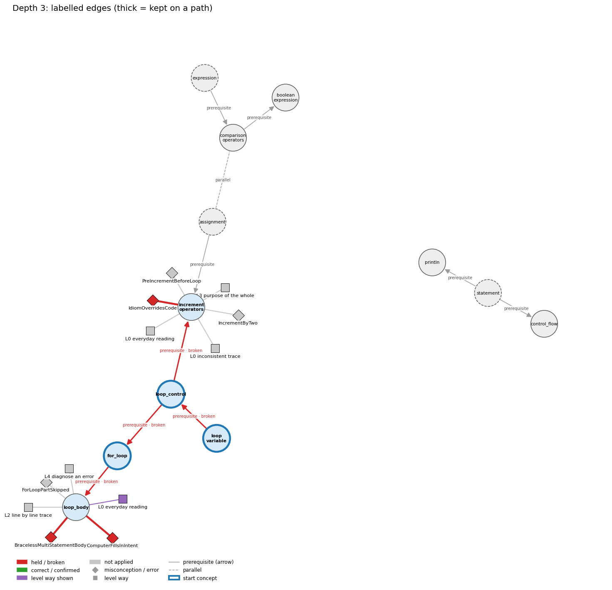
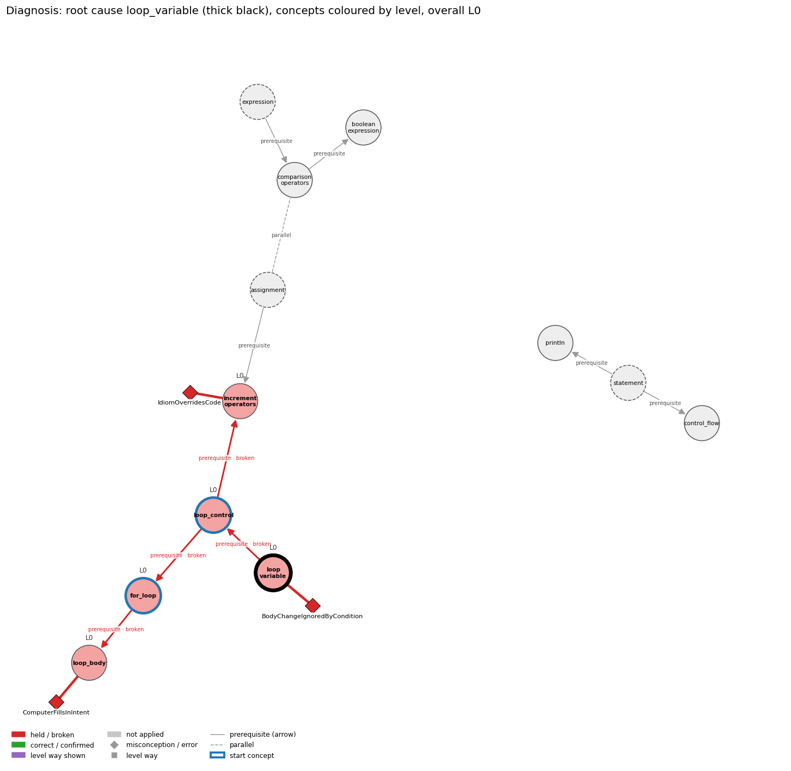

# Think on the Graph: every output of the run LP01

Files of this scenario: `input.json` (program, question, answer), `diagnosis.json`, `subgraph.json`, `traverse_log.txt`, `report.html` (this report as one full-page file, with the interactive graph `LP01_G.html`), `LP01.ipynb` (this report as a notebook).

## Level classification

This scenario tests **L0: everyday reading**. How the overall level is decided is explained in the [folder README](../../README.md).

- **Overall level: L0** (decided by: held mistake)
- **Shares of the components:** L0 1.00; coherent
- **Mistake held (root cause):** loop_variable / BodyChangeIgnoredByCondition
- **Expected by design:** overall L0; components `for_loop` L0; held none; root none
- **Overall level matches the expected one:** yes

### How the overall level of this run was calculated

1. **Find the parts of the answer.** The answer touches 5 concepts (the components in the table below). Each one got its own level from what the student wrote about it.
2. **Is a real mistake held?** Yes. The student holds the wrong rule **BodyChangeIgnoredByCondition** at `loop_variable`.
3. **Result.** An answer that is built on a wrong rule is **L0**, however well the other parts are done. So the overall level is **L0**.
4. **For information, the count of the parts:** 5 at L0. The parts are close together.

| Component | Level | Decided by | Student's words |
|---|---|---|---|
| `for_loop` | L0 | way: everyday reading | It counts from 1 to 5; so it prints 1, 2, 3, 4, 5; For i from 1 to n means do it for each number |
| `increment_operators` | L0 | holds IdiomOverridesCode | It counts from 1 to 5; so it prints 1, 2, 3, 4, 5; For i from 1 to n means do it for each number |
| `loop_body` | L0 | holds ComputerFillsInIntent | It counts from 1 to 5; so it prints 1, 2, 3, 4, 5; For i from 1 to n means do it for each number |
| `loop_control` | L0 | way: everyday reading | It counts from 1 to 5; so it prints 1, 2, 3, 4, 5; For i from 1 to n means do it for each number |
| `loop_variable` | L0 | holds BodyChangeIgnoredByCondition | It counts from 1 to 5; For i from 1 to n means do it for each number |

## 0. Input
Program:
```java
int i, n = 5;
for (i = 1; i < n; i++)
    i++;
    System.out.println(i);
System.out.println(i);
```
Question: What is printed? Explain, pass by pass, what happens to i.

Student's answer: It counts from 1 to 5, so it prints 1, 2, 3, 4, 5. 'For i from 1 to n' means do it for each number.
Settings: width 3, depth 3, prune llm, backend claude-cli, model claude-opus-5-5
## 1. Stage 1: the subgraph G from the code (no model)
Masked code (string and char literals and comments blanked; this is what the patterns see):
```
int i, n = 5;
for (i = 1; i < n; i++)
    i++;
    System.out.println(i);
System.out.println(i);
```
Which code text tagged which concept (a generic concept fires on almost any Java line; it starts the walk only if the answer repeats its tag):
| concept | generic | channel | matched text | line |
|---|---|---|---|---|
| assignment | True | pattern | '=' | 1 |
| boolean_expression | False | pattern | 'for (i = 1; i < n;' | 2 |
| comparison_operators | False | pattern | 'for (i = 1; i <' | 2 |
| control_flow | False | pattern | 'for (' | 2 |
| expression | True | pattern | 'i <' | 2 |
| expression | True | pattern | '= 5;' | 1 |
| for_loop | False | pattern | 'for (' | 2 |
| increment_operators | False | pattern | '++' | 2 |
| loop_body | False | pattern | 'for (' | 2 |
| loop_control | False | signal | 'for (i = 1; i < n; i++)' | 2 |
| loop_variable | False | pattern | 'for (i =' | 2 |
| println | False | pattern | 'System.out.println(' | 4 |
| statement | True | pattern | ';' | 1 |

G: 12 concept nodes (3 generic), 10 concept edges, 116 misconception / error edges, 84 misconception / error nodes, 60 level nodes, 120 level-misconception links, 2 connected piece(s).
Note: concept nodes form 2 pieces (the KG has no edge between them): assignment,boolean_expression,comparison_operators,expression,for_loop,increment_operators,loop_body,loop_control,loop_variable | control_flow,println,statement

Concept edges of G (the links the walk can read; `pre:` = prerequisite A -> B, `par:` = parallel):
| edge | type | rule (logic) |
|---|---|---|
| par:assignment~comparison_operators | parallel | x = y stores the value of y in x (a statement with a side effect); x == y only tests whether the two values are equal and gives a boolean. Writing = where == is meant is a compile error with int operands and a silent bug with boolean operands. |
| pre:assignment->increment_operators | prerequisite | i++ is shorthand for the assignment i = i + 1. |
| pre:comparison_operators->boolean_expression | prerequisite | A comparison such as x < y produces a boolean result; comparisons together with boolean logic provide the basis for decision-making. |
| pre:expression->comparison_operators | prerequisite | Comparison operators build expressions whose value is a boolean, so one must already know what an expression is to understand a < b. |
| pre:for_loop->loop_body | prerequisite | The statements in braces after the for header are the loop body; they run once on every pass, between the test and the increment, exactly as in a while loop. |
| pre:loop_control->for_loop | prerequisite | The for header is exactly the three control slots, and the body runs after the test and before the update on each pass. |
| pre:loop_control->increment_operators | prerequisite | The loop update i = i + 1 comes first; ++ (and +=) are then introduced as shorthand for that update. |
| pre:loop_variable->loop_control | prerequisite | The init, condition and update all act on the loop variable: the init sets it, the condition tests it, the update changes it. |
| pre:statement->control_flow | prerequisite | Control flow is the order in which statements run. |
| pre:statement->println | prerequisite | System.out.println(s); is itself a statement, so its line of output appears at its own place in the sequence. |

Misconception / error edges per concept (count), and level ways per concept (count):
| concept | misconception / error edges | level ways (L1-L4 + L0 non-misconception) |
|---|---|---|
| assignment | 15 | 24 |
| boolean_expression | 8 | 19 |
| comparison_operators | 8 | 20 |
| control_flow | 11 | 15 |
| expression | 8 | 19 |
| for_loop | 20 | 24 |
| increment_operators | 5 | 16 |
| loop_body | 12 | 14 |
| loop_control | 11 | 19 |
| loop_variable | 7 | 13 |
| println | 6 | 17 |
| statement | 5 | 19 |

**Figure 1**


**Figure 2**


## 2. Clauses and start concepts (no model)
The answer split into clauses (at sentence ends, ';', and before 'because' / 'so'; quotes removed):
| clause | text |
|---|---|
| c1 | It counts from 1 to 5 |
| c2 | so it prints 1, 2, 3, 4, 5 |
| c3 | For i from 1 to n means do it for each number |

start: BM25 of the answer against each tagged concept: loop_control 18.08 (hits 1), for_loop 14.91 (hits 1), loop_variable 14.43 (hits 1), println 12.27 (hits 1), control_flow 11.93 (hits 1), increment_operators 10.52 (hits 1), loop_body 9.44 (hits 1), boolean_expression 4.55 (hits 1), comparison_operators 3.50 (hits 1)

start: chosen loop_control, for_loop, loop_variable

start concepts (3): loop_control, for_loop, loop_variable

Start concepts: loop_control, for_loop, loop_variable

**Figure 3**


## 3. The walk, depth by depth
At each depth, for each current concept: the edges offered (a concept entering as a start concept offers its misconception / error edges and its level ways, as two families; otherwise it offers its concept edges), the prune prompt and the model's reply, then the label prompt(s) and the model's reply, parsed into label / clauses / confidence. Score = prune score x confidence.

### Depth 1: current concepts 'loop_control', 'for_loop', 'loop_variable'

#### loop_control, misconceptions: 11 edges offered
Edges offered:
| edge |
|---|
| err:loop_control->WrongIterationCount \| wrong rule: Updates the loop counter so that the loop runs the wrong number of times. \| right rule: The init, test and update together decide the number of passes; trace them to check the count. |
| mis:loop_control->DoubleLoopIndexCount \| wrong rule: for (double x = 0.0; x <= 1.0; x += 0.1) runs exactly 11 times. \| right rule: Using a double as a for-loop index is legal but bad practice: the number of iterations depends on an equality test between double values, which may not give the result you expect. |
| mis:loop_control->ForLoopPartSkipped \| wrong rule: A pass of a loop may leave out one of its parts (the condition test, the body, the update, or the initialization). \| right rule: Each pass of a for loop runs test, then body, then update, every time; the initialization runs once, at the start. |
| mis:loop_control->ForUpdateBeforeBody \| wrong rule: The update part of a for header (e.g. i = i - 4) runs before the body on each pass, so the first pass already sees the updated value. \| right rule: The update runs after the body, before the next condition test; the first pass uses the initial value. |
| mis:loop_control->IdiomOverridesCode \| wrong rule: An array loop processes the whole array from index 0 to length-1 and increments its index at the end of the body, whatever the code says. \| right rule: The loop visits exactly the indices that its initialisation, guard and update produce, in the order in which its statements are written. |
| mis:loop_control->InfiniteLoopUnnoticed \| wrong rule: A while loop always stops on its own, even if nothing in its body can make the condition false. \| right rule: A while loop stops only when its condition is false at a check, so if no pass changes the variables in the condition, it never stops. |
| mis:loop_control->LoopHeaderIsEquations \| wrong rule: The initialization, condition and update of a for header are equations that all hold at the same time. \| right rule: The three header parts are statements run at different moments: init once, then condition test, body, update, repeated. |
| mis:loop_control->LoopStepAlwaysOne \| wrong rule: A loop variable always goes up or down by 1, whatever the update says (so i = i - 4 is read as i--). \| right rule: The loop variable changes exactly as the update expression says (i += 2, i = i - 4, i *= 2, ...). |
| mis:loop_control->LoopUpdateChangesDirection \| wrong rule: The update of the loop variable can change from pass to pass (e.g. switch direction) although the code is the same. \| right rule: The update expression is the same on every pass; the loop variable changes by the rule written in the update. |
| mis:loop_control->OffByOneBound \| wrong rule: i < n and i <= n mean the same, so the loop runs until i equals n and the last pass can use a[n]. \| right rule: for (i = 0; i < n; i++) runs n times with i going up to n - 1; with <= it runs n + 1 times and reaches i = n. |
| mis:loop_control->PreIncrementBeforeLoop \| wrong rule: With ++i in the update of for (int i = s; i < n; ++i), i is increased before the body runs, so the first pass uses s + 1. \| right rule: The update runs after each pass of the body, so with either ++i or i++ the first pass uses i = s. |

Prune: the model's reply (edge id and score; the kept edges sum to 1):
```
mis:loop_control->IdiomOverridesCode (0.40), mis:loop_control->OffByOneBound (0.35), mis:loop_control->LoopStepAlwaysOne (0.25)
```
Kept by pruning: mis:loop_control->IdiomOverridesCode (0.40), mis:loop_control->OffByOneBound (0.35), mis:loop_control->LoopStepAlwaysOne (0.25)

Label prompt for the misconception / error edges (judged together). The model saw the program, the question, the numbered clauses, and these edges with their wrong rule and right rule:
| edge |
|---|
| mis:loop_control->IdiomOverridesCode \| wrong rule: An array loop processes the whole array from index 0 to length-1 and increments its index at the end of the body, whatever the code says. \| right rule: The loop visits exactly the indices that its initialisation, guard and update produce, in the order in which its statements are written. |
| mis:loop_control->OffByOneBound \| wrong rule: i < n and i <= n mean the same, so the loop runs until i equals n and the last pass can use a[n]. \| right rule: for (i = 0; i < n; i++) runs n times with i going up to n - 1; with <= it runs n + 1 times and reaches i = n. |
| mis:loop_control->LoopStepAlwaysOne \| wrong rule: A loop variable always goes up or down by 1, whatever the update says (so i = i - 4 is read as i--). \| right rule: The loop variable changes exactly as the update expression says (i += 2, i = i - 4, i *= 2, ...). |
Model's reply:
```
mis:loop_control->IdiomOverridesCode | held | clauses: 1, 2, 3 | confidence: 0.8
mis:loop_control->OffByOneBound | held | clauses: 1, 2 | confidence: 0.75
mis:loop_control->LoopStepAlwaysOne | not applied | clauses: none | confidence: 0.6
```

Parsed labels:
| edge | label | prune score | confidence | score | clauses | words |
|---|---|---|---|---|---|---|
| mis:loop_control->IdiomOverridesCode | held | 0.4 | 0.8 | 0.32 | c1, c2, c3 | It counts from 1 to 5; so it prints 1, 2, 3, 4, 5; For i from 1 to n means do it for each number |
| mis:loop_control->OffByOneBound | held | 0.35 | 0.75 | 0.26 | c1, c2 | It counts from 1 to 5; so it prints 1, 2, 3, 4, 5 |
| mis:loop_control->LoopStepAlwaysOne | not applied |  |  | 0.0 |  |  |

#### loop_control, level ways: 19 edges offered
Edges offered:
| edge |
|---|
| lvl:loop_control@L0#0 \| level L0 way everyday_reading: Folk meaning: in mathematics i = 0, i < n and i = i + 1 are equations or constraints that hold at the same time (and i = i + 1 is nonsense). In Java they are three actions run at different moments: init once, test before each pass, update after each pass. |
| lvl:loop_control@L0#3 \| level L0 way inconsistent_trace: Applies the init-test-update rule (LT) unevenly: updates before the body on some passes, skips the test or the update on a pass, or re-runs the init. (here mixing in: "++i in the for-update runs before the body each pass") |
| lvl:loop_control@L1#0 \| level L1 way names_the_element: Loop control is the init / continuation condition / increment scheme on an index variable that decides how many passes a loop makes and with which values. |
| lvl:loop_control@L1#1 \| level L1 way states_the_rule: Initialize an index variable, test a loop-continuation condition on it before each pass, and increment it as the last action of each pass; for (<initialize>; <boolean expression>; <increment>) packages the three. Choosing the loop: for when the passes are counted by an index, while when the loop runs until a condition changes, do-while when the body must run at least once; any one can be rewritten as another, so choose the clearest. |
| lvl:loop_control@L2#0 \| level L2 way line_by_line_trace: init (once) -> test -> body -> update -> test -> body -> update ... -> test false -> exit. |
| lvl:loop_control@L2#1 \| level L2 way output_prediction: The number of passes and the values seen follow from the three parts: for (int i = 0; i <= N; i++) makes N+1 passes with i = 0..N; with i < N it makes N passes; i += 2 visits every second value. |
| lvl:loop_control@L2#2 \| level L2 way one_step_execution: One update changes only the loop variable, by exactly the rule written (i++ adds 1, i = i - 4 subtracts 4); one test reads it and returns true or false without changing it. |
| lvl:loop_control@L3#0 \| level L3 way relation_to_neighbour: All three control parts act on the loop variable: the init sets it, the condition tests it, the update changes it. |
| lvl:loop_control@L3#1 \| level L3 way relation_to_neighbour: The for header is exactly the three control slots, separated by semicolons; the body runs after the test and before the update. |
| lvl:loop_control@L3#2 \| level L3 way relation_to_neighbour: The update i = i + 1 is usually written i++ (or i += k for other steps); as a whole update statement ++i and i++ are equivalent. |
| lvl:loop_control@L3#3 \| level L3 way relation_to_neighbour: A loop is infinite when the update never moves the variable toward making the condition false (e.g. condition i > 3 with update i = i + 1). |
| lvl:loop_control@L3#4 \| level L3 way relation_to_neighbour: The continuation condition fixes the number of iterations, so a sharper bound (i <= n/i instead of i < n) can make a program dramatically faster. |
| lvl:loop_control@L3#5 \| level L3 way relation_to_neighbour: The initialization and the condition of a loop fix how many times it runs; one wrong bound makes it run once too many or too few. |
| lvl:loop_control@L3#6 \| level L3 way purpose_of_the_whole: Plan: counter-controlled loop - the loop variable is a stepper that walks a predictable sequence of values (0..N-1, 1..N, every 2nd value) and fixes the number of passes in advance. |
| lvl:loop_control@L4#0 \| level L4 way predict_a_change: Changing < to <= adds one pass; starting at 1 instead of 0 removes one; doubling the step halves the passes; reversing init and bound with i-- visits the same values in reverse order (and still processes the same set only if both ends are adjusted). |
| lvl:loop_control@L4#1 \| level L4 way diagnose_an_error: rule broken: The number of passes is fixed by the init, the test and the update together. Kind: silent logic error. Trigger class: Wrong start value, < vs <=, a wrong step, or an extra update of the counter in the body (or outside the loop): the loop runs too few or too many passes (off by one, or skips values). |
| lvl:loop_control@L4#2 \| level L4 way transfer_to_a_new_program: Use explicit init/test/update control when the passes are counted or follow a fixed step; when the number of passes depends on data computed in the body, control the loop by that data (a while condition) instead. |
| lvl:loop_control@L4#3 \| level L4 way diagnose_an_error: rule broken: The update must move the loop variable toward making the condition false. Kind: silent logic error. Trigger class: An update in the wrong direction or a condition that the update cannot falsify (e.g. i > 3 with i++, or i != 10 with i += 3): infinite loop. |
| lvl:loop_control@L4#4 \| level L4 way diagnose_an_error: rule broken: Do not control a loop by an equality test on double values. Kind: silent logic error. Trigger class: for (double x = 0.0; x < 1.0; x += 0.1): after ten additions x is 0.9999999999999999, so the loop makes 11 passes instead of the intended 10. |

Prune: the model's reply (edge id and score; the kept edges sum to 1):
```
{lvl:loop_control@L0#0 (Score: 0.6)}
{lvl:loop_control@L2#1 (Score: 0.25)}
{lvl:loop_control@L4#1 (Score: 0.15)}
```
Kept by pruning: lvl:loop_control@L0#0 (0.60), lvl:loop_control@L2#1 (0.25), lvl:loop_control@L4#1 (0.15)

Label prompt for level way lvl:loop_control@L0#0 (the model saw only the concept, the way's name 'everyday reading' and its text; no level):
> Folk meaning: in mathematics i = 0, i < n and i = i + 1 are equations or constraints that hold at the same time (and i = i + 1 is nonsense). In Java they are three actions run at different moments: init once, test before each pass, update after each pass.

Model's reply:
```
Label: shown
Clauses: 1, 2, 3
Confidence: 0.85
```

Label prompt for level way lvl:loop_control@L2#1 (the model saw only the concept, the way's name 'output prediction' and its text; no level):
> The number of passes and the values seen follow from the three parts: for (int i = 0; i <= N; i++) makes N+1 passes with i = 0..N; with i < N it makes N passes; i += 2 visits every second value.

Model's reply:
```
Label: not shown
Clauses: none
Confidence: 0.8
```

Label prompt for level way lvl:loop_control@L4#1 (the model saw the concept, the way's name 'diagnose an error', its text, where the way stops and whether the words must be correct; no level):
> rule broken: The number of passes is fixed by the init, the test and the update together. Kind: silent logic error. Trigger class: Wrong start value, < vs <=, a wrong step, or an extra update of the counter in the body (or outside the loop): the loop runs too few or too many passes (off by one, or skips values).
>
> Where this way stops: Locating and fixing the mistake for one given failing case is L3. A compiler-flagged slip fixed from the message is weak evidence.

Model's reply:
```
Label: not shown
Clauses: none
Confidence: 0.85
```

Parsed labels:
| edge | label | prune score | confidence | score | clauses | words |
|---|---|---|---|---|---|---|
| lvl:loop_control@L0#0 | shown | 0.6 | 0.85 | 0.51 | c1, c2, c3 | It counts from 1 to 5; so it prints 1, 2, 3, 4, 5; For i from 1 to n means do it for each number |
| lvl:loop_control@L2#1 | not applied |  |  | 0.0 |  |  |
| lvl:loop_control@L4#1 | not applied |  |  | 0.0 |  |  |

#### for_loop, misconceptions: 20 edges offered
Edges offered:
| edge |
|---|
| err:for_loop->BracelessMultiStatementBody \| wrong rule: Indenting several statements under an if or for makes them all part of its body, even without braces. \| right rule: Without braces only the first statement belongs to the if/for; the rest run once, after it. |
| err:for_loop->ForCommaSeparators \| wrong rule: Writes for (int i = 0, i < n, i++). \| right rule: The three parts of a for header are separated by semicolons; commas only separate several statements inside the init or the update part. |
| err:for_loop->SemicolonAfterIfHeader \| wrong rule: if (x > 0); System.out.println("positive"); prints only for positive x. \| right rule: The ; ends the if with an empty statement, so the next line always runs. |
| err:for_loop->SemicolonAfterLoopHeader \| wrong rule: Puts a ; right after for (...) or while (...). \| right rule: A ; right after the loop header is a null (empty) loop body, so the statements written after it are not repeated by the loop. |
| err:for_loop->WrongIterationCount \| wrong rule: Updates the loop counter so that the loop runs the wrong number of times. \| right rule: The init, test and update together decide the number of passes; trace them to check the count. |
| mis:for_loop->DoubleLoopIndexCount \| wrong rule: for (double x = 0.0; x <= 1.0; x += 0.1) runs exactly 11 times. \| right rule: Using a double as a for-loop index is legal but bad practice: the number of iterations depends on an equality test between double values, which may not give the result you expect. |
| mis:for_loop->FalseLoopRepeatsNextCode \| wrong rule: A loop is an iterative if-else: while the condition is true the body repeats, and when it is false the code after the loop repeats. \| right rule: Only the body is repeated; once the condition is false the code after the loop runs once. |
| mis:for_loop->ForInitRepeats \| wrong rule: The initialization of a for loop runs again after a pass of the body. \| right rule: The initialization runs exactly once, before the first condition test. |
| mis:for_loop->ForIsConditional \| wrong rule: The body of a for statement executes at most once. \| right rule: The body of a for statement runs once for every pass on which the condition is true, which can be many times. |
| mis:for_loop->ForLoopPartSkipped \| wrong rule: A pass of a loop may leave out one of its parts (the condition test, the body, the update, or the initialization). \| right rule: Each pass of a for loop runs test, then body, then update, every time; the initialization runs once, at the start. |
| mis:for_loop->ForUpdateBeforeBody \| wrong rule: The update part of a for header (e.g. i = i - 4) runs before the body on each pass, so the first pass already sees the updated value. \| right rule: The update runs after the body, before the next condition test; the first pass uses the initial value. |
| mis:for_loop->ForWhileNotInterchangeable \| wrong rule: Some loops can only be written with for, others only with while. \| right rule: Any for loop can be rewritten as a while loop and vice versa; for just packages init, test and update. |
| mis:for_loop->IdiomOverridesCode \| wrong rule: An array loop processes the whole array from index 0 to length-1 and increments its index at the end of the body, whatever the code says. \| right rule: The loop visits exactly the indices that its initialisation, guard and update produce, in the order in which its statements are written. |
| mis:for_loop->LoopCountIsStatementCount \| wrong rule: The repeat count of a counted loop says how many of the body statements are executed. \| right rule: The repeat count is how many times the whole body runs; every pass runs all body statements. |
| mis:for_loop->LoopHeaderIsEquations \| wrong rule: The initialization, condition and update of a for header are equations that all hold at the same time. \| right rule: The three header parts are statements run at different moments: init once, then condition test, body, update, repeated. |
| mis:for_loop->LoopImpliedByOneTest \| wrong rule: Testing one case is enough; Java will repeat the test for the other values by itself. \| right rule: A statement runs once each time control reaches it; repeating a test for many values needs a loop. |
| mis:for_loop->LoopStepAlwaysOne \| wrong rule: A loop variable always goes up or down by 1, whatever the update says (so i = i - 4 is read as i--). \| right rule: The loop variable changes exactly as the update expression says (i += 2, i = i - 4, i *= 2, ...). |
| mis:for_loop->ProgramEndsAfterLoop \| wrong rule: When a loop finishes the program ends, so code after the loop never runs. \| right rule: When the loop condition becomes false, control continues with the first statement after the loop. |
| mis:for_loop->ReturnDoesNotExitLoop \| wrong rule: A return inside a loop does not end the loop; it sets a value each pass (the last one is returned) or returns several values. \| right rule: When return executes, the method ends at once, so the loop stops on that pass. |
| mis:for_loop->SingleIterationInsteadOfLoop \| wrong rule: A task that must be repeated is written once, without a loop, as if one pass were enough. \| right rule: A step that must happen several times (or an unknown number of times) needs a loop such as while or for; code without a loop runs once. |

Prune: the model's reply (edge id and score; the kept edges sum to 1):
```
mis:for_loop->IdiomOverridesCode (0.40), err:for_loop->BracelessMultiStatementBody (0.35), mis:for_loop->LoopStepAlwaysOne (0.25)
```
Kept by pruning: mis:for_loop->IdiomOverridesCode (0.40), err:for_loop->BracelessMultiStatementBody (0.35), mis:for_loop->LoopStepAlwaysOne (0.25)

Label prompt for the misconception / error edges (judged together). The model saw the program, the question, the numbered clauses, and these edges with their wrong rule and right rule:
| edge |
|---|
| mis:for_loop->IdiomOverridesCode \| wrong rule: An array loop processes the whole array from index 0 to length-1 and increments its index at the end of the body, whatever the code says. \| right rule: The loop visits exactly the indices that its initialisation, guard and update produce, in the order in which its statements are written. |
| err:for_loop->BracelessMultiStatementBody \| wrong rule: Indenting several statements under an if or for makes them all part of its body, even without braces. \| right rule: Without braces only the first statement belongs to the if/for; the rest run once, after it. |
| mis:for_loop->LoopStepAlwaysOne \| wrong rule: A loop variable always goes up or down by 1, whatever the update says (so i = i - 4 is read as i--). \| right rule: The loop variable changes exactly as the update expression says (i += 2, i = i - 4, i *= 2, ...). |
Model's reply:
```
mis:for_loop->IdiomOverridesCode | held | clauses: 1, 3 | confidence: 0.6
err:for_loop->BracelessMultiStatementBody | held | clauses: 2 | confidence: 0.75
mis:for_loop->LoopStepAlwaysOne | not applied | clauses: none | confidence: 0.7
```

Parsed labels:
| edge | label | prune score | confidence | score | clauses | words |
|---|---|---|---|---|---|---|
| mis:for_loop->IdiomOverridesCode | held | 0.4 | 0.6 | 0.24 | c1, c3 | It counts from 1 to 5; For i from 1 to n means do it for each number |
| err:for_loop->BracelessMultiStatementBody | held | 0.35 | 0.75 | 0.26 | c2 | so it prints 1, 2, 3, 4, 5 |
| mis:for_loop->LoopStepAlwaysOne | not applied |  |  | 0.0 |  |  |

#### for_loop, level ways: 24 edges offered
Edges offered:
| edge |
|---|
| lvl:for_loop@L0#0 \| level L0 way everyday_reading: Folk meaning: English 'for each ...' or 'for 10 times' names a whole collection or a count to be handled at once, and a maths reading treats the header as simultaneous conditions. A Java for is a while loop in compact form: one init, then test-body-update repeated, one pass at a time. |
| lvl:for_loop@L0#11 \| level L0 way inconsistent_trace: Applies the for sequencing rule (LT) unevenly: updates before the body on the first pass only, re-runs the init after a pass, or skips the test on some passes. (here mixing in: "The body of a for statement executes at most once") |
| lvl:for_loop@L1#0 \| level L1 way names_the_element: The for statement is a loop that packages an initialization, a loop-continuation condition and an increment in its header around a body. |
| lvl:for_loop@L1#1 \| level L1 way states_the_rule: Syntax: for (<initialize>; <boolean expression>; <increment>) { <statements> }, with the three parts separated by semicolons; it is, with only a few exceptions, equivalent to <initialize>; while (<boolean expression>) { <statements> <increment>; }. |
| lvl:for_loop@L2#0 \| level L2 way line_by_line_trace: Run the initializer once; then repeatedly: test the condition (stop if false), execute the body, run the update. |
| lvl:for_loop@L2#1 \| level L2 way output_prediction: A for statement has no value; the passes it makes are fixed by its header: for (int i = 1; i <= N; i++) sum += i; leaves sum = N(N+1)/2, and for (int i = 2; i <= 8; i += 2) prints 2, 4, 6, 8,. |
| lvl:for_loop@L2#2 \| level L2 way one_step_execution: One pass: the test reads the loop variable; the body applies its changes once; the update then changes the loop variable by its rule; the initializer changes state only once, before the first test. |
| lvl:for_loop@L3#0 \| level L3 way relation_to_neighbour: The for header is exactly the three loop-control slots; the body runs after the test and before the update on each pass. |
| lvl:for_loop@L3#1 \| level L3 way relation_to_neighbour: A for may be the body of another for: the inner for runs its complete set of passes for every single pass of the outer one. |
| lvl:for_loop@L3#2 \| level L3 way relation_to_neighbour: for (int i = 0; i < N; i++) gives i each valid index 0..N-1 exactly once in increasing order, the standard way to process every array element. |
| lvl:for_loop@L3#3 \| level L3 way relation_to_neighbour: A simulation runs a fixed number of trials with an outer for loop (for (int t = 0; t < T; t++)), each trial simulated inside the body. |
| lvl:for_loop@L3#4 \| level L3 way relation_to_neighbour: In a for loop, continue skips the rest of the body and transfers control directly to the increment, then the next test; this is one of the few places where the for/while equivalence fails. |
| lvl:for_loop@L3#5 \| level L3 way relation_to_neighbour: A variable declared in the for header is in scope only in the header and the body, so it cannot be used after the loop. |
| lvl:for_loop@L3#6 \| level L3 way relation_to_neighbour: A fencepost loop is a for loop that handles one item (the first or last) outside the loop so that separators come out n-1 times for n items. |
| lvl:for_loop@L3#7 \| level L3 way relation_to_neighbour: A flag search loop is a for loop that sets a boolean flag when some pass finds the target and leaves it set afterwards; the flag must be declared before the loop. |
| lvl:for_loop@L3#8 \| level L3 way purpose_of_the_whole: Plan: counted loop / counter-controlled repetition - do the body a known number of times, with the loop variable as a stepper (index, term number, trial number). |
| lvl:for_loop@L4#0 \| level L4 way predict_a_change: Rewriting a for as the equivalent while (init before, update at the end of the body) keeps behaviour, except that continue then skips the update and the loop variable stays in scope after the loop. Changing the bound or the step changes the pass count predictably (< to <= adds one pass). |
| lvl:for_loop@L4#1 \| level L4 way diagnose_an_error: rule broken: The three parts of a for header are separated by semicolons; commas only separate several statements inside the init or the update. Kind: compile-time. Trigger class: Writing for (int i = 0, i < n, i++): the compiler parses the commas as more declarators in the init and reports a syntax error. |
| lvl:for_loop@L4#2 \| level L4 way diagnose_an_error: rule broken: A ; right after while (...) or for (...) is an empty statement that is the whole loop body; the block written next is not repeated. Kind: silent logic error. Trigger class: for (...); { body } runs the body once after the loop ends; while (cond); with a cond that the empty body cannot change hangs forever (infinite loop) when cond starts true. |
| lvl:for_loop@L4#3 \| level L4 way transfer_to_a_new_program: Use for when there is an initialization, an increment and a continuation test and the loop variable is not needed after the loop; use while when the loop variable is needed later or the number of passes depends on what happens in the body. |
| lvl:for_loop@L4#4 \| level L4 way diagnose_an_error: rule broken: A ; right after if (...) is an empty statement that forms the whole then branch; the following statement or block is no longer part of the if. Kind: silent logic error. Trigger class: Any if (cond); followed by a statement or block: that statement runs for every input, whatever cond is (it compiles without error). |
| lvl:for_loop@L4#5 \| level L4 way diagnose_an_error: rule broken: The number of passes is fixed by the init, the test and the update together. Kind: silent logic error. Trigger class: Wrong start value, < vs <=, a wrong step, or an extra update of the counter in the body (or outside the loop): the loop runs too few or too many passes (off by one, or skips values). |
| lvl:for_loop@L4#6 \| level L4 way diagnose_an_error: rule broken: Without braces, the body of an if, while or for is exactly one statement; indentation does not add statements to it. Kind: silent logic error. Trigger class: A braceless header followed by two or more indented statements: only the first is controlled, the others run once, after the if/loop, on every input. |
| lvl:for_loop@L4#7 \| level L4 way diagnose_an_error: rule broken: A variable declared in the for initializer exists only inside the for statement. Kind: compile-time. Trigger class: Reading i after for (int i = 0; ...) {...}: 'cannot find symbol'. |

Prune: the model's reply (edge id and score; the kept edges sum to 1):
```
{lvl:for_loop@L0#0 (Score: 0.6)}
{lvl:for_loop@L4#5 (Score: 0.2)}
{lvl:for_loop@L4#6 (Score: 0.2)}
```
Kept by pruning: lvl:for_loop@L0#0 (0.60), lvl:for_loop@L4#5 (0.20), lvl:for_loop@L4#6 (0.20)

Label prompt for level way lvl:for_loop@L0#0 (the model saw only the concept, the way's name 'everyday reading' and its text; no level):
> Folk meaning: English 'for each ...' or 'for 10 times' names a whole collection or a count to be handled at once, and a maths reading treats the header as simultaneous conditions. A Java for is a while loop in compact form: one init, then test-body-update repeated, one pass at a time.

Model's reply:
```
Label: shown
Clauses: 1, 2, 3
Confidence: 0.85
```

Label prompt for level way lvl:for_loop@L4#5 (the model saw the concept, the way's name 'diagnose an error', its text, where the way stops and whether the words must be correct; no level):
> rule broken: The number of passes is fixed by the init, the test and the update together. Kind: silent logic error. Trigger class: Wrong start value, < vs <=, a wrong step, or an extra update of the counter in the body (or outside the loop): the loop runs too few or too many passes (off by one, or skips values).
>
> Where this way stops: Locating and fixing the mistake for one given failing case is L3. A compiler-flagged slip fixed from the message is weak evidence.

Model's reply:
```
Label: not shown
Clauses: none
Confidence: 0.85
```

Label prompt for level way lvl:for_loop@L4#6 (the model saw the concept, the way's name 'diagnose an error', its text, where the way stops and whether the words must be correct; no level):
> rule broken: Without braces, the body of an if, while or for is exactly one statement; indentation does not add statements to it. Kind: silent logic error. Trigger class: A braceless header followed by two or more indented statements: only the first is controlled, the others run once, after the if/loop, on every input.
>
> Where this way stops: Locating and fixing the mistake for one given failing case is L3. A compiler-flagged slip fixed from the message is weak evidence.

Model's reply:
```
Label: not shown
Clauses: none
Confidence: 0.93
```

Parsed labels:
| edge | label | prune score | confidence | score | clauses | words |
|---|---|---|---|---|---|---|
| lvl:for_loop@L0#0 | shown | 0.6 | 0.85 | 0.51 | c1, c2, c3 | It counts from 1 to 5; so it prints 1, 2, 3, 4, 5; For i from 1 to n means do it for each number |
| lvl:for_loop@L4#5 | not applied |  |  | 0.0 |  |  |
| lvl:for_loop@L4#6 | not applied |  |  | 0.0 |  |  |

#### loop_variable, misconceptions: 7 edges offered
Edges offered:
| edge |
|---|
| mis:loop_variable->BodyChangeIgnoredByCondition \| wrong rule: Changing the loop variable inside the body does not affect the loop condition; the loop still runs its planned number of times. \| right rule: The condition is tested with the current value of the variable, including changes made in the body. |
| mis:loop_variable->DoubleLoopIndexCount \| wrong rule: for (double x = 0.0; x <= 1.0; x += 0.1) runs exactly 11 times. \| right rule: Using a double as a for-loop index is legal but bad practice: the number of iterations depends on an equality test between double values, which may not give the result you expect. |
| mis:loop_variable->ForInitRepeats \| wrong rule: The initialization of a for loop runs again after a pass of the body. \| right rule: The initialization runs exactly once, before the first condition test. |
| mis:loop_variable->LoopOutputSameEachPass \| wrong rule: A loop prints the same thing on every pass; the changing loop variable does not affect what the body does. \| right rule: The body uses the current value of the loop variable, so its output can differ on each pass. |
| mis:loop_variable->LoopUpdateChangesDirection \| wrong rule: The update of the loop variable can change from pass to pass (e.g. switch direction) although the code is the same. \| right rule: The update expression is the same on every pass; the loop variable changes by the rule written in the update. |
| mis:loop_variable->LoopVariableLifetimeScope \| wrong rule: The for variable i is a new variable on every pass rather than one variable changed by the update. \| right rule: The for variable i is created once by the init, and the update changes that same variable on every pass. |
| mis:loop_variable->LoopVariableLimitsValues \| wrong rule: The range of the loop variable limits the values that can be read or printed inside the loop. \| right rule: The loop variable only counts passes; other values read or printed in the body are not bounded by it. |

Prune: the model's reply (edge id and score; the kept edges sum to 1):
```
mis:loop_variable->BodyChangeIgnoredByCondition (0.60), mis:loop_variable->LoopOutputSameEachPass (0.25), mis:loop_variable->LoopVariableLimitsValues (0.15)
```
Kept by pruning: mis:loop_variable->BodyChangeIgnoredByCondition (0.60), mis:loop_variable->LoopOutputSameEachPass (0.25), mis:loop_variable->LoopVariableLimitsValues (0.15)

Label prompt for the misconception / error edges (judged together). The model saw the program, the question, the numbered clauses, and these edges with their wrong rule and right rule:
| edge |
|---|
| mis:loop_variable->BodyChangeIgnoredByCondition \| wrong rule: Changing the loop variable inside the body does not affect the loop condition; the loop still runs its planned number of times. \| right rule: The condition is tested with the current value of the variable, including changes made in the body. |
| mis:loop_variable->LoopOutputSameEachPass \| wrong rule: A loop prints the same thing on every pass; the changing loop variable does not affect what the body does. \| right rule: The body uses the current value of the loop variable, so its output can differ on each pass. |
| mis:loop_variable->LoopVariableLimitsValues \| wrong rule: The range of the loop variable limits the values that can be read or printed inside the loop. \| right rule: The loop variable only counts passes; other values read or printed in the body are not bounded by it. |
Model's reply:
```
mis:loop_variable->BodyChangeIgnoredByCondition | held | clauses: 1, 3 | confidence: 0.85
mis:loop_variable->LoopOutputSameEachPass | correct | clauses: 2 | confidence: 0.6
mis:loop_variable->LoopVariableLimitsValues | not applied | clauses: none | confidence: 0.85
```

Parsed labels:
| edge | label | prune score | confidence | score | clauses | words |
|---|---|---|---|---|---|---|
| mis:loop_variable->BodyChangeIgnoredByCondition | held | 0.6 | 0.85 | 0.51 | c1, c3 | It counts from 1 to 5; For i from 1 to n means do it for each number |
| mis:loop_variable->LoopOutputSameEachPass | correct | 0.25 | 0.6 | 0.15 | c2 | so it prints 1, 2, 3, 4, 5 |
| mis:loop_variable->LoopVariableLimitsValues | not applied |  |  | 0.0 |  |  |

#### loop_variable, level ways: 13 edges offered
Edges offered:
| edge |
|---|
| lvl:loop_variable@L0#0 \| level L0 way everyday_reading: Folk meaning: in maths a variable like the i in a sum ranges over all its values at once, and 'i from 1 to 10' is a set. A Java loop variable is one storage location holding one value at a time, changed step by step by the update. |
| lvl:loop_variable@L0#5 \| level L0 way inconsistent_trace: Applies the init-test-update rule (LT, loop_control) unevenly to the loop variable: forgets one update, applies a different step on some passes, or re-initializes it mid-loop. (here mixing in: "The update of the loop variable can change from pass to pass (e.g. switch direction) although the code is the same") |
| lvl:loop_variable@L1#0 \| level L1 way names_the_element: A loop variable (loop-control counter, index) is a variable that is initialized, tested and updated in order to control a loop. |
| lvl:loop_variable@L1#1 \| level L1 way states_the_rule: The loop variable is set once by the initialization, tested by the continuation condition before each pass and updated (usually incremented) at the end of each pass; declared in a for header, it is not available after the loop. |
| lvl:loop_variable@L2#0 \| level L2 way line_by_line_trace: Its value is set by the init, read by the test, read by the body, then changed by the update, and the cycle repeats; the body sees the value set by the previous update. |
| lvl:loop_variable@L2#1 \| level L2 way output_prediction: Across passes the loop variable takes a predictable sequence of values, e.g. 4, 5, ..., 10 in TenHellos, and after a while loop it holds the first value that failed the test (11). |
| lvl:loop_variable@L2#2 \| level L2 way one_step_execution: One update changes only the loop variable (i = i + 1 turns 4 into 5); one test reads it and yields true or false; an assignment to it in the body changes what the next test sees. |
| lvl:loop_variable@L3#0 \| level L3 way relation_to_neighbour: The init, condition and update all act on the loop variable: the init sets it, the condition tests it, the update changes it. |
| lvl:loop_variable@L3#1 \| level L3 way relation_to_neighbour: In a while loop the loop variable is declared and initialized before the loop and updated inside the body, so it remains available after the loop. |
| lvl:loop_variable@L3#2 \| level L3 way purpose_of_the_whole: Role: stepper - a variable stepping through a systematic, predictable succession of values; it counts passes and often serves as an index. |
| lvl:loop_variable@L4#0 \| level L4 way predict_a_change: Shifting the start and the bound by the same amount keeps the number of passes but changes the values the body sees; assigning to the loop variable inside the body changes the pass count. |
| lvl:loop_variable@L4#1 \| level L4 way transfer_to_a_new_program: Use a dedicated loop variable (int) when passes are counted or indexed; do not use a double loop variable, and do not reuse it for other roles inside the body. |
| lvl:loop_variable@L4#2 \| level L4 way diagnose_an_error: rule broken: Update the loop variable only in the update part (or in one place in a while body). Kind: silent logic error. Trigger class: An extra i++ in the body (or modifying i elsewhere): passes are skipped or repeated, and the loop may overshoot an != bound and never end. |

Prune: the model's reply (edge id and score; the kept edges sum to 1):
```
{lvl:loop_variable@L0#0 (Score: 0.6)}
{lvl:loop_variable@L0#5 (Score: 0.25)}
{lvl:loop_variable@L4#2 (Score: 0.15)}
```
Kept by pruning: lvl:loop_variable@L0#0 (0.60), lvl:loop_variable@L0#5 (0.25), lvl:loop_variable@L4#2 (0.15)

Label prompt for level way lvl:loop_variable@L0#0 (the model saw only the concept, the way's name 'everyday reading' and its text; no level):
> Folk meaning: in maths a variable like the i in a sum ranges over all its values at once, and 'i from 1 to 10' is a set. A Java loop variable is one storage location holding one value at a time, changed step by step by the update.

Model's reply:
```
Label: shown
Clauses: 1, 2, 3
Confidence: 0.85
```

Label prompt for level way lvl:loop_variable@L0#5 (the model saw only the concept, the way's name 'inconsistent trace' and its text; no level):
> Applies the init-test-update rule (LT, loop_control) unevenly to the loop variable: forgets one update, applies a different step on some passes, or re-initializes it mid-loop. (here mixing in: "The update of the loop variable can change from pass to pass (e.g. switch direction) although the code is the same")

Model's reply:
```
Label: not shown
Clauses: none
Confidence: 0.7
```

Label prompt for level way lvl:loop_variable@L4#2 (the model saw the concept, the way's name 'diagnose an error', its text, where the way stops and whether the words must be correct; no level):
> rule broken: Update the loop variable only in the update part (or in one place in a while body). Kind: silent logic error. Trigger class: An extra i++ in the body (or modifying i elsewhere): passes are skipped or repeated, and the loop may overshoot an != bound and never end.
>
> Where this way stops: Locating and fixing the mistake for one given failing case is L3. A compiler-flagged slip fixed from the message is weak evidence.

Model's reply:
```
Label: not shown
Clauses: none
Confidence: 0.9
```

Parsed labels:
| edge | label | prune score | confidence | score | clauses | words |
|---|---|---|---|---|---|---|
| lvl:loop_variable@L0#0 | shown | 0.6 | 0.85 | 0.51 | c1, c2, c3 | It counts from 1 to 5; so it prints 1, 2, 3, 4, 5; For i from 1 to n means do it for each number |
| lvl:loop_variable@L0#5 | not applied |  |  | 0.0 |  |  |
| lvl:loop_variable@L4#2 | not applied |  |  | 0.0 |  |  |

**Kept on a path at this depth** (best N in tiers: held misconception / broken edge, then held error, then correct / confirmed / shown):

mis:loop_variable->BodyChangeIgnoredByCondition [held, tier 0, 0.51], mis:loop_control->IdiomOverridesCode [held, tier 0, 0.32], mis:loop_control->OffByOneBound [held, tier 0, 0.26], mis:for_loop->IdiomOverridesCode [held, tier 0, 0.24]

**Clause coverage after this depth:**
| clause | text | covered by |
|---|---|---|
| c1 | It counts from 1 to 5 | mis:loop_control->IdiomOverridesCode |
| c2 | so it prints 1, 2, 3, 4, 5 | mis:loop_control->IdiomOverridesCode |
| c3 | For i from 1 to n means do it for each number | mis:loop_control->IdiomOverridesCode |

**Graph check, not yet read (the walk may not stop while these remain):** pre:for_loop->loop_body, pre:loop_control->for_loop, pre:loop_control->increment_operators, pre:loop_variable->loop_control

**Figure 4 (the graph after depth 1)**


### Depth 2: current concepts 'loop_variable', 'loop_control', 'for_loop'

#### loop_variable, concept edges: 1 edges offered
Edges offered:
| edge |
|---|
| pre:loop_variable->loop_control \| rule: The init, condition and update all act on the loop variable: the init sets it, the condition tests it, the update changes it. |

Prune: the model's reply (edge id and score; the kept edges sum to 1):
```
{pre:loop_variable->loop_control (Score: 1.0)}
```
Kept by pruning: pre:loop_variable->loop_control (1.00)

Label prompt for concept edge pre:loop_variable->loop_control (loop_variable -> loop_control, prerequisite):
> The init, condition and update all act on the loop variable: the init sets it, the condition tests it, the update changes it.

Model's reply:
```
Label: broken
Clauses: 1, 2, 3
Confidence: 0.8
```

Parsed labels:
| edge | label | prune score | confidence | score | clauses | words |
|---|---|---|---|---|---|---|
| pre:loop_variable->loop_control | broken | 1.0 | 0.8 | 0.8 | c1, c2, c3 | It counts from 1 to 5; so it prints 1, 2, 3, 4, 5; For i from 1 to n means do it for each number |

#### loop_control, concept edges: 2 edges offered
Edges offered:
| edge |
|---|
| pre:loop_control->for_loop \| rule: The for header is exactly the three control slots, and the body runs after the test and before the update on each pass. |
| pre:loop_control->increment_operators \| rule: The loop update i = i + 1 comes first; ++ (and +=) are then introduced as shorthand for that update. |
| pre:loop_variable->loop_control \| rule: The init, condition and update all act on the loop variable: the init sets it, the condition tests it, the update changes it. |

Prune: the model's reply (edge id and score; the kept edges sum to 1):
```
{pre:loop_control->for_loop (Score: 0.7)}
{pre:loop_control->increment_operators (Score: 0.3)}
```
Kept by pruning: pre:loop_control->for_loop (0.70), pre:loop_control->increment_operators (0.30)

Label prompt for concept edge pre:loop_control->for_loop (loop_control -> for_loop, prerequisite):
> The for header is exactly the three control slots, and the body runs after the test and before the update on each pass.

Model's reply:
```
Label: broken
Clauses: 1, 2, 3
Confidence: 0.85
```

Label prompt for concept edge pre:loop_control->increment_operators (loop_control -> increment_operators, prerequisite):
> The loop update i = i + 1 comes first; ++ (and +=) are then introduced as shorthand for that update.

Model's reply:
```
Label: broken
Clauses: 1, 2
Confidence: 0.7
```

Parsed labels:
| edge | label | prune score | confidence | score | clauses | words |
|---|---|---|---|---|---|---|
| pre:loop_control->for_loop | broken | 0.7 | 0.85 | 0.59 | c1, c2, c3 | It counts from 1 to 5; so it prints 1, 2, 3, 4, 5; For i from 1 to n means do it for each number |
| pre:loop_control->increment_operators | broken | 0.3 | 0.7 | 0.21 | c1, c2 | It counts from 1 to 5; so it prints 1, 2, 3, 4, 5 |

#### for_loop, concept edges: 1 edges offered
Edges offered:
| edge |
|---|
| pre:for_loop->loop_body \| rule: The statements in braces after the for header are the loop body; they run once on every pass, between the test and the increment, exactly as in a while loop. |
| pre:loop_control->for_loop \| rule: The for header is exactly the three control slots, and the body runs after the test and before the update on each pass. |

Prune: the model's reply (edge id and score; the kept edges sum to 1):
```
{pre:for_loop->loop_body (Score: 1.0)}
```
Kept by pruning: pre:for_loop->loop_body (1.00)

Label prompt for concept edge pre:for_loop->loop_body (for_loop -> loop_body, prerequisite):
> The statements in braces after the for header are the loop body; they run once on every pass, between the test and the increment, exactly as in a while loop.

Model's reply:
```
Label: broken
Clauses: 1, 2
Confidence: 0.8
```

Parsed labels:
| edge | label | prune score | confidence | score | clauses | words |
|---|---|---|---|---|---|---|
| pre:for_loop->loop_body | broken | 1.0 | 0.8 | 0.8 | c1, c2 | It counts from 1 to 5; so it prints 1, 2, 3, 4, 5 |

**Kept on a path at this depth** (best N in tiers: held misconception / broken edge, then held error, then correct / confirmed / shown):

pre:loop_variable->loop_control [broken, tier 0, 0.80], pre:for_loop->loop_body [broken, tier 0, 0.80], pre:loop_control->for_loop [broken, tier 0, 0.59], pre:loop_control->increment_operators [broken, tier 0, 0.21]

reached across pre:for_loop->loop_body, entered next: loop_body

reached across pre:loop_control->increment_operators, entered next: increment_operators

**Clause coverage after this depth:**
| clause | text | covered by |
|---|---|---|
| c1 | It counts from 1 to 5 | mis:loop_control->IdiomOverridesCode |
| c2 | so it prints 1, 2, 3, 4, 5 | mis:loop_control->IdiomOverridesCode |
| c3 | For i from 1 to n means do it for each number | mis:loop_control->IdiomOverridesCode |

**Graph check, not yet read (the walk may not stop while these remain):** own edges of increment_operators, own edges of loop_body

**Figure 5 (the graph after depth 2)**


### Depth 3: current concepts 'loop_control', 'loop_variable', 'loop_body', 'for_loop', 'increment_operators'

#### loop_body, misconceptions: 12 edges offered
Edges offered:
| edge |
|---|
| err:loop_body->BracelessMultiStatementBody \| wrong rule: Indenting several statements under an if or for makes them all part of its body, even without braces. \| right rule: Without braces only the first statement belongs to the if/for; the rest run once, after it. |
| mis:loop_body->ComputerFillsInIntent \| wrong rule: The computer fills in omitted steps or values that the programmer meant, e.g. REPEAT 4 [FORWARD 30] draws a square without a turn command. \| right rule: The computer executes only what the code states; every needed step and value must be written. |
| mis:loop_body->ForLoopPartSkipped \| wrong rule: A pass of a loop may leave out one of its parts (the condition test, the body, the update, or the initialization). \| right rule: Each pass of a for loop runs test, then body, then update, every time; the initialization runs once, at the start. |
| mis:loop_body->IfInLoopUnchecked \| wrong rule: An if inside a loop body runs its branch on every pass without testing its condition. \| right rule: The if condition is tested again on every pass, with the current values, so the branch runs only on passes where it is true. |
| mis:loop_body->LoopBodyAlwaysOnce \| wrong rule: The loop body always runs at least once, even if the condition is false at the start. \| right rule: A while or for body runs zero times when the condition is false at the start. |
| mis:loop_body->LoopBodyStatementOutsideLoop \| wrong rule: Some statements inside the braces of a loop body are not repeated; they run once, before or after the loop. \| right rule: Every statement inside the loop braces is part of the body and runs on every pass. |
| mis:loop_body->LoopCountIsStatementCount \| wrong rule: The repeat count of a counted loop says how many of the body statements are executed. \| right rule: The repeat count is how many times the whole body runs; every pass runs all body statements. |
| mis:loop_body->LoopOutputSameEachPass \| wrong rule: A loop prints the same thing on every pass; the changing loop variable does not affect what the body does. \| right rule: The body uses the current value of the loop variable, so its output can differ on each pass. |
| mis:loop_body->LoopRunsStatementsSeparately \| wrong rule: A loop runs its first body statement all N times, then its second body statement all N times. \| right rule: Each pass runs the whole body in order, so the body statements interleave: S1, S2, S1, S2, ... |
| mis:loop_body->StateChangeIgnoredAcrossPasses \| wrong rule: Values changed by one pass of a loop (other than the loop variable) do not affect later passes. \| right rule: Each pass starts from the state left by the previous pass, so a change in one pass carries into the next ones. |
| mis:loop_body->StatementAfterLoopInBody \| wrong rule: A statement written after the loop is repeated with the loop body. \| right rule: The body ends at the closing brace (or after its single statement); code after it runs once, after the loop ends. |
| mis:loop_body->WhileStopsMidBody \| wrong rule: The loop stops the moment the condition becomes false, even in the middle of the body. \| right rule: The condition is tested only before each pass, so the whole body finishes before the loop can stop. |

Prune: the model's reply (edge id and score; the kept edges sum to 1):
```
err:loop_body->BracelessMultiStatementBody (0.50), mis:loop_body->ComputerFillsInIntent (0.30), mis:loop_body->ForLoopPartSkipped (0.20)
```
Kept by pruning: err:loop_body->BracelessMultiStatementBody (0.50), mis:loop_body->ComputerFillsInIntent (0.30), mis:loop_body->ForLoopPartSkipped (0.20)

Label prompt for the misconception / error edges (judged together). The model saw the program, the question, the numbered clauses, and these edges with their wrong rule and right rule:
| edge |
|---|
| err:loop_body->BracelessMultiStatementBody \| wrong rule: Indenting several statements under an if or for makes them all part of its body, even without braces. \| right rule: Without braces only the first statement belongs to the if/for; the rest run once, after it. |
| mis:loop_body->ComputerFillsInIntent \| wrong rule: The computer fills in omitted steps or values that the programmer meant, e.g. REPEAT 4 [FORWARD 30] draws a square without a turn command. \| right rule: The computer executes only what the code states; every needed step and value must be written. |
| mis:loop_body->ForLoopPartSkipped \| wrong rule: A pass of a loop may leave out one of its parts (the condition test, the body, the update, or the initialization). \| right rule: Each pass of a for loop runs test, then body, then update, every time; the initialization runs once, at the start. |
Model's reply:
```
err:loop_body->BracelessMultiStatementBody | held | clauses: 2 | confidence: 0.75
mis:loop_body->ComputerFillsInIntent | held | clauses: 1, 2, 3 | confidence: 0.7
mis:loop_body->ForLoopPartSkipped | not applied | clauses: none | confidence: 0.6
```

Parsed labels:
| edge | label | prune score | confidence | score | clauses | words |
|---|---|---|---|---|---|---|
| err:loop_body->BracelessMultiStatementBody | held | 0.5 | 0.75 | 0.38 | c2 | so it prints 1, 2, 3, 4, 5 |
| mis:loop_body->ComputerFillsInIntent | held | 0.3 | 0.7 | 0.21 | c1, c2, c3 | It counts from 1 to 5; so it prints 1, 2, 3, 4, 5; For i from 1 to n means do it for each number |
| mis:loop_body->ForLoopPartSkipped | not applied |  |  | 0.0 |  |  |

#### loop_body, level ways: 14 edges offered
Edges offered:
| edge |
|---|
| lvl:loop_body@L0#0 \| level L0 way everyday_reading: Folk meaning: an everyday 'repeat this' instruction can be read loosely - a helper fills in missing steps, does each step N times in turn, or stops partway. A Java loop body is exactly the statements inside its braces (or one statement), all executed in order on every pass. |
| lvl:loop_body@L0#6 \| level L0 way inconsistent_trace: Applies the body rule (LT) unevenly: runs all body statements on some passes but only some on others, includes the statement after the loop on some passes, or uses stale values from the first pass later. (here mixing in: "The loop body always runs at least once, even if the condition is false at the start") |
| lvl:loop_body@L1#0 \| level L1 way names_the_element: The loop body is the statement block that a loop repeats on each pass. |
| lvl:loop_body@L1#1 \| level L1 way states_the_rule: The body is the block after the loop header; braces are optional only if it is a single statement, in which case only that one statement is repeated. |
| lvl:loop_body@L2#0 \| level L2 way line_by_line_trace: On each pass the body's statements run in order, first to last, after a true test (and, in a for loop, before the update); the next pass starts from the state left by this one. |
| lvl:loop_body@L2#1 \| level L2 way output_prediction: The body's output on each pass depends on the current values, so successive passes can print different lines: TenHellos prints '4th Hello', '5th Hello', ...; the number of executions of each body statement equals the number of passes. |
| lvl:loop_body@L2#2 \| level L2 way one_step_execution: One pass of the body changes exactly the variables it assigns (e.g. print i and v, double v, increment i) and these changes carry into the next test and pass. |
| lvl:loop_body@L3#0 \| level L3 way relation_to_neighbour: The accumulator update (sum += x) is placed inside the body so it runs once per pass, while the accumulator is declared and initialized before the loop. |
| lvl:loop_body@L3#1 \| level L3 way relation_to_neighbour: count++ sits inside the body, often under an if, so it runs once on each pass that matches; the counter is declared before the loop. |
| lvl:loop_body@L3#2 \| level L3 way relation_to_neighbour: The body is what the while repeats; the condition is tested only between complete executions of it. |
| lvl:loop_body@L3#3 \| level L3 way purpose_of_the_whole: Plan: the body is the 'process one item / one step' part of a loop plan: each pass performs the same process on a new value (next element, next bet, next term). |
| lvl:loop_body@L4#0 \| level L4 way predict_a_change: Moving a statement from inside the body to after the loop changes it from running once per pass to once in total (and vice versa); reordering two body statements that share a variable changes the results (e.g. increment before vs after use). |
| lvl:loop_body@L4#1 \| level L4 way diagnose_an_error: rule broken: Without braces, the body of an if, while or for is exactly one statement; indentation does not add statements to it. Kind: silent logic error. Trigger class: A braceless header followed by two or more indented statements: only the first is controlled, the others run once, after the if/loop, on every input. |
| lvl:loop_body@L4#2 \| level L4 way transfer_to_a_new_program: Put inside the body exactly what must happen once per pass; put set-up before the loop and final reporting after it. Always brace a multi-statement body. |

Prune: the model's reply (edge id and score; the kept edges sum to 1):
```
{lvl:loop_body@L0#0 (Score: 0.6)}
{lvl:loop_body@L4#1 (Score: 0.25)}
{lvl:loop_body@L2#0 (Score: 0.15)}
```
Kept by pruning: lvl:loop_body@L0#0 (0.60), lvl:loop_body@L4#1 (0.25), lvl:loop_body@L2#0 (0.15)

Label prompt for level way lvl:loop_body@L0#0 (the model saw only the concept, the way's name 'everyday reading' and its text; no level):
> Folk meaning: an everyday 'repeat this' instruction can be read loosely - a helper fills in missing steps, does each step N times in turn, or stops partway. A Java loop body is exactly the statements inside its braces (or one statement), all executed in order on every pass.

Model's reply:
```
Label: shown
Clauses: 2, 3
Confidence: 0.75
```

Label prompt for level way lvl:loop_body@L4#1 (the model saw the concept, the way's name 'diagnose an error', its text, where the way stops and whether the words must be correct; no level):
> rule broken: Without braces, the body of an if, while or for is exactly one statement; indentation does not add statements to it. Kind: silent logic error. Trigger class: A braceless header followed by two or more indented statements: only the first is controlled, the others run once, after the if/loop, on every input.
>
> Where this way stops: Locating and fixing the mistake for one given failing case is L3. A compiler-flagged slip fixed from the message is weak evidence.

Model's reply:
```
Label: not shown
Clauses: none
Confidence: 0.9
```

Label prompt for level way lvl:loop_body@L2#0 (the model saw only the concept, the way's name 'line by line trace' and its text; no level):
> On each pass the body's statements run in order, first to last, after a true test (and, in a for loop, before the update); the next pass starts from the state left by this one.

Model's reply:
```
Label: not shown
Clauses: none
Confidence: 0.85
```

Parsed labels:
| edge | label | prune score | confidence | score | clauses | words |
|---|---|---|---|---|---|---|
| lvl:loop_body@L0#0 | shown | 0.6 | 0.75 | 0.45 | c2, c3 | so it prints 1, 2, 3, 4, 5; For i from 1 to n means do it for each number |
| lvl:loop_body@L4#1 | not applied |  |  | 0.0 |  |  |
| lvl:loop_body@L2#0 | not applied |  |  | 0.0 |  |  |

#### increment_operators, misconceptions: 5 edges offered
Edges offered:
| edge |
|---|
| mis:increment_operators->IdiomOverridesCode \| wrong rule: An array loop processes the whole array from index 0 to length-1 and increments its index at the end of the body, whatever the code says. \| right rule: The loop visits exactly the indices that its initialisation, guard and update produce, in the order in which its statements are written. |
| mis:increment_operators->IncrementByTwo \| wrong rule: i++ increases i by 2. \| right rule: i++ (and ++i) increases i by exactly 1. |
| mis:increment_operators->PostIncrementAssignsLater \| wrong rule: i = i++ increases i by 1. \| right rule: i++ evaluates to the old value, so i = i++ stores the old value back. |
| mis:increment_operators->PreIncrementBeforeLoop \| wrong rule: ++i in the for-update runs before the body each pass \| right rule: The update runs after each pass of the body, so with either ++i or i++ the first pass uses i = s. |
| mis:increment_operators->PrePostIncrementSameValue \| wrong rule: x = i++ and x = ++i store the same value in x. \| right rule: Both increment i, but ++i has the value after the increment and i++ the value before. |

Prune: the model's reply (edge id and score; the kept edges sum to 1):
```
mis:increment_operators->IdiomOverridesCode (0.70), mis:increment_operators->IncrementByTwo (0.15), mis:increment_operators->PreIncrementBeforeLoop (0.15)
```
Kept by pruning: mis:increment_operators->IdiomOverridesCode (0.70), mis:increment_operators->IncrementByTwo (0.15), mis:increment_operators->PreIncrementBeforeLoop (0.15)

Label prompt for the misconception / error edges (judged together). The model saw the program, the question, the numbered clauses, and these edges with their wrong rule and right rule:
| edge |
|---|
| mis:increment_operators->IdiomOverridesCode \| wrong rule: An array loop processes the whole array from index 0 to length-1 and increments its index at the end of the body, whatever the code says. \| right rule: The loop visits exactly the indices that its initialisation, guard and update produce, in the order in which its statements are written. |
| mis:increment_operators->IncrementByTwo \| wrong rule: i++ increases i by 2. \| right rule: i++ (and ++i) increases i by exactly 1. |
| mis:increment_operators->PreIncrementBeforeLoop \| wrong rule: ++i in the for-update runs before the body each pass \| right rule: The update runs after each pass of the body, so with either ++i or i++ the first pass uses i = s. |
Model's reply:
```
mis:increment_operators->IdiomOverridesCode | held | clauses: 1, 2, 3 | confidence: 0.8
mis:increment_operators->IncrementByTwo | not applied | clauses: none | confidence: 0.8
mis:increment_operators->PreIncrementBeforeLoop | not applied | clauses: none | confidence: 0.9
```

Parsed labels:
| edge | label | prune score | confidence | score | clauses | words |
|---|---|---|---|---|---|---|
| mis:increment_operators->IdiomOverridesCode | held | 0.7 | 0.8 | 0.56 | c1, c2, c3 | It counts from 1 to 5; so it prints 1, 2, 3, 4, 5; For i from 1 to n means do it for each number |
| mis:increment_operators->IncrementByTwo | not applied |  |  | 0.0 |  |  |
| mis:increment_operators->PreIncrementBeforeLoop | not applied |  |  | 0.0 |  |  |

#### increment_operators, level ways: 16 edges offered
Edges offered:
| edge |
|---|
| lvl:increment_operators@L0#0 \| level L0 way everyday_reading: Folk meaning: '++' reads as 'plus plus' (add twice) or as a maths symbol with no effect, and i++ inside an expression is read as 'add 1 at some later time'. In Java i++ and ++i each add exactly 1 to i immediately when evaluated; they differ only in the value the expression yields. |
| lvl:increment_operators@L0#3 \| level L0 way inconsistent_trace: Applies the increment rule (LT) unevenly: uses the old value in one expression and the new value in another for the same i++, or performs the increment at the end of the loop body instead of where it is written. (here mixing in: "x = i++ and x = ++i store the same value in x") |
| lvl:increment_operators@L1#0 \| level L1 way names_the_element: ++ and -- are the increment and decrement operators: shorthand that adds 1 to (or subtracts 1 from) a numeric variable. |
| lvl:increment_operators@L1#1 \| level L1 way states_the_rule: ++ has the same effect as i = i + 1 and -- the same as i = i - 1; as statements i++ and ++i are the same, but in expressions ++i has the value after the increment and i++ the value before. |
| lvl:increment_operators@L2#0 \| level L2 way line_by_line_trace: i++: fetch the value of i (that is the expression's value), then store i + 1 into i. ++i: store i + 1 into i, and the new value is the expression's value. Both happen before the rest of the enclosing expression continues. |
| lvl:increment_operators@L2#1 \| level L2 way output_prediction: With i = 5: x = i++ gives x = 5, i = 6; x = ++i gives x = 6, i = 6; i = i++ leaves i = 5. |
| lvl:increment_operators@L2#2 \| level L2 way one_step_execution: One execution changes exactly one variable (i) by exactly 1 and returns its old (i++) or new (++i) value. |
| lvl:increment_operators@L3#0 \| level L3 way relation_to_neighbour: The usual for-loop update is i++ (shorthand for i = i + 1); as a stand-alone update statement ++i and i++ give the same loop. |
| lvl:increment_operators@L3#1 \| level L3 way relation_to_neighbour: Inside a larger expression the result depends on which value (old or new) the increment yields and on left-to-right evaluation, e.g. j += j++ in Exercise 1.3.6. |
| lvl:increment_operators@L3#2 \| level L3 way relation_to_neighbour: i++ is shorthand for the assignment i = i + 1 (and i += k for i = i + k), so it changes the variable's stored value. |
| lvl:increment_operators@L3#3 \| level L3 way relation_to_neighbour: i++, ++i and i += 1 all add 1 to i; ++ and -- change a variable only by one and are normally used for integers, while i += k works for any amount and with any arithmetic operator (-=, *=, /=, %=). |
| lvl:increment_operators@L3#4 \| level L3 way purpose_of_the_whole: Plan/role: the update of a stepper or counter (count++ in a counter, i++ in a counted loop). |
| lvl:increment_operators@L4#0 \| level L4 way predict_a_change: As a stand-alone statement, replacing i++ by ++i, i += 1 or i = i + 1 preserves behaviour; inside an expression (x = i++ vs x = ++i) the swap changes the value used by 1. |
| lvl:increment_operators@L4#1 \| level L4 way transfer_to_a_new_program: Use i++ / i-- as stand-alone statements and in for-loop updates; avoid them inside larger expressions (x = ++i), as the book does, and use += for steps other than 1. |
| lvl:increment_operators@L4#2 \| level L4 way diagnose_an_error: rule broken: i = i++ stores the old value back. Kind: silent logic error. Trigger class: Writing i = i++ to increment: i never changes, so a loop driven by it is infinite. |
| lvl:increment_operators@L4#3 \| level L4 way diagnose_an_error: rule broken: ++ and -- apply only to a variable. Kind: compile-time. Trigger class: Applying ++ to a value that is not a variable, e.g. 5++ or (i + 1)++: compile-time error. |

Prune: the model's reply (edge id and score; the kept edges sum to 1):
```
{lvl:increment_operators@L0#3 (Score: 0.5)}
{lvl:increment_operators@L3#4 (Score: 0.25)}
{lvl:increment_operators@L0#0 (Score: 0.25)}
```
Kept by pruning: lvl:increment_operators@L0#3 (0.50), lvl:increment_operators@L3#4 (0.25), lvl:increment_operators@L0#0 (0.25)

Label prompt for level way lvl:increment_operators@L0#3 (the model saw only the concept, the way's name 'inconsistent trace' and its text; no level):
> Applies the increment rule (LT) unevenly: uses the old value in one expression and the new value in another for the same i++, or performs the increment at the end of the loop body instead of where it is written. (here mixing in: "x = i++ and x = ++i store the same value in x")

Model's reply:
```
Label: not shown
Clauses: none
Confidence: 0.8
```

Label prompt for level way lvl:increment_operators@L3#4 (the model saw the concept, the way's name 'purpose of the whole', its text, where the way stops and whether the words must be correct; no level):
> Plan/role: the update of a stepper or counter (count++ in a counter, i++ in a counted loop).
>
> Where this way stops: Narrating the lines is L2. A purpose induced from a few traced cases is L2. A wrong purpose is still L3, but with an error.

Model's reply:
```
Label: wrong
Clauses: 1, 3
Confidence: 0.75
```

Label prompt for level way lvl:increment_operators@L0#0 (the model saw only the concept, the way's name 'everyday reading' and its text; no level):
> Folk meaning: '++' reads as 'plus plus' (add twice) or as a maths symbol with no effect, and i++ inside an expression is read as 'add 1 at some later time'. In Java i++ and ++i each add exactly 1 to i immediately when evaluated; they differ only in the value the expression yields.

Model's reply:
```
Label: not shown
Clauses: none
Confidence: 0.75
```

Parsed labels:
| edge | label | prune score | confidence | score | clauses | words |
|---|---|---|---|---|---|---|
| lvl:increment_operators@L0#3 | not applied |  |  | 0.0 |  |  |

**Kept on a path at this depth** (best N in tiers: held misconception / broken edge, then held error, then correct / confirmed / shown):

mis:increment_operators->IdiomOverridesCode [held, tier 0, 0.56], mis:loop_body->ComputerFillsInIntent [held, tier 0, 0.21], err:loop_body->BracelessMultiStatementBody [held, tier 1, 0.38]

**Clause coverage after this depth:**
| clause | text | covered by |
|---|---|---|
| c1 | It counts from 1 to 5 | mis:loop_control->IdiomOverridesCode |
| c2 | so it prints 1, 2, 3, 4, 5 | mis:loop_control->IdiomOverridesCode |
| c3 | For i from 1 to n means do it for each number | mis:loop_control->IdiomOverridesCode |

**Graph check, not yet read (the walk may not stop while these remain):** pre:assignment->increment_operators

**Figure 6 (the graph after depth 3)**


Held set after the one-fault rules: mis:increment_operators->IdiomOverridesCode, mis:loop_variable->BodyChangeIgnoredByCondition, mis:loop_control->OffByOneBound (same words as mis:loop_control->IdiomOverridesCode), mis:for_loop->IdiomOverridesCode, mis:loop_body->ComputerFillsInIntent; filed at the dependent concept: mis:loop_control->IdiomOverridesCode

Shadows (a held label on a prerequisite, on a generic concept, or at a concept where the graph attaches the misconception as context, resting on the words of a stronger label at the specific or primary concept, is one wrong sentence read twice; it marks no root cause and sets no level): mis:for_loop->IdiomOverridesCode (shadow of mis:loop_body->ComputerFillsInIntent), mis:loop_control->OffByOneBound (shadow of mis:increment_operators->IdiomOverridesCode), mis:loop_control->IdiomOverridesCode (shadow of mis:increment_operators->IdiomOverridesCode)

## 4. Diagnosis (rules over the labelled graph, no model)
Root-cause walk: held on ['increment_operators', 'loop_body', 'loop_variable'], broken at [] (consequences: pre:loop_variable->loop_control, pre:for_loop->loop_body, pre:loop_control->for_loop, pre:loop_control->increment_operators), prerequisites {'increment_operators': ['assignment', 'loop_control'], 'boolean_expression': ['comparison_operators'], 'comparison_operators': ['expression'], 'loop_body': ['for_loop'], 'for_loop': ['loop_control'], 'loop_control': ['loop_variable'], 'control_flow': ['statement'], 'println': ['statement']}
- for_loop: L0 via everyday_reading "It counts from 1 to 5; so it prints 1, 2, 3, 4, 5; For i from 1 to n means do it for each number"
- increment_operators: L0 via misconception "It counts from 1 to 5; so it prints 1, 2, 3, 4, 5; For i from 1 to n means do it for each number"
- loop_body: L0 via misconception "It counts from 1 to 5; so it prints 1, 2, 3, 4, 5; For i from 1 to n means do it for each number"
- loop_control: L0 via everyday_reading "It counts from 1 to 5; so it prints 1, 2, 3, 4, 5; For i from 1 to n means do it for each number"
- loop_variable: L0 via misconception "It counts from 1 to 5; For i from 1 to n means do it for each number"

**Stop:** max depth at depth 3; prompts {'prune': 13, 'label': 24}, fresh model calls 0, cache hits 37

### Held misconceptions
| concept | misconception | kind | quote | score | shares_evidence_with |
|---|---|---|---|---|---|
| increment_operators | IdiomOverridesCode | misconception | It counts from 1 to 5; so it prints 1, 2, 3, 4, 5; For i from 1 to n means do it for each number | 0.56 |  |
| loop_variable | BodyChangeIgnoredByCondition | misconception | It counts from 1 to 5; For i from 1 to n means do it for each number | 0.51 |  |
| loop_body | ComputerFillsInIntent | misconception | It counts from 1 to 5; so it prints 1, 2, 3, 4, 5; For i from 1 to n means do it for each number | 0.21 |  |

### Shadowed labels (held in the reading, folded into the label they shadow; not faults of their own)
| concept | misconception | shadow_of | quote | score |
|---|---|---|---|---|
| loop_control | IdiomOverridesCode | mis:increment_operators->IdiomOverridesCode | It counts from 1 to 5; so it prints 1, 2, 3, 4, 5; For i from 1 to n means do it for each number | 0.32 |
| loop_control | OffByOneBound | mis:increment_operators->IdiomOverridesCode | It counts from 1 to 5; so it prints 1, 2, 3, 4, 5 | 0.2625 |
| for_loop | IdiomOverridesCode | mis:loop_body->ComputerFillsInIntent | It counts from 1 to 5; For i from 1 to n means do it for each number | 0.24 |

### Errors kept as evidence
| concept | error | quote |
|---|---|---|
| loop_body | BracelessMultiStatementBody | so it prints 1, 2, 3, 4, 5 |

### Broken concept edges
| edge | quote | score | consequence_of |
|---|---|---|---|
| pre:loop_variable->loop_control | It counts from 1 to 5; so it prints 1, 2, 3, 4, 5; For i from 1 to n means do it for each number | 0.8 | mis:loop_variable->BodyChangeIgnoredByCondition |
| pre:for_loop->loop_body | It counts from 1 to 5; so it prints 1, 2, 3, 4, 5 | 0.8 | mis:loop_variable->BodyChangeIgnoredByCondition |
| pre:loop_control->for_loop | It counts from 1 to 5; so it prints 1, 2, 3, 4, 5; For i from 1 to n means do it for each number | 0.595 | mis:loop_variable->BodyChangeIgnoredByCondition |
| pre:loop_control->increment_operators | It counts from 1 to 5; so it prints 1, 2, 3, 4, 5 | 0.21 | mis:loop_variable->BodyChangeIgnoredByCondition |

### Root cause: loop_variable / BodyChangeIgnoredByCondition

### Level per concept
| concept | level | way | misconception | source | quote | rule | also | note |
|---|---|---|---|---|---|---|---|---|
| for_loop | L0 | everyday_reading |  | level_way | It counts from 1 to 5; so it prints 1, 2, 3, 4, 5; For i from 1 to n means do it for each number |  |  |  |
| increment_operators | L0 | misconception | IdiomOverridesCode | level_mis_links | It counts from 1 to 5; so it prints 1, 2, 3, 4, 5; For i from 1 to n means do it for each number | wrong rule: An array loop processes the whole array from index 0 to length-1 and increments its index at the end of the body, whatever the code says. Right rule: The loop visits exactly the indices that its initialisation, guard and update produce, in the order in which its statements are written. |  |  |
| loop_body | L0 | misconception | ComputerFillsInIntent | level_mis_links | It counts from 1 to 5; so it prints 1, 2, 3, 4, 5; For i from 1 to n means do it for each number | wrong rule: The computer fills in omitted steps or values that the programmer meant, e.g. REPEAT 4 [FORWARD 30] draws a square without a turn command. Right rule: The computer executes only what the code states; every needed step and value must be written. |  |  |
| loop_control | L0 | everyday_reading |  | level_way | It counts from 1 to 5; so it prints 1, 2, 3, 4, 5; For i from 1 to n means do it for each number |  |  |  |
| loop_variable | L0 | misconception | BodyChangeIgnoredByCondition | level_mis_links | It counts from 1 to 5; For i from 1 to n means do it for each number | wrong rule: Changing the loop variable inside the body does not affect the loop condition; the loop still runs its planned number of times. Right rule: The condition is tested with the current value of the variable, including changes made in the body. |  |  |

Ways above L2 the model answered "wrong" (the kind of thing is done, but what is said contradicts Java; not shown):
| concept | edge | level | way | confidence | clauses | quote |
|---|---|---|---|---|---|---|
| increment_operators | lvl:increment_operators@L3#4 | L3 | purpose_of_the_whole | 0.75 | [1, 3] | It counts from 1 to 5; For i from 1 to n means do it for each number |

### Overall level: L0

Clause coverage (final):
| clause | covered by |
|---|---|
| It counts from 1 to 5 | mis:loop_control->IdiomOverridesCode |
| so it prints 1, 2, 3, 4, 5 | mis:loop_control->IdiomOverridesCode |
| For i from 1 to n means do it for each number | mis:loop_control->IdiomOverridesCode |

**Figure 7 (final picture)**


## 5. Every labelled edge (the evidence list, kept or not)
| depth | source | edge | kind | label | prune_score | confidence | score | clauses | quote |
|---|---|---|---|---|---|---|---|---|---|
| 1 | loop_control | mis:loop_control->IdiomOverridesCode | misconception | held | 0.4 | 0.8 | 0.32 | [1, 2, 3] | It counts from 1 to 5; so it prints 1, 2, 3, 4, 5; For i from 1 to n means do it for each number |
| 1 | loop_control | mis:loop_control->OffByOneBound | misconception | held | 0.35 | 0.75 | 0.2625 | [1, 2] | It counts from 1 to 5; so it prints 1, 2, 3, 4, 5 |
| 1 | loop_control | lvl:loop_control@L0#0 | level | shown | 0.6 | 0.85 | 0.51 | [1, 2, 3] | It counts from 1 to 5; so it prints 1, 2, 3, 4, 5; For i from 1 to n means do it for each number |
| 1 | for_loop | mis:for_loop->IdiomOverridesCode | misconception | held | 0.4 | 0.6 | 0.24 | [1, 3] | It counts from 1 to 5; For i from 1 to n means do it for each number |
| 1 | for_loop | err:for_loop->BracelessMultiStatementBody | error | held | 0.35 | 0.75 | 0.2625 | [2] | so it prints 1, 2, 3, 4, 5 |
| 1 | for_loop | lvl:for_loop@L0#0 | level | shown | 0.6 | 0.85 | 0.51 | [1, 2, 3] | It counts from 1 to 5; so it prints 1, 2, 3, 4, 5; For i from 1 to n means do it for each number |
| 1 | loop_variable | mis:loop_variable->BodyChangeIgnoredByCondition | misconception | held | 0.6 | 0.85 | 0.51 | [1, 3] | It counts from 1 to 5; For i from 1 to n means do it for each number |
| 1 | loop_variable | mis:loop_variable->LoopOutputSameEachPass | misconception | correct | 0.25 | 0.6 | 0.15 | [2] | so it prints 1, 2, 3, 4, 5 |
| 1 | loop_variable | lvl:loop_variable@L0#0 | level | shown | 0.6 | 0.85 | 0.51 | [1, 2, 3] | It counts from 1 to 5; so it prints 1, 2, 3, 4, 5; For i from 1 to n means do it for each number |
| 2 | loop_variable | pre:loop_variable->loop_control | prerequisite | broken | 1.0 | 0.8 | 0.8 | [1, 2, 3] | It counts from 1 to 5; so it prints 1, 2, 3, 4, 5; For i from 1 to n means do it for each number |
| 2 | loop_control | pre:loop_control->for_loop | prerequisite | broken | 0.7 | 0.85 | 0.595 | [1, 2, 3] | It counts from 1 to 5; so it prints 1, 2, 3, 4, 5; For i from 1 to n means do it for each number |
| 2 | loop_control | pre:loop_control->increment_operators | prerequisite | broken | 0.3 | 0.7 | 0.21 | [1, 2] | It counts from 1 to 5; so it prints 1, 2, 3, 4, 5 |
| 2 | for_loop | pre:for_loop->loop_body | prerequisite | broken | 1.0 | 0.8 | 0.8 | [1, 2] | It counts from 1 to 5; so it prints 1, 2, 3, 4, 5 |
| 3 | loop_body | err:loop_body->BracelessMultiStatementBody | error | held | 0.5 | 0.75 | 0.375 | [2] | so it prints 1, 2, 3, 4, 5 |
| 3 | loop_body | mis:loop_body->ComputerFillsInIntent | misconception | held | 0.3 | 0.7 | 0.21 | [1, 2, 3] | It counts from 1 to 5; so it prints 1, 2, 3, 4, 5; For i from 1 to n means do it for each number |
| 3 | loop_body | lvl:loop_body@L0#0 | level | shown | 0.6 | 0.75 | 0.45 | [2, 3] | so it prints 1, 2, 3, 4, 5; For i from 1 to n means do it for each number |
| 3 | increment_operators | mis:increment_operators->IdiomOverridesCode | misconception | held | 0.7 | 0.8 | 0.56 | [1, 2, 3] | It counts from 1 to 5; so it prints 1, 2, 3, 4, 5; For i from 1 to n means do it for each number |

## 6. The paths (what the keep step kept, depth by depth)
| depth | source | edge | kind | label | score | clauses |
|---|---|---|---|---|---|---|
| 1 | loop_variable | mis:loop_variable->BodyChangeIgnoredByCondition | misconception | held | 0.51 | [1, 3] |
| 1 | loop_control | mis:loop_control->IdiomOverridesCode | misconception | held | 0.32 | [1, 2, 3] |
| 1 | loop_control | mis:loop_control->OffByOneBound | misconception | held | 0.2625 | [1, 2] |
| 1 | for_loop | mis:for_loop->IdiomOverridesCode | misconception | held | 0.24 | [1, 3] |
| 2 | loop_variable | pre:loop_variable->loop_control | prerequisite | broken | 0.8 | [1, 2, 3] |
| 2 | for_loop | pre:for_loop->loop_body | prerequisite | broken | 0.8 | [1, 2] |
| 2 | loop_control | pre:loop_control->for_loop | prerequisite | broken | 0.595 | [1, 2, 3] |
| 2 | loop_control | pre:loop_control->increment_operators | prerequisite | broken | 0.21 | [1, 2] |
| 3 | increment_operators | mis:increment_operators->IdiomOverridesCode | misconception | held | 0.56 | [1, 2, 3] |
| 3 | loop_body | mis:loop_body->ComputerFillsInIntent | misconception | held | 0.21 | [1, 2, 3] |
| 3 | loop_body | err:loop_body->BracelessMultiStatementBody | error | held | 0.375 | [2] |

## 7. Raw traversal log
```
clauses: It counts from 1 to 5 | so it prints 1, 2, 3, 4, 5 | For i from 1 to n means do it for each number
start: BM25 of the answer against each tagged concept: loop_control 18.08 (hits 1), for_loop 14.91 (hits 1), loop_variable 14.43 (hits 1), println 12.27 (hits 1), control_flow 11.93 (hits 1), increment_operators 10.52 (hits 1), loop_body 9.44 (hits 1), boolean_expression 4.55 (hits 1), comparison_operators 3.50 (hits 1)
start: chosen loop_control, for_loop, loop_variable
start concepts (3): loop_control, for_loop, loop_variable
--- depth 1: current concepts ['loop_control', 'for_loop', 'loop_variable']
  loop_control (misconceptions): 11 candidates -> kept mis:loop_control->IdiomOverridesCode (0.40), mis:loop_control->OffByOneBound (0.35), mis:loop_control->LoopStepAlwaysOne (0.25)
    mis:loop_control->IdiomOverridesCode -> held (0.32) "It counts from 1 to 5; so it prints 1, 2, 3, 4, 5; For i from 1 to n means do it for each number"
    mis:loop_control->OffByOneBound -> held (0.26) "It counts from 1 to 5; so it prints 1, 2, 3, 4, 5"
    mis:loop_control->LoopStepAlwaysOne -> not applied (0.00) ""
  loop_control (level ways): 19 candidates -> kept lvl:loop_control@L0#0 (0.60), lvl:loop_control@L2#1 (0.25), lvl:loop_control@L4#1 (0.15)
    lvl:loop_control@L0#0 -> shown (0.51) "It counts from 1 to 5; so it prints 1, 2, 3, 4, 5; For i from 1 to n means do it for each number"
    lvl:loop_control@L2#1 -> not applied (0.00) ""
    lvl:loop_control@L4#1 -> not applied (0.00) ""
  for_loop (misconceptions): 20 candidates -> kept mis:for_loop->IdiomOverridesCode (0.40), err:for_loop->BracelessMultiStatementBody (0.35), mis:for_loop->LoopStepAlwaysOne (0.25)
    mis:for_loop->IdiomOverridesCode -> held (0.24) "It counts from 1 to 5; For i from 1 to n means do it for each number"
    err:for_loop->BracelessMultiStatementBody -> held (0.26) "so it prints 1, 2, 3, 4, 5"
    mis:for_loop->LoopStepAlwaysOne -> not applied (0.00) ""
  for_loop (level ways): 24 candidates -> kept lvl:for_loop@L0#0 (0.60), lvl:for_loop@L4#5 (0.20), lvl:for_loop@L4#6 (0.20)
    lvl:for_loop@L0#0 -> shown (0.51) "It counts from 1 to 5; so it prints 1, 2, 3, 4, 5; For i from 1 to n means do it for each number"
    lvl:for_loop@L4#5 -> not applied (0.00) ""
    lvl:for_loop@L4#6 -> not applied (0.00) ""
  loop_variable (misconceptions): 7 candidates -> kept mis:loop_variable->BodyChangeIgnoredByCondition (0.60), mis:loop_variable->LoopOutputSameEachPass (0.25), mis:loop_variable->LoopVariableLimitsValues (0.15)
    mis:loop_variable->BodyChangeIgnoredByCondition -> held (0.51) "It counts from 1 to 5; For i from 1 to n means do it for each number"
    mis:loop_variable->LoopOutputSameEachPass -> correct (0.15) "so it prints 1, 2, 3, 4, 5"
    mis:loop_variable->LoopVariableLimitsValues -> not applied (0.00) ""
  loop_variable (level ways): 13 candidates -> kept lvl:loop_variable@L0#0 (0.60), lvl:loop_variable@L0#5 (0.25), lvl:loop_variable@L4#2 (0.15)
    lvl:loop_variable@L0#0 -> shown (0.51) "It counts from 1 to 5; so it prints 1, 2, 3, 4, 5; For i from 1 to n means do it for each number"
    lvl:loop_variable@L0#5 -> not applied (0.00) ""
    lvl:loop_variable@L4#2 -> not applied (0.00) ""
  kept: mis:loop_variable->BodyChangeIgnoredByCondition [held, tier 0, 0.51], mis:loop_control->IdiomOverridesCode [held, tier 0, 0.32], mis:loop_control->OffByOneBound [held, tier 0, 0.26], mis:for_loop->IdiomOverridesCode [held, tier 0, 0.24]
  clause coverage: c1 <- mis:loop_control->IdiomOverridesCode; c2 <- mis:loop_control->IdiomOverridesCode; c3 <- mis:loop_control->IdiomOverridesCode
  not yet read: pre:for_loop->loop_body, pre:loop_control->for_loop, pre:loop_control->increment_operators, pre:loop_variable->loop_control
--- depth 2: current concepts ['loop_variable', 'loop_control', 'for_loop']
  loop_variable (concept edges): 1 candidates -> kept pre:loop_variable->loop_control (1.00)
    pre:loop_variable->loop_control -> broken (0.80) "It counts from 1 to 5; so it prints 1, 2, 3, 4, 5; For i from 1 to n means do it for each number"
  loop_control (concept edges): 2 candidates -> kept pre:loop_control->for_loop (0.70), pre:loop_control->increment_operators (0.30)
    pre:loop_control->for_loop -> broken (0.59) "It counts from 1 to 5; so it prints 1, 2, 3, 4, 5; For i from 1 to n means do it for each number"
    pre:loop_control->increment_operators -> broken (0.21) "It counts from 1 to 5; so it prints 1, 2, 3, 4, 5"
  for_loop (concept edges): 1 candidates -> kept pre:for_loop->loop_body (1.00)
    pre:for_loop->loop_body -> broken (0.80) "It counts from 1 to 5; so it prints 1, 2, 3, 4, 5"
  kept: pre:loop_variable->loop_control [broken, tier 0, 0.80], pre:for_loop->loop_body [broken, tier 0, 0.80], pre:loop_control->for_loop [broken, tier 0, 0.59], pre:loop_control->increment_operators [broken, tier 0, 0.21]
  reached across pre:for_loop->loop_body, entered next: loop_body
  reached across pre:loop_control->increment_operators, entered next: increment_operators
  clause coverage: c1 <- mis:loop_control->IdiomOverridesCode; c2 <- mis:loop_control->IdiomOverridesCode; c3 <- mis:loop_control->IdiomOverridesCode
  not yet read: own edges of increment_operators, own edges of loop_body
--- depth 3: current concepts ['loop_control', 'loop_variable', 'loop_body', 'for_loop', 'increment_operators']
  loop_body (misconceptions): 12 candidates -> kept err:loop_body->BracelessMultiStatementBody (0.50), mis:loop_body->ComputerFillsInIntent (0.30), mis:loop_body->ForLoopPartSkipped (0.20)
    err:loop_body->BracelessMultiStatementBody -> held (0.38) "so it prints 1, 2, 3, 4, 5"
    mis:loop_body->ComputerFillsInIntent -> held (0.21) "It counts from 1 to 5; so it prints 1, 2, 3, 4, 5; For i from 1 to n means do it for each number"
    mis:loop_body->ForLoopPartSkipped -> not applied (0.00) ""
  loop_body (level ways): 14 candidates -> kept lvl:loop_body@L0#0 (0.60), lvl:loop_body@L4#1 (0.25), lvl:loop_body@L2#0 (0.15)
    lvl:loop_body@L0#0 -> shown (0.45) "so it prints 1, 2, 3, 4, 5; For i from 1 to n means do it for each number"
    lvl:loop_body@L4#1 -> not applied (0.00) ""
    lvl:loop_body@L2#0 -> not applied (0.00) ""
  increment_operators (misconceptions): 5 candidates -> kept mis:increment_operators->IdiomOverridesCode (0.70), mis:increment_operators->IncrementByTwo (0.15), mis:increment_operators->PreIncrementBeforeLoop (0.15)
    mis:increment_operators->IdiomOverridesCode -> held (0.56) "It counts from 1 to 5; so it prints 1, 2, 3, 4, 5; For i from 1 to n means do it for each number"
    mis:increment_operators->IncrementByTwo -> not applied (0.00) ""
    mis:increment_operators->PreIncrementBeforeLoop -> not applied (0.00) ""
  increment_operators (level ways): 16 candidates -> kept lvl:increment_operators@L0#3 (0.50), lvl:increment_operators@L3#4 (0.25), lvl:increment_operators@L0#0 (0.25)
    lvl:increment_operators@L0#3 -> not applied (0.00) ""
    lvl:increment_operators@L3#4: wrong (0.75) -> not applied
    lvl:increment_operators@L3#4 -> not applied (0.00) ""
    lvl:increment_operators@L0#0 -> not applied (0.00) ""
  kept: mis:increment_operators->IdiomOverridesCode [held, tier 0, 0.56], mis:loop_body->ComputerFillsInIntent [held, tier 0, 0.21], err:loop_body->BracelessMultiStatementBody [held, tier 1, 0.38]
  clause coverage: c1 <- mis:loop_control->IdiomOverridesCode; c2 <- mis:loop_control->IdiomOverridesCode; c3 <- mis:loop_control->IdiomOverridesCode
  not yet read: pre:assignment->increment_operators
  held: mis:increment_operators->IdiomOverridesCode, mis:loop_variable->BodyChangeIgnoredByCondition, mis:loop_control->OffByOneBound (same words as mis:loop_control->IdiomOverridesCode), mis:for_loop->IdiomOverridesCode, mis:loop_body->ComputerFillsInIntent; filed at the dependent concept: mis:loop_control->IdiomOverridesCode
  shadows: mis:for_loop->IdiomOverridesCode (shadow of mis:loop_body->ComputerFillsInIntent), mis:loop_control->OffByOneBound (shadow of mis:increment_operators->IdiomOverridesCode), mis:loop_control->IdiomOverridesCode (shadow of mis:increment_operators->IdiomOverridesCode)
  root-cause walk: held on ['increment_operators', 'loop_body', 'loop_variable'], broken at [] (consequences: pre:loop_variable->loop_control, pre:for_loop->loop_body, pre:loop_control->for_loop, pre:loop_control->increment_operators), prerequisites {'increment_operators': ['assignment', 'loop_control'], 'boolean_expression': ['comparison_operators'], 'comparison_operators': ['expression'], 'loop_body': ['for_loop'], 'for_loop': ['loop_control'], 'loop_control': ['loop_variable'], 'control_flow': ['statement'], 'println': ['statement']}
  level for_loop: L0 via everyday_reading "It counts from 1 to 5; so it prints 1, 2, 3, 4, 5; For i from 1 to n means do it for each number"
  level increment_operators: L0 via misconception "It counts from 1 to 5; so it prints 1, 2, 3, 4, 5; For i from 1 to n means do it for each number"
  level loop_body: L0 via misconception "It counts from 1 to 5; so it prints 1, 2, 3, 4, 5; For i from 1 to n means do it for each number"
  level loop_control: L0 via everyday_reading "It counts from 1 to 5; so it prints 1, 2, 3, 4, 5; For i from 1 to n means do it for each number"
  level loop_variable: L0 via misconception "It counts from 1 to 5; For i from 1 to n means do it for each number"
```

## 8. Full diagnosis JSON
```json
{
 "scenario": "LP01",
 "settings": {
  "width": 3,
  "depth": 3,
  "prune_tools": "llm",
  "model": "claude-opus-5-5",
  "backend": "claude-cli",
  "rule_fixes": true,
  "level_v2": true
 },
 "clauses": [
  "It counts from 1 to 5",
  "so it prints 1, 2, 3, 4, 5",
  "For i from 1 to n means do it for each number"
 ],
 "start_concepts": [
  "loop_control",
  "for_loop",
  "loop_variable"
 ],
 "held_misconceptions": [
  {
   "concept": "increment_operators",
   "misconception": "IdiomOverridesCode",
   "kind": "misconception",
   "quote": "It counts from 1 to 5; so it prints 1, 2, 3, 4, 5; For i from 1 to n means do it for each number",
   "score": 0.56
  },
  {
   "concept": "loop_variable",
   "misconception": "BodyChangeIgnoredByCondition",
   "kind": "misconception",
   "quote": "It counts from 1 to 5; For i from 1 to n means do it for each number",
   "score": 0.51
  },
  {
   "concept": "loop_body",
   "misconception": "ComputerFillsInIntent",
   "kind": "misconception",
   "quote": "It counts from 1 to 5; so it prints 1, 2, 3, 4, 5; For i from 1 to n means do it for each number",
   "score": 0.21
  }
 ],
 "error_evidence": [
  {
   "concept": "loop_body",
   "error": "BracelessMultiStatementBody",
   "quote": "so it prints 1, 2, 3, 4, 5"
  }
 ],
 "shadowed": [
  {
   "concept": "loop_control",
   "misconception": "IdiomOverridesCode",
   "shadow_of": "mis:increment_operators->IdiomOverridesCode",
   "quote": "It counts from 1 to 5; so it prints 1, 2, 3, 4, 5; For i from 1 to n means do it for each number",
   "score": 0.32
  },
  {
   "concept": "loop_control",
   "misconception": "OffByOneBound",
   "shadow_of": "mis:increment_operators->IdiomOverridesCode",
   "quote": "It counts from 1 to 5; so it prints 1, 2, 3, 4, 5",
   "score": 0.2625
  },
  {
   "concept": "for_loop",
   "misconception": "IdiomOverridesCode",
   "shadow_of": "mis:loop_body->ComputerFillsInIntent",
   "quote": "It counts from 1 to 5; For i from 1 to n means do it for each number",
   "score": 0.24
  }
 ],
 "broken_edges": [
  {
   "edge": "pre:loop_variable->loop_control",
   "quote": "It counts from 1 to 5; so it prints 1, 2, 3, 4, 5; For i from 1 to n means do it for each number",
   "score": 0.8,
   "consequence_of": "mis:loop_variable->BodyChangeIgnoredByCondition"
  },
  {
   "edge": "pre:for_loop->loop_body",
   "quote": "It counts from 1 to 5; so it prints 1, 2, 3, 4, 5",
   "score": 0.8,
   "consequence_of": "mis:loop_variable->BodyChangeIgnoredByCondition"
  },
  {
   "edge": "pre:loop_control->for_loop",
   "quote": "It counts from 1 to 5; so it prints 1, 2, 3, 4, 5; For i from 1 to n means do it for each number",
   "score": 0.595,
   "consequence_of": "mis:loop_variable->BodyChangeIgnoredByCondition"
  },
  {
   "edge": "pre:loop_control->increment_operators",
   "quote": "It counts from 1 to 5; so it prints 1, 2, 3, 4, 5",
   "score": 0.21,
   "consequence_of": "mis:loop_variable->BodyChangeIgnoredByCondition"
  }
 ],
 "root_cause": {
  "concept": "loop_variable",
  "misconception": "BodyChangeIgnoredByCondition"
 },
 "levels": {
  "for_loop": {
   "level": "L0",
   "way": "everyday_reading",
   "quote": "It counts from 1 to 5; so it prints 1, 2, 3, 4, 5; For i from 1 to n means do it for each number",
   "edge": "lvl:for_loop@L0#0",
   "source": "level_way",
   "also_shown": []
  },
  "increment_operators": {
   "level": "L0",
   "way": "misconception",
   "misconception": "IdiomOverridesCode",
   "quote": "It counts from 1 to 5; so it prints 1, 2, 3, 4, 5; For i from 1 to n means do it for each number",
   "edge": "mis:increment_operators->IdiomOverridesCode",
   "rule": "wrong rule: An array loop processes the whole array from index 0 to length-1 and increments its index at the end of the body, whatever the code says. Right rule: The loop visits exactly the indices that its initialisation, guard and update produce, in the order in which its statements are written.",
   "source": "level_mis_links"
  },
  "loop_body": {
   "level": "L0",
   "way": "misconception",
   "misconception": "ComputerFillsInIntent",
   "quote": "It counts from 1 to 5; so it prints 1, 2, 3, 4, 5; For i from 1 to n means do it for each number",
   "edge": "mis:loop_body->ComputerFillsInIntent",
   "rule": "wrong rule: The computer fills in omitted steps or values that the programmer meant, e.g. REPEAT 4 [FORWARD 30] draws a square without a turn command. Right rule: The computer executes only what the code states; every needed step and value must be written.",
   "source": "level_mis_links"
  },
  "loop_control": {
   "level": "L0",
   "way": "everyday_reading",
   "quote": "It counts from 1 to 5; so it prints 1, 2, 3, 4, 5; For i from 1 to n means do it for each number",
   "edge": "lvl:loop_control@L0#0",
   "source": "level_way",
   "also_shown": []
  },
  "loop_variable": {
   "level": "L0",
   "way": "misconception",
   "misconception": "BodyChangeIgnoredByCondition",
   "quote": "It counts from 1 to 5; For i from 1 to n means do it for each number",
   "edge": "mis:loop_variable->BodyChangeIgnoredByCondition",
   "rule": "wrong rule: Changing the loop variable inside the body does not affect the loop condition; the loop still runs its planned number of times. Right rule: The condition is tested with the current value of the variable, including changes made in the body.",
   "source": "level_mis_links"
  }
 },
 "overall_level": "L0",
 "paths": [
  {
   "depth": 1,
   "source": "loop_variable",
   "edge": "mis:loop_variable->BodyChangeIgnoredByCondition",
   "target": "BodyChangeIgnoredByCondition",
   "kind": "misconception",
   "label": "held",
   "clauses": [
    1,
    3
   ],
   "quote": "It counts from 1 to 5; For i from 1 to n means do it for each number",
   "confidence": 0.85,
   "prune_score": 0.6,
   "score": 0.51,
   "logic": "Changing the loop variable inside the body does not affect the loop condition; the loop still runs its planned number of times.",
   "twin_logic": "The condition is tested with the current value of the variable, including changes made in the body.",
   "role": "primary"
  },
  {
   "depth": 1,
   "source": "loop_control",
   "edge": "mis:loop_control->IdiomOverridesCode",
   "target": "IdiomOverridesCode",
   "kind": "misconception",
   "label": "held",
   "clauses": [
    1,
    2,
    3
   ],
   "quote": "It counts from 1 to 5; so it prints 1, 2, 3, 4, 5; For i from 1 to n means do it for each number",
   "confidence": 0.8,
   "prune_score": 0.4,
   "score": 0.32,
   "logic": "An array loop processes the whole array from index 0 to length-1 and increments its index at the end of the body, whatever the code says.",
   "twin_logic": "The loop visits exactly the indices that its initialisation, guard and update produce, in the order in which its statements are written.",
   "role": "context"
  },
  {
   "depth": 1,
   "source": "loop_control",
   "edge": "mis:loop_control->OffByOneBound",
   "target": "OffByOneBound",
   "kind": "misconception",
   "label": "held",
   "clauses": [
    1,
    2
   ],
   "quote": "It counts from 1 to 5; so it prints 1, 2, 3, 4, 5",
   "confidence": 0.75,
   "prune_score": 0.35,
   "score": 0.2625,
   "logic": "i < n and i <= n mean the same, so the loop runs until i equals n and the last pass can use a[n].",
   "twin_logic": "for (i = 0; i < n; i++) runs n times with i going up to n - 1; with <= it runs n + 1 times and reaches i = n.",
   "role": "primary",
   "shares_evidence_with": "mis:loop_control->IdiomOverridesCode"
  },
  {
   "depth": 1,
   "source": "for_loop",
   "edge": "mis:for_loop->IdiomOverridesCode",
   "target": "IdiomOverridesCode",
   "kind": "misconception",
   "label": "held",
   "clauses": [
    1,
    3
   ],
   "quote": "It counts from 1 to 5; For i from 1 to n means do it for each number",
   "confidence": 0.6,
   "prune_score": 0.4,
   "score": 0.24,
   "logic": "An array loop processes the whole array from index 0 to length-1 and increments its index at the end of the body, whatever the code says.",
   "twin_logic": "The loop visits exactly the indices that its initialisation, guard and update produce, in the order in which its statements are written.",
   "role": "context"
  },
  {
   "depth": 2,
   "source": "loop_variable",
   "edge": "pre:loop_variable->loop_control",
   "target": "loop_control",
   "kind": "prerequisite",
   "label": "broken",
   "clauses": [
    1,
    2,
    3
   ],
   "quote": "It counts from 1 to 5; so it prints 1, 2, 3, 4, 5; For i from 1 to n means do it for each number",
   "confidence": 0.8,
   "prune_score": 1.0,
   "score": 0.8,
   "logic": "The init, condition and update all act on the loop variable: the init sets it, the condition tests it, the update changes it.",
   "twin_logic": null,
   "consequence_of": "mis:loop_variable->BodyChangeIgnoredByCondition"
  },
  {
   "depth": 2,
   "source": "for_loop",
   "edge": "pre:for_loop->loop_body",
   "target": "loop_body",
   "kind": "prerequisite",
   "label": "broken",
   "clauses": [
    1,
    2
   ],
   "quote": "It counts from 1 to 5; so it prints 1, 2, 3, 4, 5",
   "confidence": 0.8,
   "prune_score": 1.0,
   "score": 0.8,
   "logic": "The statements in braces after the for header are the loop body; they run once on every pass, between the test and the increment, exactly as in a while loop.",
   "twin_logic": null,
   "consequence_of": "mis:loop_variable->BodyChangeIgnoredByCondition"
  },
  {
   "depth": 2,
   "source": "loop_control",
   "edge": "pre:loop_control->for_loop",
   "target": "for_loop",
   "kind": "prerequisite",
   "label": "broken",
   "clauses": [
    1,
    2,
    3
   ],
   "quote": "It counts from 1 to 5; so it prints 1, 2, 3, 4, 5; For i from 1 to n means do it for each number",
   "confidence": 0.85,
   "prune_score": 0.7,
   "score": 0.595,
   "logic": "The for header is exactly the three control slots, and the body runs after the test and before the update on each pass.",
   "twin_logic": null,
   "consequence_of": "mis:loop_variable->BodyChangeIgnoredByCondition"
  },
  {
   "depth": 2,
   "source": "loop_control",
   "edge": "pre:loop_control->increment_operators",
   "target": "increment_operators",
   "kind": "prerequisite",
   "label": "broken",
   "clauses": [
    1,
    2
   ],
   "quote": "It counts from 1 to 5; so it prints 1, 2, 3, 4, 5",
   "confidence": 0.7,
   "prune_score": 0.3,
   "score": 0.21,
   "logic": "The loop update i = i + 1 comes first; ++ (and +=) are then introduced as shorthand for that update.",
   "twin_logic": null,
   "consequence_of": "mis:loop_variable->BodyChangeIgnoredByCondition"
  },
  {
   "depth": 3,
   "source": "increment_operators",
   "edge": "mis:increment_operators->IdiomOverridesCode",
   "target": "IdiomOverridesCode",
   "kind": "misconception",
   "label": "held",
   "clauses": [
    1,
    2,
    3
   ],
   "quote": "It counts from 1 to 5; so it prints 1, 2, 3, 4, 5; For i from 1 to n means do it for each number",
   "confidence": 0.8,
   "prune_score": 0.7,
   "score": 0.56,
   "logic": "An array loop processes the whole array from index 0 to length-1 and increments its index at the end of the body, whatever the code says.",
   "twin_logic": "The loop visits exactly the indices that its initialisation, guard and update produce, in the order in which its statements are written.",
   "role": "context"
  },
  {
   "depth": 3,
   "source": "loop_body",
   "edge": "mis:loop_body->ComputerFillsInIntent",
   "target": "ComputerFillsInIntent",
   "kind": "misconception",
   "label": "held",
   "clauses": [
    1,
    2,
    3
   ],
   "quote": "It counts from 1 to 5; so it prints 1, 2, 3, 4, 5; For i from 1 to n means do it for each number",
   "confidence": 0.7,
   "prune_score": 0.3,
   "score": 0.21,
   "logic": "The computer fills in omitted steps or values that the programmer meant, e.g. REPEAT 4 [FORWARD 30] draws a square without a turn command.",
   "twin_logic": "The computer executes only what the code states; every needed step and value must be written.",
   "role": "context"
  },
  {
   "depth": 3,
   "source": "loop_body",
   "edge": "err:loop_body->BracelessMultiStatementBody",
   "target": "BracelessMultiStatementBody",
   "kind": "error",
   "label": "held",
   "clauses": [
    2
   ],
   "quote": "so it prints 1, 2, 3, 4, 5",
   "confidence": 0.75,
   "prune_score": 0.5,
   "score": 0.375,
   "logic": "Indenting several statements under an if or for makes them all part of its body, even without braces.",
   "twin_logic": "Without braces only the first statement belongs to the if/for; the rest run once, after it.",
   "role": "primary"
  }
 ],
 "evidence": [
  {
   "depth": 1,
   "source": "loop_control",
   "edge": "mis:loop_control->IdiomOverridesCode",
   "target": "IdiomOverridesCode",
   "kind": "misconception",
   "label": "held",
   "clauses": [
    1,
    2,
    3
   ],
   "quote": "It counts from 1 to 5; so it prints 1, 2, 3, 4, 5; For i from 1 to n means do it for each number",
   "confidence": 0.8,
   "prune_score": 0.4,
   "score": 0.32,
   "logic": "An array loop processes the whole array from index 0 to length-1 and increments its index at the end of the body, whatever the code says.",
   "twin_logic": "The loop visits exactly the indices that its initialisation, guard and update produce, in the order in which its statements are written.",
   "role": "context"
  },
  {
   "depth": 1,
   "source": "loop_control",
   "edge": "mis:loop_control->OffByOneBound",
   "target": "OffByOneBound",
   "kind": "misconception",
   "label": "held",
   "clauses": [
    1,
    2
   ],
   "quote": "It counts from 1 to 5; so it prints 1, 2, 3, 4, 5",
   "confidence": 0.75,
   "prune_score": 0.35,
   "score": 0.2625,
   "logic": "i < n and i <= n mean the same, so the loop runs until i equals n and the last pass can use a[n].",
   "twin_logic": "for (i = 0; i < n; i++) runs n times with i going up to n - 1; with <= it runs n + 1 times and reaches i = n.",
   "role": "primary",
   "shares_evidence_with": "mis:loop_control->IdiomOverridesCode"
  },
  {
   "depth": 1,
   "source": "loop_control",
   "edge": "lvl:loop_control@L0#0",
   "target": "loop_control@L0",
   "kind": "level",
   "label": "shown",
   "clauses": [
    1,
    2,
    3
   ],
   "quote": "It counts from 1 to 5; so it prints 1, 2, 3, 4, 5; For i from 1 to n means do it for each number",
   "confidence": 0.85,
   "prune_score": 0.6,
   "score": 0.51,
   "logic": "Folk meaning: in mathematics i = 0, i < n and i = i + 1 are equations or constraints that hold at the same time (and i = i + 1 is nonsense). In Java they are three actions run at different moments: init once, test before each pass, update after each pass.",
   "twin_logic": null,
   "level": "L0",
   "way": "everyday_reading"
  },
  {
   "depth": 1,
   "source": "for_loop",
   "edge": "mis:for_loop->IdiomOverridesCode",
   "target": "IdiomOverridesCode",
   "kind": "misconception",
   "label": "held",
   "clauses": [
    1,
    3
   ],
   "quote": "It counts from 1 to 5; For i from 1 to n means do it for each number",
   "confidence": 0.6,
   "prune_score": 0.4,
   "score": 0.24,
   "logic": "An array loop processes the whole array from index 0 to length-1 and increments its index at the end of the body, whatever the code says.",
   "twin_logic": "The loop visits exactly the indices that its initialisation, guard and update produce, in the order in which its statements are written.",
   "role": "context"
  },
  {
   "depth": 1,
   "source": "for_loop",
   "edge": "err:for_loop->BracelessMultiStatementBody",
   "target": "BracelessMultiStatementBody",
   "kind": "error",
   "label": "held",
   "clauses": [
    2
   ],
   "quote": "so it prints 1, 2, 3, 4, 5",
   "confidence": 0.75,
   "prune_score": 0.35,
   "score": 0.2625,
   "logic": "Indenting several statements under an if or for makes them all part of its body, even without braces.",
   "twin_logic": "Without braces only the first statement belongs to the if/for; the rest run once, after it.",
   "role": "context"
  },
  {
   "depth": 1,
   "source": "for_loop",
   "edge": "lvl:for_loop@L0#0",
   "target": "for_loop@L0",
   "kind": "level",
   "label": "shown",
   "clauses": [
    1,
    2,
    3
   ],
   "quote": "It counts from 1 to 5; so it prints 1, 2, 3, 4, 5; For i from 1 to n means do it for each number",
   "confidence": 0.85,
   "prune_score": 0.6,
   "score": 0.51,
   "logic": "Folk meaning: English 'for each ...' or 'for 10 times' names a whole collection or a count to be handled at once, and a maths reading treats the header as simultaneous conditions. A Java for is a while loop in compact form: one init, then test-body-update repeated, one pass at a time.",
   "twin_logic": null,
   "level": "L0",
   "way": "everyday_reading"
  },
  {
   "depth": 1,
   "source": "loop_variable",
   "edge": "mis:loop_variable->BodyChangeIgnoredByCondition",
   "target": "BodyChangeIgnoredByCondition",
   "kind": "misconception",
   "label": "held",
   "clauses": [
    1,
    3
   ],
   "quote": "It counts from 1 to 5; For i from 1 to n means do it for each number",
   "confidence": 0.85,
   "prune_score": 0.6,
   "score": 0.51,
   "logic": "Changing the loop variable inside the body does not affect the loop condition; the loop still runs its planned number of times.",
   "twin_logic": "The condition is tested with the current value of the variable, including changes made in the body.",
   "role": "primary"
  },
  {
   "depth": 1,
   "source": "loop_variable",
   "edge": "mis:loop_variable->LoopOutputSameEachPass",
   "target": "LoopOutputSameEachPass",
   "kind": "misconception",
   "label": "correct",
   "clauses": [
    2
   ],
   "quote": "so it prints 1, 2, 3, 4, 5",
   "confidence": 0.6,
   "prune_score": 0.25,
   "score": 0.15,
   "logic": "A loop prints the same thing on every pass; the changing loop variable does not affect what the body does.",
   "twin_logic": "The body uses the current value of the loop variable, so its output can differ on each pass.",
   "role": "primary"
  },
  {
   "depth": 1,
   "source": "loop_variable",
   "edge": "lvl:loop_variable@L0#0",
   "target": "loop_variable@L0",
   "kind": "level",
   "label": "shown",
   "clauses": [
    1,
    2,
    3
   ],
   "quote": "It counts from 1 to 5; so it prints 1, 2, 3, 4, 5; For i from 1 to n means do it for each number",
   "confidence": 0.85,
   "prune_score": 0.6,
   "score": 0.51,
   "logic": "Folk meaning: in maths a variable like the i in a sum ranges over all its values at once, and 'i from 1 to 10' is a set. A Java loop variable is one storage location holding one value at a time, changed step by step by the update.",
   "twin_logic": null,
   "level": "L0",
   "way": "everyday_reading"
  },
  {
   "depth": 2,
   "source": "loop_variable",
   "edge": "pre:loop_variable->loop_control",
   "target": "loop_control",
   "kind": "prerequisite",
   "label": "broken",
   "clauses": [
    1,
    2,
    3
   ],
   "quote": "It counts from 1 to 5; so it prints 1, 2, 3, 4, 5; For i from 1 to n means do it for each number",
   "confidence": 0.8,
   "prune_score": 1.0,
   "score": 0.8,
   "logic": "The init, condition and update all act on the loop variable: the init sets it, the condition tests it, the update changes it.",
   "twin_logic": null,
   "consequence_of": "mis:loop_variable->BodyChangeIgnoredByCondition"
  },
  {
   "depth": 2,
   "source": "loop_control",
   "edge": "pre:loop_control->for_loop",
   "target": "for_loop",
   "kind": "prerequisite",
   "label": "broken",
   "clauses": [
    1,
    2,
    3
   ],
   "quote": "It counts from 1 to 5; so it prints 1, 2, 3, 4, 5; For i from 1 to n means do it for each number",
   "confidence": 0.85,
   "prune_score": 0.7,
   "score": 0.595,
   "logic": "The for header is exactly the three control slots, and the body runs after the test and before the update on each pass.",
   "twin_logic": null,
   "consequence_of": "mis:loop_variable->BodyChangeIgnoredByCondition"
  },
  {
   "depth": 2,
   "source": "loop_control",
   "edge": "pre:loop_control->increment_operators",
   "target": "increment_operators",
   "kind": "prerequisite",
   "label": "broken",
   "clauses": [
    1,
    2
   ],
   "quote": "It counts from 1 to 5; so it prints 1, 2, 3, 4, 5",
   "confidence": 0.7,
   "prune_score": 0.3,
   "score": 0.21,
   "logic": "The loop update i = i + 1 comes first; ++ (and +=) are then introduced as shorthand for that update.",
   "twin_logic": null,
   "consequence_of": "mis:loop_variable->BodyChangeIgnoredByCondition"
  },
  {
   "depth": 2,
   "source": "for_loop",
   "edge": "pre:for_loop->loop_body",
   "target": "loop_body",
   "kind": "prerequisite",
   "label": "broken",
   "clauses": [
    1,
    2
   ],
   "quote": "It counts from 1 to 5; so it prints 1, 2, 3, 4, 5",
   "confidence": 0.8,
   "prune_score": 1.0,
   "score": 0.8,
   "logic": "The statements in braces after the for header are the loop body; they run once on every pass, between the test and the increment, exactly as in a while loop.",
   "twin_logic": null,
   "consequence_of": "mis:loop_variable->BodyChangeIgnoredByCondition"
  },
  {
   "depth": 3,
   "source": "loop_body",
   "edge": "err:loop_body->BracelessMultiStatementBody",
   "target": "BracelessMultiStatementBody",
   "kind": "error",
   "label": "held",
   "clauses": [
    2
   ],
   "quote": "so it prints 1, 2, 3, 4, 5",
   "confidence": 0.75,
   "prune_score": 0.5,
   "score": 0.375,
   "logic": "Indenting several statements under an if or for makes them all part of its body, even without braces.",
   "twin_logic": "Without braces only the first statement belongs to the if/for; the rest run once, after it.",
   "role": "primary"
  },
  {
   "depth": 3,
   "source": "loop_body",
   "edge": "mis:loop_body->ComputerFillsInIntent",
   "target": "ComputerFillsInIntent",
   "kind": "misconception",
   "label": "held",
   "clauses": [
    1,
    2,
    3
   ],
   "quote": "It counts from 1 to 5; so it prints 1, 2, 3, 4, 5; For i from 1 to n means do it for each number",
   "confidence": 0.7,
   "prune_score": 0.3,
   "score": 0.21,
   "logic": "The computer fills in omitted steps or values that the programmer meant, e.g. REPEAT 4 [FORWARD 30] draws a square without a turn command.",
   "twin_logic": "The computer executes only what the code states; every needed step and value must be written.",
   "role": "context"
  },
  {
   "depth": 3,
   "source": "loop_body",
   "edge": "lvl:loop_body@L0#0",
   "target": "loop_body@L0",
   "kind": "level",
   "label": "shown",
   "clauses": [
    2,
    3
   ],
   "quote": "so it prints 1, 2, 3, 4, 5; For i from 1 to n means do it for each number",
   "confidence": 0.75,
   "prune_score": 0.6,
   "score": 0.45,
   "logic": "Folk meaning: an everyday 'repeat this' instruction can be read loosely - a helper fills in missing steps, does each step N times in turn, or stops partway. A Java loop body is exactly the statements inside its braces (or one statement), all executed in order on every pass.",
   "twin_logic": null,
   "level": "L0",
   "way": "everyday_reading"
  },
  {
   "depth": 3,
   "source": "increment_operators",
   "edge": "mis:increment_operators->IdiomOverridesCode",
   "target": "IdiomOverridesCode",
   "kind": "misconception",
   "label": "held",
   "clauses": [
    1,
    2,
    3
   ],
   "quote": "It counts from 1 to 5; so it prints 1, 2, 3, 4, 5; For i from 1 to n means do it for each number",
   "confidence": 0.8,
   "prune_score": 0.7,
   "score": 0.56,
   "logic": "An array loop processes the whole array from index 0 to length-1 and increments its index at the end of the body, whatever the code says.",
   "twin_logic": "The loop visits exactly the indices that its initialisation, guard and update produce, in the order in which its statements are written.",
   "role": "context"
  }
 ],
 "clause_coverage": {
  "It counts from 1 to 5": "mis:loop_control->IdiomOverridesCode",
  "so it prints 1, 2, 3, 4, 5": "mis:loop_control->IdiomOverridesCode",
  "For i from 1 to n means do it for each number": "mis:loop_control->IdiomOverridesCode"
 },
 "unexplained_clauses": [],
 "stop_reason": "max depth",
 "depth_reached": 3,
 "llm_calls": 0,
 "llm_cache_hits": 37,
 "llm_calls_by_step": {
  "prune": 13,
  "label": 24
 },
 "level_v2": {
  "wrong_ways": [
   {
    "concept": "increment_operators",
    "edge": "lvl:increment_operators@L3#4",
    "level": "L3",
    "way": "purpose_of_the_whole",
    "clauses": [
     1,
     3
    ],
    "quote": "It counts from 1 to 5; For i from 1 to n means do it for each number",
    "confidence": 0.75
   }
  ],
  "not_counted": []
 }
}
```
