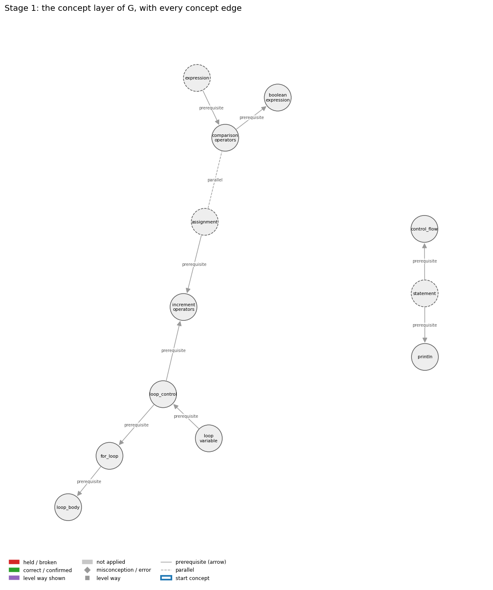
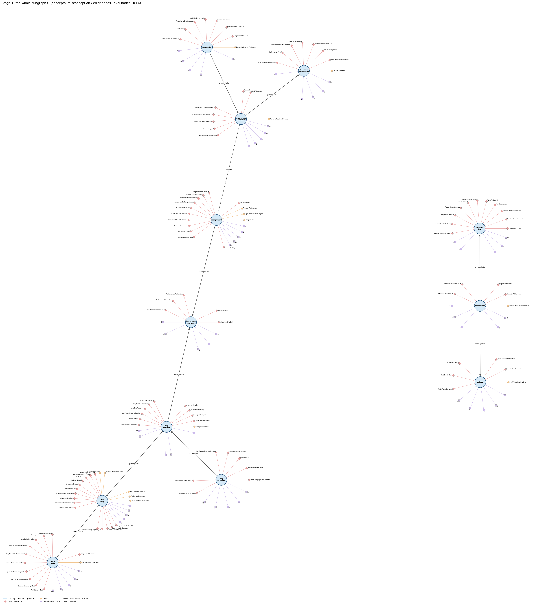
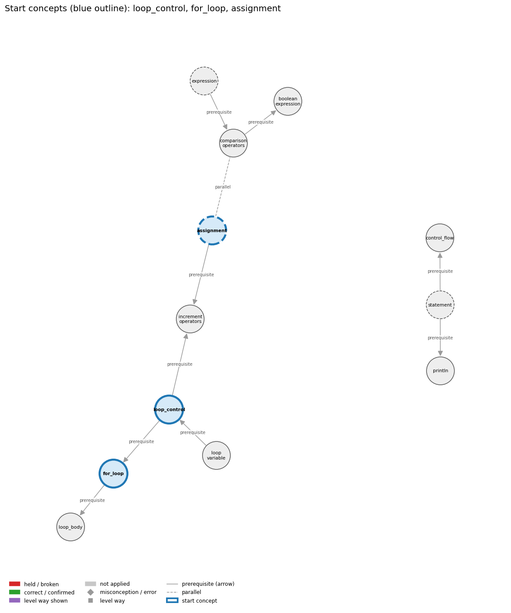
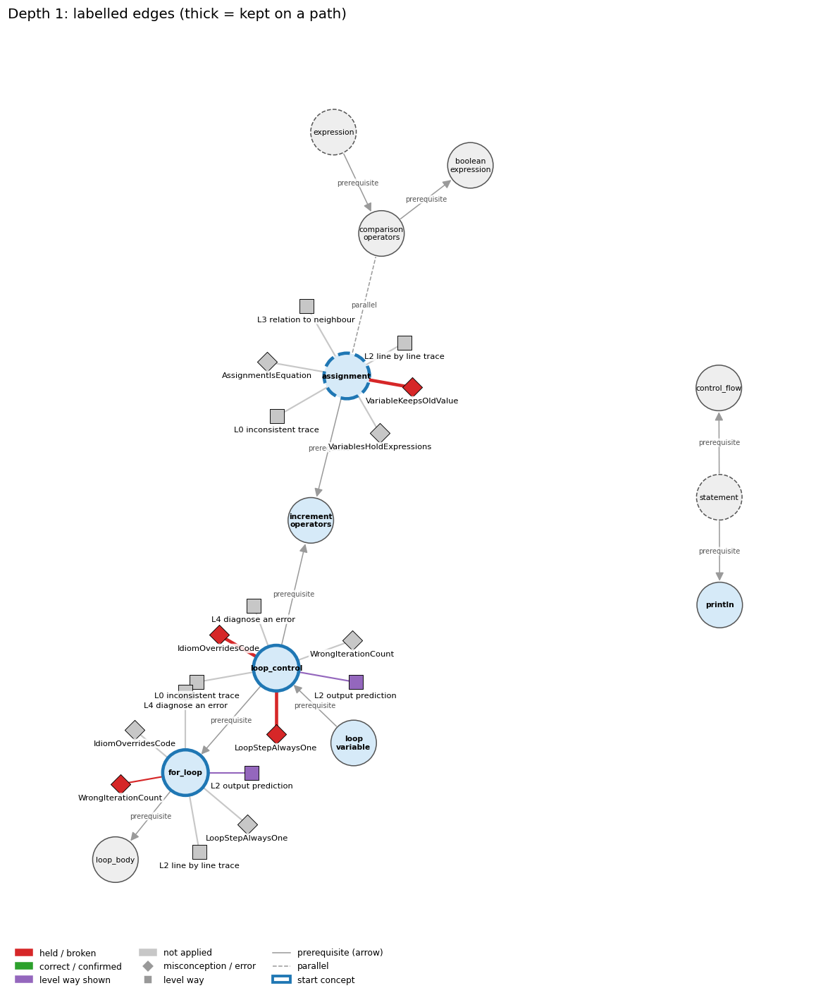
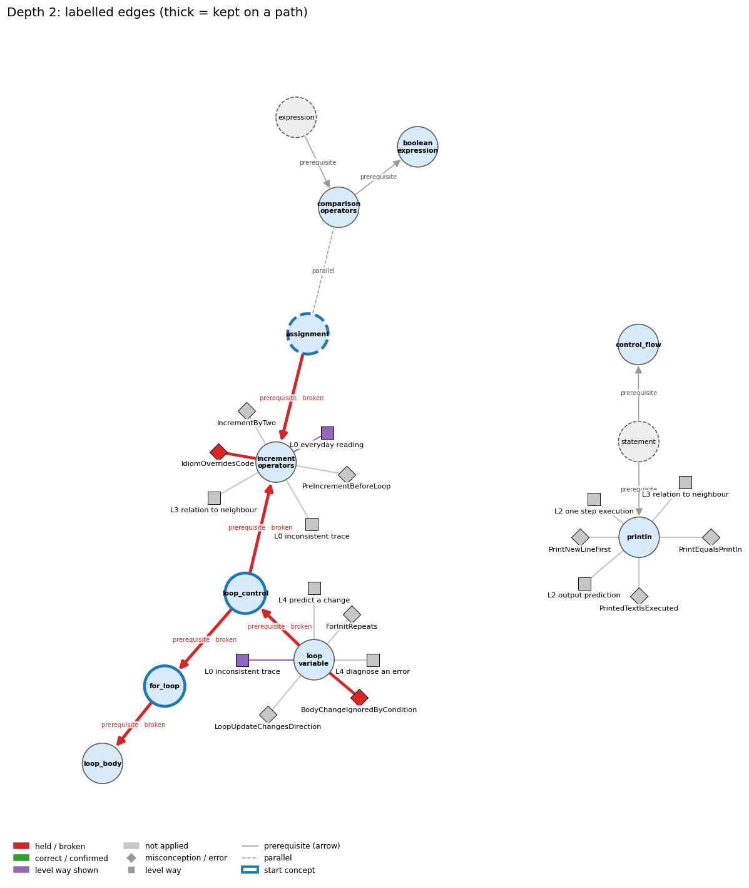
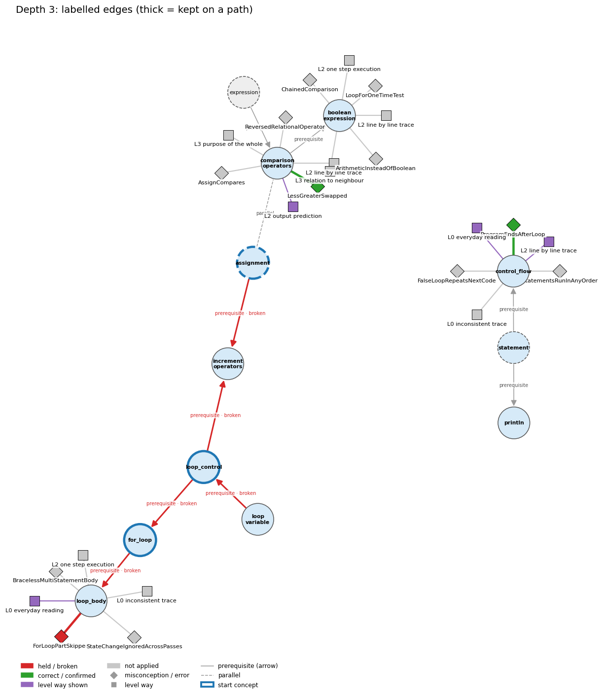
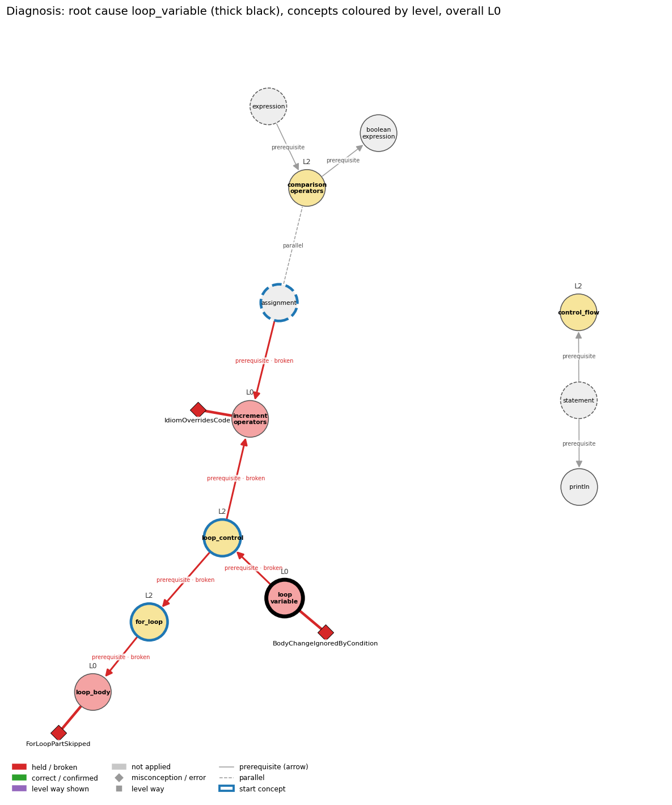

# Think on the Graph: every output of the run LP04

Files of this scenario: `input.json` (program, question, answer), `diagnosis.json`, `subgraph.json`, `traverse_log.txt`, `report.html` (this report as one full-page file, with the interactive graph `LP04_G.html`), `LP04.ipynb` (this report as a notebook).

## Level classification

This scenario tests **L0: misconception**. How the overall level is decided is explained in the [folder README](../../README.md).

- **Overall level: L0** (decided by: held mistake)
- **Shares of the components:** L0 0.43, L2 0.57; LOW coherence
- **Mistake held (root cause):** loop_variable / BodyChangeIgnoredByCondition
- **Expected by design:** overall L0; components `loop_variable` L0; held BodyChangeIgnoredByCondition; root loop_variable
- **Overall level matches the expected one:** yes

| Component | Level | Decided by | Student's words |
|---|---|---|---|
| `comparison_operators` | L2 | way: output prediction | The loop runs for i = 1, 2, 3, 4 and stops when i reaches 5 |
| `control_flow` | L2 | way: line by line trace | The loop runs for i = 1, 2, 3, 4 and stops when i reaches 5 |
| `for_loop` | L2 | way: output prediction | i is 5; The loop runs for i = 1, 2, 3, 4 and stops when i reaches 5; the i++ in the body does not affect the count |
| `increment_operators` | L0 | holds IdiomOverridesCode | The loop runs for i = 1, 2, 3, 4 and stops when i reaches 5; the i++ in the body does not affect the count |
| `loop_body` | L0 | holds ForLoopPartSkipped | The loop runs for i = 1, 2, 3, 4 and stops when i reaches 5; the i++ in the body does not affect the count |
| `loop_control` | L2 | way: output prediction | The loop runs for i = 1, 2, 3, 4 and stops when i reaches 5 |
| `loop_variable` | L0 | holds BodyChangeIgnoredByCondition | The loop runs for i = 1, 2, 3, 4 and stops when i reaches 5; the i++ in the body does not affect the count |

## 0. Input
Program:
```java
int i, n = 5;
for (i = 1; i < n; i++)
    i++;
    System.out.println(i);
System.out.println(i);
```
Question: What is the value of i when the second println runs? Explain how i gets that value.

Student's answer: i is 5. The loop runs for i = 1, 2, 3, 4 and stops when i reaches 5; the i++ in the body does not affect the count.
Settings: width 3, depth 3, prune llm, backend claude-cli, model claude-opus-5-5
## 1. Stage 1: the subgraph G from the code (no model)
Masked code (string and char literals and comments blanked; this is what the patterns see):
```
int i, n = 5;
for (i = 1; i < n; i++)
    i++;
    System.out.println(i);
System.out.println(i);
```
Which code text tagged which concept (a generic concept fires on almost any Java line; it starts the walk only if the answer repeats its tag):
| concept | generic | channel | matched text | line |
|---|---|---|---|---|
| assignment | True | pattern | '=' | 1 |
| boolean_expression | False | pattern | 'for (i = 1; i < n;' | 2 |
| comparison_operators | False | pattern | 'for (i = 1; i <' | 2 |
| control_flow | False | pattern | 'for (' | 2 |
| expression | True | pattern | 'i <' | 2 |
| expression | True | pattern | '= 5;' | 1 |
| for_loop | False | pattern | 'for (' | 2 |
| increment_operators | False | pattern | '++' | 2 |
| loop_body | False | pattern | 'for (' | 2 |
| loop_control | False | signal | 'for (i = 1; i < n; i++)' | 2 |
| loop_variable | False | pattern | 'for (i =' | 2 |
| println | False | pattern | 'System.out.println(' | 4 |
| statement | True | pattern | ';' | 1 |

G: 12 concept nodes (3 generic), 10 concept edges, 116 misconception / error edges, 84 misconception / error nodes, 60 level nodes, 120 level-misconception links, 2 connected piece(s).
Note: concept nodes form 2 pieces (the KG has no edge between them): assignment,boolean_expression,comparison_operators,expression,for_loop,increment_operators,loop_body,loop_control,loop_variable | control_flow,println,statement

Concept edges of G (the links the walk can read; `pre:` = prerequisite A -> B, `par:` = parallel):
| edge | type | rule (logic) |
|---|---|---|
| par:assignment~comparison_operators | parallel | x = y stores the value of y in x (a statement with a side effect); x == y only tests whether the two values are equal and gives a boolean. Writing = where == is meant is a compile error with int operands and a silent bug with boolean operands. |
| pre:assignment->increment_operators | prerequisite | i++ is shorthand for the assignment i = i + 1. |
| pre:comparison_operators->boolean_expression | prerequisite | A comparison such as x < y produces a boolean result; comparisons together with boolean logic provide the basis for decision-making. |
| pre:expression->comparison_operators | prerequisite | Comparison operators build expressions whose value is a boolean, so one must already know what an expression is to understand a < b. |
| pre:for_loop->loop_body | prerequisite | The statements in braces after the for header are the loop body; they run once on every pass, between the test and the increment, exactly as in a while loop. |
| pre:loop_control->for_loop | prerequisite | The for header is exactly the three control slots, and the body runs after the test and before the update on each pass. |
| pre:loop_control->increment_operators | prerequisite | The loop update i = i + 1 comes first; ++ (and +=) are then introduced as shorthand for that update. |
| pre:loop_variable->loop_control | prerequisite | The init, condition and update all act on the loop variable: the init sets it, the condition tests it, the update changes it. |
| pre:statement->control_flow | prerequisite | Control flow is the order in which statements run. |
| pre:statement->println | prerequisite | System.out.println(s); is itself a statement, so its line of output appears at its own place in the sequence. |

Misconception / error edges per concept (count), and level ways per concept (count):
| concept | misconception / error edges | level ways (L1-L4 + L0 non-misconception) |
|---|---|---|
| assignment | 15 | 24 |
| boolean_expression | 8 | 19 |
| comparison_operators | 8 | 20 |
| control_flow | 11 | 15 |
| expression | 8 | 19 |
| for_loop | 20 | 24 |
| increment_operators | 5 | 16 |
| loop_body | 12 | 14 |
| loop_control | 11 | 19 |
| loop_variable | 7 | 13 |
| println | 6 | 17 |
| statement | 5 | 19 |

**Figure 1**


**Figure 2**


## 2. Clauses and start concepts (no model)
The answer split into clauses (at sentence ends, ';', and before 'because' / 'so'; quotes removed):
| clause | text |
|---|---|
| c1 | i is 5 |
| c2 | The loop runs for i = 1, 2, 3, 4 and stops when i reaches 5 |
| c3 | the i++ in the body does not affect the count |

start: generic concepts whose tagging text occurs in the answer: assignment, statement

start: BM25 of the answer against each tagged concept: loop_control 23.93 (hits 1), for_loop 21.80 (hits 1), assignment 19.30 (hits 1), increment_operators 18.64 (hits 1), loop_variable 16.40 (hits 1), loop_body 11.91 (hits 1), control_flow 9.41 (hits 1), println 8.02 (hits 1), statement 5.89 (hits 1), boolean_expression 3.94 (hits 1), comparison_operators 3.90 (hits 1)

start: chosen loop_control, for_loop, assignment

start concepts (3): loop_control, for_loop, assignment

Start concepts: loop_control, for_loop, assignment

**Figure 3**


## 3. The walk, depth by depth
At each depth, for each current concept: the edges offered (a concept entering as a start concept offers its misconception / error edges and its level ways, as two families; otherwise it offers its concept edges), the prune prompt and the model's reply, then the label prompt(s) and the model's reply, parsed into label / clauses / confidence. Score = prune score x confidence.

### Depth 1: current concepts 'loop_control', 'for_loop', 'assignment'

#### loop_control, misconceptions: 11 edges offered
Edges offered:
| edge |
|---|
| err:loop_control->WrongIterationCount \| wrong rule: Updates the loop counter so that the loop runs the wrong number of times. \| right rule: The init, test and update together decide the number of passes; trace them to check the count. |
| mis:loop_control->DoubleLoopIndexCount \| wrong rule: for (double x = 0.0; x <= 1.0; x += 0.1) runs exactly 11 times. \| right rule: Using a double as a for-loop index is legal but bad practice: the number of iterations depends on an equality test between double values, which may not give the result you expect. |
| mis:loop_control->ForLoopPartSkipped \| wrong rule: A pass of a loop may leave out one of its parts (the condition test, the body, the update, or the initialization). \| right rule: Each pass of a for loop runs test, then body, then update, every time; the initialization runs once, at the start. |
| mis:loop_control->ForUpdateBeforeBody \| wrong rule: The update part of a for header (e.g. i = i - 4) runs before the body on each pass, so the first pass already sees the updated value. \| right rule: The update runs after the body, before the next condition test; the first pass uses the initial value. |
| mis:loop_control->IdiomOverridesCode \| wrong rule: An array loop processes the whole array from index 0 to length-1 and increments its index at the end of the body, whatever the code says. \| right rule: The loop visits exactly the indices that its initialisation, guard and update produce, in the order in which its statements are written. |
| mis:loop_control->InfiniteLoopUnnoticed \| wrong rule: A while loop always stops on its own, even if nothing in its body can make the condition false. \| right rule: A while loop stops only when its condition is false at a check, so if no pass changes the variables in the condition, it never stops. |
| mis:loop_control->LoopHeaderIsEquations \| wrong rule: The initialization, condition and update of a for header are equations that all hold at the same time. \| right rule: The three header parts are statements run at different moments: init once, then condition test, body, update, repeated. |
| mis:loop_control->LoopStepAlwaysOne \| wrong rule: A loop variable always goes up or down by 1, whatever the update says (so i = i - 4 is read as i--). \| right rule: The loop variable changes exactly as the update expression says (i += 2, i = i - 4, i *= 2, ...). |
| mis:loop_control->LoopUpdateChangesDirection \| wrong rule: The update of the loop variable can change from pass to pass (e.g. switch direction) although the code is the same. \| right rule: The update expression is the same on every pass; the loop variable changes by the rule written in the update. |
| mis:loop_control->OffByOneBound \| wrong rule: i < n and i <= n mean the same, so the loop runs until i equals n and the last pass can use a[n]. \| right rule: for (i = 0; i < n; i++) runs n times with i going up to n - 1; with <= it runs n + 1 times and reaches i = n. |
| mis:loop_control->PreIncrementBeforeLoop \| wrong rule: With ++i in the update of for (int i = s; i < n; ++i), i is increased before the body runs, so the first pass uses s + 1. \| right rule: The update runs after each pass of the body, so with either ++i or i++ the first pass uses i = s. |

Prune: the model's reply (edge id and score; the kept edges sum to 1):
```
mis:loop_control->IdiomOverridesCode (0.45), err:loop_control->WrongIterationCount (0.35), mis:loop_control->LoopStepAlwaysOne (0.20)
```
Kept by pruning: mis:loop_control->IdiomOverridesCode (0.45), err:loop_control->WrongIterationCount (0.35), mis:loop_control->LoopStepAlwaysOne (0.20)

Label prompt for the misconception / error edges (judged together). The model saw the program, the question, the numbered clauses, and these edges with their wrong rule and right rule:
| edge |
|---|
| mis:loop_control->IdiomOverridesCode \| wrong rule: An array loop processes the whole array from index 0 to length-1 and increments its index at the end of the body, whatever the code says. \| right rule: The loop visits exactly the indices that its initialisation, guard and update produce, in the order in which its statements are written. |
| err:loop_control->WrongIterationCount \| wrong rule: Updates the loop counter so that the loop runs the wrong number of times. \| right rule: The init, test and update together decide the number of passes; trace them to check the count. |
| mis:loop_control->LoopStepAlwaysOne \| wrong rule: A loop variable always goes up or down by 1, whatever the update says (so i = i - 4 is read as i--). \| right rule: The loop variable changes exactly as the update expression says (i += 2, i = i - 4, i *= 2, ...). |
Model's reply:
```
mis:loop_control->IdiomOverridesCode | held | clauses: 2, 3 | confidence: 0.6
err:loop_control->WrongIterationCount | not applied | clauses: none | confidence: 0.6
mis:loop_control->LoopStepAlwaysOne | held | clauses: 2, 3 | confidence: 0.55
```

Parsed labels:
| edge | label | prune score | confidence | score | clauses | words |
|---|---|---|---|---|---|---|
| mis:loop_control->IdiomOverridesCode | held | 0.45 | 0.6 | 0.27 | c2, c3 | The loop runs for i = 1, 2, 3, 4 and stops when i reaches 5; the i++ in the body does not affect the count |
| err:loop_control->WrongIterationCount | not applied |  |  | 0.0 |  |  |
| mis:loop_control->LoopStepAlwaysOne | held | 0.2 | 0.55 | 0.11 | c2, c3 | The loop runs for i = 1, 2, 3, 4 and stops when i reaches 5; the i++ in the body does not affect the count |

#### loop_control, level ways: 19 edges offered
Edges offered:
| edge |
|---|
| lvl:loop_control@L0#0 \| level L0 way everyday_reading: Folk meaning: in mathematics i = 0, i < n and i = i + 1 are equations or constraints that hold at the same time (and i = i + 1 is nonsense). In Java they are three actions run at different moments: init once, test before each pass, update after each pass. |
| lvl:loop_control@L0#3 \| level L0 way inconsistent_trace: Applies the init-test-update rule (LT) unevenly: updates before the body on some passes, skips the test or the update on a pass, or re-runs the init. (here mixing in: "++i in the for-update runs before the body each pass") |
| lvl:loop_control@L1#0 \| level L1 way names_the_element: Loop control is the init / continuation condition / increment scheme on an index variable that decides how many passes a loop makes and with which values. |
| lvl:loop_control@L1#1 \| level L1 way states_the_rule: Initialize an index variable, test a loop-continuation condition on it before each pass, and increment it as the last action of each pass; for (<initialize>; <boolean expression>; <increment>) packages the three. Choosing the loop: for when the passes are counted by an index, while when the loop runs until a condition changes, do-while when the body must run at least once; any one can be rewritten as another, so choose the clearest. |
| lvl:loop_control@L2#0 \| level L2 way line_by_line_trace: init (once) -> test -> body -> update -> test -> body -> update ... -> test false -> exit. |
| lvl:loop_control@L2#1 \| level L2 way output_prediction: The number of passes and the values seen follow from the three parts: for (int i = 0; i <= N; i++) makes N+1 passes with i = 0..N; with i < N it makes N passes; i += 2 visits every second value. |
| lvl:loop_control@L2#2 \| level L2 way one_step_execution: One update changes only the loop variable, by exactly the rule written (i++ adds 1, i = i - 4 subtracts 4); one test reads it and returns true or false without changing it. |
| lvl:loop_control@L3#0 \| level L3 way relation_to_neighbour: All three control parts act on the loop variable: the init sets it, the condition tests it, the update changes it. |
| lvl:loop_control@L3#1 \| level L3 way relation_to_neighbour: The for header is exactly the three control slots, separated by semicolons; the body runs after the test and before the update. |
| lvl:loop_control@L3#2 \| level L3 way relation_to_neighbour: The update i = i + 1 is usually written i++ (or i += k for other steps); as a whole update statement ++i and i++ are equivalent. |
| lvl:loop_control@L3#3 \| level L3 way relation_to_neighbour: A loop is infinite when the update never moves the variable toward making the condition false (e.g. condition i > 3 with update i = i + 1). |
| lvl:loop_control@L3#4 \| level L3 way relation_to_neighbour: The continuation condition fixes the number of iterations, so a sharper bound (i <= n/i instead of i < n) can make a program dramatically faster. |
| lvl:loop_control@L3#5 \| level L3 way relation_to_neighbour: The initialization and the condition of a loop fix how many times it runs; one wrong bound makes it run once too many or too few. |
| lvl:loop_control@L3#6 \| level L3 way purpose_of_the_whole: Plan: counter-controlled loop - the loop variable is a stepper that walks a predictable sequence of values (0..N-1, 1..N, every 2nd value) and fixes the number of passes in advance. |
| lvl:loop_control@L4#0 \| level L4 way predict_a_change: Changing < to <= adds one pass; starting at 1 instead of 0 removes one; doubling the step halves the passes; reversing init and bound with i-- visits the same values in reverse order (and still processes the same set only if both ends are adjusted). |
| lvl:loop_control@L4#1 \| level L4 way diagnose_an_error: rule broken: The number of passes is fixed by the init, the test and the update together. Kind: silent logic error. Trigger class: Wrong start value, < vs <=, a wrong step, or an extra update of the counter in the body (or outside the loop): the loop runs too few or too many passes (off by one, or skips values). |
| lvl:loop_control@L4#2 \| level L4 way transfer_to_a_new_program: Use explicit init/test/update control when the passes are counted or follow a fixed step; when the number of passes depends on data computed in the body, control the loop by that data (a while condition) instead. |
| lvl:loop_control@L4#3 \| level L4 way diagnose_an_error: rule broken: The update must move the loop variable toward making the condition false. Kind: silent logic error. Trigger class: An update in the wrong direction or a condition that the update cannot falsify (e.g. i > 3 with i++, or i != 10 with i += 3): infinite loop. |
| lvl:loop_control@L4#4 \| level L4 way diagnose_an_error: rule broken: Do not control a loop by an equality test on double values. Kind: silent logic error. Trigger class: for (double x = 0.0; x < 1.0; x += 0.1): after ten additions x is 0.9999999999999999, so the loop makes 11 passes instead of the intended 10. |

Prune: the model's reply (edge id and score; the kept edges sum to 1):
```
{lvl:loop_control@L0#3 (Score: 0.5)}
{lvl:loop_control@L4#1 (Score: 0.3)}
{lvl:loop_control@L2#1 (Score: 0.2)}
```
Kept by pruning: lvl:loop_control@L0#3 (0.50), lvl:loop_control@L4#1 (0.30), lvl:loop_control@L2#1 (0.20)

Label prompt for level way lvl:loop_control@L0#3 (the model saw only the concept, the way's name 'inconsistent trace' and its text; no level):
> Applies the init-test-update rule (LT) unevenly: updates before the body on some passes, skips the test or the update on a pass, or re-runs the init. (here mixing in: "++i in the for-update runs before the body each pass")

Model's reply:
```
Label: not shown
Clauses: none
Confidence: 0.7
```

Label prompt for level way lvl:loop_control@L4#1 (the model saw the concept, the way's name 'diagnose an error', its text, where the way stops and whether the words must be correct; no level):
> rule broken: The number of passes is fixed by the init, the test and the update together. Kind: silent logic error. Trigger class: Wrong start value, < vs <=, a wrong step, or an extra update of the counter in the body (or outside the loop): the loop runs too few or too many passes (off by one, or skips values).
>
> Where this way stops: Locating and fixing the mistake for one given failing case is L3. A compiler-flagged slip fixed from the message is weak evidence.

Model's reply:
```
Label: wrong
Clauses: 2, 3
Confidence: 0.8
```

Label prompt for level way lvl:loop_control@L2#1 (the model saw only the concept, the way's name 'output prediction' and its text; no level):
> The number of passes and the values seen follow from the three parts: for (int i = 0; i <= N; i++) makes N+1 passes with i = 0..N; with i < N it makes N passes; i += 2 visits every second value.

Model's reply:
```
Label: shown
Clauses: 2
Confidence: 0.7
```

Parsed labels:
| edge | label | prune score | confidence | score | clauses | words |
|---|---|---|---|---|---|---|
| lvl:loop_control@L0#3 | not applied |  |  | 0.0 |  |  |

#### for_loop, misconceptions: 20 edges offered
Edges offered:
| edge |
|---|
| err:for_loop->BracelessMultiStatementBody \| wrong rule: Indenting several statements under an if or for makes them all part of its body, even without braces. \| right rule: Without braces only the first statement belongs to the if/for; the rest run once, after it. |
| err:for_loop->ForCommaSeparators \| wrong rule: Writes for (int i = 0, i < n, i++). \| right rule: The three parts of a for header are separated by semicolons; commas only separate several statements inside the init or the update part. |
| err:for_loop->SemicolonAfterIfHeader \| wrong rule: if (x > 0); System.out.println("positive"); prints only for positive x. \| right rule: The ; ends the if with an empty statement, so the next line always runs. |
| err:for_loop->SemicolonAfterLoopHeader \| wrong rule: Puts a ; right after for (...) or while (...). \| right rule: A ; right after the loop header is a null (empty) loop body, so the statements written after it are not repeated by the loop. |
| err:for_loop->WrongIterationCount \| wrong rule: Updates the loop counter so that the loop runs the wrong number of times. \| right rule: The init, test and update together decide the number of passes; trace them to check the count. |
| mis:for_loop->DoubleLoopIndexCount \| wrong rule: for (double x = 0.0; x <= 1.0; x += 0.1) runs exactly 11 times. \| right rule: Using a double as a for-loop index is legal but bad practice: the number of iterations depends on an equality test between double values, which may not give the result you expect. |
| mis:for_loop->FalseLoopRepeatsNextCode \| wrong rule: A loop is an iterative if-else: while the condition is true the body repeats, and when it is false the code after the loop repeats. \| right rule: Only the body is repeated; once the condition is false the code after the loop runs once. |
| mis:for_loop->ForInitRepeats \| wrong rule: The initialization of a for loop runs again after a pass of the body. \| right rule: The initialization runs exactly once, before the first condition test. |
| mis:for_loop->ForIsConditional \| wrong rule: The body of a for statement executes at most once. \| right rule: The body of a for statement runs once for every pass on which the condition is true, which can be many times. |
| mis:for_loop->ForLoopPartSkipped \| wrong rule: A pass of a loop may leave out one of its parts (the condition test, the body, the update, or the initialization). \| right rule: Each pass of a for loop runs test, then body, then update, every time; the initialization runs once, at the start. |
| mis:for_loop->ForUpdateBeforeBody \| wrong rule: The update part of a for header (e.g. i = i - 4) runs before the body on each pass, so the first pass already sees the updated value. \| right rule: The update runs after the body, before the next condition test; the first pass uses the initial value. |
| mis:for_loop->ForWhileNotInterchangeable \| wrong rule: Some loops can only be written with for, others only with while. \| right rule: Any for loop can be rewritten as a while loop and vice versa; for just packages init, test and update. |
| mis:for_loop->IdiomOverridesCode \| wrong rule: An array loop processes the whole array from index 0 to length-1 and increments its index at the end of the body, whatever the code says. \| right rule: The loop visits exactly the indices that its initialisation, guard and update produce, in the order in which its statements are written. |
| mis:for_loop->LoopCountIsStatementCount \| wrong rule: The repeat count of a counted loop says how many of the body statements are executed. \| right rule: The repeat count is how many times the whole body runs; every pass runs all body statements. |
| mis:for_loop->LoopHeaderIsEquations \| wrong rule: The initialization, condition and update of a for header are equations that all hold at the same time. \| right rule: The three header parts are statements run at different moments: init once, then condition test, body, update, repeated. |
| mis:for_loop->LoopImpliedByOneTest \| wrong rule: Testing one case is enough; Java will repeat the test for the other values by itself. \| right rule: A statement runs once each time control reaches it; repeating a test for many values needs a loop. |
| mis:for_loop->LoopStepAlwaysOne \| wrong rule: A loop variable always goes up or down by 1, whatever the update says (so i = i - 4 is read as i--). \| right rule: The loop variable changes exactly as the update expression says (i += 2, i = i - 4, i *= 2, ...). |
| mis:for_loop->ProgramEndsAfterLoop \| wrong rule: When a loop finishes the program ends, so code after the loop never runs. \| right rule: When the loop condition becomes false, control continues with the first statement after the loop. |
| mis:for_loop->ReturnDoesNotExitLoop \| wrong rule: A return inside a loop does not end the loop; it sets a value each pass (the last one is returned) or returns several values. \| right rule: When return executes, the method ends at once, so the loop stops on that pass. |
| mis:for_loop->SingleIterationInsteadOfLoop \| wrong rule: A task that must be repeated is written once, without a loop, as if one pass were enough. \| right rule: A step that must happen several times (or an unknown number of times) needs a loop such as while or for; code without a loop runs once. |

Prune: the model's reply (edge id and score; the kept edges sum to 1):
```
mis:for_loop->IdiomOverridesCode (0.45), mis:for_loop->LoopStepAlwaysOne (0.30), err:for_loop->WrongIterationCount (0.25)
```
Kept by pruning: mis:for_loop->IdiomOverridesCode (0.45), mis:for_loop->LoopStepAlwaysOne (0.30), err:for_loop->WrongIterationCount (0.25)

Label prompt for the misconception / error edges (judged together). The model saw the program, the question, the numbered clauses, and these edges with their wrong rule and right rule:
| edge |
|---|
| mis:for_loop->IdiomOverridesCode \| wrong rule: An array loop processes the whole array from index 0 to length-1 and increments its index at the end of the body, whatever the code says. \| right rule: The loop visits exactly the indices that its initialisation, guard and update produce, in the order in which its statements are written. |
| mis:for_loop->LoopStepAlwaysOne \| wrong rule: A loop variable always goes up or down by 1, whatever the update says (so i = i - 4 is read as i--). \| right rule: The loop variable changes exactly as the update expression says (i += 2, i = i - 4, i *= 2, ...). |
| err:for_loop->WrongIterationCount \| wrong rule: Updates the loop counter so that the loop runs the wrong number of times. \| right rule: The init, test and update together decide the number of passes; trace them to check the count. |
Model's reply:
```
mis:for_loop->IdiomOverridesCode | not applied | clauses: none | confidence: 0.75
mis:for_loop->LoopStepAlwaysOne | not applied | clauses: none | confidence: 0.6
err:for_loop->WrongIterationCount | held | clauses: 2, 3 | confidence: 0.85
```

Parsed labels:
| edge | label | prune score | confidence | score | clauses | words |
|---|---|---|---|---|---|---|
| mis:for_loop->IdiomOverridesCode | not applied |  |  | 0.0 |  |  |
| mis:for_loop->LoopStepAlwaysOne | not applied |  |  | 0.0 |  |  |
| err:for_loop->WrongIterationCount | held | 0.25 | 0.85 | 0.21 | c2, c3 | The loop runs for i = 1, 2, 3, 4 and stops when i reaches 5; the i++ in the body does not affect the count |

#### for_loop, level ways: 24 edges offered
Edges offered:
| edge |
|---|
| lvl:for_loop@L0#0 \| level L0 way everyday_reading: Folk meaning: English 'for each ...' or 'for 10 times' names a whole collection or a count to be handled at once, and a maths reading treats the header as simultaneous conditions. A Java for is a while loop in compact form: one init, then test-body-update repeated, one pass at a time. |
| lvl:for_loop@L0#11 \| level L0 way inconsistent_trace: Applies the for sequencing rule (LT) unevenly: updates before the body on the first pass only, re-runs the init after a pass, or skips the test on some passes. (here mixing in: "The body of a for statement executes at most once") |
| lvl:for_loop@L1#0 \| level L1 way names_the_element: The for statement is a loop that packages an initialization, a loop-continuation condition and an increment in its header around a body. |
| lvl:for_loop@L1#1 \| level L1 way states_the_rule: Syntax: for (<initialize>; <boolean expression>; <increment>) { <statements> }, with the three parts separated by semicolons; it is, with only a few exceptions, equivalent to <initialize>; while (<boolean expression>) { <statements> <increment>; }. |
| lvl:for_loop@L2#0 \| level L2 way line_by_line_trace: Run the initializer once; then repeatedly: test the condition (stop if false), execute the body, run the update. |
| lvl:for_loop@L2#1 \| level L2 way output_prediction: A for statement has no value; the passes it makes are fixed by its header: for (int i = 1; i <= N; i++) sum += i; leaves sum = N(N+1)/2, and for (int i = 2; i <= 8; i += 2) prints 2, 4, 6, 8,. |
| lvl:for_loop@L2#2 \| level L2 way one_step_execution: One pass: the test reads the loop variable; the body applies its changes once; the update then changes the loop variable by its rule; the initializer changes state only once, before the first test. |
| lvl:for_loop@L3#0 \| level L3 way relation_to_neighbour: The for header is exactly the three loop-control slots; the body runs after the test and before the update on each pass. |
| lvl:for_loop@L3#1 \| level L3 way relation_to_neighbour: A for may be the body of another for: the inner for runs its complete set of passes for every single pass of the outer one. |
| lvl:for_loop@L3#2 \| level L3 way relation_to_neighbour: for (int i = 0; i < N; i++) gives i each valid index 0..N-1 exactly once in increasing order, the standard way to process every array element. |
| lvl:for_loop@L3#3 \| level L3 way relation_to_neighbour: A simulation runs a fixed number of trials with an outer for loop (for (int t = 0; t < T; t++)), each trial simulated inside the body. |
| lvl:for_loop@L3#4 \| level L3 way relation_to_neighbour: In a for loop, continue skips the rest of the body and transfers control directly to the increment, then the next test; this is one of the few places where the for/while equivalence fails. |
| lvl:for_loop@L3#5 \| level L3 way relation_to_neighbour: A variable declared in the for header is in scope only in the header and the body, so it cannot be used after the loop. |
| lvl:for_loop@L3#6 \| level L3 way relation_to_neighbour: A fencepost loop is a for loop that handles one item (the first or last) outside the loop so that separators come out n-1 times for n items. |
| lvl:for_loop@L3#7 \| level L3 way relation_to_neighbour: A flag search loop is a for loop that sets a boolean flag when some pass finds the target and leaves it set afterwards; the flag must be declared before the loop. |
| lvl:for_loop@L3#8 \| level L3 way purpose_of_the_whole: Plan: counted loop / counter-controlled repetition - do the body a known number of times, with the loop variable as a stepper (index, term number, trial number). |
| lvl:for_loop@L4#0 \| level L4 way predict_a_change: Rewriting a for as the equivalent while (init before, update at the end of the body) keeps behaviour, except that continue then skips the update and the loop variable stays in scope after the loop. Changing the bound or the step changes the pass count predictably (< to <= adds one pass). |
| lvl:for_loop@L4#1 \| level L4 way diagnose_an_error: rule broken: The three parts of a for header are separated by semicolons; commas only separate several statements inside the init or the update. Kind: compile-time. Trigger class: Writing for (int i = 0, i < n, i++): the compiler parses the commas as more declarators in the init and reports a syntax error. |
| lvl:for_loop@L4#2 \| level L4 way diagnose_an_error: rule broken: A ; right after while (...) or for (...) is an empty statement that is the whole loop body; the block written next is not repeated. Kind: silent logic error. Trigger class: for (...); { body } runs the body once after the loop ends; while (cond); with a cond that the empty body cannot change hangs forever (infinite loop) when cond starts true. |
| lvl:for_loop@L4#3 \| level L4 way transfer_to_a_new_program: Use for when there is an initialization, an increment and a continuation test and the loop variable is not needed after the loop; use while when the loop variable is needed later or the number of passes depends on what happens in the body. |
| lvl:for_loop@L4#4 \| level L4 way diagnose_an_error: rule broken: A ; right after if (...) is an empty statement that forms the whole then branch; the following statement or block is no longer part of the if. Kind: silent logic error. Trigger class: Any if (cond); followed by a statement or block: that statement runs for every input, whatever cond is (it compiles without error). |
| lvl:for_loop@L4#5 \| level L4 way diagnose_an_error: rule broken: The number of passes is fixed by the init, the test and the update together. Kind: silent logic error. Trigger class: Wrong start value, < vs <=, a wrong step, or an extra update of the counter in the body (or outside the loop): the loop runs too few or too many passes (off by one, or skips values). |
| lvl:for_loop@L4#6 \| level L4 way diagnose_an_error: rule broken: Without braces, the body of an if, while or for is exactly one statement; indentation does not add statements to it. Kind: silent logic error. Trigger class: A braceless header followed by two or more indented statements: only the first is controlled, the others run once, after the if/loop, on every input. |
| lvl:for_loop@L4#7 \| level L4 way diagnose_an_error: rule broken: A variable declared in the for initializer exists only inside the for statement. Kind: compile-time. Trigger class: Reading i after for (int i = 0; ...) {...}: 'cannot find symbol'. |

Prune: the model's reply (edge id and score; the kept edges sum to 1):
```
{lvl:for_loop@L4#5 (Score: 0.5)}
{lvl:for_loop@L2#1 (Score: 0.3)}
{lvl:for_loop@L2#0 (Score: 0.2)}
```
Kept by pruning: lvl:for_loop@L4#5 (0.50), lvl:for_loop@L2#1 (0.30), lvl:for_loop@L2#0 (0.20)

Label prompt for level way lvl:for_loop@L4#5 (the model saw the concept, the way's name 'diagnose an error', its text, where the way stops and whether the words must be correct; no level):
> rule broken: The number of passes is fixed by the init, the test and the update together. Kind: silent logic error. Trigger class: Wrong start value, < vs <=, a wrong step, or an extra update of the counter in the body (or outside the loop): the loop runs too few or too many passes (off by one, or skips values).
>
> Where this way stops: Locating and fixing the mistake for one given failing case is L3. A compiler-flagged slip fixed from the message is weak evidence.

Model's reply:
```
Label: wrong
Clauses: 2, 3
Confidence: 0.8
```

Label prompt for level way lvl:for_loop@L2#1 (the model saw only the concept, the way's name 'output prediction' and its text; no level):
> A for statement has no value; the passes it makes are fixed by its header: for (int i = 1; i <= N; i++) sum += i; leaves sum = N(N+1)/2, and for (int i = 2; i <= 8; i += 2) prints 2, 4, 6, 8,.

Model's reply:
```
Label: shown
Clauses: 1, 2, 3
Confidence: 0.6
```

Label prompt for level way lvl:for_loop@L2#0 (the model saw only the concept, the way's name 'line by line trace' and its text; no level):
> Run the initializer once; then repeatedly: test the condition (stop if false), execute the body, run the update.

Model's reply:
```
Label: not shown
Clauses: none
Confidence: 0.7
```

Parsed labels:
(none)

#### assignment, misconceptions: 15 edges offered
Edges offered:
| edge |
|---|
| err:assignment->AssignToFinal \| wrong rule: Assigns a new value to a variable declared final. \| right rule: A final variable cannot be reassigned after it is initialized; the compiler reports an error. |
| err:assignment->ExpressionOnLeftOfAssignment \| wrong rule: Writes a + b = c; or 7 = a; as if = were a math equation. \| right rule: The left side of an assignment must be a single variable; only the right side can be an expression. |
| err:assignment->RedeclareToReassign \| wrong rule: Writes int x = 5; ... int x = 10; to change x. \| right rule: A declaration gives a variable its name and type; a later change of value is an assignment statement such as x = 10;, not a second declaration. |
| mis:assignment->AssignCompares \| wrong rule: x = y checks whether x and y are equal. \| right rule: x = y copies the value of y into x; x == y is what compares them. |
| mis:assignment->AssignmentAddsToTarget \| wrong rule: a = b adds the value of b to the value already in a (the accumulator model). \| right rule: a = b replaces the old value of a with the value of b; the old value is lost. |
| mis:assignment->AssignmentCopiesObject \| wrong rule: b = a; for an array makes b a separate copy, so changing b[i] leaves a[i] unchanged. \| right rule: b = a; copies only the reference, so a and b refer to the same array and b[i] = v also changes a[i]. |
| mis:assignment->AssignmentEmptiesSource \| wrong rule: After b = a, a no longer holds a value, as if the value had been moved. \| right rule: Assignment copies; the variable on the right keeps its value. |
| mis:assignment->AssignmentExchangesValues \| wrong rule: b = a exchanges the values of a and b. \| right rule: b = a copies a into b and leaves a unchanged; an exchange needs a temporary variable and three assignments. |
| mis:assignment->AssignmentIsEquation \| wrong rule: An assignment states a lasting equality between its two sides, so y = x - y can be solved like the equation x = 2y and x = x + 5 relates two equal quantities. \| right rule: An assignment is a one-time action: evaluate the right side with current values, then store the result in the left variable. |
| mis:assignment->AssignmentNotExpression \| wrong rule: An assignment cannot be used inside a larger expression, so a condition like (x = read()) != v is not allowed. \| right rule: An assignment is an expression whose value is the value assigned, so (x = v) both stores v in x and gives v. |
| mis:assignment->AssignmentOppositeDirection \| wrong rule: a = b copies the value of a into b. \| right rule: Assignment stores the value of the right side into the variable on the left. |
| mis:assignment->PrintedTextIsExecuted \| wrong rule: System.out.println("x is 5"); sets x to 5 (text inside the quotes is run as code). \| right rule: Characters inside double quotes are printed literally; println only displays them and changes no variable. Only an assignment such as x = 5; sets x. |
| mis:assignment->SwapWithoutTemp \| wrong rule: a[i] = a[j]; a[j] = a[i]; exchanges the two values. \| right rule: A temporary variable must save a[i] before it is overwritten. |
| mis:assignment->VariableKeepsOldValue \| wrong rule: A variable keeps its first value after a new assignment (the static model). \| right rule: Each assignment or read replaces the variable's current value. |
| mis:assignment->VariablesHoldExpressions \| wrong rule: y = x + k; makes y always equal to x + k, so when x changes later, y changes too. \| right rule: y = x + k; stores the value that x + k has at that moment, so later changes to x do not change y. |

Prune: the model's reply (edge id and score; the kept edges sum to 1):
```
mis:assignment->VariableKeepsOldValue (0.70), mis:assignment->AssignmentIsEquation (0.15), mis:assignment->VariablesHoldExpressions (0.15)
```
Kept by pruning: mis:assignment->VariableKeepsOldValue (0.70), mis:assignment->AssignmentIsEquation (0.15), mis:assignment->VariablesHoldExpressions (0.15)

Label prompt for the misconception / error edges (judged together). The model saw the program, the question, the numbered clauses, and these edges with their wrong rule and right rule:
| edge |
|---|
| mis:assignment->VariableKeepsOldValue \| wrong rule: A variable keeps its first value after a new assignment (the static model). \| right rule: Each assignment or read replaces the variable's current value. |
| mis:assignment->AssignmentIsEquation \| wrong rule: An assignment states a lasting equality between its two sides, so y = x - y can be solved like the equation x = 2y and x = x + 5 relates two equal quantities. \| right rule: An assignment is a one-time action: evaluate the right side with current values, then store the result in the left variable. |
| mis:assignment->VariablesHoldExpressions \| wrong rule: y = x + k; makes y always equal to x + k, so when x changes later, y changes too. \| right rule: y = x + k; stores the value that x + k has at that moment, so later changes to x do not change y. |
Model's reply:
```
mis:assignment->VariableKeepsOldValue | held | clauses: 2, 3 | confidence: 0.55
mis:assignment->AssignmentIsEquation | not applied | clauses: none | confidence: 0.85
mis:assignment->VariablesHoldExpressions | not applied | clauses: none | confidence: 0.9
```

Parsed labels:
| edge | label | prune score | confidence | score | clauses | words |
|---|---|---|---|---|---|---|
| mis:assignment->VariableKeepsOldValue | held | 0.7 | 0.55 | 0.39 | c2, c3 | The loop runs for i = 1, 2, 3, 4 and stops when i reaches 5; the i++ in the body does not affect the count |
| mis:assignment->AssignmentIsEquation | not applied |  |  | 0.0 |  |  |
| mis:assignment->VariablesHoldExpressions | not applied |  |  | 0.0 |  |  |

#### assignment, level ways: 24 edges offered
Edges offered:
| edge |
|---|
| lvl:assignment@L0#0 \| level L0 way everyday_reading: In maths, = states a symmetric, lasting equality (a = b means b = a, and x = x + 5 is false). In Java, = is a one-time, directed action: evaluate the right side, then store the result in the variable on the left. |
| lvl:assignment@L0#9 \| level L0 way inconsistent_trace: Points to LT (evaluate the right side with current values, then overwrite the left variable). Applied unevenly, a student traces one segment correctly but reads the next as simultaneous equations or as a swap, giving 15 and 15 for one segment and 5 and 10 for the other. (here mixing in: "= stores the expression itself, not its computed value") |
| lvl:assignment@L1#0 \| level L1 way names_the_element: Assignment statement: the statement variable = expression; which stores a data-type value in a variable. |
| lvl:assignment@L1#1 \| level L1 way states_the_rule: The left-hand side must be a single variable. The right-hand side can be any expression whose type is compatible with the variable's type. = is not mathematical equality (a + b = b + a and 1 = a are illegal). |
| lvl:assignment@L2#0 \| level L2 way line_by_line_trace: First the right-hand side is fully evaluated using the variables' current values (left to right). Then that value is stored in the left-hand variable, replacing its old value, and execution moves to the next statement. |
| lvl:assignment@L2#1 \| level L2 way output_prediction: As a statement it prints nothing; its result is the new value of the left variable (after c = a + b; with a = 1234 and b = 99, c is 1333). Used as an expression, its value is the value assigned. |
| lvl:assignment@L2#2 \| level L2 way one_step_execution: Exactly one variable, the left one, changes, and its old value is lost. Variables on the right keep their values: x = x + 5; with x = 5 makes x 10. |
| lvl:assignment@L3#0 \| level L3 way relation_to_neighbour: The left side must be a declared variable whose type accepts the value. Assignment is how that variable's value changes. |
| lvl:assignment@L3#1 \| level L3 way relation_to_neighbour: A declaration can include the first assignment (int x = 5;). Assigning to a variable that was never declared does not compile. |
| lvl:assignment@L3#2 \| level L3 way relation_to_neighbour: Exchanging a[i] and a[j] takes three assignments in a fixed order through a temporary, because each assignment overwrites its target. |
| lvl:assignment@L3#3 \| level L3 way relation_to_neighbour: int t = a; a = b; b = t; works only in this order, because every assignment destroys its left variable's old value. |
| lvl:assignment@L3#4 \| level L3 way relation_to_neighbour: x op= e is shorthand for x = x op e. The left variable's current value is fetched first and then combined with e. |
| lvl:assignment@L3#5 \| level L3 way relation_to_neighbour: Because an assignment is an expression whose value is the value stored, and = groups right to left, a = b = 0 first stores 0 in b and then stores that 0 in a. |
| lvl:assignment@L3#6 \| level L3 way relation_to_neighbour: As a statement, i++ has the same effect as the assignment i = i + 1. |
| lvl:assignment@L3#7 \| level L3 way relation_to_neighbour: A trace records the value of each variable after each assignment runs, one row per statement. |
| lvl:assignment@L3#8 \| level L3 way relation_to_neighbour: x = y stores the value of y in x (a statement with a side effect); x == y only tests whether the two values are equal and gives a boolean. Writing = where == is meant is a compile error with int operands and a silent bug with boolean operands. |
| lvl:assignment@L3#9 \| level L3 way purpose_of_the_whole: Assignment gives a variable its value in each role: initialization, counter update (n = n + 1), gatherer update (sum = sum + x), most-wanted holder update (max = x), or temporary (t = a). |
| lvl:assignment@L4#0 \| level L4 way predict_a_change: Swapping the two sides (a = b versus b = a) changes which variable changes. Reordering assignments changes the final values. An assignment cannot be undone, because the old value is lost unless it was first saved in a temporary. |
| lvl:assignment@L4#1 \| level L4 way diagnose_an_error: rule broken: The left-hand side of = must be a single variable; only the right-hand side may be an arbitrary expression. Kind: compile-time. Trigger class: Any assignment whose left side is a literal or compound expression (7 = a; a + b = c;): 'unexpected type, required: variable'. |
| lvl:assignment@L4#2 \| level L4 way transfer_to_a_new_program: Use assignment whenever a variable's value must be set or updated. Use == to compare, final to forbid updates, and op= or ++ for x = x op e. |
| lvl:assignment@L4#3 \| level L4 way diagnose_an_error: rule broken: A local variable may be declared only once in its scope; later changes use an assignment without the type. Kind: compile-time. Trigger class: A second 'int x = ...' for a name already declared in the same or an enclosing block: 'variable x is already defined'. |
| lvl:assignment@L4#4 \| level L4 way diagnose_an_error: rule broken: A final variable is assigned exactly once; it cannot be reassigned after initialization. Kind: compile-time. Trigger class: Any assignment, ++ or op= to a final variable after its initialization: 'cannot assign a value to final variable'. |
| lvl:assignment@L4#5 \| level L4 way diagnose_an_error: rule broken: = assigns and == compares; a condition needs a boolean. Kind: compile-time. Trigger class: Writing if (a = b) with int a, b gives 'incompatible types: int cannot be converted to boolean'. With boolean variables it compiles and silently assigns. |
| lvl:assignment@L4#6 \| level L4 way diagnose_an_error: rule broken: The assigned value's type must fit the variable's type. Kind: compile-time. Trigger class: Assigning a double to an int, an int to a String, and so on: 'incompatible types'. |

Prune: the model's reply (edge id and score; the kept edges sum to 1):
```
{lvl:assignment@L3#6 (Score: 0.5)}
{lvl:assignment@L2#0 (Score: 0.25)}
{lvl:assignment@L0#9 (Score: 0.25)}
```
Kept by pruning: lvl:assignment@L3#6 (0.50), lvl:assignment@L2#0 (0.25), lvl:assignment@L0#9 (0.25)

Label prompt for level way lvl:assignment@L3#6 (the model saw the concept, the way's name 'relation to neighbour', its text, where the way stops and whether the words must be correct; no level):
> As a statement, i++ has the same effect as the assignment i = i + 1.
>
> Where this way stops: Two correct but separate rules are L1. Executing the two in sequence is L2. A relational answer may be correct or a relational error.

Model's reply:
```
Label: not shown
Clauses: none
Confidence: 0.6
```

Label prompt for level way lvl:assignment@L2#0 (the model saw only the concept, the way's name 'line by line trace' and its text; no level):
> First the right-hand side is fully evaluated using the variables' current values (left to right). Then that value is stored in the left-hand variable, replacing its old value, and execution moves to the next statement.

Model's reply:
```
Label: not shown
Clauses: none
Confidence: 0.7
```

Label prompt for level way lvl:assignment@L0#9 (the model saw only the concept, the way's name 'inconsistent trace' and its text; no level):
> Points to LT (evaluate the right side with current values, then overwrite the left variable). Applied unevenly, a student traces one segment correctly but reads the next as simultaneous equations or as a swap, giving 15 and 15 for one segment and 5 and 10 for the other. (here mixing in: "= stores the expression itself, not its computed value")

Model's reply:
```
Label: not shown
Clauses: none
Confidence: 0.9
```

Parsed labels:
| edge | label | prune score | confidence | score | clauses | words |
|---|---|---|---|---|---|---|
| lvl:assignment@L3#6 | not applied |  |  | 0.0 |  |  |
| lvl:assignment@L2#0 | not applied |  |  | 0.0 |  |  |
| lvl:assignment@L0#9 | not applied |  |  | 0.0 |  |  |

**Kept on a path at this depth** (best N in tiers: held misconception / broken edge, then held error, then correct / confirmed / shown):

mis:assignment->VariableKeepsOldValue [held, tier 0, 0.39], mis:loop_control->IdiomOverridesCode [held, tier 0, 0.27], mis:loop_control->LoopStepAlwaysOne [held, tier 0, 0.11]

**Clause coverage after this depth:**
| clause | text | covered by |
|---|---|---|
| c1 | i is 5 | not covered yet |
| c2 | The loop runs for i = 1, 2, 3, 4 and stops when i reaches 5 | mis:loop_control->IdiomOverridesCode |
| c3 | the i++ in the body does not affect the count | mis:loop_control->IdiomOverridesCode |

**Uncovered clauses bring in (BM25 of the uncovered clauses against unvisited concepts):** println (3.28), increment_operators (3.13), loop_variable (1.99)

**Graph check, not yet read (the walk may not stop while these remain):** own edges of increment_operators, own edges of loop_variable, own edges of println, par:assignment~comparison_operators, pre:assignment->increment_operators, pre:for_loop->loop_body, pre:loop_control->for_loop, pre:loop_control->increment_operators, pre:loop_variable->loop_control

**Figure 4 (the graph after depth 1)**


### Depth 2: current concepts 'assignment', 'loop_control', 'for_loop', 'println', 'increment_operators', 'loop_variable'

#### assignment, concept edges: 2 edges offered
Edges offered:
| edge |
|---|
| par:assignment~comparison_operators \| rule: x = y stores the value of y in x (a statement with a side effect); x == y only tests whether the two values are equal and gives a boolean. Writing = where == is meant is a compile error with int operands and a silent bug with boolean operands. |
| pre:assignment->increment_operators \| rule: i++ is shorthand for the assignment i = i + 1. |

Prune: the model's reply (edge id and score; the kept edges sum to 1):
```
{pre:assignment->increment_operators (Score: 0.85)}
{par:assignment~comparison_operators (Score: 0.15)}
```
Kept by pruning: pre:assignment->increment_operators (0.85), par:assignment~comparison_operators (0.15)

Label prompt for concept edge pre:assignment->increment_operators (assignment -> increment_operators, prerequisite):
> i++ is shorthand for the assignment i = i + 1.

Model's reply:
```
Label: broken
Clauses: 2, 3
Confidence: 0.85
```

Label prompt for concept edge par:assignment~comparison_operators (assignment -> comparison_operators, parallel):
> x = y stores the value of y in x (a statement with a side effect); x == y only tests whether the two values are equal and gives a boolean. Writing = where == is meant is a compile error with int operands and a silent bug with boolean operands.

Model's reply:
```
Label: not applied
Clauses: none
Confidence: 0.9
```

Parsed labels:
| edge | label | prune score | confidence | score | clauses | words |
|---|---|---|---|---|---|---|
| pre:assignment->increment_operators | broken | 0.85 | 0.85 | 0.72 | c2, c3 | The loop runs for i = 1, 2, 3, 4 and stops when i reaches 5; the i++ in the body does not affect the count |
| par:assignment~comparison_operators | not applied |  |  | 0.0 |  |  |

#### loop_control, concept edges: 3 edges offered
Edges offered:
| edge |
|---|
| pre:loop_control->for_loop \| rule: The for header is exactly the three control slots, and the body runs after the test and before the update on each pass. |
| pre:loop_control->increment_operators \| rule: The loop update i = i + 1 comes first; ++ (and +=) are then introduced as shorthand for that update. |
| pre:loop_variable->loop_control \| rule: The init, condition and update all act on the loop variable: the init sets it, the condition tests it, the update changes it. |

Prune: the model's reply (edge id and score; the kept edges sum to 1):
```
{pre:loop_control->for_loop (Score: 0.4)}
{pre:loop_variable->loop_control (Score: 0.35)}
{pre:loop_control->increment_operators (Score: 0.25)}
```
Kept by pruning: pre:loop_control->for_loop (0.40), pre:loop_variable->loop_control (0.35), pre:loop_control->increment_operators (0.25)

Label prompt for concept edge pre:loop_control->for_loop (loop_control -> for_loop, prerequisite):
> The for header is exactly the three control slots, and the body runs after the test and before the update on each pass.

Model's reply:
```
Label: broken
Clauses: 2, 3
Confidence: 0.85
```

Label prompt for concept edge pre:loop_variable->loop_control (loop_variable -> loop_control, prerequisite):
> The init, condition and update all act on the loop variable: the init sets it, the condition tests it, the update changes it.

Model's reply:
```
Label: broken
Clauses: 2, 3
Confidence: 0.75
```

Label prompt for concept edge pre:loop_control->increment_operators (loop_control -> increment_operators, prerequisite):
> The loop update i = i + 1 comes first; ++ (and +=) are then introduced as shorthand for that update.

Model's reply:
```
Label: broken
Clauses: 2, 3
Confidence: 0.8
```

Parsed labels:
| edge | label | prune score | confidence | score | clauses | words |
|---|---|---|---|---|---|---|
| pre:loop_control->for_loop | broken | 0.4 | 0.85 | 0.34 | c2, c3 | The loop runs for i = 1, 2, 3, 4 and stops when i reaches 5; the i++ in the body does not affect the count |
| pre:loop_variable->loop_control | broken | 0.35 | 0.75 | 0.26 | c2, c3 | The loop runs for i = 1, 2, 3, 4 and stops when i reaches 5; the i++ in the body does not affect the count |
| pre:loop_control->increment_operators | broken | 0.25 | 0.8 | 0.2 | c2, c3 | The loop runs for i = 1, 2, 3, 4 and stops when i reaches 5; the i++ in the body does not affect the count |

#### for_loop, concept edges: 1 edges offered
Edges offered:
| edge |
|---|
| pre:for_loop->loop_body \| rule: The statements in braces after the for header are the loop body; they run once on every pass, between the test and the increment, exactly as in a while loop. |
| pre:loop_control->for_loop \| rule: The for header is exactly the three control slots, and the body runs after the test and before the update on each pass. |

Prune: the model's reply (edge id and score; the kept edges sum to 1):
```
{pre:for_loop->loop_body (Score: 1.0)}
```
Kept by pruning: pre:for_loop->loop_body (1.00)

Label prompt for concept edge pre:for_loop->loop_body (for_loop -> loop_body, prerequisite):
> The statements in braces after the for header are the loop body; they run once on every pass, between the test and the increment, exactly as in a while loop.

Model's reply:
```
Label: broken
Clauses: 2, 3
Confidence: 0.85
```

Parsed labels:
| edge | label | prune score | confidence | score | clauses | words |
|---|---|---|---|---|---|---|
| pre:for_loop->loop_body | broken | 1.0 | 0.85 | 0.85 | c2, c3 | The loop runs for i = 1, 2, 3, 4 and stops when i reaches 5; the i++ in the body does not affect the count |

#### println, misconceptions: 6 edges offered
Edges offered:
| edge |
|---|
| err:println->PrintWithoutFinalNewline \| wrong rule: Ends the output with print and expects it to appear right away. \| right rule: Finish a line of print calls with println; some systems hold print output until a newline is printed. |
| mis:println->IdentifierCaseInsensitive \| wrong rule: System.out.Println and System.out.println name the same method. \| right rule: Java is case-sensitive: names of variables, methods and classes that differ only in capitalization are different names. |
| mis:println->ParenthesesOnlyIfArgument \| wrong rule: println with nothing to print can be written System.out.println; without the parentheses. \| right rule: A method call always needs parentheses, so an empty line is printed with System.out.println();. |
| mis:println->PrintEqualsPrintln \| wrong rule: print and println do the same thing, so print(s1); print(s2); puts s1 and s2 on separate lines. \| right rule: println ends the line after printing and print does not, so print(s1); print(s2); puts s1 and s2 on the same line. |
| mis:println->PrintNewLineFirst \| wrong rule: println(s) prints a newline and then s. \| right rule: println(s) prints s and then the newline. |
| mis:println->PrintedTextIsExecuted \| wrong rule: System.out.println("x is 5"); sets x to 5 (text inside the quotes is run as code). \| right rule: Characters inside double quotes are printed literally; println only displays them and changes no variable. Only an assignment such as x = 5; sets x. |

Prune: the model's reply (edge id and score; the kept edges sum to 1):
```
mis:println->PrintedTextIsExecuted (0.60), mis:println->PrintEqualsPrintln (0.20), mis:println->PrintNewLineFirst (0.20)
```
Kept by pruning: mis:println->PrintedTextIsExecuted (0.60), mis:println->PrintEqualsPrintln (0.20), mis:println->PrintNewLineFirst (0.20)

Label prompt for the misconception / error edges (judged together). The model saw the program, the question, the numbered clauses, and these edges with their wrong rule and right rule:
| edge |
|---|
| mis:println->PrintedTextIsExecuted \| wrong rule: System.out.println("x is 5"); sets x to 5 (text inside the quotes is run as code). \| right rule: Characters inside double quotes are printed literally; println only displays them and changes no variable. Only an assignment such as x = 5; sets x. |
| mis:println->PrintEqualsPrintln \| wrong rule: print and println do the same thing, so print(s1); print(s2); puts s1 and s2 on separate lines. \| right rule: println ends the line after printing and print does not, so print(s1); print(s2); puts s1 and s2 on the same line. |
| mis:println->PrintNewLineFirst \| wrong rule: println(s) prints a newline and then s. \| right rule: println(s) prints s and then the newline. |
Model's reply:
```
mis:println->PrintedTextIsExecuted | not applied | clauses: none | confidence: 0.95
mis:println->PrintEqualsPrintln | not applied | clauses: none | confidence: 0.95
mis:println->PrintNewLineFirst | not applied | clauses: none | confidence: 0.95
```

Parsed labels:
| edge | label | prune score | confidence | score | clauses | words |
|---|---|---|---|---|---|---|
| mis:println->PrintedTextIsExecuted | not applied |  |  | 0.0 |  |  |
| mis:println->PrintEqualsPrintln | not applied |  |  | 0.0 |  |  |
| mis:println->PrintNewLineFirst | not applied |  |  | 0.0 |  |  |

#### println, level ways: 17 edges offered
Edges offered:
| edge |
|---|
| lvl:println@L0#0 \| level L0 way everyday_reading: Everyday reading: 'println' is just 'print', and 'new line' is something you do before writing. Java rule: println(x) prints x and then ends the line; println() alone just ends the line. |
| lvl:println@L0#3 \| level L0 way inconsistent_trace: Applies the println rule (print, then end line) unevenly: puts the newline before the text on one call and after it on another, or forgets that the next output starts on a new line. (here mixing in: "print and println behave the same (no newline difference)") |
| lvl:println@L1#0 \| level L1 way names_the_element: System.out.println is a library method that prints its argument followed by a line terminator ('print line'). |
| lvl:println@L1#1 \| level L1 way states_the_rule: println(String x) behaves as though it calls print(x) and then println(); println() terminates the current line by writing the line separator string. |
| lvl:println@L2#0 \| level L2 way line_by_line_trace: Evaluate the argument, print its characters at the current position, then write the line separator so the cursor moves to the beginning of the next line. |
| lvl:println@L2#1 \| level L2 way output_prediction: Output is the value's characters followed by a line break: println("Hello, "); println("World!"); prints two lines. |
| lvl:println@L2#2 \| level L2 way one_step_execution: One call appends the text and a line separator to the output; the cursor ends at the start of the next line; no variable changes and nothing is returned. |
| lvl:println@L3#0 \| level L3 way relation_to_neighbour: System.out.println(s); is a statement, so its line of output appears at its own place in the sequence. |
| lvl:println@L3#1 \| level L3 way relation_to_neighbour: println("s") outputs exactly the characters between the quotes and then ends the line. |
| lvl:println@L3#2 \| level L3 way relation_to_neighbour: print leaves the cursor on the line; println ends it; several prints followed by one println make one line. |
| lvl:println@L3#3 \| level L3 way relation_to_neighbour: println prints numbers with all their digits and always ends the line; printf formats each value by its conversion code and ends the line only where the format has %n or \n. |
| lvl:println@L3#4 \| level L3 way purpose_of_the_whole: Purpose: produce one complete line of output, e.g. each result on its own line, or end a line built with print. |
| lvl:println@L4#0 \| level L4 way predict_a_change: Replacing println with print joins the next output onto the same line (a typical logic error); the characters printed stay the same. |
| lvl:println@L4#1 \| level L4 way transfer_to_a_new_program: Use println when each output item belongs on its own line or to end a line; use print to continue a line and printf to control number formatting. |
| lvl:println@L4#2 \| level L4 way diagnose_an_error: rule broken: Finish a line of print calls with println. Kind: silent logic error. Trigger class: output ends with print, so the last line may not be shown or runs into the shell prompt |
| lvl:println@L4#3 \| level L4 way diagnose_an_error: rule broken: Method names are case-sensitive. Kind: compile-time. Trigger class: System.out.Println or system.out.println: cannot find symbol |
| lvl:println@L4#4 \| level L4 way diagnose_an_error: rule broken: Calls need parentheses. Kind: compile-time. Trigger class: System.out.println; without () |

Prune: the model's reply (edge id and score; the kept edges sum to 1):
```
{lvl:println@L3#0 (Score: 0.5)}
{lvl:println@L2#2 (Score: 0.3)}
{lvl:println@L2#1 (Score: 0.2)}
```
Kept by pruning: lvl:println@L3#0 (0.50), lvl:println@L2#2 (0.30), lvl:println@L2#1 (0.20)

Label prompt for level way lvl:println@L3#0 (the model saw the concept, the way's name 'relation to neighbour', its text, where the way stops and whether the words must be correct; no level):
> System.out.println(s); is a statement, so its line of output appears at its own place in the sequence.
>
> Where this way stops: Two correct but separate rules are L1. Executing the two in sequence is L2. A relational answer may be correct or a relational error.

Model's reply:
```
Label: not shown
Clauses: none
Confidence: 0.85
```

Label prompt for level way lvl:println@L2#2 (the model saw only the concept, the way's name 'one step execution' and its text; no level):
> One call appends the text and a line separator to the output; the cursor ends at the start of the next line; no variable changes and nothing is returned.

Model's reply:
```
Label: not shown
Clauses: none
Confidence: 0.9
```

Label prompt for level way lvl:println@L2#1 (the model saw only the concept, the way's name 'output prediction' and its text; no level):
> Output is the value's characters followed by a line break: println("Hello, "); println("World!"); prints two lines.

Model's reply:
```
Label: not shown
Clauses: none
Confidence: 0.75
```

Parsed labels:
| edge | label | prune score | confidence | score | clauses | words |
|---|---|---|---|---|---|---|
| lvl:println@L3#0 | not applied |  |  | 0.0 |  |  |
| lvl:println@L2#2 | not applied |  |  | 0.0 |  |  |
| lvl:println@L2#1 | not applied |  |  | 0.0 |  |  |

#### increment_operators, misconceptions: 5 edges offered
Edges offered:
| edge |
|---|
| mis:increment_operators->IdiomOverridesCode \| wrong rule: An array loop processes the whole array from index 0 to length-1 and increments its index at the end of the body, whatever the code says. \| right rule: The loop visits exactly the indices that its initialisation, guard and update produce, in the order in which its statements are written. |
| mis:increment_operators->IncrementByTwo \| wrong rule: i++ increases i by 2. \| right rule: i++ (and ++i) increases i by exactly 1. |
| mis:increment_operators->PostIncrementAssignsLater \| wrong rule: i = i++ increases i by 1. \| right rule: i++ evaluates to the old value, so i = i++ stores the old value back. |
| mis:increment_operators->PreIncrementBeforeLoop \| wrong rule: ++i in the for-update runs before the body each pass \| right rule: The update runs after each pass of the body, so with either ++i or i++ the first pass uses i = s. |
| mis:increment_operators->PrePostIncrementSameValue \| wrong rule: x = i++ and x = ++i store the same value in x. \| right rule: Both increment i, but ++i has the value after the increment and i++ the value before. |

Prune: the model's reply (edge id and score; the kept edges sum to 1):
```
mis:increment_operators->IdiomOverridesCode (0.70), mis:increment_operators->PreIncrementBeforeLoop (0.20), mis:increment_operators->IncrementByTwo (0.10)
```
Kept by pruning: mis:increment_operators->IdiomOverridesCode (0.70), mis:increment_operators->PreIncrementBeforeLoop (0.20), mis:increment_operators->IncrementByTwo (0.10)

Label prompt for the misconception / error edges (judged together). The model saw the program, the question, the numbered clauses, and these edges with their wrong rule and right rule:
| edge |
|---|
| mis:increment_operators->IdiomOverridesCode \| wrong rule: An array loop processes the whole array from index 0 to length-1 and increments its index at the end of the body, whatever the code says. \| right rule: The loop visits exactly the indices that its initialisation, guard and update produce, in the order in which its statements are written. |
| mis:increment_operators->PreIncrementBeforeLoop \| wrong rule: ++i in the for-update runs before the body each pass \| right rule: The update runs after each pass of the body, so with either ++i or i++ the first pass uses i = s. |
| mis:increment_operators->IncrementByTwo \| wrong rule: i++ increases i by 2. \| right rule: i++ (and ++i) increases i by exactly 1. |
Model's reply:
```
mis:increment_operators->IdiomOverridesCode | held | clauses: 2, 3 | confidence: 0.75
mis:increment_operators->PreIncrementBeforeLoop | not applied | clauses: none | confidence: 0.9
mis:increment_operators->IncrementByTwo | not applied | clauses: none | confidence: 0.8
```

Parsed labels:
| edge | label | prune score | confidence | score | clauses | words |
|---|---|---|---|---|---|---|
| mis:increment_operators->IdiomOverridesCode | held | 0.7000000000000001 | 0.75 | 0.53 | c2, c3 | The loop runs for i = 1, 2, 3, 4 and stops when i reaches 5; the i++ in the body does not affect the count |
| mis:increment_operators->PreIncrementBeforeLoop | not applied |  |  | 0.0 |  |  |
| mis:increment_operators->IncrementByTwo | not applied |  |  | 0.0 |  |  |

#### increment_operators, level ways: 16 edges offered
Edges offered:
| edge |
|---|
| lvl:increment_operators@L0#0 \| level L0 way everyday_reading: Folk meaning: '++' reads as 'plus plus' (add twice) or as a maths symbol with no effect, and i++ inside an expression is read as 'add 1 at some later time'. In Java i++ and ++i each add exactly 1 to i immediately when evaluated; they differ only in the value the expression yields. |
| lvl:increment_operators@L0#3 \| level L0 way inconsistent_trace: Applies the increment rule (LT) unevenly: uses the old value in one expression and the new value in another for the same i++, or performs the increment at the end of the loop body instead of where it is written. (here mixing in: "x = i++ and x = ++i store the same value in x") |
| lvl:increment_operators@L1#0 \| level L1 way names_the_element: ++ and -- are the increment and decrement operators: shorthand that adds 1 to (or subtracts 1 from) a numeric variable. |
| lvl:increment_operators@L1#1 \| level L1 way states_the_rule: ++ has the same effect as i = i + 1 and -- the same as i = i - 1; as statements i++ and ++i are the same, but in expressions ++i has the value after the increment and i++ the value before. |
| lvl:increment_operators@L2#0 \| level L2 way line_by_line_trace: i++: fetch the value of i (that is the expression's value), then store i + 1 into i. ++i: store i + 1 into i, and the new value is the expression's value. Both happen before the rest of the enclosing expression continues. |
| lvl:increment_operators@L2#1 \| level L2 way output_prediction: With i = 5: x = i++ gives x = 5, i = 6; x = ++i gives x = 6, i = 6; i = i++ leaves i = 5. |
| lvl:increment_operators@L2#2 \| level L2 way one_step_execution: One execution changes exactly one variable (i) by exactly 1 and returns its old (i++) or new (++i) value. |
| lvl:increment_operators@L3#0 \| level L3 way relation_to_neighbour: The usual for-loop update is i++ (shorthand for i = i + 1); as a stand-alone update statement ++i and i++ give the same loop. |
| lvl:increment_operators@L3#1 \| level L3 way relation_to_neighbour: Inside a larger expression the result depends on which value (old or new) the increment yields and on left-to-right evaluation, e.g. j += j++ in Exercise 1.3.6. |
| lvl:increment_operators@L3#2 \| level L3 way relation_to_neighbour: i++ is shorthand for the assignment i = i + 1 (and i += k for i = i + k), so it changes the variable's stored value. |
| lvl:increment_operators@L3#3 \| level L3 way relation_to_neighbour: i++, ++i and i += 1 all add 1 to i; ++ and -- change a variable only by one and are normally used for integers, while i += k works for any amount and with any arithmetic operator (-=, *=, /=, %=). |
| lvl:increment_operators@L3#4 \| level L3 way purpose_of_the_whole: Plan/role: the update of a stepper or counter (count++ in a counter, i++ in a counted loop). |
| lvl:increment_operators@L4#0 \| level L4 way predict_a_change: As a stand-alone statement, replacing i++ by ++i, i += 1 or i = i + 1 preserves behaviour; inside an expression (x = i++ vs x = ++i) the swap changes the value used by 1. |
| lvl:increment_operators@L4#1 \| level L4 way transfer_to_a_new_program: Use i++ / i-- as stand-alone statements and in for-loop updates; avoid them inside larger expressions (x = ++i), as the book does, and use += for steps other than 1. |
| lvl:increment_operators@L4#2 \| level L4 way diagnose_an_error: rule broken: i = i++ stores the old value back. Kind: silent logic error. Trigger class: Writing i = i++ to increment: i never changes, so a loop driven by it is infinite. |
| lvl:increment_operators@L4#3 \| level L4 way diagnose_an_error: rule broken: ++ and -- apply only to a variable. Kind: compile-time. Trigger class: Applying ++ to a value that is not a variable, e.g. 5++ or (i + 1)++: compile-time error. |

Prune: the model's reply (edge id and score; the kept edges sum to 1):
```
{lvl:increment_operators@L0#3 (Score: 0.5)}
{lvl:increment_operators@L0#0 (Score: 0.3)}
{lvl:increment_operators@L3#0 (Score: 0.2)}
```
Kept by pruning: lvl:increment_operators@L0#3 (0.50), lvl:increment_operators@L0#0 (0.30), lvl:increment_operators@L3#0 (0.20)

Label prompt for level way lvl:increment_operators@L0#3 (the model saw only the concept, the way's name 'inconsistent trace' and its text; no level):
> Applies the increment rule (LT) unevenly: uses the old value in one expression and the new value in another for the same i++, or performs the increment at the end of the loop body instead of where it is written. (here mixing in: "x = i++ and x = ++i store the same value in x")

Model's reply:
```
Label: not shown
Clauses: none
Confidence: 0.7
```

Label prompt for level way lvl:increment_operators@L0#0 (the model saw only the concept, the way's name 'everyday reading' and its text; no level):
> Folk meaning: '++' reads as 'plus plus' (add twice) or as a maths symbol with no effect, and i++ inside an expression is read as 'add 1 at some later time'. In Java i++ and ++i each add exactly 1 to i immediately when evaluated; they differ only in the value the expression yields.

Model's reply:
```
Label: shown
Clauses: 2, 3
Confidence: 0.7
```

Label prompt for level way lvl:increment_operators@L3#0 (the model saw the concept, the way's name 'relation to neighbour', its text, where the way stops and whether the words must be correct; no level):
> The usual for-loop update is i++ (shorthand for i = i + 1); as a stand-alone update statement ++i and i++ give the same loop.
>
> Where this way stops: Two correct but separate rules are L1. Executing the two in sequence is L2. A relational answer may be correct or a relational error.

Model's reply:
```
Label: wrong
Clauses: 2, 3
Confidence: 0.8
```

Parsed labels:
| edge | label | prune score | confidence | score | clauses | words |
|---|---|---|---|---|---|---|
| lvl:increment_operators@L0#3 | not applied |  |  | 0.0 |  |  |
| lvl:increment_operators@L0#0 | shown | 0.3 | 0.7 | 0.21 | c2, c3 | The loop runs for i = 1, 2, 3, 4 and stops when i reaches 5; the i++ in the body does not affect the count |

#### loop_variable, misconceptions: 7 edges offered
Edges offered:
| edge |
|---|
| mis:loop_variable->BodyChangeIgnoredByCondition \| wrong rule: Changing the loop variable inside the body does not affect the loop condition; the loop still runs its planned number of times. \| right rule: The condition is tested with the current value of the variable, including changes made in the body. |
| mis:loop_variable->DoubleLoopIndexCount \| wrong rule: for (double x = 0.0; x <= 1.0; x += 0.1) runs exactly 11 times. \| right rule: Using a double as a for-loop index is legal but bad practice: the number of iterations depends on an equality test between double values, which may not give the result you expect. |
| mis:loop_variable->ForInitRepeats \| wrong rule: The initialization of a for loop runs again after a pass of the body. \| right rule: The initialization runs exactly once, before the first condition test. |
| mis:loop_variable->LoopOutputSameEachPass \| wrong rule: A loop prints the same thing on every pass; the changing loop variable does not affect what the body does. \| right rule: The body uses the current value of the loop variable, so its output can differ on each pass. |
| mis:loop_variable->LoopUpdateChangesDirection \| wrong rule: The update of the loop variable can change from pass to pass (e.g. switch direction) although the code is the same. \| right rule: The update expression is the same on every pass; the loop variable changes by the rule written in the update. |
| mis:loop_variable->LoopVariableLifetimeScope \| wrong rule: The for variable i is a new variable on every pass rather than one variable changed by the update. \| right rule: The for variable i is created once by the init, and the update changes that same variable on every pass. |
| mis:loop_variable->LoopVariableLimitsValues \| wrong rule: The range of the loop variable limits the values that can be read or printed inside the loop. \| right rule: The loop variable only counts passes; other values read or printed in the body are not bounded by it. |

Prune: the model's reply (edge id and score; the kept edges sum to 1):
```
mis:loop_variable->BodyChangeIgnoredByCondition (0.80), mis:loop_variable->LoopUpdateChangesDirection (0.10), mis:loop_variable->ForInitRepeats (0.10)
```
Kept by pruning: mis:loop_variable->BodyChangeIgnoredByCondition (0.80), mis:loop_variable->LoopUpdateChangesDirection (0.10), mis:loop_variable->ForInitRepeats (0.10)

Label prompt for the misconception / error edges (judged together). The model saw the program, the question, the numbered clauses, and these edges with their wrong rule and right rule:
| edge |
|---|
| mis:loop_variable->BodyChangeIgnoredByCondition \| wrong rule: Changing the loop variable inside the body does not affect the loop condition; the loop still runs its planned number of times. \| right rule: The condition is tested with the current value of the variable, including changes made in the body. |
| mis:loop_variable->LoopUpdateChangesDirection \| wrong rule: The update of the loop variable can change from pass to pass (e.g. switch direction) although the code is the same. \| right rule: The update expression is the same on every pass; the loop variable changes by the rule written in the update. |
| mis:loop_variable->ForInitRepeats \| wrong rule: The initialization of a for loop runs again after a pass of the body. \| right rule: The initialization runs exactly once, before the first condition test. |
Model's reply:
```
mis:loop_variable->BodyChangeIgnoredByCondition | held | clauses: 2, 3 | confidence: 0.93
mis:loop_variable->LoopUpdateChangesDirection | not applied | clauses: none | confidence: 0.88
mis:loop_variable->ForInitRepeats | not applied | clauses: none | confidence: 0.9
```

Parsed labels:
| edge | label | prune score | confidence | score | clauses | words |
|---|---|---|---|---|---|---|
| mis:loop_variable->BodyChangeIgnoredByCondition | held | 0.8 | 0.93 | 0.74 | c2, c3 | The loop runs for i = 1, 2, 3, 4 and stops when i reaches 5; the i++ in the body does not affect the count |
| mis:loop_variable->LoopUpdateChangesDirection | not applied |  |  | 0.0 |  |  |
| mis:loop_variable->ForInitRepeats | not applied |  |  | 0.0 |  |  |

#### loop_variable, level ways: 13 edges offered
Edges offered:
| edge |
|---|
| lvl:loop_variable@L0#0 \| level L0 way everyday_reading: Folk meaning: in maths a variable like the i in a sum ranges over all its values at once, and 'i from 1 to 10' is a set. A Java loop variable is one storage location holding one value at a time, changed step by step by the update. |
| lvl:loop_variable@L0#5 \| level L0 way inconsistent_trace: Applies the init-test-update rule (LT, loop_control) unevenly to the loop variable: forgets one update, applies a different step on some passes, or re-initializes it mid-loop. (here mixing in: "The update of the loop variable can change from pass to pass (e.g. switch direction) although the code is the same") |
| lvl:loop_variable@L1#0 \| level L1 way names_the_element: A loop variable (loop-control counter, index) is a variable that is initialized, tested and updated in order to control a loop. |
| lvl:loop_variable@L1#1 \| level L1 way states_the_rule: The loop variable is set once by the initialization, tested by the continuation condition before each pass and updated (usually incremented) at the end of each pass; declared in a for header, it is not available after the loop. |
| lvl:loop_variable@L2#0 \| level L2 way line_by_line_trace: Its value is set by the init, read by the test, read by the body, then changed by the update, and the cycle repeats; the body sees the value set by the previous update. |
| lvl:loop_variable@L2#1 \| level L2 way output_prediction: Across passes the loop variable takes a predictable sequence of values, e.g. 4, 5, ..., 10 in TenHellos, and after a while loop it holds the first value that failed the test (11). |
| lvl:loop_variable@L2#2 \| level L2 way one_step_execution: One update changes only the loop variable (i = i + 1 turns 4 into 5); one test reads it and yields true or false; an assignment to it in the body changes what the next test sees. |
| lvl:loop_variable@L3#0 \| level L3 way relation_to_neighbour: The init, condition and update all act on the loop variable: the init sets it, the condition tests it, the update changes it. |
| lvl:loop_variable@L3#1 \| level L3 way relation_to_neighbour: In a while loop the loop variable is declared and initialized before the loop and updated inside the body, so it remains available after the loop. |
| lvl:loop_variable@L3#2 \| level L3 way purpose_of_the_whole: Role: stepper - a variable stepping through a systematic, predictable succession of values; it counts passes and often serves as an index. |
| lvl:loop_variable@L4#0 \| level L4 way predict_a_change: Shifting the start and the bound by the same amount keeps the number of passes but changes the values the body sees; assigning to the loop variable inside the body changes the pass count. |
| lvl:loop_variable@L4#1 \| level L4 way transfer_to_a_new_program: Use a dedicated loop variable (int) when passes are counted or indexed; do not use a double loop variable, and do not reuse it for other roles inside the body. |
| lvl:loop_variable@L4#2 \| level L4 way diagnose_an_error: rule broken: Update the loop variable only in the update part (or in one place in a while body). Kind: silent logic error. Trigger class: An extra i++ in the body (or modifying i elsewhere): passes are skipped or repeated, and the loop may overshoot an != bound and never end. |

Prune: the model's reply (edge id and score; the kept edges sum to 1):
```
{lvl:loop_variable@L0#5 (Score: 0.5)}
{lvl:loop_variable@L4#2 (Score: 0.25)}
{lvl:loop_variable@L4#0 (Score: 0.25)}
```
Kept by pruning: lvl:loop_variable@L0#5 (0.50), lvl:loop_variable@L4#2 (0.25), lvl:loop_variable@L4#0 (0.25)

Label prompt for level way lvl:loop_variable@L0#5 (the model saw only the concept, the way's name 'inconsistent trace' and its text; no level):
> Applies the init-test-update rule (LT, loop_control) unevenly to the loop variable: forgets one update, applies a different step on some passes, or re-initializes it mid-loop. (here mixing in: "The update of the loop variable can change from pass to pass (e.g. switch direction) although the code is the same")

Model's reply:
```
Label: shown
Clauses: 2, 3
Confidence: 0.6
```

Label prompt for level way lvl:loop_variable@L4#2 (the model saw the concept, the way's name 'diagnose an error', its text, where the way stops and whether the words must be correct; no level):
> rule broken: Update the loop variable only in the update part (or in one place in a while body). Kind: silent logic error. Trigger class: An extra i++ in the body (or modifying i elsewhere): passes are skipped or repeated, and the loop may overshoot an != bound and never end.
>
> Where this way stops: Locating and fixing the mistake for one given failing case is L3. A compiler-flagged slip fixed from the message is weak evidence.

Model's reply:
```
Label: wrong
Clauses: 2, 3
Confidence: 0.8
```

Label prompt for level way lvl:loop_variable@L4#0 (the model saw the concept, the way's name 'predict a change', its text, where the way stops and whether the words must be correct; no level):
> Shifting the start and the bound by the same amount keeps the number of passes but changes the values the body sees; assigning to the loop variable inside the body changes the pass count.
>
> Where this way stops: Re-tracing the changed code value by value is L2 on the new code. Adapting given code to a familiar variant may be only relational.

Model's reply:
```
Label: wrong
Clauses: 3
Confidence: 0.7
```

Parsed labels:
| edge | label | prune score | confidence | score | clauses | words |
|---|---|---|---|---|---|---|
| lvl:loop_variable@L0#5 | shown | 0.5 | 0.6 | 0.3 | c2, c3 | The loop runs for i = 1, 2, 3, 4 and stops when i reaches 5; the i++ in the body does not affect the count |

**Kept on a path at this depth** (best N in tiers: held misconception / broken edge, then held error, then correct / confirmed / shown):

pre:for_loop->loop_body [broken, tier 0, 0.85], mis:loop_variable->BodyChangeIgnoredByCondition [held, tier 0, 0.74], pre:assignment->increment_operators [broken, tier 0, 0.72], mis:increment_operators->IdiomOverridesCode [held, tier 0, 0.53], pre:loop_control->for_loop [broken, tier 0, 0.34], pre:loop_variable->loop_control [broken, tier 0, 0.26], pre:loop_control->increment_operators [broken, tier 0, 0.20]

reached across pre:for_loop->loop_body, entered next: loop_body

**Clause coverage after this depth:**
| clause | text | covered by |
|---|---|---|
| c1 | i is 5 | not covered yet |
| c2 | The loop runs for i = 1, 2, 3, 4 and stops when i reaches 5 | mis:loop_control->IdiomOverridesCode |
| c3 | the i++ in the body does not affect the count | mis:loop_control->IdiomOverridesCode |

**Uncovered clauses bring in (BM25 of the uncovered clauses against unvisited concepts):** control_flow (0.24), comparison_operators (0.24), boolean_expression (0.22)

**Graph check, not yet read (the walk may not stop while these remain):** own edges of boolean_expression, own edges of comparison_operators, own edges of control_flow, own edges of loop_body, pre:statement->println

**Figure 5 (the graph after depth 2)**


### Depth 3: current concepts 'loop_body', 'for_loop', 'loop_variable', 'increment_operators', 'assignment', 'loop_control', 'println', 'control_flow', 'comparison_operators', 'boolean_expression'

#### loop_body, misconceptions: 12 edges offered
Edges offered:
| edge |
|---|
| err:loop_body->BracelessMultiStatementBody \| wrong rule: Indenting several statements under an if or for makes them all part of its body, even without braces. \| right rule: Without braces only the first statement belongs to the if/for; the rest run once, after it. |
| mis:loop_body->ComputerFillsInIntent \| wrong rule: The computer fills in omitted steps or values that the programmer meant, e.g. REPEAT 4 [FORWARD 30] draws a square without a turn command. \| right rule: The computer executes only what the code states; every needed step and value must be written. |
| mis:loop_body->ForLoopPartSkipped \| wrong rule: A pass of a loop may leave out one of its parts (the condition test, the body, the update, or the initialization). \| right rule: Each pass of a for loop runs test, then body, then update, every time; the initialization runs once, at the start. |
| mis:loop_body->IfInLoopUnchecked \| wrong rule: An if inside a loop body runs its branch on every pass without testing its condition. \| right rule: The if condition is tested again on every pass, with the current values, so the branch runs only on passes where it is true. |
| mis:loop_body->LoopBodyAlwaysOnce \| wrong rule: The loop body always runs at least once, even if the condition is false at the start. \| right rule: A while or for body runs zero times when the condition is false at the start. |
| mis:loop_body->LoopBodyStatementOutsideLoop \| wrong rule: Some statements inside the braces of a loop body are not repeated; they run once, before or after the loop. \| right rule: Every statement inside the loop braces is part of the body and runs on every pass. |
| mis:loop_body->LoopCountIsStatementCount \| wrong rule: The repeat count of a counted loop says how many of the body statements are executed. \| right rule: The repeat count is how many times the whole body runs; every pass runs all body statements. |
| mis:loop_body->LoopOutputSameEachPass \| wrong rule: A loop prints the same thing on every pass; the changing loop variable does not affect what the body does. \| right rule: The body uses the current value of the loop variable, so its output can differ on each pass. |
| mis:loop_body->LoopRunsStatementsSeparately \| wrong rule: A loop runs its first body statement all N times, then its second body statement all N times. \| right rule: Each pass runs the whole body in order, so the body statements interleave: S1, S2, S1, S2, ... |
| mis:loop_body->StateChangeIgnoredAcrossPasses \| wrong rule: Values changed by one pass of a loop (other than the loop variable) do not affect later passes. \| right rule: Each pass starts from the state left by the previous pass, so a change in one pass carries into the next ones. |
| mis:loop_body->StatementAfterLoopInBody \| wrong rule: A statement written after the loop is repeated with the loop body. \| right rule: The body ends at the closing brace (or after its single statement); code after it runs once, after the loop ends. |
| mis:loop_body->WhileStopsMidBody \| wrong rule: The loop stops the moment the condition becomes false, even in the middle of the body. \| right rule: The condition is tested only before each pass, so the whole body finishes before the loop can stop. |

Prune: the model's reply (edge id and score; the kept edges sum to 1):
```
mis:loop_body->ForLoopPartSkipped (0.45), mis:loop_body->StateChangeIgnoredAcrossPasses (0.40), err:loop_body->BracelessMultiStatementBody (0.15)
```
Kept by pruning: mis:loop_body->ForLoopPartSkipped (0.45), mis:loop_body->StateChangeIgnoredAcrossPasses (0.40), err:loop_body->BracelessMultiStatementBody (0.15)

Label prompt for the misconception / error edges (judged together). The model saw the program, the question, the numbered clauses, and these edges with their wrong rule and right rule:
| edge |
|---|
| mis:loop_body->ForLoopPartSkipped \| wrong rule: A pass of a loop may leave out one of its parts (the condition test, the body, the update, or the initialization). \| right rule: Each pass of a for loop runs test, then body, then update, every time; the initialization runs once, at the start. |
| mis:loop_body->StateChangeIgnoredAcrossPasses \| wrong rule: Values changed by one pass of a loop (other than the loop variable) do not affect later passes. \| right rule: Each pass starts from the state left by the previous pass, so a change in one pass carries into the next ones. |
| err:loop_body->BracelessMultiStatementBody \| wrong rule: Indenting several statements under an if or for makes them all part of its body, even without braces. \| right rule: Without braces only the first statement belongs to the if/for; the rest run once, after it. |
Model's reply:
```
mis:loop_body->ForLoopPartSkipped | held | clauses: 2, 3 | confidence: 0.7
mis:loop_body->StateChangeIgnoredAcrossPasses | not applied | clauses: none | confidence: 0.75
err:loop_body->BracelessMultiStatementBody | not applied | clauses: none | confidence: 0.7
```

Parsed labels:
| edge | label | prune score | confidence | score | clauses | words |
|---|---|---|---|---|---|---|
| mis:loop_body->ForLoopPartSkipped | held | 0.45 | 0.7 | 0.32 | c2, c3 | The loop runs for i = 1, 2, 3, 4 and stops when i reaches 5; the i++ in the body does not affect the count |
| mis:loop_body->StateChangeIgnoredAcrossPasses | not applied |  |  | 0.0 |  |  |
| err:loop_body->BracelessMultiStatementBody | not applied |  |  | 0.0 |  |  |

#### loop_body, level ways: 14 edges offered
Edges offered:
| edge |
|---|
| lvl:loop_body@L0#0 \| level L0 way everyday_reading: Folk meaning: an everyday 'repeat this' instruction can be read loosely - a helper fills in missing steps, does each step N times in turn, or stops partway. A Java loop body is exactly the statements inside its braces (or one statement), all executed in order on every pass. |
| lvl:loop_body@L0#6 \| level L0 way inconsistent_trace: Applies the body rule (LT) unevenly: runs all body statements on some passes but only some on others, includes the statement after the loop on some passes, or uses stale values from the first pass later. (here mixing in: "The loop body always runs at least once, even if the condition is false at the start") |
| lvl:loop_body@L1#0 \| level L1 way names_the_element: The loop body is the statement block that a loop repeats on each pass. |
| lvl:loop_body@L1#1 \| level L1 way states_the_rule: The body is the block after the loop header; braces are optional only if it is a single statement, in which case only that one statement is repeated. |
| lvl:loop_body@L2#0 \| level L2 way line_by_line_trace: On each pass the body's statements run in order, first to last, after a true test (and, in a for loop, before the update); the next pass starts from the state left by this one. |
| lvl:loop_body@L2#1 \| level L2 way output_prediction: The body's output on each pass depends on the current values, so successive passes can print different lines: TenHellos prints '4th Hello', '5th Hello', ...; the number of executions of each body statement equals the number of passes. |
| lvl:loop_body@L2#2 \| level L2 way one_step_execution: One pass of the body changes exactly the variables it assigns (e.g. print i and v, double v, increment i) and these changes carry into the next test and pass. |
| lvl:loop_body@L3#0 \| level L3 way relation_to_neighbour: The accumulator update (sum += x) is placed inside the body so it runs once per pass, while the accumulator is declared and initialized before the loop. |
| lvl:loop_body@L3#1 \| level L3 way relation_to_neighbour: count++ sits inside the body, often under an if, so it runs once on each pass that matches; the counter is declared before the loop. |
| lvl:loop_body@L3#2 \| level L3 way relation_to_neighbour: The body is what the while repeats; the condition is tested only between complete executions of it. |
| lvl:loop_body@L3#3 \| level L3 way purpose_of_the_whole: Plan: the body is the 'process one item / one step' part of a loop plan: each pass performs the same process on a new value (next element, next bet, next term). |
| lvl:loop_body@L4#0 \| level L4 way predict_a_change: Moving a statement from inside the body to after the loop changes it from running once per pass to once in total (and vice versa); reordering two body statements that share a variable changes the results (e.g. increment before vs after use). |
| lvl:loop_body@L4#1 \| level L4 way diagnose_an_error: rule broken: Without braces, the body of an if, while or for is exactly one statement; indentation does not add statements to it. Kind: silent logic error. Trigger class: A braceless header followed by two or more indented statements: only the first is controlled, the others run once, after the if/loop, on every input. |
| lvl:loop_body@L4#2 \| level L4 way transfer_to_a_new_program: Put inside the body exactly what must happen once per pass; put set-up before the loop and final reporting after it. Always brace a multi-statement body. |

Prune: the model's reply (edge id and score; the kept edges sum to 1):
```
{lvl:loop_body@L0#6 (Score: 0.5)}
{lvl:loop_body@L2#2 (Score: 0.3)}
{lvl:loop_body@L0#0 (Score: 0.2)}
```
Kept by pruning: lvl:loop_body@L0#6 (0.50), lvl:loop_body@L2#2 (0.30), lvl:loop_body@L0#0 (0.20)

Label prompt for level way lvl:loop_body@L0#6 (the model saw only the concept, the way's name 'inconsistent trace' and its text; no level):
> Applies the body rule (LT) unevenly: runs all body statements on some passes but only some on others, includes the statement after the loop on some passes, or uses stale values from the first pass later. (here mixing in: "The loop body always runs at least once, even if the condition is false at the start")

Model's reply:
```
Label: not shown
Clauses: none
Confidence: 0.7
```

Label prompt for level way lvl:loop_body@L2#2 (the model saw only the concept, the way's name 'one step execution' and its text; no level):
> One pass of the body changes exactly the variables it assigns (e.g. print i and v, double v, increment i) and these changes carry into the next test and pass.

Model's reply:
```
Label: not shown
Clauses: none
Confidence: 0.9
```

Label prompt for level way lvl:loop_body@L0#0 (the model saw only the concept, the way's name 'everyday reading' and its text; no level):
> Folk meaning: an everyday 'repeat this' instruction can be read loosely - a helper fills in missing steps, does each step N times in turn, or stops partway. A Java loop body is exactly the statements inside its braces (or one statement), all executed in order on every pass.

Model's reply:
```
Label: shown
Clauses: 2, 3
Confidence: 0.7
```

Parsed labels:
| edge | label | prune score | confidence | score | clauses | words |
|---|---|---|---|---|---|---|
| lvl:loop_body@L0#6 | not applied |  |  | 0.0 |  |  |
| lvl:loop_body@L2#2 | not applied |  |  | 0.0 |  |  |
| lvl:loop_body@L0#0 | shown | 0.2 | 0.7 | 0.14 | c2, c3 | The loop runs for i = 1, 2, 3, 4 and stops when i reaches 5; the i++ in the body does not affect the count |

#### assignment, concept edges: 1 edges offered
Edges offered:
| edge |
|---|
| par:assignment~comparison_operators \| rule: x = y stores the value of y in x (a statement with a side effect); x == y only tests whether the two values are equal and gives a boolean. Writing = where == is meant is a compile error with int operands and a silent bug with boolean operands. |
| pre:assignment->increment_operators \| rule: i++ is shorthand for the assignment i = i + 1. |

Prune: the model's reply (edge id and score; the kept edges sum to 1):
```
{par:assignment~comparison_operators (Score: 1.0)}
```
Kept by pruning: par:assignment~comparison_operators (1.00)

Label prompt for concept edge par:assignment~comparison_operators (assignment -> comparison_operators, parallel):
> x = y stores the value of y in x (a statement with a side effect); x == y only tests whether the two values are equal and gives a boolean. Writing = where == is meant is a compile error with int operands and a silent bug with boolean operands.

Model's reply:
```
Label: not applied
Clauses: none
Confidence: 0.9
```

Parsed labels:
| edge | label | prune score | confidence | score | clauses | words |
|---|---|---|---|---|---|---|
| par:assignment~comparison_operators | not applied |  |  | 0.0 |  |  |

#### println, concept edges: 1 edges offered
Edges offered:
| edge |
|---|
| pre:statement->println \| rule: System.out.println(s); is itself a statement, so its line of output appears at its own place in the sequence. |

Prune: the model's reply (edge id and score; the kept edges sum to 1):
```
{pre:statement->println (Score: 1.0)}
```
Kept by pruning: pre:statement->println (1.00)

Label prompt for concept edge pre:statement->println (statement -> println, prerequisite):
> System.out.println(s); is itself a statement, so its line of output appears at its own place in the sequence.

Model's reply:
```
Label: not applied
Clauses: none
Confidence: 0.75
```

Parsed labels:
| edge | label | prune score | confidence | score | clauses | words |
|---|---|---|---|---|---|---|
| pre:statement->println | not applied |  |  | 0.0 |  |  |

#### control_flow, misconceptions: 11 edges offered
Edges offered:
| edge |
|---|
| mis:control_flow->CodeAfterIfSkipped \| wrong rule: When the then branch runs, the code after the if is skipped. \| right rule: After the if finishes, execution continues with the next statement either way. |
| mis:control_flow->FalseConditionRestartsProgram \| wrong rule: When an if condition is false (and there is no else), control jumps back to the start of the program. \| right rule: A false condition skips the then branch and execution continues with the statement after the if statement. |
| mis:control_flow->FalseLoopRepeatsNextCode \| wrong rule: A loop is an iterative if-else: while the condition is true the body repeats, and when it is false the code after the loop repeats. \| right rule: Only the body is repeated; once the condition is false the code after the loop runs once. |
| mis:control_flow->IfConditionWatched \| wrong rule: An if statement watches its condition while the program runs and fires as soon as the condition becomes true (if = whenever). \| right rule: An if condition is tested once, when control reaches the if statement; later changes to the variables do not trigger the branch. |
| mis:control_flow->IfWaitsForCondition \| wrong rule: An IF statement earlier in the program stays active and fires later, e.g. inside a later loop, when its condition becomes true. \| right rule: An if is evaluated once when control reaches it; afterwards it is inactive unless control returns to it. |
| mis:control_flow->LoopImpliedByOneTest \| wrong rule: Testing one case is enough; Java will repeat the test for the other values by itself. \| right rule: A statement runs once each time control reaches it; repeating a test for many values needs a loop. |
| mis:control_flow->NoShortCircuit \| wrong rule: logical AND/OR always evaluate both sides (Java short-circuits them) \| right rule: In p && q, q is evaluated only when p is true; in p \|\| q, q is evaluated only when p is false. |
| mis:control_flow->ProgramEndsAfterLoop \| wrong rule: When a loop finishes the program ends, so code after the loop never runs. \| right rule: When the loop condition becomes false, control continues with the first statement after the loop. |
| mis:control_flow->ProgramLooksAhead \| wrong rule: The program knows or sees what later lines will do and acts on those goals at the current line, e.g. it stops 'at ten' because it wants to draw a box. \| right rule: Each statement executes using only the current state; later lines have no effect until control reaches them. |
| mis:control_flow->ReturnDoesNotExitLoop \| wrong rule: A return inside a loop does not end the loop; it sets a value each pass (the last one is returned) or returns several values. \| right rule: When return executes, the method ends at once, so the loop stops on that pass. |
| mis:control_flow->StatementsRunInAnyOrder \| wrong rule: Statements in a program can run in any order. \| right rule: Without control statements, statements run once each, top to bottom. |

Prune: the model's reply (edge id and score; the kept edges sum to 1):
```
mis:control_flow->ProgramEndsAfterLoop (0.45), mis:control_flow->FalseLoopRepeatsNextCode (0.35), mis:control_flow->StatementsRunInAnyOrder (0.20)
```
Kept by pruning: mis:control_flow->ProgramEndsAfterLoop (0.45), mis:control_flow->FalseLoopRepeatsNextCode (0.35), mis:control_flow->StatementsRunInAnyOrder (0.20)

Label prompt for the misconception / error edges (judged together). The model saw the program, the question, the numbered clauses, and these edges with their wrong rule and right rule:
| edge |
|---|
| mis:control_flow->ProgramEndsAfterLoop \| wrong rule: When a loop finishes the program ends, so code after the loop never runs. \| right rule: When the loop condition becomes false, control continues with the first statement after the loop. |
| mis:control_flow->FalseLoopRepeatsNextCode \| wrong rule: A loop is an iterative if-else: while the condition is true the body repeats, and when it is false the code after the loop repeats. \| right rule: Only the body is repeated; once the condition is false the code after the loop runs once. |
| mis:control_flow->StatementsRunInAnyOrder \| wrong rule: Statements in a program can run in any order. \| right rule: Without control statements, statements run once each, top to bottom. |
Model's reply:
```
mis:control_flow->ProgramEndsAfterLoop | correct | clauses: 1, 2 | confidence: 0.6
mis:control_flow->FalseLoopRepeatsNextCode | not applied | clauses: none | confidence: 0.85
mis:control_flow->StatementsRunInAnyOrder | not applied | clauses: none | confidence: 0.9
```

Parsed labels:
| edge | label | prune score | confidence | score | clauses | words |
|---|---|---|---|---|---|---|
| mis:control_flow->ProgramEndsAfterLoop | correct | 0.45 | 0.6 | 0.27 | c1, c2 | i is 5; The loop runs for i = 1, 2, 3, 4 and stops when i reaches 5 |
| mis:control_flow->FalseLoopRepeatsNextCode | not applied |  |  | 0.0 |  |  |
| mis:control_flow->StatementsRunInAnyOrder | not applied |  |  | 0.0 |  |  |

#### control_flow, level ways: 15 edges offered
Edges offered:
| edge |
|---|
| lvl:control_flow@L0#0 \| level L0 way everyday_reading: Folk meaning: in everyday instructions a listener reads the whole list at once, does steps in a sensible order and infers what the writer wants. Java instead executes statements one at a time, top to bottom, each only when control reaches it, and nothing later in the program has any effect earlier. |
| lvl:control_flow@L0#3 \| level L0 way inconsistent_trace: Applies the sequencing rule (LT) unevenly: e.g. runs a later line before an earlier one, lets an if that was already passed fire again later, or ends the program when a loop or a false if ends instead of continuing with the next statement. (here mixing in: "Statements in a program can run in any order") |
| lvl:control_flow@L1#0 \| level L1 way names_the_element: Control flow is the order in which a program's statements are executed (statement sequencing); conditionals and loops are the statements that change it. |
| lvl:control_flow@L1#1 \| level L1 way states_the_rule: Without control statements every statement executes once, in the order given; a block executes its statements in order from first to last; if/if-else choose between one or two alternatives and loops repeat statements depending on a condition. |
| lvl:control_flow@L2#0 \| level L2 way line_by_line_trace: Execute the statement at the current point; when it completes normally, control passes to the next statement in the block. An if evaluates its condition once and then runs at most one branch; a loop evaluates its condition before each pass; after an if or a loop finishes, control continues with the statement after it. |
| lvl:control_flow@L2#1 \| level L2 way output_prediction: The output is the sequence of print statements that control actually reaches, in the order reached: e.g. TenHellos prints 1st, 2nd, 3rd Hello once each, then 4th to 10th Hello from the loop. |
| lvl:control_flow@L2#2 \| level L2 way one_step_execution: One step executes the single statement at the current control point using the current values, updates at most the variables it assigns, and moves the control point to the next statement (or, for an if/loop test, to the chosen branch, back to the test, or past the statement). |
| lvl:control_flow@L3#0 \| level L3 way relation_to_neighbour: Control flow is defined over statements: statements are executed for their effect, and if/while/for are themselves statements that may be used wherever a statement is allowed, so they can nest. |
| lvl:control_flow@L3#1 \| level L3 way relation_to_neighbour: An if changes the default top-to-bottom flow: its condition is tested once when control reaches it, its block runs only if true, and in both cases control then continues with the next statement. |
| lvl:control_flow@L3#2 \| level L3 way relation_to_neighbour: A flowchart draws control flow: each path through the diagram is a possible path of execution, with a decision box for each if or loop test. |
| lvl:control_flow@L3#3 \| level L3 way purpose_of_the_whole: Plan: control flow lets one program do different things for different inputs (selection) and do a thing many times (repetition), so a short program can specify a potentially unlimited number of executed statements. |
| lvl:control_flow@L4#0 \| level L4 way predict_a_change: Reordering two statements generally changes the result whenever one reads a variable that the other writes (e.g. swapping x = x + 1 and print(x)); reordering is safe only for statements that touch disjoint variables. Moving a statement into or out of a branch or loop body changes how many times it runs (0, 1 or n). |
| lvl:control_flow@L4#1 \| level L4 way transfer_to_a_new_program: Reason in terms of control flow whenever you must predict output or find why a statement did or did not run: trace which statement is reached next. Straight-line sequence suffices only when every input needs the same steps exactly once; otherwise add a conditional or a loop. |
| lvl:control_flow@L4#2 \| level L4 way diagnose_an_error: rule broken: A local variable must be definitely assigned on every control-flow path before it is read. Kind: compile-time. Trigger class: A variable assigned only inside an if branch (or only in a loop body) and read after it: the compiler reports 'variable might not have been initialized'. |
| lvl:control_flow@L4#3 \| level L4 way diagnose_an_error: rule broken: Statements run in the order written, so an update must come before the statement that needs the new value. Kind: silent logic error. Trigger class: Swapping two dependent statements (e.g. printing before updating, or incrementing the index before using it): output is shifted or off by one pass, with no error. |

Prune: the model's reply (edge id and score; the kept edges sum to 1):
```
{lvl:control_flow@L0#3 (Score: 0.5)}
{lvl:control_flow@L2#0 (Score: 0.3)}
{lvl:control_flow@L0#0 (Score: 0.2)}
```
Kept by pruning: lvl:control_flow@L0#3 (0.50), lvl:control_flow@L2#0 (0.30), lvl:control_flow@L0#0 (0.20)

Label prompt for level way lvl:control_flow@L0#3 (the model saw only the concept, the way's name 'inconsistent trace' and its text; no level):
> Applies the sequencing rule (LT) unevenly: e.g. runs a later line before an earlier one, lets an if that was already passed fire again later, or ends the program when a loop or a false if ends instead of continuing with the next statement. (here mixing in: "Statements in a program can run in any order")

Model's reply:
```
Label: not shown
Clauses: none
Confidence: 0.7
```

Label prompt for level way lvl:control_flow@L2#0 (the model saw only the concept, the way's name 'line by line trace' and its text; no level):
> Execute the statement at the current point; when it completes normally, control passes to the next statement in the block. An if evaluates its condition once and then runs at most one branch; a loop evaluates its condition before each pass; after an if or a loop finishes, control continues with the statement after it.

Model's reply:
```
Label: shown
Clauses: 2
Confidence: 0.6
```

Label prompt for level way lvl:control_flow@L0#0 (the model saw only the concept, the way's name 'everyday reading' and its text; no level):
> Folk meaning: in everyday instructions a listener reads the whole list at once, does steps in a sensible order and infers what the writer wants. Java instead executes statements one at a time, top to bottom, each only when control reaches it, and nothing later in the program has any effect earlier.

Model's reply:
```
Label: shown
Clauses: 2, 3
Confidence: 0.65
```

Parsed labels:
| edge | label | prune score | confidence | score | clauses | words |
|---|---|---|---|---|---|---|
| lvl:control_flow@L0#3 | not applied |  |  | 0.0 |  |  |
| lvl:control_flow@L2#0 | shown | 0.3 | 0.6 | 0.18 | c2 | The loop runs for i = 1, 2, 3, 4 and stops when i reaches 5 |
| lvl:control_flow@L0#0 | shown | 0.2 | 0.65 | 0.13 | c2, c3 | The loop runs for i = 1, 2, 3, 4 and stops when i reaches 5; the i++ in the body does not affect the count |

#### comparison_operators, misconceptions: 8 edges offered
Edges offered:
| edge |
|---|
| err:comparison_operators->ReversedRelationalOperator \| wrong rule: Writes =< or => instead of <= and >=. \| right rule: The operators are written <= and >=. |
| mis:comparison_operators->AssignCompares \| wrong rule: = compares two values instead of assigning \| right rule: x = y copies the value of y into x; x == y is what compares them. |
| mis:comparison_operators->ChainedComparison \| wrong rule: 90 <= grade <= 100 tests whether grade is between 90 and 100. \| right rule: a < b < c does not compile (a < b is a boolean); a range test is written 90 <= grade && grade <= 100. |
| mis:comparison_operators->ComparisonWithBooleanLiteral \| wrong rule: you must write == true / == false to test a boolean \| right rule: if (b) already tests b, so writing == true adds nothing. |
| mis:comparison_operators->EqualityOperatorComparesObjectsValues \| wrong rule: s == t is true whenever the two Strings contain the same text. \| right rule: s == t is true only when s and t refer to the same object; s.equals(t) compares the text. |
| mis:comparison_operators->EqualsComparesReferences \| wrong rule: .equals() compares references, not contents \| right rule: s.equals(t) checks whether the two Strings contain the same characters. |
| mis:comparison_operators->LessGreaterSwapped \| wrong rule: < and > mean the same thing (or a < b means a is greater than b). \| right rule: a < b is true when a is smaller than b; a > b when a is larger. |
| mis:comparison_operators->StringRelationalComparison \| wrong rule: s < t compares two Strings alphabetically. \| right rule: < and > are defined only for primitive types; comparing Strings with them does not compile. |

Prune: the model's reply (edge id and score; the kept edges sum to 1):
```
mis:comparison_operators->LessGreaterSwapped (0.80), mis:comparison_operators->AssignCompares (0.10), err:comparison_operators->ReversedRelationalOperator (0.10)
```
Kept by pruning: mis:comparison_operators->LessGreaterSwapped (0.80), mis:comparison_operators->AssignCompares (0.10), err:comparison_operators->ReversedRelationalOperator (0.10)

Label prompt for the misconception / error edges (judged together). The model saw the program, the question, the numbered clauses, and these edges with their wrong rule and right rule:
| edge |
|---|
| mis:comparison_operators->LessGreaterSwapped \| wrong rule: < and > mean the same thing (or a < b means a is greater than b). \| right rule: a < b is true when a is smaller than b; a > b when a is larger. |
| mis:comparison_operators->AssignCompares \| wrong rule: = compares two values instead of assigning \| right rule: x = y copies the value of y into x; x == y is what compares them. |
| err:comparison_operators->ReversedRelationalOperator \| wrong rule: Writes =< or => instead of <= and >=. \| right rule: The operators are written <= and >=. |
Model's reply:
```
mis:comparison_operators->LessGreaterSwapped | correct | clauses: 2 | confidence: 0.8
mis:comparison_operators->AssignCompares | not applied | clauses: none | confidence: 0.9
err:comparison_operators->ReversedRelationalOperator | not applied | clauses: none | confidence: 0.95
```

Parsed labels:
| edge | label | prune score | confidence | score | clauses | words |
|---|---|---|---|---|---|---|
| mis:comparison_operators->LessGreaterSwapped | correct | 0.8 | 0.8 | 0.64 | c2 | The loop runs for i = 1, 2, 3, 4 and stops when i reaches 5 |
| mis:comparison_operators->AssignCompares | not applied |  |  | 0.0 |  |  |
| err:comparison_operators->ReversedRelationalOperator | not applied |  |  | 0.0 |  |  |

#### comparison_operators, level ways: 20 edges offered
Edges offered:
| edge |
|---|
| lvl:comparison_operators@L0#0 \| level L0 way everyday_reading: Folk meaning: in maths = states that two things are equal, and inequalities can be chained (a < b < c) or spoken as 'equal or less than' (=<). Java rule: = assigns while == compares; the operators are spelled <= and >= only; a < b < c does not compile; and on Strings == compares references. |
| lvl:comparison_operators@L0#5 \| level L0 way inconsistent_trace: Points to LT (evaluate both operands, promote to a common type, then compare). Applied unevenly: the student treats < as <= on the boundary pass of a loop, or compares an int with a double as ints on one line and as doubles on another. (here mixing in: "90 <= grade <= 100 tests whether grade is between 90 and 100") |
| lvl:comparison_operators@L1#0 \| level L1 way names_the_element: Comparison (relational) operators ==, !=, <, <=, >, >= are mixed-type operators: they take two operands of a numeric type and produce a boolean. |
| lvl:comparison_operators@L1#1 \| level L1 way states_the_rule: ==, !=, <, <=, >, >= are defined for each primitive numeric type and produce a boolean; they have lower precedence than arithmetic and higher than boolean operators; < and > are not defined for Strings, and == on non-primitive types compares identity. |
| lvl:comparison_operators@L2#0 \| level L2 way line_by_line_trace: Evaluate the left operand (including its arithmetic), then the right operand; if their types differ, promote the narrower one (int to double); then compare and produce true or false. |
| lvl:comparison_operators@L2#1 \| level L2 way output_prediction: The result is a boolean: (2 <= 2) is true, 2 < 2 is false, (x < 3.1) is true for int x = 3; any comparison involving NaN, even NaN == NaN, is false. |
| lvl:comparison_operators@L2#2 \| level L2 way one_step_execution: A comparison changes no variable and only returns a boolean, unlike =, which changes the value of the variable on its left. |
| lvl:comparison_operators@L3#0 \| level L3 way relation_to_neighbour: A comparison is itself an expression whose value is a boolean, so it can appear anywhere a boolean is needed, including on the right of an assignment (boolean ok = x > y;). |
| lvl:comparison_operators@L3#1 \| level L3 way relation_to_neighbour: Comparisons are the building blocks of conditions: together with boolean logic they provide the basis for decision-making. |
| lvl:comparison_operators@L3#2 \| level L3 way relation_to_neighbour: Comparisons bind tighter than && and \|\|, so they are evaluated first and logical operators combine their boolean results. |
| lvl:comparison_operators@L3#3 \| level L3 way relation_to_neighbour: Comparisons take numbers and produce a boolean; boolean values themselves can be compared only with == and != (not <), and testing them against true is unnecessary. |
| lvl:comparison_operators@L3#4 \| level L3 way relation_to_neighbour: x = y stores the value of y in x (a statement with a side effect); x == y only tests whether the two values are equal and gives a boolean. Writing = where == is meant is a compile error with int operands and a silent bug with boolean operands. |
| lvl:comparison_operators@L3#5 \| level L3 way purpose_of_the_whole: Used to test a numeric condition: thresholds and sign checks, range tests, divisibility (n % k == 0), loop continuation (i < N), sentinel checks, and running-extreme updates (if (x > max) max = x). |
| lvl:comparison_operators@L4#0 \| level L4 way predict_a_change: Changing < to <= (or > to >=) changes the result only at the boundary value, which in a loop guard means one more or one fewer iteration (off-by-one); mirroring the comparison (a < b to b > a) preserves the value; negating it gives the complementary operator (!(a < b) is a >= b). |
| lvl:comparison_operators@L4#1 \| level L4 way diagnose_an_error: rule broken: The operators are written <= and >=. Kind: compile-time. Trigger class: Writing =< or => (e.g. if (x => 0)). |
| lvl:comparison_operators@L4#2 \| level L4 way transfer_to_a_new_program: Use comparison operators for numeric and char tests; for Strings use equals (or compareTo); for computed doubles use a tolerance; for booleans use the variable itself instead of == true. |
| lvl:comparison_operators@L4#3 \| level L4 way diagnose_an_error: rule broken: == compares, = assigns. Kind: compile-time. Trigger class: if (a = b) with int operands (with boolean operands it compiles and silently assigns). |
| lvl:comparison_operators@L4#4 \| level L4 way diagnose_an_error: rule broken: == on Strings compares references, not text. Kind: silent logic error. Trigger class: Comparing a String built at run time (input, concatenation) with a literal using ==. |
| lvl:comparison_operators@L4#5 \| level L4 way diagnose_an_error: rule broken: < and > are defined only for primitive types; comparisons cannot be chained; both operands must be compatible. Kind: compile-time. Trigger class: s < t on Strings, a < b < c, or 5 < "6". |
| lvl:comparison_operators@L4#6 \| level L4 way diagnose_an_error: rule broken: Computed doubles should not be compared with ==. Kind: silent logic error. Trigger class: == between doubles produced by arithmetic, e.g. (0.1 + 0.1 + 0.1 == 0.3). |

Prune: the model's reply (edge id and score; the kept edges sum to 1):
```
{lvl:comparison_operators@L3#5 (Score: 0.45)}
{lvl:comparison_operators@L2#1 (Score: 0.35)}
{lvl:comparison_operators@L2#0 (Score: 0.2)}
```
Kept by pruning: lvl:comparison_operators@L3#5 (0.45), lvl:comparison_operators@L2#1 (0.35), lvl:comparison_operators@L2#0 (0.20)

Label prompt for level way lvl:comparison_operators@L3#5 (the model saw the concept, the way's name 'purpose of the whole', its text, where the way stops and whether the words must be correct; no level):
> Used to test a numeric condition: thresholds and sign checks, range tests, divisibility (n % k == 0), loop continuation (i < N), sentinel checks, and running-extreme updates (if (x > max) max = x).
>
> Where this way stops: Narrating the lines is L2. A purpose induced from a few traced cases is L2. A wrong purpose is still L3, but with an error.

Model's reply:
```
Label: wrong
Clauses: 2
Confidence: 0.55
```

Label prompt for level way lvl:comparison_operators@L2#1 (the model saw only the concept, the way's name 'output prediction' and its text; no level):
> The result is a boolean: (2 <= 2) is true, 2 < 2 is false, (x < 3.1) is true for int x = 3; any comparison involving NaN, even NaN == NaN, is false.

Model's reply:
```
Label: shown
Clauses: 2
Confidence: 0.6
```

Label prompt for level way lvl:comparison_operators@L2#0 (the model saw only the concept, the way's name 'line by line trace' and its text; no level):
> Evaluate the left operand (including its arithmetic), then the right operand; if their types differ, promote the narrower one (int to double); then compare and produce true or false.

Model's reply:
```
Label: not shown
Clauses: none
Confidence: 0.65
```

Parsed labels:
(none)

#### boolean_expression, misconceptions: 8 edges offered
Edges offered:
| edge |
|---|
| err:boolean_expression->ElseWithCondition \| wrong rule: Writes else (x > 0) with a condition but no if. \| right rule: else takes no condition; use else if (x > 0). |
| mis:boolean_expression->ArithmeticInsteadOfBoolean \| wrong rule: A true/false question is answered with arithmetic (e.g. 1 for true). \| right rule: A logic question is written as a boolean expression whose value is true or false. |
| mis:boolean_expression->ChainedComparison \| wrong rule: 90 <= grade <= 100 tests whether grade is between 90 and 100. \| right rule: a < b < c does not compile (a < b is a boolean); a range test is written 90 <= grade && grade <= 100. |
| mis:boolean_expression->ComparisonWithBooleanLiteral \| wrong rule: To test a boolean b you must write if (b == true). \| right rule: if (b) already tests b, so writing == true adds nothing. |
| mis:boolean_expression->LoopForOneTimeTest \| wrong rule: Uses a loop where a condition needs to be tested only once. \| right rule: A test made once is an if; a loop repeats. |
| mis:boolean_expression->MapToBooleanWithConditionalOperator \| wrong rule: To get a boolean from x > y you need ok = (x > y) ? true : false;. \| right rule: ok = (x > y); already gives the boolean, so the ? : is unnecessary. |
| mis:boolean_expression->MapToBooleanWithIf \| wrong rule: To store whether x > y in a boolean you need if (x > y) ok = true; else ok = false;. \| right rule: ok = (x > y); stores the result of the comparison directly. |
| mis:boolean_expression->NestedIfsInsteadOfLogicalOperators \| wrong rule: A condition on several values has to be written as nested if statements, one value per if. \| right rule: Several conditions combine into one boolean expression with && and \|\|, e.g. if (x == 0 && y == 0). |

Prune: the model's reply (edge id and score; the kept edges sum to 1):
```
mis:boolean_expression->LoopForOneTimeTest (0.50), mis:boolean_expression->ArithmeticInsteadOfBoolean (0.30), mis:boolean_expression->ChainedComparison (0.20)
```
Kept by pruning: mis:boolean_expression->LoopForOneTimeTest (0.50), mis:boolean_expression->ArithmeticInsteadOfBoolean (0.30), mis:boolean_expression->ChainedComparison (0.20)

Label prompt for the misconception / error edges (judged together). The model saw the program, the question, the numbered clauses, and these edges with their wrong rule and right rule:
| edge |
|---|
| mis:boolean_expression->LoopForOneTimeTest \| wrong rule: Uses a loop where a condition needs to be tested only once. \| right rule: A test made once is an if; a loop repeats. |
| mis:boolean_expression->ArithmeticInsteadOfBoolean \| wrong rule: A true/false question is answered with arithmetic (e.g. 1 for true). \| right rule: A logic question is written as a boolean expression whose value is true or false. |
| mis:boolean_expression->ChainedComparison \| wrong rule: 90 <= grade <= 100 tests whether grade is between 90 and 100. \| right rule: a < b < c does not compile (a < b is a boolean); a range test is written 90 <= grade && grade <= 100. |
Model's reply:
```
mis:boolean_expression->LoopForOneTimeTest | not applied | clauses: none | confidence: 0.9
mis:boolean_expression->ArithmeticInsteadOfBoolean | not applied | clauses: none | confidence: 0.92
mis:boolean_expression->ChainedComparison | not applied | clauses: none | confidence: 0.93
```

Parsed labels:
| edge | label | prune score | confidence | score | clauses | words |
|---|---|---|---|---|---|---|
| mis:boolean_expression->LoopForOneTimeTest | not applied |  |  | 0.0 |  |  |
| mis:boolean_expression->ArithmeticInsteadOfBoolean | not applied |  |  | 0.0 |  |  |
| mis:boolean_expression->ChainedComparison | not applied |  |  | 0.0 |  |  |

#### boolean_expression, level ways: 19 edges offered
Edges offered:
| edge |
|---|
| lvl:boolean_expression@L0#0 \| level L0 way everyday_reading: Folk meaning: maths writes a range as 90 <= grade <= 100 and English says 'if x is 1 or 2'. Java rule: each comparison is a separate boolean expression and they must be joined explicitly: 90 <= grade && grade <= 100, x == 1 \|\| x == 2; 90 <= grade <= 100 does not compile because 90 <= grade is already a boolean. |
| lvl:boolean_expression@L0#5 \| level L0 way inconsistent_trace: Points to LT (arithmetic first, then comparisons, then !, &&, \|\|, left to right, with short-circuit). Applied unevenly: the student evaluates && before a comparison in one sub-expression, or evaluates the right operand of && on a pass where the left was already false. (here mixing in: "you must write == true / == false to test a boolean") |
| lvl:boolean_expression@L1#0 \| level L1 way names_the_element: A boolean expression is any expression whose type is boolean: a boolean literal or variable, a comparison, or such parts combined with &&, \|\| and !. |
| lvl:boolean_expression@L1#1 \| level L1 way states_the_rule: A boolean expression has value true or false; it is built from comparisons (lower precedence than arithmetic, higher than boolean operators) and boolean operators; the condition of if, while and for must be one. |
| lvl:boolean_expression@L2#0 \| level L2 way line_by_line_trace: Operands are evaluated left to right; arithmetic sub-expressions first, then comparisons, then !, then &&, then \|\|; && and \|\| evaluate their right operand only when the left has not decided the result. |
| lvl:boolean_expression@L2#1 \| level L2 way output_prediction: The value is true or false: with year = 1900, (year % 4 == 0) && (year % 100 != 0) \|\| (year % 400 == 0) is false, so LeapYear prints false. |
| lvl:boolean_expression@L2#2 \| level L2 way one_step_execution: Evaluating a boolean expression changes no variable (unless it contains an assignment, ++ or a method with side effects); state changes only when its value is stored, as in isLeapYear = isLeapYear && (year % 100 != 0);. |
| lvl:boolean_expression@L3#0 \| level L3 way relation_to_neighbour: Comparisons are the atoms of boolean expressions; because they bind tighter than && and \|\|, month >= 1 && month <= 12 groups as (month >= 1) && (month <= 12) without parentheses. |
| lvl:boolean_expression@L3#1 \| level L3 way relation_to_neighbour: &&, \|\| and ! combine boolean sub-expressions into a larger one; ! binds tighter than comparisons, so negating a comparison needs parentheses: !(x > 0). |
| lvl:boolean_expression@L3#2 \| level L3 way relation_to_neighbour: The if statement evaluates its boolean expression once and runs its block only when the value is true; the expression must have type boolean, so if (x = 5) with int x does not compile. |
| lvl:boolean_expression@L3#3 \| level L3 way relation_to_neighbour: The while loop re-evaluates its boolean expression before every pass and stops the first time it is false, so some variable in the expression must change in the body or the loop never ends. |
| lvl:boolean_expression@L3#4 \| level L3 way relation_to_neighbour: In RandomSurfer the boolean expression r < sum is evaluated for each candidate page j in turn, as sum grows; the first j for which it is true is the chosen page. |
| lvl:boolean_expression@L3#5 \| level L3 way relation_to_neighbour: In the template if (<boolean expression>) { <statements> } the placeholder may be filled by any boolean-typed expression: a literal, a boolean variable, a comparison or a combination with logical operators. |
| lvl:boolean_expression@L3#6 \| level L3 way purpose_of_the_whole: Expresses a decision condition or guard (which branch runs, whether a loop continues) or computes a flag; common plans: range test lo <= x && x <= hi, divisibility test n % k == 0, combined rule as in LeapYear. |
| lvl:boolean_expression@L4#0 \| level L4 way predict_a_change: Rewriting with De Morgan (!(a && b) as !a \|\| !b) keeps the value for every input; swapping the operands of && keeps the truth value but can change whether the right operand is evaluated (and whether a guard still protects it); changing < to <= changes the result only at the boundary value. |
| lvl:boolean_expression@L4#1 \| level L4 way diagnose_an_error: rule broken: else takes no condition; a second condition needs else if (...). Kind: compile-time. Trigger class: Writing else (x > 0) { ... } after an if block (the compiler reports e.g. 'not a statement' or '; expected'). |
| lvl:boolean_expression@L4#2 \| level L4 way transfer_to_a_new_program: Use a boolean expression wherever code must decide or record a yes/no condition, and store it directly (ok = x > y) rather than via if or ? :; when different outcomes are needed for several cases use an if-else chain of such expressions. |
| lvl:boolean_expression@L4#3 \| level L4 way diagnose_an_error: rule broken: The condition must be a boolean expression; = assigns, == compares. Kind: compile-time. Trigger class: if (a = b) with int a and b (with boolean variables it compiles and silently assigns). |
| lvl:boolean_expression@L4#4 \| level L4 way diagnose_an_error: rule broken: Comparisons cannot be chained; each must be joined with && or \|\|. Kind: compile-time. Trigger class: Range written as a < b < c or 90 <= grade <= 100. |

Prune: the model's reply (edge id and score; the kept edges sum to 1):
```
{lvl:boolean_expression@L3#3 (Score: 0.55)}
{lvl:boolean_expression@L2#0 (Score: 0.25)}
{lvl:boolean_expression@L2#2 (Score: 0.2)}
```
Kept by pruning: lvl:boolean_expression@L3#3 (0.55), lvl:boolean_expression@L2#0 (0.25), lvl:boolean_expression@L2#2 (0.20)

Label prompt for level way lvl:boolean_expression@L3#3 (the model saw the concept, the way's name 'relation to neighbour', its text, where the way stops and whether the words must be correct; no level):
> The while loop re-evaluates its boolean expression before every pass and stops the first time it is false, so some variable in the expression must change in the body or the loop never ends.
>
> Where this way stops: Two correct but separate rules are L1. Executing the two in sequence is L2. A relational answer may be correct or a relational error.

Model's reply:
```
Label: wrong
Clauses: 2, 3
Confidence: 0.8
```

Label prompt for level way lvl:boolean_expression@L2#0 (the model saw only the concept, the way's name 'line by line trace' and its text; no level):
> Operands are evaluated left to right; arithmetic sub-expressions first, then comparisons, then !, then &&, then ||; && and || evaluate their right operand only when the left has not decided the result.

Model's reply:
```
Label: not shown
Clauses: none
Confidence: 0.8
```

Label prompt for level way lvl:boolean_expression@L2#2 (the model saw only the concept, the way's name 'one step execution' and its text; no level):
> Evaluating a boolean expression changes no variable (unless it contains an assignment, ++ or a method with side effects); state changes only when its value is stored, as in isLeapYear = isLeapYear && (year % 100 != 0);.

Model's reply:
```
Label: not shown
Clauses: none
Confidence: 0.85
```

Parsed labels:
(none)

**Kept on a path at this depth** (best N in tiers: held misconception / broken edge, then held error, then correct / confirmed / shown):

mis:loop_body->ForLoopPartSkipped [held, tier 0, 0.32], mis:comparison_operators->LessGreaterSwapped [correct, tier 2, 0.64], mis:control_flow->ProgramEndsAfterLoop [correct, tier 2, 0.27]

**Clause coverage after this depth:**
| clause | text | covered by |
|---|---|---|
| c1 | i is 5 | mis:control_flow->ProgramEndsAfterLoop |
| c2 | The loop runs for i = 1, 2, 3, 4 and stops when i reaches 5 | mis:loop_control->IdiomOverridesCode |
| c3 | the i++ in the body does not affect the count | mis:loop_control->IdiomOverridesCode |

**Graph check, not yet read (the walk may not stop while these remain):** pre:comparison_operators->boolean_expression, pre:expression->comparison_operators, pre:statement->control_flow

**Figure 6 (the graph after depth 3)**


Held set after the one-fault rules: mis:loop_variable->BodyChangeIgnoredByCondition, mis:increment_operators->IdiomOverridesCode, mis:assignment->VariableKeepsOldValue, mis:loop_body->ForLoopPartSkipped, mis:loop_control->LoopStepAlwaysOne (same words as mis:loop_control->IdiomOverridesCode); filed at the dependent concept: mis:loop_control->IdiomOverridesCode

Shadows (a held label on a prerequisite, on a generic concept, or at a concept where the graph attaches the misconception as context, resting on the words of a stronger label at the specific or primary concept, is one wrong sentence read twice; it marks no root cause and sets no level): mis:assignment->VariableKeepsOldValue (shadow of mis:loop_control->LoopStepAlwaysOne), mis:loop_control->LoopStepAlwaysOne (shadow of mis:loop_body->ForLoopPartSkipped), mis:loop_control->IdiomOverridesCode (shadow of mis:loop_body->ForLoopPartSkipped)

## 4. Diagnosis (rules over the labelled graph, no model)
Root-cause walk: held on ['increment_operators', 'loop_body', 'loop_variable'], broken at [] (consequences: pre:for_loop->loop_body, pre:assignment->increment_operators, pre:loop_control->for_loop, pre:loop_variable->loop_control, pre:loop_control->increment_operators), prerequisites {'increment_operators': ['assignment', 'loop_control'], 'boolean_expression': ['comparison_operators'], 'comparison_operators': ['expression'], 'loop_body': ['for_loop'], 'for_loop': ['loop_control'], 'loop_control': ['loop_variable'], 'control_flow': ['statement'], 'println': ['statement']}
- comparison_operators: L2 via output_prediction "The loop runs for i = 1, 2, 3, 4 and stops when i reaches 5"
- control_flow: L2 via line_by_line_trace "The loop runs for i = 1, 2, 3, 4 and stops when i reaches 5"
- for_loop: L2 via output_prediction "i is 5; The loop runs for i = 1, 2, 3, 4 and stops when i reaches 5; the i++ in the body does not affect the count"
- increment_operators: L0 via misconception "The loop runs for i = 1, 2, 3, 4 and stops when i reaches 5; the i++ in the body does not affect the count"
- loop_body: L0 via misconception "The loop runs for i = 1, 2, 3, 4 and stops when i reaches 5; the i++ in the body does not affect the count"
- loop_control: L2 via output_prediction "The loop runs for i = 1, 2, 3, 4 and stops when i reaches 5"
- loop_variable: L0 via misconception "The loop runs for i = 1, 2, 3, 4 and stops when i reaches 5; the i++ in the body does not affect the count"

**Stop:** max depth at depth 3; prompts {'prune': 25, 'label': 48}, fresh model calls 0, cache hits 73

### Held misconceptions
| concept | misconception | kind | quote | score | shares_evidence_with |
|---|---|---|---|---|---|
| loop_variable | BodyChangeIgnoredByCondition | misconception | The loop runs for i = 1, 2, 3, 4 and stops when i reaches 5; the i++ in the body does not affect the count | 0.744 |  |
| increment_operators | IdiomOverridesCode | misconception | The loop runs for i = 1, 2, 3, 4 and stops when i reaches 5; the i++ in the body does not affect the count | 0.525 |  |
| loop_body | ForLoopPartSkipped | misconception | The loop runs for i = 1, 2, 3, 4 and stops when i reaches 5; the i++ in the body does not affect the count | 0.315 |  |

### Shadowed labels (held in the reading, folded into the label they shadow; not faults of their own)
| concept | misconception | shadow_of | quote | score |
|---|---|---|---|---|
| loop_control | IdiomOverridesCode | mis:loop_body->ForLoopPartSkipped | The loop runs for i = 1, 2, 3, 4 and stops when i reaches 5; the i++ in the body does not affect the count | 0.27 |
| loop_control | LoopStepAlwaysOne | mis:loop_body->ForLoopPartSkipped | The loop runs for i = 1, 2, 3, 4 and stops when i reaches 5; the i++ in the body does not affect the count | 0.11 |
| assignment | VariableKeepsOldValue | mis:loop_control->LoopStepAlwaysOne | The loop runs for i = 1, 2, 3, 4 and stops when i reaches 5; the i++ in the body does not affect the count | 0.385 |

### Broken concept edges
| edge | quote | score | consequence_of |
|---|---|---|---|
| pre:for_loop->loop_body | The loop runs for i = 1, 2, 3, 4 and stops when i reaches 5; the i++ in the body does not affect the count | 0.85 | mis:assignment->VariableKeepsOldValue |
| pre:assignment->increment_operators | The loop runs for i = 1, 2, 3, 4 and stops when i reaches 5; the i++ in the body does not affect the count | 0.7225 | mis:assignment->VariableKeepsOldValue |
| pre:loop_control->for_loop | The loop runs for i = 1, 2, 3, 4 and stops when i reaches 5; the i++ in the body does not affect the count | 0.34 | mis:assignment->VariableKeepsOldValue |
| pre:loop_variable->loop_control | The loop runs for i = 1, 2, 3, 4 and stops when i reaches 5; the i++ in the body does not affect the count | 0.2625 | mis:assignment->VariableKeepsOldValue |
| pre:loop_control->increment_operators | The loop runs for i = 1, 2, 3, 4 and stops when i reaches 5; the i++ in the body does not affect the count | 0.2 | mis:assignment->VariableKeepsOldValue |

### Root cause: loop_variable / BodyChangeIgnoredByCondition

### Level per concept
| concept | level | way | misconception | source | quote | rule | also | note |
|---|---|---|---|---|---|---|---|---|
| comparison_operators | L2 | output_prediction |  | level_way | The loop runs for i = 1, 2, 3, 4 and stops when i reaches 5 |  |  |  |
| control_flow | L2 | line_by_line_trace |  | level_way | The loop runs for i = 1, 2, 3, 4 and stops when i reaches 5 |  | L0 everyday_reading |  |
| for_loop | L2 | output_prediction |  | level_way | i is 5; The loop runs for i = 1, 2, 3, 4 and stops when i reaches 5; the i++ in the body does not affect the count |  |  |  |
| increment_operators | L0 | misconception | IdiomOverridesCode | level_mis_links | The loop runs for i = 1, 2, 3, 4 and stops when i reaches 5; the i++ in the body does not affect the count | wrong rule: An array loop processes the whole array from index 0 to length-1 and increments its index at the end of the body, whatever the code says. Right rule: The loop visits exactly the indices that its initialisation, guard and update produce, in the order in which its statements are written. |  |  |
| loop_body | L0 | misconception | ForLoopPartSkipped | level_mis_links | The loop runs for i = 1, 2, 3, 4 and stops when i reaches 5; the i++ in the body does not affect the count | wrong rule: A pass of a loop may leave out one of its parts (the condition test, the body, the update, or the initialization). Right rule: Each pass of a for loop runs test, then body, then update, every time; the initialization runs once, at the start. |  |  |
| loop_control | L2 | output_prediction |  | level_way | The loop runs for i = 1, 2, 3, 4 and stops when i reaches 5 |  |  |  |
| loop_variable | L0 | misconception | BodyChangeIgnoredByCondition | level_mis_links | The loop runs for i = 1, 2, 3, 4 and stops when i reaches 5; the i++ in the body does not affect the count | wrong rule: Changing the loop variable inside the body does not affect the loop condition; the loop still runs its planned number of times. Right rule: The condition is tested with the current value of the variable, including changes made in the body. |  |  |

Ways above L2 the model answered "wrong" (the kind of thing is done, but what is said contradicts Java; not shown):
| concept | edge | level | way | confidence | clauses | quote |
|---|---|---|---|---|---|---|
| loop_control | lvl:loop_control@L4#1 | L4 | diagnose_an_error | 0.8 | [2, 3] | The loop runs for i = 1, 2, 3, 4 and stops when i reaches 5; the i++ in the body does not affect the count |
| for_loop | lvl:for_loop@L4#5 | L4 | diagnose_an_error | 0.8 | [2, 3] | The loop runs for i = 1, 2, 3, 4 and stops when i reaches 5; the i++ in the body does not affect the count |
| increment_operators | lvl:increment_operators@L3#0 | L3 | relation_to_neighbour | 0.8 | [2, 3] | The loop runs for i = 1, 2, 3, 4 and stops when i reaches 5; the i++ in the body does not affect the count |
| loop_variable | lvl:loop_variable@L4#2 | L4 | diagnose_an_error | 0.8 | [2, 3] | The loop runs for i = 1, 2, 3, 4 and stops when i reaches 5; the i++ in the body does not affect the count |
| loop_variable | lvl:loop_variable@L4#0 | L4 | predict_a_change | 0.7 | [3] | the i++ in the body does not affect the count |
| comparison_operators | lvl:comparison_operators@L3#5 | L3 | purpose_of_the_whole | 0.55 | [2] | The loop runs for i = 1, 2, 3, 4 and stops when i reaches 5 |
| boolean_expression | lvl:boolean_expression@L3#3 | L3 | relation_to_neighbour | 0.8 | [2, 3] | The loop runs for i = 1, 2, 3, 4 and stops when i reaches 5; the i++ in the body does not affect the count |

### Overall level: L0

Clause coverage (final):
| clause | covered by |
|---|---|
| i is 5 | lvl:for_loop@L2#1 |
| The loop runs for i = 1, 2, 3, 4 and stops when i reaches 5 | mis:loop_control->IdiomOverridesCode |
| the i++ in the body does not affect the count | mis:loop_control->IdiomOverridesCode |

**Figure 7 (final picture)**


## 5. Every labelled edge (the evidence list, kept or not)
| depth | source | edge | kind | label | prune_score | confidence | score | clauses | quote |
|---|---|---|---|---|---|---|---|---|---|
| 1 | loop_control | mis:loop_control->IdiomOverridesCode | misconception | held | 0.45 | 0.6 | 0.27 | [2, 3] | The loop runs for i = 1, 2, 3, 4 and stops when i reaches 5; the i++ in the body does not affect the count |
| 1 | loop_control | mis:loop_control->LoopStepAlwaysOne | misconception | held | 0.2 | 0.55 | 0.11 | [2, 3] | The loop runs for i = 1, 2, 3, 4 and stops when i reaches 5; the i++ in the body does not affect the count |
| 1 | loop_control | lvl:loop_control@L2#1 | level | shown | 0.2 | 0.7 | 0.14 | [2] | The loop runs for i = 1, 2, 3, 4 and stops when i reaches 5 |
| 1 | for_loop | err:for_loop->WrongIterationCount | error | held | 0.25 | 0.85 | 0.2125 | [2, 3] | The loop runs for i = 1, 2, 3, 4 and stops when i reaches 5; the i++ in the body does not affect the count |
| 1 | for_loop | lvl:for_loop@L2#1 | level | shown | 0.3 | 0.6 | 0.18 | [1, 2, 3] | i is 5; The loop runs for i = 1, 2, 3, 4 and stops when i reaches 5; the i++ in the body does not affect the count |
| 1 | assignment | mis:assignment->VariableKeepsOldValue | misconception | held | 0.7 | 0.55 | 0.385 | [2, 3] | The loop runs for i = 1, 2, 3, 4 and stops when i reaches 5; the i++ in the body does not affect the count |
| 2 | assignment | pre:assignment->increment_operators | prerequisite | broken | 0.85 | 0.85 | 0.7225 | [2, 3] | The loop runs for i = 1, 2, 3, 4 and stops when i reaches 5; the i++ in the body does not affect the count |
| 2 | loop_control | pre:loop_control->for_loop | prerequisite | broken | 0.4 | 0.85 | 0.34 | [2, 3] | The loop runs for i = 1, 2, 3, 4 and stops when i reaches 5; the i++ in the body does not affect the count |
| 2 | loop_control | pre:loop_variable->loop_control | prerequisite | broken | 0.35 | 0.75 | 0.2625 | [2, 3] | The loop runs for i = 1, 2, 3, 4 and stops when i reaches 5; the i++ in the body does not affect the count |
| 2 | loop_control | pre:loop_control->increment_operators | prerequisite | broken | 0.25 | 0.8 | 0.2 | [2, 3] | The loop runs for i = 1, 2, 3, 4 and stops when i reaches 5; the i++ in the body does not affect the count |
| 2 | for_loop | pre:for_loop->loop_body | prerequisite | broken | 1.0 | 0.85 | 0.85 | [2, 3] | The loop runs for i = 1, 2, 3, 4 and stops when i reaches 5; the i++ in the body does not affect the count |
| 2 | increment_operators | mis:increment_operators->IdiomOverridesCode | misconception | held | 0.7000000000000001 | 0.75 | 0.525 | [2, 3] | The loop runs for i = 1, 2, 3, 4 and stops when i reaches 5; the i++ in the body does not affect the count |
| 2 | increment_operators | lvl:increment_operators@L0#0 | level | shown | 0.3 | 0.7 | 0.21 | [2, 3] | The loop runs for i = 1, 2, 3, 4 and stops when i reaches 5; the i++ in the body does not affect the count |
| 2 | loop_variable | mis:loop_variable->BodyChangeIgnoredByCondition | misconception | held | 0.8 | 0.93 | 0.744 | [2, 3] | The loop runs for i = 1, 2, 3, 4 and stops when i reaches 5; the i++ in the body does not affect the count |
| 2 | loop_variable | lvl:loop_variable@L0#5 | level | shown | 0.5 | 0.6 | 0.3 | [2, 3] | The loop runs for i = 1, 2, 3, 4 and stops when i reaches 5; the i++ in the body does not affect the count |
| 3 | loop_body | mis:loop_body->ForLoopPartSkipped | misconception | held | 0.45 | 0.7 | 0.315 | [2, 3] | The loop runs for i = 1, 2, 3, 4 and stops when i reaches 5; the i++ in the body does not affect the count |
| 3 | loop_body | lvl:loop_body@L0#0 | level | shown | 0.2 | 0.7 | 0.14 | [2, 3] | The loop runs for i = 1, 2, 3, 4 and stops when i reaches 5; the i++ in the body does not affect the count |
| 3 | control_flow | mis:control_flow->ProgramEndsAfterLoop | misconception | correct | 0.45 | 0.6 | 0.27 | [1, 2] | i is 5; The loop runs for i = 1, 2, 3, 4 and stops when i reaches 5 |
| 3 | control_flow | lvl:control_flow@L2#0 | level | shown | 0.3 | 0.6 | 0.18 | [2] | The loop runs for i = 1, 2, 3, 4 and stops when i reaches 5 |
| 3 | control_flow | lvl:control_flow@L0#0 | level | shown | 0.2 | 0.65 | 0.13 | [2, 3] | The loop runs for i = 1, 2, 3, 4 and stops when i reaches 5; the i++ in the body does not affect the count |
| 3 | comparison_operators | mis:comparison_operators->LessGreaterSwapped | misconception | correct | 0.8 | 0.8 | 0.64 | [2] | The loop runs for i = 1, 2, 3, 4 and stops when i reaches 5 |
| 3 | comparison_operators | lvl:comparison_operators@L2#1 | level | shown | 0.35 | 0.6 | 0.21 | [2] | The loop runs for i = 1, 2, 3, 4 and stops when i reaches 5 |

## 6. The paths (what the keep step kept, depth by depth)
| depth | source | edge | kind | label | score | clauses |
|---|---|---|---|---|---|---|
| 1 | assignment | mis:assignment->VariableKeepsOldValue | misconception | held | 0.385 | [2, 3] |
| 1 | loop_control | mis:loop_control->IdiomOverridesCode | misconception | held | 0.27 | [2, 3] |
| 1 | loop_control | mis:loop_control->LoopStepAlwaysOne | misconception | held | 0.11 | [2, 3] |
| 2 | for_loop | pre:for_loop->loop_body | prerequisite | broken | 0.85 | [2, 3] |
| 2 | loop_variable | mis:loop_variable->BodyChangeIgnoredByCondition | misconception | held | 0.744 | [2, 3] |
| 2 | assignment | pre:assignment->increment_operators | prerequisite | broken | 0.7225 | [2, 3] |
| 2 | increment_operators | mis:increment_operators->IdiomOverridesCode | misconception | held | 0.525 | [2, 3] |
| 2 | loop_control | pre:loop_control->for_loop | prerequisite | broken | 0.34 | [2, 3] |
| 2 | loop_control | pre:loop_variable->loop_control | prerequisite | broken | 0.2625 | [2, 3] |
| 2 | loop_control | pre:loop_control->increment_operators | prerequisite | broken | 0.2 | [2, 3] |
| 3 | loop_body | mis:loop_body->ForLoopPartSkipped | misconception | held | 0.315 | [2, 3] |
| 3 | comparison_operators | mis:comparison_operators->LessGreaterSwapped | misconception | correct | 0.64 | [2] |
| 3 | control_flow | mis:control_flow->ProgramEndsAfterLoop | misconception | correct | 0.27 | [1, 2] |

## 7. Raw traversal log
```
clauses: i is 5 | The loop runs for i = 1, 2, 3, 4 and stops when i reaches 5 | the i++ in the body does not affect the count
start: generic concepts whose tagging text occurs in the answer: assignment, statement
start: BM25 of the answer against each tagged concept: loop_control 23.93 (hits 1), for_loop 21.80 (hits 1), assignment 19.30 (hits 1), increment_operators 18.64 (hits 1), loop_variable 16.40 (hits 1), loop_body 11.91 (hits 1), control_flow 9.41 (hits 1), println 8.02 (hits 1), statement 5.89 (hits 1), boolean_expression 3.94 (hits 1), comparison_operators 3.90 (hits 1)
start: chosen loop_control, for_loop, assignment
start concepts (3): loop_control, for_loop, assignment
--- depth 1: current concepts ['loop_control', 'for_loop', 'assignment']
  loop_control (misconceptions): 11 candidates -> kept mis:loop_control->IdiomOverridesCode (0.45), err:loop_control->WrongIterationCount (0.35), mis:loop_control->LoopStepAlwaysOne (0.20)
    mis:loop_control->IdiomOverridesCode -> held (0.27) "The loop runs for i = 1, 2, 3, 4 and stops when i reaches 5; the i++ in the body does not affect the count"
    err:loop_control->WrongIterationCount -> not applied (0.00) ""
    mis:loop_control->LoopStepAlwaysOne -> held (0.11) "The loop runs for i = 1, 2, 3, 4 and stops when i reaches 5; the i++ in the body does not affect the count"
  loop_control (level ways): 19 candidates -> kept lvl:loop_control@L0#3 (0.50), lvl:loop_control@L4#1 (0.30), lvl:loop_control@L2#1 (0.20)
    lvl:loop_control@L0#3 -> not applied (0.00) ""
    lvl:loop_control@L4#1: wrong (0.80) -> not applied
    lvl:loop_control@L4#1 -> not applied (0.00) ""
    lvl:loop_control@L2#1 -> shown (0.14) "The loop runs for i = 1, 2, 3, 4 and stops when i reaches 5"
  for_loop (misconceptions): 20 candidates -> kept mis:for_loop->IdiomOverridesCode (0.45), mis:for_loop->LoopStepAlwaysOne (0.30), err:for_loop->WrongIterationCount (0.25)
    mis:for_loop->IdiomOverridesCode -> not applied (0.00) ""
    mis:for_loop->LoopStepAlwaysOne -> not applied (0.00) ""
    err:for_loop->WrongIterationCount -> held (0.21) "The loop runs for i = 1, 2, 3, 4 and stops when i reaches 5; the i++ in the body does not affect the count"
  for_loop (level ways): 24 candidates -> kept lvl:for_loop@L4#5 (0.50), lvl:for_loop@L2#1 (0.30), lvl:for_loop@L2#0 (0.20)
    lvl:for_loop@L4#5: wrong (0.80) -> not applied
    lvl:for_loop@L4#5 -> not applied (0.00) ""
    lvl:for_loop@L2#1 -> shown (0.18) "i is 5; The loop runs for i = 1, 2, 3, 4 and stops when i reaches 5; the i++ in the body does not affect the count"
    lvl:for_loop@L2#0 -> not applied (0.00) ""
  assignment (misconceptions): 15 candidates -> kept mis:assignment->VariableKeepsOldValue (0.70), mis:assignment->AssignmentIsEquation (0.15), mis:assignment->VariablesHoldExpressions (0.15)
    mis:assignment->VariableKeepsOldValue -> held (0.39) "The loop runs for i = 1, 2, 3, 4 and stops when i reaches 5; the i++ in the body does not affect the count"
    mis:assignment->AssignmentIsEquation -> not applied (0.00) ""
    mis:assignment->VariablesHoldExpressions -> not applied (0.00) ""
  assignment (level ways): 24 candidates -> kept lvl:assignment@L3#6 (0.50), lvl:assignment@L2#0 (0.25), lvl:assignment@L0#9 (0.25)
    lvl:assignment@L3#6 -> not applied (0.00) ""
    lvl:assignment@L2#0 -> not applied (0.00) ""
    lvl:assignment@L0#9 -> not applied (0.00) ""
  kept: mis:assignment->VariableKeepsOldValue [held, tier 0, 0.39], mis:loop_control->IdiomOverridesCode [held, tier 0, 0.27], mis:loop_control->LoopStepAlwaysOne [held, tier 0, 0.11]
  clause coverage: c1 uncovered; c2 <- mis:loop_control->IdiomOverridesCode; c3 <- mis:loop_control->IdiomOverridesCode
  uncovered clauses bring in: println (3.28), increment_operators (3.13), loop_variable (1.99)
  not yet read: own edges of increment_operators, own edges of loop_variable, own edges of println, par:assignment~comparison_operators, pre:assignment->increment_operators, pre:for_loop->loop_body, pre:loop_control->for_loop, pre:loop_control->increment_operators, pre:loop_variable->loop_control
--- depth 2: current concepts ['assignment', 'loop_control', 'for_loop', 'println', 'increment_operators', 'loop_variable']
  assignment (concept edges): 2 candidates -> kept pre:assignment->increment_operators (0.85), par:assignment~comparison_operators (0.15)
    pre:assignment->increment_operators -> broken (0.72) "The loop runs for i = 1, 2, 3, 4 and stops when i reaches 5; the i++ in the body does not affect the count"
    par:assignment~comparison_operators -> not applied (0.00) ""
  loop_control (concept edges): 3 candidates -> kept pre:loop_control->for_loop (0.40), pre:loop_variable->loop_control (0.35), pre:loop_control->increment_operators (0.25)
    pre:loop_control->for_loop -> broken (0.34) "The loop runs for i = 1, 2, 3, 4 and stops when i reaches 5; the i++ in the body does not affect the count"
    pre:loop_variable->loop_control -> broken (0.26) "The loop runs for i = 1, 2, 3, 4 and stops when i reaches 5; the i++ in the body does not affect the count"
    pre:loop_control->increment_operators -> broken (0.20) "The loop runs for i = 1, 2, 3, 4 and stops when i reaches 5; the i++ in the body does not affect the count"
  for_loop (concept edges): 1 candidates -> kept pre:for_loop->loop_body (1.00)
    pre:for_loop->loop_body -> broken (0.85) "The loop runs for i = 1, 2, 3, 4 and stops when i reaches 5; the i++ in the body does not affect the count"
  println (misconceptions): 6 candidates -> kept mis:println->PrintedTextIsExecuted (0.60), mis:println->PrintEqualsPrintln (0.20), mis:println->PrintNewLineFirst (0.20)
    mis:println->PrintedTextIsExecuted -> not applied (0.00) ""
    mis:println->PrintEqualsPrintln -> not applied (0.00) ""
    mis:println->PrintNewLineFirst -> not applied (0.00) ""
  println (level ways): 17 candidates -> kept lvl:println@L3#0 (0.50), lvl:println@L2#2 (0.30), lvl:println@L2#1 (0.20)
    lvl:println@L3#0 -> not applied (0.00) ""
    lvl:println@L2#2 -> not applied (0.00) ""
    lvl:println@L2#1 -> not applied (0.00) ""
  increment_operators (misconceptions): 5 candidates -> kept mis:increment_operators->IdiomOverridesCode (0.70), mis:increment_operators->PreIncrementBeforeLoop (0.20), mis:increment_operators->IncrementByTwo (0.10)
    mis:increment_operators->IdiomOverridesCode -> held (0.53) "The loop runs for i = 1, 2, 3, 4 and stops when i reaches 5; the i++ in the body does not affect the count"
    mis:increment_operators->PreIncrementBeforeLoop -> not applied (0.00) ""
    mis:increment_operators->IncrementByTwo -> not applied (0.00) ""
  increment_operators (level ways): 16 candidates -> kept lvl:increment_operators@L0#3 (0.50), lvl:increment_operators@L0#0 (0.30), lvl:increment_operators@L3#0 (0.20)
    lvl:increment_operators@L0#3 -> not applied (0.00) ""
    lvl:increment_operators@L0#0 -> shown (0.21) "The loop runs for i = 1, 2, 3, 4 and stops when i reaches 5; the i++ in the body does not affect the count"
    lvl:increment_operators@L3#0: wrong (0.80) -> not applied
    lvl:increment_operators@L3#0 -> not applied (0.00) ""
  loop_variable (misconceptions): 7 candidates -> kept mis:loop_variable->BodyChangeIgnoredByCondition (0.80), mis:loop_variable->LoopUpdateChangesDirection (0.10), mis:loop_variable->ForInitRepeats (0.10)
    mis:loop_variable->BodyChangeIgnoredByCondition -> held (0.74) "The loop runs for i = 1, 2, 3, 4 and stops when i reaches 5; the i++ in the body does not affect the count"
    mis:loop_variable->LoopUpdateChangesDirection -> not applied (0.00) ""
    mis:loop_variable->ForInitRepeats -> not applied (0.00) ""
  loop_variable (level ways): 13 candidates -> kept lvl:loop_variable@L0#5 (0.50), lvl:loop_variable@L4#2 (0.25), lvl:loop_variable@L4#0 (0.25)
    lvl:loop_variable@L0#5 -> shown (0.30) "The loop runs for i = 1, 2, 3, 4 and stops when i reaches 5; the i++ in the body does not affect the count"
    lvl:loop_variable@L4#2: wrong (0.80) -> not applied
    lvl:loop_variable@L4#2 -> not applied (0.00) ""
    lvl:loop_variable@L4#0: wrong (0.70) -> not applied
    lvl:loop_variable@L4#0 -> not applied (0.00) ""
  kept: pre:for_loop->loop_body [broken, tier 0, 0.85], mis:loop_variable->BodyChangeIgnoredByCondition [held, tier 0, 0.74], pre:assignment->increment_operators [broken, tier 0, 0.72], mis:increment_operators->IdiomOverridesCode [held, tier 0, 0.53], pre:loop_control->for_loop [broken, tier 0, 0.34], pre:loop_variable->loop_control [broken, tier 0, 0.26], pre:loop_control->increment_operators [broken, tier 0, 0.20]
  reached across pre:for_loop->loop_body, entered next: loop_body
  clause coverage: c1 uncovered; c2 <- mis:loop_control->IdiomOverridesCode; c3 <- mis:loop_control->IdiomOverridesCode
  uncovered clauses bring in: control_flow (0.24), comparison_operators (0.24), boolean_expression (0.22)
  not yet read: own edges of boolean_expression, own edges of comparison_operators, own edges of control_flow, own edges of loop_body, pre:statement->println
--- depth 3: current concepts ['loop_body', 'for_loop', 'loop_variable', 'increment_operators', 'assignment', 'loop_control', 'println', 'control_flow', 'comparison_operators', 'boolean_expression']
  loop_body (misconceptions): 12 candidates -> kept mis:loop_body->ForLoopPartSkipped (0.45), mis:loop_body->StateChangeIgnoredAcrossPasses (0.40), err:loop_body->BracelessMultiStatementBody (0.15)
    mis:loop_body->ForLoopPartSkipped -> held (0.32) "The loop runs for i = 1, 2, 3, 4 and stops when i reaches 5; the i++ in the body does not affect the count"
    mis:loop_body->StateChangeIgnoredAcrossPasses -> not applied (0.00) ""
    err:loop_body->BracelessMultiStatementBody -> not applied (0.00) ""
  loop_body (level ways): 14 candidates -> kept lvl:loop_body@L0#6 (0.50), lvl:loop_body@L2#2 (0.30), lvl:loop_body@L0#0 (0.20)
    lvl:loop_body@L0#6 -> not applied (0.00) ""
    lvl:loop_body@L2#2 -> not applied (0.00) ""
    lvl:loop_body@L0#0 -> shown (0.14) "The loop runs for i = 1, 2, 3, 4 and stops when i reaches 5; the i++ in the body does not affect the count"
  assignment (concept edges): 1 candidates -> kept par:assignment~comparison_operators (1.00)
    par:assignment~comparison_operators -> not applied (0.00) ""
  println (concept edges): 1 candidates -> kept pre:statement->println (1.00)
    pre:statement->println -> not applied (0.00) ""
  control_flow (misconceptions): 11 candidates -> kept mis:control_flow->ProgramEndsAfterLoop (0.45), mis:control_flow->FalseLoopRepeatsNextCode (0.35), mis:control_flow->StatementsRunInAnyOrder (0.20)
    mis:control_flow->ProgramEndsAfterLoop -> correct (0.27) "i is 5; The loop runs for i = 1, 2, 3, 4 and stops when i reaches 5"
    mis:control_flow->FalseLoopRepeatsNextCode -> not applied (0.00) ""
    mis:control_flow->StatementsRunInAnyOrder -> not applied (0.00) ""
  control_flow (level ways): 15 candidates -> kept lvl:control_flow@L0#3 (0.50), lvl:control_flow@L2#0 (0.30), lvl:control_flow@L0#0 (0.20)
    lvl:control_flow@L0#3 -> not applied (0.00) ""
    lvl:control_flow@L2#0 -> shown (0.18) "The loop runs for i = 1, 2, 3, 4 and stops when i reaches 5"
    lvl:control_flow@L0#0 -> shown (0.13) "The loop runs for i = 1, 2, 3, 4 and stops when i reaches 5; the i++ in the body does not affect the count"
  comparison_operators (misconceptions): 8 candidates -> kept mis:comparison_operators->LessGreaterSwapped (0.80), mis:comparison_operators->AssignCompares (0.10), err:comparison_operators->ReversedRelationalOperator (0.10)
    mis:comparison_operators->LessGreaterSwapped -> correct (0.64) "The loop runs for i = 1, 2, 3, 4 and stops when i reaches 5"
    mis:comparison_operators->AssignCompares -> not applied (0.00) ""
    err:comparison_operators->ReversedRelationalOperator -> not applied (0.00) ""
  comparison_operators (level ways): 20 candidates -> kept lvl:comparison_operators@L3#5 (0.45), lvl:comparison_operators@L2#1 (0.35), lvl:comparison_operators@L2#0 (0.20)
    lvl:comparison_operators@L3#5: wrong (0.55) -> not applied
    lvl:comparison_operators@L3#5 -> not applied (0.00) ""
    lvl:comparison_operators@L2#1 -> shown (0.21) "The loop runs for i = 1, 2, 3, 4 and stops when i reaches 5"
    lvl:comparison_operators@L2#0 -> not applied (0.00) ""
  boolean_expression (misconceptions): 8 candidates -> kept mis:boolean_expression->LoopForOneTimeTest (0.50), mis:boolean_expression->ArithmeticInsteadOfBoolean (0.30), mis:boolean_expression->ChainedComparison (0.20)
    mis:boolean_expression->LoopForOneTimeTest -> not applied (0.00) ""
    mis:boolean_expression->ArithmeticInsteadOfBoolean -> not applied (0.00) ""
    mis:boolean_expression->ChainedComparison -> not applied (0.00) ""
  boolean_expression (level ways): 19 candidates -> kept lvl:boolean_expression@L3#3 (0.55), lvl:boolean_expression@L2#0 (0.25), lvl:boolean_expression@L2#2 (0.20)
    lvl:boolean_expression@L3#3: wrong (0.80) -> not applied
    lvl:boolean_expression@L3#3 -> not applied (0.00) ""
    lvl:boolean_expression@L2#0 -> not applied (0.00) ""
    lvl:boolean_expression@L2#2 -> not applied (0.00) ""
  kept: mis:loop_body->ForLoopPartSkipped [held, tier 0, 0.32], mis:comparison_operators->LessGreaterSwapped [correct, tier 2, 0.64], mis:control_flow->ProgramEndsAfterLoop [correct, tier 2, 0.27]
  clause coverage: c1 <- mis:control_flow->ProgramEndsAfterLoop; c2 <- mis:loop_control->IdiomOverridesCode; c3 <- mis:loop_control->IdiomOverridesCode
  not yet read: pre:comparison_operators->boolean_expression, pre:expression->comparison_operators, pre:statement->control_flow
  held: mis:loop_variable->BodyChangeIgnoredByCondition, mis:increment_operators->IdiomOverridesCode, mis:assignment->VariableKeepsOldValue, mis:loop_body->ForLoopPartSkipped, mis:loop_control->LoopStepAlwaysOne (same words as mis:loop_control->IdiomOverridesCode); filed at the dependent concept: mis:loop_control->IdiomOverridesCode
  shadows: mis:assignment->VariableKeepsOldValue (shadow of mis:loop_control->LoopStepAlwaysOne), mis:loop_control->LoopStepAlwaysOne (shadow of mis:loop_body->ForLoopPartSkipped), mis:loop_control->IdiomOverridesCode (shadow of mis:loop_body->ForLoopPartSkipped)
  root-cause walk: held on ['increment_operators', 'loop_body', 'loop_variable'], broken at [] (consequences: pre:for_loop->loop_body, pre:assignment->increment_operators, pre:loop_control->for_loop, pre:loop_variable->loop_control, pre:loop_control->increment_operators), prerequisites {'increment_operators': ['assignment', 'loop_control'], 'boolean_expression': ['comparison_operators'], 'comparison_operators': ['expression'], 'loop_body': ['for_loop'], 'for_loop': ['loop_control'], 'loop_control': ['loop_variable'], 'control_flow': ['statement'], 'println': ['statement']}
  level comparison_operators: L2 via output_prediction "The loop runs for i = 1, 2, 3, 4 and stops when i reaches 5"
  level control_flow: L2 via line_by_line_trace "The loop runs for i = 1, 2, 3, 4 and stops when i reaches 5"
  level for_loop: L2 via output_prediction "i is 5; The loop runs for i = 1, 2, 3, 4 and stops when i reaches 5; the i++ in the body does not affect the count"
  level increment_operators: L0 via misconception "The loop runs for i = 1, 2, 3, 4 and stops when i reaches 5; the i++ in the body does not affect the count"
  level loop_body: L0 via misconception "The loop runs for i = 1, 2, 3, 4 and stops when i reaches 5; the i++ in the body does not affect the count"
  level loop_control: L2 via output_prediction "The loop runs for i = 1, 2, 3, 4 and stops when i reaches 5"
  level loop_variable: L0 via misconception "The loop runs for i = 1, 2, 3, 4 and stops when i reaches 5; the i++ in the body does not affect the count"
```

## 8. Full diagnosis JSON
```json
{
 "scenario": "LP04",
 "settings": {
  "width": 3,
  "depth": 3,
  "prune_tools": "llm",
  "model": "claude-opus-5-5",
  "backend": "claude-cli",
  "rule_fixes": true,
  "level_v2": true
 },
 "clauses": [
  "i is 5",
  "The loop runs for i = 1, 2, 3, 4 and stops when i reaches 5",
  "the i++ in the body does not affect the count"
 ],
 "start_concepts": [
  "loop_control",
  "for_loop",
  "assignment"
 ],
 "held_misconceptions": [
  {
   "concept": "loop_variable",
   "misconception": "BodyChangeIgnoredByCondition",
   "kind": "misconception",
   "quote": "The loop runs for i = 1, 2, 3, 4 and stops when i reaches 5; the i++ in the body does not affect the count",
   "score": 0.744
  },
  {
   "concept": "increment_operators",
   "misconception": "IdiomOverridesCode",
   "kind": "misconception",
   "quote": "The loop runs for i = 1, 2, 3, 4 and stops when i reaches 5; the i++ in the body does not affect the count",
   "score": 0.525
  },
  {
   "concept": "loop_body",
   "misconception": "ForLoopPartSkipped",
   "kind": "misconception",
   "quote": "The loop runs for i = 1, 2, 3, 4 and stops when i reaches 5; the i++ in the body does not affect the count",
   "score": 0.315
  }
 ],
 "error_evidence": [],
 "shadowed": [
  {
   "concept": "loop_control",
   "misconception": "IdiomOverridesCode",
   "shadow_of": "mis:loop_body->ForLoopPartSkipped",
   "quote": "The loop runs for i = 1, 2, 3, 4 and stops when i reaches 5; the i++ in the body does not affect the count",
   "score": 0.27
  },
  {
   "concept": "loop_control",
   "misconception": "LoopStepAlwaysOne",
   "shadow_of": "mis:loop_body->ForLoopPartSkipped",
   "quote": "The loop runs for i = 1, 2, 3, 4 and stops when i reaches 5; the i++ in the body does not affect the count",
   "score": 0.11
  },
  {
   "concept": "assignment",
   "misconception": "VariableKeepsOldValue",
   "shadow_of": "mis:loop_control->LoopStepAlwaysOne",
   "quote": "The loop runs for i = 1, 2, 3, 4 and stops when i reaches 5; the i++ in the body does not affect the count",
   "score": 0.385
  }
 ],
 "broken_edges": [
  {
   "edge": "pre:for_loop->loop_body",
   "quote": "The loop runs for i = 1, 2, 3, 4 and stops when i reaches 5; the i++ in the body does not affect the count",
   "score": 0.85,
   "consequence_of": "mis:assignment->VariableKeepsOldValue"
  },
  {
   "edge": "pre:assignment->increment_operators",
   "quote": "The loop runs for i = 1, 2, 3, 4 and stops when i reaches 5; the i++ in the body does not affect the count",
   "score": 0.7225,
   "consequence_of": "mis:assignment->VariableKeepsOldValue"
  },
  {
   "edge": "pre:loop_control->for_loop",
   "quote": "The loop runs for i = 1, 2, 3, 4 and stops when i reaches 5; the i++ in the body does not affect the count",
   "score": 0.34,
   "consequence_of": "mis:assignment->VariableKeepsOldValue"
  },
  {
   "edge": "pre:loop_variable->loop_control",
   "quote": "The loop runs for i = 1, 2, 3, 4 and stops when i reaches 5; the i++ in the body does not affect the count",
   "score": 0.2625,
   "consequence_of": "mis:assignment->VariableKeepsOldValue"
  },
  {
   "edge": "pre:loop_control->increment_operators",
   "quote": "The loop runs for i = 1, 2, 3, 4 and stops when i reaches 5; the i++ in the body does not affect the count",
   "score": 0.2,
   "consequence_of": "mis:assignment->VariableKeepsOldValue"
  }
 ],
 "root_cause": {
  "concept": "loop_variable",
  "misconception": "BodyChangeIgnoredByCondition"
 },
 "levels": {
  "comparison_operators": {
   "level": "L2",
   "way": "output_prediction",
   "quote": "The loop runs for i = 1, 2, 3, 4 and stops when i reaches 5",
   "edge": "lvl:comparison_operators@L2#1",
   "source": "level_way",
   "also_shown": []
  },
  "control_flow": {
   "level": "L2",
   "way": "line_by_line_trace",
   "quote": "The loop runs for i = 1, 2, 3, 4 and stops when i reaches 5",
   "edge": "lvl:control_flow@L2#0",
   "source": "level_way",
   "also_shown": [
    "L0 everyday_reading"
   ]
  },
  "for_loop": {
   "level": "L2",
   "way": "output_prediction",
   "quote": "i is 5; The loop runs for i = 1, 2, 3, 4 and stops when i reaches 5; the i++ in the body does not affect the count",
   "edge": "lvl:for_loop@L2#1",
   "source": "level_way",
   "also_shown": []
  },
  "increment_operators": {
   "level": "L0",
   "way": "misconception",
   "misconception": "IdiomOverridesCode",
   "quote": "The loop runs for i = 1, 2, 3, 4 and stops when i reaches 5; the i++ in the body does not affect the count",
   "edge": "mis:increment_operators->IdiomOverridesCode",
   "rule": "wrong rule: An array loop processes the whole array from index 0 to length-1 and increments its index at the end of the body, whatever the code says. Right rule: The loop visits exactly the indices that its initialisation, guard and update produce, in the order in which its statements are written.",
   "source": "level_mis_links"
  },
  "loop_body": {
   "level": "L0",
   "way": "misconception",
   "misconception": "ForLoopPartSkipped",
   "quote": "The loop runs for i = 1, 2, 3, 4 and stops when i reaches 5; the i++ in the body does not affect the count",
   "edge": "mis:loop_body->ForLoopPartSkipped",
   "rule": "wrong rule: A pass of a loop may leave out one of its parts (the condition test, the body, the update, or the initialization). Right rule: Each pass of a for loop runs test, then body, then update, every time; the initialization runs once, at the start.",
   "source": "level_mis_links"
  },
  "loop_control": {
   "level": "L2",
   "way": "output_prediction",
   "quote": "The loop runs for i = 1, 2, 3, 4 and stops when i reaches 5",
   "edge": "lvl:loop_control@L2#1",
   "source": "level_way",
   "also_shown": []
  },
  "loop_variable": {
   "level": "L0",
   "way": "misconception",
   "misconception": "BodyChangeIgnoredByCondition",
   "quote": "The loop runs for i = 1, 2, 3, 4 and stops when i reaches 5; the i++ in the body does not affect the count",
   "edge": "mis:loop_variable->BodyChangeIgnoredByCondition",
   "rule": "wrong rule: Changing the loop variable inside the body does not affect the loop condition; the loop still runs its planned number of times. Right rule: The condition is tested with the current value of the variable, including changes made in the body.",
   "source": "level_mis_links"
  }
 },
 "overall_level": "L0",
 "paths": [
  {
   "depth": 1,
   "source": "assignment",
   "edge": "mis:assignment->VariableKeepsOldValue",
   "target": "VariableKeepsOldValue",
   "kind": "misconception",
   "label": "held",
   "clauses": [
    2,
    3
   ],
   "quote": "The loop runs for i = 1, 2, 3, 4 and stops when i reaches 5; the i++ in the body does not affect the count",
   "confidence": 0.55,
   "prune_score": 0.7,
   "score": 0.385,
   "logic": "A variable keeps its first value after a new assignment (the static model).",
   "twin_logic": "Each assignment or read replaces the variable's current value.",
   "role": "context"
  },
  {
   "depth": 1,
   "source": "loop_control",
   "edge": "mis:loop_control->IdiomOverridesCode",
   "target": "IdiomOverridesCode",
   "kind": "misconception",
   "label": "held",
   "clauses": [
    2,
    3
   ],
   "quote": "The loop runs for i = 1, 2, 3, 4 and stops when i reaches 5; the i++ in the body does not affect the count",
   "confidence": 0.6,
   "prune_score": 0.45,
   "score": 0.27,
   "logic": "An array loop processes the whole array from index 0 to length-1 and increments its index at the end of the body, whatever the code says.",
   "twin_logic": "The loop visits exactly the indices that its initialisation, guard and update produce, in the order in which its statements are written.",
   "role": "context"
  },
  {
   "depth": 1,
   "source": "loop_control",
   "edge": "mis:loop_control->LoopStepAlwaysOne",
   "target": "LoopStepAlwaysOne",
   "kind": "misconception",
   "label": "held",
   "clauses": [
    2,
    3
   ],
   "quote": "The loop runs for i = 1, 2, 3, 4 and stops when i reaches 5; the i++ in the body does not affect the count",
   "confidence": 0.55,
   "prune_score": 0.2,
   "score": 0.11,
   "logic": "A loop variable always goes up or down by 1, whatever the update says (so i = i - 4 is read as i--).",
   "twin_logic": "The loop variable changes exactly as the update expression says (i += 2, i = i - 4, i *= 2, ...).",
   "role": "context",
   "shares_evidence_with": "mis:loop_control->IdiomOverridesCode"
  },
  {
   "depth": 2,
   "source": "for_loop",
   "edge": "pre:for_loop->loop_body",
   "target": "loop_body",
   "kind": "prerequisite",
   "label": "broken",
   "clauses": [
    2,
    3
   ],
   "quote": "The loop runs for i = 1, 2, 3, 4 and stops when i reaches 5; the i++ in the body does not affect the count",
   "confidence": 0.85,
   "prune_score": 1.0,
   "score": 0.85,
   "logic": "The statements in braces after the for header are the loop body; they run once on every pass, between the test and the increment, exactly as in a while loop.",
   "twin_logic": null,
   "consequence_of": "mis:assignment->VariableKeepsOldValue"
  },
  {
   "depth": 2,
   "source": "loop_variable",
   "edge": "mis:loop_variable->BodyChangeIgnoredByCondition",
   "target": "BodyChangeIgnoredByCondition",
   "kind": "misconception",
   "label": "held",
   "clauses": [
    2,
    3
   ],
   "quote": "The loop runs for i = 1, 2, 3, 4 and stops when i reaches 5; the i++ in the body does not affect the count",
   "confidence": 0.93,
   "prune_score": 0.8,
   "score": 0.744,
   "logic": "Changing the loop variable inside the body does not affect the loop condition; the loop still runs its planned number of times.",
   "twin_logic": "The condition is tested with the current value of the variable, including changes made in the body.",
   "role": "primary"
  },
  {
   "depth": 2,
   "source": "assignment",
   "edge": "pre:assignment->increment_operators",
   "target": "increment_operators",
   "kind": "prerequisite",
   "label": "broken",
   "clauses": [
    2,
    3
   ],
   "quote": "The loop runs for i = 1, 2, 3, 4 and stops when i reaches 5; the i++ in the body does not affect the count",
   "confidence": 0.85,
   "prune_score": 0.85,
   "score": 0.7225,
   "logic": "i++ is shorthand for the assignment i = i + 1.",
   "twin_logic": null,
   "consequence_of": "mis:assignment->VariableKeepsOldValue"
  },
  {
   "depth": 2,
   "source": "increment_operators",
   "edge": "mis:increment_operators->IdiomOverridesCode",
   "target": "IdiomOverridesCode",
   "kind": "misconception",
   "label": "held",
   "clauses": [
    2,
    3
   ],
   "quote": "The loop runs for i = 1, 2, 3, 4 and stops when i reaches 5; the i++ in the body does not affect the count",
   "confidence": 0.75,
   "prune_score": 0.7000000000000001,
   "score": 0.525,
   "logic": "An array loop processes the whole array from index 0 to length-1 and increments its index at the end of the body, whatever the code says.",
   "twin_logic": "The loop visits exactly the indices that its initialisation, guard and update produce, in the order in which its statements are written.",
   "role": "context"
  },
  {
   "depth": 2,
   "source": "loop_control",
   "edge": "pre:loop_control->for_loop",
   "target": "for_loop",
   "kind": "prerequisite",
   "label": "broken",
   "clauses": [
    2,
    3
   ],
   "quote": "The loop runs for i = 1, 2, 3, 4 and stops when i reaches 5; the i++ in the body does not affect the count",
   "confidence": 0.85,
   "prune_score": 0.4,
   "score": 0.34,
   "logic": "The for header is exactly the three control slots, and the body runs after the test and before the update on each pass.",
   "twin_logic": null,
   "consequence_of": "mis:assignment->VariableKeepsOldValue"
  },
  {
   "depth": 2,
   "source": "loop_control",
   "edge": "pre:loop_variable->loop_control",
   "target": "loop_variable",
   "kind": "prerequisite",
   "label": "broken",
   "clauses": [
    2,
    3
   ],
   "quote": "The loop runs for i = 1, 2, 3, 4 and stops when i reaches 5; the i++ in the body does not affect the count",
   "confidence": 0.75,
   "prune_score": 0.35,
   "score": 0.2625,
   "logic": "The init, condition and update all act on the loop variable: the init sets it, the condition tests it, the update changes it.",
   "twin_logic": null,
   "consequence_of": "mis:assignment->VariableKeepsOldValue"
  },
  {
   "depth": 2,
   "source": "loop_control",
   "edge": "pre:loop_control->increment_operators",
   "target": "increment_operators",
   "kind": "prerequisite",
   "label": "broken",
   "clauses": [
    2,
    3
   ],
   "quote": "The loop runs for i = 1, 2, 3, 4 and stops when i reaches 5; the i++ in the body does not affect the count",
   "confidence": 0.8,
   "prune_score": 0.25,
   "score": 0.2,
   "logic": "The loop update i = i + 1 comes first; ++ (and +=) are then introduced as shorthand for that update.",
   "twin_logic": null,
   "consequence_of": "mis:assignment->VariableKeepsOldValue"
  },
  {
   "depth": 3,
   "source": "loop_body",
   "edge": "mis:loop_body->ForLoopPartSkipped",
   "target": "ForLoopPartSkipped",
   "kind": "misconception",
   "label": "held",
   "clauses": [
    2,
    3
   ],
   "quote": "The loop runs for i = 1, 2, 3, 4 and stops when i reaches 5; the i++ in the body does not affect the count",
   "confidence": 0.7,
   "prune_score": 0.45,
   "score": 0.315,
   "logic": "A pass of a loop may leave out one of its parts (the condition test, the body, the update, or the initialization).",
   "twin_logic": "Each pass of a for loop runs test, then body, then update, every time; the initialization runs once, at the start.",
   "role": "context"
  },
  {
   "depth": 3,
   "source": "comparison_operators",
   "edge": "mis:comparison_operators->LessGreaterSwapped",
   "target": "LessGreaterSwapped",
   "kind": "misconception",
   "label": "correct",
   "clauses": [
    2
   ],
   "quote": "The loop runs for i = 1, 2, 3, 4 and stops when i reaches 5",
   "confidence": 0.8,
   "prune_score": 0.8,
   "score": 0.64,
   "logic": "< and > mean the same thing (or a < b means a is greater than b).",
   "twin_logic": "a < b is true when a is smaller than b; a > b when a is larger.",
   "role": "primary"
  },
  {
   "depth": 3,
   "source": "control_flow",
   "edge": "mis:control_flow->ProgramEndsAfterLoop",
   "target": "ProgramEndsAfterLoop",
   "kind": "misconception",
   "label": "correct",
   "clauses": [
    1,
    2
   ],
   "quote": "i is 5; The loop runs for i = 1, 2, 3, 4 and stops when i reaches 5",
   "confidence": 0.6,
   "prune_score": 0.45,
   "score": 0.27,
   "logic": "When a loop finishes the program ends, so code after the loop never runs.",
   "twin_logic": "When the loop condition becomes false, control continues with the first statement after the loop.",
   "role": "context"
  }
 ],
 "evidence": [
  {
   "depth": 1,
   "source": "loop_control",
   "edge": "mis:loop_control->IdiomOverridesCode",
   "target": "IdiomOverridesCode",
   "kind": "misconception",
   "label": "held",
   "clauses": [
    2,
    3
   ],
   "quote": "The loop runs for i = 1, 2, 3, 4 and stops when i reaches 5; the i++ in the body does not affect the count",
   "confidence": 0.6,
   "prune_score": 0.45,
   "score": 0.27,
   "logic": "An array loop processes the whole array from index 0 to length-1 and increments its index at the end of the body, whatever the code says.",
   "twin_logic": "The loop visits exactly the indices that its initialisation, guard and update produce, in the order in which its statements are written.",
   "role": "context"
  },
  {
   "depth": 1,
   "source": "loop_control",
   "edge": "mis:loop_control->LoopStepAlwaysOne",
   "target": "LoopStepAlwaysOne",
   "kind": "misconception",
   "label": "held",
   "clauses": [
    2,
    3
   ],
   "quote": "The loop runs for i = 1, 2, 3, 4 and stops when i reaches 5; the i++ in the body does not affect the count",
   "confidence": 0.55,
   "prune_score": 0.2,
   "score": 0.11,
   "logic": "A loop variable always goes up or down by 1, whatever the update says (so i = i - 4 is read as i--).",
   "twin_logic": "The loop variable changes exactly as the update expression says (i += 2, i = i - 4, i *= 2, ...).",
   "role": "context",
   "shares_evidence_with": "mis:loop_control->IdiomOverridesCode"
  },
  {
   "depth": 1,
   "source": "loop_control",
   "edge": "lvl:loop_control@L2#1",
   "target": "loop_control@L2",
   "kind": "level",
   "label": "shown",
   "clauses": [
    2
   ],
   "quote": "The loop runs for i = 1, 2, 3, 4 and stops when i reaches 5",
   "confidence": 0.7,
   "prune_score": 0.2,
   "score": 0.14,
   "logic": "The number of passes and the values seen follow from the three parts: for (int i = 0; i <= N; i++) makes N+1 passes with i = 0..N; with i < N it makes N passes; i += 2 visits every second value.",
   "twin_logic": null,
   "level": "L2",
   "way": "output_prediction"
  },
  {
   "depth": 1,
   "source": "for_loop",
   "edge": "err:for_loop->WrongIterationCount",
   "target": "WrongIterationCount",
   "kind": "error",
   "label": "held",
   "clauses": [
    2,
    3
   ],
   "quote": "The loop runs for i = 1, 2, 3, 4 and stops when i reaches 5; the i++ in the body does not affect the count",
   "confidence": 0.85,
   "prune_score": 0.25,
   "score": 0.2125,
   "logic": "Updates the loop counter so that the loop runs the wrong number of times.",
   "twin_logic": "The init, test and update together decide the number of passes; trace them to check the count.",
   "role": "primary"
  },
  {
   "depth": 1,
   "source": "for_loop",
   "edge": "lvl:for_loop@L2#1",
   "target": "for_loop@L2",
   "kind": "level",
   "label": "shown",
   "clauses": [
    1,
    2,
    3
   ],
   "quote": "i is 5; The loop runs for i = 1, 2, 3, 4 and stops when i reaches 5; the i++ in the body does not affect the count",
   "confidence": 0.6,
   "prune_score": 0.3,
   "score": 0.18,
   "logic": "A for statement has no value; the passes it makes are fixed by its header: for (int i = 1; i <= N; i++) sum += i; leaves sum = N(N+1)/2, and for (int i = 2; i <= 8; i += 2) prints 2, 4, 6, 8,.",
   "twin_logic": null,
   "level": "L2",
   "way": "output_prediction"
  },
  {
   "depth": 1,
   "source": "assignment",
   "edge": "mis:assignment->VariableKeepsOldValue",
   "target": "VariableKeepsOldValue",
   "kind": "misconception",
   "label": "held",
   "clauses": [
    2,
    3
   ],
   "quote": "The loop runs for i = 1, 2, 3, 4 and stops when i reaches 5; the i++ in the body does not affect the count",
   "confidence": 0.55,
   "prune_score": 0.7,
   "score": 0.385,
   "logic": "A variable keeps its first value after a new assignment (the static model).",
   "twin_logic": "Each assignment or read replaces the variable's current value.",
   "role": "context"
  },
  {
   "depth": 2,
   "source": "assignment",
   "edge": "pre:assignment->increment_operators",
   "target": "increment_operators",
   "kind": "prerequisite",
   "label": "broken",
   "clauses": [
    2,
    3
   ],
   "quote": "The loop runs for i = 1, 2, 3, 4 and stops when i reaches 5; the i++ in the body does not affect the count",
   "confidence": 0.85,
   "prune_score": 0.85,
   "score": 0.7225,
   "logic": "i++ is shorthand for the assignment i = i + 1.",
   "twin_logic": null,
   "consequence_of": "mis:assignment->VariableKeepsOldValue"
  },
  {
   "depth": 2,
   "source": "loop_control",
   "edge": "pre:loop_control->for_loop",
   "target": "for_loop",
   "kind": "prerequisite",
   "label": "broken",
   "clauses": [
    2,
    3
   ],
   "quote": "The loop runs for i = 1, 2, 3, 4 and stops when i reaches 5; the i++ in the body does not affect the count",
   "confidence": 0.85,
   "prune_score": 0.4,
   "score": 0.34,
   "logic": "The for header is exactly the three control slots, and the body runs after the test and before the update on each pass.",
   "twin_logic": null,
   "consequence_of": "mis:assignment->VariableKeepsOldValue"
  },
  {
   "depth": 2,
   "source": "loop_control",
   "edge": "pre:loop_variable->loop_control",
   "target": "loop_variable",
   "kind": "prerequisite",
   "label": "broken",
   "clauses": [
    2,
    3
   ],
   "quote": "The loop runs for i = 1, 2, 3, 4 and stops when i reaches 5; the i++ in the body does not affect the count",
   "confidence": 0.75,
   "prune_score": 0.35,
   "score": 0.2625,
   "logic": "The init, condition and update all act on the loop variable: the init sets it, the condition tests it, the update changes it.",
   "twin_logic": null,
   "consequence_of": "mis:assignment->VariableKeepsOldValue"
  },
  {
   "depth": 2,
   "source": "loop_control",
   "edge": "pre:loop_control->increment_operators",
   "target": "increment_operators",
   "kind": "prerequisite",
   "label": "broken",
   "clauses": [
    2,
    3
   ],
   "quote": "The loop runs for i = 1, 2, 3, 4 and stops when i reaches 5; the i++ in the body does not affect the count",
   "confidence": 0.8,
   "prune_score": 0.25,
   "score": 0.2,
   "logic": "The loop update i = i + 1 comes first; ++ (and +=) are then introduced as shorthand for that update.",
   "twin_logic": null,
   "consequence_of": "mis:assignment->VariableKeepsOldValue"
  },
  {
   "depth": 2,
   "source": "for_loop",
   "edge": "pre:for_loop->loop_body",
   "target": "loop_body",
   "kind": "prerequisite",
   "label": "broken",
   "clauses": [
    2,
    3
   ],
   "quote": "The loop runs for i = 1, 2, 3, 4 and stops when i reaches 5; the i++ in the body does not affect the count",
   "confidence": 0.85,
   "prune_score": 1.0,
   "score": 0.85,
   "logic": "The statements in braces after the for header are the loop body; they run once on every pass, between the test and the increment, exactly as in a while loop.",
   "twin_logic": null,
   "consequence_of": "mis:assignment->VariableKeepsOldValue"
  },
  {
   "depth": 2,
   "source": "increment_operators",
   "edge": "mis:increment_operators->IdiomOverridesCode",
   "target": "IdiomOverridesCode",
   "kind": "misconception",
   "label": "held",
   "clauses": [
    2,
    3
   ],
   "quote": "The loop runs for i = 1, 2, 3, 4 and stops when i reaches 5; the i++ in the body does not affect the count",
   "confidence": 0.75,
   "prune_score": 0.7000000000000001,
   "score": 0.525,
   "logic": "An array loop processes the whole array from index 0 to length-1 and increments its index at the end of the body, whatever the code says.",
   "twin_logic": "The loop visits exactly the indices that its initialisation, guard and update produce, in the order in which its statements are written.",
   "role": "context"
  },
  {
   "depth": 2,
   "source": "increment_operators",
   "edge": "lvl:increment_operators@L0#0",
   "target": "increment_operators@L0",
   "kind": "level",
   "label": "shown",
   "clauses": [
    2,
    3
   ],
   "quote": "The loop runs for i = 1, 2, 3, 4 and stops when i reaches 5; the i++ in the body does not affect the count",
   "confidence": 0.7,
   "prune_score": 0.3,
   "score": 0.21,
   "logic": "Folk meaning: '++' reads as 'plus plus' (add twice) or as a maths symbol with no effect, and i++ inside an expression is read as 'add 1 at some later time'. In Java i++ and ++i each add exactly 1 to i immediately when evaluated; they differ only in the value the expression yields.",
   "twin_logic": null,
   "level": "L0",
   "way": "everyday_reading"
  },
  {
   "depth": 2,
   "source": "loop_variable",
   "edge": "mis:loop_variable->BodyChangeIgnoredByCondition",
   "target": "BodyChangeIgnoredByCondition",
   "kind": "misconception",
   "label": "held",
   "clauses": [
    2,
    3
   ],
   "quote": "The loop runs for i = 1, 2, 3, 4 and stops when i reaches 5; the i++ in the body does not affect the count",
   "confidence": 0.93,
   "prune_score": 0.8,
   "score": 0.744,
   "logic": "Changing the loop variable inside the body does not affect the loop condition; the loop still runs its planned number of times.",
   "twin_logic": "The condition is tested with the current value of the variable, including changes made in the body.",
   "role": "primary"
  },
  {
   "depth": 2,
   "source": "loop_variable",
   "edge": "lvl:loop_variable@L0#5",
   "target": "loop_variable@L0",
   "kind": "level",
   "label": "shown",
   "clauses": [
    2,
    3
   ],
   "quote": "The loop runs for i = 1, 2, 3, 4 and stops when i reaches 5; the i++ in the body does not affect the count",
   "confidence": 0.6,
   "prune_score": 0.5,
   "score": 0.3,
   "logic": "Applies the init-test-update rule (LT, loop_control) unevenly to the loop variable: forgets one update, applies a different step on some passes, or re-initializes it mid-loop. (here mixing in: \"The update of the loop variable can change from pass to pass (e.g. switch direction) although the code is the same\")",
   "twin_logic": null,
   "level": "L0",
   "way": "inconsistent_trace"
  },
  {
   "depth": 3,
   "source": "loop_body",
   "edge": "mis:loop_body->ForLoopPartSkipped",
   "target": "ForLoopPartSkipped",
   "kind": "misconception",
   "label": "held",
   "clauses": [
    2,
    3
   ],
   "quote": "The loop runs for i = 1, 2, 3, 4 and stops when i reaches 5; the i++ in the body does not affect the count",
   "confidence": 0.7,
   "prune_score": 0.45,
   "score": 0.315,
   "logic": "A pass of a loop may leave out one of its parts (the condition test, the body, the update, or the initialization).",
   "twin_logic": "Each pass of a for loop runs test, then body, then update, every time; the initialization runs once, at the start.",
   "role": "context"
  },
  {
   "depth": 3,
   "source": "loop_body",
   "edge": "lvl:loop_body@L0#0",
   "target": "loop_body@L0",
   "kind": "level",
   "label": "shown",
   "clauses": [
    2,
    3
   ],
   "quote": "The loop runs for i = 1, 2, 3, 4 and stops when i reaches 5; the i++ in the body does not affect the count",
   "confidence": 0.7,
   "prune_score": 0.2,
   "score": 0.14,
   "logic": "Folk meaning: an everyday 'repeat this' instruction can be read loosely - a helper fills in missing steps, does each step N times in turn, or stops partway. A Java loop body is exactly the statements inside its braces (or one statement), all executed in order on every pass.",
   "twin_logic": null,
   "level": "L0",
   "way": "everyday_reading"
  },
  {
   "depth": 3,
   "source": "control_flow",
   "edge": "mis:control_flow->ProgramEndsAfterLoop",
   "target": "ProgramEndsAfterLoop",
   "kind": "misconception",
   "label": "correct",
   "clauses": [
    1,
    2
   ],
   "quote": "i is 5; The loop runs for i = 1, 2, 3, 4 and stops when i reaches 5",
   "confidence": 0.6,
   "prune_score": 0.45,
   "score": 0.27,
   "logic": "When a loop finishes the program ends, so code after the loop never runs.",
   "twin_logic": "When the loop condition becomes false, control continues with the first statement after the loop.",
   "role": "context"
  },
  {
   "depth": 3,
   "source": "control_flow",
   "edge": "lvl:control_flow@L2#0",
   "target": "control_flow@L2",
   "kind": "level",
   "label": "shown",
   "clauses": [
    2
   ],
   "quote": "The loop runs for i = 1, 2, 3, 4 and stops when i reaches 5",
   "confidence": 0.6,
   "prune_score": 0.3,
   "score": 0.18,
   "logic": "Execute the statement at the current point; when it completes normally, control passes to the next statement in the block. An if evaluates its condition once and then runs at most one branch; a loop evaluates its condition before each pass; after an if or a loop finishes, control continues with the statement after it.",
   "twin_logic": null,
   "level": "L2",
   "way": "line_by_line_trace"
  },
  {
   "depth": 3,
   "source": "control_flow",
   "edge": "lvl:control_flow@L0#0",
   "target": "control_flow@L0",
   "kind": "level",
   "label": "shown",
   "clauses": [
    2,
    3
   ],
   "quote": "The loop runs for i = 1, 2, 3, 4 and stops when i reaches 5; the i++ in the body does not affect the count",
   "confidence": 0.65,
   "prune_score": 0.2,
   "score": 0.13,
   "logic": "Folk meaning: in everyday instructions a listener reads the whole list at once, does steps in a sensible order and infers what the writer wants. Java instead executes statements one at a time, top to bottom, each only when control reaches it, and nothing later in the program has any effect earlier.",
   "twin_logic": null,
   "level": "L0",
   "way": "everyday_reading"
  },
  {
   "depth": 3,
   "source": "comparison_operators",
   "edge": "mis:comparison_operators->LessGreaterSwapped",
   "target": "LessGreaterSwapped",
   "kind": "misconception",
   "label": "correct",
   "clauses": [
    2
   ],
   "quote": "The loop runs for i = 1, 2, 3, 4 and stops when i reaches 5",
   "confidence": 0.8,
   "prune_score": 0.8,
   "score": 0.64,
   "logic": "< and > mean the same thing (or a < b means a is greater than b).",
   "twin_logic": "a < b is true when a is smaller than b; a > b when a is larger.",
   "role": "primary"
  },
  {
   "depth": 3,
   "source": "comparison_operators",
   "edge": "lvl:comparison_operators@L2#1",
   "target": "comparison_operators@L2",
   "kind": "level",
   "label": "shown",
   "clauses": [
    2
   ],
   "quote": "The loop runs for i = 1, 2, 3, 4 and stops when i reaches 5",
   "confidence": 0.6,
   "prune_score": 0.35,
   "score": 0.21,
   "logic": "The result is a boolean: (2 <= 2) is true, 2 < 2 is false, (x < 3.1) is true for int x = 3; any comparison involving NaN, even NaN == NaN, is false.",
   "twin_logic": null,
   "level": "L2",
   "way": "output_prediction"
  }
 ],
 "clause_coverage": {
  "i is 5": "lvl:for_loop@L2#1",
  "The loop runs for i = 1, 2, 3, 4 and stops when i reaches 5": "mis:loop_control->IdiomOverridesCode",
  "the i++ in the body does not affect the count": "mis:loop_control->IdiomOverridesCode"
 },
 "unexplained_clauses": [],
 "stop_reason": "max depth",
 "depth_reached": 3,
 "llm_calls": 0,
 "llm_cache_hits": 73,
 "llm_calls_by_step": {
  "prune": 25,
  "label": 48
 },
 "level_v2": {
  "wrong_ways": [
   {
    "concept": "loop_control",
    "edge": "lvl:loop_control@L4#1",
    "level": "L4",
    "way": "diagnose_an_error",
    "clauses": [
     2,
     3
    ],
    "quote": "The loop runs for i = 1, 2, 3, 4 and stops when i reaches 5; the i++ in the body does not affect the count",
    "confidence": 0.8
   },
   {
    "concept": "for_loop",
    "edge": "lvl:for_loop@L4#5",
    "level": "L4",
    "way": "diagnose_an_error",
    "clauses": [
     2,
     3
    ],
    "quote": "The loop runs for i = 1, 2, 3, 4 and stops when i reaches 5; the i++ in the body does not affect the count",
    "confidence": 0.8
   },
   {
    "concept": "increment_operators",
    "edge": "lvl:increment_operators@L3#0",
    "level": "L3",
    "way": "relation_to_neighbour",
    "clauses": [
     2,
     3
    ],
    "quote": "The loop runs for i = 1, 2, 3, 4 and stops when i reaches 5; the i++ in the body does not affect the count",
    "confidence": 0.8
   },
   {
    "concept": "loop_variable",
    "edge": "lvl:loop_variable@L4#2",
    "level": "L4",
    "way": "diagnose_an_error",
    "clauses": [
     2,
     3
    ],
    "quote": "The loop runs for i = 1, 2, 3, 4 and stops when i reaches 5; the i++ in the body does not affect the count",
    "confidence": 0.8
   },
   {
    "concept": "loop_variable",
    "edge": "lvl:loop_variable@L4#0",
    "level": "L4",
    "way": "predict_a_change",
    "clauses": [
     3
    ],
    "quote": "the i++ in the body does not affect the count",
    "confidence": 0.7
   },
   {
    "concept": "comparison_operators",
    "edge": "lvl:comparison_operators@L3#5",
    "level": "L3",
    "way": "purpose_of_the_whole",
    "clauses": [
     2
    ],
    "quote": "The loop runs for i = 1, 2, 3, 4 and stops when i reaches 5",
    "confidence": 0.55
   },
   {
    "concept": "boolean_expression",
    "edge": "lvl:boolean_expression@L3#3",
    "level": "L3",
    "way": "relation_to_neighbour",
    "clauses": [
     2,
     3
    ],
    "quote": "The loop runs for i = 1, 2, 3, 4 and stops when i reaches 5; the i++ in the body does not affect the count",
    "confidence": 0.8
   }
  ],
  "not_counted": []
 }
}
```
