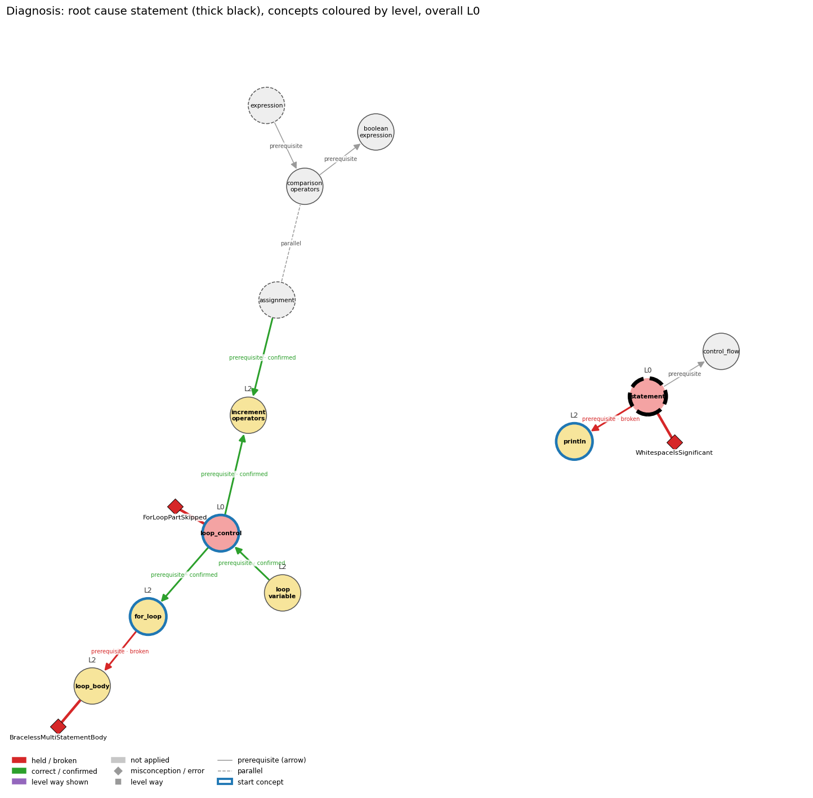

# LP07: the overall level and how it was arrived at

This page explains, with the numbers of this run, how one overall level was worked out for this answer. Every step of the run itself (what the graph offered, the model's replies, all labels, all figures) is in the notebook [`LP07.ipynb`](LP07.ipynb) and in `report.html`.

## The answer that was read

```java
int i, n = 5;
for (i = 1; i < n; i++)
    i++;
    System.out.println(i);
System.out.println(i);
```

**Question.** What is printed? Explain, pass by pass, what happens to i.

**Student's answer.** Pass 1: i++ makes i 2 and println prints 2, then the update makes it 3. Pass 2: i++ makes it 4 and the update makes it 5. 5 < 5 is false, so the loop stops and the last line prints 5. Output: 2 and 5.

**What this scenario was written to test.** L0: inconsistent trace.

## Result

- **Overall level: L0** (prestructural)
- **Decided by:** a real mistake is held, so the answer is L0 (step 3 below)
- **Expected by design:** L0. **Match: yes**

## The five levels

| Level | Name | What an answer at this level does |
|---|---|---|
| L0 | prestructural | holds a rule that contradicts Java, or reads the code in an everyday sense |
| L1 | unistructural | names a part or states one rule without applying it |
| L2 | multistructural | applies the rules to the code step by step (a trace, a predicted output, one step) |
| L3 | relational | relates the parts to each other or gives the purpose of the whole |
| L4 | extended abstract | reasons beyond the given code (a change, an error, a new program) |

A level is never asked from the model directly. For each concept the model only says which *ways* of showing a level the student's words show (for example "output prediction", which sits at L2) and which wrong rules the student holds. The level is then read off by fixed rules.

## Step 1. Which concepts were taken

Stage 1 read the program and found 12 concepts in it. Not all of them count for the overall level. A concept is taken as a **component** when two things hold:

- it is not a *generic* concept (one that almost every Java program has, such as `statement`), unless a real mistake is held on it;
- the student's answer shows something about it, so that it has a level.

| Concept | Generic | Level | Taken as a component? |
|---|---|---|---|
| `assignment` | yes | none | no: generic, and the answer shows nothing about it |
| `boolean_expression` |  | none | no: the answer shows nothing about it, so it has no level |
| `comparison_operators` |  | none | no: the answer shows nothing about it, so it has no level |
| `control_flow` |  | none | no: the answer shows nothing about it, so it has no level |
| `expression` | yes | none | no: generic, and the answer shows nothing about it |
| `for_loop` |  | L2 | **yes** |
| `increment_operators` |  | L2 | **yes** |
| `loop_body` |  | L2 | **yes** |
| `loop_control` |  | L0 | **yes** |
| `loop_variable` |  | L2 | **yes** |
| `println` |  | L2 | **yes** |
| `statement` | yes | L0 | **yes** (generic, but a mistake is held on it) |

**Components of this answer: 7.** `for_loop`, `increment_operators`, `loop_body`, `loop_control`, `loop_variable`, `println`, `statement`.



*The concepts of this program and the links between them, after the run. A coloured concept has a level (red L0, orange L1, yellow L2, light green L3, green L4); a grey concept was found in the code but the answer shows nothing about it. A thick black outline marks the root cause, and a diamond is a wrong rule the student holds. The picture also colours generic concepts that have a level; the table above says which of them are counted.*

## Step 2. The level of each component

Each component gets its level by the first of these rules that fits:

- **(a)** a wrong rule (misconception) is held on the concept: **L0**, whatever else is shown;
- **(b)** only L0 ways are shown (everyday reading, inconsistent trace): **L0**;
- **(c)** otherwise the **highest** level at which a way is shown. One shown way is enough, because the levels build on each other.

A way above L2 is counted only when the model's confidence is above 0.60 and it does not rest only on the words of a held mistake.

### `for_loop`: L2

- **Rule (c).** The highest way shown is **L2 "line by line trace"**.
- Student's words: "Pass 1: i++ makes i 2 and println prints 2, then the update makes it 3; Pass 2: i++ makes it 4 and the update makes it 5; 5 < 5 is false; so the loop stops and the last line prints 5"
- All ways shown on this concept: L2 "line by line trace" (confidence 0.85).

### `increment_operators`: L2

- **Rule (c).** The highest way shown is **L2 "one step execution"**.
- Student's words: "Pass 1: i++ makes i 2 and println prints 2, then the update makes it 3; Pass 2: i++ makes it 4 and the update makes it 5"
- All ways shown on this concept: L2 "one step execution" (confidence 0.85); L2 "line by line trace" (confidence 0.70).
- Shown but not counted: L3 "relation to neighbour" (confidence 0.60 is not above 0.60).

### `loop_body`: L2

- **Rule (c).** The highest way shown is **L2 "line by line trace"**.
- Student's words: "Pass 1: i++ makes i 2 and println prints 2, then the update makes it 3; Pass 2: i++ makes it 4 and the update makes it 5"
- All ways shown on this concept: L0 "inconsistent trace" (confidence 0.80); L2 "line by line trace" (confidence 0.80).
- The error BracelessMultiStatementBody is also noted on this concept. An error makes a concept L0 only at the root cause, so the level here stays L2.

### `loop_control`: L0

- **Rule (a).** The student holds the wrong rule **ForLoopPartSkipped** on this concept.
- Wrong rule: "A pass of a loop may leave out one of its parts (the condition test, the body, the update, or the initialization)."
- Right rule: "Each pass of a for loop runs test, then body, then update, every time; the initialization runs once, at the start."
- Student's words: "Pass 1: i++ makes i 2 and println prints 2, then the update makes it 3; Pass 2: i++ makes it 4 and the update makes it 5"
- Ways also shown on this concept (they do not change the L0): L2 "line by line trace" (confidence 0.85); L2 "one step execution" (confidence 0.80).
- The student does this kind of thing, but what is said is wrong in Java, so it is not counted: L3 "relation to neighbour".

### `loop_variable`: L2

- **Rule (c).** The highest way shown is **L2 "line by line trace"**.
- Student's words: "Pass 1: i++ makes i 2 and println prints 2, then the update makes it 3; Pass 2: i++ makes it 4 and the update makes it 5; 5 < 5 is false"
- All ways shown on this concept: L2 "one step execution" (confidence 0.85); L2 "line by line trace" (confidence 0.80); L2 "output prediction" (confidence 0.75).

### `println`: L2

- **Rule (c).** The highest way shown is **L2 "output prediction"**.
- Student's words: "Pass 1: i++ makes i 2 and println prints 2, then the update makes it 3; so the loop stops and the last line prints 5; Output: 2 and 5"
- All ways shown on this concept: L2 "output prediction" (confidence 0.70).
- The student does this kind of thing, but what is said is wrong in Java, so it is not counted: L3 "relation to neighbour".

### `statement`: L0

- **Rule (a).** The student holds the wrong rule **WhitespaceIsSignificant** on this concept.
- Wrong rule: "Line breaks and indentation change what the program does, so each statement must be on its own line."
- Right rule: "Java compilers consider all whitespace in program text (outside quotation marks) to be equivalent; layout is for human readers."
- Student's words: "Pass 1: i++ makes i 2 and println prints 2, then the update makes it 3; Output: 2 and 5"
- Ways also shown on this concept (they do not change the L0): L0 "inconsistent trace" (confidence 0.80); L0 "everyday reading" (confidence 0.60); L2 "line by line trace" (confidence 0.80).

## Step 3. Is a real mistake held?

A real mistake is a wrong rule (misconception) or a broken rule (error) that the student's own words show, after the same mistake found at two concepts has been counted once. If there is one, the walk also names the concept where the mistake starts, the **root cause**: among the concepts with a mistake, the one furthest back along the prerequisite links.

| Mistake | Kind | At concept | Student's words |
|---|---|---|---|
| WhitespaceIsSignificant | misconception | `statement` | Pass 1: i++ makes i 2 and println prints 2, then the update makes it 3; Output: 2 and 5 |
| BracelessMultiStatementBody | error | `loop_body` | Pass 1: i++ makes i 2 and println prints 2, then the update makes it 3; Output: 2 and 5 |
| ForLoopPartSkipped | misconception | `loop_control` | Pass 1: i++ makes i 2 and println prints 2, then the update makes it 3; Pass 2: i++ makes it 4 and the update makes it 5 |

- **WhitespaceIsSignificant.** Wrong rule: "Line breaks and indentation change what the program does, so each statement must be on its own line." Right rule: "Java compilers consider all whitespace in program text (outside quotation marks) to be equivalent; layout is for human readers."
- **BracelessMultiStatementBody.** Wrong rule: "Indenting several statements under an if or for makes them all part of its body, even without braces." Right rule: "Without braces only the first statement belongs to the if/for; the rest run once, after it."
- **ForLoopPartSkipped.** Wrong rule: "A pass of a loop may leave out one of its parts (the condition test, the body, the update, or the initialization)." Right rule: "Each pass of a for loop runs test, then body, then update, every time; the initialization runs once, at the start."

**Yes.** Root cause: `statement`, with WhitespaceIsSignificant.

**Rule: an answer that is built on a wrong rule is L0, however well its other parts are done.** So the overall level is **L0**, and the count in step 4 is given for information only.

## Step 4. Count the components at each level

| Level | Components at this level | Number | Share |
|---|---|---|---|
| L0 | `loop_control`, `statement` | 2 | 2 ÷ 7 = 0.29 |
| L2 | `for_loop`, `increment_operators`, `loop_body`, `loop_variable`, `println` | 5 | 5 ÷ 7 = 0.71 |

The largest share is at **L2** (5 of 7 components).

Because a real mistake is held (step 3), this count does not decide: the overall level stays **L0**, although the largest share is at L2. The student handles those parts correctly, but the answer rests on a wrong rule.

## Step 5. How far apart are the components?

The lowest component level is L0 and the highest is L2: 2 − 0 = 2.

The components are two or more levels apart, so the answer is marked **LOW coherence**: the one overall level hides real differences between the parts, and the table of step 2 should be read with it.

## Conclusion

7 components; a real mistake is held (WhitespaceIsSignificant at `statement`); so the overall level is **L0**. Shares: L0 0.29, L2 0.71; LOW coherence.

| | Overall level | Components | Held mistake | Root cause |
|---|---|---|---|---|
| This run | L0 | `for_loop` L2, `increment_operators` L2, `loop_body` L2, `loop_control` L0, `loop_variable` L2, `println` L2, `statement` L0 | WhitespaceIsSignificant, BracelessMultiStatementBody, ForLoopPartSkipped | `statement` |
| Expected by design | L0 | `loop_body` L0 | none | none |

The expected result lists only the main concept the scenario was written for; the run levels every concept the answer touches, so it usually has more components.

The rule and how it was made are in the [folder README](../../README.md).
