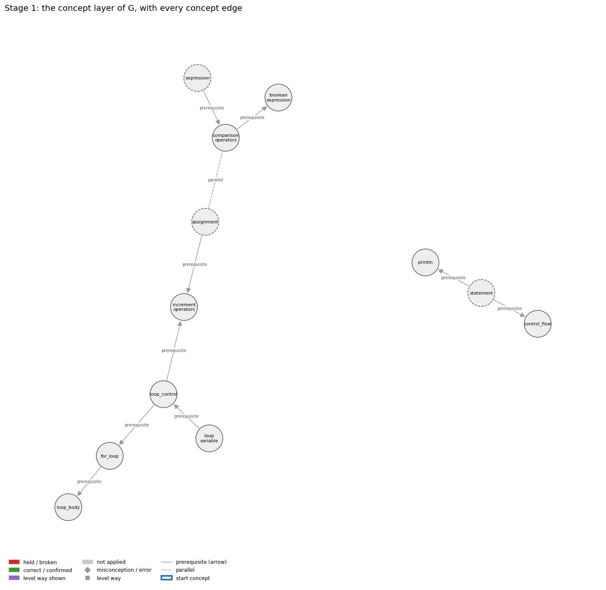
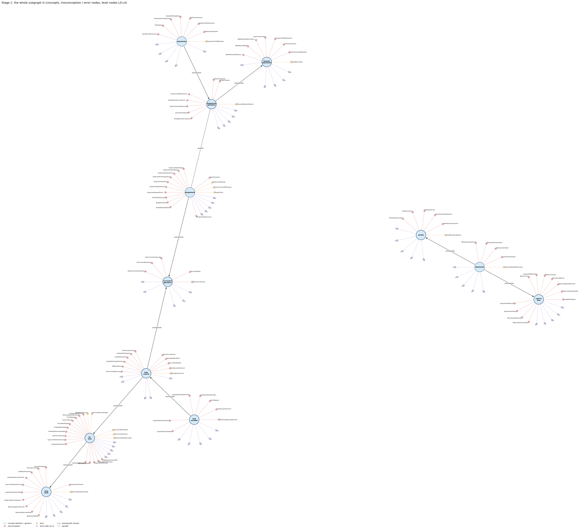
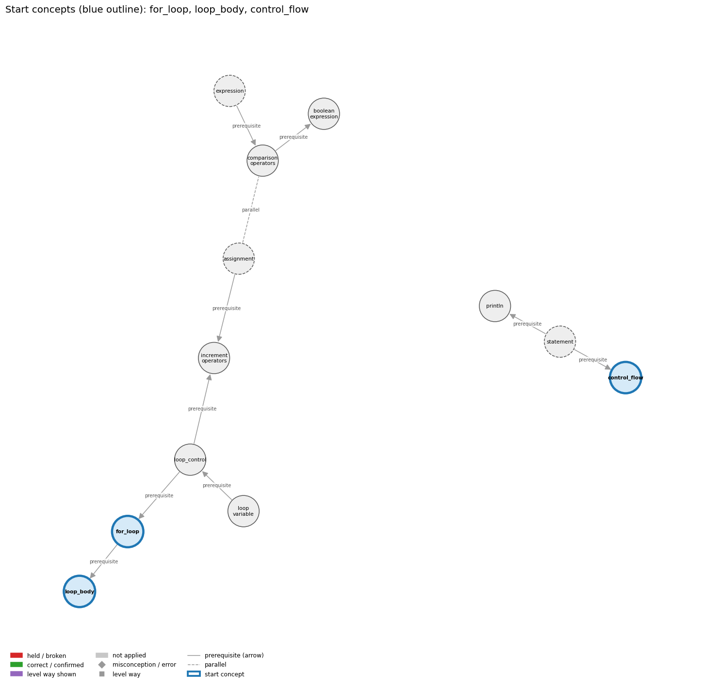
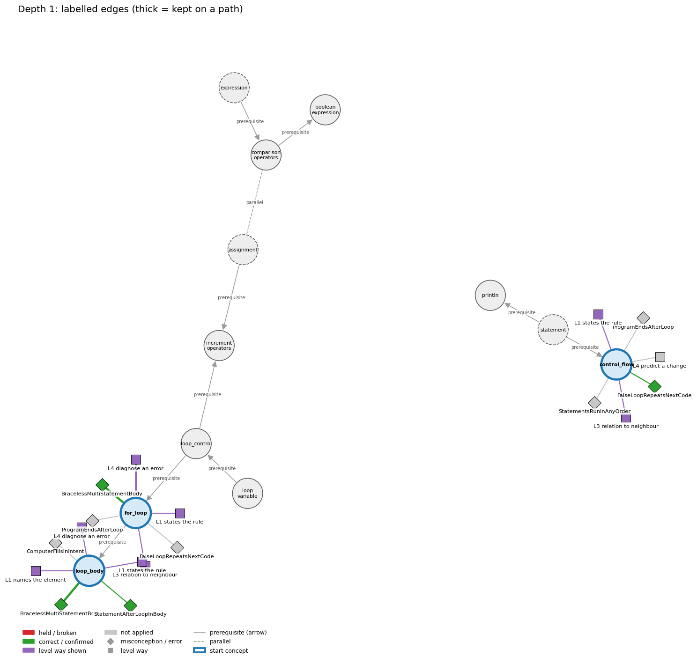
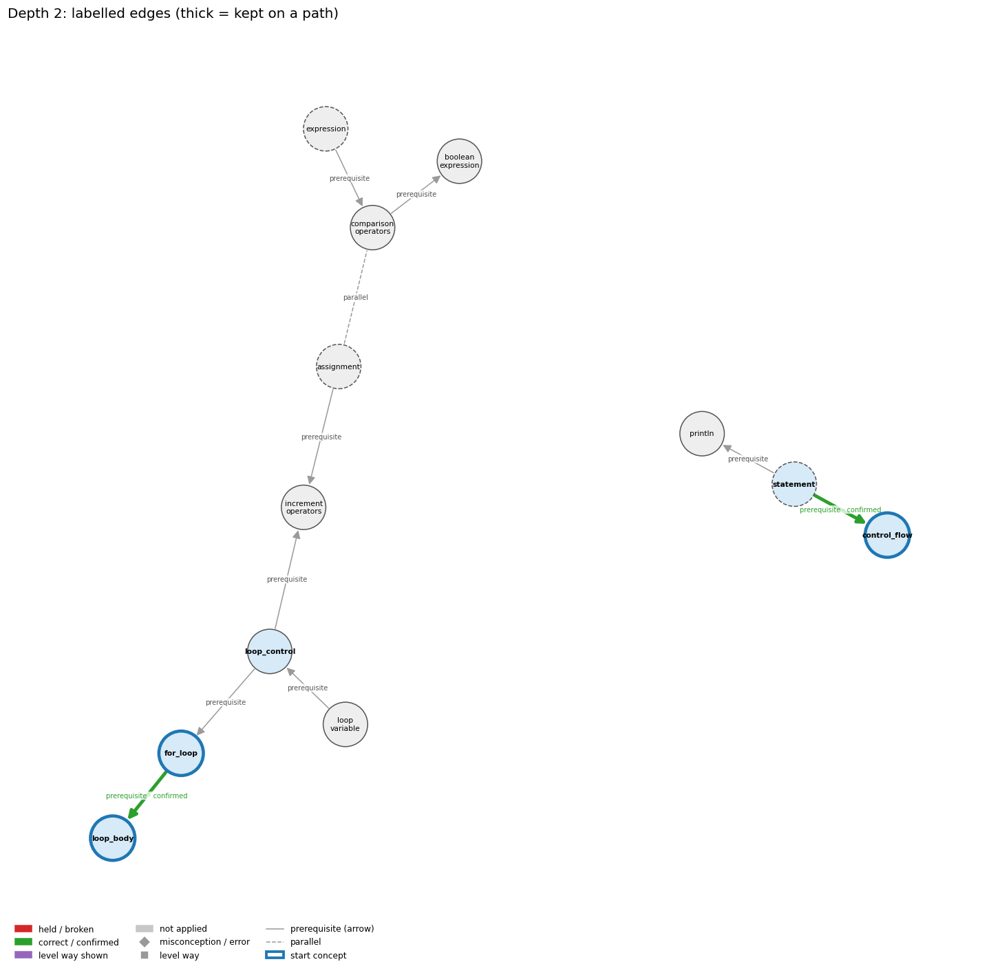
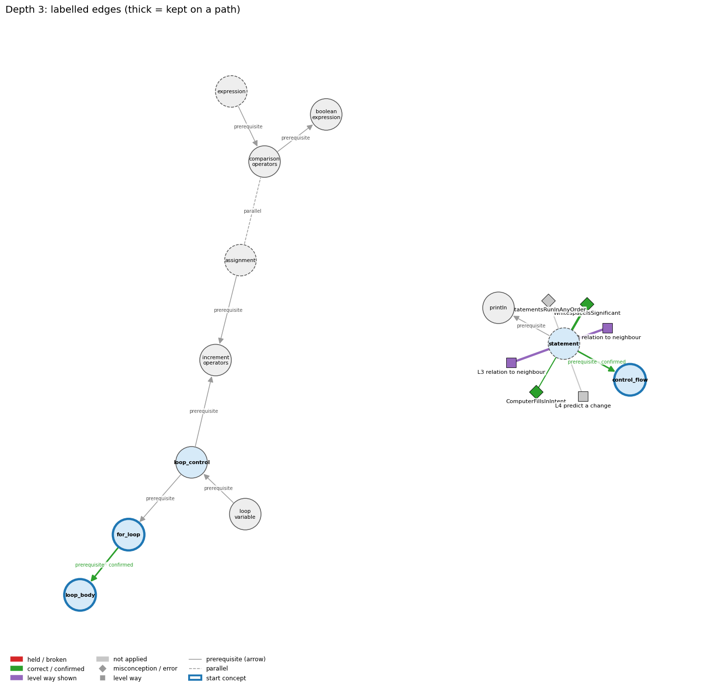
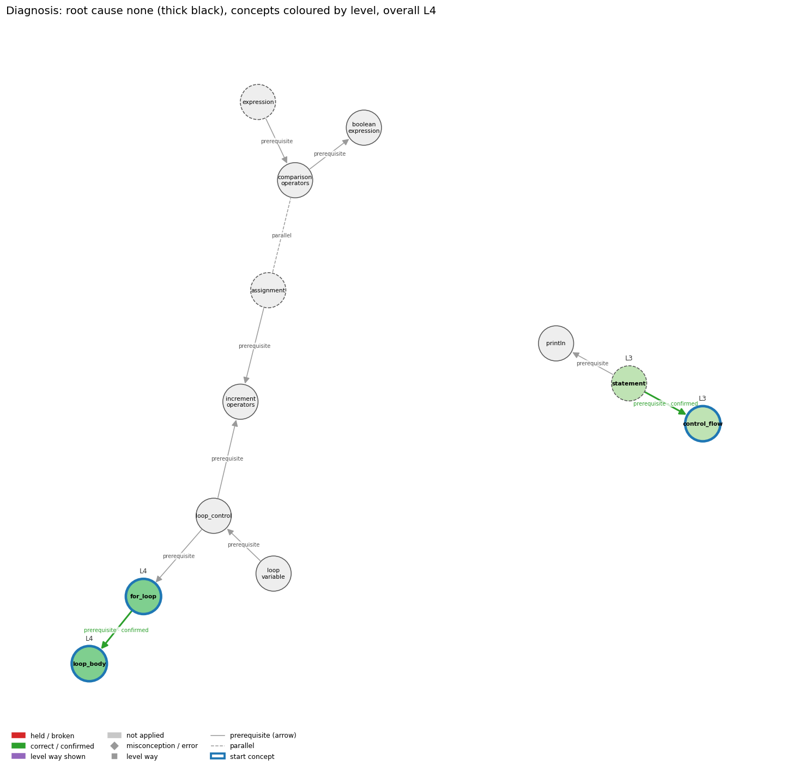

# Think on the Graph: every output of the run LP09

Files of this scenario: `input.json` (program, question, answer), `diagnosis.json`, `subgraph.json`, `traverse_log.txt`, `report.html` (this report as one full-page file, with the interactive graph `LP09_G.html`), `LP09.ipynb` (this report as a notebook).

## Level classification

This scenario tests **L1: states the rule**. How the overall level is decided is explained in the [folder README](../../README.md).

- **Overall level: L4** (decided by: largest share)
- **Shares of the components:** L3 0.33, L4 0.67; coherent
- **Mistake held (root cause):** none
- **Expected by design:** overall L1; components `loop_body` L1; held none; root none
- **Overall level matches the expected one:** no

### How the overall level of this run was calculated

1. **Find the parts of the answer.** The answer touches 3 concepts (the components in the table below). Each one got its own level from what the student wrote about it.
2. **Is a real mistake held?** No wrong rule is held.
3. **Count the parts at each level:** 1 at L3, 2 at L4.
4. **Result.** Most parts (2 of 3) are at L4, so the overall level is **L4**.
5. **Check.** The levels of the parts are next to each other, so the answer is coherent.

| Component | Level | Decided by | Student's words |
|---|---|---|---|
| `control_flow` | L3 | way: relation to neighbour | Without braces a for loop repeats only the one statement right after its header; The indentation does not matter; so the println lines are not part of the loop |
| `for_loop` | L4 | way: diagnose an error | Without braces a for loop repeats only the one statement right after its header; The indentation does not matter; so the println lines are not part of the loop |
| `loop_body` | L4 | way: diagnose an error | Without braces a for loop repeats only the one statement right after its header; The indentation does not matter; so the println lines are not part of the loop |

Generic concepts with a level (not counted as components): `statement` L3.

## 0. Input
Program:
```java
int i, n = 5;
for (i = 1; i < n; i++)
    i++;
    System.out.println(i);
System.out.println(i);
```
Question: How many times is System.out.println executed? Explain your reasoning.

Student's answer: Without braces a for loop repeats only the one statement right after its header. The indentation does not matter, so the println lines are not part of the loop.
Settings: width 3, depth 3, prune llm, backend claude-cli, model claude-opus-5-5
## 1. Stage 1: which concepts the program uses (no model)
The program with the text in quotes and the comments blanked out, so that only real code is read:
```
int i, n = 5;
for (i = 1; i < n; i++)
    i++;
    System.out.println(i);
System.out.println(i);
```
Which piece of the code points to which concept. A generic concept is one that almost every Java program has; the reading starts from it only if the student's answer mentions it:
| concept | generic | channel | matched text | line |
|---|---|---|---|---|
| assignment | True | pattern | '=' | 1 |
| boolean_expression | False | pattern | 'for (i = 1; i < n;' | 2 |
| comparison_operators | False | pattern | 'for (i = 1; i <' | 2 |
| control_flow | False | pattern | 'for (' | 2 |
| expression | True | pattern | 'i <' | 2 |
| expression | True | pattern | '= 5;' | 1 |
| for_loop | False | pattern | 'for (' | 2 |
| increment_operators | False | pattern | '++' | 2 |
| loop_body | False | pattern | 'for (' | 2 |
| loop_control | False | signal | 'for (i = 1; i < n; i++)' | 2 |
| loop_variable | False | pattern | 'for (i =' | 2 |
| println | False | pattern | 'System.out.println(' | 4 |
| statement | True | pattern | ';' | 1 |

The part of the knowledge graph used for this program (called G) has 12 concepts (3 of them generic), 10 links between concepts, 116 links from a concept to a possible mistake (84 different mistakes) and 60 level entries (five levels, L0 to L4, for each concept). It is in 2 connected piece(s).
Note: concept nodes form 2 pieces (the KG has no edge between them): assignment,boolean_expression,comparison_operators,expression,for_loop,increment_operators,loop_body,loop_control,loop_variable | control_flow,println,statement

The links between these concepts. `pre:` means the first concept must be understood before the second; `par:` means the two are learned side by side:
| edge | type | rule (logic) |
|---|---|---|
| par:assignment~comparison_operators | parallel | x = y stores the value of y in x (a statement with a side effect); x == y only tests whether the two values are equal and gives a boolean. Writing = where == is meant is a compile error with int operands and a silent bug with boolean operands. |
| pre:assignment->increment_operators | prerequisite | i++ is shorthand for the assignment i = i + 1. |
| pre:comparison_operators->boolean_expression | prerequisite | A comparison such as x < y produces a boolean result; comparisons together with boolean logic provide the basis for decision-making. |
| pre:expression->comparison_operators | prerequisite | Comparison operators build expressions whose value is a boolean, so one must already know what an expression is to understand a < b. |
| pre:for_loop->loop_body | prerequisite | The statements in braces after the for header are the loop body; they run once on every pass, between the test and the increment, exactly as in a while loop. |
| pre:loop_control->for_loop | prerequisite | The for header is exactly the three control slots, and the body runs after the test and before the update on each pass. |
| pre:loop_control->increment_operators | prerequisite | The loop update i = i + 1 comes first; ++ (and +=) are then introduced as shorthand for that update. |
| pre:loop_variable->loop_control | prerequisite | The init, condition and update all act on the loop variable: the init sets it, the condition tests it, the update changes it. |
| pre:statement->control_flow | prerequisite | Control flow is the order in which statements run. |
| pre:statement->println | prerequisite | System.out.println(s); is itself a statement, so its line of output appears at its own place in the sequence. |

For each concept: how many possible mistakes the graph lists for it, and how many ways of showing a level:
| concept | possible mistakes | ways of showing a level |
|---|---|---|
| assignment | 15 | 24 |
| boolean_expression | 8 | 19 |
| comparison_operators | 8 | 20 |
| control_flow | 11 | 15 |
| expression | 8 | 19 |
| for_loop | 20 | 24 |
| increment_operators | 5 | 16 |
| loop_body | 12 | 14 |
| loop_control | 11 | 19 |
| loop_variable | 7 | 13 |
| println | 6 | 17 |
| statement | 5 | 19 |

**Figure 1**


**Figure 2**


## 2. The answer in pieces, and where the reading starts (no model)
The student's answer cut into short pieces (clauses), so that every finding can point to the exact words it rests on:
| clause | text |
|---|---|
| c1 | Without braces a for loop repeats only the one statement right after its header |
| c2 | The indentation does not matter |
| c3 | so the println lines are not part of the loop |

start: BM25 of the answer against each tagged concept: for_loop 15.63 (hits 1), loop_body 14.04 (hits 1), control_flow 10.95 (hits 1), println 10.75 (hits 1), loop_control 7.94 (hits 1), loop_variable 5.91 (hits 1), boolean_expression 5.07 (hits 1), comparison_operators 4.46 (hits 1), increment_operators 4.03 (hits 1)

start: chosen for_loop, loop_body, control_flow

start concepts (3): for_loop, loop_body, control_flow

The reading starts at the concepts whose description is closest to the student's words. Start concepts: for_loop, loop_body, control_flow

**Figure 3**


## 3. Reading the answer against the graph, round by round (the model is asked here)
The answer is read in rounds. In each round, for each concept being looked at, three things happen. First the graph offers what could be said about the concept: the possible mistakes, the ways of showing a level, or the links to neighbouring concepts. Then the model picks the few that matter for this answer. Then the model judges each picked one against the student's clauses and gives a label, the clause numbers it rests on and a confidence from 0 to 1. Score = relevance score x confidence.

### Round 1: the concepts being looked at are 'for_loop', 'loop_body', 'control_flow'

#### for_loop: 20 possible mistakes offered
What the graph offers:
| edge |
|---|
| err:for_loop->BracelessMultiStatementBody \| wrong rule: Indenting several statements under an if or for makes them all part of its body, even without braces. \| right rule: Without braces only the first statement belongs to the if/for; the rest run once, after it. |
| err:for_loop->ForCommaSeparators \| wrong rule: Writes for (int i = 0, i < n, i++). \| right rule: The three parts of a for header are separated by semicolons; commas only separate several statements inside the init or the update part. |
| err:for_loop->SemicolonAfterIfHeader \| wrong rule: if (x > 0); System.out.println("positive"); prints only for positive x. \| right rule: The ; ends the if with an empty statement, so the next line always runs. |
| err:for_loop->SemicolonAfterLoopHeader \| wrong rule: Puts a ; right after for (...) or while (...). \| right rule: A ; right after the loop header is a null (empty) loop body, so the statements written after it are not repeated by the loop. |
| err:for_loop->WrongIterationCount \| wrong rule: Updates the loop counter so that the loop runs the wrong number of times. \| right rule: The init, test and update together decide the number of passes; trace them to check the count. |
| mis:for_loop->DoubleLoopIndexCount \| wrong rule: for (double x = 0.0; x <= 1.0; x += 0.1) runs exactly 11 times. \| right rule: Using a double as a for-loop index is legal but bad practice: the number of iterations depends on an equality test between double values, which may not give the result you expect. |
| mis:for_loop->FalseLoopRepeatsNextCode \| wrong rule: A loop is an iterative if-else: while the condition is true the body repeats, and when it is false the code after the loop repeats. \| right rule: Only the body is repeated; once the condition is false the code after the loop runs once. |
| mis:for_loop->ForInitRepeats \| wrong rule: The initialization of a for loop runs again after a pass of the body. \| right rule: The initialization runs exactly once, before the first condition test. |
| mis:for_loop->ForIsConditional \| wrong rule: The body of a for statement executes at most once. \| right rule: The body of a for statement runs once for every pass on which the condition is true, which can be many times. |
| mis:for_loop->ForLoopPartSkipped \| wrong rule: A pass of a loop may leave out one of its parts (the condition test, the body, the update, or the initialization). \| right rule: Each pass of a for loop runs test, then body, then update, every time; the initialization runs once, at the start. |
| mis:for_loop->ForUpdateBeforeBody \| wrong rule: The update part of a for header (e.g. i = i - 4) runs before the body on each pass, so the first pass already sees the updated value. \| right rule: The update runs after the body, before the next condition test; the first pass uses the initial value. |
| mis:for_loop->ForWhileNotInterchangeable \| wrong rule: Some loops can only be written with for, others only with while. \| right rule: Any for loop can be rewritten as a while loop and vice versa; for just packages init, test and update. |
| mis:for_loop->IdiomOverridesCode \| wrong rule: An array loop processes the whole array from index 0 to length-1 and increments its index at the end of the body, whatever the code says. \| right rule: The loop visits exactly the indices that its initialisation, guard and update produce, in the order in which its statements are written. |
| mis:for_loop->LoopCountIsStatementCount \| wrong rule: The repeat count of a counted loop says how many of the body statements are executed. \| right rule: The repeat count is how many times the whole body runs; every pass runs all body statements. |
| mis:for_loop->LoopHeaderIsEquations \| wrong rule: The initialization, condition and update of a for header are equations that all hold at the same time. \| right rule: The three header parts are statements run at different moments: init once, then condition test, body, update, repeated. |
| mis:for_loop->LoopImpliedByOneTest \| wrong rule: Testing one case is enough; Java will repeat the test for the other values by itself. \| right rule: A statement runs once each time control reaches it; repeating a test for many values needs a loop. |
| mis:for_loop->LoopStepAlwaysOne \| wrong rule: A loop variable always goes up or down by 1, whatever the update says (so i = i - 4 is read as i--). \| right rule: The loop variable changes exactly as the update expression says (i += 2, i = i - 4, i *= 2, ...). |
| mis:for_loop->ProgramEndsAfterLoop \| wrong rule: When a loop finishes the program ends, so code after the loop never runs. \| right rule: When the loop condition becomes false, control continues with the first statement after the loop. |
| mis:for_loop->ReturnDoesNotExitLoop \| wrong rule: A return inside a loop does not end the loop; it sets a value each pass (the last one is returned) or returns several values. \| right rule: When return executes, the method ends at once, so the loop stops on that pass. |
| mis:for_loop->SingleIterationInsteadOfLoop \| wrong rule: A task that must be repeated is written once, without a loop, as if one pass were enough. \| right rule: A step that must happen several times (or an unknown number of times) needs a loop such as while or for; code without a loop runs once. |

Step 1, pick the relevant ones. The model's reply (each picked item with its relevance score; the scores add up to 1):
```
err:for_loop->BracelessMultiStatementBody (0.70), mis:for_loop->FalseLoopRepeatsNextCode (0.20), mis:for_loop->ProgramEndsAfterLoop (0.10)
```
Picked: err:for_loop->BracelessMultiStatementBody (0.70), mis:for_loop->FalseLoopRepeatsNextCode (0.20), mis:for_loop->ProgramEndsAfterLoop (0.10)

Step 2, judge the possible mistakes of this concept (all in one question). The model saw the program, the question, the numbered clauses and each possible mistake with its wrong rule and the right rule. held = the student follows the wrong rule; correct = the student follows the right rule; not applied = the answer says nothing about it:
| edge |
|---|
| err:for_loop->BracelessMultiStatementBody \| wrong rule: Indenting several statements under an if or for makes them all part of its body, even without braces. \| right rule: Without braces only the first statement belongs to the if/for; the rest run once, after it. |
| mis:for_loop->FalseLoopRepeatsNextCode \| wrong rule: A loop is an iterative if-else: while the condition is true the body repeats, and when it is false the code after the loop repeats. \| right rule: Only the body is repeated; once the condition is false the code after the loop runs once. |
| mis:for_loop->ProgramEndsAfterLoop \| wrong rule: When a loop finishes the program ends, so code after the loop never runs. \| right rule: When the loop condition becomes false, control continues with the first statement after the loop. |
Model's reply:
```
err:for_loop->BracelessMultiStatementBody | correct | clauses: 1, 2, 3 | confidence: 0.95
mis:for_loop->FalseLoopRepeatsNextCode | not applied | clauses: none | confidence: 0.85
mis:for_loop->ProgramEndsAfterLoop | not applied | clauses: none | confidence: 0.8
```

The labels as the program read them:
| edge | label | prune score | confidence | score | clauses | words |
|---|---|---|---|---|---|---|
| err:for_loop->BracelessMultiStatementBody | correct | 0.7000000000000001 | 0.95 | 0.67 | c1, c2, c3 | Without braces a for loop repeats only the one statement right after its header; The indentation does not matter; so the println lines are not part of the loop |
| mis:for_loop->FalseLoopRepeatsNextCode | not applied |  |  | 0.0 |  |  |
| mis:for_loop->ProgramEndsAfterLoop | not applied |  |  | 0.0 |  |  |

#### for_loop: 24 ways of showing a level offered
What the graph offers:
| edge |
|---|
| lvl:for_loop@L0#0 \| level L0 way everyday_reading: Folk meaning: English 'for each ...' or 'for 10 times' names a whole collection or a count to be handled at once, and a maths reading treats the header as simultaneous conditions. A Java for is a while loop in compact form: one init, then test-body-update repeated, one pass at a time. |
| lvl:for_loop@L0#11 \| level L0 way inconsistent_trace: Applies the for sequencing rule (LT) unevenly: updates before the body on the first pass only, re-runs the init after a pass, or skips the test on some passes. (here mixing in: "The body of a for statement executes at most once") |
| lvl:for_loop@L1#0 \| level L1 way names_the_element: The for statement is a loop that packages an initialization, a loop-continuation condition and an increment in its header around a body. |
| lvl:for_loop@L1#1 \| level L1 way states_the_rule: Syntax: for (<initialize>; <boolean expression>; <increment>) { <statements> }, with the three parts separated by semicolons; it is, with only a few exceptions, equivalent to <initialize>; while (<boolean expression>) { <statements> <increment>; }. |
| lvl:for_loop@L2#0 \| level L2 way line_by_line_trace: Run the initializer once; then repeatedly: test the condition (stop if false), execute the body, run the update. |
| lvl:for_loop@L2#1 \| level L2 way output_prediction: A for statement has no value; the passes it makes are fixed by its header: for (int i = 1; i <= N; i++) sum += i; leaves sum = N(N+1)/2, and for (int i = 2; i <= 8; i += 2) prints 2, 4, 6, 8,. |
| lvl:for_loop@L2#2 \| level L2 way one_step_execution: One pass: the test reads the loop variable; the body applies its changes once; the update then changes the loop variable by its rule; the initializer changes state only once, before the first test. |
| lvl:for_loop@L3#0 \| level L3 way relation_to_neighbour: The for header is exactly the three loop-control slots; the body runs after the test and before the update on each pass. |
| lvl:for_loop@L3#1 \| level L3 way relation_to_neighbour: A for may be the body of another for: the inner for runs its complete set of passes for every single pass of the outer one. |
| lvl:for_loop@L3#2 \| level L3 way relation_to_neighbour: for (int i = 0; i < N; i++) gives i each valid index 0..N-1 exactly once in increasing order, the standard way to process every array element. |
| lvl:for_loop@L3#3 \| level L3 way relation_to_neighbour: A simulation runs a fixed number of trials with an outer for loop (for (int t = 0; t < T; t++)), each trial simulated inside the body. |
| lvl:for_loop@L3#4 \| level L3 way relation_to_neighbour: In a for loop, continue skips the rest of the body and transfers control directly to the increment, then the next test; this is one of the few places where the for/while equivalence fails. |
| lvl:for_loop@L3#5 \| level L3 way relation_to_neighbour: A variable declared in the for header is in scope only in the header and the body, so it cannot be used after the loop. |
| lvl:for_loop@L3#6 \| level L3 way relation_to_neighbour: A fencepost loop is a for loop that handles one item (the first or last) outside the loop so that separators come out n-1 times for n items. |
| lvl:for_loop@L3#7 \| level L3 way relation_to_neighbour: A flag search loop is a for loop that sets a boolean flag when some pass finds the target and leaves it set afterwards; the flag must be declared before the loop. |
| lvl:for_loop@L3#8 \| level L3 way purpose_of_the_whole: Plan: counted loop / counter-controlled repetition - do the body a known number of times, with the loop variable as a stepper (index, term number, trial number). |
| lvl:for_loop@L4#0 \| level L4 way predict_a_change: Rewriting a for as the equivalent while (init before, update at the end of the body) keeps behaviour, except that continue then skips the update and the loop variable stays in scope after the loop. Changing the bound or the step changes the pass count predictably (< to <= adds one pass). |
| lvl:for_loop@L4#1 \| level L4 way diagnose_an_error: rule broken: The three parts of a for header are separated by semicolons; commas only separate several statements inside the init or the update. Kind: compile-time. Trigger class: Writing for (int i = 0, i < n, i++): the compiler parses the commas as more declarators in the init and reports a syntax error. |
| lvl:for_loop@L4#2 \| level L4 way diagnose_an_error: rule broken: A ; right after while (...) or for (...) is an empty statement that is the whole loop body; the block written next is not repeated. Kind: silent logic error. Trigger class: for (...); { body } runs the body once after the loop ends; while (cond); with a cond that the empty body cannot change hangs forever (infinite loop) when cond starts true. |
| lvl:for_loop@L4#3 \| level L4 way transfer_to_a_new_program: Use for when there is an initialization, an increment and a continuation test and the loop variable is not needed after the loop; use while when the loop variable is needed later or the number of passes depends on what happens in the body. |
| lvl:for_loop@L4#4 \| level L4 way diagnose_an_error: rule broken: A ; right after if (...) is an empty statement that forms the whole then branch; the following statement or block is no longer part of the if. Kind: silent logic error. Trigger class: Any if (cond); followed by a statement or block: that statement runs for every input, whatever cond is (it compiles without error). |
| lvl:for_loop@L4#5 \| level L4 way diagnose_an_error: rule broken: The number of passes is fixed by the init, the test and the update together. Kind: silent logic error. Trigger class: Wrong start value, < vs <=, a wrong step, or an extra update of the counter in the body (or outside the loop): the loop runs too few or too many passes (off by one, or skips values). |
| lvl:for_loop@L4#6 \| level L4 way diagnose_an_error: rule broken: Without braces, the body of an if, while or for is exactly one statement; indentation does not add statements to it. Kind: silent logic error. Trigger class: A braceless header followed by two or more indented statements: only the first is controlled, the others run once, after the if/loop, on every input. |
| lvl:for_loop@L4#7 \| level L4 way diagnose_an_error: rule broken: A variable declared in the for initializer exists only inside the for statement. Kind: compile-time. Trigger class: Reading i after for (int i = 0; ...) {...}: 'cannot find symbol'. |

Step 1, pick the relevant ones. The model's reply (each picked item with its relevance score; the scores add up to 1):
```
{lvl:for_loop@L4#6 (Score: 0.7)}
{lvl:for_loop@L1#1 (Score: 0.15)}
{lvl:for_loop@L3#0 (Score: 0.15)}
```
Picked: lvl:for_loop@L4#6 (0.70), lvl:for_loop@L1#1 (0.15), lvl:for_loop@L3#0 (0.15)

Step 2, judge one way of showing a higher level (lvl:for_loop@L4#6, 'diagnose an error'). The model saw the description below and where this way stops, not the level it belongs to, and answers shown, wrong or not shown:
> rule broken: Without braces, the body of an if, while or for is exactly one statement; indentation does not add statements to it. Kind: silent logic error. Trigger class: A braceless header followed by two or more indented statements: only the first is controlled, the others run once, after the if/loop, on every input.
>
> Where this way stops: Locating and fixing the mistake for one given failing case is L3. A compiler-flagged slip fixed from the message is weak evidence.

Model's reply:
```
Label: shown
Clauses: 1, 2, 3
Confidence: 0.8
```

Step 2, judge one way of showing a level (lvl:for_loop@L1#1, 'states the rule'). The model saw only the description below, not the level it belongs to, and answers shown or not shown:
> Syntax: for (<initialize>; <boolean expression>; <increment>) { <statements> }, with the three parts separated by semicolons; it is, with only a few exceptions, equivalent to <initialize>; while (<boolean expression>) { <statements> <increment>; }.

Model's reply:
```
Label: shown
Clauses: 1
Confidence: 0.6
```

Step 2, judge one way of showing a higher level (lvl:for_loop@L3#0, 'relation to neighbour'). The model saw the description below and where this way stops, not the level it belongs to, and answers shown, wrong or not shown:
> The for header is exactly the three loop-control slots; the body runs after the test and before the update on each pass.
>
> Where this way stops: Two correct but separate rules are L1. Executing the two in sequence is L2. A relational answer may be correct or a relational error.

Model's reply:
```
Label: shown
Clauses: 1, 2, 3
Confidence: 0.7
```

The labels as the program read them:
| edge | label | prune score | confidence | score | clauses | words |
|---|---|---|---|---|---|---|
| lvl:for_loop@L4#6 | shown | 0.7 | 0.8 | 0.56 | c1, c2, c3 | Without braces a for loop repeats only the one statement right after its header; The indentation does not matter; so the println lines are not part of the loop |
| lvl:for_loop@L1#1 | shown | 0.15 | 0.6 | 0.09 | c1 | Without braces a for loop repeats only the one statement right after its header |
| lvl:for_loop@L3#0 | shown | 0.15 | 0.7 | 0.1 | c1, c2, c3 | Without braces a for loop repeats only the one statement right after its header; The indentation does not matter; so the println lines are not part of the loop |

#### loop_body: 12 possible mistakes offered
What the graph offers:
| edge |
|---|
| err:loop_body->BracelessMultiStatementBody \| wrong rule: Indenting several statements under an if or for makes them all part of its body, even without braces. \| right rule: Without braces only the first statement belongs to the if/for; the rest run once, after it. |
| mis:loop_body->ComputerFillsInIntent \| wrong rule: The computer fills in omitted steps or values that the programmer meant, e.g. REPEAT 4 [FORWARD 30] draws a square without a turn command. \| right rule: The computer executes only what the code states; every needed step and value must be written. |
| mis:loop_body->ForLoopPartSkipped \| wrong rule: A pass of a loop may leave out one of its parts (the condition test, the body, the update, or the initialization). \| right rule: Each pass of a for loop runs test, then body, then update, every time; the initialization runs once, at the start. |
| mis:loop_body->IfInLoopUnchecked \| wrong rule: An if inside a loop body runs its branch on every pass without testing its condition. \| right rule: The if condition is tested again on every pass, with the current values, so the branch runs only on passes where it is true. |
| mis:loop_body->LoopBodyAlwaysOnce \| wrong rule: The loop body always runs at least once, even if the condition is false at the start. \| right rule: A while or for body runs zero times when the condition is false at the start. |
| mis:loop_body->LoopBodyStatementOutsideLoop \| wrong rule: Some statements inside the braces of a loop body are not repeated; they run once, before or after the loop. \| right rule: Every statement inside the loop braces is part of the body and runs on every pass. |
| mis:loop_body->LoopCountIsStatementCount \| wrong rule: The repeat count of a counted loop says how many of the body statements are executed. \| right rule: The repeat count is how many times the whole body runs; every pass runs all body statements. |
| mis:loop_body->LoopOutputSameEachPass \| wrong rule: A loop prints the same thing on every pass; the changing loop variable does not affect what the body does. \| right rule: The body uses the current value of the loop variable, so its output can differ on each pass. |
| mis:loop_body->LoopRunsStatementsSeparately \| wrong rule: A loop runs its first body statement all N times, then its second body statement all N times. \| right rule: Each pass runs the whole body in order, so the body statements interleave: S1, S2, S1, S2, ... |
| mis:loop_body->StateChangeIgnoredAcrossPasses \| wrong rule: Values changed by one pass of a loop (other than the loop variable) do not affect later passes. \| right rule: Each pass starts from the state left by the previous pass, so a change in one pass carries into the next ones. |
| mis:loop_body->StatementAfterLoopInBody \| wrong rule: A statement written after the loop is repeated with the loop body. \| right rule: The body ends at the closing brace (or after its single statement); code after it runs once, after the loop ends. |
| mis:loop_body->WhileStopsMidBody \| wrong rule: The loop stops the moment the condition becomes false, even in the middle of the body. \| right rule: The condition is tested only before each pass, so the whole body finishes before the loop can stop. |

Step 1, pick the relevant ones. The model's reply (each picked item with its relevance score; the scores add up to 1):
```
err:loop_body->BracelessMultiStatementBody (0.60), mis:loop_body->StatementAfterLoopInBody (0.30), mis:loop_body->ComputerFillsInIntent (0.10)
```
Picked: err:loop_body->BracelessMultiStatementBody (0.60), mis:loop_body->StatementAfterLoopInBody (0.30), mis:loop_body->ComputerFillsInIntent (0.10)

Step 2, judge the possible mistakes of this concept (all in one question). The model saw the program, the question, the numbered clauses and each possible mistake with its wrong rule and the right rule. held = the student follows the wrong rule; correct = the student follows the right rule; not applied = the answer says nothing about it:
| edge |
|---|
| err:loop_body->BracelessMultiStatementBody \| wrong rule: Indenting several statements under an if or for makes them all part of its body, even without braces. \| right rule: Without braces only the first statement belongs to the if/for; the rest run once, after it. |
| mis:loop_body->StatementAfterLoopInBody \| wrong rule: A statement written after the loop is repeated with the loop body. \| right rule: The body ends at the closing brace (or after its single statement); code after it runs once, after the loop ends. |
| mis:loop_body->ComputerFillsInIntent \| wrong rule: The computer fills in omitted steps or values that the programmer meant, e.g. REPEAT 4 [FORWARD 30] draws a square without a turn command. \| right rule: The computer executes only what the code states; every needed step and value must be written. |
Model's reply:
```
err:loop_body->BracelessMultiStatementBody | correct | clauses: 1, 2, 3 | confidence: 0.95
mis:loop_body->StatementAfterLoopInBody | correct | clauses: 1, 3 | confidence: 0.8
mis:loop_body->ComputerFillsInIntent | not applied | clauses: none | confidence: 0.7
```

The labels as the program read them:
| edge | label | prune score | confidence | score | clauses | words |
|---|---|---|---|---|---|---|
| err:loop_body->BracelessMultiStatementBody | correct | 0.6000000000000001 | 0.95 | 0.57 | c1, c2, c3 | Without braces a for loop repeats only the one statement right after its header; The indentation does not matter; so the println lines are not part of the loop |
| mis:loop_body->StatementAfterLoopInBody | correct | 0.30000000000000004 | 0.8 | 0.24 | c1, c3 | Without braces a for loop repeats only the one statement right after its header; so the println lines are not part of the loop |
| mis:loop_body->ComputerFillsInIntent | not applied |  |  | 0.0 |  |  |

#### loop_body: 14 ways of showing a level offered
What the graph offers:
| edge |
|---|
| lvl:loop_body@L0#0 \| level L0 way everyday_reading: Folk meaning: an everyday 'repeat this' instruction can be read loosely - a helper fills in missing steps, does each step N times in turn, or stops partway. A Java loop body is exactly the statements inside its braces (or one statement), all executed in order on every pass. |
| lvl:loop_body@L0#6 \| level L0 way inconsistent_trace: Applies the body rule (LT) unevenly: runs all body statements on some passes but only some on others, includes the statement after the loop on some passes, or uses stale values from the first pass later. (here mixing in: "The loop body always runs at least once, even if the condition is false at the start") |
| lvl:loop_body@L1#0 \| level L1 way names_the_element: The loop body is the statement block that a loop repeats on each pass. |
| lvl:loop_body@L1#1 \| level L1 way states_the_rule: The body is the block after the loop header; braces are optional only if it is a single statement, in which case only that one statement is repeated. |
| lvl:loop_body@L2#0 \| level L2 way line_by_line_trace: On each pass the body's statements run in order, first to last, after a true test (and, in a for loop, before the update); the next pass starts from the state left by this one. |
| lvl:loop_body@L2#1 \| level L2 way output_prediction: The body's output on each pass depends on the current values, so successive passes can print different lines: TenHellos prints '4th Hello', '5th Hello', ...; the number of executions of each body statement equals the number of passes. |
| lvl:loop_body@L2#2 \| level L2 way one_step_execution: One pass of the body changes exactly the variables it assigns (e.g. print i and v, double v, increment i) and these changes carry into the next test and pass. |
| lvl:loop_body@L3#0 \| level L3 way relation_to_neighbour: The accumulator update (sum += x) is placed inside the body so it runs once per pass, while the accumulator is declared and initialized before the loop. |
| lvl:loop_body@L3#1 \| level L3 way relation_to_neighbour: count++ sits inside the body, often under an if, so it runs once on each pass that matches; the counter is declared before the loop. |
| lvl:loop_body@L3#2 \| level L3 way relation_to_neighbour: The body is what the while repeats; the condition is tested only between complete executions of it. |
| lvl:loop_body@L3#3 \| level L3 way purpose_of_the_whole: Plan: the body is the 'process one item / one step' part of a loop plan: each pass performs the same process on a new value (next element, next bet, next term). |
| lvl:loop_body@L4#0 \| level L4 way predict_a_change: Moving a statement from inside the body to after the loop changes it from running once per pass to once in total (and vice versa); reordering two body statements that share a variable changes the results (e.g. increment before vs after use). |
| lvl:loop_body@L4#1 \| level L4 way diagnose_an_error: rule broken: Without braces, the body of an if, while or for is exactly one statement; indentation does not add statements to it. Kind: silent logic error. Trigger class: A braceless header followed by two or more indented statements: only the first is controlled, the others run once, after the if/loop, on every input. |
| lvl:loop_body@L4#2 \| level L4 way transfer_to_a_new_program: Put inside the body exactly what must happen once per pass; put set-up before the loop and final reporting after it. Always brace a multi-statement body. |

Step 1, pick the relevant ones. The model's reply (each picked item with its relevance score; the scores add up to 1):
```
{lvl:loop_body@L1#1 (Score: 0.45)}
{lvl:loop_body@L4#1 (Score: 0.4)}
{lvl:loop_body@L1#0 (Score: 0.15)}
```
Picked: lvl:loop_body@L1#1 (0.45), lvl:loop_body@L4#1 (0.40), lvl:loop_body@L1#0 (0.15)

Step 2, judge one way of showing a level (lvl:loop_body@L1#1, 'states the rule'). The model saw only the description below, not the level it belongs to, and answers shown or not shown:
> The body is the block after the loop header; braces are optional only if it is a single statement, in which case only that one statement is repeated.

Model's reply:
```
Label: shown
Clauses: 1, 3
Confidence: 0.9
```

Step 2, judge one way of showing a higher level (lvl:loop_body@L4#1, 'diagnose an error'). The model saw the description below and where this way stops, not the level it belongs to, and answers shown, wrong or not shown:
> rule broken: Without braces, the body of an if, while or for is exactly one statement; indentation does not add statements to it. Kind: silent logic error. Trigger class: A braceless header followed by two or more indented statements: only the first is controlled, the others run once, after the if/loop, on every input.
>
> Where this way stops: Locating and fixing the mistake for one given failing case is L3. A compiler-flagged slip fixed from the message is weak evidence.

Model's reply:
```
Label: shown
Clauses: 1, 2, 3
Confidence: 0.7
```

Step 2, judge one way of showing a level (lvl:loop_body@L1#0, 'names the element'). The model saw only the description below, not the level it belongs to, and answers shown or not shown:
> The loop body is the statement block that a loop repeats on each pass.

Model's reply:
```
Label: shown
Clauses: 1, 3
Confidence: 0.85
```

The labels as the program read them:
| edge | label | prune score | confidence | score | clauses | words |
|---|---|---|---|---|---|---|
| lvl:loop_body@L1#1 | shown | 0.45 | 0.9 | 0.41 | c1, c3 | Without braces a for loop repeats only the one statement right after its header; so the println lines are not part of the loop |
| lvl:loop_body@L4#1 | shown | 0.4 | 0.7 | 0.28 | c1, c2, c3 | Without braces a for loop repeats only the one statement right after its header; The indentation does not matter; so the println lines are not part of the loop |
| lvl:loop_body@L1#0 | shown | 0.15 | 0.85 | 0.13 | c1, c3 | Without braces a for loop repeats only the one statement right after its header; so the println lines are not part of the loop |

#### control_flow: 11 possible mistakes offered
What the graph offers:
| edge |
|---|
| mis:control_flow->CodeAfterIfSkipped \| wrong rule: When the then branch runs, the code after the if is skipped. \| right rule: After the if finishes, execution continues with the next statement either way. |
| mis:control_flow->FalseConditionRestartsProgram \| wrong rule: When an if condition is false (and there is no else), control jumps back to the start of the program. \| right rule: A false condition skips the then branch and execution continues with the statement after the if statement. |
| mis:control_flow->FalseLoopRepeatsNextCode \| wrong rule: A loop is an iterative if-else: while the condition is true the body repeats, and when it is false the code after the loop repeats. \| right rule: Only the body is repeated; once the condition is false the code after the loop runs once. |
| mis:control_flow->IfConditionWatched \| wrong rule: An if statement watches its condition while the program runs and fires as soon as the condition becomes true (if = whenever). \| right rule: An if condition is tested once, when control reaches the if statement; later changes to the variables do not trigger the branch. |
| mis:control_flow->IfWaitsForCondition \| wrong rule: An IF statement earlier in the program stays active and fires later, e.g. inside a later loop, when its condition becomes true. \| right rule: An if is evaluated once when control reaches it; afterwards it is inactive unless control returns to it. |
| mis:control_flow->LoopImpliedByOneTest \| wrong rule: Testing one case is enough; Java will repeat the test for the other values by itself. \| right rule: A statement runs once each time control reaches it; repeating a test for many values needs a loop. |
| mis:control_flow->NoShortCircuit \| wrong rule: logical AND/OR always evaluate both sides (Java short-circuits them) \| right rule: In p && q, q is evaluated only when p is true; in p \|\| q, q is evaluated only when p is false. |
| mis:control_flow->ProgramEndsAfterLoop \| wrong rule: When a loop finishes the program ends, so code after the loop never runs. \| right rule: When the loop condition becomes false, control continues with the first statement after the loop. |
| mis:control_flow->ProgramLooksAhead \| wrong rule: The program knows or sees what later lines will do and acts on those goals at the current line, e.g. it stops 'at ten' because it wants to draw a box. \| right rule: Each statement executes using only the current state; later lines have no effect until control reaches them. |
| mis:control_flow->ReturnDoesNotExitLoop \| wrong rule: A return inside a loop does not end the loop; it sets a value each pass (the last one is returned) or returns several values. \| right rule: When return executes, the method ends at once, so the loop stops on that pass. |
| mis:control_flow->StatementsRunInAnyOrder \| wrong rule: Statements in a program can run in any order. \| right rule: Without control statements, statements run once each, top to bottom. |

Step 1, pick the relevant ones. The model's reply (each picked item with its relevance score; the scores add up to 1):
```
mis:control_flow->FalseLoopRepeatsNextCode (0.60), mis:control_flow->ProgramEndsAfterLoop (0.25), mis:control_flow->StatementsRunInAnyOrder (0.15)
```
Picked: mis:control_flow->FalseLoopRepeatsNextCode (0.60), mis:control_flow->ProgramEndsAfterLoop (0.25), mis:control_flow->StatementsRunInAnyOrder (0.15)

Step 2, judge the possible mistakes of this concept (all in one question). The model saw the program, the question, the numbered clauses and each possible mistake with its wrong rule and the right rule. held = the student follows the wrong rule; correct = the student follows the right rule; not applied = the answer says nothing about it:
| edge |
|---|
| mis:control_flow->FalseLoopRepeatsNextCode \| wrong rule: A loop is an iterative if-else: while the condition is true the body repeats, and when it is false the code after the loop repeats. \| right rule: Only the body is repeated; once the condition is false the code after the loop runs once. |
| mis:control_flow->ProgramEndsAfterLoop \| wrong rule: When a loop finishes the program ends, so code after the loop never runs. \| right rule: When the loop condition becomes false, control continues with the first statement after the loop. |
| mis:control_flow->StatementsRunInAnyOrder \| wrong rule: Statements in a program can run in any order. \| right rule: Without control statements, statements run once each, top to bottom. |
Model's reply:
```
mis:control_flow->FalseLoopRepeatsNextCode | correct | clauses: 1, 3 | confidence: 0.6
mis:control_flow->ProgramEndsAfterLoop | not applied | clauses: none | confidence: 0.75
mis:control_flow->StatementsRunInAnyOrder | not applied | clauses: none | confidence: 0.9
```

The labels as the program read them:
| edge | label | prune score | confidence | score | clauses | words |
|---|---|---|---|---|---|---|
| mis:control_flow->FalseLoopRepeatsNextCode | correct | 0.6 | 0.6 | 0.36 | c1, c3 | Without braces a for loop repeats only the one statement right after its header; so the println lines are not part of the loop |
| mis:control_flow->ProgramEndsAfterLoop | not applied |  |  | 0.0 |  |  |
| mis:control_flow->StatementsRunInAnyOrder | not applied |  |  | 0.0 |  |  |

#### control_flow: 15 ways of showing a level offered
What the graph offers:
| edge |
|---|
| lvl:control_flow@L0#0 \| level L0 way everyday_reading: Folk meaning: in everyday instructions a listener reads the whole list at once, does steps in a sensible order and infers what the writer wants. Java instead executes statements one at a time, top to bottom, each only when control reaches it, and nothing later in the program has any effect earlier. |
| lvl:control_flow@L0#3 \| level L0 way inconsistent_trace: Applies the sequencing rule (LT) unevenly: e.g. runs a later line before an earlier one, lets an if that was already passed fire again later, or ends the program when a loop or a false if ends instead of continuing with the next statement. (here mixing in: "Statements in a program can run in any order") |
| lvl:control_flow@L1#0 \| level L1 way names_the_element: Control flow is the order in which a program's statements are executed (statement sequencing); conditionals and loops are the statements that change it. |
| lvl:control_flow@L1#1 \| level L1 way states_the_rule: Without control statements every statement executes once, in the order given; a block executes its statements in order from first to last; if/if-else choose between one or two alternatives and loops repeat statements depending on a condition. |
| lvl:control_flow@L2#0 \| level L2 way line_by_line_trace: Execute the statement at the current point; when it completes normally, control passes to the next statement in the block. An if evaluates its condition once and then runs at most one branch; a loop evaluates its condition before each pass; after an if or a loop finishes, control continues with the statement after it. |
| lvl:control_flow@L2#1 \| level L2 way output_prediction: The output is the sequence of print statements that control actually reaches, in the order reached: e.g. TenHellos prints 1st, 2nd, 3rd Hello once each, then 4th to 10th Hello from the loop. |
| lvl:control_flow@L2#2 \| level L2 way one_step_execution: One step executes the single statement at the current control point using the current values, updates at most the variables it assigns, and moves the control point to the next statement (or, for an if/loop test, to the chosen branch, back to the test, or past the statement). |
| lvl:control_flow@L3#0 \| level L3 way relation_to_neighbour: Control flow is defined over statements: statements are executed for their effect, and if/while/for are themselves statements that may be used wherever a statement is allowed, so they can nest. |
| lvl:control_flow@L3#1 \| level L3 way relation_to_neighbour: An if changes the default top-to-bottom flow: its condition is tested once when control reaches it, its block runs only if true, and in both cases control then continues with the next statement. |
| lvl:control_flow@L3#2 \| level L3 way relation_to_neighbour: A flowchart draws control flow: each path through the diagram is a possible path of execution, with a decision box for each if or loop test. |
| lvl:control_flow@L3#3 \| level L3 way purpose_of_the_whole: Plan: control flow lets one program do different things for different inputs (selection) and do a thing many times (repetition), so a short program can specify a potentially unlimited number of executed statements. |
| lvl:control_flow@L4#0 \| level L4 way predict_a_change: Reordering two statements generally changes the result whenever one reads a variable that the other writes (e.g. swapping x = x + 1 and print(x)); reordering is safe only for statements that touch disjoint variables. Moving a statement into or out of a branch or loop body changes how many times it runs (0, 1 or n). |
| lvl:control_flow@L4#1 \| level L4 way transfer_to_a_new_program: Reason in terms of control flow whenever you must predict output or find why a statement did or did not run: trace which statement is reached next. Straight-line sequence suffices only when every input needs the same steps exactly once; otherwise add a conditional or a loop. |
| lvl:control_flow@L4#2 \| level L4 way diagnose_an_error: rule broken: A local variable must be definitely assigned on every control-flow path before it is read. Kind: compile-time. Trigger class: A variable assigned only inside an if branch (or only in a loop body) and read after it: the compiler reports 'variable might not have been initialized'. |
| lvl:control_flow@L4#3 \| level L4 way diagnose_an_error: rule broken: Statements run in the order written, so an update must come before the statement that needs the new value. Kind: silent logic error. Trigger class: Swapping two dependent statements (e.g. printing before updating, or incrementing the index before using it): output is shifted or off by one pass, with no error. |

Step 1, pick the relevant ones. The model's reply (each picked item with its relevance score; the scores add up to 1):
```
{lvl:control_flow@L1#1 (Score: 0.5)}
{lvl:control_flow@L4#0 (Score: 0.3)}
{lvl:control_flow@L3#0 (Score: 0.2)}
```
Picked: lvl:control_flow@L1#1 (0.50), lvl:control_flow@L4#0 (0.30), lvl:control_flow@L3#0 (0.20)

Step 2, judge one way of showing a level (lvl:control_flow@L1#1, 'states the rule'). The model saw only the description below, not the level it belongs to, and answers shown or not shown:
> Without control statements every statement executes once, in the order given; a block executes its statements in order from first to last; if/if-else choose between one or two alternatives and loops repeat statements depending on a condition.

Model's reply:
```
Label: shown
Clauses: 1, 3
Confidence: 0.7
```

Step 2, judge one way of showing a higher level (lvl:control_flow@L4#0, 'predict a change'). The model saw the description below and where this way stops, not the level it belongs to, and answers shown, wrong or not shown:
> Reordering two statements generally changes the result whenever one reads a variable that the other writes (e.g. swapping x = x + 1 and print(x)); reordering is safe only for statements that touch disjoint variables. Moving a statement into or out of a branch or loop body changes how many times it runs (0, 1 or n).
>
> Where this way stops: Re-tracing the changed code value by value is L2 on the new code. Adapting given code to a familiar variant may be only relational.

Model's reply:
```
Label: not shown
Clauses: none
Confidence: 0.8
```

Step 2, judge one way of showing a higher level (lvl:control_flow@L3#0, 'relation to neighbour'). The model saw the description below and where this way stops, not the level it belongs to, and answers shown, wrong or not shown:
> Control flow is defined over statements: statements are executed for their effect, and if/while/for are themselves statements that may be used wherever a statement is allowed, so they can nest.
>
> Where this way stops: Two correct but separate rules are L1. Executing the two in sequence is L2. A relational answer may be correct or a relational error.

Model's reply:
```
Label: shown
Clauses: 1, 2, 3
Confidence: 0.8
```

The labels as the program read them:
| edge | label | prune score | confidence | score | clauses | words |
|---|---|---|---|---|---|---|
| lvl:control_flow@L1#1 | shown | 0.5 | 0.7 | 0.35 | c1, c3 | Without braces a for loop repeats only the one statement right after its header; so the println lines are not part of the loop |
| lvl:control_flow@L4#0 | not applied |  |  | 0.0 |  |  |
| lvl:control_flow@L3#0 | shown | 0.2 | 0.8 | 0.16 | c1, c2, c3 | Without braces a for loop repeats only the one statement right after its header; The indentation does not matter; so the println lines are not part of the loop |

**Kept in this round** (mistakes first, then findings that only confirm understanding; only the best few are kept):

err:for_loop->BracelessMultiStatementBody [correct, tier 2, 0.67], err:loop_body->BracelessMultiStatementBody [correct, tier 2, 0.57], lvl:for_loop@L4#6 [shown, tier 2, 0.56]

**Which clauses are explained so far:**
| clause | text | covered by |
|---|---|---|
| c1 | Without braces a for loop repeats only the one statement right after its header | err:for_loop->BracelessMultiStatementBody |
| c2 | The indentation does not matter | err:for_loop->BracelessMultiStatementBody |
| c3 | so the println lines are not part of the loop | err:for_loop->BracelessMultiStatementBody |

**Links not read yet (the reading does not stop while some remain):** pre:for_loop->loop_body, pre:loop_control->for_loop, pre:statement->control_flow

**Figure 4 (the graph after round 1)**


### Round 2: the concepts being looked at are 'for_loop', 'loop_body', 'control_flow'

#### for_loop: 2 links to neighbouring concepts offered
What the graph offers:
| edge |
|---|
| pre:for_loop->loop_body \| rule: The statements in braces after the for header are the loop body; they run once on every pass, between the test and the increment, exactly as in a while loop. |
| pre:loop_control->for_loop \| rule: The for header is exactly the three control slots, and the body runs after the test and before the update on each pass. |

Step 1, pick the relevant ones. The model's reply (each picked item with its relevance score; the scores add up to 1):
```
{pre:for_loop->loop_body (Score: 0.7)}
{pre:loop_control->for_loop (Score: 0.3)}
```
Picked: pre:for_loop->loop_body (0.70), pre:loop_control->for_loop (0.30)

Step 2, judge the link between two concepts (pre:for_loop->loop_body). The model answers confirmed (the student carries the rule from the first concept into the second), broken (the student fails to) or not applied:
> The statements in braces after the for header are the loop body; they run once on every pass, between the test and the increment, exactly as in a while loop.

Model's reply:
```
Label: confirmed
Clauses: 1, 2, 3
Confidence: 0.85
```

Step 2, judge the link between two concepts (pre:loop_control->for_loop). The model answers confirmed (the student carries the rule from the first concept into the second), broken (the student fails to) or not applied:
> The for header is exactly the three control slots, and the body runs after the test and before the update on each pass.

Model's reply:
```
Label: not applied
Clauses: none
Confidence: 0.6
```

The labels as the program read them:
| edge | label | prune score | confidence | score | clauses | words |
|---|---|---|---|---|---|---|
| pre:for_loop->loop_body | confirmed | 0.7 | 0.85 | 0.59 | c1, c2, c3 | Without braces a for loop repeats only the one statement right after its header; The indentation does not matter; so the println lines are not part of the loop |
| pre:loop_control->for_loop | not applied |  |  | 0.0 |  |  |

#### control_flow: 1 links to neighbouring concepts offered
What the graph offers:
| edge |
|---|
| pre:statement->control_flow \| rule: Control flow is the order in which statements run. |

Step 1, pick the relevant ones. The model's reply (each picked item with its relevance score; the scores add up to 1):
```
{pre:statement->control_flow (Score: 1.0)}
```
Picked: pre:statement->control_flow (1.00)

Step 2, judge the link between two concepts (pre:statement->control_flow). The model answers confirmed (the student carries the rule from the first concept into the second), broken (the student fails to) or not applied:
> Control flow is the order in which statements run.

Model's reply:
```
Label: confirmed
Clauses: 1, 3
Confidence: 0.8
```

The labels as the program read them:
| edge | label | prune score | confidence | score | clauses | words |
|---|---|---|---|---|---|---|
| pre:statement->control_flow | confirmed | 1.0 | 0.8 | 0.8 | c1, c3 | Without braces a for loop repeats only the one statement right after its header; so the println lines are not part of the loop |

**Kept in this round** (mistakes first, then findings that only confirm understanding; only the best few are kept):

pre:statement->control_flow [confirmed, tier 2, 0.80], pre:for_loop->loop_body [confirmed, tier 2, 0.59]

reached across pre:statement->control_flow, entered next: statement

**Which clauses are explained so far:**
| clause | text | covered by |
|---|---|---|
| c1 | Without braces a for loop repeats only the one statement right after its header | err:for_loop->BracelessMultiStatementBody |
| c2 | The indentation does not matter | err:for_loop->BracelessMultiStatementBody |
| c3 | so the println lines are not part of the loop | err:for_loop->BracelessMultiStatementBody |

**Links not read yet (the reading does not stop while some remain):** own edges of statement

**Figure 5 (the graph after round 2)**


### Round 3: the concepts being looked at are 'statement', 'control_flow', 'loop_body', 'for_loop'

#### statement: 5 possible mistakes offered
What the graph offers:
| edge |
|---|
| err:statement->StatementNeedsNoTerminator \| wrong rule: A statement still compiles and runs if the semicolon at its end is left out, or if a stray ; is put right after if (c) or for (...). \| right rule: Each statement must end with ;, otherwise javac reports ';' expected. |
| mis:statement->ComputerFillsInIntent \| wrong rule: The computer fills in omitted steps or values that the programmer meant, e.g. REPEAT 4 [FORWARD 30] draws a square without a turn command. \| right rule: The computer executes only what the code states; every needed step and value must be written. |
| mis:statement->ProgramLooksAhead \| wrong rule: The program knows or sees what later lines will do and acts on those goals at the current line, e.g. it stops 'at ten' because it wants to draw a box. \| right rule: Each statement executes using only the current state; later lines have no effect until control reaches them. |
| mis:statement->StatementsRunInAnyOrder \| wrong rule: Statements in a program can run in any order. \| right rule: Without control statements, statements run once each, top to bottom. |
| mis:statement->WhitespaceIsSignificant \| wrong rule: Line breaks and indentation change what the program does, so each statement must be on its own line. \| right rule: Java compilers consider all whitespace in program text (outside quotation marks) to be equivalent; layout is for human readers. |

Step 1, pick the relevant ones. The model's reply (each picked item with its relevance score; the scores add up to 1):
```
{mis:statement->WhitespaceIsSignificant (Score: 0.6)}
{mis:statement->ComputerFillsInIntent (Score: 0.25)}
{mis:statement->StatementsRunInAnyOrder (Score: 0.15)}
```
Picked: mis:statement->WhitespaceIsSignificant (0.60), mis:statement->ComputerFillsInIntent (0.25), mis:statement->StatementsRunInAnyOrder (0.15)

Step 2, judge the possible mistakes of this concept (all in one question). The model saw the program, the question, the numbered clauses and each possible mistake with its wrong rule and the right rule. held = the student follows the wrong rule; correct = the student follows the right rule; not applied = the answer says nothing about it:
| edge |
|---|
| mis:statement->WhitespaceIsSignificant \| wrong rule: Line breaks and indentation change what the program does, so each statement must be on its own line. \| right rule: Java compilers consider all whitespace in program text (outside quotation marks) to be equivalent; layout is for human readers. |
| mis:statement->ComputerFillsInIntent \| wrong rule: The computer fills in omitted steps or values that the programmer meant, e.g. REPEAT 4 [FORWARD 30] draws a square without a turn command. \| right rule: The computer executes only what the code states; every needed step and value must be written. |
| mis:statement->StatementsRunInAnyOrder \| wrong rule: Statements in a program can run in any order. \| right rule: Without control statements, statements run once each, top to bottom. |
Model's reply:
```
mis:statement->WhitespaceIsSignificant | correct | clauses: 1, 2, 3 | confidence: 0.95
mis:statement->ComputerFillsInIntent | correct | clauses: 1, 3 | confidence: 0.6
mis:statement->StatementsRunInAnyOrder | not applied | clauses: none | confidence: 0.85
```

The labels as the program read them:
| edge | label | prune score | confidence | score | clauses | words |
|---|---|---|---|---|---|---|
| mis:statement->WhitespaceIsSignificant | correct | 0.6 | 0.95 | 0.57 | c1, c2, c3 | Without braces a for loop repeats only the one statement right after its header; The indentation does not matter; so the println lines are not part of the loop |
| mis:statement->ComputerFillsInIntent | correct | 0.25 | 0.6 | 0.15 | c1, c3 | Without braces a for loop repeats only the one statement right after its header; so the println lines are not part of the loop |
| mis:statement->StatementsRunInAnyOrder | not applied |  |  | 0.0 |  |  |

#### statement: 19 ways of showing a level offered
What the graph offers:
| edge |
|---|
| lvl:statement@L0#0 \| level L0 way everyday_reading: Everyday reading: a program is read like a text or a list of wishes that the computer takes in all at once, so line order, goals of later lines or what the writer meant can matter. Java rule: each statement is one step, ended by ;, executed once, in written order, using only the current state. |
| lvl:statement@L0#2 \| level L0 way inconsistent_trace: Applies the sequencing rule (LT) unevenly: executes the statements in order on some lines but lets a later statement's effect leak into an earlier one, or skips or repeats a statement on one pass. (here mixing in: "The computer fills in omitted steps or values that the programmer meant, e.g. REPEAT 4 [FORWARD 30] draws a square without a turn command") |
| lvl:statement@L1#0 \| level L1 way names_the_element: A statement is one step of a program (a declaration, assignment, method call such as System.out.println(...), or control statement), ended by a semicolon when it is a simple statement. |
| lvl:statement@L1#1 \| level L1 way states_the_rule: A method body is a sequence of statements enclosed in braces and each followed by a semicolon; statements are executed for their effect and have no value; an expression statement evaluates its expression and discards any value. |
| lvl:statement@L2#0 \| level L2 way line_by_line_trace: Statements run one at a time, from first to last; each completes (normally or abruptly) before the next starts. |
| lvl:statement@L2#1 \| level L2 way output_prediction: A statement has no value; its result is its effect: a changed variable, printed output, or a change of control flow. |
| lvl:statement@L2#2 \| level L2 way one_step_execution: Executing one statement applies its single effect to the current state (e.g. prints one string, or stores one value) and then control moves to the next statement. |
| lvl:statement@L3#0 \| level L3 way relation_to_neighbour: Statements live in main's body; running the program executes main's statements in order. |
| lvl:statement@L3#1 \| level L3 way relation_to_neighbour: A block groups a sequence of statements in braces; the body of main() is such a block. |
| lvl:statement@L3#2 \| level L3 way relation_to_neighbour: System.out.print(s); is a statement, so its output appears exactly at its place in the sequence, with no newline. |
| lvl:statement@L3#3 \| level L3 way relation_to_neighbour: System.out.println(s); is a statement, so its line of output appears at its place in the sequence; swapping two println statements swaps the output lines. |
| lvl:statement@L3#4 \| level L3 way relation_to_neighbour: Control flow is the order in which statements run; without control statements it is straight-line, each once in order. |
| lvl:statement@L3#5 \| level L3 way relation_to_neighbour: A lone ; is the empty statement, which does nothing; it can fill a for-loop part or, by accident, end an if or loop header. |
| lvl:statement@L3#6 \| level L3 way relation_to_neighbour: An algorithm becomes a program as a sequence of statements, executed once each in the order given. |
| lvl:statement@L3#7 \| level L3 way purpose_of_the_whole: Purpose: a statement is the unit of action; a program is characterized by its sequence of statements, each doing one step of the algorithm. |
| lvl:statement@L4#0 \| level L4 way predict_a_change: Swapping two statements that touch the same variable or the output generally changes the result; swapping independent statements, or changing only whitespace between them, keeps it. |
| lvl:statement@L4#1 \| level L4 way diagnose_an_error: rule broken: Each simple statement must end with ;. Kind: compile-time. Trigger class: omitting the ; at the end of a statement: javac reports ';' expected (often at the end of that line or the next) |
| lvl:statement@L4#2 \| level L4 way transfer_to_a_new_program: Write one statement per step and order them as the algorithm requires; straight-line sequence suffices when every step runs once, otherwise use conditionals or loops. |
| lvl:statement@L4#3 \| level L4 way diagnose_an_error: rule broken: A ; directly after an if/while/for header is an empty statement. Kind: silent logic error. Trigger class: if (x > 0); or while (cond); followed by the intended body |

Step 1, pick the relevant ones. The model's reply (each picked item with its relevance score; the scores add up to 1):
```
{lvl:statement@L4#0 (Score: 0.45)}
{lvl:statement@L3#1 (Score: 0.3)}
{lvl:statement@L3#4 (Score: 0.25)}
```
Picked: lvl:statement@L4#0 (0.45), lvl:statement@L3#1 (0.30), lvl:statement@L3#4 (0.25)

Step 2, judge one way of showing a higher level (lvl:statement@L4#0, 'predict a change'). The model saw the description below and where this way stops, not the level it belongs to, and answers shown, wrong or not shown:
> Swapping two statements that touch the same variable or the output generally changes the result; swapping independent statements, or changing only whitespace between them, keeps it.
>
> Where this way stops: Re-tracing the changed code value by value is L2 on the new code. Adapting given code to a familiar variant may be only relational.

Model's reply:
```
Label: not shown
Clauses: none
Confidence: 0.7
```

Step 2, judge one way of showing a higher level (lvl:statement@L3#1, 'relation to neighbour'). The model saw the description below and where this way stops, not the level it belongs to, and answers shown, wrong or not shown:
> A block groups a sequence of statements in braces; the body of main() is such a block.
>
> Where this way stops: Two correct but separate rules are L1. Executing the two in sequence is L2. A relational answer may be correct or a relational error.

Model's reply:
```
Label: shown
Clauses: 1, 2, 3
Confidence: 0.7
```

Step 2, judge one way of showing a higher level (lvl:statement@L3#4, 'relation to neighbour'). The model saw the description below and where this way stops, not the level it belongs to, and answers shown, wrong or not shown:
> Control flow is the order in which statements run; without control statements it is straight-line, each once in order.
>
> Where this way stops: Two correct but separate rules are L1. Executing the two in sequence is L2. A relational answer may be correct or a relational error.

Model's reply:
```
Label: shown
Clauses: 1, 2, 3
Confidence: 0.7
```

The labels as the program read them:
| edge | label | prune score | confidence | score | clauses | words |
|---|---|---|---|---|---|---|
| lvl:statement@L4#0 | not applied |  |  | 0.0 |  |  |
| lvl:statement@L3#1 | shown | 0.3 | 0.7 | 0.21 | c1, c2, c3 | Without braces a for loop repeats only the one statement right after its header; The indentation does not matter; so the println lines are not part of the loop |
| lvl:statement@L3#4 | shown | 0.25 | 0.7 | 0.17 | c1, c2, c3 | Without braces a for loop repeats only the one statement right after its header; The indentation does not matter; so the println lines are not part of the loop |

#### for_loop: 1 links to neighbouring concepts offered
What the graph offers:
| edge |
|---|
| pre:for_loop->loop_body \| rule: The statements in braces after the for header are the loop body; they run once on every pass, between the test and the increment, exactly as in a while loop. |
| pre:loop_control->for_loop \| rule: The for header is exactly the three control slots, and the body runs after the test and before the update on each pass. |

Step 1, pick the relevant ones. The model's reply (each picked item with its relevance score; the scores add up to 1):
```
pre:loop_control->for_loop (1.00)
```
Picked: pre:loop_control->for_loop (1.00)

Step 2, judge the link between two concepts (pre:loop_control->for_loop). The model answers confirmed (the student carries the rule from the first concept into the second), broken (the student fails to) or not applied:
> The for header is exactly the three control slots, and the body runs after the test and before the update on each pass.

Model's reply:
```
Label: not applied
Clauses: none
Confidence: 0.6
```

The labels as the program read them:
| edge | label | prune score | confidence | score | clauses | words |
|---|---|---|---|---|---|---|
| pre:loop_control->for_loop | not applied |  |  | 0.0 |  |  |

**Kept in this round** (mistakes first, then findings that only confirm understanding; only the best few are kept):

mis:statement->WhitespaceIsSignificant [correct, tier 2, 0.57], lvl:statement@L3#1 [shown, tier 2, 0.21], lvl:statement@L3#4 [shown, tier 2, 0.17]

**Which clauses are explained so far:**
| clause | text | covered by |
|---|---|---|
| c1 | Without braces a for loop repeats only the one statement right after its header | err:for_loop->BracelessMultiStatementBody |
| c2 | The indentation does not matter | err:for_loop->BracelessMultiStatementBody |
| c3 | so the println lines are not part of the loop | err:for_loop->BracelessMultiStatementBody |

**Links not read yet (the reading does not stop while some remain):** pre:statement->println

**Figure 6 (the graph after round 3)**


## 4. Diagnosis (fixed rules, no model)

From here on the model is not asked any more. Fixed rules decide which labels count as mistakes, where the mistake starts (the root cause) and the level of each concept.
Finding where the mistake starts: held on [], broken at [], prerequisites {'increment_operators': ['assignment', 'loop_control'], 'boolean_expression': ['comparison_operators'], 'comparison_operators': ['expression'], 'loop_body': ['for_loop'], 'for_loop': ['loop_control'], 'loop_control': ['loop_variable'], 'control_flow': ['statement'], 'println': ['statement']}
- control_flow: L3 via relation_to_neighbour "Without braces a for loop repeats only the one statement right after its header; The indentation does not matter; so the println lines are not part of the loop"
- for_loop: L4 via diagnose_an_error "Without braces a for loop repeats only the one statement right after its header; The indentation does not matter; so the println lines are not part of the loop"
- loop_body: L4 via diagnose_an_error "Without braces a for loop repeats only the one statement right after its header; The indentation does not matter; so the println lines are not part of the loop"
- statement: L3 via relation_to_neighbour "Without braces a for loop repeats only the one statement right after its header; The indentation does not matter; so the println lines are not part of the loop"

**Why the reading stopped:** max depth, in round 3. Questions put to the model: {'prune': 11, 'label': 20} (new: 0, answered from stored replies: 31)

### Held misconceptions
(none)

### Links between concepts that the student breaks
(none)

### Root cause: none

### Level per concept
| concept | level | way | misconception | source | quote | rule | also | note |
|---|---|---|---|---|---|---|---|---|
| control_flow | L3 | relation_to_neighbour |  | level_way | Without braces a for loop repeats only the one statement right after its header; The indentation does not matter; so the println lines are not part of the loop |  | L1 states_the_rule |  |
| for_loop | L4 | diagnose_an_error |  | level_way | Without braces a for loop repeats only the one statement right after its header; The indentation does not matter; so the println lines are not part of the loop |  | L3 relation_to_neighbour, L1 states_the_rule |  |
| loop_body | L4 | diagnose_an_error |  | level_way | Without braces a for loop repeats only the one statement right after its header; The indentation does not matter; so the println lines are not part of the loop |  | L1 states_the_rule, L1 names_the_element |  |
| statement | L3 | relation_to_neighbour |  | level_way | Without braces a for loop repeats only the one statement right after its header; The indentation does not matter; so the println lines are not part of the loop |  | L3 relation_to_neighbour |  |

### Overall level by the walk's own Stage 7 rule: L4

The overall level of this folder is the one in the section \"Level classification\" at the top; it can differ from this one.

Which finding explains each clause, at the end:
| clause | covered by |
|---|---|
| Without braces a for loop repeats only the one statement right after its header | err:for_loop->BracelessMultiStatementBody |
| The indentation does not matter | err:for_loop->BracelessMultiStatementBody |
| so the println lines are not part of the loop | err:for_loop->BracelessMultiStatementBody |

**Figure 7 (final picture)**


## 5. Everything that got a label
| depth | source | edge | kind | label | prune_score | confidence | score | clauses | quote |
|---|---|---|---|---|---|---|---|---|---|
| 1 | for_loop | err:for_loop->BracelessMultiStatementBody | error | correct | 0.7000000000000001 | 0.95 | 0.665 | [1, 2, 3] | Without braces a for loop repeats only the one statement right after its header; The indentation does not matter; so the println lines are not part of the loop |
| 1 | for_loop | lvl:for_loop@L4#6 | level | shown | 0.7 | 0.8 | 0.56 | [1, 2, 3] | Without braces a for loop repeats only the one statement right after its header; The indentation does not matter; so the println lines are not part of the loop |
| 1 | for_loop | lvl:for_loop@L1#1 | level | shown | 0.15 | 0.6 | 0.09 | [1] | Without braces a for loop repeats only the one statement right after its header |
| 1 | for_loop | lvl:for_loop@L3#0 | level | shown | 0.15 | 0.7 | 0.105 | [1, 2, 3] | Without braces a for loop repeats only the one statement right after its header; The indentation does not matter; so the println lines are not part of the loop |
| 1 | loop_body | err:loop_body->BracelessMultiStatementBody | error | correct | 0.6000000000000001 | 0.95 | 0.57 | [1, 2, 3] | Without braces a for loop repeats only the one statement right after its header; The indentation does not matter; so the println lines are not part of the loop |
| 1 | loop_body | mis:loop_body->StatementAfterLoopInBody | misconception | correct | 0.30000000000000004 | 0.8 | 0.24 | [1, 3] | Without braces a for loop repeats only the one statement right after its header; so the println lines are not part of the loop |
| 1 | loop_body | lvl:loop_body@L1#1 | level | shown | 0.45 | 0.9 | 0.405 | [1, 3] | Without braces a for loop repeats only the one statement right after its header; so the println lines are not part of the loop |
| 1 | loop_body | lvl:loop_body@L4#1 | level | shown | 0.4 | 0.7 | 0.28 | [1, 2, 3] | Without braces a for loop repeats only the one statement right after its header; The indentation does not matter; so the println lines are not part of the loop |
| 1 | loop_body | lvl:loop_body@L1#0 | level | shown | 0.15 | 0.85 | 0.1275 | [1, 3] | Without braces a for loop repeats only the one statement right after its header; so the println lines are not part of the loop |
| 1 | control_flow | mis:control_flow->FalseLoopRepeatsNextCode | misconception | correct | 0.6 | 0.6 | 0.36 | [1, 3] | Without braces a for loop repeats only the one statement right after its header; so the println lines are not part of the loop |
| 1 | control_flow | lvl:control_flow@L1#1 | level | shown | 0.5 | 0.7 | 0.35 | [1, 3] | Without braces a for loop repeats only the one statement right after its header; so the println lines are not part of the loop |
| 1 | control_flow | lvl:control_flow@L3#0 | level | shown | 0.2 | 0.8 | 0.16 | [1, 2, 3] | Without braces a for loop repeats only the one statement right after its header; The indentation does not matter; so the println lines are not part of the loop |
| 2 | for_loop | pre:for_loop->loop_body | prerequisite | confirmed | 0.7 | 0.85 | 0.595 | [1, 2, 3] | Without braces a for loop repeats only the one statement right after its header; The indentation does not matter; so the println lines are not part of the loop |
| 2 | control_flow | pre:statement->control_flow | prerequisite | confirmed | 1.0 | 0.8 | 0.8 | [1, 3] | Without braces a for loop repeats only the one statement right after its header; so the println lines are not part of the loop |
| 3 | statement | mis:statement->WhitespaceIsSignificant | misconception | correct | 0.6 | 0.95 | 0.57 | [1, 2, 3] | Without braces a for loop repeats only the one statement right after its header; The indentation does not matter; so the println lines are not part of the loop |
| 3 | statement | mis:statement->ComputerFillsInIntent | misconception | correct | 0.25 | 0.6 | 0.15 | [1, 3] | Without braces a for loop repeats only the one statement right after its header; so the println lines are not part of the loop |
| 3 | statement | lvl:statement@L3#1 | level | shown | 0.3 | 0.7 | 0.21 | [1, 2, 3] | Without braces a for loop repeats only the one statement right after its header; The indentation does not matter; so the println lines are not part of the loop |
| 3 | statement | lvl:statement@L3#4 | level | shown | 0.25 | 0.7 | 0.175 | [1, 2, 3] | Without braces a for loop repeats only the one statement right after its header; The indentation does not matter; so the println lines are not part of the loop |

## 6. What was kept, round by round
| depth | source | edge | kind | label | score | clauses |
|---|---|---|---|---|---|---|
| 1 | for_loop | err:for_loop->BracelessMultiStatementBody | error | correct | 0.665 | [1, 2, 3] |
| 1 | loop_body | err:loop_body->BracelessMultiStatementBody | error | correct | 0.57 | [1, 2, 3] |
| 1 | for_loop | lvl:for_loop@L4#6 | level | shown | 0.56 | [1, 2, 3] |
| 2 | control_flow | pre:statement->control_flow | prerequisite | confirmed | 0.8 | [1, 3] |
| 2 | for_loop | pre:for_loop->loop_body | prerequisite | confirmed | 0.595 | [1, 2, 3] |
| 3 | statement | mis:statement->WhitespaceIsSignificant | misconception | correct | 0.57 | [1, 2, 3] |
| 3 | statement | lvl:statement@L3#1 | level | shown | 0.21 | [1, 2, 3] |
| 3 | statement | lvl:statement@L3#4 | level | shown | 0.175 | [1, 2, 3] |

## 7. The program's own log of the run
```
clauses: Without braces a for loop repeats only the one statement right after its header | The indentation does not matter | so the println lines are not part of the loop
start: BM25 of the answer against each tagged concept: for_loop 15.63 (hits 1), loop_body 14.04 (hits 1), control_flow 10.95 (hits 1), println 10.75 (hits 1), loop_control 7.94 (hits 1), loop_variable 5.91 (hits 1), boolean_expression 5.07 (hits 1), comparison_operators 4.46 (hits 1), increment_operators 4.03 (hits 1)
start: chosen for_loop, loop_body, control_flow
start concepts (3): for_loop, loop_body, control_flow
--- depth 1: current concepts ['for_loop', 'loop_body', 'control_flow']
  for_loop (misconceptions): 20 candidates -> kept err:for_loop->BracelessMultiStatementBody (0.70), mis:for_loop->FalseLoopRepeatsNextCode (0.20), mis:for_loop->ProgramEndsAfterLoop (0.10)
    err:for_loop->BracelessMultiStatementBody -> correct (0.67) "Without braces a for loop repeats only the one statement right after its header; The indentation does not matter; so the println lines are not part of the loop"
    mis:for_loop->FalseLoopRepeatsNextCode -> not applied (0.00) ""
    mis:for_loop->ProgramEndsAfterLoop -> not applied (0.00) ""
  for_loop (level ways): 24 candidates -> kept lvl:for_loop@L4#6 (0.70), lvl:for_loop@L1#1 (0.15), lvl:for_loop@L3#0 (0.15)
    lvl:for_loop@L4#6 -> shown (0.56) "Without braces a for loop repeats only the one statement right after its header; The indentation does not matter; so the println lines are not part of the loop"
    lvl:for_loop@L1#1 -> shown (0.09) "Without braces a for loop repeats only the one statement right after its header"
    lvl:for_loop@L3#0 -> shown (0.10) "Without braces a for loop repeats only the one statement right after its header; The indentation does not matter; so the println lines are not part of the loop"
  loop_body (misconceptions): 12 candidates -> kept err:loop_body->BracelessMultiStatementBody (0.60), mis:loop_body->StatementAfterLoopInBody (0.30), mis:loop_body->ComputerFillsInIntent (0.10)
    err:loop_body->BracelessMultiStatementBody -> correct (0.57) "Without braces a for loop repeats only the one statement right after its header; The indentation does not matter; so the println lines are not part of the loop"
    mis:loop_body->StatementAfterLoopInBody -> correct (0.24) "Without braces a for loop repeats only the one statement right after its header; so the println lines are not part of the loop"
    mis:loop_body->ComputerFillsInIntent -> not applied (0.00) ""
  loop_body (level ways): 14 candidates -> kept lvl:loop_body@L1#1 (0.45), lvl:loop_body@L4#1 (0.40), lvl:loop_body@L1#0 (0.15)
    lvl:loop_body@L1#1 -> shown (0.41) "Without braces a for loop repeats only the one statement right after its header; so the println lines are not part of the loop"
    lvl:loop_body@L4#1 -> shown (0.28) "Without braces a for loop repeats only the one statement right after its header; The indentation does not matter; so the println lines are not part of the loop"
    lvl:loop_body@L1#0 -> shown (0.13) "Without braces a for loop repeats only the one statement right after its header; so the println lines are not part of the loop"
  control_flow (misconceptions): 11 candidates -> kept mis:control_flow->FalseLoopRepeatsNextCode (0.60), mis:control_flow->ProgramEndsAfterLoop (0.25), mis:control_flow->StatementsRunInAnyOrder (0.15)
    mis:control_flow->FalseLoopRepeatsNextCode -> correct (0.36) "Without braces a for loop repeats only the one statement right after its header; so the println lines are not part of the loop"
    mis:control_flow->ProgramEndsAfterLoop -> not applied (0.00) ""
    mis:control_flow->StatementsRunInAnyOrder -> not applied (0.00) ""
  control_flow (level ways): 15 candidates -> kept lvl:control_flow@L1#1 (0.50), lvl:control_flow@L4#0 (0.30), lvl:control_flow@L3#0 (0.20)
    lvl:control_flow@L1#1 -> shown (0.35) "Without braces a for loop repeats only the one statement right after its header; so the println lines are not part of the loop"
    lvl:control_flow@L4#0 -> not applied (0.00) ""
    lvl:control_flow@L3#0 -> shown (0.16) "Without braces a for loop repeats only the one statement right after its header; The indentation does not matter; so the println lines are not part of the loop"
  kept: err:for_loop->BracelessMultiStatementBody [correct, tier 2, 0.67], err:loop_body->BracelessMultiStatementBody [correct, tier 2, 0.57], lvl:for_loop@L4#6 [shown, tier 2, 0.56]
  clause coverage: c1 <- err:for_loop->BracelessMultiStatementBody; c2 <- err:for_loop->BracelessMultiStatementBody; c3 <- err:for_loop->BracelessMultiStatementBody
  not yet read: pre:for_loop->loop_body, pre:loop_control->for_loop, pre:statement->control_flow
--- depth 2: current concepts ['for_loop', 'loop_body', 'control_flow']
  for_loop (concept edges): 2 candidates -> kept pre:for_loop->loop_body (0.70), pre:loop_control->for_loop (0.30)
    pre:for_loop->loop_body -> confirmed (0.59) "Without braces a for loop repeats only the one statement right after its header; The indentation does not matter; so the println lines are not part of the loop"
    pre:loop_control->for_loop -> not applied (0.00) ""
  control_flow (concept edges): 1 candidates -> kept pre:statement->control_flow (1.00)
    pre:statement->control_flow -> confirmed (0.80) "Without braces a for loop repeats only the one statement right after its header; so the println lines are not part of the loop"
  kept: pre:statement->control_flow [confirmed, tier 2, 0.80], pre:for_loop->loop_body [confirmed, tier 2, 0.59]
  reached across pre:statement->control_flow, entered next: statement
  clause coverage: c1 <- err:for_loop->BracelessMultiStatementBody; c2 <- err:for_loop->BracelessMultiStatementBody; c3 <- err:for_loop->BracelessMultiStatementBody
  not yet read: own edges of statement
--- depth 3: current concepts ['statement', 'control_flow', 'loop_body', 'for_loop']
  statement (misconceptions): 5 candidates -> kept mis:statement->WhitespaceIsSignificant (0.60), mis:statement->ComputerFillsInIntent (0.25), mis:statement->StatementsRunInAnyOrder (0.15)
    mis:statement->WhitespaceIsSignificant -> correct (0.57) "Without braces a for loop repeats only the one statement right after its header; The indentation does not matter; so the println lines are not part of the loop"
    mis:statement->ComputerFillsInIntent -> correct (0.15) "Without braces a for loop repeats only the one statement right after its header; so the println lines are not part of the loop"
    mis:statement->StatementsRunInAnyOrder -> not applied (0.00) ""
  statement (level ways): 19 candidates -> kept lvl:statement@L4#0 (0.45), lvl:statement@L3#1 (0.30), lvl:statement@L3#4 (0.25)
    lvl:statement@L4#0 -> not applied (0.00) ""
    lvl:statement@L3#1 -> shown (0.21) "Without braces a for loop repeats only the one statement right after its header; The indentation does not matter; so the println lines are not part of the loop"
    lvl:statement@L3#4 -> shown (0.17) "Without braces a for loop repeats only the one statement right after its header; The indentation does not matter; so the println lines are not part of the loop"
  for_loop (concept edges): 1 candidates -> kept pre:loop_control->for_loop (1.00)
    pre:loop_control->for_loop -> not applied (0.00) ""
  kept: mis:statement->WhitespaceIsSignificant [correct, tier 2, 0.57], lvl:statement@L3#1 [shown, tier 2, 0.21], lvl:statement@L3#4 [shown, tier 2, 0.17]
  clause coverage: c1 <- err:for_loop->BracelessMultiStatementBody; c2 <- err:for_loop->BracelessMultiStatementBody; c3 <- err:for_loop->BracelessMultiStatementBody
  not yet read: pre:statement->println
  root-cause walk: held on [], broken at [], prerequisites {'increment_operators': ['assignment', 'loop_control'], 'boolean_expression': ['comparison_operators'], 'comparison_operators': ['expression'], 'loop_body': ['for_loop'], 'for_loop': ['loop_control'], 'loop_control': ['loop_variable'], 'control_flow': ['statement'], 'println': ['statement']}
  level control_flow: L3 via relation_to_neighbour "Without braces a for loop repeats only the one statement right after its header; The indentation does not matter; so the println lines are not part of the loop"
  level for_loop: L4 via diagnose_an_error "Without braces a for loop repeats only the one statement right after its header; The indentation does not matter; so the println lines are not part of the loop"
  level loop_body: L4 via diagnose_an_error "Without braces a for loop repeats only the one statement right after its header; The indentation does not matter; so the println lines are not part of the loop"
  level statement: L3 via relation_to_neighbour "Without braces a for loop repeats only the one statement right after its header; The indentation does not matter; so the println lines are not part of the loop"
```

## 8. The full result as data
```json
{
 "scenario": "LP09",
 "settings": {
  "width": 3,
  "depth": 3,
  "prune_tools": "llm",
  "model": "claude-opus-5-5",
  "backend": "claude-cli",
  "rule_fixes": true,
  "level_v2": true
 },
 "clauses": [
  "Without braces a for loop repeats only the one statement right after its header",
  "The indentation does not matter",
  "so the println lines are not part of the loop"
 ],
 "start_concepts": [
  "for_loop",
  "loop_body",
  "control_flow"
 ],
 "held_misconceptions": [],
 "error_evidence": [],
 "shadowed": [],
 "broken_edges": [],
 "root_cause": null,
 "levels": {
  "control_flow": {
   "level": "L3",
   "way": "relation_to_neighbour",
   "quote": "Without braces a for loop repeats only the one statement right after its header; The indentation does not matter; so the println lines are not part of the loop",
   "edge": "lvl:control_flow@L3#0",
   "source": "level_way",
   "also_shown": [
    "L1 states_the_rule"
   ]
  },
  "for_loop": {
   "level": "L4",
   "way": "diagnose_an_error",
   "quote": "Without braces a for loop repeats only the one statement right after its header; The indentation does not matter; so the println lines are not part of the loop",
   "edge": "lvl:for_loop@L4#6",
   "source": "level_way",
   "also_shown": [
    "L3 relation_to_neighbour",
    "L1 states_the_rule"
   ]
  },
  "loop_body": {
   "level": "L4",
   "way": "diagnose_an_error",
   "quote": "Without braces a for loop repeats only the one statement right after its header; The indentation does not matter; so the println lines are not part of the loop",
   "edge": "lvl:loop_body@L4#1",
   "source": "level_way",
   "also_shown": [
    "L1 states_the_rule",
    "L1 names_the_element"
   ]
  },
  "statement": {
   "level": "L3",
   "way": "relation_to_neighbour",
   "quote": "Without braces a for loop repeats only the one statement right after its header; The indentation does not matter; so the println lines are not part of the loop",
   "edge": "lvl:statement@L3#1",
   "source": "level_way",
   "also_shown": [
    "L3 relation_to_neighbour"
   ]
  }
 },
 "overall_level": "L4",
 "paths": [
  {
   "depth": 1,
   "source": "for_loop",
   "edge": "err:for_loop->BracelessMultiStatementBody",
   "target": "BracelessMultiStatementBody",
   "kind": "error",
   "label": "correct",
   "clauses": [
    1,
    2,
    3
   ],
   "quote": "Without braces a for loop repeats only the one statement right after its header; The indentation does not matter; so the println lines are not part of the loop",
   "confidence": 0.95,
   "prune_score": 0.7000000000000001,
   "score": 0.665,
   "logic": "Indenting several statements under an if or for makes them all part of its body, even without braces.",
   "twin_logic": "Without braces only the first statement belongs to the if/for; the rest run once, after it.",
   "role": "context"
  },
  {
   "depth": 1,
   "source": "loop_body",
   "edge": "err:loop_body->BracelessMultiStatementBody",
   "target": "BracelessMultiStatementBody",
   "kind": "error",
   "label": "correct",
   "clauses": [
    1,
    2,
    3
   ],
   "quote": "Without braces a for loop repeats only the one statement right after its header; The indentation does not matter; so the println lines are not part of the loop",
   "confidence": 0.95,
   "prune_score": 0.6000000000000001,
   "score": 0.57,
   "logic": "Indenting several statements under an if or for makes them all part of its body, even without braces.",
   "twin_logic": "Without braces only the first statement belongs to the if/for; the rest run once, after it.",
   "role": "primary"
  },
  {
   "depth": 1,
   "source": "for_loop",
   "edge": "lvl:for_loop@L4#6",
   "target": "for_loop@L4",
   "kind": "level",
   "label": "shown",
   "clauses": [
    1,
    2,
    3
   ],
   "quote": "Without braces a for loop repeats only the one statement right after its header; The indentation does not matter; so the println lines are not part of the loop",
   "confidence": 0.8,
   "prune_score": 0.7,
   "score": 0.56,
   "logic": "rule broken: Without braces, the body of an if, while or for is exactly one statement; indentation does not add statements to it. Kind: silent logic error. Trigger class: A braceless header followed by two or more indented statements: only the first is controlled, the others run once, after the if/loop, on every input.",
   "twin_logic": null,
   "level": "L4",
   "way": "diagnose_an_error"
  },
  {
   "depth": 2,
   "source": "control_flow",
   "edge": "pre:statement->control_flow",
   "target": "statement",
   "kind": "prerequisite",
   "label": "confirmed",
   "clauses": [
    1,
    3
   ],
   "quote": "Without braces a for loop repeats only the one statement right after its header; so the println lines are not part of the loop",
   "confidence": 0.8,
   "prune_score": 1.0,
   "score": 0.8,
   "logic": "Control flow is the order in which statements run.",
   "twin_logic": null
  },
  {
   "depth": 2,
   "source": "for_loop",
   "edge": "pre:for_loop->loop_body",
   "target": "loop_body",
   "kind": "prerequisite",
   "label": "confirmed",
   "clauses": [
    1,
    2,
    3
   ],
   "quote": "Without braces a for loop repeats only the one statement right after its header; The indentation does not matter; so the println lines are not part of the loop",
   "confidence": 0.85,
   "prune_score": 0.7,
   "score": 0.595,
   "logic": "The statements in braces after the for header are the loop body; they run once on every pass, between the test and the increment, exactly as in a while loop.",
   "twin_logic": null
  },
  {
   "depth": 3,
   "source": "statement",
   "edge": "mis:statement->WhitespaceIsSignificant",
   "target": "WhitespaceIsSignificant",
   "kind": "misconception",
   "label": "correct",
   "clauses": [
    1,
    2,
    3
   ],
   "quote": "Without braces a for loop repeats only the one statement right after its header; The indentation does not matter; so the println lines are not part of the loop",
   "confidence": 0.95,
   "prune_score": 0.6,
   "score": 0.57,
   "logic": "Line breaks and indentation change what the program does, so each statement must be on its own line.",
   "twin_logic": "Java compilers consider all whitespace in program text (outside quotation marks) to be equivalent; layout is for human readers.",
   "role": "context"
  },
  {
   "depth": 3,
   "source": "statement",
   "edge": "lvl:statement@L3#1",
   "target": "statement@L3",
   "kind": "level",
   "label": "shown",
   "clauses": [
    1,
    2,
    3
   ],
   "quote": "Without braces a for loop repeats only the one statement right after its header; The indentation does not matter; so the println lines are not part of the loop",
   "confidence": 0.7,
   "prune_score": 0.3,
   "score": 0.21,
   "logic": "A block groups a sequence of statements in braces; the body of main() is such a block.",
   "twin_logic": null,
   "level": "L3",
   "way": "relation_to_neighbour"
  },
  {
   "depth": 3,
   "source": "statement",
   "edge": "lvl:statement@L3#4",
   "target": "statement@L3",
   "kind": "level",
   "label": "shown",
   "clauses": [
    1,
    2,
    3
   ],
   "quote": "Without braces a for loop repeats only the one statement right after its header; The indentation does not matter; so the println lines are not part of the loop",
   "confidence": 0.7,
   "prune_score": 0.25,
   "score": 0.175,
   "logic": "Control flow is the order in which statements run; without control statements it is straight-line, each once in order.",
   "twin_logic": null,
   "level": "L3",
   "way": "relation_to_neighbour"
  }
 ],
 "evidence": [
  {
   "depth": 1,
   "source": "for_loop",
   "edge": "err:for_loop->BracelessMultiStatementBody",
   "target": "BracelessMultiStatementBody",
   "kind": "error",
   "label": "correct",
   "clauses": [
    1,
    2,
    3
   ],
   "quote": "Without braces a for loop repeats only the one statement right after its header; The indentation does not matter; so the println lines are not part of the loop",
   "confidence": 0.95,
   "prune_score": 0.7000000000000001,
   "score": 0.665,
   "logic": "Indenting several statements under an if or for makes them all part of its body, even without braces.",
   "twin_logic": "Without braces only the first statement belongs to the if/for; the rest run once, after it.",
   "role": "context"
  },
  {
   "depth": 1,
   "source": "for_loop",
   "edge": "lvl:for_loop@L4#6",
   "target": "for_loop@L4",
   "kind": "level",
   "label": "shown",
   "clauses": [
    1,
    2,
    3
   ],
   "quote": "Without braces a for loop repeats only the one statement right after its header; The indentation does not matter; so the println lines are not part of the loop",
   "confidence": 0.8,
   "prune_score": 0.7,
   "score": 0.56,
   "logic": "rule broken: Without braces, the body of an if, while or for is exactly one statement; indentation does not add statements to it. Kind: silent logic error. Trigger class: A braceless header followed by two or more indented statements: only the first is controlled, the others run once, after the if/loop, on every input.",
   "twin_logic": null,
   "level": "L4",
   "way": "diagnose_an_error"
  },
  {
   "depth": 1,
   "source": "for_loop",
   "edge": "lvl:for_loop@L1#1",
   "target": "for_loop@L1",
   "kind": "level",
   "label": "shown",
   "clauses": [
    1
   ],
   "quote": "Without braces a for loop repeats only the one statement right after its header",
   "confidence": 0.6,
   "prune_score": 0.15,
   "score": 0.09,
   "logic": "Syntax: for (<initialize>; <boolean expression>; <increment>) { <statements> }, with the three parts separated by semicolons; it is, with only a few exceptions, equivalent to <initialize>; while (<boolean expression>) { <statements> <increment>; }.",
   "twin_logic": null,
   "level": "L1",
   "way": "states_the_rule"
  },
  {
   "depth": 1,
   "source": "for_loop",
   "edge": "lvl:for_loop@L3#0",
   "target": "for_loop@L3",
   "kind": "level",
   "label": "shown",
   "clauses": [
    1,
    2,
    3
   ],
   "quote": "Without braces a for loop repeats only the one statement right after its header; The indentation does not matter; so the println lines are not part of the loop",
   "confidence": 0.7,
   "prune_score": 0.15,
   "score": 0.105,
   "logic": "The for header is exactly the three loop-control slots; the body runs after the test and before the update on each pass.",
   "twin_logic": null,
   "level": "L3",
   "way": "relation_to_neighbour"
  },
  {
   "depth": 1,
   "source": "loop_body",
   "edge": "err:loop_body->BracelessMultiStatementBody",
   "target": "BracelessMultiStatementBody",
   "kind": "error",
   "label": "correct",
   "clauses": [
    1,
    2,
    3
   ],
   "quote": "Without braces a for loop repeats only the one statement right after its header; The indentation does not matter; so the println lines are not part of the loop",
   "confidence": 0.95,
   "prune_score": 0.6000000000000001,
   "score": 0.57,
   "logic": "Indenting several statements under an if or for makes them all part of its body, even without braces.",
   "twin_logic": "Without braces only the first statement belongs to the if/for; the rest run once, after it.",
   "role": "primary"
  },
  {
   "depth": 1,
   "source": "loop_body",
   "edge": "mis:loop_body->StatementAfterLoopInBody",
   "target": "StatementAfterLoopInBody",
   "kind": "misconception",
   "label": "correct",
   "clauses": [
    1,
    3
   ],
   "quote": "Without braces a for loop repeats only the one statement right after its header; so the println lines are not part of the loop",
   "confidence": 0.8,
   "prune_score": 0.30000000000000004,
   "score": 0.24,
   "logic": "A statement written after the loop is repeated with the loop body.",
   "twin_logic": "The body ends at the closing brace (or after its single statement); code after it runs once, after the loop ends.",
   "role": "primary"
  },
  {
   "depth": 1,
   "source": "loop_body",
   "edge": "lvl:loop_body@L1#1",
   "target": "loop_body@L1",
   "kind": "level",
   "label": "shown",
   "clauses": [
    1,
    3
   ],
   "quote": "Without braces a for loop repeats only the one statement right after its header; so the println lines are not part of the loop",
   "confidence": 0.9,
   "prune_score": 0.45,
   "score": 0.405,
   "logic": "The body is the block after the loop header; braces are optional only if it is a single statement, in which case only that one statement is repeated.",
   "twin_logic": null,
   "level": "L1",
   "way": "states_the_rule"
  },
  {
   "depth": 1,
   "source": "loop_body",
   "edge": "lvl:loop_body@L4#1",
   "target": "loop_body@L4",
   "kind": "level",
   "label": "shown",
   "clauses": [
    1,
    2,
    3
   ],
   "quote": "Without braces a for loop repeats only the one statement right after its header; The indentation does not matter; so the println lines are not part of the loop",
   "confidence": 0.7,
   "prune_score": 0.4,
   "score": 0.28,
   "logic": "rule broken: Without braces, the body of an if, while or for is exactly one statement; indentation does not add statements to it. Kind: silent logic error. Trigger class: A braceless header followed by two or more indented statements: only the first is controlled, the others run once, after the if/loop, on every input.",
   "twin_logic": null,
   "level": "L4",
   "way": "diagnose_an_error"
  },
  {
   "depth": 1,
   "source": "loop_body",
   "edge": "lvl:loop_body@L1#0",
   "target": "loop_body@L1",
   "kind": "level",
   "label": "shown",
   "clauses": [
    1,
    3
   ],
   "quote": "Without braces a for loop repeats only the one statement right after its header; so the println lines are not part of the loop",
   "confidence": 0.85,
   "prune_score": 0.15,
   "score": 0.1275,
   "logic": "The loop body is the statement block that a loop repeats on each pass.",
   "twin_logic": null,
   "level": "L1",
   "way": "names_the_element"
  },
  {
   "depth": 1,
   "source": "control_flow",
   "edge": "mis:control_flow->FalseLoopRepeatsNextCode",
   "target": "FalseLoopRepeatsNextCode",
   "kind": "misconception",
   "label": "correct",
   "clauses": [
    1,
    3
   ],
   "quote": "Without braces a for loop repeats only the one statement right after its header; so the println lines are not part of the loop",
   "confidence": 0.6,
   "prune_score": 0.6,
   "score": 0.36,
   "logic": "A loop is an iterative if-else: while the condition is true the body repeats, and when it is false the code after the loop repeats.",
   "twin_logic": "Only the body is repeated; once the condition is false the code after the loop runs once.",
   "role": "context"
  },
  {
   "depth": 1,
   "source": "control_flow",
   "edge": "lvl:control_flow@L1#1",
   "target": "control_flow@L1",
   "kind": "level",
   "label": "shown",
   "clauses": [
    1,
    3
   ],
   "quote": "Without braces a for loop repeats only the one statement right after its header; so the println lines are not part of the loop",
   "confidence": 0.7,
   "prune_score": 0.5,
   "score": 0.35,
   "logic": "Without control statements every statement executes once, in the order given; a block executes its statements in order from first to last; if/if-else choose between one or two alternatives and loops repeat statements depending on a condition.",
   "twin_logic": null,
   "level": "L1",
   "way": "states_the_rule"
  },
  {
   "depth": 1,
   "source": "control_flow",
   "edge": "lvl:control_flow@L3#0",
   "target": "control_flow@L3",
   "kind": "level",
   "label": "shown",
   "clauses": [
    1,
    2,
    3
   ],
   "quote": "Without braces a for loop repeats only the one statement right after its header; The indentation does not matter; so the println lines are not part of the loop",
   "confidence": 0.8,
   "prune_score": 0.2,
   "score": 0.16,
   "logic": "Control flow is defined over statements: statements are executed for their effect, and if/while/for are themselves statements that may be used wherever a statement is allowed, so they can nest.",
   "twin_logic": null,
   "level": "L3",
   "way": "relation_to_neighbour"
  },
  {
   "depth": 2,
   "source": "for_loop",
   "edge": "pre:for_loop->loop_body",
   "target": "loop_body",
   "kind": "prerequisite",
   "label": "confirmed",
   "clauses": [
    1,
    2,
    3
   ],
   "quote": "Without braces a for loop repeats only the one statement right after its header; The indentation does not matter; so the println lines are not part of the loop",
   "confidence": 0.85,
   "prune_score": 0.7,
   "score": 0.595,
   "logic": "The statements in braces after the for header are the loop body; they run once on every pass, between the test and the increment, exactly as in a while loop.",
   "twin_logic": null
  },
  {
   "depth": 2,
   "source": "control_flow",
   "edge": "pre:statement->control_flow",
   "target": "statement",
   "kind": "prerequisite",
   "label": "confirmed",
   "clauses": [
    1,
    3
   ],
   "quote": "Without braces a for loop repeats only the one statement right after its header; so the println lines are not part of the loop",
   "confidence": 0.8,
   "prune_score": 1.0,
   "score": 0.8,
   "logic": "Control flow is the order in which statements run.",
   "twin_logic": null
  },
  {
   "depth": 3,
   "source": "statement",
   "edge": "mis:statement->WhitespaceIsSignificant",
   "target": "WhitespaceIsSignificant",
   "kind": "misconception",
   "label": "correct",
   "clauses": [
    1,
    2,
    3
   ],
   "quote": "Without braces a for loop repeats only the one statement right after its header; The indentation does not matter; so the println lines are not part of the loop",
   "confidence": 0.95,
   "prune_score": 0.6,
   "score": 0.57,
   "logic": "Line breaks and indentation change what the program does, so each statement must be on its own line.",
   "twin_logic": "Java compilers consider all whitespace in program text (outside quotation marks) to be equivalent; layout is for human readers.",
   "role": "context"
  },
  {
   "depth": 3,
   "source": "statement",
   "edge": "mis:statement->ComputerFillsInIntent",
   "target": "ComputerFillsInIntent",
   "kind": "misconception",
   "label": "correct",
   "clauses": [
    1,
    3
   ],
   "quote": "Without braces a for loop repeats only the one statement right after its header; so the println lines are not part of the loop",
   "confidence": 0.6,
   "prune_score": 0.25,
   "score": 0.15,
   "logic": "The computer fills in omitted steps or values that the programmer meant, e.g. REPEAT 4 [FORWARD 30] draws a square without a turn command.",
   "twin_logic": "The computer executes only what the code states; every needed step and value must be written.",
   "role": "primary"
  },
  {
   "depth": 3,
   "source": "statement",
   "edge": "lvl:statement@L3#1",
   "target": "statement@L3",
   "kind": "level",
   "label": "shown",
   "clauses": [
    1,
    2,
    3
   ],
   "quote": "Without braces a for loop repeats only the one statement right after its header; The indentation does not matter; so the println lines are not part of the loop",
   "confidence": 0.7,
   "prune_score": 0.3,
   "score": 0.21,
   "logic": "A block groups a sequence of statements in braces; the body of main() is such a block.",
   "twin_logic": null,
   "level": "L3",
   "way": "relation_to_neighbour"
  },
  {
   "depth": 3,
   "source": "statement",
   "edge": "lvl:statement@L3#4",
   "target": "statement@L3",
   "kind": "level",
   "label": "shown",
   "clauses": [
    1,
    2,
    3
   ],
   "quote": "Without braces a for loop repeats only the one statement right after its header; The indentation does not matter; so the println lines are not part of the loop",
   "confidence": 0.7,
   "prune_score": 0.25,
   "score": 0.175,
   "logic": "Control flow is the order in which statements run; without control statements it is straight-line, each once in order.",
   "twin_logic": null,
   "level": "L3",
   "way": "relation_to_neighbour"
  }
 ],
 "clause_coverage": {
  "Without braces a for loop repeats only the one statement right after its header": "err:for_loop->BracelessMultiStatementBody",
  "The indentation does not matter": "err:for_loop->BracelessMultiStatementBody",
  "so the println lines are not part of the loop": "err:for_loop->BracelessMultiStatementBody"
 },
 "unexplained_clauses": [],
 "stop_reason": "max depth",
 "depth_reached": 3,
 "llm_calls": 0,
 "llm_cache_hits": 31,
 "llm_calls_by_step": {
  "prune": 11,
  "label": 20
 },
 "level_v2": {
  "wrong_ways": [],
  "not_counted": []
 }
}
```
