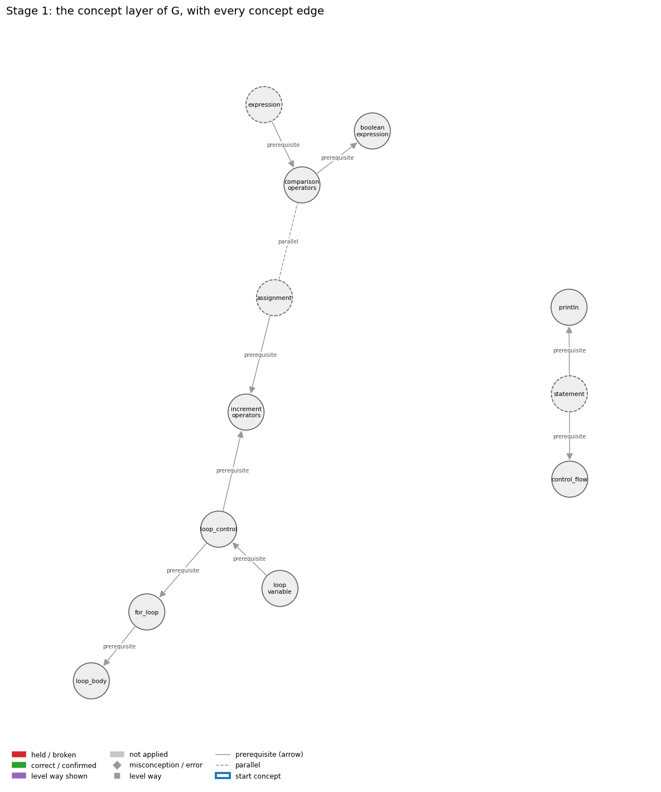
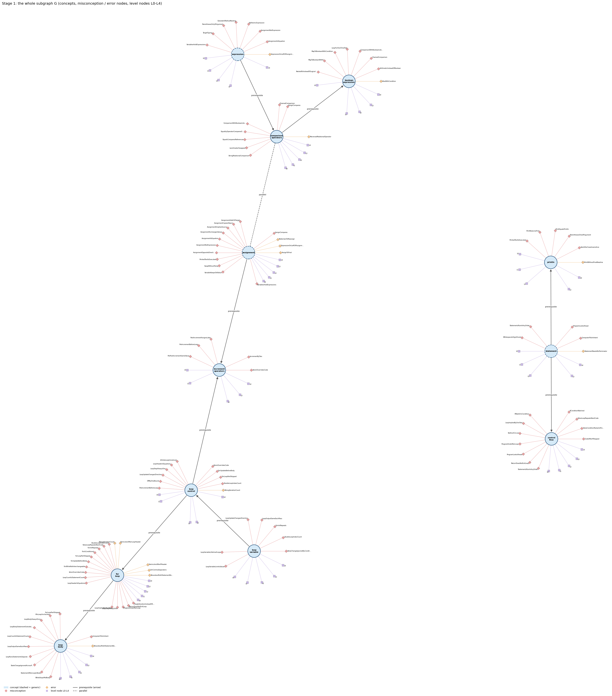
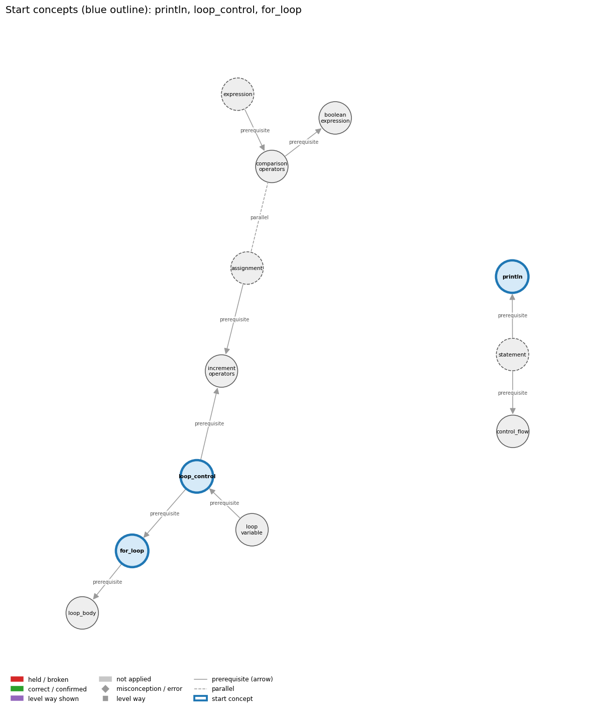
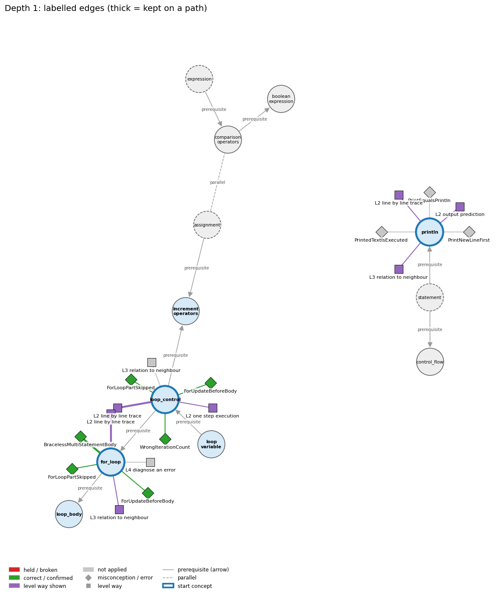
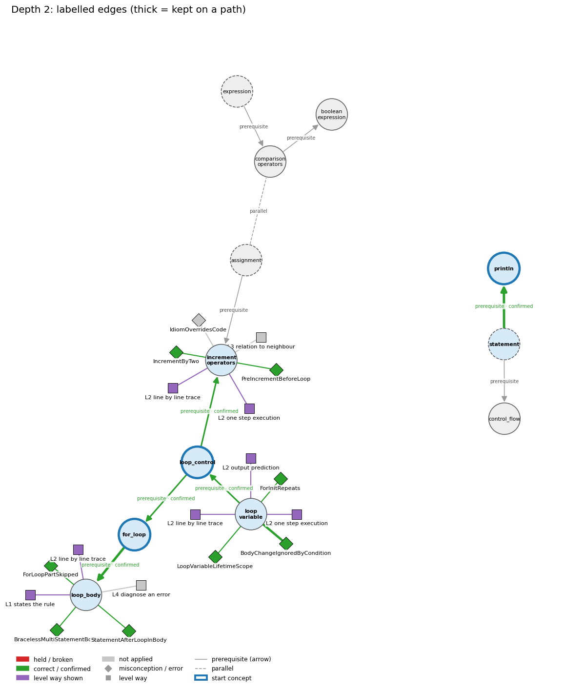
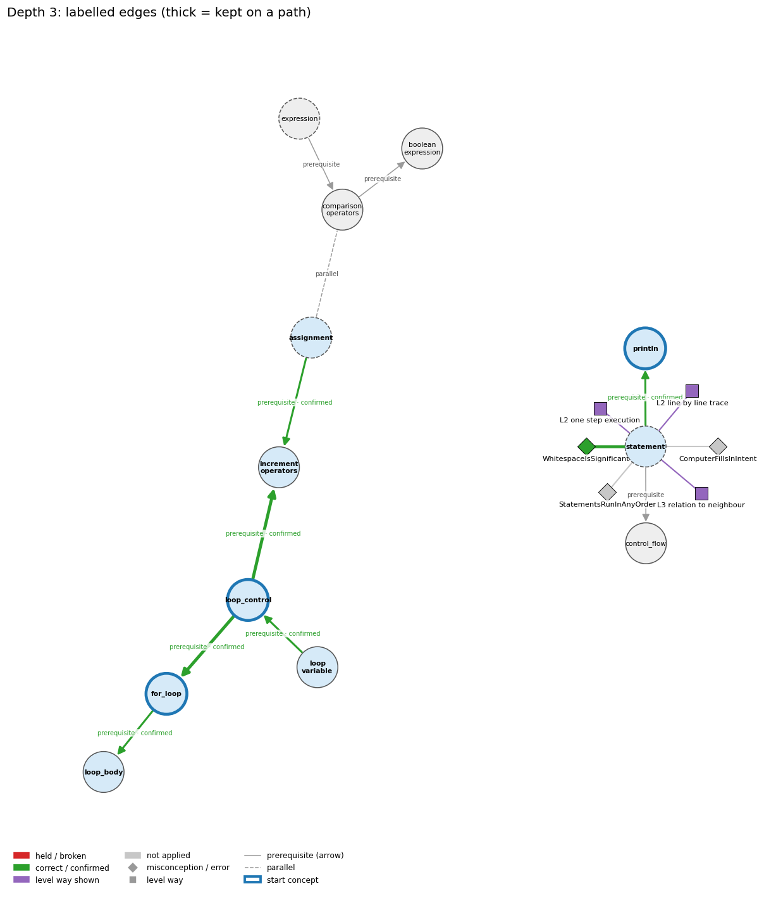
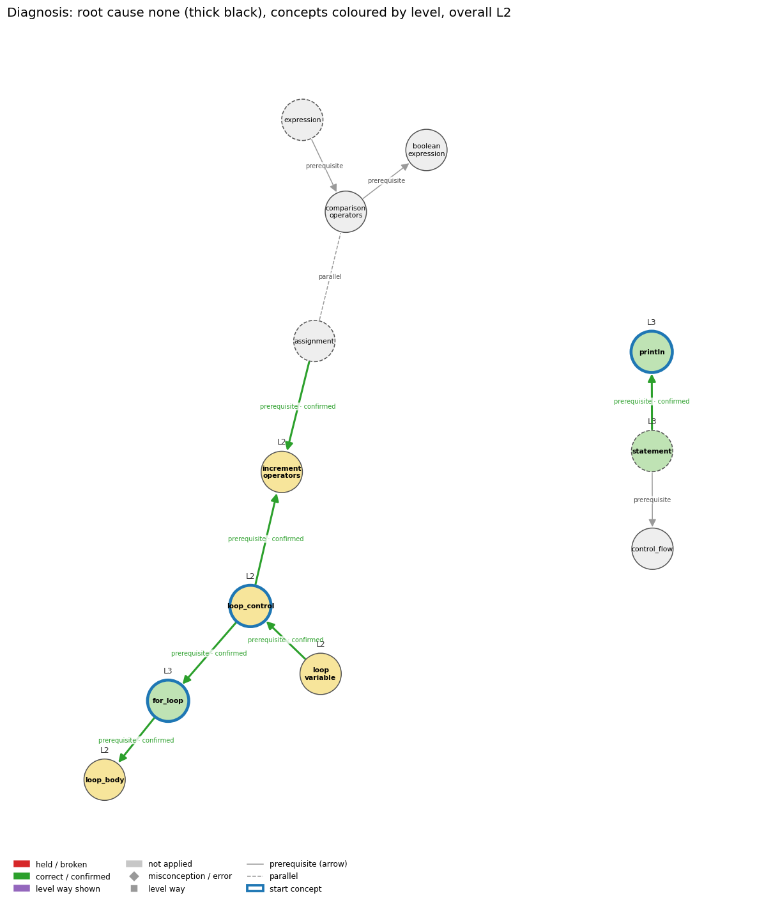

# Think on the Graph: every output of the run LP10

Files of this scenario: `input.json` (program, question, answer), `diagnosis.json`, `subgraph.json`, `traverse_log.txt`, `report.html` (this report as one full-page file, with the interactive graph `LP10_G.html`), `LP10.ipynb` (this report as a notebook).

## Level classification

This scenario tests **L2: line by line trace**. How the overall level is decided is explained in the [folder README](../../README.md).

- **Overall level: L2** (decided by: largest share)
- **Shares of the components:** L2 0.67, L3 0.33; coherent
- **Mistake held (root cause):** none
- **Expected by design:** overall L2; components `for_loop` L2, `loop_body` L2; held none; root none
- **Overall level matches the expected one:** yes

### How the overall level of this run was calculated

1. **Find the parts of the answer.** The answer touches 6 concepts (the components in the table below). Each one got its own level from what the student wrote about it.
2. **Is a real mistake held?** No wrong rule is held.
3. **Count the parts at each level:** 4 at L2, 2 at L3.
4. **Result.** Most parts (4 of 6) are at L2, so the overall level is **L2**.
5. **Check.** The levels of the parts are next to each other, so the answer is coherent.

| Component | Level | Decided by | Student's words |
|---|---|---|---|
| `for_loop` | L3 | way: relation to neighbour | 1 < 5 is true, the body i++ makes i 2, the update makes it 3; 3 < 5 is true, the body makes it 4, the update makes it 5; Only i++ was in the loop |
| `increment_operators` | L2 | way: one step execution | 1 < 5 is true, the body i++ makes i 2, the update makes it 3; 3 < 5 is true, the body makes it 4, the update makes it 5 |
| `loop_body` | L2 | way: line by line trace | 1 < 5 is true, the body i++ makes i 2, the update makes it 3; 3 < 5 is true, the body makes it 4, the update makes it 5 |
| `loop_control` | L2 | way: line by line trace | i starts at 1; 1 < 5 is true, the body i++ makes i 2, the update makes it 3; 3 < 5 is true, the body makes it 4, the update makes it 5; 5 < 5 is false; so the loop stops |
| `loop_variable` | L2 | way: line by line trace | i starts at 1; 1 < 5 is true, the body i++ makes i 2, the update makes it 3; 3 < 5 is true, the body makes it 4, the update makes it 5; 5 < 5 is false |
| `println` | L3 | way: relation to neighbour | Only i++ was in the loop; Then the two println lines print 5 and 5 |

Generic concepts with a level (not counted as components): `statement` L3.

## 0. Input
Program:
```java
int i, n = 5;
for (i = 1; i < n; i++)
    i++;
    System.out.println(i);
System.out.println(i);
```
Question: What is printed? Explain, pass by pass, what happens to i.

Student's answer: i starts at 1. 1 < 5 is true, the body i++ makes i 2, the update makes it 3. 3 < 5 is true, the body makes it 4, the update makes it 5. 5 < 5 is false, so the loop stops. Only i++ was in the loop. Then the two println lines print 5 and 5.
Settings: width 3, depth 3, prune llm, backend claude-cli, model claude-opus-5-5
## 1. Stage 1: the subgraph G from the code (no model)
Masked code (string and char literals and comments blanked; this is what the patterns see):
```
int i, n = 5;
for (i = 1; i < n; i++)
    i++;
    System.out.println(i);
System.out.println(i);
```
Which code text tagged which concept (a generic concept fires on almost any Java line; it starts the walk only if the answer repeats its tag):
| concept | generic | channel | matched text | line |
|---|---|---|---|---|
| assignment | True | pattern | '=' | 1 |
| boolean_expression | False | pattern | 'for (i = 1; i < n;' | 2 |
| comparison_operators | False | pattern | 'for (i = 1; i <' | 2 |
| control_flow | False | pattern | 'for (' | 2 |
| expression | True | pattern | 'i <' | 2 |
| expression | True | pattern | '= 5;' | 1 |
| for_loop | False | pattern | 'for (' | 2 |
| increment_operators | False | pattern | '++' | 2 |
| loop_body | False | pattern | 'for (' | 2 |
| loop_control | False | signal | 'for (i = 1; i < n; i++)' | 2 |
| loop_variable | False | pattern | 'for (i =' | 2 |
| println | False | pattern | 'System.out.println(' | 4 |
| statement | True | pattern | ';' | 1 |

G: 12 concept nodes (3 generic), 10 concept edges, 116 misconception / error edges, 84 misconception / error nodes, 60 level nodes, 120 level-misconception links, 2 connected piece(s).
Note: concept nodes form 2 pieces (the KG has no edge between them): assignment,boolean_expression,comparison_operators,expression,for_loop,increment_operators,loop_body,loop_control,loop_variable | control_flow,println,statement

Concept edges of G (the links the walk can read; `pre:` = prerequisite A -> B, `par:` = parallel):
| edge | type | rule (logic) |
|---|---|---|
| par:assignment~comparison_operators | parallel | x = y stores the value of y in x (a statement with a side effect); x == y only tests whether the two values are equal and gives a boolean. Writing = where == is meant is a compile error with int operands and a silent bug with boolean operands. |
| pre:assignment->increment_operators | prerequisite | i++ is shorthand for the assignment i = i + 1. |
| pre:comparison_operators->boolean_expression | prerequisite | A comparison such as x < y produces a boolean result; comparisons together with boolean logic provide the basis for decision-making. |
| pre:expression->comparison_operators | prerequisite | Comparison operators build expressions whose value is a boolean, so one must already know what an expression is to understand a < b. |
| pre:for_loop->loop_body | prerequisite | The statements in braces after the for header are the loop body; they run once on every pass, between the test and the increment, exactly as in a while loop. |
| pre:loop_control->for_loop | prerequisite | The for header is exactly the three control slots, and the body runs after the test and before the update on each pass. |
| pre:loop_control->increment_operators | prerequisite | The loop update i = i + 1 comes first; ++ (and +=) are then introduced as shorthand for that update. |
| pre:loop_variable->loop_control | prerequisite | The init, condition and update all act on the loop variable: the init sets it, the condition tests it, the update changes it. |
| pre:statement->control_flow | prerequisite | Control flow is the order in which statements run. |
| pre:statement->println | prerequisite | System.out.println(s); is itself a statement, so its line of output appears at its own place in the sequence. |

Misconception / error edges per concept (count), and level ways per concept (count):
| concept | misconception / error edges | level ways (L1-L4 + L0 non-misconception) |
|---|---|---|
| assignment | 15 | 24 |
| boolean_expression | 8 | 19 |
| comparison_operators | 8 | 20 |
| control_flow | 11 | 15 |
| expression | 8 | 19 |
| for_loop | 20 | 24 |
| increment_operators | 5 | 16 |
| loop_body | 12 | 14 |
| loop_control | 11 | 19 |
| loop_variable | 7 | 13 |
| println | 6 | 17 |
| statement | 5 | 19 |

**Figure 1**


**Figure 2**


## 2. Clauses and start concepts (no model)
The answer split into clauses (at sentence ends, ';', and before 'because' / 'so'; quotes removed):
| clause | text |
|---|---|
| c1 | i starts at 1 |
| c2 | 1 < 5 is true, the body i++ makes i 2, the update makes it 3 |
| c3 | 3 < 5 is true, the body makes it 4, the update makes it 5 |
| c4 | 5 < 5 is false |
| c5 | so the loop stops |
| c6 | Only i++ was in the loop |
| c7 | Then the two println lines print 5 and 5 |

start: BM25 of the answer against each tagged concept: println 39.72 (hits 1), loop_control 37.67 (hits 1), for_loop 36.95 (hits 1), increment_operators 28.25 (hits 1), loop_variable 23.71 (hits 1), loop_body 22.07 (hits 1), control_flow 15.77 (hits 1), comparison_operators 13.63 (hits 1), boolean_expression 12.23 (hits 1)

start: chosen println, loop_control, for_loop

start concepts (3): println, loop_control, for_loop

Start concepts: println, loop_control, for_loop

**Figure 3**


## 3. The walk, depth by depth
At each depth, for each current concept: the edges offered (a concept entering as a start concept offers its misconception / error edges and its level ways, as two families; otherwise it offers its concept edges), the prune prompt and the model's reply, then the label prompt(s) and the model's reply, parsed into label / clauses / confidence. Score = prune score x confidence.

### Depth 1: current concepts 'println', 'loop_control', 'for_loop'

#### println, misconceptions: 6 edges offered
Edges offered:
| edge |
|---|
| err:println->PrintWithoutFinalNewline \| wrong rule: Ends the output with print and expects it to appear right away. \| right rule: Finish a line of print calls with println; some systems hold print output until a newline is printed. |
| mis:println->IdentifierCaseInsensitive \| wrong rule: System.out.Println and System.out.println name the same method. \| right rule: Java is case-sensitive: names of variables, methods and classes that differ only in capitalization are different names. |
| mis:println->ParenthesesOnlyIfArgument \| wrong rule: println with nothing to print can be written System.out.println; without the parentheses. \| right rule: A method call always needs parentheses, so an empty line is printed with System.out.println();. |
| mis:println->PrintEqualsPrintln \| wrong rule: print and println do the same thing, so print(s1); print(s2); puts s1 and s2 on separate lines. \| right rule: println ends the line after printing and print does not, so print(s1); print(s2); puts s1 and s2 on the same line. |
| mis:println->PrintNewLineFirst \| wrong rule: println(s) prints a newline and then s. \| right rule: println(s) prints s and then the newline. |
| mis:println->PrintedTextIsExecuted \| wrong rule: System.out.println("x is 5"); sets x to 5 (text inside the quotes is run as code). \| right rule: Characters inside double quotes are printed literally; println only displays them and changes no variable. Only an assignment such as x = 5; sets x. |

Prune: the model's reply (edge id and score; the kept edges sum to 1):
```
mis:println->PrintEqualsPrintln (0.40), mis:println->PrintedTextIsExecuted (0.35), mis:println->PrintNewLineFirst (0.25)
```
Kept by pruning: mis:println->PrintEqualsPrintln (0.40), mis:println->PrintedTextIsExecuted (0.35), mis:println->PrintNewLineFirst (0.25)

Label prompt for the misconception / error edges (judged together). The model saw the program, the question, the numbered clauses, and these edges with their wrong rule and right rule:
| edge |
|---|
| mis:println->PrintEqualsPrintln \| wrong rule: print and println do the same thing, so print(s1); print(s2); puts s1 and s2 on separate lines. \| right rule: println ends the line after printing and print does not, so print(s1); print(s2); puts s1 and s2 on the same line. |
| mis:println->PrintedTextIsExecuted \| wrong rule: System.out.println("x is 5"); sets x to 5 (text inside the quotes is run as code). \| right rule: Characters inside double quotes are printed literally; println only displays them and changes no variable. Only an assignment such as x = 5; sets x. |
| mis:println->PrintNewLineFirst \| wrong rule: println(s) prints a newline and then s. \| right rule: println(s) prints s and then the newline. |
Model's reply:
```
mis:println->PrintEqualsPrintln | not applied | clauses: none | confidence: 0.9
mis:println->PrintedTextIsExecuted | not applied | clauses: none | confidence: 0.92
mis:println->PrintNewLineFirst | not applied | clauses: none | confidence: 0.85
```

Parsed labels:
| edge | label | prune score | confidence | score | clauses | words |
|---|---|---|---|---|---|---|
| mis:println->PrintEqualsPrintln | not applied |  |  | 0.0 |  |  |
| mis:println->PrintedTextIsExecuted | not applied |  |  | 0.0 |  |  |
| mis:println->PrintNewLineFirst | not applied |  |  | 0.0 |  |  |

#### println, level ways: 17 edges offered
Edges offered:
| edge |
|---|
| lvl:println@L0#0 \| level L0 way everyday_reading: Everyday reading: 'println' is just 'print', and 'new line' is something you do before writing. Java rule: println(x) prints x and then ends the line; println() alone just ends the line. |
| lvl:println@L0#3 \| level L0 way inconsistent_trace: Applies the println rule (print, then end line) unevenly: puts the newline before the text on one call and after it on another, or forgets that the next output starts on a new line. (here mixing in: "print and println behave the same (no newline difference)") |
| lvl:println@L1#0 \| level L1 way names_the_element: System.out.println is a library method that prints its argument followed by a line terminator ('print line'). |
| lvl:println@L1#1 \| level L1 way states_the_rule: println(String x) behaves as though it calls print(x) and then println(); println() terminates the current line by writing the line separator string. |
| lvl:println@L2#0 \| level L2 way line_by_line_trace: Evaluate the argument, print its characters at the current position, then write the line separator so the cursor moves to the beginning of the next line. |
| lvl:println@L2#1 \| level L2 way output_prediction: Output is the value's characters followed by a line break: println("Hello, "); println("World!"); prints two lines. |
| lvl:println@L2#2 \| level L2 way one_step_execution: One call appends the text and a line separator to the output; the cursor ends at the start of the next line; no variable changes and nothing is returned. |
| lvl:println@L3#0 \| level L3 way relation_to_neighbour: System.out.println(s); is a statement, so its line of output appears at its own place in the sequence. |
| lvl:println@L3#1 \| level L3 way relation_to_neighbour: println("s") outputs exactly the characters between the quotes and then ends the line. |
| lvl:println@L3#2 \| level L3 way relation_to_neighbour: print leaves the cursor on the line; println ends it; several prints followed by one println make one line. |
| lvl:println@L3#3 \| level L3 way relation_to_neighbour: println prints numbers with all their digits and always ends the line; printf formats each value by its conversion code and ends the line only where the format has %n or \n. |
| lvl:println@L3#4 \| level L3 way purpose_of_the_whole: Purpose: produce one complete line of output, e.g. each result on its own line, or end a line built with print. |
| lvl:println@L4#0 \| level L4 way predict_a_change: Replacing println with print joins the next output onto the same line (a typical logic error); the characters printed stay the same. |
| lvl:println@L4#1 \| level L4 way transfer_to_a_new_program: Use println when each output item belongs on its own line or to end a line; use print to continue a line and printf to control number formatting. |
| lvl:println@L4#2 \| level L4 way diagnose_an_error: rule broken: Finish a line of print calls with println. Kind: silent logic error. Trigger class: output ends with print, so the last line may not be shown or runs into the shell prompt |
| lvl:println@L4#3 \| level L4 way diagnose_an_error: rule broken: Method names are case-sensitive. Kind: compile-time. Trigger class: System.out.Println or system.out.println: cannot find symbol |
| lvl:println@L4#4 \| level L4 way diagnose_an_error: rule broken: Calls need parentheses. Kind: compile-time. Trigger class: System.out.println; without () |

Prune: the model's reply (edge id and score; the kept edges sum to 1):
```
{lvl:println@L3#0 (Score: 0.5)}
{lvl:println@L2#1 (Score: 0.3)}
{lvl:println@L2#0 (Score: 0.2)}
```
Kept by pruning: lvl:println@L3#0 (0.50), lvl:println@L2#1 (0.30), lvl:println@L2#0 (0.20)

Label prompt for level way lvl:println@L3#0 (the model saw the concept, the way's name 'relation to neighbour', its text, where the way stops and whether the words must be correct; no level):
> System.out.println(s); is a statement, so its line of output appears at its own place in the sequence.
>
> Where this way stops: Two correct but separate rules are L1. Executing the two in sequence is L2. A relational answer may be correct or a relational error.

Model's reply:
```
Label: shown
Clauses: 6, 7
Confidence: 0.7
```

Label prompt for level way lvl:println@L2#1 (the model saw only the concept, the way's name 'output prediction' and its text; no level):
> Output is the value's characters followed by a line break: println("Hello, "); println("World!"); prints two lines.

Model's reply:
```
Label: shown
Clauses: 7
Confidence: 0.75
```

Label prompt for level way lvl:println@L2#0 (the model saw only the concept, the way's name 'line by line trace' and its text; no level):
> Evaluate the argument, print its characters at the current position, then write the line separator so the cursor moves to the beginning of the next line.

Model's reply:
```
Label: shown
Clauses: 7
Confidence: 0.6
```

Parsed labels:
| edge | label | prune score | confidence | score | clauses | words |
|---|---|---|---|---|---|---|
| lvl:println@L3#0 | shown | 0.5 | 0.7 | 0.35 | c6, c7 | Only i++ was in the loop; Then the two println lines print 5 and 5 |
| lvl:println@L2#1 | shown | 0.3 | 0.75 | 0.22 | c7 | Then the two println lines print 5 and 5 |
| lvl:println@L2#0 | shown | 0.2 | 0.6 | 0.12 | c7 | Then the two println lines print 5 and 5 |

#### loop_control, misconceptions: 11 edges offered
Edges offered:
| edge |
|---|
| err:loop_control->WrongIterationCount \| wrong rule: Updates the loop counter so that the loop runs the wrong number of times. \| right rule: The init, test and update together decide the number of passes; trace them to check the count. |
| mis:loop_control->DoubleLoopIndexCount \| wrong rule: for (double x = 0.0; x <= 1.0; x += 0.1) runs exactly 11 times. \| right rule: Using a double as a for-loop index is legal but bad practice: the number of iterations depends on an equality test between double values, which may not give the result you expect. |
| mis:loop_control->ForLoopPartSkipped \| wrong rule: A pass of a loop may leave out one of its parts (the condition test, the body, the update, or the initialization). \| right rule: Each pass of a for loop runs test, then body, then update, every time; the initialization runs once, at the start. |
| mis:loop_control->ForUpdateBeforeBody \| wrong rule: The update part of a for header (e.g. i = i - 4) runs before the body on each pass, so the first pass already sees the updated value. \| right rule: The update runs after the body, before the next condition test; the first pass uses the initial value. |
| mis:loop_control->IdiomOverridesCode \| wrong rule: An array loop processes the whole array from index 0 to length-1 and increments its index at the end of the body, whatever the code says. \| right rule: The loop visits exactly the indices that its initialisation, guard and update produce, in the order in which its statements are written. |
| mis:loop_control->InfiniteLoopUnnoticed \| wrong rule: A while loop always stops on its own, even if nothing in its body can make the condition false. \| right rule: A while loop stops only when its condition is false at a check, so if no pass changes the variables in the condition, it never stops. |
| mis:loop_control->LoopHeaderIsEquations \| wrong rule: The initialization, condition and update of a for header are equations that all hold at the same time. \| right rule: The three header parts are statements run at different moments: init once, then condition test, body, update, repeated. |
| mis:loop_control->LoopStepAlwaysOne \| wrong rule: A loop variable always goes up or down by 1, whatever the update says (so i = i - 4 is read as i--). \| right rule: The loop variable changes exactly as the update expression says (i += 2, i = i - 4, i *= 2, ...). |
| mis:loop_control->LoopUpdateChangesDirection \| wrong rule: The update of the loop variable can change from pass to pass (e.g. switch direction) although the code is the same. \| right rule: The update expression is the same on every pass; the loop variable changes by the rule written in the update. |
| mis:loop_control->OffByOneBound \| wrong rule: i < n and i <= n mean the same, so the loop runs until i equals n and the last pass can use a[n]. \| right rule: for (i = 0; i < n; i++) runs n times with i going up to n - 1; with <= it runs n + 1 times and reaches i = n. |
| mis:loop_control->PreIncrementBeforeLoop \| wrong rule: With ++i in the update of for (int i = s; i < n; ++i), i is increased before the body runs, so the first pass uses s + 1. \| right rule: The update runs after each pass of the body, so with either ++i or i++ the first pass uses i = s. |

Prune: the model's reply (edge id and score; the kept edges sum to 1):
```
mis:loop_control->ForLoopPartSkipped (0.40), mis:loop_control->ForUpdateBeforeBody (0.30), err:loop_control->WrongIterationCount (0.30)
```
Kept by pruning: mis:loop_control->ForLoopPartSkipped (0.40), mis:loop_control->ForUpdateBeforeBody (0.30), err:loop_control->WrongIterationCount (0.30)

Label prompt for the misconception / error edges (judged together). The model saw the program, the question, the numbered clauses, and these edges with their wrong rule and right rule:
| edge |
|---|
| mis:loop_control->ForLoopPartSkipped \| wrong rule: A pass of a loop may leave out one of its parts (the condition test, the body, the update, or the initialization). \| right rule: Each pass of a for loop runs test, then body, then update, every time; the initialization runs once, at the start. |
| mis:loop_control->ForUpdateBeforeBody \| wrong rule: The update part of a for header (e.g. i = i - 4) runs before the body on each pass, so the first pass already sees the updated value. \| right rule: The update runs after the body, before the next condition test; the first pass uses the initial value. |
| err:loop_control->WrongIterationCount \| wrong rule: Updates the loop counter so that the loop runs the wrong number of times. \| right rule: The init, test and update together decide the number of passes; trace them to check the count. |
Model's reply:
```
mis:loop_control->ForLoopPartSkipped | correct | clauses: 2, 3, 4 | confidence: 0.85
mis:loop_control->ForUpdateBeforeBody | correct | clauses: 2, 3 | confidence: 0.85
err:loop_control->WrongIterationCount | correct | clauses: 2, 3, 4, 5 | confidence: 0.85
```

Parsed labels:
| edge | label | prune score | confidence | score | clauses | words |
|---|---|---|---|---|---|---|
| mis:loop_control->ForLoopPartSkipped | correct | 0.4 | 0.85 | 0.34 | c2, c3, c4 | 1 < 5 is true, the body i++ makes i 2, the update makes it 3; 3 < 5 is true, the body makes it 4, the update makes it 5; 5 < 5 is false |
| mis:loop_control->ForUpdateBeforeBody | correct | 0.3 | 0.85 | 0.26 | c2, c3 | 1 < 5 is true, the body i++ makes i 2, the update makes it 3; 3 < 5 is true, the body makes it 4, the update makes it 5 |
| err:loop_control->WrongIterationCount | correct | 0.3 | 0.85 | 0.26 | c2, c3, c4, c5 | 1 < 5 is true, the body i++ makes i 2, the update makes it 3; 3 < 5 is true, the body makes it 4, the update makes it 5; 5 < 5 is false; so the loop stops |

#### loop_control, level ways: 19 edges offered
Edges offered:
| edge |
|---|
| lvl:loop_control@L0#0 \| level L0 way everyday_reading: Folk meaning: in mathematics i = 0, i < n and i = i + 1 are equations or constraints that hold at the same time (and i = i + 1 is nonsense). In Java they are three actions run at different moments: init once, test before each pass, update after each pass. |
| lvl:loop_control@L0#3 \| level L0 way inconsistent_trace: Applies the init-test-update rule (LT) unevenly: updates before the body on some passes, skips the test or the update on a pass, or re-runs the init. (here mixing in: "++i in the for-update runs before the body each pass") |
| lvl:loop_control@L1#0 \| level L1 way names_the_element: Loop control is the init / continuation condition / increment scheme on an index variable that decides how many passes a loop makes and with which values. |
| lvl:loop_control@L1#1 \| level L1 way states_the_rule: Initialize an index variable, test a loop-continuation condition on it before each pass, and increment it as the last action of each pass; for (<initialize>; <boolean expression>; <increment>) packages the three. Choosing the loop: for when the passes are counted by an index, while when the loop runs until a condition changes, do-while when the body must run at least once; any one can be rewritten as another, so choose the clearest. |
| lvl:loop_control@L2#0 \| level L2 way line_by_line_trace: init (once) -> test -> body -> update -> test -> body -> update ... -> test false -> exit. |
| lvl:loop_control@L2#1 \| level L2 way output_prediction: The number of passes and the values seen follow from the three parts: for (int i = 0; i <= N; i++) makes N+1 passes with i = 0..N; with i < N it makes N passes; i += 2 visits every second value. |
| lvl:loop_control@L2#2 \| level L2 way one_step_execution: One update changes only the loop variable, by exactly the rule written (i++ adds 1, i = i - 4 subtracts 4); one test reads it and returns true or false without changing it. |
| lvl:loop_control@L3#0 \| level L3 way relation_to_neighbour: All three control parts act on the loop variable: the init sets it, the condition tests it, the update changes it. |
| lvl:loop_control@L3#1 \| level L3 way relation_to_neighbour: The for header is exactly the three control slots, separated by semicolons; the body runs after the test and before the update. |
| lvl:loop_control@L3#2 \| level L3 way relation_to_neighbour: The update i = i + 1 is usually written i++ (or i += k for other steps); as a whole update statement ++i and i++ are equivalent. |
| lvl:loop_control@L3#3 \| level L3 way relation_to_neighbour: A loop is infinite when the update never moves the variable toward making the condition false (e.g. condition i > 3 with update i = i + 1). |
| lvl:loop_control@L3#4 \| level L3 way relation_to_neighbour: The continuation condition fixes the number of iterations, so a sharper bound (i <= n/i instead of i < n) can make a program dramatically faster. |
| lvl:loop_control@L3#5 \| level L3 way relation_to_neighbour: The initialization and the condition of a loop fix how many times it runs; one wrong bound makes it run once too many or too few. |
| lvl:loop_control@L3#6 \| level L3 way purpose_of_the_whole: Plan: counter-controlled loop - the loop variable is a stepper that walks a predictable sequence of values (0..N-1, 1..N, every 2nd value) and fixes the number of passes in advance. |
| lvl:loop_control@L4#0 \| level L4 way predict_a_change: Changing < to <= adds one pass; starting at 1 instead of 0 removes one; doubling the step halves the passes; reversing init and bound with i-- visits the same values in reverse order (and still processes the same set only if both ends are adjusted). |
| lvl:loop_control@L4#1 \| level L4 way diagnose_an_error: rule broken: The number of passes is fixed by the init, the test and the update together. Kind: silent logic error. Trigger class: Wrong start value, < vs <=, a wrong step, or an extra update of the counter in the body (or outside the loop): the loop runs too few or too many passes (off by one, or skips values). |
| lvl:loop_control@L4#2 \| level L4 way transfer_to_a_new_program: Use explicit init/test/update control when the passes are counted or follow a fixed step; when the number of passes depends on data computed in the body, control the loop by that data (a while condition) instead. |
| lvl:loop_control@L4#3 \| level L4 way diagnose_an_error: rule broken: The update must move the loop variable toward making the condition false. Kind: silent logic error. Trigger class: An update in the wrong direction or a condition that the update cannot falsify (e.g. i > 3 with i++, or i != 10 with i += 3): infinite loop. |
| lvl:loop_control@L4#4 \| level L4 way diagnose_an_error: rule broken: Do not control a loop by an equality test on double values. Kind: silent logic error. Trigger class: for (double x = 0.0; x < 1.0; x += 0.1): after ten additions x is 0.9999999999999999, so the loop makes 11 passes instead of the intended 10. |

Prune: the model's reply (edge id and score; the kept edges sum to 1):
```
{lvl:loop_control@L2#0 (Score: 0.5)}
{lvl:loop_control@L3#1 (Score: 0.3)}
{lvl:loop_control@L2#2 (Score: 0.2)}
```
Kept by pruning: lvl:loop_control@L2#0 (0.50), lvl:loop_control@L3#1 (0.30), lvl:loop_control@L2#2 (0.20)

Label prompt for level way lvl:loop_control@L2#0 (the model saw only the concept, the way's name 'line by line trace' and its text; no level):
> init (once) -> test -> body -> update -> test -> body -> update ... -> test false -> exit.

Model's reply:
```
Label: shown
Clauses: 1, 2, 3, 4, 5
Confidence: 0.95
```

Label prompt for level way lvl:loop_control@L3#1 (the model saw the concept, the way's name 'relation to neighbour', its text, where the way stops and whether the words must be correct; no level):
> The for header is exactly the three control slots, separated by semicolons; the body runs after the test and before the update.
>
> Where this way stops: Two correct but separate rules are L1. Executing the two in sequence is L2. A relational answer may be correct or a relational error.

Model's reply:
```
Label: not shown
Clauses: none
Confidence: 0.6
```

Label prompt for level way lvl:loop_control@L2#2 (the model saw only the concept, the way's name 'one step execution' and its text; no level):
> One update changes only the loop variable, by exactly the rule written (i++ adds 1, i = i - 4 subtracts 4); one test reads it and returns true or false without changing it.

Model's reply:
```
Label: shown
Clauses: 2, 3, 4
Confidence: 0.9
```

Parsed labels:
| edge | label | prune score | confidence | score | clauses | words |
|---|---|---|---|---|---|---|
| lvl:loop_control@L2#0 | shown | 0.5 | 0.95 | 0.47 | c1, c2, c3, c4, c5 | i starts at 1; 1 < 5 is true, the body i++ makes i 2, the update makes it 3; 3 < 5 is true, the body makes it 4, the update makes it 5; 5 < 5 is false; so the loop stops |
| lvl:loop_control@L3#1 | not applied |  |  | 0.0 |  |  |
| lvl:loop_control@L2#2 | shown | 0.2 | 0.9 | 0.18 | c2, c3, c4 | 1 < 5 is true, the body i++ makes i 2, the update makes it 3; 3 < 5 is true, the body makes it 4, the update makes it 5; 5 < 5 is false |

#### for_loop, misconceptions: 20 edges offered
Edges offered:
| edge |
|---|
| err:for_loop->BracelessMultiStatementBody \| wrong rule: Indenting several statements under an if or for makes them all part of its body, even without braces. \| right rule: Without braces only the first statement belongs to the if/for; the rest run once, after it. |
| err:for_loop->ForCommaSeparators \| wrong rule: Writes for (int i = 0, i < n, i++). \| right rule: The three parts of a for header are separated by semicolons; commas only separate several statements inside the init or the update part. |
| err:for_loop->SemicolonAfterIfHeader \| wrong rule: if (x > 0); System.out.println("positive"); prints only for positive x. \| right rule: The ; ends the if with an empty statement, so the next line always runs. |
| err:for_loop->SemicolonAfterLoopHeader \| wrong rule: Puts a ; right after for (...) or while (...). \| right rule: A ; right after the loop header is a null (empty) loop body, so the statements written after it are not repeated by the loop. |
| err:for_loop->WrongIterationCount \| wrong rule: Updates the loop counter so that the loop runs the wrong number of times. \| right rule: The init, test and update together decide the number of passes; trace them to check the count. |
| mis:for_loop->DoubleLoopIndexCount \| wrong rule: for (double x = 0.0; x <= 1.0; x += 0.1) runs exactly 11 times. \| right rule: Using a double as a for-loop index is legal but bad practice: the number of iterations depends on an equality test between double values, which may not give the result you expect. |
| mis:for_loop->FalseLoopRepeatsNextCode \| wrong rule: A loop is an iterative if-else: while the condition is true the body repeats, and when it is false the code after the loop repeats. \| right rule: Only the body is repeated; once the condition is false the code after the loop runs once. |
| mis:for_loop->ForInitRepeats \| wrong rule: The initialization of a for loop runs again after a pass of the body. \| right rule: The initialization runs exactly once, before the first condition test. |
| mis:for_loop->ForIsConditional \| wrong rule: The body of a for statement executes at most once. \| right rule: The body of a for statement runs once for every pass on which the condition is true, which can be many times. |
| mis:for_loop->ForLoopPartSkipped \| wrong rule: A pass of a loop may leave out one of its parts (the condition test, the body, the update, or the initialization). \| right rule: Each pass of a for loop runs test, then body, then update, every time; the initialization runs once, at the start. |
| mis:for_loop->ForUpdateBeforeBody \| wrong rule: The update part of a for header (e.g. i = i - 4) runs before the body on each pass, so the first pass already sees the updated value. \| right rule: The update runs after the body, before the next condition test; the first pass uses the initial value. |
| mis:for_loop->ForWhileNotInterchangeable \| wrong rule: Some loops can only be written with for, others only with while. \| right rule: Any for loop can be rewritten as a while loop and vice versa; for just packages init, test and update. |
| mis:for_loop->IdiomOverridesCode \| wrong rule: An array loop processes the whole array from index 0 to length-1 and increments its index at the end of the body, whatever the code says. \| right rule: The loop visits exactly the indices that its initialisation, guard and update produce, in the order in which its statements are written. |
| mis:for_loop->LoopCountIsStatementCount \| wrong rule: The repeat count of a counted loop says how many of the body statements are executed. \| right rule: The repeat count is how many times the whole body runs; every pass runs all body statements. |
| mis:for_loop->LoopHeaderIsEquations \| wrong rule: The initialization, condition and update of a for header are equations that all hold at the same time. \| right rule: The three header parts are statements run at different moments: init once, then condition test, body, update, repeated. |
| mis:for_loop->LoopImpliedByOneTest \| wrong rule: Testing one case is enough; Java will repeat the test for the other values by itself. \| right rule: A statement runs once each time control reaches it; repeating a test for many values needs a loop. |
| mis:for_loop->LoopStepAlwaysOne \| wrong rule: A loop variable always goes up or down by 1, whatever the update says (so i = i - 4 is read as i--). \| right rule: The loop variable changes exactly as the update expression says (i += 2, i = i - 4, i *= 2, ...). |
| mis:for_loop->ProgramEndsAfterLoop \| wrong rule: When a loop finishes the program ends, so code after the loop never runs. \| right rule: When the loop condition becomes false, control continues with the first statement after the loop. |
| mis:for_loop->ReturnDoesNotExitLoop \| wrong rule: A return inside a loop does not end the loop; it sets a value each pass (the last one is returned) or returns several values. \| right rule: When return executes, the method ends at once, so the loop stops on that pass. |
| mis:for_loop->SingleIterationInsteadOfLoop \| wrong rule: A task that must be repeated is written once, without a loop, as if one pass were enough. \| right rule: A step that must happen several times (or an unknown number of times) needs a loop such as while or for; code without a loop runs once. |

Prune: the model's reply (edge id and score; the kept edges sum to 1):
```
err:for_loop->BracelessMultiStatementBody (0.50), mis:for_loop->ForUpdateBeforeBody (0.25), mis:for_loop->ForLoopPartSkipped (0.25)
```
Kept by pruning: err:for_loop->BracelessMultiStatementBody (0.50), mis:for_loop->ForUpdateBeforeBody (0.25), mis:for_loop->ForLoopPartSkipped (0.25)

Label prompt for the misconception / error edges (judged together). The model saw the program, the question, the numbered clauses, and these edges with their wrong rule and right rule:
| edge |
|---|
| err:for_loop->BracelessMultiStatementBody \| wrong rule: Indenting several statements under an if or for makes them all part of its body, even without braces. \| right rule: Without braces only the first statement belongs to the if/for; the rest run once, after it. |
| mis:for_loop->ForUpdateBeforeBody \| wrong rule: The update part of a for header (e.g. i = i - 4) runs before the body on each pass, so the first pass already sees the updated value. \| right rule: The update runs after the body, before the next condition test; the first pass uses the initial value. |
| mis:for_loop->ForLoopPartSkipped \| wrong rule: A pass of a loop may leave out one of its parts (the condition test, the body, the update, or the initialization). \| right rule: Each pass of a for loop runs test, then body, then update, every time; the initialization runs once, at the start. |
Model's reply:
```
err:for_loop->BracelessMultiStatementBody | correct | clauses: 6, 7 | confidence: 0.93
mis:for_loop->ForUpdateBeforeBody | correct | clauses: 2, 3 | confidence: 0.92
mis:for_loop->ForLoopPartSkipped | correct | clauses: 2, 3, 4 | confidence: 0.85
```

Parsed labels:
| edge | label | prune score | confidence | score | clauses | words |
|---|---|---|---|---|---|---|
| err:for_loop->BracelessMultiStatementBody | correct | 0.5 | 0.93 | 0.47 | c6, c7 | Only i++ was in the loop; Then the two println lines print 5 and 5 |
| mis:for_loop->ForUpdateBeforeBody | correct | 0.25 | 0.92 | 0.23 | c2, c3 | 1 < 5 is true, the body i++ makes i 2, the update makes it 3; 3 < 5 is true, the body makes it 4, the update makes it 5 |
| mis:for_loop->ForLoopPartSkipped | correct | 0.25 | 0.85 | 0.21 | c2, c3, c4 | 1 < 5 is true, the body i++ makes i 2, the update makes it 3; 3 < 5 is true, the body makes it 4, the update makes it 5; 5 < 5 is false |

#### for_loop, level ways: 24 edges offered
Edges offered:
| edge |
|---|
| lvl:for_loop@L0#0 \| level L0 way everyday_reading: Folk meaning: English 'for each ...' or 'for 10 times' names a whole collection or a count to be handled at once, and a maths reading treats the header as simultaneous conditions. A Java for is a while loop in compact form: one init, then test-body-update repeated, one pass at a time. |
| lvl:for_loop@L0#11 \| level L0 way inconsistent_trace: Applies the for sequencing rule (LT) unevenly: updates before the body on the first pass only, re-runs the init after a pass, or skips the test on some passes. (here mixing in: "The body of a for statement executes at most once") |
| lvl:for_loop@L1#0 \| level L1 way names_the_element: The for statement is a loop that packages an initialization, a loop-continuation condition and an increment in its header around a body. |
| lvl:for_loop@L1#1 \| level L1 way states_the_rule: Syntax: for (<initialize>; <boolean expression>; <increment>) { <statements> }, with the three parts separated by semicolons; it is, with only a few exceptions, equivalent to <initialize>; while (<boolean expression>) { <statements> <increment>; }. |
| lvl:for_loop@L2#0 \| level L2 way line_by_line_trace: Run the initializer once; then repeatedly: test the condition (stop if false), execute the body, run the update. |
| lvl:for_loop@L2#1 \| level L2 way output_prediction: A for statement has no value; the passes it makes are fixed by its header: for (int i = 1; i <= N; i++) sum += i; leaves sum = N(N+1)/2, and for (int i = 2; i <= 8; i += 2) prints 2, 4, 6, 8,. |
| lvl:for_loop@L2#2 \| level L2 way one_step_execution: One pass: the test reads the loop variable; the body applies its changes once; the update then changes the loop variable by its rule; the initializer changes state only once, before the first test. |
| lvl:for_loop@L3#0 \| level L3 way relation_to_neighbour: The for header is exactly the three loop-control slots; the body runs after the test and before the update on each pass. |
| lvl:for_loop@L3#1 \| level L3 way relation_to_neighbour: A for may be the body of another for: the inner for runs its complete set of passes for every single pass of the outer one. |
| lvl:for_loop@L3#2 \| level L3 way relation_to_neighbour: for (int i = 0; i < N; i++) gives i each valid index 0..N-1 exactly once in increasing order, the standard way to process every array element. |
| lvl:for_loop@L3#3 \| level L3 way relation_to_neighbour: A simulation runs a fixed number of trials with an outer for loop (for (int t = 0; t < T; t++)), each trial simulated inside the body. |
| lvl:for_loop@L3#4 \| level L3 way relation_to_neighbour: In a for loop, continue skips the rest of the body and transfers control directly to the increment, then the next test; this is one of the few places where the for/while equivalence fails. |
| lvl:for_loop@L3#5 \| level L3 way relation_to_neighbour: A variable declared in the for header is in scope only in the header and the body, so it cannot be used after the loop. |
| lvl:for_loop@L3#6 \| level L3 way relation_to_neighbour: A fencepost loop is a for loop that handles one item (the first or last) outside the loop so that separators come out n-1 times for n items. |
| lvl:for_loop@L3#7 \| level L3 way relation_to_neighbour: A flag search loop is a for loop that sets a boolean flag when some pass finds the target and leaves it set afterwards; the flag must be declared before the loop. |
| lvl:for_loop@L3#8 \| level L3 way purpose_of_the_whole: Plan: counted loop / counter-controlled repetition - do the body a known number of times, with the loop variable as a stepper (index, term number, trial number). |
| lvl:for_loop@L4#0 \| level L4 way predict_a_change: Rewriting a for as the equivalent while (init before, update at the end of the body) keeps behaviour, except that continue then skips the update and the loop variable stays in scope after the loop. Changing the bound or the step changes the pass count predictably (< to <= adds one pass). |
| lvl:for_loop@L4#1 \| level L4 way diagnose_an_error: rule broken: The three parts of a for header are separated by semicolons; commas only separate several statements inside the init or the update. Kind: compile-time. Trigger class: Writing for (int i = 0, i < n, i++): the compiler parses the commas as more declarators in the init and reports a syntax error. |
| lvl:for_loop@L4#2 \| level L4 way diagnose_an_error: rule broken: A ; right after while (...) or for (...) is an empty statement that is the whole loop body; the block written next is not repeated. Kind: silent logic error. Trigger class: for (...); { body } runs the body once after the loop ends; while (cond); with a cond that the empty body cannot change hangs forever (infinite loop) when cond starts true. |
| lvl:for_loop@L4#3 \| level L4 way transfer_to_a_new_program: Use for when there is an initialization, an increment and a continuation test and the loop variable is not needed after the loop; use while when the loop variable is needed later or the number of passes depends on what happens in the body. |
| lvl:for_loop@L4#4 \| level L4 way diagnose_an_error: rule broken: A ; right after if (...) is an empty statement that forms the whole then branch; the following statement or block is no longer part of the if. Kind: silent logic error. Trigger class: Any if (cond); followed by a statement or block: that statement runs for every input, whatever cond is (it compiles without error). |
| lvl:for_loop@L4#5 \| level L4 way diagnose_an_error: rule broken: The number of passes is fixed by the init, the test and the update together. Kind: silent logic error. Trigger class: Wrong start value, < vs <=, a wrong step, or an extra update of the counter in the body (or outside the loop): the loop runs too few or too many passes (off by one, or skips values). |
| lvl:for_loop@L4#6 \| level L4 way diagnose_an_error: rule broken: Without braces, the body of an if, while or for is exactly one statement; indentation does not add statements to it. Kind: silent logic error. Trigger class: A braceless header followed by two or more indented statements: only the first is controlled, the others run once, after the if/loop, on every input. |
| lvl:for_loop@L4#7 \| level L4 way diagnose_an_error: rule broken: A variable declared in the for initializer exists only inside the for statement. Kind: compile-time. Trigger class: Reading i after for (int i = 0; ...) {...}: 'cannot find symbol'. |

Prune: the model's reply (edge id and score; the kept edges sum to 1):
```
{lvl:for_loop@L2#0 (Score: 0.45)}
{lvl:for_loop@L4#6 (Score: 0.35)}
{lvl:for_loop@L3#0 (Score: 0.2)}
```
Kept by pruning: lvl:for_loop@L2#0 (0.45), lvl:for_loop@L4#6 (0.35), lvl:for_loop@L3#0 (0.20)

Label prompt for level way lvl:for_loop@L2#0 (the model saw only the concept, the way's name 'line by line trace' and its text; no level):
> Run the initializer once; then repeatedly: test the condition (stop if false), execute the body, run the update.

Model's reply:
```
Label: shown
Clauses: 1, 2, 3, 4, 5
Confidence: 0.95
```

Label prompt for level way lvl:for_loop@L4#6 (the model saw the concept, the way's name 'diagnose an error', its text, where the way stops and whether the words must be correct; no level):
> rule broken: Without braces, the body of an if, while or for is exactly one statement; indentation does not add statements to it. Kind: silent logic error. Trigger class: A braceless header followed by two or more indented statements: only the first is controlled, the others run once, after the if/loop, on every input.
>
> Where this way stops: Locating and fixing the mistake for one given failing case is L3. A compiler-flagged slip fixed from the message is weak evidence.

Model's reply:
```
Label: not shown
Clauses: none
Confidence: 0.6
```

Label prompt for level way lvl:for_loop@L3#0 (the model saw the concept, the way's name 'relation to neighbour', its text, where the way stops and whether the words must be correct; no level):
> The for header is exactly the three loop-control slots; the body runs after the test and before the update on each pass.
>
> Where this way stops: Two correct but separate rules are L1. Executing the two in sequence is L2. A relational answer may be correct or a relational error.

Model's reply:
```
Label: shown
Clauses: 2, 3, 6
Confidence: 0.7
```

Parsed labels:
| edge | label | prune score | confidence | score | clauses | words |
|---|---|---|---|---|---|---|
| lvl:for_loop@L2#0 | shown | 0.45 | 0.95 | 0.43 | c1, c2, c3, c4, c5 | i starts at 1; 1 < 5 is true, the body i++ makes i 2, the update makes it 3; 3 < 5 is true, the body makes it 4, the update makes it 5; 5 < 5 is false; so the loop stops |
| lvl:for_loop@L4#6 | not applied |  |  | 0.0 |  |  |
| lvl:for_loop@L3#0 | shown | 0.2 | 0.7 | 0.14 | c2, c3, c6 | 1 < 5 is true, the body i++ makes i 2, the update makes it 3; 3 < 5 is true, the body makes it 4, the update makes it 5; Only i++ was in the loop |

**Kept on a path at this depth** (best N in tiers: held misconception / broken edge, then held error, then correct / confirmed / shown):

lvl:loop_control@L2#0 [shown, tier 2, 0.47], err:for_loop->BracelessMultiStatementBody [correct, tier 2, 0.47], lvl:for_loop@L2#0 [shown, tier 2, 0.43]

**Clause coverage after this depth:**
| clause | text | covered by |
|---|---|---|
| c1 | i starts at 1 | not covered yet |
| c2 | 1 < 5 is true, the body i++ makes i 2, the update makes it 3 | mis:loop_control->ForLoopPartSkipped |
| c3 | 3 < 5 is true, the body makes it 4, the update makes it 5 | mis:loop_control->ForLoopPartSkipped |
| c4 | 5 < 5 is false | mis:loop_control->ForLoopPartSkipped |
| c5 | so the loop stops | err:loop_control->WrongIterationCount |
| c6 | Only i++ was in the loop | err:for_loop->BracelessMultiStatementBody |
| c7 | Then the two println lines print 5 and 5 | err:for_loop->BracelessMultiStatementBody |

**Uncovered clauses bring in (BM25 of the uncovered clauses against unvisited concepts):** increment_operators (4.73), loop_variable (2.57), loop_body (2.55)

**Graph check, not yet read (the walk may not stop while these remain):** own edges of increment_operators, own edges of loop_body, own edges of loop_variable, pre:for_loop->loop_body, pre:loop_control->for_loop, pre:loop_control->increment_operators, pre:loop_variable->loop_control, pre:statement->println

**Figure 4 (the graph after depth 1)**


### Depth 2: current concepts 'println', 'loop_control', 'for_loop', 'increment_operators', 'loop_variable', 'loop_body'

#### println, concept edges: 1 edges offered
Edges offered:
| edge |
|---|
| pre:statement->println \| rule: System.out.println(s); is itself a statement, so its line of output appears at its own place in the sequence. |

Prune: the model's reply (edge id and score; the kept edges sum to 1):
```
{pre:statement->println (Score: 1.0)}
```
Kept by pruning: pre:statement->println (1.00)

Label prompt for concept edge pre:statement->println (statement -> println, prerequisite):
> System.out.println(s); is itself a statement, so its line of output appears at its own place in the sequence.

Model's reply:
```
Label: confirmed
Clauses: 6, 7
Confidence: 0.85
```

Parsed labels:
| edge | label | prune score | confidence | score | clauses | words |
|---|---|---|---|---|---|---|
| pre:statement->println | confirmed | 1.0 | 0.85 | 0.85 | c6, c7 | Only i++ was in the loop; Then the two println lines print 5 and 5 |

#### loop_control, concept edges: 3 edges offered
Edges offered:
| edge |
|---|
| pre:loop_control->for_loop \| rule: The for header is exactly the three control slots, and the body runs after the test and before the update on each pass. |
| pre:loop_control->increment_operators \| rule: The loop update i = i + 1 comes first; ++ (and +=) are then introduced as shorthand for that update. |
| pre:loop_variable->loop_control \| rule: The init, condition and update all act on the loop variable: the init sets it, the condition tests it, the update changes it. |

Prune: the model's reply (edge id and score; the kept edges sum to 1):
```
{pre:loop_control->for_loop (Score: 0.5)}
{pre:loop_variable->loop_control (Score: 0.35)}
{pre:loop_control->increment_operators (Score: 0.15)}
```
Kept by pruning: pre:loop_control->for_loop (0.50), pre:loop_variable->loop_control (0.35), pre:loop_control->increment_operators (0.15)

Label prompt for concept edge pre:loop_control->for_loop (loop_control -> for_loop, prerequisite):
> The for header is exactly the three control slots, and the body runs after the test and before the update on each pass.

Model's reply:
```
Label: confirmed
Clauses: 2, 3, 4, 6
Confidence: 0.9
```

Label prompt for concept edge pre:loop_variable->loop_control (loop_variable -> loop_control, prerequisite):
> The init, condition and update all act on the loop variable: the init sets it, the condition tests it, the update changes it.

Model's reply:
```
Label: confirmed
Clauses: 1, 2, 3, 4
Confidence: 0.9
```

Label prompt for concept edge pre:loop_control->increment_operators (loop_control -> increment_operators, prerequisite):
> The loop update i = i + 1 comes first; ++ (and +=) are then introduced as shorthand for that update.

Model's reply:
```
Label: confirmed
Clauses: 2, 3
Confidence: 0.8
```

Parsed labels:
| edge | label | prune score | confidence | score | clauses | words |
|---|---|---|---|---|---|---|
| pre:loop_control->for_loop | confirmed | 0.5 | 0.9 | 0.45 | c2, c3, c4, c6 | 1 < 5 is true, the body i++ makes i 2, the update makes it 3; 3 < 5 is true, the body makes it 4, the update makes it 5; 5 < 5 is false; Only i++ was in the loop |
| pre:loop_variable->loop_control | confirmed | 0.35 | 0.9 | 0.32 | c1, c2, c3, c4 | i starts at 1; 1 < 5 is true, the body i++ makes i 2, the update makes it 3; 3 < 5 is true, the body makes it 4, the update makes it 5; 5 < 5 is false |
| pre:loop_control->increment_operators | confirmed | 0.15 | 0.8 | 0.12 | c2, c3 | 1 < 5 is true, the body i++ makes i 2, the update makes it 3; 3 < 5 is true, the body makes it 4, the update makes it 5 |

#### for_loop, concept edges: 1 edges offered
Edges offered:
| edge |
|---|
| pre:for_loop->loop_body \| rule: The statements in braces after the for header are the loop body; they run once on every pass, between the test and the increment, exactly as in a while loop. |
| pre:loop_control->for_loop \| rule: The for header is exactly the three control slots, and the body runs after the test and before the update on each pass. |

Prune: the model's reply (edge id and score; the kept edges sum to 1):
```
{pre:for_loop->loop_body (Score: 1.0)}
```
Kept by pruning: pre:for_loop->loop_body (1.00)

Label prompt for concept edge pre:for_loop->loop_body (for_loop -> loop_body, prerequisite):
> The statements in braces after the for header are the loop body; they run once on every pass, between the test and the increment, exactly as in a while loop.

Model's reply:
```
Label: confirmed
Clauses: 2, 3, 6
Confidence: 0.9
```

Parsed labels:
| edge | label | prune score | confidence | score | clauses | words |
|---|---|---|---|---|---|---|
| pre:for_loop->loop_body | confirmed | 1.0 | 0.9 | 0.9 | c2, c3, c6 | 1 < 5 is true, the body i++ makes i 2, the update makes it 3; 3 < 5 is true, the body makes it 4, the update makes it 5; Only i++ was in the loop |

#### increment_operators, misconceptions: 5 edges offered
Edges offered:
| edge |
|---|
| mis:increment_operators->IdiomOverridesCode \| wrong rule: An array loop processes the whole array from index 0 to length-1 and increments its index at the end of the body, whatever the code says. \| right rule: The loop visits exactly the indices that its initialisation, guard and update produce, in the order in which its statements are written. |
| mis:increment_operators->IncrementByTwo \| wrong rule: i++ increases i by 2. \| right rule: i++ (and ++i) increases i by exactly 1. |
| mis:increment_operators->PostIncrementAssignsLater \| wrong rule: i = i++ increases i by 1. \| right rule: i++ evaluates to the old value, so i = i++ stores the old value back. |
| mis:increment_operators->PreIncrementBeforeLoop \| wrong rule: ++i in the for-update runs before the body each pass \| right rule: The update runs after each pass of the body, so with either ++i or i++ the first pass uses i = s. |
| mis:increment_operators->PrePostIncrementSameValue \| wrong rule: x = i++ and x = ++i store the same value in x. \| right rule: Both increment i, but ++i has the value after the increment and i++ the value before. |

Prune: the model's reply (edge id and score; the kept edges sum to 1):
```
mis:increment_operators->IncrementByTwo (0.45), mis:increment_operators->PreIncrementBeforeLoop (0.30), mis:increment_operators->IdiomOverridesCode (0.25)
```
Kept by pruning: mis:increment_operators->IncrementByTwo (0.45), mis:increment_operators->PreIncrementBeforeLoop (0.30), mis:increment_operators->IdiomOverridesCode (0.25)

Label prompt for the misconception / error edges (judged together). The model saw the program, the question, the numbered clauses, and these edges with their wrong rule and right rule:
| edge |
|---|
| mis:increment_operators->IncrementByTwo \| wrong rule: i++ increases i by 2. \| right rule: i++ (and ++i) increases i by exactly 1. |
| mis:increment_operators->PreIncrementBeforeLoop \| wrong rule: ++i in the for-update runs before the body each pass \| right rule: The update runs after each pass of the body, so with either ++i or i++ the first pass uses i = s. |
| mis:increment_operators->IdiomOverridesCode \| wrong rule: An array loop processes the whole array from index 0 to length-1 and increments its index at the end of the body, whatever the code says. \| right rule: The loop visits exactly the indices that its initialisation, guard and update produce, in the order in which its statements are written. |
Model's reply:
```
mis:increment_operators->IncrementByTwo | correct | clauses: 2, 3 | confidence: 0.9
mis:increment_operators->PreIncrementBeforeLoop | correct | clauses: 2, 3 | confidence: 0.7
mis:increment_operators->IdiomOverridesCode | not applied | clauses: none | confidence: 0.75
```

Parsed labels:
| edge | label | prune score | confidence | score | clauses | words |
|---|---|---|---|---|---|---|
| mis:increment_operators->IncrementByTwo | correct | 0.45 | 0.9 | 0.41 | c2, c3 | 1 < 5 is true, the body i++ makes i 2, the update makes it 3; 3 < 5 is true, the body makes it 4, the update makes it 5 |
| mis:increment_operators->PreIncrementBeforeLoop | correct | 0.3 | 0.7 | 0.21 | c2, c3 | 1 < 5 is true, the body i++ makes i 2, the update makes it 3; 3 < 5 is true, the body makes it 4, the update makes it 5 |
| mis:increment_operators->IdiomOverridesCode | not applied |  |  | 0.0 |  |  |

#### increment_operators, level ways: 16 edges offered
Edges offered:
| edge |
|---|
| lvl:increment_operators@L0#0 \| level L0 way everyday_reading: Folk meaning: '++' reads as 'plus plus' (add twice) or as a maths symbol with no effect, and i++ inside an expression is read as 'add 1 at some later time'. In Java i++ and ++i each add exactly 1 to i immediately when evaluated; they differ only in the value the expression yields. |
| lvl:increment_operators@L0#3 \| level L0 way inconsistent_trace: Applies the increment rule (LT) unevenly: uses the old value in one expression and the new value in another for the same i++, or performs the increment at the end of the loop body instead of where it is written. (here mixing in: "x = i++ and x = ++i store the same value in x") |
| lvl:increment_operators@L1#0 \| level L1 way names_the_element: ++ and -- are the increment and decrement operators: shorthand that adds 1 to (or subtracts 1 from) a numeric variable. |
| lvl:increment_operators@L1#1 \| level L1 way states_the_rule: ++ has the same effect as i = i + 1 and -- the same as i = i - 1; as statements i++ and ++i are the same, but in expressions ++i has the value after the increment and i++ the value before. |
| lvl:increment_operators@L2#0 \| level L2 way line_by_line_trace: i++: fetch the value of i (that is the expression's value), then store i + 1 into i. ++i: store i + 1 into i, and the new value is the expression's value. Both happen before the rest of the enclosing expression continues. |
| lvl:increment_operators@L2#1 \| level L2 way output_prediction: With i = 5: x = i++ gives x = 5, i = 6; x = ++i gives x = 6, i = 6; i = i++ leaves i = 5. |
| lvl:increment_operators@L2#2 \| level L2 way one_step_execution: One execution changes exactly one variable (i) by exactly 1 and returns its old (i++) or new (++i) value. |
| lvl:increment_operators@L3#0 \| level L3 way relation_to_neighbour: The usual for-loop update is i++ (shorthand for i = i + 1); as a stand-alone update statement ++i and i++ give the same loop. |
| lvl:increment_operators@L3#1 \| level L3 way relation_to_neighbour: Inside a larger expression the result depends on which value (old or new) the increment yields and on left-to-right evaluation, e.g. j += j++ in Exercise 1.3.6. |
| lvl:increment_operators@L3#2 \| level L3 way relation_to_neighbour: i++ is shorthand for the assignment i = i + 1 (and i += k for i = i + k), so it changes the variable's stored value. |
| lvl:increment_operators@L3#3 \| level L3 way relation_to_neighbour: i++, ++i and i += 1 all add 1 to i; ++ and -- change a variable only by one and are normally used for integers, while i += k works for any amount and with any arithmetic operator (-=, *=, /=, %=). |
| lvl:increment_operators@L3#4 \| level L3 way purpose_of_the_whole: Plan/role: the update of a stepper or counter (count++ in a counter, i++ in a counted loop). |
| lvl:increment_operators@L4#0 \| level L4 way predict_a_change: As a stand-alone statement, replacing i++ by ++i, i += 1 or i = i + 1 preserves behaviour; inside an expression (x = i++ vs x = ++i) the swap changes the value used by 1. |
| lvl:increment_operators@L4#1 \| level L4 way transfer_to_a_new_program: Use i++ / i-- as stand-alone statements and in for-loop updates; avoid them inside larger expressions (x = ++i), as the book does, and use += for steps other than 1. |
| lvl:increment_operators@L4#2 \| level L4 way diagnose_an_error: rule broken: i = i++ stores the old value back. Kind: silent logic error. Trigger class: Writing i = i++ to increment: i never changes, so a loop driven by it is infinite. |
| lvl:increment_operators@L4#3 \| level L4 way diagnose_an_error: rule broken: ++ and -- apply only to a variable. Kind: compile-time. Trigger class: Applying ++ to a value that is not a variable, e.g. 5++ or (i + 1)++: compile-time error. |

Prune: the model's reply (edge id and score; the kept edges sum to 1):
```
{lvl:increment_operators@L2#2 (Score: 0.4)}
{lvl:increment_operators@L3#0 (Score: 0.35)}
{lvl:increment_operators@L2#0 (Score: 0.25)}
```
Kept by pruning: lvl:increment_operators@L2#2 (0.40), lvl:increment_operators@L3#0 (0.35), lvl:increment_operators@L2#0 (0.25)

Label prompt for level way lvl:increment_operators@L2#2 (the model saw only the concept, the way's name 'one step execution' and its text; no level):
> One execution changes exactly one variable (i) by exactly 1 and returns its old (i++) or new (++i) value.

Model's reply:
```
Label: shown
Clauses: 2, 3
Confidence: 0.75
```

Label prompt for level way lvl:increment_operators@L3#0 (the model saw the concept, the way's name 'relation to neighbour', its text, where the way stops and whether the words must be correct; no level):
> The usual for-loop update is i++ (shorthand for i = i + 1); as a stand-alone update statement ++i and i++ give the same loop.
>
> Where this way stops: Two correct but separate rules are L1. Executing the two in sequence is L2. A relational answer may be correct or a relational error.

Model's reply:
```
Label: not shown
Clauses: none
Confidence: 0.8
```

Label prompt for level way lvl:increment_operators@L2#0 (the model saw only the concept, the way's name 'line by line trace' and its text; no level):
> i++: fetch the value of i (that is the expression's value), then store i + 1 into i. ++i: store i + 1 into i, and the new value is the expression's value. Both happen before the rest of the enclosing expression continues.

Model's reply:
```
Label: shown
Clauses: 2, 3
Confidence: 0.7
```

Parsed labels:
| edge | label | prune score | confidence | score | clauses | words |
|---|---|---|---|---|---|---|
| lvl:increment_operators@L2#2 | shown | 0.4 | 0.75 | 0.3 | c2, c3 | 1 < 5 is true, the body i++ makes i 2, the update makes it 3; 3 < 5 is true, the body makes it 4, the update makes it 5 |
| lvl:increment_operators@L3#0 | not applied |  |  | 0.0 |  |  |
| lvl:increment_operators@L2#0 | shown | 0.25 | 0.7 | 0.17 | c2, c3 | 1 < 5 is true, the body i++ makes i 2, the update makes it 3; 3 < 5 is true, the body makes it 4, the update makes it 5 |

#### loop_variable, misconceptions: 7 edges offered
Edges offered:
| edge |
|---|
| mis:loop_variable->BodyChangeIgnoredByCondition \| wrong rule: Changing the loop variable inside the body does not affect the loop condition; the loop still runs its planned number of times. \| right rule: The condition is tested with the current value of the variable, including changes made in the body. |
| mis:loop_variable->DoubleLoopIndexCount \| wrong rule: for (double x = 0.0; x <= 1.0; x += 0.1) runs exactly 11 times. \| right rule: Using a double as a for-loop index is legal but bad practice: the number of iterations depends on an equality test between double values, which may not give the result you expect. |
| mis:loop_variable->ForInitRepeats \| wrong rule: The initialization of a for loop runs again after a pass of the body. \| right rule: The initialization runs exactly once, before the first condition test. |
| mis:loop_variable->LoopOutputSameEachPass \| wrong rule: A loop prints the same thing on every pass; the changing loop variable does not affect what the body does. \| right rule: The body uses the current value of the loop variable, so its output can differ on each pass. |
| mis:loop_variable->LoopUpdateChangesDirection \| wrong rule: The update of the loop variable can change from pass to pass (e.g. switch direction) although the code is the same. \| right rule: The update expression is the same on every pass; the loop variable changes by the rule written in the update. |
| mis:loop_variable->LoopVariableLifetimeScope \| wrong rule: The for variable i is a new variable on every pass rather than one variable changed by the update. \| right rule: The for variable i is created once by the init, and the update changes that same variable on every pass. |
| mis:loop_variable->LoopVariableLimitsValues \| wrong rule: The range of the loop variable limits the values that can be read or printed inside the loop. \| right rule: The loop variable only counts passes; other values read or printed in the body are not bounded by it. |

Prune: the model's reply (edge id and score; the kept edges sum to 1):
```
mis:loop_variable->BodyChangeIgnoredByCondition (0.60), mis:loop_variable->LoopVariableLifetimeScope (0.25), mis:loop_variable->ForInitRepeats (0.15)
```
Kept by pruning: mis:loop_variable->BodyChangeIgnoredByCondition (0.60), mis:loop_variable->LoopVariableLifetimeScope (0.25), mis:loop_variable->ForInitRepeats (0.15)

Label prompt for the misconception / error edges (judged together). The model saw the program, the question, the numbered clauses, and these edges with their wrong rule and right rule:
| edge |
|---|
| mis:loop_variable->BodyChangeIgnoredByCondition \| wrong rule: Changing the loop variable inside the body does not affect the loop condition; the loop still runs its planned number of times. \| right rule: The condition is tested with the current value of the variable, including changes made in the body. |
| mis:loop_variable->LoopVariableLifetimeScope \| wrong rule: The for variable i is a new variable on every pass rather than one variable changed by the update. \| right rule: The for variable i is created once by the init, and the update changes that same variable on every pass. |
| mis:loop_variable->ForInitRepeats \| wrong rule: The initialization of a for loop runs again after a pass of the body. \| right rule: The initialization runs exactly once, before the first condition test. |
Model's reply:
```
mis:loop_variable->BodyChangeIgnoredByCondition | correct | clauses: 2, 3, 4, 5 | confidence: 0.9
mis:loop_variable->LoopVariableLifetimeScope | correct | clauses: 2, 3, 7 | confidence: 0.75
mis:loop_variable->ForInitRepeats | correct | clauses: 1, 3 | confidence: 0.8
```

Parsed labels:
| edge | label | prune score | confidence | score | clauses | words |
|---|---|---|---|---|---|---|
| mis:loop_variable->BodyChangeIgnoredByCondition | correct | 0.6 | 0.9 | 0.54 | c2, c3, c4, c5 | 1 < 5 is true, the body i++ makes i 2, the update makes it 3; 3 < 5 is true, the body makes it 4, the update makes it 5; 5 < 5 is false; so the loop stops |
| mis:loop_variable->LoopVariableLifetimeScope | correct | 0.25 | 0.75 | 0.19 | c2, c3, c7 | 1 < 5 is true, the body i++ makes i 2, the update makes it 3; 3 < 5 is true, the body makes it 4, the update makes it 5; Then the two println lines print 5 and 5 |
| mis:loop_variable->ForInitRepeats | correct | 0.15 | 0.8 | 0.12 | c1, c3 | i starts at 1; 3 < 5 is true, the body makes it 4, the update makes it 5 |

#### loop_variable, level ways: 13 edges offered
Edges offered:
| edge |
|---|
| lvl:loop_variable@L0#0 \| level L0 way everyday_reading: Folk meaning: in maths a variable like the i in a sum ranges over all its values at once, and 'i from 1 to 10' is a set. A Java loop variable is one storage location holding one value at a time, changed step by step by the update. |
| lvl:loop_variable@L0#5 \| level L0 way inconsistent_trace: Applies the init-test-update rule (LT, loop_control) unevenly to the loop variable: forgets one update, applies a different step on some passes, or re-initializes it mid-loop. (here mixing in: "The update of the loop variable can change from pass to pass (e.g. switch direction) although the code is the same") |
| lvl:loop_variable@L1#0 \| level L1 way names_the_element: A loop variable (loop-control counter, index) is a variable that is initialized, tested and updated in order to control a loop. |
| lvl:loop_variable@L1#1 \| level L1 way states_the_rule: The loop variable is set once by the initialization, tested by the continuation condition before each pass and updated (usually incremented) at the end of each pass; declared in a for header, it is not available after the loop. |
| lvl:loop_variable@L2#0 \| level L2 way line_by_line_trace: Its value is set by the init, read by the test, read by the body, then changed by the update, and the cycle repeats; the body sees the value set by the previous update. |
| lvl:loop_variable@L2#1 \| level L2 way output_prediction: Across passes the loop variable takes a predictable sequence of values, e.g. 4, 5, ..., 10 in TenHellos, and after a while loop it holds the first value that failed the test (11). |
| lvl:loop_variable@L2#2 \| level L2 way one_step_execution: One update changes only the loop variable (i = i + 1 turns 4 into 5); one test reads it and yields true or false; an assignment to it in the body changes what the next test sees. |
| lvl:loop_variable@L3#0 \| level L3 way relation_to_neighbour: The init, condition and update all act on the loop variable: the init sets it, the condition tests it, the update changes it. |
| lvl:loop_variable@L3#1 \| level L3 way relation_to_neighbour: In a while loop the loop variable is declared and initialized before the loop and updated inside the body, so it remains available after the loop. |
| lvl:loop_variable@L3#2 \| level L3 way purpose_of_the_whole: Role: stepper - a variable stepping through a systematic, predictable succession of values; it counts passes and often serves as an index. |
| lvl:loop_variable@L4#0 \| level L4 way predict_a_change: Shifting the start and the bound by the same amount keeps the number of passes but changes the values the body sees; assigning to the loop variable inside the body changes the pass count. |
| lvl:loop_variable@L4#1 \| level L4 way transfer_to_a_new_program: Use a dedicated loop variable (int) when passes are counted or indexed; do not use a double loop variable, and do not reuse it for other roles inside the body. |
| lvl:loop_variable@L4#2 \| level L4 way diagnose_an_error: rule broken: Update the loop variable only in the update part (or in one place in a while body). Kind: silent logic error. Trigger class: An extra i++ in the body (or modifying i elsewhere): passes are skipped or repeated, and the loop may overshoot an != bound and never end. |

Prune: the model's reply (edge id and score; the kept edges sum to 1):
```
{lvl:loop_variable@L2#0 (Score: 0.4)}
{lvl:loop_variable@L2#2 (Score: 0.35)}
{lvl:loop_variable@L2#1 (Score: 0.25)}
```
Kept by pruning: lvl:loop_variable@L2#0 (0.40), lvl:loop_variable@L2#2 (0.35), lvl:loop_variable@L2#1 (0.25)

Label prompt for level way lvl:loop_variable@L2#0 (the model saw only the concept, the way's name 'line by line trace' and its text; no level):
> Its value is set by the init, read by the test, read by the body, then changed by the update, and the cycle repeats; the body sees the value set by the previous update.

Model's reply:
```
Label: shown
Clauses: 1, 2, 3, 4
Confidence: 0.9
```

Label prompt for level way lvl:loop_variable@L2#2 (the model saw only the concept, the way's name 'one step execution' and its text; no level):
> One update changes only the loop variable (i = i + 1 turns 4 into 5); one test reads it and yields true or false; an assignment to it in the body changes what the next test sees.

Model's reply:
```
Label: shown
Clauses: 2, 3, 4
Confidence: 0.9
```

Label prompt for level way lvl:loop_variable@L2#1 (the model saw only the concept, the way's name 'output prediction' and its text; no level):
> Across passes the loop variable takes a predictable sequence of values, e.g. 4, 5, ..., 10 in TenHellos, and after a while loop it holds the first value that failed the test (11).

Model's reply:
```
Label: shown
Clauses: 1, 2, 3, 4, 7
Confidence: 0.93
```

Parsed labels:
| edge | label | prune score | confidence | score | clauses | words |
|---|---|---|---|---|---|---|
| lvl:loop_variable@L2#0 | shown | 0.4 | 0.9 | 0.36 | c1, c2, c3, c4 | i starts at 1; 1 < 5 is true, the body i++ makes i 2, the update makes it 3; 3 < 5 is true, the body makes it 4, the update makes it 5; 5 < 5 is false |
| lvl:loop_variable@L2#2 | shown | 0.35 | 0.9 | 0.32 | c2, c3, c4 | 1 < 5 is true, the body i++ makes i 2, the update makes it 3; 3 < 5 is true, the body makes it 4, the update makes it 5; 5 < 5 is false |
| lvl:loop_variable@L2#1 | shown | 0.25 | 0.93 | 0.23 | c1, c2, c3, c4, c7 | i starts at 1; 1 < 5 is true, the body i++ makes i 2, the update makes it 3; 3 < 5 is true, the body makes it 4, the update makes it 5; 5 < 5 is false; Then the two println lines print 5 and 5 |

#### loop_body, misconceptions: 12 edges offered
Edges offered:
| edge |
|---|
| err:loop_body->BracelessMultiStatementBody \| wrong rule: Indenting several statements under an if or for makes them all part of its body, even without braces. \| right rule: Without braces only the first statement belongs to the if/for; the rest run once, after it. |
| mis:loop_body->ComputerFillsInIntent \| wrong rule: The computer fills in omitted steps or values that the programmer meant, e.g. REPEAT 4 [FORWARD 30] draws a square without a turn command. \| right rule: The computer executes only what the code states; every needed step and value must be written. |
| mis:loop_body->ForLoopPartSkipped \| wrong rule: A pass of a loop may leave out one of its parts (the condition test, the body, the update, or the initialization). \| right rule: Each pass of a for loop runs test, then body, then update, every time; the initialization runs once, at the start. |
| mis:loop_body->IfInLoopUnchecked \| wrong rule: An if inside a loop body runs its branch on every pass without testing its condition. \| right rule: The if condition is tested again on every pass, with the current values, so the branch runs only on passes where it is true. |
| mis:loop_body->LoopBodyAlwaysOnce \| wrong rule: The loop body always runs at least once, even if the condition is false at the start. \| right rule: A while or for body runs zero times when the condition is false at the start. |
| mis:loop_body->LoopBodyStatementOutsideLoop \| wrong rule: Some statements inside the braces of a loop body are not repeated; they run once, before or after the loop. \| right rule: Every statement inside the loop braces is part of the body and runs on every pass. |
| mis:loop_body->LoopCountIsStatementCount \| wrong rule: The repeat count of a counted loop says how many of the body statements are executed. \| right rule: The repeat count is how many times the whole body runs; every pass runs all body statements. |
| mis:loop_body->LoopOutputSameEachPass \| wrong rule: A loop prints the same thing on every pass; the changing loop variable does not affect what the body does. \| right rule: The body uses the current value of the loop variable, so its output can differ on each pass. |
| mis:loop_body->LoopRunsStatementsSeparately \| wrong rule: A loop runs its first body statement all N times, then its second body statement all N times. \| right rule: Each pass runs the whole body in order, so the body statements interleave: S1, S2, S1, S2, ... |
| mis:loop_body->StateChangeIgnoredAcrossPasses \| wrong rule: Values changed by one pass of a loop (other than the loop variable) do not affect later passes. \| right rule: Each pass starts from the state left by the previous pass, so a change in one pass carries into the next ones. |
| mis:loop_body->StatementAfterLoopInBody \| wrong rule: A statement written after the loop is repeated with the loop body. \| right rule: The body ends at the closing brace (or after its single statement); code after it runs once, after the loop ends. |
| mis:loop_body->WhileStopsMidBody \| wrong rule: The loop stops the moment the condition becomes false, even in the middle of the body. \| right rule: The condition is tested only before each pass, so the whole body finishes before the loop can stop. |

Prune: the model's reply (edge id and score; the kept edges sum to 1):
```
err:loop_body->BracelessMultiStatementBody (0.50), mis:loop_body->StatementAfterLoopInBody (0.30), mis:loop_body->ForLoopPartSkipped (0.20)
```
Kept by pruning: err:loop_body->BracelessMultiStatementBody (0.50), mis:loop_body->StatementAfterLoopInBody (0.30), mis:loop_body->ForLoopPartSkipped (0.20)

Label prompt for the misconception / error edges (judged together). The model saw the program, the question, the numbered clauses, and these edges with their wrong rule and right rule:
| edge |
|---|
| err:loop_body->BracelessMultiStatementBody \| wrong rule: Indenting several statements under an if or for makes them all part of its body, even without braces. \| right rule: Without braces only the first statement belongs to the if/for; the rest run once, after it. |
| mis:loop_body->StatementAfterLoopInBody \| wrong rule: A statement written after the loop is repeated with the loop body. \| right rule: The body ends at the closing brace (or after its single statement); code after it runs once, after the loop ends. |
| mis:loop_body->ForLoopPartSkipped \| wrong rule: A pass of a loop may leave out one of its parts (the condition test, the body, the update, or the initialization). \| right rule: Each pass of a for loop runs test, then body, then update, every time; the initialization runs once, at the start. |
Model's reply:
```
err:loop_body->BracelessMultiStatementBody | correct | clauses: 6, 7 | confidence: 0.9
mis:loop_body->StatementAfterLoopInBody | correct | clauses: 6, 7 | confidence: 0.75
mis:loop_body->ForLoopPartSkipped | correct | clauses: 2, 3, 4 | confidence: 0.9
```

Parsed labels:
| edge | label | prune score | confidence | score | clauses | words |
|---|---|---|---|---|---|---|
| err:loop_body->BracelessMultiStatementBody | correct | 0.5 | 0.9 | 0.45 | c6, c7 | Only i++ was in the loop; Then the two println lines print 5 and 5 |
| mis:loop_body->StatementAfterLoopInBody | correct | 0.3 | 0.75 | 0.22 | c6, c7 | Only i++ was in the loop; Then the two println lines print 5 and 5 |
| mis:loop_body->ForLoopPartSkipped | correct | 0.2 | 0.9 | 0.18 | c2, c3, c4 | 1 < 5 is true, the body i++ makes i 2, the update makes it 3; 3 < 5 is true, the body makes it 4, the update makes it 5; 5 < 5 is false |

#### loop_body, level ways: 14 edges offered
Edges offered:
| edge |
|---|
| lvl:loop_body@L0#0 \| level L0 way everyday_reading: Folk meaning: an everyday 'repeat this' instruction can be read loosely - a helper fills in missing steps, does each step N times in turn, or stops partway. A Java loop body is exactly the statements inside its braces (or one statement), all executed in order on every pass. |
| lvl:loop_body@L0#6 \| level L0 way inconsistent_trace: Applies the body rule (LT) unevenly: runs all body statements on some passes but only some on others, includes the statement after the loop on some passes, or uses stale values from the first pass later. (here mixing in: "The loop body always runs at least once, even if the condition is false at the start") |
| lvl:loop_body@L1#0 \| level L1 way names_the_element: The loop body is the statement block that a loop repeats on each pass. |
| lvl:loop_body@L1#1 \| level L1 way states_the_rule: The body is the block after the loop header; braces are optional only if it is a single statement, in which case only that one statement is repeated. |
| lvl:loop_body@L2#0 \| level L2 way line_by_line_trace: On each pass the body's statements run in order, first to last, after a true test (and, in a for loop, before the update); the next pass starts from the state left by this one. |
| lvl:loop_body@L2#1 \| level L2 way output_prediction: The body's output on each pass depends on the current values, so successive passes can print different lines: TenHellos prints '4th Hello', '5th Hello', ...; the number of executions of each body statement equals the number of passes. |
| lvl:loop_body@L2#2 \| level L2 way one_step_execution: One pass of the body changes exactly the variables it assigns (e.g. print i and v, double v, increment i) and these changes carry into the next test and pass. |
| lvl:loop_body@L3#0 \| level L3 way relation_to_neighbour: The accumulator update (sum += x) is placed inside the body so it runs once per pass, while the accumulator is declared and initialized before the loop. |
| lvl:loop_body@L3#1 \| level L3 way relation_to_neighbour: count++ sits inside the body, often under an if, so it runs once on each pass that matches; the counter is declared before the loop. |
| lvl:loop_body@L3#2 \| level L3 way relation_to_neighbour: The body is what the while repeats; the condition is tested only between complete executions of it. |
| lvl:loop_body@L3#3 \| level L3 way purpose_of_the_whole: Plan: the body is the 'process one item / one step' part of a loop plan: each pass performs the same process on a new value (next element, next bet, next term). |
| lvl:loop_body@L4#0 \| level L4 way predict_a_change: Moving a statement from inside the body to after the loop changes it from running once per pass to once in total (and vice versa); reordering two body statements that share a variable changes the results (e.g. increment before vs after use). |
| lvl:loop_body@L4#1 \| level L4 way diagnose_an_error: rule broken: Without braces, the body of an if, while or for is exactly one statement; indentation does not add statements to it. Kind: silent logic error. Trigger class: A braceless header followed by two or more indented statements: only the first is controlled, the others run once, after the if/loop, on every input. |
| lvl:loop_body@L4#2 \| level L4 way transfer_to_a_new_program: Put inside the body exactly what must happen once per pass; put set-up before the loop and final reporting after it. Always brace a multi-statement body. |

Prune: the model's reply (edge id and score; the kept edges sum to 1):
```
{lvl:loop_body@L4#1 (Score: 0.5)}
{lvl:loop_body@L2#0 (Score: 0.3)}
{lvl:loop_body@L1#1 (Score: 0.2)}
```
Kept by pruning: lvl:loop_body@L4#1 (0.50), lvl:loop_body@L2#0 (0.30), lvl:loop_body@L1#1 (0.20)

Label prompt for level way lvl:loop_body@L4#1 (the model saw the concept, the way's name 'diagnose an error', its text, where the way stops and whether the words must be correct; no level):
> rule broken: Without braces, the body of an if, while or for is exactly one statement; indentation does not add statements to it. Kind: silent logic error. Trigger class: A braceless header followed by two or more indented statements: only the first is controlled, the others run once, after the if/loop, on every input.
>
> Where this way stops: Locating and fixing the mistake for one given failing case is L3. A compiler-flagged slip fixed from the message is weak evidence.

Model's reply:
```
Label: not shown
Clauses: none
Confidence: 0.6
```

Label prompt for level way lvl:loop_body@L2#0 (the model saw only the concept, the way's name 'line by line trace' and its text; no level):
> On each pass the body's statements run in order, first to last, after a true test (and, in a for loop, before the update); the next pass starts from the state left by this one.

Model's reply:
```
Label: shown
Clauses: 2, 3
Confidence: 0.9
```

Label prompt for level way lvl:loop_body@L1#1 (the model saw only the concept, the way's name 'states the rule' and its text; no level):
> The body is the block after the loop header; braces are optional only if it is a single statement, in which case only that one statement is repeated.

Model's reply:
```
Label: shown
Clauses: 6, 7
Confidence: 0.85
```

Parsed labels:
| edge | label | prune score | confidence | score | clauses | words |
|---|---|---|---|---|---|---|
| lvl:loop_body@L4#1 | not applied |  |  | 0.0 |  |  |
| lvl:loop_body@L2#0 | shown | 0.3 | 0.9 | 0.27 | c2, c3 | 1 < 5 is true, the body i++ makes i 2, the update makes it 3; 3 < 5 is true, the body makes it 4, the update makes it 5 |
| lvl:loop_body@L1#1 | shown | 0.2 | 0.85 | 0.17 | c6, c7 | Only i++ was in the loop; Then the two println lines print 5 and 5 |

**Kept on a path at this depth** (best N in tiers: held misconception / broken edge, then held error, then correct / confirmed / shown):

pre:for_loop->loop_body [confirmed, tier 2, 0.90], pre:statement->println [confirmed, tier 2, 0.85], mis:loop_variable->BodyChangeIgnoredByCondition [correct, tier 2, 0.54]

reached across pre:statement->println, entered next: statement

**Clause coverage after this depth:**
| clause | text | covered by |
|---|---|---|
| c1 | i starts at 1 | pre:loop_variable->loop_control |
| c2 | 1 < 5 is true, the body i++ makes i 2, the update makes it 3 | mis:loop_control->ForLoopPartSkipped |
| c3 | 3 < 5 is true, the body makes it 4, the update makes it 5 | mis:loop_control->ForLoopPartSkipped |
| c4 | 5 < 5 is false | mis:loop_control->ForLoopPartSkipped |
| c5 | so the loop stops | err:loop_control->WrongIterationCount |
| c6 | Only i++ was in the loop | err:for_loop->BracelessMultiStatementBody |
| c7 | Then the two println lines print 5 and 5 | err:for_loop->BracelessMultiStatementBody |

**Graph check, not yet read (the walk may not stop while these remain):** own edges of statement, pre:assignment->increment_operators

**Figure 5 (the graph after depth 2)**


### Depth 3: current concepts 'loop_body', 'for_loop', 'statement', 'println', 'increment_operators'

#### for_loop, concept edges: 1 edges offered
Edges offered:
| edge |
|---|
| pre:for_loop->loop_body \| rule: The statements in braces after the for header are the loop body; they run once on every pass, between the test and the increment, exactly as in a while loop. |
| pre:loop_control->for_loop \| rule: The for header is exactly the three control slots, and the body runs after the test and before the update on each pass. |

Prune: the model's reply (edge id and score; the kept edges sum to 1):
```
{pre:for_loop->loop_body (Score: 1.0)}
```
Kept by pruning: pre:loop_control->for_loop (1.00)

Label prompt for concept edge pre:loop_control->for_loop (loop_control -> for_loop, prerequisite):
> The for header is exactly the three control slots, and the body runs after the test and before the update on each pass.

Model's reply:
```
Label: confirmed
Clauses: 2, 3, 4, 6
Confidence: 0.9
```

Parsed labels:
| edge | label | prune score | confidence | score | clauses | words |
|---|---|---|---|---|---|---|
| pre:loop_control->for_loop | confirmed | 1.0 | 0.9 | 0.9 | c2, c3, c4, c6 | 1 < 5 is true, the body i++ makes i 2, the update makes it 3; 3 < 5 is true, the body makes it 4, the update makes it 5; 5 < 5 is false; Only i++ was in the loop |

#### statement, misconceptions: 5 edges offered
Edges offered:
| edge |
|---|
| err:statement->StatementNeedsNoTerminator \| wrong rule: A statement still compiles and runs if the semicolon at its end is left out, or if a stray ; is put right after if (c) or for (...). \| right rule: Each statement must end with ;, otherwise javac reports ';' expected. |
| mis:statement->ComputerFillsInIntent \| wrong rule: The computer fills in omitted steps or values that the programmer meant, e.g. REPEAT 4 [FORWARD 30] draws a square without a turn command. \| right rule: The computer executes only what the code states; every needed step and value must be written. |
| mis:statement->ProgramLooksAhead \| wrong rule: The program knows or sees what later lines will do and acts on those goals at the current line, e.g. it stops 'at ten' because it wants to draw a box. \| right rule: Each statement executes using only the current state; later lines have no effect until control reaches them. |
| mis:statement->StatementsRunInAnyOrder \| wrong rule: Statements in a program can run in any order. \| right rule: Without control statements, statements run once each, top to bottom. |
| mis:statement->WhitespaceIsSignificant \| wrong rule: Line breaks and indentation change what the program does, so each statement must be on its own line. \| right rule: Java compilers consider all whitespace in program text (outside quotation marks) to be equivalent; layout is for human readers. |

Prune: the model's reply (edge id and score; the kept edges sum to 1):
```
{mis:statement->WhitespaceIsSignificant (Score: 0.6)}
{mis:statement->ComputerFillsInIntent (Score: 0.2)}
{mis:statement->StatementsRunInAnyOrder (Score: 0.2)}
```
Kept by pruning: mis:statement->WhitespaceIsSignificant (0.60), mis:statement->ComputerFillsInIntent (0.20), mis:statement->StatementsRunInAnyOrder (0.20)

Label prompt for the misconception / error edges (judged together). The model saw the program, the question, the numbered clauses, and these edges with their wrong rule and right rule:
| edge |
|---|
| mis:statement->WhitespaceIsSignificant \| wrong rule: Line breaks and indentation change what the program does, so each statement must be on its own line. \| right rule: Java compilers consider all whitespace in program text (outside quotation marks) to be equivalent; layout is for human readers. |
| mis:statement->ComputerFillsInIntent \| wrong rule: The computer fills in omitted steps or values that the programmer meant, e.g. REPEAT 4 [FORWARD 30] draws a square without a turn command. \| right rule: The computer executes only what the code states; every needed step and value must be written. |
| mis:statement->StatementsRunInAnyOrder \| wrong rule: Statements in a program can run in any order. \| right rule: Without control statements, statements run once each, top to bottom. |
Model's reply:
```
mis:statement->WhitespaceIsSignificant | correct | clauses: 6, 7 | confidence: 0.9
mis:statement->ComputerFillsInIntent | not applied | clauses: none | confidence: 0.85
mis:statement->StatementsRunInAnyOrder | not applied | clauses: none | confidence: 0.6
```

Parsed labels:
| edge | label | prune score | confidence | score | clauses | words |
|---|---|---|---|---|---|---|
| mis:statement->WhitespaceIsSignificant | correct | 0.6 | 0.9 | 0.54 | c6, c7 | Only i++ was in the loop; Then the two println lines print 5 and 5 |
| mis:statement->ComputerFillsInIntent | not applied |  |  | 0.0 |  |  |
| mis:statement->StatementsRunInAnyOrder | not applied |  |  | 0.0 |  |  |

#### statement, level ways: 19 edges offered
Edges offered:
| edge |
|---|
| lvl:statement@L0#0 \| level L0 way everyday_reading: Everyday reading: a program is read like a text or a list of wishes that the computer takes in all at once, so line order, goals of later lines or what the writer meant can matter. Java rule: each statement is one step, ended by ;, executed once, in written order, using only the current state. |
| lvl:statement@L0#2 \| level L0 way inconsistent_trace: Applies the sequencing rule (LT) unevenly: executes the statements in order on some lines but lets a later statement's effect leak into an earlier one, or skips or repeats a statement on one pass. (here mixing in: "The computer fills in omitted steps or values that the programmer meant, e.g. REPEAT 4 [FORWARD 30] draws a square without a turn command") |
| lvl:statement@L1#0 \| level L1 way names_the_element: A statement is one step of a program (a declaration, assignment, method call such as System.out.println(...), or control statement), ended by a semicolon when it is a simple statement. |
| lvl:statement@L1#1 \| level L1 way states_the_rule: A method body is a sequence of statements enclosed in braces and each followed by a semicolon; statements are executed for their effect and have no value; an expression statement evaluates its expression and discards any value. |
| lvl:statement@L2#0 \| level L2 way line_by_line_trace: Statements run one at a time, from first to last; each completes (normally or abruptly) before the next starts. |
| lvl:statement@L2#1 \| level L2 way output_prediction: A statement has no value; its result is its effect: a changed variable, printed output, or a change of control flow. |
| lvl:statement@L2#2 \| level L2 way one_step_execution: Executing one statement applies its single effect to the current state (e.g. prints one string, or stores one value) and then control moves to the next statement. |
| lvl:statement@L3#0 \| level L3 way relation_to_neighbour: Statements live in main's body; running the program executes main's statements in order. |
| lvl:statement@L3#1 \| level L3 way relation_to_neighbour: A block groups a sequence of statements in braces; the body of main() is such a block. |
| lvl:statement@L3#2 \| level L3 way relation_to_neighbour: System.out.print(s); is a statement, so its output appears exactly at its place in the sequence, with no newline. |
| lvl:statement@L3#3 \| level L3 way relation_to_neighbour: System.out.println(s); is a statement, so its line of output appears at its place in the sequence; swapping two println statements swaps the output lines. |
| lvl:statement@L3#4 \| level L3 way relation_to_neighbour: Control flow is the order in which statements run; without control statements it is straight-line, each once in order. |
| lvl:statement@L3#5 \| level L3 way relation_to_neighbour: A lone ; is the empty statement, which does nothing; it can fill a for-loop part or, by accident, end an if or loop header. |
| lvl:statement@L3#6 \| level L3 way relation_to_neighbour: An algorithm becomes a program as a sequence of statements, executed once each in the order given. |
| lvl:statement@L3#7 \| level L3 way purpose_of_the_whole: Purpose: a statement is the unit of action; a program is characterized by its sequence of statements, each doing one step of the algorithm. |
| lvl:statement@L4#0 \| level L4 way predict_a_change: Swapping two statements that touch the same variable or the output generally changes the result; swapping independent statements, or changing only whitespace between them, keeps it. |
| lvl:statement@L4#1 \| level L4 way diagnose_an_error: rule broken: Each simple statement must end with ;. Kind: compile-time. Trigger class: omitting the ; at the end of a statement: javac reports ';' expected (often at the end of that line or the next) |
| lvl:statement@L4#2 \| level L4 way transfer_to_a_new_program: Write one statement per step and order them as the algorithm requires; straight-line sequence suffices when every step runs once, otherwise use conditionals or loops. |
| lvl:statement@L4#3 \| level L4 way diagnose_an_error: rule broken: A ; directly after an if/while/for header is an empty statement. Kind: silent logic error. Trigger class: if (x > 0); or while (cond); followed by the intended body |

Prune: the model's reply (edge id and score; the kept edges sum to 1):
```
{lvl:statement@L2#0 (Score: 0.4)}
{lvl:statement@L2#2 (Score: 0.3)}
{lvl:statement@L3#4 (Score: 0.3)}
```
Kept by pruning: lvl:statement@L2#0 (0.40), lvl:statement@L2#2 (0.30), lvl:statement@L3#4 (0.30)

Label prompt for level way lvl:statement@L2#0 (the model saw only the concept, the way's name 'line by line trace' and its text; no level):
> Statements run one at a time, from first to last; each completes (normally or abruptly) before the next starts.

Model's reply:
```
Label: shown
Clauses: 1, 2, 3, 4, 5, 7
Confidence: 0.85
```

Label prompt for level way lvl:statement@L2#2 (the model saw only the concept, the way's name 'one step execution' and its text; no level):
> Executing one statement applies its single effect to the current state (e.g. prints one string, or stores one value) and then control moves to the next statement.

Model's reply:
```
Label: shown
Clauses: 2, 3, 7
Confidence: 0.8
```

Label prompt for level way lvl:statement@L3#4 (the model saw the concept, the way's name 'relation to neighbour', its text, where the way stops and whether the words must be correct; no level):
> Control flow is the order in which statements run; without control statements it is straight-line, each once in order.
>
> Where this way stops: Two correct but separate rules are L1. Executing the two in sequence is L2. A relational answer may be correct or a relational error.

Model's reply:
```
Label: shown
Clauses: 6, 7
Confidence: 0.75
```

Parsed labels:
| edge | label | prune score | confidence | score | clauses | words |
|---|---|---|---|---|---|---|
| lvl:statement@L2#0 | shown | 0.4 | 0.85 | 0.34 | c1, c2, c3, c4, c5, c7 | i starts at 1; 1 < 5 is true, the body i++ makes i 2, the update makes it 3; 3 < 5 is true, the body makes it 4, the update makes it 5; 5 < 5 is false; so the loop stops; Then the two println lines print 5 and 5 |
| lvl:statement@L2#2 | shown | 0.3 | 0.8 | 0.24 | c2, c3, c7 | 1 < 5 is true, the body i++ makes i 2, the update makes it 3; 3 < 5 is true, the body makes it 4, the update makes it 5; Then the two println lines print 5 and 5 |
| lvl:statement@L3#4 | shown | 0.3 | 0.75 | 0.22 | c6, c7 | Only i++ was in the loop; Then the two println lines print 5 and 5 |

#### increment_operators, concept edges: 2 edges offered
Edges offered:
| edge |
|---|
| pre:assignment->increment_operators \| rule: i++ is shorthand for the assignment i = i + 1. |
| pre:loop_control->increment_operators \| rule: The loop update i = i + 1 comes first; ++ (and +=) are then introduced as shorthand for that update. |

Prune: the model's reply (edge id and score; the kept edges sum to 1):
```
{pre:loop_control->increment_operators (Score: 0.6)}
{pre:assignment->increment_operators (Score: 0.4)}
```
Kept by pruning: pre:loop_control->increment_operators (0.60), pre:assignment->increment_operators (0.40)

Label prompt for concept edge pre:loop_control->increment_operators (loop_control -> increment_operators, prerequisite):
> The loop update i = i + 1 comes first; ++ (and +=) are then introduced as shorthand for that update.

Model's reply:
```
Label: confirmed
Clauses: 2, 3
Confidence: 0.8
```

Label prompt for concept edge pre:assignment->increment_operators (assignment -> increment_operators, prerequisite):
> i++ is shorthand for the assignment i = i + 1.

Model's reply:
```
Label: confirmed
Clauses: 2, 3
Confidence: 0.85
```

Parsed labels:
| edge | label | prune score | confidence | score | clauses | words |
|---|---|---|---|---|---|---|
| pre:loop_control->increment_operators | confirmed | 0.6 | 0.8 | 0.48 | c2, c3 | 1 < 5 is true, the body i++ makes i 2, the update makes it 3; 3 < 5 is true, the body makes it 4, the update makes it 5 |
| pre:assignment->increment_operators | confirmed | 0.4 | 0.85 | 0.34 | c2, c3 | 1 < 5 is true, the body i++ makes i 2, the update makes it 3; 3 < 5 is true, the body makes it 4, the update makes it 5 |

**Kept on a path at this depth** (best N in tiers: held misconception / broken edge, then held error, then correct / confirmed / shown):

pre:loop_control->for_loop [confirmed, tier 2, 0.90], mis:statement->WhitespaceIsSignificant [correct, tier 2, 0.54], pre:loop_control->increment_operators [confirmed, tier 2, 0.48]

**Clause coverage after this depth:**
| clause | text | covered by |
|---|---|---|
| c1 | i starts at 1 | pre:loop_variable->loop_control |
| c2 | 1 < 5 is true, the body i++ makes i 2, the update makes it 3 | mis:loop_control->ForLoopPartSkipped |
| c3 | 3 < 5 is true, the body makes it 4, the update makes it 5 | mis:loop_control->ForLoopPartSkipped |
| c4 | 5 < 5 is false | mis:loop_control->ForLoopPartSkipped |
| c5 | so the loop stops | err:loop_control->WrongIterationCount |
| c6 | Only i++ was in the loop | err:for_loop->BracelessMultiStatementBody |
| c7 | Then the two println lines print 5 and 5 | err:for_loop->BracelessMultiStatementBody |

**Graph check, not yet read (the walk may not stop while these remain):** pre:statement->control_flow

**Figure 6 (the graph after depth 3)**


## 4. Diagnosis (rules over the labelled graph, no model)
Root-cause walk: held on [], broken at [], prerequisites {'increment_operators': ['assignment', 'loop_control'], 'boolean_expression': ['comparison_operators'], 'comparison_operators': ['expression'], 'loop_body': ['for_loop'], 'for_loop': ['loop_control'], 'loop_control': ['loop_variable'], 'control_flow': ['statement'], 'println': ['statement']}
- for_loop: L3 via relation_to_neighbour "1 < 5 is true, the body i++ makes i 2, the update makes it 3; 3 < 5 is true, the body makes it 4, the update makes it 5; Only i++ was in the loop"
- increment_operators: L2 via one_step_execution "1 < 5 is true, the body i++ makes i 2, the update makes it 3; 3 < 5 is true, the body makes it 4, the update makes it 5"
- loop_body: L2 via line_by_line_trace "1 < 5 is true, the body i++ makes i 2, the update makes it 3; 3 < 5 is true, the body makes it 4, the update makes it 5"
- loop_control: L2 via line_by_line_trace "i starts at 1; 1 < 5 is true, the body i++ makes i 2, the update makes it 3; 3 < 5 is true, the body makes it 4, the update makes it 5; 5 < 5 is false; so the loop stops"
- loop_variable: L2 via line_by_line_trace "i starts at 1; 1 < 5 is true, the body i++ makes i 2, the update makes it 3; 3 < 5 is true, the body makes it 4, the update makes it 5; 5 < 5 is false"
- println: L3 via relation_to_neighbour "Only i++ was in the loop; Then the two println lines print 5 and 5"
- statement: L3 via relation_to_neighbour "Only i++ was in the loop; Then the two println lines print 5 and 5"

**Stop:** max depth at depth 3; prompts {'prune': 19, 'label': 36}, fresh model calls 0, cache hits 55

### Held misconceptions
(none)

### Broken concept edges
(none)

### Root cause: none

### Level per concept
| concept | level | way | misconception | source | quote | rule | also | note |
|---|---|---|---|---|---|---|---|---|
| for_loop | L3 | relation_to_neighbour |  | level_way | 1 < 5 is true, the body i++ makes i 2, the update makes it 3; 3 < 5 is true, the body makes it 4, the update makes it 5; Only i++ was in the loop |  | L2 line_by_line_trace |  |
| increment_operators | L2 | one_step_execution |  | level_way | 1 < 5 is true, the body i++ makes i 2, the update makes it 3; 3 < 5 is true, the body makes it 4, the update makes it 5 |  | L2 line_by_line_trace |  |
| loop_body | L2 | line_by_line_trace |  | level_way | 1 < 5 is true, the body i++ makes i 2, the update makes it 3; 3 < 5 is true, the body makes it 4, the update makes it 5 |  | L1 states_the_rule |  |
| loop_control | L2 | line_by_line_trace |  | level_way | i starts at 1; 1 < 5 is true, the body i++ makes i 2, the update makes it 3; 3 < 5 is true, the body makes it 4, the update makes it 5; 5 < 5 is false; so the loop stops |  | L2 one_step_execution |  |
| loop_variable | L2 | line_by_line_trace |  | level_way | i starts at 1; 1 < 5 is true, the body i++ makes i 2, the update makes it 3; 3 < 5 is true, the body makes it 4, the update makes it 5; 5 < 5 is false |  | L2 one_step_execution, L2 output_prediction |  |
| println | L3 | relation_to_neighbour |  | level_way | Only i++ was in the loop; Then the two println lines print 5 and 5 |  | L2 output_prediction, L2 line_by_line_trace |  |
| statement | L3 | relation_to_neighbour |  | level_way | Only i++ was in the loop; Then the two println lines print 5 and 5 |  | L2 line_by_line_trace, L2 one_step_execution |  |

### Overall level: L2

Clause coverage (final):
| clause | covered by |
|---|---|
| i starts at 1 | lvl:loop_control@L2#0 |
| 1 < 5 is true, the body i++ makes i 2, the update makes it 3 | mis:loop_control->ForLoopPartSkipped |
| 3 < 5 is true, the body makes it 4, the update makes it 5 | mis:loop_control->ForLoopPartSkipped |
| 5 < 5 is false | mis:loop_control->ForLoopPartSkipped |
| so the loop stops | err:loop_control->WrongIterationCount |
| Only i++ was in the loop | lvl:println@L3#0 |
| Then the two println lines print 5 and 5 | lvl:println@L3#0 |

**Figure 7 (final picture)**


## 5. Every labelled edge (the evidence list, kept or not)
| depth | source | edge | kind | label | prune_score | confidence | score | clauses | quote |
|---|---|---|---|---|---|---|---|---|---|
| 1 | println | lvl:println@L3#0 | level | shown | 0.5 | 0.7 | 0.35 | [6, 7] | Only i++ was in the loop; Then the two println lines print 5 and 5 |
| 1 | println | lvl:println@L2#1 | level | shown | 0.3 | 0.75 | 0.225 | [7] | Then the two println lines print 5 and 5 |
| 1 | println | lvl:println@L2#0 | level | shown | 0.2 | 0.6 | 0.12 | [7] | Then the two println lines print 5 and 5 |
| 1 | loop_control | mis:loop_control->ForLoopPartSkipped | misconception | correct | 0.4 | 0.85 | 0.34 | [2, 3, 4] | 1 < 5 is true, the body i++ makes i 2, the update makes it 3; 3 < 5 is true, the body makes it 4, the update makes it 5; 5 < 5 is false |
| 1 | loop_control | mis:loop_control->ForUpdateBeforeBody | misconception | correct | 0.3 | 0.85 | 0.255 | [2, 3] | 1 < 5 is true, the body i++ makes i 2, the update makes it 3; 3 < 5 is true, the body makes it 4, the update makes it 5 |
| 1 | loop_control | err:loop_control->WrongIterationCount | error | correct | 0.3 | 0.85 | 0.255 | [2, 3, 4, 5] | 1 < 5 is true, the body i++ makes i 2, the update makes it 3; 3 < 5 is true, the body makes it 4, the update makes it 5; 5 < 5 is false; so the loop stops |
| 1 | loop_control | lvl:loop_control@L2#0 | level | shown | 0.5 | 0.95 | 0.475 | [1, 2, 3, 4, 5] | i starts at 1; 1 < 5 is true, the body i++ makes i 2, the update makes it 3; 3 < 5 is true, the body makes it 4, the update makes it 5; 5 < 5 is false; so the loop stops |
| 1 | loop_control | lvl:loop_control@L2#2 | level | shown | 0.2 | 0.9 | 0.18 | [2, 3, 4] | 1 < 5 is true, the body i++ makes i 2, the update makes it 3; 3 < 5 is true, the body makes it 4, the update makes it 5; 5 < 5 is false |
| 1 | for_loop | err:for_loop->BracelessMultiStatementBody | error | correct | 0.5 | 0.93 | 0.465 | [6, 7] | Only i++ was in the loop; Then the two println lines print 5 and 5 |
| 1 | for_loop | mis:for_loop->ForUpdateBeforeBody | misconception | correct | 0.25 | 0.92 | 0.23 | [2, 3] | 1 < 5 is true, the body i++ makes i 2, the update makes it 3; 3 < 5 is true, the body makes it 4, the update makes it 5 |
| 1 | for_loop | mis:for_loop->ForLoopPartSkipped | misconception | correct | 0.25 | 0.85 | 0.2125 | [2, 3, 4] | 1 < 5 is true, the body i++ makes i 2, the update makes it 3; 3 < 5 is true, the body makes it 4, the update makes it 5; 5 < 5 is false |
| 1 | for_loop | lvl:for_loop@L2#0 | level | shown | 0.45 | 0.95 | 0.4275 | [1, 2, 3, 4, 5] | i starts at 1; 1 < 5 is true, the body i++ makes i 2, the update makes it 3; 3 < 5 is true, the body makes it 4, the update makes it 5; 5 < 5 is false; so the loop stops |
| 1 | for_loop | lvl:for_loop@L3#0 | level | shown | 0.2 | 0.7 | 0.14 | [2, 3, 6] | 1 < 5 is true, the body i++ makes i 2, the update makes it 3; 3 < 5 is true, the body makes it 4, the update makes it 5; Only i++ was in the loop |
| 2 | println | pre:statement->println | prerequisite | confirmed | 1.0 | 0.85 | 0.85 | [6, 7] | Only i++ was in the loop; Then the two println lines print 5 and 5 |
| 2 | loop_control | pre:loop_control->for_loop | prerequisite | confirmed | 0.5 | 0.9 | 0.45 | [2, 3, 4, 6] | 1 < 5 is true, the body i++ makes i 2, the update makes it 3; 3 < 5 is true, the body makes it 4, the update makes it 5; 5 < 5 is false; Only i++ was in the loop |
| 2 | loop_control | pre:loop_variable->loop_control | prerequisite | confirmed | 0.35 | 0.9 | 0.315 | [1, 2, 3, 4] | i starts at 1; 1 < 5 is true, the body i++ makes i 2, the update makes it 3; 3 < 5 is true, the body makes it 4, the update makes it 5; 5 < 5 is false |
| 2 | loop_control | pre:loop_control->increment_operators | prerequisite | confirmed | 0.15 | 0.8 | 0.12 | [2, 3] | 1 < 5 is true, the body i++ makes i 2, the update makes it 3; 3 < 5 is true, the body makes it 4, the update makes it 5 |
| 2 | for_loop | pre:for_loop->loop_body | prerequisite | confirmed | 1.0 | 0.9 | 0.9 | [2, 3, 6] | 1 < 5 is true, the body i++ makes i 2, the update makes it 3; 3 < 5 is true, the body makes it 4, the update makes it 5; Only i++ was in the loop |
| 2 | increment_operators | mis:increment_operators->IncrementByTwo | misconception | correct | 0.45 | 0.9 | 0.405 | [2, 3] | 1 < 5 is true, the body i++ makes i 2, the update makes it 3; 3 < 5 is true, the body makes it 4, the update makes it 5 |
| 2 | increment_operators | mis:increment_operators->PreIncrementBeforeLoop | misconception | correct | 0.3 | 0.7 | 0.21 | [2, 3] | 1 < 5 is true, the body i++ makes i 2, the update makes it 3; 3 < 5 is true, the body makes it 4, the update makes it 5 |
| 2 | increment_operators | lvl:increment_operators@L2#2 | level | shown | 0.4 | 0.75 | 0.3 | [2, 3] | 1 < 5 is true, the body i++ makes i 2, the update makes it 3; 3 < 5 is true, the body makes it 4, the update makes it 5 |
| 2 | increment_operators | lvl:increment_operators@L2#0 | level | shown | 0.25 | 0.7 | 0.175 | [2, 3] | 1 < 5 is true, the body i++ makes i 2, the update makes it 3; 3 < 5 is true, the body makes it 4, the update makes it 5 |
| 2 | loop_variable | mis:loop_variable->BodyChangeIgnoredByCondition | misconception | correct | 0.6 | 0.9 | 0.54 | [2, 3, 4, 5] | 1 < 5 is true, the body i++ makes i 2, the update makes it 3; 3 < 5 is true, the body makes it 4, the update makes it 5; 5 < 5 is false; so the loop stops |
| 2 | loop_variable | mis:loop_variable->LoopVariableLifetimeScope | misconception | correct | 0.25 | 0.75 | 0.1875 | [2, 3, 7] | 1 < 5 is true, the body i++ makes i 2, the update makes it 3; 3 < 5 is true, the body makes it 4, the update makes it 5; Then the two println lines print 5 and 5 |
| 2 | loop_variable | mis:loop_variable->ForInitRepeats | misconception | correct | 0.15 | 0.8 | 0.12 | [1, 3] | i starts at 1; 3 < 5 is true, the body makes it 4, the update makes it 5 |
| 2 | loop_variable | lvl:loop_variable@L2#0 | level | shown | 0.4 | 0.9 | 0.36 | [1, 2, 3, 4] | i starts at 1; 1 < 5 is true, the body i++ makes i 2, the update makes it 3; 3 < 5 is true, the body makes it 4, the update makes it 5; 5 < 5 is false |
| 2 | loop_variable | lvl:loop_variable@L2#2 | level | shown | 0.35 | 0.9 | 0.315 | [2, 3, 4] | 1 < 5 is true, the body i++ makes i 2, the update makes it 3; 3 < 5 is true, the body makes it 4, the update makes it 5; 5 < 5 is false |
| 2 | loop_variable | lvl:loop_variable@L2#1 | level | shown | 0.25 | 0.93 | 0.2325 | [1, 2, 3, 4, 7] | i starts at 1; 1 < 5 is true, the body i++ makes i 2, the update makes it 3; 3 < 5 is true, the body makes it 4, the update makes it 5; 5 < 5 is false; Then the two println lines print 5 and 5 |
| 2 | loop_body | err:loop_body->BracelessMultiStatementBody | error | correct | 0.5 | 0.9 | 0.45 | [6, 7] | Only i++ was in the loop; Then the two println lines print 5 and 5 |
| 2 | loop_body | mis:loop_body->StatementAfterLoopInBody | misconception | correct | 0.3 | 0.75 | 0.225 | [6, 7] | Only i++ was in the loop; Then the two println lines print 5 and 5 |
| 2 | loop_body | mis:loop_body->ForLoopPartSkipped | misconception | correct | 0.2 | 0.9 | 0.18 | [2, 3, 4] | 1 < 5 is true, the body i++ makes i 2, the update makes it 3; 3 < 5 is true, the body makes it 4, the update makes it 5; 5 < 5 is false |
| 2 | loop_body | lvl:loop_body@L2#0 | level | shown | 0.3 | 0.9 | 0.27 | [2, 3] | 1 < 5 is true, the body i++ makes i 2, the update makes it 3; 3 < 5 is true, the body makes it 4, the update makes it 5 |
| 2 | loop_body | lvl:loop_body@L1#1 | level | shown | 0.2 | 0.85 | 0.17 | [6, 7] | Only i++ was in the loop; Then the two println lines print 5 and 5 |
| 3 | for_loop | pre:loop_control->for_loop | prerequisite | confirmed | 1.0 | 0.9 | 0.9 | [2, 3, 4, 6] | 1 < 5 is true, the body i++ makes i 2, the update makes it 3; 3 < 5 is true, the body makes it 4, the update makes it 5; 5 < 5 is false; Only i++ was in the loop |
| 3 | statement | mis:statement->WhitespaceIsSignificant | misconception | correct | 0.6 | 0.9 | 0.54 | [6, 7] | Only i++ was in the loop; Then the two println lines print 5 and 5 |
| 3 | statement | lvl:statement@L2#0 | level | shown | 0.4 | 0.85 | 0.34 | [1, 2, 3, 4, 5, 7] | i starts at 1; 1 < 5 is true, the body i++ makes i 2, the update makes it 3; 3 < 5 is true, the body makes it 4, the update makes it 5; 5 < 5 is false; so the loop stops; Then the two println lines print 5 and 5 |
| 3 | statement | lvl:statement@L2#2 | level | shown | 0.3 | 0.8 | 0.24 | [2, 3, 7] | 1 < 5 is true, the body i++ makes i 2, the update makes it 3; 3 < 5 is true, the body makes it 4, the update makes it 5; Then the two println lines print 5 and 5 |
| 3 | statement | lvl:statement@L3#4 | level | shown | 0.3 | 0.75 | 0.225 | [6, 7] | Only i++ was in the loop; Then the two println lines print 5 and 5 |
| 3 | increment_operators | pre:loop_control->increment_operators | prerequisite | confirmed | 0.6 | 0.8 | 0.48 | [2, 3] | 1 < 5 is true, the body i++ makes i 2, the update makes it 3; 3 < 5 is true, the body makes it 4, the update makes it 5 |
| 3 | increment_operators | pre:assignment->increment_operators | prerequisite | confirmed | 0.4 | 0.85 | 0.34 | [2, 3] | 1 < 5 is true, the body i++ makes i 2, the update makes it 3; 3 < 5 is true, the body makes it 4, the update makes it 5 |

## 6. The paths (what the keep step kept, depth by depth)
| depth | source | edge | kind | label | score | clauses |
|---|---|---|---|---|---|---|
| 1 | loop_control | lvl:loop_control@L2#0 | level | shown | 0.475 | [1, 2, 3, 4, 5] |
| 1 | for_loop | err:for_loop->BracelessMultiStatementBody | error | correct | 0.465 | [6, 7] |
| 1 | for_loop | lvl:for_loop@L2#0 | level | shown | 0.4275 | [1, 2, 3, 4, 5] |
| 2 | for_loop | pre:for_loop->loop_body | prerequisite | confirmed | 0.9 | [2, 3, 6] |
| 2 | println | pre:statement->println | prerequisite | confirmed | 0.85 | [6, 7] |
| 2 | loop_variable | mis:loop_variable->BodyChangeIgnoredByCondition | misconception | correct | 0.54 | [2, 3, 4, 5] |
| 3 | for_loop | pre:loop_control->for_loop | prerequisite | confirmed | 0.9 | [2, 3, 4, 6] |
| 3 | statement | mis:statement->WhitespaceIsSignificant | misconception | correct | 0.54 | [6, 7] |
| 3 | increment_operators | pre:loop_control->increment_operators | prerequisite | confirmed | 0.48 | [2, 3] |

## 7. Raw traversal log
```
clauses: i starts at 1 | 1 < 5 is true, the body i++ makes i 2, the update makes it 3 | 3 < 5 is true, the body makes it 4, the update makes it 5 | 5 < 5 is false | so the loop stops | Only i++ was in the loop | Then the two println lines print 5 and 5
start: BM25 of the answer against each tagged concept: println 39.72 (hits 1), loop_control 37.67 (hits 1), for_loop 36.95 (hits 1), increment_operators 28.25 (hits 1), loop_variable 23.71 (hits 1), loop_body 22.07 (hits 1), control_flow 15.77 (hits 1), comparison_operators 13.63 (hits 1), boolean_expression 12.23 (hits 1)
start: chosen println, loop_control, for_loop
start concepts (3): println, loop_control, for_loop
--- depth 1: current concepts ['println', 'loop_control', 'for_loop']
  println (misconceptions): 6 candidates -> kept mis:println->PrintEqualsPrintln (0.40), mis:println->PrintedTextIsExecuted (0.35), mis:println->PrintNewLineFirst (0.25)
    mis:println->PrintEqualsPrintln -> not applied (0.00) ""
    mis:println->PrintedTextIsExecuted -> not applied (0.00) ""
    mis:println->PrintNewLineFirst -> not applied (0.00) ""
  println (level ways): 17 candidates -> kept lvl:println@L3#0 (0.50), lvl:println@L2#1 (0.30), lvl:println@L2#0 (0.20)
    lvl:println@L3#0 -> shown (0.35) "Only i++ was in the loop; Then the two println lines print 5 and 5"
    lvl:println@L2#1 -> shown (0.22) "Then the two println lines print 5 and 5"
    lvl:println@L2#0 -> shown (0.12) "Then the two println lines print 5 and 5"
  loop_control (misconceptions): 11 candidates -> kept mis:loop_control->ForLoopPartSkipped (0.40), mis:loop_control->ForUpdateBeforeBody (0.30), err:loop_control->WrongIterationCount (0.30)
    mis:loop_control->ForLoopPartSkipped -> correct (0.34) "1 < 5 is true, the body i++ makes i 2, the update makes it 3; 3 < 5 is true, the body makes it 4, the update makes it 5; 5 < 5 is false"
    mis:loop_control->ForUpdateBeforeBody -> correct (0.26) "1 < 5 is true, the body i++ makes i 2, the update makes it 3; 3 < 5 is true, the body makes it 4, the update makes it 5"
    err:loop_control->WrongIterationCount -> correct (0.26) "1 < 5 is true, the body i++ makes i 2, the update makes it 3; 3 < 5 is true, the body makes it 4, the update makes it 5; 5 < 5 is false; so the loop stops"
  loop_control (level ways): 19 candidates -> kept lvl:loop_control@L2#0 (0.50), lvl:loop_control@L3#1 (0.30), lvl:loop_control@L2#2 (0.20)
    lvl:loop_control@L2#0 -> shown (0.47) "i starts at 1; 1 < 5 is true, the body i++ makes i 2, the update makes it 3; 3 < 5 is true, the body makes it 4, the update makes it 5; 5 < 5 is false; so the loop stops"
    lvl:loop_control@L3#1 -> not applied (0.00) ""
    lvl:loop_control@L2#2 -> shown (0.18) "1 < 5 is true, the body i++ makes i 2, the update makes it 3; 3 < 5 is true, the body makes it 4, the update makes it 5; 5 < 5 is false"
  for_loop (misconceptions): 20 candidates -> kept err:for_loop->BracelessMultiStatementBody (0.50), mis:for_loop->ForUpdateBeforeBody (0.25), mis:for_loop->ForLoopPartSkipped (0.25)
    err:for_loop->BracelessMultiStatementBody -> correct (0.47) "Only i++ was in the loop; Then the two println lines print 5 and 5"
    mis:for_loop->ForUpdateBeforeBody -> correct (0.23) "1 < 5 is true, the body i++ makes i 2, the update makes it 3; 3 < 5 is true, the body makes it 4, the update makes it 5"
    mis:for_loop->ForLoopPartSkipped -> correct (0.21) "1 < 5 is true, the body i++ makes i 2, the update makes it 3; 3 < 5 is true, the body makes it 4, the update makes it 5; 5 < 5 is false"
  for_loop (level ways): 24 candidates -> kept lvl:for_loop@L2#0 (0.45), lvl:for_loop@L4#6 (0.35), lvl:for_loop@L3#0 (0.20)
    lvl:for_loop@L2#0 -> shown (0.43) "i starts at 1; 1 < 5 is true, the body i++ makes i 2, the update makes it 3; 3 < 5 is true, the body makes it 4, the update makes it 5; 5 < 5 is false; so the loop stops"
    lvl:for_loop@L4#6 -> not applied (0.00) ""
    lvl:for_loop@L3#0 -> shown (0.14) "1 < 5 is true, the body i++ makes i 2, the update makes it 3; 3 < 5 is true, the body makes it 4, the update makes it 5; Only i++ was in the loop"
  kept: lvl:loop_control@L2#0 [shown, tier 2, 0.47], err:for_loop->BracelessMultiStatementBody [correct, tier 2, 0.47], lvl:for_loop@L2#0 [shown, tier 2, 0.43]
  clause coverage: c1 uncovered; c2 <- mis:loop_control->ForLoopPartSkipped; c3 <- mis:loop_control->ForLoopPartSkipped; c4 <- mis:loop_control->ForLoopPartSkipped; c5 <- err:loop_control->WrongIterationCount; c6 <- err:for_loop->BracelessMultiStatementBody; c7 <- err:for_loop->BracelessMultiStatementBody
  uncovered clauses bring in: increment_operators (4.73), loop_variable (2.57), loop_body (2.55)
  not yet read: own edges of increment_operators, own edges of loop_body, own edges of loop_variable, pre:for_loop->loop_body, pre:loop_control->for_loop, pre:loop_control->increment_operators, pre:loop_variable->loop_control, pre:statement->println
--- depth 2: current concepts ['println', 'loop_control', 'for_loop', 'increment_operators', 'loop_variable', 'loop_body']
  println (concept edges): 1 candidates -> kept pre:statement->println (1.00)
    pre:statement->println -> confirmed (0.85) "Only i++ was in the loop; Then the two println lines print 5 and 5"
  loop_control (concept edges): 3 candidates -> kept pre:loop_control->for_loop (0.50), pre:loop_variable->loop_control (0.35), pre:loop_control->increment_operators (0.15)
    pre:loop_control->for_loop -> confirmed (0.45) "1 < 5 is true, the body i++ makes i 2, the update makes it 3; 3 < 5 is true, the body makes it 4, the update makes it 5; 5 < 5 is false; Only i++ was in the loop"
    pre:loop_variable->loop_control -> confirmed (0.32) "i starts at 1; 1 < 5 is true, the body i++ makes i 2, the update makes it 3; 3 < 5 is true, the body makes it 4, the update makes it 5; 5 < 5 is false"
    pre:loop_control->increment_operators -> confirmed (0.12) "1 < 5 is true, the body i++ makes i 2, the update makes it 3; 3 < 5 is true, the body makes it 4, the update makes it 5"
  for_loop (concept edges): 1 candidates -> kept pre:for_loop->loop_body (1.00)
    pre:for_loop->loop_body -> confirmed (0.90) "1 < 5 is true, the body i++ makes i 2, the update makes it 3; 3 < 5 is true, the body makes it 4, the update makes it 5; Only i++ was in the loop"
  increment_operators (misconceptions): 5 candidates -> kept mis:increment_operators->IncrementByTwo (0.45), mis:increment_operators->PreIncrementBeforeLoop (0.30), mis:increment_operators->IdiomOverridesCode (0.25)
    mis:increment_operators->IncrementByTwo -> correct (0.41) "1 < 5 is true, the body i++ makes i 2, the update makes it 3; 3 < 5 is true, the body makes it 4, the update makes it 5"
    mis:increment_operators->PreIncrementBeforeLoop -> correct (0.21) "1 < 5 is true, the body i++ makes i 2, the update makes it 3; 3 < 5 is true, the body makes it 4, the update makes it 5"
    mis:increment_operators->IdiomOverridesCode -> not applied (0.00) ""
  increment_operators (level ways): 16 candidates -> kept lvl:increment_operators@L2#2 (0.40), lvl:increment_operators@L3#0 (0.35), lvl:increment_operators@L2#0 (0.25)
    lvl:increment_operators@L2#2 -> shown (0.30) "1 < 5 is true, the body i++ makes i 2, the update makes it 3; 3 < 5 is true, the body makes it 4, the update makes it 5"
    lvl:increment_operators@L3#0 -> not applied (0.00) ""
    lvl:increment_operators@L2#0 -> shown (0.17) "1 < 5 is true, the body i++ makes i 2, the update makes it 3; 3 < 5 is true, the body makes it 4, the update makes it 5"
  loop_variable (misconceptions): 7 candidates -> kept mis:loop_variable->BodyChangeIgnoredByCondition (0.60), mis:loop_variable->LoopVariableLifetimeScope (0.25), mis:loop_variable->ForInitRepeats (0.15)
    mis:loop_variable->BodyChangeIgnoredByCondition -> correct (0.54) "1 < 5 is true, the body i++ makes i 2, the update makes it 3; 3 < 5 is true, the body makes it 4, the update makes it 5; 5 < 5 is false; so the loop stops"
    mis:loop_variable->LoopVariableLifetimeScope -> correct (0.19) "1 < 5 is true, the body i++ makes i 2, the update makes it 3; 3 < 5 is true, the body makes it 4, the update makes it 5; Then the two println lines print 5 and 5"
    mis:loop_variable->ForInitRepeats -> correct (0.12) "i starts at 1; 3 < 5 is true, the body makes it 4, the update makes it 5"
  loop_variable (level ways): 13 candidates -> kept lvl:loop_variable@L2#0 (0.40), lvl:loop_variable@L2#2 (0.35), lvl:loop_variable@L2#1 (0.25)
    lvl:loop_variable@L2#0 -> shown (0.36) "i starts at 1; 1 < 5 is true, the body i++ makes i 2, the update makes it 3; 3 < 5 is true, the body makes it 4, the update makes it 5; 5 < 5 is false"
    lvl:loop_variable@L2#2 -> shown (0.32) "1 < 5 is true, the body i++ makes i 2, the update makes it 3; 3 < 5 is true, the body makes it 4, the update makes it 5; 5 < 5 is false"
    lvl:loop_variable@L2#1 -> shown (0.23) "i starts at 1; 1 < 5 is true, the body i++ makes i 2, the update makes it 3; 3 < 5 is true, the body makes it 4, the update makes it 5; 5 < 5 is false; Then the two println lines print 5 and 5"
  loop_body (misconceptions): 12 candidates -> kept err:loop_body->BracelessMultiStatementBody (0.50), mis:loop_body->StatementAfterLoopInBody (0.30), mis:loop_body->ForLoopPartSkipped (0.20)
    err:loop_body->BracelessMultiStatementBody -> correct (0.45) "Only i++ was in the loop; Then the two println lines print 5 and 5"
    mis:loop_body->StatementAfterLoopInBody -> correct (0.22) "Only i++ was in the loop; Then the two println lines print 5 and 5"
    mis:loop_body->ForLoopPartSkipped -> correct (0.18) "1 < 5 is true, the body i++ makes i 2, the update makes it 3; 3 < 5 is true, the body makes it 4, the update makes it 5; 5 < 5 is false"
  loop_body (level ways): 14 candidates -> kept lvl:loop_body@L4#1 (0.50), lvl:loop_body@L2#0 (0.30), lvl:loop_body@L1#1 (0.20)
    lvl:loop_body@L4#1 -> not applied (0.00) ""
    lvl:loop_body@L2#0 -> shown (0.27) "1 < 5 is true, the body i++ makes i 2, the update makes it 3; 3 < 5 is true, the body makes it 4, the update makes it 5"
    lvl:loop_body@L1#1 -> shown (0.17) "Only i++ was in the loop; Then the two println lines print 5 and 5"
  kept: pre:for_loop->loop_body [confirmed, tier 2, 0.90], pre:statement->println [confirmed, tier 2, 0.85], mis:loop_variable->BodyChangeIgnoredByCondition [correct, tier 2, 0.54]
  reached across pre:statement->println, entered next: statement
  clause coverage: c1 <- pre:loop_variable->loop_control; c2 <- mis:loop_control->ForLoopPartSkipped; c3 <- mis:loop_control->ForLoopPartSkipped; c4 <- mis:loop_control->ForLoopPartSkipped; c5 <- err:loop_control->WrongIterationCount; c6 <- err:for_loop->BracelessMultiStatementBody; c7 <- err:for_loop->BracelessMultiStatementBody
  not yet read: own edges of statement, pre:assignment->increment_operators
--- depth 3: current concepts ['loop_body', 'for_loop', 'statement', 'println', 'increment_operators']
  for_loop (concept edges): 1 candidates -> kept pre:loop_control->for_loop (1.00)
    pre:loop_control->for_loop -> confirmed (0.90) "1 < 5 is true, the body i++ makes i 2, the update makes it 3; 3 < 5 is true, the body makes it 4, the update makes it 5; 5 < 5 is false; Only i++ was in the loop"
  statement (misconceptions): 5 candidates -> kept mis:statement->WhitespaceIsSignificant (0.60), mis:statement->ComputerFillsInIntent (0.20), mis:statement->StatementsRunInAnyOrder (0.20)
    mis:statement->WhitespaceIsSignificant -> correct (0.54) "Only i++ was in the loop; Then the two println lines print 5 and 5"
    mis:statement->ComputerFillsInIntent -> not applied (0.00) ""
    mis:statement->StatementsRunInAnyOrder -> not applied (0.00) ""
  statement (level ways): 19 candidates -> kept lvl:statement@L2#0 (0.40), lvl:statement@L2#2 (0.30), lvl:statement@L3#4 (0.30)
    lvl:statement@L2#0 -> shown (0.34) "i starts at 1; 1 < 5 is true, the body i++ makes i 2, the update makes it 3; 3 < 5 is true, the body makes it 4, the update makes it 5; 5 < 5 is false; so the loop stops; Then the two println lines print 5 and 5"
    lvl:statement@L2#2 -> shown (0.24) "1 < 5 is true, the body i++ makes i 2, the update makes it 3; 3 < 5 is true, the body makes it 4, the update makes it 5; Then the two println lines print 5 and 5"
    lvl:statement@L3#4 -> shown (0.22) "Only i++ was in the loop; Then the two println lines print 5 and 5"
  increment_operators (concept edges): 2 candidates -> kept pre:loop_control->increment_operators (0.60), pre:assignment->increment_operators (0.40)
    pre:loop_control->increment_operators -> confirmed (0.48) "1 < 5 is true, the body i++ makes i 2, the update makes it 3; 3 < 5 is true, the body makes it 4, the update makes it 5"
    pre:assignment->increment_operators -> confirmed (0.34) "1 < 5 is true, the body i++ makes i 2, the update makes it 3; 3 < 5 is true, the body makes it 4, the update makes it 5"
  kept: pre:loop_control->for_loop [confirmed, tier 2, 0.90], mis:statement->WhitespaceIsSignificant [correct, tier 2, 0.54], pre:loop_control->increment_operators [confirmed, tier 2, 0.48]
  clause coverage: c1 <- pre:loop_variable->loop_control; c2 <- mis:loop_control->ForLoopPartSkipped; c3 <- mis:loop_control->ForLoopPartSkipped; c4 <- mis:loop_control->ForLoopPartSkipped; c5 <- err:loop_control->WrongIterationCount; c6 <- err:for_loop->BracelessMultiStatementBody; c7 <- err:for_loop->BracelessMultiStatementBody
  not yet read: pre:statement->control_flow
  root-cause walk: held on [], broken at [], prerequisites {'increment_operators': ['assignment', 'loop_control'], 'boolean_expression': ['comparison_operators'], 'comparison_operators': ['expression'], 'loop_body': ['for_loop'], 'for_loop': ['loop_control'], 'loop_control': ['loop_variable'], 'control_flow': ['statement'], 'println': ['statement']}
  level for_loop: L3 via relation_to_neighbour "1 < 5 is true, the body i++ makes i 2, the update makes it 3; 3 < 5 is true, the body makes it 4, the update makes it 5; Only i++ was in the loop"
  level increment_operators: L2 via one_step_execution "1 < 5 is true, the body i++ makes i 2, the update makes it 3; 3 < 5 is true, the body makes it 4, the update makes it 5"
  level loop_body: L2 via line_by_line_trace "1 < 5 is true, the body i++ makes i 2, the update makes it 3; 3 < 5 is true, the body makes it 4, the update makes it 5"
  level loop_control: L2 via line_by_line_trace "i starts at 1; 1 < 5 is true, the body i++ makes i 2, the update makes it 3; 3 < 5 is true, the body makes it 4, the update makes it 5; 5 < 5 is false; so the loop stops"
  level loop_variable: L2 via line_by_line_trace "i starts at 1; 1 < 5 is true, the body i++ makes i 2, the update makes it 3; 3 < 5 is true, the body makes it 4, the update makes it 5; 5 < 5 is false"
  level println: L3 via relation_to_neighbour "Only i++ was in the loop; Then the two println lines print 5 and 5"
  level statement: L3 via relation_to_neighbour "Only i++ was in the loop; Then the two println lines print 5 and 5"
```

## 8. Full diagnosis JSON
```json
{
 "scenario": "LP10",
 "settings": {
  "width": 3,
  "depth": 3,
  "prune_tools": "llm",
  "model": "claude-opus-5-5",
  "backend": "claude-cli",
  "rule_fixes": true,
  "level_v2": true
 },
 "clauses": [
  "i starts at 1",
  "1 < 5 is true, the body i++ makes i 2, the update makes it 3",
  "3 < 5 is true, the body makes it 4, the update makes it 5",
  "5 < 5 is false",
  "so the loop stops",
  "Only i++ was in the loop",
  "Then the two println lines print 5 and 5"
 ],
 "start_concepts": [
  "println",
  "loop_control",
  "for_loop"
 ],
 "held_misconceptions": [],
 "error_evidence": [],
 "shadowed": [],
 "broken_edges": [],
 "root_cause": null,
 "levels": {
  "for_loop": {
   "level": "L3",
   "way": "relation_to_neighbour",
   "quote": "1 < 5 is true, the body i++ makes i 2, the update makes it 3; 3 < 5 is true, the body makes it 4, the update makes it 5; Only i++ was in the loop",
   "edge": "lvl:for_loop@L3#0",
   "source": "level_way",
   "also_shown": [
    "L2 line_by_line_trace"
   ]
  },
  "increment_operators": {
   "level": "L2",
   "way": "one_step_execution",
   "quote": "1 < 5 is true, the body i++ makes i 2, the update makes it 3; 3 < 5 is true, the body makes it 4, the update makes it 5",
   "edge": "lvl:increment_operators@L2#2",
   "source": "level_way",
   "also_shown": [
    "L2 line_by_line_trace"
   ]
  },
  "loop_body": {
   "level": "L2",
   "way": "line_by_line_trace",
   "quote": "1 < 5 is true, the body i++ makes i 2, the update makes it 3; 3 < 5 is true, the body makes it 4, the update makes it 5",
   "edge": "lvl:loop_body@L2#0",
   "source": "level_way",
   "also_shown": [
    "L1 states_the_rule"
   ]
  },
  "loop_control": {
   "level": "L2",
   "way": "line_by_line_trace",
   "quote": "i starts at 1; 1 < 5 is true, the body i++ makes i 2, the update makes it 3; 3 < 5 is true, the body makes it 4, the update makes it 5; 5 < 5 is false; so the loop stops",
   "edge": "lvl:loop_control@L2#0",
   "source": "level_way",
   "also_shown": [
    "L2 one_step_execution"
   ]
  },
  "loop_variable": {
   "level": "L2",
   "way": "line_by_line_trace",
   "quote": "i starts at 1; 1 < 5 is true, the body i++ makes i 2, the update makes it 3; 3 < 5 is true, the body makes it 4, the update makes it 5; 5 < 5 is false",
   "edge": "lvl:loop_variable@L2#0",
   "source": "level_way",
   "also_shown": [
    "L2 one_step_execution",
    "L2 output_prediction"
   ]
  },
  "println": {
   "level": "L3",
   "way": "relation_to_neighbour",
   "quote": "Only i++ was in the loop; Then the two println lines print 5 and 5",
   "edge": "lvl:println@L3#0",
   "source": "level_way",
   "also_shown": [
    "L2 output_prediction",
    "L2 line_by_line_trace"
   ]
  },
  "statement": {
   "level": "L3",
   "way": "relation_to_neighbour",
   "quote": "Only i++ was in the loop; Then the two println lines print 5 and 5",
   "edge": "lvl:statement@L3#4",
   "source": "level_way",
   "also_shown": [
    "L2 line_by_line_trace",
    "L2 one_step_execution"
   ]
  }
 },
 "overall_level": "L2",
 "paths": [
  {
   "depth": 1,
   "source": "loop_control",
   "edge": "lvl:loop_control@L2#0",
   "target": "loop_control@L2",
   "kind": "level",
   "label": "shown",
   "clauses": [
    1,
    2,
    3,
    4,
    5
   ],
   "quote": "i starts at 1; 1 < 5 is true, the body i++ makes i 2, the update makes it 3; 3 < 5 is true, the body makes it 4, the update makes it 5; 5 < 5 is false; so the loop stops",
   "confidence": 0.95,
   "prune_score": 0.5,
   "score": 0.475,
   "logic": "init (once) -> test -> body -> update -> test -> body -> update ... -> test false -> exit.",
   "twin_logic": null,
   "level": "L2",
   "way": "line_by_line_trace"
  },
  {
   "depth": 1,
   "source": "for_loop",
   "edge": "err:for_loop->BracelessMultiStatementBody",
   "target": "BracelessMultiStatementBody",
   "kind": "error",
   "label": "correct",
   "clauses": [
    6,
    7
   ],
   "quote": "Only i++ was in the loop; Then the two println lines print 5 and 5",
   "confidence": 0.93,
   "prune_score": 0.5,
   "score": 0.465,
   "logic": "Indenting several statements under an if or for makes them all part of its body, even without braces.",
   "twin_logic": "Without braces only the first statement belongs to the if/for; the rest run once, after it.",
   "role": "context"
  },
  {
   "depth": 1,
   "source": "for_loop",
   "edge": "lvl:for_loop@L2#0",
   "target": "for_loop@L2",
   "kind": "level",
   "label": "shown",
   "clauses": [
    1,
    2,
    3,
    4,
    5
   ],
   "quote": "i starts at 1; 1 < 5 is true, the body i++ makes i 2, the update makes it 3; 3 < 5 is true, the body makes it 4, the update makes it 5; 5 < 5 is false; so the loop stops",
   "confidence": 0.95,
   "prune_score": 0.45,
   "score": 0.4275,
   "logic": "Run the initializer once; then repeatedly: test the condition (stop if false), execute the body, run the update.",
   "twin_logic": null,
   "level": "L2",
   "way": "line_by_line_trace"
  },
  {
   "depth": 2,
   "source": "for_loop",
   "edge": "pre:for_loop->loop_body",
   "target": "loop_body",
   "kind": "prerequisite",
   "label": "confirmed",
   "clauses": [
    2,
    3,
    6
   ],
   "quote": "1 < 5 is true, the body i++ makes i 2, the update makes it 3; 3 < 5 is true, the body makes it 4, the update makes it 5; Only i++ was in the loop",
   "confidence": 0.9,
   "prune_score": 1.0,
   "score": 0.9,
   "logic": "The statements in braces after the for header are the loop body; they run once on every pass, between the test and the increment, exactly as in a while loop.",
   "twin_logic": null
  },
  {
   "depth": 2,
   "source": "println",
   "edge": "pre:statement->println",
   "target": "statement",
   "kind": "prerequisite",
   "label": "confirmed",
   "clauses": [
    6,
    7
   ],
   "quote": "Only i++ was in the loop; Then the two println lines print 5 and 5",
   "confidence": 0.85,
   "prune_score": 1.0,
   "score": 0.85,
   "logic": "System.out.println(s); is itself a statement, so its line of output appears at its own place in the sequence.",
   "twin_logic": null
  },
  {
   "depth": 2,
   "source": "loop_variable",
   "edge": "mis:loop_variable->BodyChangeIgnoredByCondition",
   "target": "BodyChangeIgnoredByCondition",
   "kind": "misconception",
   "label": "correct",
   "clauses": [
    2,
    3,
    4,
    5
   ],
   "quote": "1 < 5 is true, the body i++ makes i 2, the update makes it 3; 3 < 5 is true, the body makes it 4, the update makes it 5; 5 < 5 is false; so the loop stops",
   "confidence": 0.9,
   "prune_score": 0.6,
   "score": 0.54,
   "logic": "Changing the loop variable inside the body does not affect the loop condition; the loop still runs its planned number of times.",
   "twin_logic": "The condition is tested with the current value of the variable, including changes made in the body.",
   "role": "primary"
  },
  {
   "depth": 3,
   "source": "for_loop",
   "edge": "pre:loop_control->for_loop",
   "target": "loop_control",
   "kind": "prerequisite",
   "label": "confirmed",
   "clauses": [
    2,
    3,
    4,
    6
   ],
   "quote": "1 < 5 is true, the body i++ makes i 2, the update makes it 3; 3 < 5 is true, the body makes it 4, the update makes it 5; 5 < 5 is false; Only i++ was in the loop",
   "confidence": 0.9,
   "prune_score": 1.0,
   "score": 0.9,
   "logic": "The for header is exactly the three control slots, and the body runs after the test and before the update on each pass.",
   "twin_logic": null
  },
  {
   "depth": 3,
   "source": "statement",
   "edge": "mis:statement->WhitespaceIsSignificant",
   "target": "WhitespaceIsSignificant",
   "kind": "misconception",
   "label": "correct",
   "clauses": [
    6,
    7
   ],
   "quote": "Only i++ was in the loop; Then the two println lines print 5 and 5",
   "confidence": 0.9,
   "prune_score": 0.6,
   "score": 0.54,
   "logic": "Line breaks and indentation change what the program does, so each statement must be on its own line.",
   "twin_logic": "Java compilers consider all whitespace in program text (outside quotation marks) to be equivalent; layout is for human readers.",
   "role": "context"
  },
  {
   "depth": 3,
   "source": "increment_operators",
   "edge": "pre:loop_control->increment_operators",
   "target": "loop_control",
   "kind": "prerequisite",
   "label": "confirmed",
   "clauses": [
    2,
    3
   ],
   "quote": "1 < 5 is true, the body i++ makes i 2, the update makes it 3; 3 < 5 is true, the body makes it 4, the update makes it 5",
   "confidence": 0.8,
   "prune_score": 0.6,
   "score": 0.48,
   "logic": "The loop update i = i + 1 comes first; ++ (and +=) are then introduced as shorthand for that update.",
   "twin_logic": null
  }
 ],
 "evidence": [
  {
   "depth": 1,
   "source": "println",
   "edge": "lvl:println@L3#0",
   "target": "println@L3",
   "kind": "level",
   "label": "shown",
   "clauses": [
    6,
    7
   ],
   "quote": "Only i++ was in the loop; Then the two println lines print 5 and 5",
   "confidence": 0.7,
   "prune_score": 0.5,
   "score": 0.35,
   "logic": "System.out.println(s); is a statement, so its line of output appears at its own place in the sequence.",
   "twin_logic": null,
   "level": "L3",
   "way": "relation_to_neighbour"
  },
  {
   "depth": 1,
   "source": "println",
   "edge": "lvl:println@L2#1",
   "target": "println@L2",
   "kind": "level",
   "label": "shown",
   "clauses": [
    7
   ],
   "quote": "Then the two println lines print 5 and 5",
   "confidence": 0.75,
   "prune_score": 0.3,
   "score": 0.225,
   "logic": "Output is the value's characters followed by a line break: println(\"Hello, \"); println(\"World!\"); prints two lines.",
   "twin_logic": null,
   "level": "L2",
   "way": "output_prediction"
  },
  {
   "depth": 1,
   "source": "println",
   "edge": "lvl:println@L2#0",
   "target": "println@L2",
   "kind": "level",
   "label": "shown",
   "clauses": [
    7
   ],
   "quote": "Then the two println lines print 5 and 5",
   "confidence": 0.6,
   "prune_score": 0.2,
   "score": 0.12,
   "logic": "Evaluate the argument, print its characters at the current position, then write the line separator so the cursor moves to the beginning of the next line.",
   "twin_logic": null,
   "level": "L2",
   "way": "line_by_line_trace"
  },
  {
   "depth": 1,
   "source": "loop_control",
   "edge": "mis:loop_control->ForLoopPartSkipped",
   "target": "ForLoopPartSkipped",
   "kind": "misconception",
   "label": "correct",
   "clauses": [
    2,
    3,
    4
   ],
   "quote": "1 < 5 is true, the body i++ makes i 2, the update makes it 3; 3 < 5 is true, the body makes it 4, the update makes it 5; 5 < 5 is false",
   "confidence": 0.85,
   "prune_score": 0.4,
   "score": 0.34,
   "logic": "A pass of a loop may leave out one of its parts (the condition test, the body, the update, or the initialization).",
   "twin_logic": "Each pass of a for loop runs test, then body, then update, every time; the initialization runs once, at the start.",
   "role": "context"
  },
  {
   "depth": 1,
   "source": "loop_control",
   "edge": "mis:loop_control->ForUpdateBeforeBody",
   "target": "ForUpdateBeforeBody",
   "kind": "misconception",
   "label": "correct",
   "clauses": [
    2,
    3
   ],
   "quote": "1 < 5 is true, the body i++ makes i 2, the update makes it 3; 3 < 5 is true, the body makes it 4, the update makes it 5",
   "confidence": 0.85,
   "prune_score": 0.3,
   "score": 0.255,
   "logic": "The update part of a for header (e.g. i = i - 4) runs before the body on each pass, so the first pass already sees the updated value.",
   "twin_logic": "The update runs after the body, before the next condition test; the first pass uses the initial value.",
   "role": "context"
  },
  {
   "depth": 1,
   "source": "loop_control",
   "edge": "err:loop_control->WrongIterationCount",
   "target": "WrongIterationCount",
   "kind": "error",
   "label": "correct",
   "clauses": [
    2,
    3,
    4,
    5
   ],
   "quote": "1 < 5 is true, the body i++ makes i 2, the update makes it 3; 3 < 5 is true, the body makes it 4, the update makes it 5; 5 < 5 is false; so the loop stops",
   "confidence": 0.85,
   "prune_score": 0.3,
   "score": 0.255,
   "logic": "Updates the loop counter so that the loop runs the wrong number of times.",
   "twin_logic": "The init, test and update together decide the number of passes; trace them to check the count.",
   "role": "context"
  },
  {
   "depth": 1,
   "source": "loop_control",
   "edge": "lvl:loop_control@L2#0",
   "target": "loop_control@L2",
   "kind": "level",
   "label": "shown",
   "clauses": [
    1,
    2,
    3,
    4,
    5
   ],
   "quote": "i starts at 1; 1 < 5 is true, the body i++ makes i 2, the update makes it 3; 3 < 5 is true, the body makes it 4, the update makes it 5; 5 < 5 is false; so the loop stops",
   "confidence": 0.95,
   "prune_score": 0.5,
   "score": 0.475,
   "logic": "init (once) -> test -> body -> update -> test -> body -> update ... -> test false -> exit.",
   "twin_logic": null,
   "level": "L2",
   "way": "line_by_line_trace"
  },
  {
   "depth": 1,
   "source": "loop_control",
   "edge": "lvl:loop_control@L2#2",
   "target": "loop_control@L2",
   "kind": "level",
   "label": "shown",
   "clauses": [
    2,
    3,
    4
   ],
   "quote": "1 < 5 is true, the body i++ makes i 2, the update makes it 3; 3 < 5 is true, the body makes it 4, the update makes it 5; 5 < 5 is false",
   "confidence": 0.9,
   "prune_score": 0.2,
   "score": 0.18,
   "logic": "One update changes only the loop variable, by exactly the rule written (i++ adds 1, i = i - 4 subtracts 4); one test reads it and returns true or false without changing it.",
   "twin_logic": null,
   "level": "L2",
   "way": "one_step_execution"
  },
  {
   "depth": 1,
   "source": "for_loop",
   "edge": "err:for_loop->BracelessMultiStatementBody",
   "target": "BracelessMultiStatementBody",
   "kind": "error",
   "label": "correct",
   "clauses": [
    6,
    7
   ],
   "quote": "Only i++ was in the loop; Then the two println lines print 5 and 5",
   "confidence": 0.93,
   "prune_score": 0.5,
   "score": 0.465,
   "logic": "Indenting several statements under an if or for makes them all part of its body, even without braces.",
   "twin_logic": "Without braces only the first statement belongs to the if/for; the rest run once, after it.",
   "role": "context"
  },
  {
   "depth": 1,
   "source": "for_loop",
   "edge": "mis:for_loop->ForUpdateBeforeBody",
   "target": "ForUpdateBeforeBody",
   "kind": "misconception",
   "label": "correct",
   "clauses": [
    2,
    3
   ],
   "quote": "1 < 5 is true, the body i++ makes i 2, the update makes it 3; 3 < 5 is true, the body makes it 4, the update makes it 5",
   "confidence": 0.92,
   "prune_score": 0.25,
   "score": 0.23,
   "logic": "The update part of a for header (e.g. i = i - 4) runs before the body on each pass, so the first pass already sees the updated value.",
   "twin_logic": "The update runs after the body, before the next condition test; the first pass uses the initial value.",
   "role": "primary"
  },
  {
   "depth": 1,
   "source": "for_loop",
   "edge": "mis:for_loop->ForLoopPartSkipped",
   "target": "ForLoopPartSkipped",
   "kind": "misconception",
   "label": "correct",
   "clauses": [
    2,
    3,
    4
   ],
   "quote": "1 < 5 is true, the body i++ makes i 2, the update makes it 3; 3 < 5 is true, the body makes it 4, the update makes it 5; 5 < 5 is false",
   "confidence": 0.85,
   "prune_score": 0.25,
   "score": 0.2125,
   "logic": "A pass of a loop may leave out one of its parts (the condition test, the body, the update, or the initialization).",
   "twin_logic": "Each pass of a for loop runs test, then body, then update, every time; the initialization runs once, at the start.",
   "role": "primary"
  },
  {
   "depth": 1,
   "source": "for_loop",
   "edge": "lvl:for_loop@L2#0",
   "target": "for_loop@L2",
   "kind": "level",
   "label": "shown",
   "clauses": [
    1,
    2,
    3,
    4,
    5
   ],
   "quote": "i starts at 1; 1 < 5 is true, the body i++ makes i 2, the update makes it 3; 3 < 5 is true, the body makes it 4, the update makes it 5; 5 < 5 is false; so the loop stops",
   "confidence": 0.95,
   "prune_score": 0.45,
   "score": 0.4275,
   "logic": "Run the initializer once; then repeatedly: test the condition (stop if false), execute the body, run the update.",
   "twin_logic": null,
   "level": "L2",
   "way": "line_by_line_trace"
  },
  {
   "depth": 1,
   "source": "for_loop",
   "edge": "lvl:for_loop@L3#0",
   "target": "for_loop@L3",
   "kind": "level",
   "label": "shown",
   "clauses": [
    2,
    3,
    6
   ],
   "quote": "1 < 5 is true, the body i++ makes i 2, the update makes it 3; 3 < 5 is true, the body makes it 4, the update makes it 5; Only i++ was in the loop",
   "confidence": 0.7,
   "prune_score": 0.2,
   "score": 0.14,
   "logic": "The for header is exactly the three loop-control slots; the body runs after the test and before the update on each pass.",
   "twin_logic": null,
   "level": "L3",
   "way": "relation_to_neighbour"
  },
  {
   "depth": 2,
   "source": "println",
   "edge": "pre:statement->println",
   "target": "statement",
   "kind": "prerequisite",
   "label": "confirmed",
   "clauses": [
    6,
    7
   ],
   "quote": "Only i++ was in the loop; Then the two println lines print 5 and 5",
   "confidence": 0.85,
   "prune_score": 1.0,
   "score": 0.85,
   "logic": "System.out.println(s); is itself a statement, so its line of output appears at its own place in the sequence.",
   "twin_logic": null
  },
  {
   "depth": 2,
   "source": "loop_control",
   "edge": "pre:loop_control->for_loop",
   "target": "for_loop",
   "kind": "prerequisite",
   "label": "confirmed",
   "clauses": [
    2,
    3,
    4,
    6
   ],
   "quote": "1 < 5 is true, the body i++ makes i 2, the update makes it 3; 3 < 5 is true, the body makes it 4, the update makes it 5; 5 < 5 is false; Only i++ was in the loop",
   "confidence": 0.9,
   "prune_score": 0.5,
   "score": 0.45,
   "logic": "The for header is exactly the three control slots, and the body runs after the test and before the update on each pass.",
   "twin_logic": null
  },
  {
   "depth": 2,
   "source": "loop_control",
   "edge": "pre:loop_variable->loop_control",
   "target": "loop_variable",
   "kind": "prerequisite",
   "label": "confirmed",
   "clauses": [
    1,
    2,
    3,
    4
   ],
   "quote": "i starts at 1; 1 < 5 is true, the body i++ makes i 2, the update makes it 3; 3 < 5 is true, the body makes it 4, the update makes it 5; 5 < 5 is false",
   "confidence": 0.9,
   "prune_score": 0.35,
   "score": 0.315,
   "logic": "The init, condition and update all act on the loop variable: the init sets it, the condition tests it, the update changes it.",
   "twin_logic": null
  },
  {
   "depth": 2,
   "source": "loop_control",
   "edge": "pre:loop_control->increment_operators",
   "target": "increment_operators",
   "kind": "prerequisite",
   "label": "confirmed",
   "clauses": [
    2,
    3
   ],
   "quote": "1 < 5 is true, the body i++ makes i 2, the update makes it 3; 3 < 5 is true, the body makes it 4, the update makes it 5",
   "confidence": 0.8,
   "prune_score": 0.15,
   "score": 0.12,
   "logic": "The loop update i = i + 1 comes first; ++ (and +=) are then introduced as shorthand for that update.",
   "twin_logic": null
  },
  {
   "depth": 2,
   "source": "for_loop",
   "edge": "pre:for_loop->loop_body",
   "target": "loop_body",
   "kind": "prerequisite",
   "label": "confirmed",
   "clauses": [
    2,
    3,
    6
   ],
   "quote": "1 < 5 is true, the body i++ makes i 2, the update makes it 3; 3 < 5 is true, the body makes it 4, the update makes it 5; Only i++ was in the loop",
   "confidence": 0.9,
   "prune_score": 1.0,
   "score": 0.9,
   "logic": "The statements in braces after the for header are the loop body; they run once on every pass, between the test and the increment, exactly as in a while loop.",
   "twin_logic": null
  },
  {
   "depth": 2,
   "source": "increment_operators",
   "edge": "mis:increment_operators->IncrementByTwo",
   "target": "IncrementByTwo",
   "kind": "misconception",
   "label": "correct",
   "clauses": [
    2,
    3
   ],
   "quote": "1 < 5 is true, the body i++ makes i 2, the update makes it 3; 3 < 5 is true, the body makes it 4, the update makes it 5",
   "confidence": 0.9,
   "prune_score": 0.45,
   "score": 0.405,
   "logic": "i++ increases i by 2.",
   "twin_logic": "i++ (and ++i) increases i by exactly 1.",
   "role": "primary"
  },
  {
   "depth": 2,
   "source": "increment_operators",
   "edge": "mis:increment_operators->PreIncrementBeforeLoop",
   "target": "PreIncrementBeforeLoop",
   "kind": "misconception",
   "label": "correct",
   "clauses": [
    2,
    3
   ],
   "quote": "1 < 5 is true, the body i++ makes i 2, the update makes it 3; 3 < 5 is true, the body makes it 4, the update makes it 5",
   "confidence": 0.7,
   "prune_score": 0.3,
   "score": 0.21,
   "logic": "++i in the for-update runs before the body each pass",
   "twin_logic": "The update runs after each pass of the body, so with either ++i or i++ the first pass uses i = s.",
   "role": "context"
  },
  {
   "depth": 2,
   "source": "increment_operators",
   "edge": "lvl:increment_operators@L2#2",
   "target": "increment_operators@L2",
   "kind": "level",
   "label": "shown",
   "clauses": [
    2,
    3
   ],
   "quote": "1 < 5 is true, the body i++ makes i 2, the update makes it 3; 3 < 5 is true, the body makes it 4, the update makes it 5",
   "confidence": 0.75,
   "prune_score": 0.4,
   "score": 0.3,
   "logic": "One execution changes exactly one variable (i) by exactly 1 and returns its old (i++) or new (++i) value.",
   "twin_logic": null,
   "level": "L2",
   "way": "one_step_execution"
  },
  {
   "depth": 2,
   "source": "increment_operators",
   "edge": "lvl:increment_operators@L2#0",
   "target": "increment_operators@L2",
   "kind": "level",
   "label": "shown",
   "clauses": [
    2,
    3
   ],
   "quote": "1 < 5 is true, the body i++ makes i 2, the update makes it 3; 3 < 5 is true, the body makes it 4, the update makes it 5",
   "confidence": 0.7,
   "prune_score": 0.25,
   "score": 0.175,
   "logic": "i++: fetch the value of i (that is the expression's value), then store i + 1 into i. ++i: store i + 1 into i, and the new value is the expression's value. Both happen before the rest of the enclosing expression continues.",
   "twin_logic": null,
   "level": "L2",
   "way": "line_by_line_trace"
  },
  {
   "depth": 2,
   "source": "loop_variable",
   "edge": "mis:loop_variable->BodyChangeIgnoredByCondition",
   "target": "BodyChangeIgnoredByCondition",
   "kind": "misconception",
   "label": "correct",
   "clauses": [
    2,
    3,
    4,
    5
   ],
   "quote": "1 < 5 is true, the body i++ makes i 2, the update makes it 3; 3 < 5 is true, the body makes it 4, the update makes it 5; 5 < 5 is false; so the loop stops",
   "confidence": 0.9,
   "prune_score": 0.6,
   "score": 0.54,
   "logic": "Changing the loop variable inside the body does not affect the loop condition; the loop still runs its planned number of times.",
   "twin_logic": "The condition is tested with the current value of the variable, including changes made in the body.",
   "role": "primary"
  },
  {
   "depth": 2,
   "source": "loop_variable",
   "edge": "mis:loop_variable->LoopVariableLifetimeScope",
   "target": "LoopVariableLifetimeScope",
   "kind": "misconception",
   "label": "correct",
   "clauses": [
    2,
    3,
    7
   ],
   "quote": "1 < 5 is true, the body i++ makes i 2, the update makes it 3; 3 < 5 is true, the body makes it 4, the update makes it 5; Then the two println lines print 5 and 5",
   "confidence": 0.75,
   "prune_score": 0.25,
   "score": 0.1875,
   "logic": "The for variable i is a new variable on every pass rather than one variable changed by the update.",
   "twin_logic": "The for variable i is created once by the init, and the update changes that same variable on every pass.",
   "role": "context"
  },
  {
   "depth": 2,
   "source": "loop_variable",
   "edge": "mis:loop_variable->ForInitRepeats",
   "target": "ForInitRepeats",
   "kind": "misconception",
   "label": "correct",
   "clauses": [
    1,
    3
   ],
   "quote": "i starts at 1; 3 < 5 is true, the body makes it 4, the update makes it 5",
   "confidence": 0.8,
   "prune_score": 0.15,
   "score": 0.12,
   "logic": "The initialization of a for loop runs again after a pass of the body.",
   "twin_logic": "The initialization runs exactly once, before the first condition test.",
   "role": "context"
  },
  {
   "depth": 2,
   "source": "loop_variable",
   "edge": "lvl:loop_variable@L2#0",
   "target": "loop_variable@L2",
   "kind": "level",
   "label": "shown",
   "clauses": [
    1,
    2,
    3,
    4
   ],
   "quote": "i starts at 1; 1 < 5 is true, the body i++ makes i 2, the update makes it 3; 3 < 5 is true, the body makes it 4, the update makes it 5; 5 < 5 is false",
   "confidence": 0.9,
   "prune_score": 0.4,
   "score": 0.36,
   "logic": "Its value is set by the init, read by the test, read by the body, then changed by the update, and the cycle repeats; the body sees the value set by the previous update.",
   "twin_logic": null,
   "level": "L2",
   "way": "line_by_line_trace"
  },
  {
   "depth": 2,
   "source": "loop_variable",
   "edge": "lvl:loop_variable@L2#2",
   "target": "loop_variable@L2",
   "kind": "level",
   "label": "shown",
   "clauses": [
    2,
    3,
    4
   ],
   "quote": "1 < 5 is true, the body i++ makes i 2, the update makes it 3; 3 < 5 is true, the body makes it 4, the update makes it 5; 5 < 5 is false",
   "confidence": 0.9,
   "prune_score": 0.35,
   "score": 0.315,
   "logic": "One update changes only the loop variable (i = i + 1 turns 4 into 5); one test reads it and yields true or false; an assignment to it in the body changes what the next test sees.",
   "twin_logic": null,
   "level": "L2",
   "way": "one_step_execution"
  },
  {
   "depth": 2,
   "source": "loop_variable",
   "edge": "lvl:loop_variable@L2#1",
   "target": "loop_variable@L2",
   "kind": "level",
   "label": "shown",
   "clauses": [
    1,
    2,
    3,
    4,
    7
   ],
   "quote": "i starts at 1; 1 < 5 is true, the body i++ makes i 2, the update makes it 3; 3 < 5 is true, the body makes it 4, the update makes it 5; 5 < 5 is false; Then the two println lines print 5 and 5",
   "confidence": 0.93,
   "prune_score": 0.25,
   "score": 0.2325,
   "logic": "Across passes the loop variable takes a predictable sequence of values, e.g. 4, 5, ..., 10 in TenHellos, and after a while loop it holds the first value that failed the test (11).",
   "twin_logic": null,
   "level": "L2",
   "way": "output_prediction"
  },
  {
   "depth": 2,
   "source": "loop_body",
   "edge": "err:loop_body->BracelessMultiStatementBody",
   "target": "BracelessMultiStatementBody",
   "kind": "error",
   "label": "correct",
   "clauses": [
    6,
    7
   ],
   "quote": "Only i++ was in the loop; Then the two println lines print 5 and 5",
   "confidence": 0.9,
   "prune_score": 0.5,
   "score": 0.45,
   "logic": "Indenting several statements under an if or for makes them all part of its body, even without braces.",
   "twin_logic": "Without braces only the first statement belongs to the if/for; the rest run once, after it.",
   "role": "primary"
  },
  {
   "depth": 2,
   "source": "loop_body",
   "edge": "mis:loop_body->StatementAfterLoopInBody",
   "target": "StatementAfterLoopInBody",
   "kind": "misconception",
   "label": "correct",
   "clauses": [
    6,
    7
   ],
   "quote": "Only i++ was in the loop; Then the two println lines print 5 and 5",
   "confidence": 0.75,
   "prune_score": 0.3,
   "score": 0.225,
   "logic": "A statement written after the loop is repeated with the loop body.",
   "twin_logic": "The body ends at the closing brace (or after its single statement); code after it runs once, after the loop ends.",
   "role": "primary"
  },
  {
   "depth": 2,
   "source": "loop_body",
   "edge": "mis:loop_body->ForLoopPartSkipped",
   "target": "ForLoopPartSkipped",
   "kind": "misconception",
   "label": "correct",
   "clauses": [
    2,
    3,
    4
   ],
   "quote": "1 < 5 is true, the body i++ makes i 2, the update makes it 3; 3 < 5 is true, the body makes it 4, the update makes it 5; 5 < 5 is false",
   "confidence": 0.9,
   "prune_score": 0.2,
   "score": 0.18,
   "logic": "A pass of a loop may leave out one of its parts (the condition test, the body, the update, or the initialization).",
   "twin_logic": "Each pass of a for loop runs test, then body, then update, every time; the initialization runs once, at the start.",
   "role": "context"
  },
  {
   "depth": 2,
   "source": "loop_body",
   "edge": "lvl:loop_body@L2#0",
   "target": "loop_body@L2",
   "kind": "level",
   "label": "shown",
   "clauses": [
    2,
    3
   ],
   "quote": "1 < 5 is true, the body i++ makes i 2, the update makes it 3; 3 < 5 is true, the body makes it 4, the update makes it 5",
   "confidence": 0.9,
   "prune_score": 0.3,
   "score": 0.27,
   "logic": "On each pass the body's statements run in order, first to last, after a true test (and, in a for loop, before the update); the next pass starts from the state left by this one.",
   "twin_logic": null,
   "level": "L2",
   "way": "line_by_line_trace"
  },
  {
   "depth": 2,
   "source": "loop_body",
   "edge": "lvl:loop_body@L1#1",
   "target": "loop_body@L1",
   "kind": "level",
   "label": "shown",
   "clauses": [
    6,
    7
   ],
   "quote": "Only i++ was in the loop; Then the two println lines print 5 and 5",
   "confidence": 0.85,
   "prune_score": 0.2,
   "score": 0.17,
   "logic": "The body is the block after the loop header; braces are optional only if it is a single statement, in which case only that one statement is repeated.",
   "twin_logic": null,
   "level": "L1",
   "way": "states_the_rule"
  },
  {
   "depth": 3,
   "source": "for_loop",
   "edge": "pre:loop_control->for_loop",
   "target": "loop_control",
   "kind": "prerequisite",
   "label": "confirmed",
   "clauses": [
    2,
    3,
    4,
    6
   ],
   "quote": "1 < 5 is true, the body i++ makes i 2, the update makes it 3; 3 < 5 is true, the body makes it 4, the update makes it 5; 5 < 5 is false; Only i++ was in the loop",
   "confidence": 0.9,
   "prune_score": 1.0,
   "score": 0.9,
   "logic": "The for header is exactly the three control slots, and the body runs after the test and before the update on each pass.",
   "twin_logic": null
  },
  {
   "depth": 3,
   "source": "statement",
   "edge": "mis:statement->WhitespaceIsSignificant",
   "target": "WhitespaceIsSignificant",
   "kind": "misconception",
   "label": "correct",
   "clauses": [
    6,
    7
   ],
   "quote": "Only i++ was in the loop; Then the two println lines print 5 and 5",
   "confidence": 0.9,
   "prune_score": 0.6,
   "score": 0.54,
   "logic": "Line breaks and indentation change what the program does, so each statement must be on its own line.",
   "twin_logic": "Java compilers consider all whitespace in program text (outside quotation marks) to be equivalent; layout is for human readers.",
   "role": "context"
  },
  {
   "depth": 3,
   "source": "statement",
   "edge": "lvl:statement@L2#0",
   "target": "statement@L2",
   "kind": "level",
   "label": "shown",
   "clauses": [
    1,
    2,
    3,
    4,
    5,
    7
   ],
   "quote": "i starts at 1; 1 < 5 is true, the body i++ makes i 2, the update makes it 3; 3 < 5 is true, the body makes it 4, the update makes it 5; 5 < 5 is false; so the loop stops; Then the two println lines print 5 and 5",
   "confidence": 0.85,
   "prune_score": 0.4,
   "score": 0.34,
   "logic": "Statements run one at a time, from first to last; each completes (normally or abruptly) before the next starts.",
   "twin_logic": null,
   "level": "L2",
   "way": "line_by_line_trace"
  },
  {
   "depth": 3,
   "source": "statement",
   "edge": "lvl:statement@L2#2",
   "target": "statement@L2",
   "kind": "level",
   "label": "shown",
   "clauses": [
    2,
    3,
    7
   ],
   "quote": "1 < 5 is true, the body i++ makes i 2, the update makes it 3; 3 < 5 is true, the body makes it 4, the update makes it 5; Then the two println lines print 5 and 5",
   "confidence": 0.8,
   "prune_score": 0.3,
   "score": 0.24,
   "logic": "Executing one statement applies its single effect to the current state (e.g. prints one string, or stores one value) and then control moves to the next statement.",
   "twin_logic": null,
   "level": "L2",
   "way": "one_step_execution"
  },
  {
   "depth": 3,
   "source": "statement",
   "edge": "lvl:statement@L3#4",
   "target": "statement@L3",
   "kind": "level",
   "label": "shown",
   "clauses": [
    6,
    7
   ],
   "quote": "Only i++ was in the loop; Then the two println lines print 5 and 5",
   "confidence": 0.75,
   "prune_score": 0.3,
   "score": 0.225,
   "logic": "Control flow is the order in which statements run; without control statements it is straight-line, each once in order.",
   "twin_logic": null,
   "level": "L3",
   "way": "relation_to_neighbour"
  },
  {
   "depth": 3,
   "source": "increment_operators",
   "edge": "pre:loop_control->increment_operators",
   "target": "loop_control",
   "kind": "prerequisite",
   "label": "confirmed",
   "clauses": [
    2,
    3
   ],
   "quote": "1 < 5 is true, the body i++ makes i 2, the update makes it 3; 3 < 5 is true, the body makes it 4, the update makes it 5",
   "confidence": 0.8,
   "prune_score": 0.6,
   "score": 0.48,
   "logic": "The loop update i = i + 1 comes first; ++ (and +=) are then introduced as shorthand for that update.",
   "twin_logic": null
  },
  {
   "depth": 3,
   "source": "increment_operators",
   "edge": "pre:assignment->increment_operators",
   "target": "assignment",
   "kind": "prerequisite",
   "label": "confirmed",
   "clauses": [
    2,
    3
   ],
   "quote": "1 < 5 is true, the body i++ makes i 2, the update makes it 3; 3 < 5 is true, the body makes it 4, the update makes it 5",
   "confidence": 0.85,
   "prune_score": 0.4,
   "score": 0.34,
   "logic": "i++ is shorthand for the assignment i = i + 1.",
   "twin_logic": null
  }
 ],
 "clause_coverage": {
  "i starts at 1": "lvl:loop_control@L2#0",
  "1 < 5 is true, the body i++ makes i 2, the update makes it 3": "mis:loop_control->ForLoopPartSkipped",
  "3 < 5 is true, the body makes it 4, the update makes it 5": "mis:loop_control->ForLoopPartSkipped",
  "5 < 5 is false": "mis:loop_control->ForLoopPartSkipped",
  "so the loop stops": "err:loop_control->WrongIterationCount",
  "Only i++ was in the loop": "lvl:println@L3#0",
  "Then the two println lines print 5 and 5": "lvl:println@L3#0"
 },
 "unexplained_clauses": [],
 "stop_reason": "max depth",
 "depth_reached": 3,
 "llm_calls": 0,
 "llm_cache_hits": 55,
 "llm_calls_by_step": {
  "prune": 19,
  "label": 36
 },
 "level_v2": {
  "wrong_ways": [],
  "not_counted": []
 }
}
```
