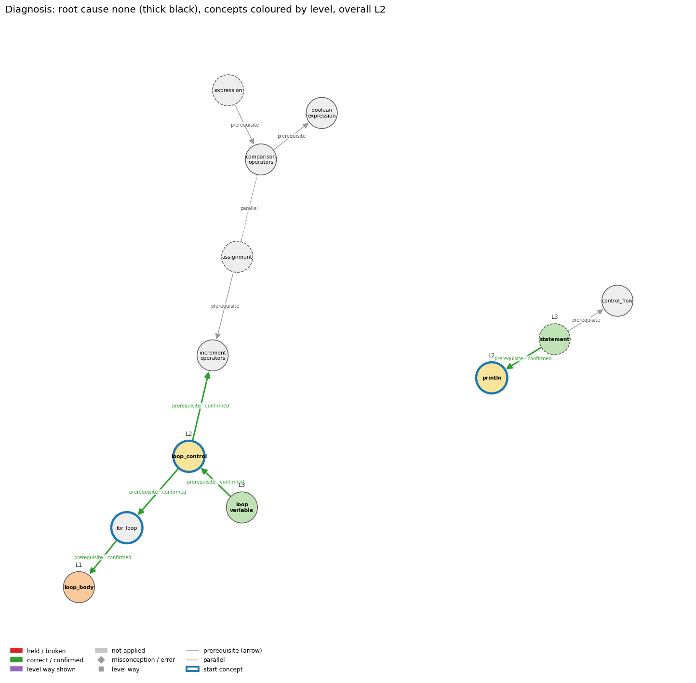

# LP11: the overall level and how it was arrived at

This page explains, with the numbers of this run, how one overall level was worked out for this answer. Every step of the run itself (what the graph offered, the model's replies, all labels, all figures) is in the notebook [`LP11.ipynb`](LP11.ipynb) and in `report.html`.

## The answer that was read

```java
int i, n = 5;
for (i = 1; i < n; i++)
    i++;
    System.out.println(i);
System.out.println(i);
```

**Question.** What is the value of i when the second println runs? Explain how i gets that value.

**Student's answer.** i is 5. The loop leaves when the test 5 < 5 fails, so i is 5 at that point, and nothing after the loop changes i. Both println lines print 5.

**What this scenario was written to test.** L2: output prediction.

## Result

- **Overall level: L2** (multistructural)
- **Decided by:** no mistake is held, so the level that most components have (step 4 below)
- **Expected by design:** L2. **Match: yes**

## The five levels

| Level | Name | What an answer at this level does |
|---|---|---|
| L0 | prestructural | holds a rule that contradicts Java, or reads the code in an everyday sense |
| L1 | unistructural | names a part or states one rule without applying it |
| L2 | multistructural | applies the rules to the code step by step (a trace, a predicted output, one step) |
| L3 | relational | relates the parts to each other or gives the purpose of the whole |
| L4 | extended abstract | reasons beyond the given code (a change, an error, a new program) |

A level is never asked from the model directly. For each concept the model only says which *ways* of showing a level the student's words show (for example "output prediction", which sits at L2) and which wrong rules the student holds. The level is then read off by fixed rules.

## Step 1. Which concepts were taken

Stage 1 read the program and found 12 concepts in it. Not all of them count for the overall level. A concept is taken as a **component** when two things hold:

- it is not a *generic* concept (one that almost every Java program has, such as `statement`), unless a real mistake is held on it;
- the student's answer shows something about it, so that it has a level.

| Concept | Generic | Level | Taken as a component? |
|---|---|---|---|
| `assignment` | yes | none | no: generic, and the answer shows nothing about it |
| `boolean_expression` |  | none | no: the answer shows nothing about it, so it has no level |
| `comparison_operators` |  | none | no: the answer shows nothing about it, so it has no level |
| `control_flow` |  | none | no: the answer shows nothing about it, so it has no level |
| `expression` | yes | none | no: generic, and the answer shows nothing about it |
| `for_loop` |  | none | no: the answer shows nothing about it, so it has no level |
| `increment_operators` |  | none | no: the answer shows nothing about it, so it has no level |
| `loop_body` |  | L1 | **yes** |
| `loop_control` |  | L2 | **yes** |
| `loop_variable` |  | L3 | **yes** |
| `println` |  | L2 | **yes** |
| `statement` | yes | L3 | no: generic |

**Components of this answer: 4.** `loop_body`, `loop_control`, `loop_variable`, `println`.



*The concepts of this program and the links between them, after the run. A coloured concept has a level (red L0, orange L1, yellow L2, light green L3, green L4); a grey concept was found in the code but the answer shows nothing about it. A thick black outline marks the root cause, and a diamond is a wrong rule the student holds. The picture also colours generic concepts that have a level; the table above says which of them are counted.*

## Step 2. The level of each component

Each component gets its level by the first of these rules that fits:

- **(a)** a wrong rule (misconception) is held on the concept: **L0**, whatever else is shown;
- **(b)** only L0 ways are shown (everyday reading, inconsistent trace): **L0**;
- **(c)** otherwise the **highest** level at which a way is shown. One shown way is enough, because the levels build on each other.

A way above L2 is counted only when the model's confidence is above 0.60 and it does not rest only on the words of a held mistake.

### `loop_body`: L1

- **Rule (c).** The highest way shown is **L1 "states the rule"**.
- Student's words: "Both println lines print 5"
- All ways shown on this concept: L1 "states the rule" (confidence 0.70).

### `loop_control`: L2

- **Rule (c).** The highest way shown is **L2 "one step execution"**.
- Student's words: "The loop leaves when the test 5 < 5 fails"
- All ways shown on this concept: L2 "one step execution" (confidence 0.60).

### `loop_variable`: L3

- **Rule (c).** The highest way shown is **L3 "relation to neighbour"**.
- Student's words: "The loop leaves when the test 5 < 5 fails; so i is 5 at that point, and nothing after the loop changes i; Both println lines print 5"
- All ways shown on this concept: L2 "output prediction" (confidence 0.80); L2 "one step execution" (confidence 0.60); L3 "relation to neighbour" (confidence 0.70).

### `println`: L2

- **Rule (c).** The highest way shown is **L2 "one step execution"**.
- Student's words: "so i is 5 at that point, and nothing after the loop changes i; Both println lines print 5"
- All ways shown on this concept: L2 "output prediction" (confidence 0.70); L2 "one step execution" (confidence 0.60).

## Step 3. Is a real mistake held?

A real mistake is a wrong rule (misconception) or a broken rule (error) that the student's own words show, after the same mistake found at two concepts has been counted once. If there is one, the walk also names the concept where the mistake starts, the **root cause**: among the concepts with a mistake, the one furthest back along the prerequisite links.

**No.** No wrong rule or broken rule is held in this answer, so the overall level is decided by the count in step 4.

## Step 4. Count the components at each level

| Level | Components at this level | Number | Share |
|---|---|---|---|
| L1 | `loop_body` | 1 | 1 ÷ 4 = 0.25 |
| L2 | `loop_control`, `println` | 2 | 2 ÷ 4 = 0.50 |
| L3 | `loop_variable` | 1 | 1 ÷ 4 = 0.25 |

The largest share is at **L2** (2 of 4 components).

No mistake is held, so this decides: the overall level is **L2**.

## Step 5. How far apart are the components?

The lowest component level is L1 and the highest is L3: 3 − 1 = 2.

The components are two or more levels apart, so the answer is marked **LOW coherence**: the one overall level hides real differences between the parts, and the table of step 2 should be read with it.

## Conclusion

4 components; no mistake is held; the largest share is at L2; so the overall level is **L2**. Shares: L1 0.25, L2 0.50, L3 0.25; LOW coherence.

| | Overall level | Components | Held mistake | Root cause |
|---|---|---|---|---|
| This run | L2 | `loop_body` L1, `loop_control` L2, `loop_variable` L3, `println` L2 | none | none |
| Expected by design | L2 | `for_loop` L2 | none | none |

The expected result lists only the main concept the scenario was written for; the run levels every concept the answer touches, so it usually has more components.

The rule and how it was made are in the [folder README](../../README.md).
