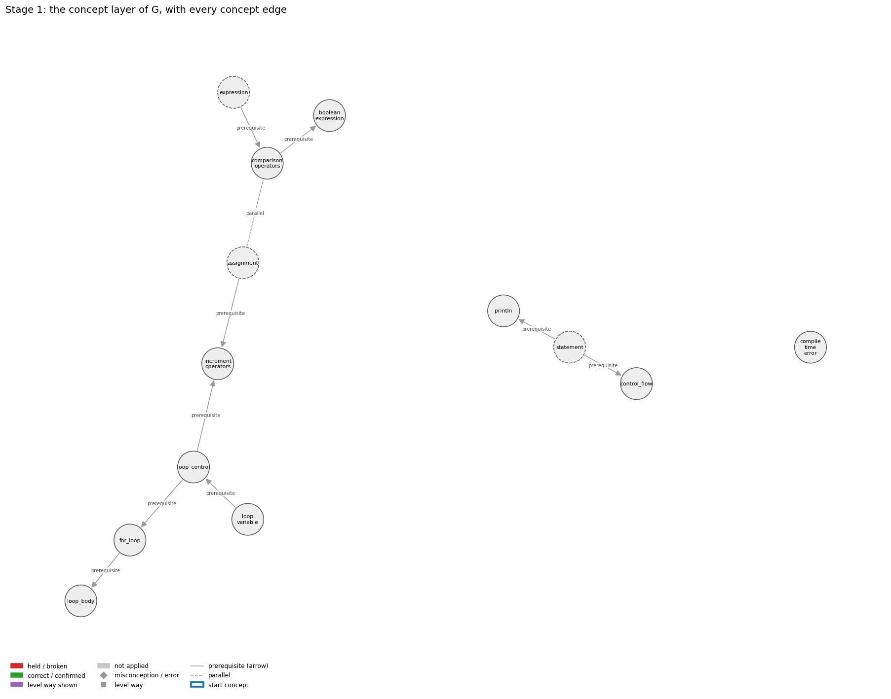
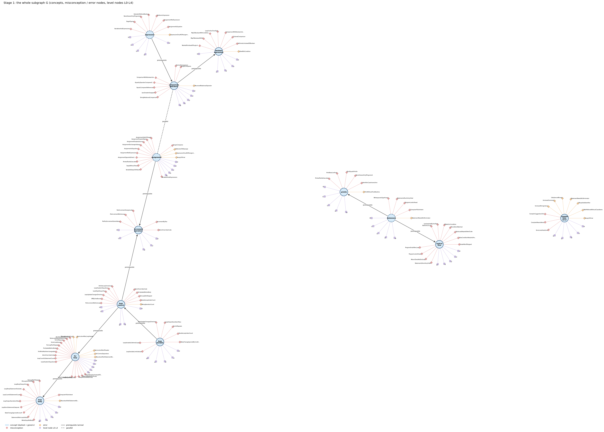
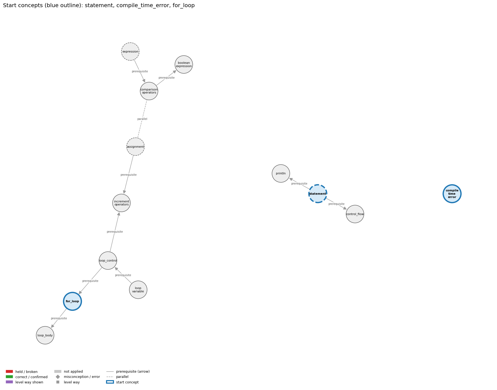
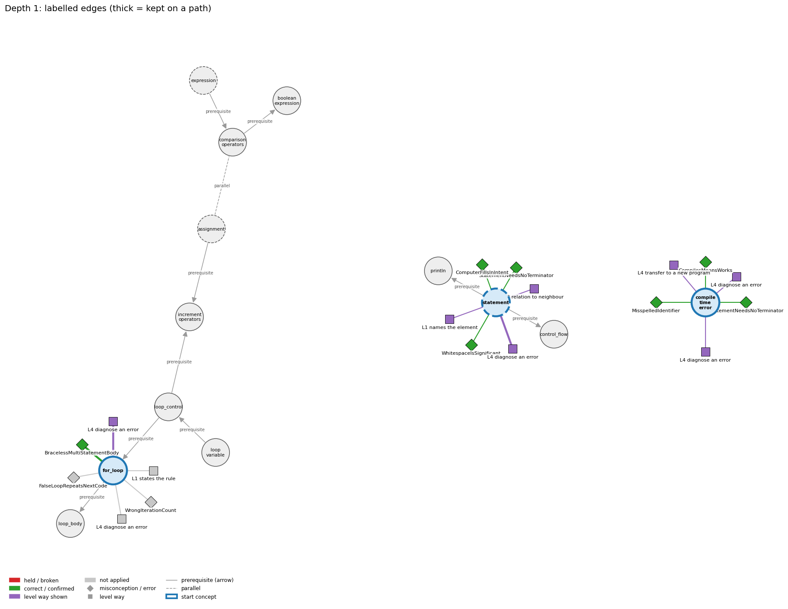
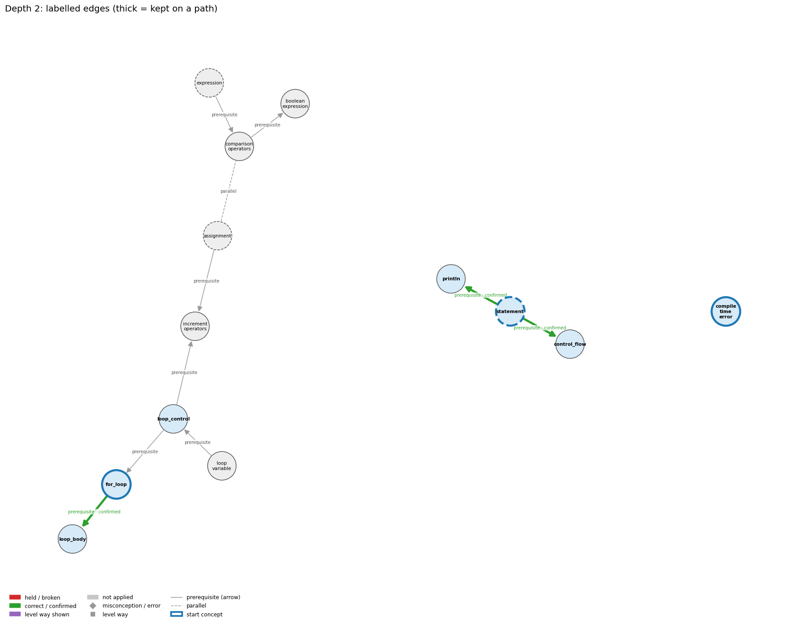
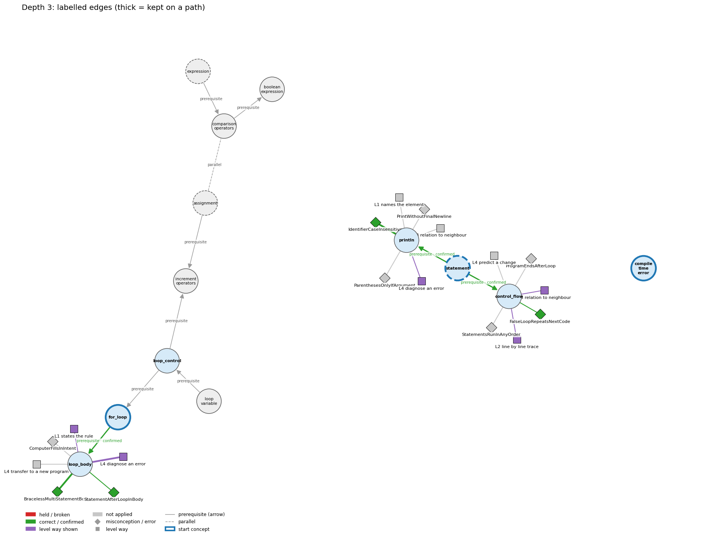
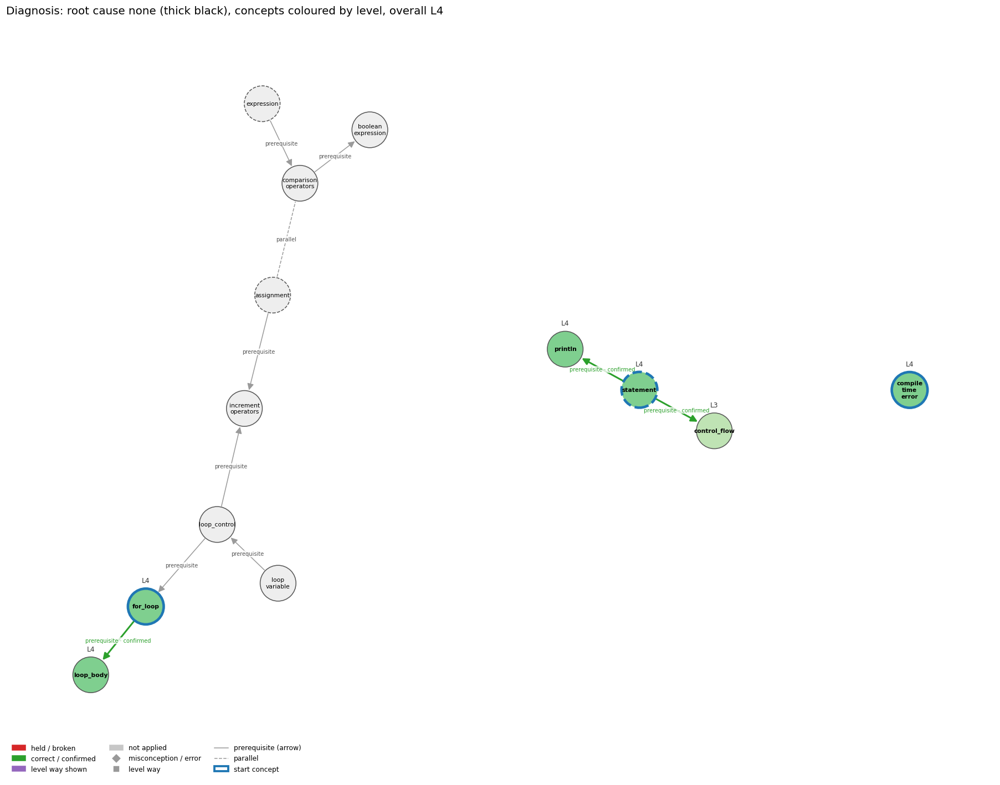

# Think on the Graph: every output of the run LP17

Files of this scenario: `input.json` (program, question, answer), `diagnosis.json`, `subgraph.json`, `traverse_log.txt`, `report.html` (this report as one full-page file, with the interactive graph `LP17_G.html`), `LP17.ipynb` (this report as a notebook).

## Level classification

This scenario tests **L4: diagnose an error**. How the overall level is decided is explained in the [folder README](../../README.md).

- **Overall level: L4** (decided by: largest share)
- **Shares of the components:** L3 0.20, L4 0.80; coherent
- **Mistake held (root cause):** none
- **Expected by design:** overall L4; components `for_loop` L4, `statement` L4, `identifier` L4; held none; root none
- **Overall level matches the expected one:** yes

| Component | Level | Decided by | Student's words |
|---|---|---|---|
| `compile_time_error` | L4 | way: diagnose an error | It does not compile; Line 1 and line 4 are missing the; at the end; so javac reports; expected |
| `control_flow` | L3 | way: relation to neighbour | Even then the indentation is misleading: without braces only i++ is in the loop, a silent logic error whenever a braceless loop is followed by indented lines |
| `for_loop` | L4 | way: diagnose an error | Even then the indentation is misleading: without braces only i++ is in the loop, a silent logic error whenever a braceless loop is followed by indented lines |
| `loop_body` | L4 | way: diagnose an error | Even then the indentation is misleading: without braces only i++ is in the loop, a silent logic error whenever a braceless loop is followed by indented lines |
| `println` | L4 | way: diagnose an error | After those are fixed, system.out still fails; because Java is case-sensitive: there is no package called system, it must be System |

Generic concepts with a level (not counted as components): `statement` L4.

## 0. Input
Program:
```java
int i , n= 5
for(i=1;i<n;i++)
    i++;
    System.out.println(i)
system.out.println(i);
```
Question: Will this compile? What happens when you run it? Explain your reasoning.

Student's answer: It does not compile. Line 1 and line 4 are missing the ; at the end, so javac reports ';' expected. After those are fixed, system.out still fails because Java is case-sensitive: there is no package called system, it must be System. Even then the indentation is misleading: without braces only i++ is in the loop, a silent logic error whenever a braceless loop is followed by indented lines.
Settings: width 3, depth 3, prune llm, backend claude-cli, model claude-opus-5-5
## 1. Stage 1: the subgraph G from the code (no model)
Masked code (string and char literals and comments blanked; this is what the patterns see):
```
int i , n= 5
for(i=1;i<n;i++)
    i++;
    System.out.println(i)
system.out.println(i);
```
Which code text tagged which concept (a generic concept fires on almost any Java line; it starts the walk only if the answer repeats its tag):
| concept | generic | channel | matched text | line |
|---|---|---|---|---|
| assignment | True | pattern | '=' | 1 |
| boolean_expression | False | pattern | 'for(i=1;i<n;' | 2 |
| comparison_operators | False | pattern | 'for(i=1;i<' | 2 |
| compile_time_error | False | signal | '    System.out.println(i)' | 4 |
| control_flow | False | pattern | 'for(' | 2 |
| expression | True | pattern | 'i<' | 2 |
| expression | True | pattern | '=1;' | 2 |
| for_loop | False | pattern | 'for(' | 2 |
| increment_operators | False | pattern | '++' | 2 |
| loop_body | False | pattern | 'for(' | 2 |
| loop_control | False | signal | 'for(i=1;i<n;i++)' | 2 |
| loop_variable | False | pattern | 'for(i=' | 2 |
| println | False | pattern | 'System.out.println(' | 4 |
| statement | True | pattern | ';' | 2 |

G: 13 concept nodes (3 generic), 10 concept edges, 126 misconception / error edges, 92 misconception / error nodes, 65 level nodes, 125 level-misconception links, 3 connected piece(s).
Note: concept nodes form 3 pieces (the KG has no edge between them): assignment,boolean_expression,comparison_operators,expression,for_loop,increment_operators,loop_body,loop_control,loop_variable | compile_time_error | control_flow,println,statement
Note: compile_time_error.missing_semicolon: compiler-message signal, needs javac output; skipped

Concept edges of G (the links the walk can read; `pre:` = prerequisite A -> B, `par:` = parallel):
| edge | type | rule (logic) |
|---|---|---|
| par:assignment~comparison_operators | parallel | x = y stores the value of y in x (a statement with a side effect); x == y only tests whether the two values are equal and gives a boolean. Writing = where == is meant is a compile error with int operands and a silent bug with boolean operands. |
| pre:assignment->increment_operators | prerequisite | i++ is shorthand for the assignment i = i + 1. |
| pre:comparison_operators->boolean_expression | prerequisite | A comparison such as x < y produces a boolean result; comparisons together with boolean logic provide the basis for decision-making. |
| pre:expression->comparison_operators | prerequisite | Comparison operators build expressions whose value is a boolean, so one must already know what an expression is to understand a < b. |
| pre:for_loop->loop_body | prerequisite | The statements in braces after the for header are the loop body; they run once on every pass, between the test and the increment, exactly as in a while loop. |
| pre:loop_control->for_loop | prerequisite | The for header is exactly the three control slots, and the body runs after the test and before the update on each pass. |
| pre:loop_control->increment_operators | prerequisite | The loop update i = i + 1 comes first; ++ (and +=) are then introduced as shorthand for that update. |
| pre:loop_variable->loop_control | prerequisite | The init, condition and update all act on the loop variable: the init sets it, the condition tests it, the update changes it. |
| pre:statement->control_flow | prerequisite | Control flow is the order in which statements run. |
| pre:statement->println | prerequisite | System.out.println(s); is itself a statement, so its line of output appears at its own place in the sequence. |

Misconception / error edges per concept (count), and level ways per concept (count):
| concept | misconception / error edges | level ways (L1-L4 + L0 non-misconception) |
|---|---|---|
| assignment | 15 | 24 |
| boolean_expression | 8 | 19 |
| comparison_operators | 8 | 20 |
| compile_time_error | 10 | 21 |
| control_flow | 11 | 15 |
| expression | 8 | 19 |
| for_loop | 20 | 24 |
| increment_operators | 5 | 16 |
| loop_body | 12 | 14 |
| loop_control | 11 | 19 |
| loop_variable | 7 | 13 |
| println | 6 | 17 |
| statement | 5 | 19 |

**Figure 1**


**Figure 2**


## 2. Clauses and start concepts (no model)
The answer split into clauses (at sentence ends, ';', and before 'because' / 'so'; quotes removed):
| clause | text |
|---|---|
| c1 | It does not compile |
| c2 | Line 1 and line 4 are missing the |
| c3 | at the end |
| c4 | so javac reports |
| c5 | expected |
| c6 | After those are fixed, system.out still fails |
| c7 | because Java is case-sensitive: there is no package called system, it must be System |
| c8 | Even then the indentation is misleading: without braces only i++ is in the loop, a silent logic error whenever a braceless loop is followed by indented lines |

start: generic concepts whose tagging text occurs in the answer: statement

start: BM25 of the answer against each tagged concept: statement 42.13 (hits 1), compile_time_error 35.62 (hits 1), for_loop 29.91 (hits 1), println 28.82 (hits 1), control_flow 27.93 (hits 1), loop_control 23.02 (hits 1), loop_body 20.00 (hits 1), increment_operators 17.22 (hits 1), loop_variable 16.70 (hits 1), comparison_operators 15.85 (hits 1), boolean_expression 12.62 (hits 1)

start: chosen statement, compile_time_error, for_loop

start concepts (3): statement, compile_time_error, for_loop

Start concepts: statement, compile_time_error, for_loop

**Figure 3**


## 3. The walk, depth by depth
At each depth, for each current concept: the edges offered (a concept entering as a start concept offers its misconception / error edges and its level ways, as two families; otherwise it offers its concept edges), the prune prompt and the model's reply, then the label prompt(s) and the model's reply, parsed into label / clauses / confidence. Score = prune score x confidence.

### Depth 1: current concepts 'statement', 'compile_time_error', 'for_loop'

#### statement, misconceptions: 5 edges offered
Edges offered:
| edge |
|---|
| err:statement->StatementNeedsNoTerminator \| wrong rule: A statement still compiles and runs if the semicolon at its end is left out, or if a stray ; is put right after if (c) or for (...). \| right rule: Each statement must end with ;, otherwise javac reports ';' expected. |
| mis:statement->ComputerFillsInIntent \| wrong rule: The computer fills in omitted steps or values that the programmer meant, e.g. REPEAT 4 [FORWARD 30] draws a square without a turn command. \| right rule: The computer executes only what the code states; every needed step and value must be written. |
| mis:statement->ProgramLooksAhead \| wrong rule: The program knows or sees what later lines will do and acts on those goals at the current line, e.g. it stops 'at ten' because it wants to draw a box. \| right rule: Each statement executes using only the current state; later lines have no effect until control reaches them. |
| mis:statement->StatementsRunInAnyOrder \| wrong rule: Statements in a program can run in any order. \| right rule: Without control statements, statements run once each, top to bottom. |
| mis:statement->WhitespaceIsSignificant \| wrong rule: Line breaks and indentation change what the program does, so each statement must be on its own line. \| right rule: Java compilers consider all whitespace in program text (outside quotation marks) to be equivalent; layout is for human readers. |

Prune: the model's reply (edge id and score; the kept edges sum to 1):
```
{err:statement->StatementNeedsNoTerminator (Score: 0.5)}
{mis:statement->WhitespaceIsSignificant (Score: 0.35)}
{mis:statement->ComputerFillsInIntent (Score: 0.15)}
```
Kept by pruning: err:statement->StatementNeedsNoTerminator (0.50), mis:statement->WhitespaceIsSignificant (0.35), mis:statement->ComputerFillsInIntent (0.15)

Label prompt for the misconception / error edges (judged together). The model saw the program, the question, the numbered clauses, and these edges with their wrong rule and right rule:
| edge |
|---|
| err:statement->StatementNeedsNoTerminator \| wrong rule: A statement still compiles and runs if the semicolon at its end is left out, or if a stray ; is put right after if (c) or for (...). \| right rule: Each statement must end with ;, otherwise javac reports ';' expected. |
| mis:statement->WhitespaceIsSignificant \| wrong rule: Line breaks and indentation change what the program does, so each statement must be on its own line. \| right rule: Java compilers consider all whitespace in program text (outside quotation marks) to be equivalent; layout is for human readers. |
| mis:statement->ComputerFillsInIntent \| wrong rule: The computer fills in omitted steps or values that the programmer meant, e.g. REPEAT 4 [FORWARD 30] draws a square without a turn command. \| right rule: The computer executes only what the code states; every needed step and value must be written. |
Model's reply:
```
err:statement->StatementNeedsNoTerminator | correct | clauses: 1, 2, 3, 4, 5 | confidence: 0.9
mis:statement->WhitespaceIsSignificant | correct | clauses: 8 | confidence: 0.85
mis:statement->ComputerFillsInIntent | correct | clauses: 6, 7, 8 | confidence: 0.6
```

Parsed labels:
| edge | label | prune score | confidence | score | clauses | words |
|---|---|---|---|---|---|---|
| err:statement->StatementNeedsNoTerminator | correct | 0.5 | 0.9 | 0.45 | c1, c2, c3, c4, c5 | It does not compile; Line 1 and line 4 are missing the; at the end; so javac reports; expected |
| mis:statement->WhitespaceIsSignificant | correct | 0.35 | 0.85 | 0.3 | c8 | Even then the indentation is misleading: without braces only i++ is in the loop, a silent logic error whenever a braceless loop is followed by indented lines |
| mis:statement->ComputerFillsInIntent | correct | 0.15 | 0.6 | 0.09 | c6, c7, c8 | After those are fixed, system.out still fails; because Java is case-sensitive: there is no package called system, it must be System; Even then the indentation is misleading: without braces only i++ is in the loop, a silent logic error whenever a braceless loop is followed by indented lines |

#### statement, level ways: 19 edges offered
Edges offered:
| edge |
|---|
| lvl:statement@L0#0 \| level L0 way everyday_reading: Everyday reading: a program is read like a text or a list of wishes that the computer takes in all at once, so line order, goals of later lines or what the writer meant can matter. Java rule: each statement is one step, ended by ;, executed once, in written order, using only the current state. |
| lvl:statement@L0#2 \| level L0 way inconsistent_trace: Applies the sequencing rule (LT) unevenly: executes the statements in order on some lines but lets a later statement's effect leak into an earlier one, or skips or repeats a statement on one pass. (here mixing in: "The computer fills in omitted steps or values that the programmer meant, e.g. REPEAT 4 [FORWARD 30] draws a square without a turn command") |
| lvl:statement@L1#0 \| level L1 way names_the_element: A statement is one step of a program (a declaration, assignment, method call such as System.out.println(...), or control statement), ended by a semicolon when it is a simple statement. |
| lvl:statement@L1#1 \| level L1 way states_the_rule: A method body is a sequence of statements enclosed in braces and each followed by a semicolon; statements are executed for their effect and have no value; an expression statement evaluates its expression and discards any value. |
| lvl:statement@L2#0 \| level L2 way line_by_line_trace: Statements run one at a time, from first to last; each completes (normally or abruptly) before the next starts. |
| lvl:statement@L2#1 \| level L2 way output_prediction: A statement has no value; its result is its effect: a changed variable, printed output, or a change of control flow. |
| lvl:statement@L2#2 \| level L2 way one_step_execution: Executing one statement applies its single effect to the current state (e.g. prints one string, or stores one value) and then control moves to the next statement. |
| lvl:statement@L3#0 \| level L3 way relation_to_neighbour: Statements live in main's body; running the program executes main's statements in order. |
| lvl:statement@L3#1 \| level L3 way relation_to_neighbour: A block groups a sequence of statements in braces; the body of main() is such a block. |
| lvl:statement@L3#2 \| level L3 way relation_to_neighbour: System.out.print(s); is a statement, so its output appears exactly at its place in the sequence, with no newline. |
| lvl:statement@L3#3 \| level L3 way relation_to_neighbour: System.out.println(s); is a statement, so its line of output appears at its place in the sequence; swapping two println statements swaps the output lines. |
| lvl:statement@L3#4 \| level L3 way relation_to_neighbour: Control flow is the order in which statements run; without control statements it is straight-line, each once in order. |
| lvl:statement@L3#5 \| level L3 way relation_to_neighbour: A lone ; is the empty statement, which does nothing; it can fill a for-loop part or, by accident, end an if or loop header. |
| lvl:statement@L3#6 \| level L3 way relation_to_neighbour: An algorithm becomes a program as a sequence of statements, executed once each in the order given. |
| lvl:statement@L3#7 \| level L3 way purpose_of_the_whole: Purpose: a statement is the unit of action; a program is characterized by its sequence of statements, each doing one step of the algorithm. |
| lvl:statement@L4#0 \| level L4 way predict_a_change: Swapping two statements that touch the same variable or the output generally changes the result; swapping independent statements, or changing only whitespace between them, keeps it. |
| lvl:statement@L4#1 \| level L4 way diagnose_an_error: rule broken: Each simple statement must end with ;. Kind: compile-time. Trigger class: omitting the ; at the end of a statement: javac reports ';' expected (often at the end of that line or the next) |
| lvl:statement@L4#2 \| level L4 way transfer_to_a_new_program: Write one statement per step and order them as the algorithm requires; straight-line sequence suffices when every step runs once, otherwise use conditionals or loops. |
| lvl:statement@L4#3 \| level L4 way diagnose_an_error: rule broken: A ; directly after an if/while/for header is an empty statement. Kind: silent logic error. Trigger class: if (x > 0); or while (cond); followed by the intended body |

Prune: the model's reply (edge id and score; the kept edges sum to 1):
```
{lvl:statement@L4#1 (Score: 0.6)}
{lvl:statement@L3#1 (Score: 0.25)}
{lvl:statement@L1#0 (Score: 0.15)}
```
Kept by pruning: lvl:statement@L4#1 (0.60), lvl:statement@L3#1 (0.25), lvl:statement@L1#0 (0.15)

Label prompt for level way lvl:statement@L4#1 (the model saw the concept, the way's name 'diagnose an error', its text, where the way stops and whether the words must be correct; no level):
> rule broken: Each simple statement must end with ;. Kind: compile-time. Trigger class: omitting the ; at the end of a statement: javac reports ';' expected (often at the end of that line or the next)
>
> Where this way stops: Locating and fixing the mistake for one given failing case is L3. A compiler-flagged slip fixed from the message is weak evidence.

Model's reply:
```
Label: shown
Clauses: 1, 2, 3, 4, 5
Confidence: 0.85
```

Label prompt for level way lvl:statement@L3#1 (the model saw the concept, the way's name 'relation to neighbour', its text, where the way stops and whether the words must be correct; no level):
> A block groups a sequence of statements in braces; the body of main() is such a block.
>
> Where this way stops: Two correct but separate rules are L1. Executing the two in sequence is L2. A relational answer may be correct or a relational error.

Model's reply:
```
Label: shown
Clauses: 8
Confidence: 0.72
```

Label prompt for level way lvl:statement@L1#0 (the model saw only the concept, the way's name 'names the element' and its text; no level):
> A statement is one step of a program (a declaration, assignment, method call such as System.out.println(...), or control statement), ended by a semicolon when it is a simple statement.

Model's reply:
```
Label: shown
Clauses: 2, 3, 4, 5
Confidence: 0.8
```

Parsed labels:
| edge | label | prune score | confidence | score | clauses | words |
|---|---|---|---|---|---|---|
| lvl:statement@L4#1 | shown | 0.6 | 0.85 | 0.51 | c1, c2, c3, c4, c5 | It does not compile; Line 1 and line 4 are missing the; at the end; so javac reports; expected |
| lvl:statement@L3#1 | shown | 0.25 | 0.72 | 0.18 | c8 | Even then the indentation is misleading: without braces only i++ is in the loop, a silent logic error whenever a braceless loop is followed by indented lines |
| lvl:statement@L1#0 | shown | 0.15 | 0.8 | 0.12 | c2, c3, c4, c5 | Line 1 and line 4 are missing the; at the end; so javac reports; expected |

#### compile_time_error, misconceptions: 10 edges offered
Edges offered:
| edge |
|---|
| err:compile_time_error->AssignToFinal \| wrong rule: Assigns a new value to a variable declared final. \| right rule: A final variable cannot be reassigned after it is initialized; the compiler reports an error. |
| err:compile_time_error->MathMethodWithoutClassName \| wrong rule: sqrt(x) calls the square-root method. \| right rule: Library methods are called with the class name, e.g. Math.sqrt(x). |
| err:compile_time_error->MisspelledIdentifier \| wrong rule: Writes Sytem.out.prinln or a misspelled variable name. \| right rule: Every name must be spelled exactly, including capitalization. |
| err:compile_time_error->StatementNeedsNoTerminator \| wrong rule: a statement runs without the ; \| right rule: Each statement must end with ;, otherwise javac reports ';' expected. |
| err:compile_time_error->UnbalancedBraces \| wrong rule: A missing { or } is harmless. \| right rule: Every { must be matched by a } so the class body and the method body are well formed. |
| err:compile_time_error->UnclosedComment \| wrong rule: Opens a comment with /* and never closes it. \| right rule: A /* comment is the text between /* and */, so the closing */ is required. |
| err:compile_time_error->UnclosedStringLiteral \| wrong rule: A string literal can be left without its closing quote. \| right rule: A String literal is enclosed in a pair of double quotes. |
| mis:compile_time_error->CompilerSuggestionIsFix \| wrong rule: Doing exactly what the compiler message suggests will fix the error. \| right rule: An error message is evidence that something is wrong, but its suggested remedy may be wrong; find the actual cause. |
| mis:compile_time_error->CompilesMeansWorks \| wrong rule: Code that compiles is code that works. \| right rule: Code that compiles can still have run-time and logical errors. |
| mis:compile_time_error->ErrorLineIsFaultLine \| wrong rule: The line number in a javac error is always the line that has the mistake. \| right rule: The compiler reports where it noticed the problem, which can be after the real fault; for example, omitting the second left brace of HelloWorld produces errors reported on later lines. |

Prune: the model's reply (edge id and score; the kept edges sum to 1):
```
{err:compile_time_error->StatementNeedsNoTerminator (Score: 0.4)}
{err:compile_time_error->MisspelledIdentifier (Score: 0.35)}
{mis:compile_time_error->CompilesMeansWorks (Score: 0.25)}
```
Kept by pruning: err:compile_time_error->StatementNeedsNoTerminator (0.40), err:compile_time_error->MisspelledIdentifier (0.35), mis:compile_time_error->CompilesMeansWorks (0.25)

Label prompt for the misconception / error edges (judged together). The model saw the program, the question, the numbered clauses, and these edges with their wrong rule and right rule:
| edge |
|---|
| err:compile_time_error->StatementNeedsNoTerminator \| wrong rule: a statement runs without the ; \| right rule: Each statement must end with ;, otherwise javac reports ';' expected. |
| err:compile_time_error->MisspelledIdentifier \| wrong rule: Writes Sytem.out.prinln or a misspelled variable name. \| right rule: Every name must be spelled exactly, including capitalization. |
| mis:compile_time_error->CompilesMeansWorks \| wrong rule: Code that compiles is code that works. \| right rule: Code that compiles can still have run-time and logical errors. |
Model's reply:
```
err:compile_time_error->StatementNeedsNoTerminator | correct | clauses: 1, 2, 3, 4, 5 | confidence: 0.9
err:compile_time_error->MisspelledIdentifier | correct | clauses: 6, 7 | confidence: 0.95
mis:compile_time_error->CompilesMeansWorks | correct | clauses: 8 | confidence: 0.9
```

Parsed labels:
| edge | label | prune score | confidence | score | clauses | words |
|---|---|---|---|---|---|---|
| err:compile_time_error->StatementNeedsNoTerminator | correct | 0.4 | 0.9 | 0.36 | c1, c2, c3, c4, c5 | It does not compile; Line 1 and line 4 are missing the; at the end; so javac reports; expected |
| err:compile_time_error->MisspelledIdentifier | correct | 0.35 | 0.95 | 0.33 | c6, c7 | After those are fixed, system.out still fails; because Java is case-sensitive: there is no package called system, it must be System |
| mis:compile_time_error->CompilesMeansWorks | correct | 0.25 | 0.9 | 0.23 | c8 | Even then the indentation is misleading: without braces only i++ is in the loop, a silent logic error whenever a braceless loop is followed by indented lines |

#### compile_time_error, level ways: 21 edges offered
Edges offered:
| edge |
|---|
| lvl:compile_time_error@L0#0 \| level L0 way everyday_reading: Everyday reading: 'error' means the program will do something wrong when used, and a message points exactly at the mistake. Java rule: a compile-time error is a breach of the language rules found by javac before any execution; no .class is produced, and the reported line is where javac noticed it. |
| lvl:compile_time_error@L0#3 \| level L0 way inconsistent_trace: Applies the 'javac checks before running' rule unevenly: predicts output for a program that would not compile, or expects a compile error from a fault (such as division by zero) that only shows at run time. (here mixing in: "Code that compiles is code that works") |
| lvl:compile_time_error@L1#0 \| level L1 way names_the_element: A compile-time error (syntax error) is an error in the source code, caught by javac, that prevents the program from being translated. |
| lvl:compile_time_error@L1#1 \| level L1 way states_the_rule: Compile-time errors occur when the code violates the rules of the Java language (syntax, names, types); they are caught when you compile and prevent the translation. |
| lvl:compile_time_error@L2#0 \| level L2 way line_by_line_trace: javac reads the whole file, reports each error with file name, line number and message, tries to recover and continue, and prints a count; the first message is the most reliable. |
| lvl:compile_time_error@L2#1 \| level L2 way output_prediction: Result: messages such as Bad.java:4: ';' expected ... 3 errors, and no Name.class; nothing of the program runs. |
| lvl:compile_time_error@L2#2 \| level L2 way one_step_execution: A failed compile leaves the file system without a new Name.class (an older one, if any, is not updated) and changes no program state. |
| lvl:compile_time_error@L3#0 \| level L3 way relation_to_neighbour: A compile-time error is reported while javac compiles Name.java, so no new Name.class is produced. |
| lvl:compile_time_error@L3#1 \| level L3 way relation_to_neighbour: Each compile-time error comes with a message; reading it (first error first, line may be late) is how it is found and fixed. |
| lvl:compile_time_error@L3#2 \| level L3 way relation_to_neighbour: A compile-time error is found by javac before the program runs; a run-time error only while it runs, so code that compiles can still crash. |
| lvl:compile_time_error@L3#3 \| level L3 way purpose_of_the_whole: Purpose (of the check): catch rule violations automatically before running, so they cannot cause wrong behaviour; S&W say treat the compiler as a friend. |
| lvl:compile_time_error@L4#0 \| level L4 way predict_a_change: Fixing the first error and recompiling can remove many messages at once; a single missing brace or semicolon can cause several messages. |
| lvl:compile_time_error@L4#1 \| level L4 way diagnose_an_error: rule broken: Each statement must end with ;. Kind: compile-time. Trigger class: missing ; at the end of a statement: ';' expected |
| lvl:compile_time_error@L4#2 \| level L4 way diagnose_an_error: rule broken: Every { must be matched by a }. Kind: compile-time. Trigger class: missing or extra brace: '{' expected, 'class' or 'interface' expected, reached end of file while parsing |
| lvl:compile_time_error@L4#3 \| level L4 way diagnose_an_error: rule broken: A String literal is enclosed in a pair of double quotes. Kind: compile-time. Trigger class: missing closing quote: unclosed string literal, often with confusing follow-on errors |
| lvl:compile_time_error@L4#4 \| level L4 way diagnose_an_error: rule broken: Library static methods are called with the class name, e.g. Math.sqrt(x). Kind: compile-time. Trigger class: calling sqrt(x) without Math.: cannot find symbol |
| lvl:compile_time_error@L4#5 \| level L4 way diagnose_an_error: rule broken: Every name must be spelled exactly, including capitalization. Kind: compile-time. Trigger class: Sytem.out.prinln, Println, or a misspelled variable: cannot find symbol |
| lvl:compile_time_error@L4#6 \| level L4 way diagnose_an_error: rule broken: A /* comment needs its closing */. Kind: compile-time. Trigger class: /* with no */ swallows the rest of the file |
| lvl:compile_time_error@L4#7 \| level L4 way transfer_to_a_new_program: Expect compile-time errors for anything the compiler can check from the text alone (syntax, names, types, final); expect run-time or logic errors for faults that depend on input values or on what the program was meant to do. |
| lvl:compile_time_error@L4#8 \| level L4 way diagnose_an_error: rule broken: A final variable cannot be reassigned after it is initialized. Kind: compile-time. Trigger class: assigning a second value to a final variable |
| lvl:compile_time_error@L4#9 \| level L4 way diagnose_an_error: rule broken: Required keywords (class, static, void...) must be present and spelled right. Kind: compile-time. Trigger class: omitting or misspelling a keyword in public class Name or the main header |

Prune: the model's reply (edge id and score; the kept edges sum to 1):
```
{lvl:compile_time_error@L4#1 (Score: 0.4)}
{lvl:compile_time_error@L4#5 (Score: 0.35)}
{lvl:compile_time_error@L4#7 (Score: 0.25)}
```
Kept by pruning: lvl:compile_time_error@L4#1 (0.40), lvl:compile_time_error@L4#5 (0.35), lvl:compile_time_error@L4#7 (0.25)

Label prompt for level way lvl:compile_time_error@L4#1 (the model saw the concept, the way's name 'diagnose an error', its text, where the way stops and whether the words must be correct; no level):
> rule broken: Each statement must end with ;. Kind: compile-time. Trigger class: missing ; at the end of a statement: ';' expected
>
> Where this way stops: Locating and fixing the mistake for one given failing case is L3. A compiler-flagged slip fixed from the message is weak evidence.

Model's reply:
```
Label: shown
Clauses: 1, 2, 3, 4, 5
Confidence: 0.75
```

Label prompt for level way lvl:compile_time_error@L4#5 (the model saw the concept, the way's name 'diagnose an error', its text, where the way stops and whether the words must be correct; no level):
> rule broken: Every name must be spelled exactly, including capitalization. Kind: compile-time. Trigger class: Sytem.out.prinln, Println, or a misspelled variable: cannot find symbol
>
> Where this way stops: Locating and fixing the mistake for one given failing case is L3. A compiler-flagged slip fixed from the message is weak evidence.

Model's reply:
```
Label: shown
Clauses: 6, 7
Confidence: 0.75
```

Label prompt for level way lvl:compile_time_error@L4#7 (the model saw the concept, the way's name 'transfer to a new program', its text, where the way stops and whether the words must be correct; no level):
> Expect compile-time errors for anything the compiler can check from the text alone (syntax, names, types, final); expect run-time or logic errors for faults that depend on input values or on what the program was meant to do.
>
> Where this way stops: Reproducing or slightly varying a familiar program is L1 to L3.

Model's reply:
```
Label: shown
Clauses: 2, 3, 4, 5, 6, 7, 8
Confidence: 0.8
```

Parsed labels:
| edge | label | prune score | confidence | score | clauses | words |
|---|---|---|---|---|---|---|
| lvl:compile_time_error@L4#1 | shown | 0.4 | 0.75 | 0.3 | c1, c2, c3, c4, c5 | It does not compile; Line 1 and line 4 are missing the; at the end; so javac reports; expected |
| lvl:compile_time_error@L4#5 | shown | 0.35 | 0.75 | 0.26 | c6, c7 | After those are fixed, system.out still fails; because Java is case-sensitive: there is no package called system, it must be System |
| lvl:compile_time_error@L4#7 | shown | 0.25 | 0.8 | 0.2 | c2, c3, c4, c5, c6, c7, c8 | Line 1 and line 4 are missing the; at the end; so javac reports; expected; After those are fixed, system.out still fails; because Java is case-sensitive: there is no package called system, it must be System; Even then the indentation is misleading: without braces only i++ is in the loop, a silent logic error whenever a braceless loop is followed by indented lines |

#### for_loop, misconceptions: 20 edges offered
Edges offered:
| edge |
|---|
| err:for_loop->BracelessMultiStatementBody \| wrong rule: Indenting several statements under an if or for makes them all part of its body, even without braces. \| right rule: Without braces only the first statement belongs to the if/for; the rest run once, after it. |
| err:for_loop->ForCommaSeparators \| wrong rule: Writes for (int i = 0, i < n, i++). \| right rule: The three parts of a for header are separated by semicolons; commas only separate several statements inside the init or the update part. |
| err:for_loop->SemicolonAfterIfHeader \| wrong rule: if (x > 0); System.out.println("positive"); prints only for positive x. \| right rule: The ; ends the if with an empty statement, so the next line always runs. |
| err:for_loop->SemicolonAfterLoopHeader \| wrong rule: Puts a ; right after for (...) or while (...). \| right rule: A ; right after the loop header is a null (empty) loop body, so the statements written after it are not repeated by the loop. |
| err:for_loop->WrongIterationCount \| wrong rule: Updates the loop counter so that the loop runs the wrong number of times. \| right rule: The init, test and update together decide the number of passes; trace them to check the count. |
| mis:for_loop->DoubleLoopIndexCount \| wrong rule: for (double x = 0.0; x <= 1.0; x += 0.1) runs exactly 11 times. \| right rule: Using a double as a for-loop index is legal but bad practice: the number of iterations depends on an equality test between double values, which may not give the result you expect. |
| mis:for_loop->FalseLoopRepeatsNextCode \| wrong rule: A loop is an iterative if-else: while the condition is true the body repeats, and when it is false the code after the loop repeats. \| right rule: Only the body is repeated; once the condition is false the code after the loop runs once. |
| mis:for_loop->ForInitRepeats \| wrong rule: The initialization of a for loop runs again after a pass of the body. \| right rule: The initialization runs exactly once, before the first condition test. |
| mis:for_loop->ForIsConditional \| wrong rule: The body of a for statement executes at most once. \| right rule: The body of a for statement runs once for every pass on which the condition is true, which can be many times. |
| mis:for_loop->ForLoopPartSkipped \| wrong rule: A pass of a loop may leave out one of its parts (the condition test, the body, the update, or the initialization). \| right rule: Each pass of a for loop runs test, then body, then update, every time; the initialization runs once, at the start. |
| mis:for_loop->ForUpdateBeforeBody \| wrong rule: The update part of a for header (e.g. i = i - 4) runs before the body on each pass, so the first pass already sees the updated value. \| right rule: The update runs after the body, before the next condition test; the first pass uses the initial value. |
| mis:for_loop->ForWhileNotInterchangeable \| wrong rule: Some loops can only be written with for, others only with while. \| right rule: Any for loop can be rewritten as a while loop and vice versa; for just packages init, test and update. |
| mis:for_loop->IdiomOverridesCode \| wrong rule: An array loop processes the whole array from index 0 to length-1 and increments its index at the end of the body, whatever the code says. \| right rule: The loop visits exactly the indices that its initialisation, guard and update produce, in the order in which its statements are written. |
| mis:for_loop->LoopCountIsStatementCount \| wrong rule: The repeat count of a counted loop says how many of the body statements are executed. \| right rule: The repeat count is how many times the whole body runs; every pass runs all body statements. |
| mis:for_loop->LoopHeaderIsEquations \| wrong rule: The initialization, condition and update of a for header are equations that all hold at the same time. \| right rule: The three header parts are statements run at different moments: init once, then condition test, body, update, repeated. |
| mis:for_loop->LoopImpliedByOneTest \| wrong rule: Testing one case is enough; Java will repeat the test for the other values by itself. \| right rule: A statement runs once each time control reaches it; repeating a test for many values needs a loop. |
| mis:for_loop->LoopStepAlwaysOne \| wrong rule: A loop variable always goes up or down by 1, whatever the update says (so i = i - 4 is read as i--). \| right rule: The loop variable changes exactly as the update expression says (i += 2, i = i - 4, i *= 2, ...). |
| mis:for_loop->ProgramEndsAfterLoop \| wrong rule: When a loop finishes the program ends, so code after the loop never runs. \| right rule: When the loop condition becomes false, control continues with the first statement after the loop. |
| mis:for_loop->ReturnDoesNotExitLoop \| wrong rule: A return inside a loop does not end the loop; it sets a value each pass (the last one is returned) or returns several values. \| right rule: When return executes, the method ends at once, so the loop stops on that pass. |
| mis:for_loop->SingleIterationInsteadOfLoop \| wrong rule: A task that must be repeated is written once, without a loop, as if one pass were enough. \| right rule: A step that must happen several times (or an unknown number of times) needs a loop such as while or for; code without a loop runs once. |

Prune: the model's reply (edge id and score; the kept edges sum to 1):
```
err:for_loop->BracelessMultiStatementBody (0.80), err:for_loop->WrongIterationCount (0.10), mis:for_loop->FalseLoopRepeatsNextCode (0.10)
```
Kept by pruning: err:for_loop->BracelessMultiStatementBody (0.80), err:for_loop->WrongIterationCount (0.10), mis:for_loop->FalseLoopRepeatsNextCode (0.10)

Label prompt for the misconception / error edges (judged together). The model saw the program, the question, the numbered clauses, and these edges with their wrong rule and right rule:
| edge |
|---|
| err:for_loop->BracelessMultiStatementBody \| wrong rule: Indenting several statements under an if or for makes them all part of its body, even without braces. \| right rule: Without braces only the first statement belongs to the if/for; the rest run once, after it. |
| err:for_loop->WrongIterationCount \| wrong rule: Updates the loop counter so that the loop runs the wrong number of times. \| right rule: The init, test and update together decide the number of passes; trace them to check the count. |
| mis:for_loop->FalseLoopRepeatsNextCode \| wrong rule: A loop is an iterative if-else: while the condition is true the body repeats, and when it is false the code after the loop repeats. \| right rule: Only the body is repeated; once the condition is false the code after the loop runs once. |
Model's reply:
```
err:for_loop->BracelessMultiStatementBody | correct | clauses: 8 | confidence: 0.95
err:for_loop->WrongIterationCount | not applied | clauses: none | confidence: 0.85
mis:for_loop->FalseLoopRepeatsNextCode | not applied | clauses: none | confidence: 0.9
```

Parsed labels:
| edge | label | prune score | confidence | score | clauses | words |
|---|---|---|---|---|---|---|
| err:for_loop->BracelessMultiStatementBody | correct | 0.8 | 0.95 | 0.76 | c8 | Even then the indentation is misleading: without braces only i++ is in the loop, a silent logic error whenever a braceless loop is followed by indented lines |
| err:for_loop->WrongIterationCount | not applied |  |  | 0.0 |  |  |
| mis:for_loop->FalseLoopRepeatsNextCode | not applied |  |  | 0.0 |  |  |

#### for_loop, level ways: 24 edges offered
Edges offered:
| edge |
|---|
| lvl:for_loop@L0#0 \| level L0 way everyday_reading: Folk meaning: English 'for each ...' or 'for 10 times' names a whole collection or a count to be handled at once, and a maths reading treats the header as simultaneous conditions. A Java for is a while loop in compact form: one init, then test-body-update repeated, one pass at a time. |
| lvl:for_loop@L0#11 \| level L0 way inconsistent_trace: Applies the for sequencing rule (LT) unevenly: updates before the body on the first pass only, re-runs the init after a pass, or skips the test on some passes. (here mixing in: "The body of a for statement executes at most once") |
| lvl:for_loop@L1#0 \| level L1 way names_the_element: The for statement is a loop that packages an initialization, a loop-continuation condition and an increment in its header around a body. |
| lvl:for_loop@L1#1 \| level L1 way states_the_rule: Syntax: for (<initialize>; <boolean expression>; <increment>) { <statements> }, with the three parts separated by semicolons; it is, with only a few exceptions, equivalent to <initialize>; while (<boolean expression>) { <statements> <increment>; }. |
| lvl:for_loop@L2#0 \| level L2 way line_by_line_trace: Run the initializer once; then repeatedly: test the condition (stop if false), execute the body, run the update. |
| lvl:for_loop@L2#1 \| level L2 way output_prediction: A for statement has no value; the passes it makes are fixed by its header: for (int i = 1; i <= N; i++) sum += i; leaves sum = N(N+1)/2, and for (int i = 2; i <= 8; i += 2) prints 2, 4, 6, 8,. |
| lvl:for_loop@L2#2 \| level L2 way one_step_execution: One pass: the test reads the loop variable; the body applies its changes once; the update then changes the loop variable by its rule; the initializer changes state only once, before the first test. |
| lvl:for_loop@L3#0 \| level L3 way relation_to_neighbour: The for header is exactly the three loop-control slots; the body runs after the test and before the update on each pass. |
| lvl:for_loop@L3#1 \| level L3 way relation_to_neighbour: A for may be the body of another for: the inner for runs its complete set of passes for every single pass of the outer one. |
| lvl:for_loop@L3#2 \| level L3 way relation_to_neighbour: for (int i = 0; i < N; i++) gives i each valid index 0..N-1 exactly once in increasing order, the standard way to process every array element. |
| lvl:for_loop@L3#3 \| level L3 way relation_to_neighbour: A simulation runs a fixed number of trials with an outer for loop (for (int t = 0; t < T; t++)), each trial simulated inside the body. |
| lvl:for_loop@L3#4 \| level L3 way relation_to_neighbour: In a for loop, continue skips the rest of the body and transfers control directly to the increment, then the next test; this is one of the few places where the for/while equivalence fails. |
| lvl:for_loop@L3#5 \| level L3 way relation_to_neighbour: A variable declared in the for header is in scope only in the header and the body, so it cannot be used after the loop. |
| lvl:for_loop@L3#6 \| level L3 way relation_to_neighbour: A fencepost loop is a for loop that handles one item (the first or last) outside the loop so that separators come out n-1 times for n items. |
| lvl:for_loop@L3#7 \| level L3 way relation_to_neighbour: A flag search loop is a for loop that sets a boolean flag when some pass finds the target and leaves it set afterwards; the flag must be declared before the loop. |
| lvl:for_loop@L3#8 \| level L3 way purpose_of_the_whole: Plan: counted loop / counter-controlled repetition - do the body a known number of times, with the loop variable as a stepper (index, term number, trial number). |
| lvl:for_loop@L4#0 \| level L4 way predict_a_change: Rewriting a for as the equivalent while (init before, update at the end of the body) keeps behaviour, except that continue then skips the update and the loop variable stays in scope after the loop. Changing the bound or the step changes the pass count predictably (< to <= adds one pass). |
| lvl:for_loop@L4#1 \| level L4 way diagnose_an_error: rule broken: The three parts of a for header are separated by semicolons; commas only separate several statements inside the init or the update. Kind: compile-time. Trigger class: Writing for (int i = 0, i < n, i++): the compiler parses the commas as more declarators in the init and reports a syntax error. |
| lvl:for_loop@L4#2 \| level L4 way diagnose_an_error: rule broken: A ; right after while (...) or for (...) is an empty statement that is the whole loop body; the block written next is not repeated. Kind: silent logic error. Trigger class: for (...); { body } runs the body once after the loop ends; while (cond); with a cond that the empty body cannot change hangs forever (infinite loop) when cond starts true. |
| lvl:for_loop@L4#3 \| level L4 way transfer_to_a_new_program: Use for when there is an initialization, an increment and a continuation test and the loop variable is not needed after the loop; use while when the loop variable is needed later or the number of passes depends on what happens in the body. |
| lvl:for_loop@L4#4 \| level L4 way diagnose_an_error: rule broken: A ; right after if (...) is an empty statement that forms the whole then branch; the following statement or block is no longer part of the if. Kind: silent logic error. Trigger class: Any if (cond); followed by a statement or block: that statement runs for every input, whatever cond is (it compiles without error). |
| lvl:for_loop@L4#5 \| level L4 way diagnose_an_error: rule broken: The number of passes is fixed by the init, the test and the update together. Kind: silent logic error. Trigger class: Wrong start value, < vs <=, a wrong step, or an extra update of the counter in the body (or outside the loop): the loop runs too few or too many passes (off by one, or skips values). |
| lvl:for_loop@L4#6 \| level L4 way diagnose_an_error: rule broken: Without braces, the body of an if, while or for is exactly one statement; indentation does not add statements to it. Kind: silent logic error. Trigger class: A braceless header followed by two or more indented statements: only the first is controlled, the others run once, after the if/loop, on every input. |
| lvl:for_loop@L4#7 \| level L4 way diagnose_an_error: rule broken: A variable declared in the for initializer exists only inside the for statement. Kind: compile-time. Trigger class: Reading i after for (int i = 0; ...) {...}: 'cannot find symbol'. |

Prune: the model's reply (edge id and score; the kept edges sum to 1):
```
{lvl:for_loop@L4#6 (Score: 0.75)}
{lvl:for_loop@L1#1 (Score: 0.15)}
{lvl:for_loop@L4#5 (Score: 0.1)}
```
Kept by pruning: lvl:for_loop@L4#6 (0.75), lvl:for_loop@L1#1 (0.15), lvl:for_loop@L4#5 (0.10)

Label prompt for level way lvl:for_loop@L4#6 (the model saw the concept, the way's name 'diagnose an error', its text, where the way stops and whether the words must be correct; no level):
> rule broken: Without braces, the body of an if, while or for is exactly one statement; indentation does not add statements to it. Kind: silent logic error. Trigger class: A braceless header followed by two or more indented statements: only the first is controlled, the others run once, after the if/loop, on every input.
>
> Where this way stops: Locating and fixing the mistake for one given failing case is L3. A compiler-flagged slip fixed from the message is weak evidence.

Model's reply:
```
Label: shown
Clauses: 8
Confidence: 0.8
```

Label prompt for level way lvl:for_loop@L1#1 (the model saw only the concept, the way's name 'states the rule' and its text; no level):
> Syntax: for (<initialize>; <boolean expression>; <increment>) { <statements> }, with the three parts separated by semicolons; it is, with only a few exceptions, equivalent to <initialize>; while (<boolean expression>) { <statements> <increment>; }.

Model's reply:
```
Label: not shown
Clauses: none
Confidence: 0.6
```

Label prompt for level way lvl:for_loop@L4#5 (the model saw the concept, the way's name 'diagnose an error', its text, where the way stops and whether the words must be correct; no level):
> rule broken: The number of passes is fixed by the init, the test and the update together. Kind: silent logic error. Trigger class: Wrong start value, < vs <=, a wrong step, or an extra update of the counter in the body (or outside the loop): the loop runs too few or too many passes (off by one, or skips values).
>
> Where this way stops: Locating and fixing the mistake for one given failing case is L3. A compiler-flagged slip fixed from the message is weak evidence.

Model's reply:
```
Label: not shown
Clauses: none
Confidence: 0.8
```

Parsed labels:
| edge | label | prune score | confidence | score | clauses | words |
|---|---|---|---|---|---|---|
| lvl:for_loop@L4#6 | shown | 0.75 | 0.8 | 0.6 | c8 | Even then the indentation is misleading: without braces only i++ is in the loop, a silent logic error whenever a braceless loop is followed by indented lines |
| lvl:for_loop@L1#1 | not applied |  |  | 0.0 |  |  |
| lvl:for_loop@L4#5 | not applied |  |  | 0.0 |  |  |

**Kept on a path at this depth** (best N in tiers: held misconception / broken edge, then held error, then correct / confirmed / shown):

err:for_loop->BracelessMultiStatementBody [correct, tier 2, 0.76], lvl:for_loop@L4#6 [shown, tier 2, 0.60], lvl:statement@L4#1 [shown, tier 2, 0.51]

**Clause coverage after this depth:**
| clause | text | covered by |
|---|---|---|
| c1 | It does not compile | err:statement->StatementNeedsNoTerminator |
| c2 | Line 1 and line 4 are missing the | err:statement->StatementNeedsNoTerminator |
| c3 | at the end | err:statement->StatementNeedsNoTerminator |
| c4 | so javac reports | err:statement->StatementNeedsNoTerminator |
| c5 | expected | err:statement->StatementNeedsNoTerminator |
| c6 | After those are fixed, system.out still fails | mis:statement->ComputerFillsInIntent |
| c7 | because Java is case-sensitive: there is no package called system, it must be System | mis:statement->ComputerFillsInIntent |
| c8 | Even then the indentation is misleading: without braces only i++ is in the loop, a silent logic error whenever a braceless loop is followed by indented lines | mis:statement->WhitespaceIsSignificant |

**Graph check, not yet read (the walk may not stop while these remain):** pre:for_loop->loop_body, pre:loop_control->for_loop, pre:statement->control_flow, pre:statement->println

**Figure 4 (the graph after depth 1)**


### Depth 2: current concepts 'statement', 'for_loop'

#### statement, concept edges: 2 edges offered
Edges offered:
| edge |
|---|
| pre:statement->control_flow \| rule: Control flow is the order in which statements run. |
| pre:statement->println \| rule: System.out.println(s); is itself a statement, so its line of output appears at its own place in the sequence. |

Prune: the model's reply (edge id and score; the kept edges sum to 1):
```
{pre:statement->control_flow (Score: 0.8)}
{pre:statement->println (Score: 0.2)}
```
Kept by pruning: pre:statement->control_flow (0.80), pre:statement->println (0.20)

Label prompt for concept edge pre:statement->control_flow (statement -> control_flow, prerequisite):
> Control flow is the order in which statements run.

Model's reply:
```
Label: confirmed
Clauses: 8
Confidence: 0.8
```

Label prompt for concept edge pre:statement->println (statement -> println, prerequisite):
> System.out.println(s); is itself a statement, so its line of output appears at its own place in the sequence.

Model's reply:
```
Label: confirmed
Clauses: 8
Confidence: 0.6
```

Parsed labels:
| edge | label | prune score | confidence | score | clauses | words |
|---|---|---|---|---|---|---|
| pre:statement->control_flow | confirmed | 0.8 | 0.8 | 0.64 | c8 | Even then the indentation is misleading: without braces only i++ is in the loop, a silent logic error whenever a braceless loop is followed by indented lines |
| pre:statement->println | confirmed | 0.2 | 0.6 | 0.12 | c8 | Even then the indentation is misleading: without braces only i++ is in the loop, a silent logic error whenever a braceless loop is followed by indented lines |

#### for_loop, concept edges: 2 edges offered
Edges offered:
| edge |
|---|
| pre:for_loop->loop_body \| rule: The statements in braces after the for header are the loop body; they run once on every pass, between the test and the increment, exactly as in a while loop. |
| pre:loop_control->for_loop \| rule: The for header is exactly the three control slots, and the body runs after the test and before the update on each pass. |

Prune: the model's reply (edge id and score; the kept edges sum to 1):
```
{pre:for_loop->loop_body (Score: 0.7)}
{pre:loop_control->for_loop (Score: 0.3)}
```
Kept by pruning: pre:for_loop->loop_body (0.70), pre:loop_control->for_loop (0.30)

Label prompt for concept edge pre:for_loop->loop_body (for_loop -> loop_body, prerequisite):
> The statements in braces after the for header are the loop body; they run once on every pass, between the test and the increment, exactly as in a while loop.

Model's reply:
```
Label: confirmed
Clauses: 8
Confidence: 0.8
```

Label prompt for concept edge pre:loop_control->for_loop (loop_control -> for_loop, prerequisite):
> The for header is exactly the three control slots, and the body runs after the test and before the update on each pass.

Model's reply:
```
Label: not applied
Clauses: none
Confidence: 0.6
```

Parsed labels:
| edge | label | prune score | confidence | score | clauses | words |
|---|---|---|---|---|---|---|
| pre:for_loop->loop_body | confirmed | 0.7 | 0.8 | 0.56 | c8 | Even then the indentation is misleading: without braces only i++ is in the loop, a silent logic error whenever a braceless loop is followed by indented lines |
| pre:loop_control->for_loop | not applied |  |  | 0.0 |  |  |

**Kept on a path at this depth** (best N in tiers: held misconception / broken edge, then held error, then correct / confirmed / shown):

pre:statement->control_flow [confirmed, tier 2, 0.64], pre:for_loop->loop_body [confirmed, tier 2, 0.56], pre:statement->println [confirmed, tier 2, 0.12]

reached across pre:statement->control_flow, entered next: control_flow

reached across pre:for_loop->loop_body, entered next: loop_body

reached across pre:statement->println, entered next: println

**Clause coverage after this depth:**
| clause | text | covered by |
|---|---|---|
| c1 | It does not compile | err:statement->StatementNeedsNoTerminator |
| c2 | Line 1 and line 4 are missing the | err:statement->StatementNeedsNoTerminator |
| c3 | at the end | err:statement->StatementNeedsNoTerminator |
| c4 | so javac reports | err:statement->StatementNeedsNoTerminator |
| c5 | expected | err:statement->StatementNeedsNoTerminator |
| c6 | After those are fixed, system.out still fails | mis:statement->ComputerFillsInIntent |
| c7 | because Java is case-sensitive: there is no package called system, it must be System | mis:statement->ComputerFillsInIntent |
| c8 | Even then the indentation is misleading: without braces only i++ is in the loop, a silent logic error whenever a braceless loop is followed by indented lines | mis:statement->WhitespaceIsSignificant |

**Graph check, not yet read (the walk may not stop while these remain):** own edges of control_flow, own edges of loop_body, own edges of println

**Figure 5 (the graph after depth 2)**


### Depth 3: current concepts 'control_flow', 'statement', 'loop_body', 'for_loop', 'println'

#### control_flow, misconceptions: 11 edges offered
Edges offered:
| edge |
|---|
| mis:control_flow->CodeAfterIfSkipped \| wrong rule: When the then branch runs, the code after the if is skipped. \| right rule: After the if finishes, execution continues with the next statement either way. |
| mis:control_flow->FalseConditionRestartsProgram \| wrong rule: When an if condition is false (and there is no else), control jumps back to the start of the program. \| right rule: A false condition skips the then branch and execution continues with the statement after the if statement. |
| mis:control_flow->FalseLoopRepeatsNextCode \| wrong rule: A loop is an iterative if-else: while the condition is true the body repeats, and when it is false the code after the loop repeats. \| right rule: Only the body is repeated; once the condition is false the code after the loop runs once. |
| mis:control_flow->IfConditionWatched \| wrong rule: An if statement watches its condition while the program runs and fires as soon as the condition becomes true (if = whenever). \| right rule: An if condition is tested once, when control reaches the if statement; later changes to the variables do not trigger the branch. |
| mis:control_flow->IfWaitsForCondition \| wrong rule: An IF statement earlier in the program stays active and fires later, e.g. inside a later loop, when its condition becomes true. \| right rule: An if is evaluated once when control reaches it; afterwards it is inactive unless control returns to it. |
| mis:control_flow->LoopImpliedByOneTest \| wrong rule: Testing one case is enough; Java will repeat the test for the other values by itself. \| right rule: A statement runs once each time control reaches it; repeating a test for many values needs a loop. |
| mis:control_flow->NoShortCircuit \| wrong rule: logical AND/OR always evaluate both sides (Java short-circuits them) \| right rule: In p && q, q is evaluated only when p is true; in p \|\| q, q is evaluated only when p is false. |
| mis:control_flow->ProgramEndsAfterLoop \| wrong rule: When a loop finishes the program ends, so code after the loop never runs. \| right rule: When the loop condition becomes false, control continues with the first statement after the loop. |
| mis:control_flow->ProgramLooksAhead \| wrong rule: The program knows or sees what later lines will do and acts on those goals at the current line, e.g. it stops 'at ten' because it wants to draw a box. \| right rule: Each statement executes using only the current state; later lines have no effect until control reaches them. |
| mis:control_flow->ReturnDoesNotExitLoop \| wrong rule: A return inside a loop does not end the loop; it sets a value each pass (the last one is returned) or returns several values. \| right rule: When return executes, the method ends at once, so the loop stops on that pass. |
| mis:control_flow->StatementsRunInAnyOrder \| wrong rule: Statements in a program can run in any order. \| right rule: Without control statements, statements run once each, top to bottom. |

Prune: the model's reply (edge id and score; the kept edges sum to 1):
```
mis:control_flow->FalseLoopRepeatsNextCode (0.50), mis:control_flow->ProgramEndsAfterLoop (0.30), mis:control_flow->StatementsRunInAnyOrder (0.20)
```
Kept by pruning: mis:control_flow->FalseLoopRepeatsNextCode (0.50), mis:control_flow->ProgramEndsAfterLoop (0.30), mis:control_flow->StatementsRunInAnyOrder (0.20)

Label prompt for the misconception / error edges (judged together). The model saw the program, the question, the numbered clauses, and these edges with their wrong rule and right rule:
| edge |
|---|
| mis:control_flow->FalseLoopRepeatsNextCode \| wrong rule: A loop is an iterative if-else: while the condition is true the body repeats, and when it is false the code after the loop repeats. \| right rule: Only the body is repeated; once the condition is false the code after the loop runs once. |
| mis:control_flow->ProgramEndsAfterLoop \| wrong rule: When a loop finishes the program ends, so code after the loop never runs. \| right rule: When the loop condition becomes false, control continues with the first statement after the loop. |
| mis:control_flow->StatementsRunInAnyOrder \| wrong rule: Statements in a program can run in any order. \| right rule: Without control statements, statements run once each, top to bottom. |
Model's reply:
```
mis:control_flow->FalseLoopRepeatsNextCode | correct | clauses: 8 | confidence: 0.7
mis:control_flow->ProgramEndsAfterLoop | not applied | clauses: none | confidence: 0.65
mis:control_flow->StatementsRunInAnyOrder | not applied | clauses: none | confidence: 0.9
```

Parsed labels:
| edge | label | prune score | confidence | score | clauses | words |
|---|---|---|---|---|---|---|
| mis:control_flow->FalseLoopRepeatsNextCode | correct | 0.5 | 0.7 | 0.35 | c8 | Even then the indentation is misleading: without braces only i++ is in the loop, a silent logic error whenever a braceless loop is followed by indented lines |
| mis:control_flow->ProgramEndsAfterLoop | not applied |  |  | 0.0 |  |  |
| mis:control_flow->StatementsRunInAnyOrder | not applied |  |  | 0.0 |  |  |

#### control_flow, level ways: 15 edges offered
Edges offered:
| edge |
|---|
| lvl:control_flow@L0#0 \| level L0 way everyday_reading: Folk meaning: in everyday instructions a listener reads the whole list at once, does steps in a sensible order and infers what the writer wants. Java instead executes statements one at a time, top to bottom, each only when control reaches it, and nothing later in the program has any effect earlier. |
| lvl:control_flow@L0#3 \| level L0 way inconsistent_trace: Applies the sequencing rule (LT) unevenly: e.g. runs a later line before an earlier one, lets an if that was already passed fire again later, or ends the program when a loop or a false if ends instead of continuing with the next statement. (here mixing in: "Statements in a program can run in any order") |
| lvl:control_flow@L1#0 \| level L1 way names_the_element: Control flow is the order in which a program's statements are executed (statement sequencing); conditionals and loops are the statements that change it. |
| lvl:control_flow@L1#1 \| level L1 way states_the_rule: Without control statements every statement executes once, in the order given; a block executes its statements in order from first to last; if/if-else choose between one or two alternatives and loops repeat statements depending on a condition. |
| lvl:control_flow@L2#0 \| level L2 way line_by_line_trace: Execute the statement at the current point; when it completes normally, control passes to the next statement in the block. An if evaluates its condition once and then runs at most one branch; a loop evaluates its condition before each pass; after an if or a loop finishes, control continues with the statement after it. |
| lvl:control_flow@L2#1 \| level L2 way output_prediction: The output is the sequence of print statements that control actually reaches, in the order reached: e.g. TenHellos prints 1st, 2nd, 3rd Hello once each, then 4th to 10th Hello from the loop. |
| lvl:control_flow@L2#2 \| level L2 way one_step_execution: One step executes the single statement at the current control point using the current values, updates at most the variables it assigns, and moves the control point to the next statement (or, for an if/loop test, to the chosen branch, back to the test, or past the statement). |
| lvl:control_flow@L3#0 \| level L3 way relation_to_neighbour: Control flow is defined over statements: statements are executed for their effect, and if/while/for are themselves statements that may be used wherever a statement is allowed, so they can nest. |
| lvl:control_flow@L3#1 \| level L3 way relation_to_neighbour: An if changes the default top-to-bottom flow: its condition is tested once when control reaches it, its block runs only if true, and in both cases control then continues with the next statement. |
| lvl:control_flow@L3#2 \| level L3 way relation_to_neighbour: A flowchart draws control flow: each path through the diagram is a possible path of execution, with a decision box for each if or loop test. |
| lvl:control_flow@L3#3 \| level L3 way purpose_of_the_whole: Plan: control flow lets one program do different things for different inputs (selection) and do a thing many times (repetition), so a short program can specify a potentially unlimited number of executed statements. |
| lvl:control_flow@L4#0 \| level L4 way predict_a_change: Reordering two statements generally changes the result whenever one reads a variable that the other writes (e.g. swapping x = x + 1 and print(x)); reordering is safe only for statements that touch disjoint variables. Moving a statement into or out of a branch or loop body changes how many times it runs (0, 1 or n). |
| lvl:control_flow@L4#1 \| level L4 way transfer_to_a_new_program: Reason in terms of control flow whenever you must predict output or find why a statement did or did not run: trace which statement is reached next. Straight-line sequence suffices only when every input needs the same steps exactly once; otherwise add a conditional or a loop. |
| lvl:control_flow@L4#2 \| level L4 way diagnose_an_error: rule broken: A local variable must be definitely assigned on every control-flow path before it is read. Kind: compile-time. Trigger class: A variable assigned only inside an if branch (or only in a loop body) and read after it: the compiler reports 'variable might not have been initialized'. |
| lvl:control_flow@L4#3 \| level L4 way diagnose_an_error: rule broken: Statements run in the order written, so an update must come before the statement that needs the new value. Kind: silent logic error. Trigger class: Swapping two dependent statements (e.g. printing before updating, or incrementing the index before using it): output is shifted or off by one pass, with no error. |

Prune: the model's reply (edge id and score; the kept edges sum to 1):
```
{lvl:control_flow@L4#0 (Score: 0.45)}
{lvl:control_flow@L3#0 (Score: 0.3)}
{lvl:control_flow@L2#0 (Score: 0.25)}
```
Kept by pruning: lvl:control_flow@L4#0 (0.45), lvl:control_flow@L3#0 (0.30), lvl:control_flow@L2#0 (0.25)

Label prompt for level way lvl:control_flow@L4#0 (the model saw the concept, the way's name 'predict a change', its text, where the way stops and whether the words must be correct; no level):
> Reordering two statements generally changes the result whenever one reads a variable that the other writes (e.g. swapping x = x + 1 and print(x)); reordering is safe only for statements that touch disjoint variables. Moving a statement into or out of a branch or loop body changes how many times it runs (0, 1 or n).
>
> Where this way stops: Re-tracing the changed code value by value is L2 on the new code. Adapting given code to a familiar variant may be only relational.

Model's reply:
```
Label: not shown
Clauses: none
Confidence: 0.75
```

Label prompt for level way lvl:control_flow@L3#0 (the model saw the concept, the way's name 'relation to neighbour', its text, where the way stops and whether the words must be correct; no level):
> Control flow is defined over statements: statements are executed for their effect, and if/while/for are themselves statements that may be used wherever a statement is allowed, so they can nest.
>
> Where this way stops: Two correct but separate rules are L1. Executing the two in sequence is L2. A relational answer may be correct or a relational error.

Model's reply:
```
Label: shown
Clauses: 8
Confidence: 0.75
```

Label prompt for level way lvl:control_flow@L2#0 (the model saw only the concept, the way's name 'line by line trace' and its text; no level):
> Execute the statement at the current point; when it completes normally, control passes to the next statement in the block. An if evaluates its condition once and then runs at most one branch; a loop evaluates its condition before each pass; after an if or a loop finishes, control continues with the statement after it.

Model's reply:
```
Label: shown
Clauses: 8
Confidence: 0.6
```

Parsed labels:
| edge | label | prune score | confidence | score | clauses | words |
|---|---|---|---|---|---|---|
| lvl:control_flow@L4#0 | not applied |  |  | 0.0 |  |  |
| lvl:control_flow@L3#0 | shown | 0.3 | 0.75 | 0.22 | c8 | Even then the indentation is misleading: without braces only i++ is in the loop, a silent logic error whenever a braceless loop is followed by indented lines |
| lvl:control_flow@L2#0 | shown | 0.25 | 0.6 | 0.15 | c8 | Even then the indentation is misleading: without braces only i++ is in the loop, a silent logic error whenever a braceless loop is followed by indented lines |

#### loop_body, misconceptions: 12 edges offered
Edges offered:
| edge |
|---|
| err:loop_body->BracelessMultiStatementBody \| wrong rule: Indenting several statements under an if or for makes them all part of its body, even without braces. \| right rule: Without braces only the first statement belongs to the if/for; the rest run once, after it. |
| mis:loop_body->ComputerFillsInIntent \| wrong rule: The computer fills in omitted steps or values that the programmer meant, e.g. REPEAT 4 [FORWARD 30] draws a square without a turn command. \| right rule: The computer executes only what the code states; every needed step and value must be written. |
| mis:loop_body->ForLoopPartSkipped \| wrong rule: A pass of a loop may leave out one of its parts (the condition test, the body, the update, or the initialization). \| right rule: Each pass of a for loop runs test, then body, then update, every time; the initialization runs once, at the start. |
| mis:loop_body->IfInLoopUnchecked \| wrong rule: An if inside a loop body runs its branch on every pass without testing its condition. \| right rule: The if condition is tested again on every pass, with the current values, so the branch runs only on passes where it is true. |
| mis:loop_body->LoopBodyAlwaysOnce \| wrong rule: The loop body always runs at least once, even if the condition is false at the start. \| right rule: A while or for body runs zero times when the condition is false at the start. |
| mis:loop_body->LoopBodyStatementOutsideLoop \| wrong rule: Some statements inside the braces of a loop body are not repeated; they run once, before or after the loop. \| right rule: Every statement inside the loop braces is part of the body and runs on every pass. |
| mis:loop_body->LoopCountIsStatementCount \| wrong rule: The repeat count of a counted loop says how many of the body statements are executed. \| right rule: The repeat count is how many times the whole body runs; every pass runs all body statements. |
| mis:loop_body->LoopOutputSameEachPass \| wrong rule: A loop prints the same thing on every pass; the changing loop variable does not affect what the body does. \| right rule: The body uses the current value of the loop variable, so its output can differ on each pass. |
| mis:loop_body->LoopRunsStatementsSeparately \| wrong rule: A loop runs its first body statement all N times, then its second body statement all N times. \| right rule: Each pass runs the whole body in order, so the body statements interleave: S1, S2, S1, S2, ... |
| mis:loop_body->StateChangeIgnoredAcrossPasses \| wrong rule: Values changed by one pass of a loop (other than the loop variable) do not affect later passes. \| right rule: Each pass starts from the state left by the previous pass, so a change in one pass carries into the next ones. |
| mis:loop_body->StatementAfterLoopInBody \| wrong rule: A statement written after the loop is repeated with the loop body. \| right rule: The body ends at the closing brace (or after its single statement); code after it runs once, after the loop ends. |
| mis:loop_body->WhileStopsMidBody \| wrong rule: The loop stops the moment the condition becomes false, even in the middle of the body. \| right rule: The condition is tested only before each pass, so the whole body finishes before the loop can stop. |

Prune: the model's reply (edge id and score; the kept edges sum to 1):
```
err:loop_body->BracelessMultiStatementBody (0.60), mis:loop_body->StatementAfterLoopInBody (0.25), mis:loop_body->ComputerFillsInIntent (0.15)
```
Kept by pruning: err:loop_body->BracelessMultiStatementBody (0.60), mis:loop_body->StatementAfterLoopInBody (0.25), mis:loop_body->ComputerFillsInIntent (0.15)

Label prompt for the misconception / error edges (judged together). The model saw the program, the question, the numbered clauses, and these edges with their wrong rule and right rule:
| edge |
|---|
| err:loop_body->BracelessMultiStatementBody \| wrong rule: Indenting several statements under an if or for makes them all part of its body, even without braces. \| right rule: Without braces only the first statement belongs to the if/for; the rest run once, after it. |
| mis:loop_body->StatementAfterLoopInBody \| wrong rule: A statement written after the loop is repeated with the loop body. \| right rule: The body ends at the closing brace (or after its single statement); code after it runs once, after the loop ends. |
| mis:loop_body->ComputerFillsInIntent \| wrong rule: The computer fills in omitted steps or values that the programmer meant, e.g. REPEAT 4 [FORWARD 30] draws a square without a turn command. \| right rule: The computer executes only what the code states; every needed step and value must be written. |
Model's reply:
```
err:loop_body->BracelessMultiStatementBody | correct | clauses: 8 | confidence: 0.95
mis:loop_body->StatementAfterLoopInBody | correct | clauses: 8 | confidence: 0.7
mis:loop_body->ComputerFillsInIntent | not applied | clauses: none | confidence: 0.7
```

Parsed labels:
| edge | label | prune score | confidence | score | clauses | words |
|---|---|---|---|---|---|---|
| err:loop_body->BracelessMultiStatementBody | correct | 0.6 | 0.95 | 0.57 | c8 | Even then the indentation is misleading: without braces only i++ is in the loop, a silent logic error whenever a braceless loop is followed by indented lines |
| mis:loop_body->StatementAfterLoopInBody | correct | 0.25 | 0.7 | 0.17 | c8 | Even then the indentation is misleading: without braces only i++ is in the loop, a silent logic error whenever a braceless loop is followed by indented lines |
| mis:loop_body->ComputerFillsInIntent | not applied |  |  | 0.0 |  |  |

#### loop_body, level ways: 14 edges offered
Edges offered:
| edge |
|---|
| lvl:loop_body@L0#0 \| level L0 way everyday_reading: Folk meaning: an everyday 'repeat this' instruction can be read loosely - a helper fills in missing steps, does each step N times in turn, or stops partway. A Java loop body is exactly the statements inside its braces (or one statement), all executed in order on every pass. |
| lvl:loop_body@L0#6 \| level L0 way inconsistent_trace: Applies the body rule (LT) unevenly: runs all body statements on some passes but only some on others, includes the statement after the loop on some passes, or uses stale values from the first pass later. (here mixing in: "The loop body always runs at least once, even if the condition is false at the start") |
| lvl:loop_body@L1#0 \| level L1 way names_the_element: The loop body is the statement block that a loop repeats on each pass. |
| lvl:loop_body@L1#1 \| level L1 way states_the_rule: The body is the block after the loop header; braces are optional only if it is a single statement, in which case only that one statement is repeated. |
| lvl:loop_body@L2#0 \| level L2 way line_by_line_trace: On each pass the body's statements run in order, first to last, after a true test (and, in a for loop, before the update); the next pass starts from the state left by this one. |
| lvl:loop_body@L2#1 \| level L2 way output_prediction: The body's output on each pass depends on the current values, so successive passes can print different lines: TenHellos prints '4th Hello', '5th Hello', ...; the number of executions of each body statement equals the number of passes. |
| lvl:loop_body@L2#2 \| level L2 way one_step_execution: One pass of the body changes exactly the variables it assigns (e.g. print i and v, double v, increment i) and these changes carry into the next test and pass. |
| lvl:loop_body@L3#0 \| level L3 way relation_to_neighbour: The accumulator update (sum += x) is placed inside the body so it runs once per pass, while the accumulator is declared and initialized before the loop. |
| lvl:loop_body@L3#1 \| level L3 way relation_to_neighbour: count++ sits inside the body, often under an if, so it runs once on each pass that matches; the counter is declared before the loop. |
| lvl:loop_body@L3#2 \| level L3 way relation_to_neighbour: The body is what the while repeats; the condition is tested only between complete executions of it. |
| lvl:loop_body@L3#3 \| level L3 way purpose_of_the_whole: Plan: the body is the 'process one item / one step' part of a loop plan: each pass performs the same process on a new value (next element, next bet, next term). |
| lvl:loop_body@L4#0 \| level L4 way predict_a_change: Moving a statement from inside the body to after the loop changes it from running once per pass to once in total (and vice versa); reordering two body statements that share a variable changes the results (e.g. increment before vs after use). |
| lvl:loop_body@L4#1 \| level L4 way diagnose_an_error: rule broken: Without braces, the body of an if, while or for is exactly one statement; indentation does not add statements to it. Kind: silent logic error. Trigger class: A braceless header followed by two or more indented statements: only the first is controlled, the others run once, after the if/loop, on every input. |
| lvl:loop_body@L4#2 \| level L4 way transfer_to_a_new_program: Put inside the body exactly what must happen once per pass; put set-up before the loop and final reporting after it. Always brace a multi-statement body. |

Prune: the model's reply (edge id and score; the kept edges sum to 1):
```
{lvl:loop_body@L4#1 (Score: 0.6)}
{lvl:loop_body@L1#1 (Score: 0.3)}
{lvl:loop_body@L4#2 (Score: 0.1)}
```
Kept by pruning: lvl:loop_body@L4#1 (0.60), lvl:loop_body@L1#1 (0.30), lvl:loop_body@L4#2 (0.10)

Label prompt for level way lvl:loop_body@L4#1 (the model saw the concept, the way's name 'diagnose an error', its text, where the way stops and whether the words must be correct; no level):
> rule broken: Without braces, the body of an if, while or for is exactly one statement; indentation does not add statements to it. Kind: silent logic error. Trigger class: A braceless header followed by two or more indented statements: only the first is controlled, the others run once, after the if/loop, on every input.
>
> Where this way stops: Locating and fixing the mistake for one given failing case is L3. A compiler-flagged slip fixed from the message is weak evidence.

Model's reply:
```
Label: shown
Clauses: 8
Confidence: 0.85
```

Label prompt for level way lvl:loop_body@L1#1 (the model saw only the concept, the way's name 'states the rule' and its text; no level):
> The body is the block after the loop header; braces are optional only if it is a single statement, in which case only that one statement is repeated.

Model's reply:
```
Label: shown
Clauses: 8
Confidence: 0.9
```

Label prompt for level way lvl:loop_body@L4#2 (the model saw the concept, the way's name 'transfer to a new program', its text, where the way stops and whether the words must be correct; no level):
> Put inside the body exactly what must happen once per pass; put set-up before the loop and final reporting after it. Always brace a multi-statement body.
>
> Where this way stops: Reproducing or slightly varying a familiar program is L1 to L3.

Model's reply:
```
Label: not shown
Clauses: none
Confidence: 0.8
```

Parsed labels:
| edge | label | prune score | confidence | score | clauses | words |
|---|---|---|---|---|---|---|
| lvl:loop_body@L4#1 | shown | 0.6000000000000001 | 0.85 | 0.51 | c8 | Even then the indentation is misleading: without braces only i++ is in the loop, a silent logic error whenever a braceless loop is followed by indented lines |
| lvl:loop_body@L1#1 | shown | 0.30000000000000004 | 0.9 | 0.27 | c8 | Even then the indentation is misleading: without braces only i++ is in the loop, a silent logic error whenever a braceless loop is followed by indented lines |
| lvl:loop_body@L4#2 | not applied |  |  | 0.0 |  |  |

#### for_loop, concept edges: 1 edges offered
Edges offered:
| edge |
|---|
| pre:for_loop->loop_body \| rule: The statements in braces after the for header are the loop body; they run once on every pass, between the test and the increment, exactly as in a while loop. |
| pre:loop_control->for_loop \| rule: The for header is exactly the three control slots, and the body runs after the test and before the update on each pass. |

Prune: the model's reply (edge id and score; the kept edges sum to 1):
```
pre:loop_control->for_loop (1.00)
```
Kept by pruning: pre:loop_control->for_loop (1.00)

Label prompt for concept edge pre:loop_control->for_loop (loop_control -> for_loop, prerequisite):
> The for header is exactly the three control slots, and the body runs after the test and before the update on each pass.

Model's reply:
```
Label: not applied
Clauses: none
Confidence: 0.6
```

Parsed labels:
| edge | label | prune score | confidence | score | clauses | words |
|---|---|---|---|---|---|---|
| pre:loop_control->for_loop | not applied |  |  | 0.0 |  |  |

#### println, misconceptions: 6 edges offered
Edges offered:
| edge |
|---|
| err:println->PrintWithoutFinalNewline \| wrong rule: Ends the output with print and expects it to appear right away. \| right rule: Finish a line of print calls with println; some systems hold print output until a newline is printed. |
| mis:println->IdentifierCaseInsensitive \| wrong rule: System.out.Println and System.out.println name the same method. \| right rule: Java is case-sensitive: names of variables, methods and classes that differ only in capitalization are different names. |
| mis:println->ParenthesesOnlyIfArgument \| wrong rule: println with nothing to print can be written System.out.println; without the parentheses. \| right rule: A method call always needs parentheses, so an empty line is printed with System.out.println();. |
| mis:println->PrintEqualsPrintln \| wrong rule: print and println do the same thing, so print(s1); print(s2); puts s1 and s2 on separate lines. \| right rule: println ends the line after printing and print does not, so print(s1); print(s2); puts s1 and s2 on the same line. |
| mis:println->PrintNewLineFirst \| wrong rule: println(s) prints a newline and then s. \| right rule: println(s) prints s and then the newline. |
| mis:println->PrintedTextIsExecuted \| wrong rule: System.out.println("x is 5"); sets x to 5 (text inside the quotes is run as code). \| right rule: Characters inside double quotes are printed literally; println only displays them and changes no variable. Only an assignment such as x = 5; sets x. |

Prune: the model's reply (edge id and score; the kept edges sum to 1):
```
mis:println->IdentifierCaseInsensitive (0.80), mis:println->ParenthesesOnlyIfArgument (0.12), err:println->PrintWithoutFinalNewline (0.08)
```
Kept by pruning: mis:println->IdentifierCaseInsensitive (0.80), mis:println->ParenthesesOnlyIfArgument (0.12), err:println->PrintWithoutFinalNewline (0.08)

Label prompt for the misconception / error edges (judged together). The model saw the program, the question, the numbered clauses, and these edges with their wrong rule and right rule:
| edge |
|---|
| mis:println->IdentifierCaseInsensitive \| wrong rule: System.out.Println and System.out.println name the same method. \| right rule: Java is case-sensitive: names of variables, methods and classes that differ only in capitalization are different names. |
| mis:println->ParenthesesOnlyIfArgument \| wrong rule: println with nothing to print can be written System.out.println; without the parentheses. \| right rule: A method call always needs parentheses, so an empty line is printed with System.out.println();. |
| err:println->PrintWithoutFinalNewline \| wrong rule: Ends the output with print and expects it to appear right away. \| right rule: Finish a line of print calls with println; some systems hold print output until a newline is printed. |
Model's reply:
```
mis:println->IdentifierCaseInsensitive | correct | clauses: 6, 7 | confidence: 0.9
mis:println->ParenthesesOnlyIfArgument | not applied | clauses: none | confidence: 0.9
err:println->PrintWithoutFinalNewline | not applied | clauses: none | confidence: 0.95
```

Parsed labels:
| edge | label | prune score | confidence | score | clauses | words |
|---|---|---|---|---|---|---|
| mis:println->IdentifierCaseInsensitive | correct | 0.8 | 0.9 | 0.72 | c6, c7 | After those are fixed, system.out still fails; because Java is case-sensitive: there is no package called system, it must be System |
| mis:println->ParenthesesOnlyIfArgument | not applied |  |  | 0.0 |  |  |
| err:println->PrintWithoutFinalNewline | not applied |  |  | 0.0 |  |  |

#### println, level ways: 17 edges offered
Edges offered:
| edge |
|---|
| lvl:println@L0#0 \| level L0 way everyday_reading: Everyday reading: 'println' is just 'print', and 'new line' is something you do before writing. Java rule: println(x) prints x and then ends the line; println() alone just ends the line. |
| lvl:println@L0#3 \| level L0 way inconsistent_trace: Applies the println rule (print, then end line) unevenly: puts the newline before the text on one call and after it on another, or forgets that the next output starts on a new line. (here mixing in: "print and println behave the same (no newline difference)") |
| lvl:println@L1#0 \| level L1 way names_the_element: System.out.println is a library method that prints its argument followed by a line terminator ('print line'). |
| lvl:println@L1#1 \| level L1 way states_the_rule: println(String x) behaves as though it calls print(x) and then println(); println() terminates the current line by writing the line separator string. |
| lvl:println@L2#0 \| level L2 way line_by_line_trace: Evaluate the argument, print its characters at the current position, then write the line separator so the cursor moves to the beginning of the next line. |
| lvl:println@L2#1 \| level L2 way output_prediction: Output is the value's characters followed by a line break: println("Hello, "); println("World!"); prints two lines. |
| lvl:println@L2#2 \| level L2 way one_step_execution: One call appends the text and a line separator to the output; the cursor ends at the start of the next line; no variable changes and nothing is returned. |
| lvl:println@L3#0 \| level L3 way relation_to_neighbour: System.out.println(s); is a statement, so its line of output appears at its own place in the sequence. |
| lvl:println@L3#1 \| level L3 way relation_to_neighbour: println("s") outputs exactly the characters between the quotes and then ends the line. |
| lvl:println@L3#2 \| level L3 way relation_to_neighbour: print leaves the cursor on the line; println ends it; several prints followed by one println make one line. |
| lvl:println@L3#3 \| level L3 way relation_to_neighbour: println prints numbers with all their digits and always ends the line; printf formats each value by its conversion code and ends the line only where the format has %n or \n. |
| lvl:println@L3#4 \| level L3 way purpose_of_the_whole: Purpose: produce one complete line of output, e.g. each result on its own line, or end a line built with print. |
| lvl:println@L4#0 \| level L4 way predict_a_change: Replacing println with print joins the next output onto the same line (a typical logic error); the characters printed stay the same. |
| lvl:println@L4#1 \| level L4 way transfer_to_a_new_program: Use println when each output item belongs on its own line or to end a line; use print to continue a line and printf to control number formatting. |
| lvl:println@L4#2 \| level L4 way diagnose_an_error: rule broken: Finish a line of print calls with println. Kind: silent logic error. Trigger class: output ends with print, so the last line may not be shown or runs into the shell prompt |
| lvl:println@L4#3 \| level L4 way diagnose_an_error: rule broken: Method names are case-sensitive. Kind: compile-time. Trigger class: System.out.Println or system.out.println: cannot find symbol |
| lvl:println@L4#4 \| level L4 way diagnose_an_error: rule broken: Calls need parentheses. Kind: compile-time. Trigger class: System.out.println; without () |

Prune: the model's reply (edge id and score; the kept edges sum to 1):
```
{lvl:println@L4#3 (Score: 0.6)}
{lvl:println@L3#0 (Score: 0.25)}
{lvl:println@L1#0 (Score: 0.15)}
```
Kept by pruning: lvl:println@L4#3 (0.60), lvl:println@L3#0 (0.25), lvl:println@L1#0 (0.15)

Label prompt for level way lvl:println@L4#3 (the model saw the concept, the way's name 'diagnose an error', its text, where the way stops and whether the words must be correct; no level):
> rule broken: Method names are case-sensitive. Kind: compile-time. Trigger class: System.out.Println or system.out.println: cannot find symbol
>
> Where this way stops: Locating and fixing the mistake for one given failing case is L3. A compiler-flagged slip fixed from the message is weak evidence.

Model's reply:
```
Label: shown
Clauses: 6, 7
Confidence: 0.8
```

Label prompt for level way lvl:println@L3#0 (the model saw the concept, the way's name 'relation to neighbour', its text, where the way stops and whether the words must be correct; no level):
> System.out.println(s); is a statement, so its line of output appears at its own place in the sequence.
>
> Where this way stops: Two correct but separate rules are L1. Executing the two in sequence is L2. A relational answer may be correct or a relational error.

Model's reply:
```
Label: not shown
Clauses: none
Confidence: 0.7
```

Label prompt for level way lvl:println@L1#0 (the model saw only the concept, the way's name 'names the element' and its text; no level):
> System.out.println is a library method that prints its argument followed by a line terminator ('print line').

Model's reply:
```
Label: not shown
Clauses: none
Confidence: 0.7
```

Parsed labels:
| edge | label | prune score | confidence | score | clauses | words |
|---|---|---|---|---|---|---|
| lvl:println@L4#3 | shown | 0.6 | 0.8 | 0.48 | c6, c7 | After those are fixed, system.out still fails; because Java is case-sensitive: there is no package called system, it must be System |
| lvl:println@L3#0 | not applied |  |  | 0.0 |  |  |
| lvl:println@L1#0 | not applied |  |  | 0.0 |  |  |

**Kept on a path at this depth** (best N in tiers: held misconception / broken edge, then held error, then correct / confirmed / shown):

mis:println->IdentifierCaseInsensitive [correct, tier 2, 0.72], err:loop_body->BracelessMultiStatementBody [correct, tier 2, 0.57], lvl:loop_body@L4#1 [shown, tier 2, 0.51]

**Clause coverage after this depth:**
| clause | text | covered by |
|---|---|---|
| c1 | It does not compile | err:statement->StatementNeedsNoTerminator |
| c2 | Line 1 and line 4 are missing the | err:statement->StatementNeedsNoTerminator |
| c3 | at the end | err:statement->StatementNeedsNoTerminator |
| c4 | so javac reports | err:statement->StatementNeedsNoTerminator |
| c5 | expected | err:statement->StatementNeedsNoTerminator |
| c6 | After those are fixed, system.out still fails | mis:statement->ComputerFillsInIntent |
| c7 | because Java is case-sensitive: there is no package called system, it must be System | mis:statement->ComputerFillsInIntent |
| c8 | Even then the indentation is misleading: without braces only i++ is in the loop, a silent logic error whenever a braceless loop is followed by indented lines | mis:statement->WhitespaceIsSignificant |

**Figure 6 (the graph after depth 3)**


## 4. Diagnosis (rules over the labelled graph, no model)
Root-cause walk: held on [], broken at [], prerequisites {'increment_operators': ['assignment', 'loop_control'], 'boolean_expression': ['comparison_operators'], 'comparison_operators': ['expression'], 'loop_body': ['for_loop'], 'for_loop': ['loop_control'], 'loop_control': ['loop_variable'], 'control_flow': ['statement'], 'println': ['statement']}
- compile_time_error: L4 via diagnose_an_error "It does not compile; Line 1 and line 4 are missing the; at the end; so javac reports; expected"
- control_flow: L3 via relation_to_neighbour "Even then the indentation is misleading: without braces only i++ is in the loop, a silent logic error whenever a braceless loop is followed by indented lines"
- for_loop: L4 via diagnose_an_error "Even then the indentation is misleading: without braces only i++ is in the loop, a silent logic error whenever a braceless loop is followed by indented lines"
- loop_body: L4 via diagnose_an_error "Even then the indentation is misleading: without braces only i++ is in the loop, a silent logic error whenever a braceless loop is followed by indented lines"
- println: L4 via diagnose_an_error "After those are fixed, system.out still fails; because Java is case-sensitive: there is no package called system, it must be System"
- statement: L4 via diagnose_an_error "It does not compile; Line 1 and line 4 are missing the; at the end; so javac reports; expected"

**Stop:** sufficient at depth 3; prompts {'prune': 15, 'label': 29}, fresh model calls 0, cache hits 44

### Held misconceptions
(none)

### Broken concept edges
(none)

### Root cause: none

### Level per concept
| concept | level | way | misconception | source | quote | rule | also | note |
|---|---|---|---|---|---|---|---|---|
| compile_time_error | L4 | diagnose_an_error |  | level_way | It does not compile; Line 1 and line 4 are missing the; at the end; so javac reports; expected |  | L4 diagnose_an_error, L4 transfer_to_a_new_program |  |
| control_flow | L3 | relation_to_neighbour |  | level_way | Even then the indentation is misleading: without braces only i++ is in the loop, a silent logic error whenever a braceless loop is followed by indented lines |  | L2 line_by_line_trace |  |
| for_loop | L4 | diagnose_an_error |  | level_way | Even then the indentation is misleading: without braces only i++ is in the loop, a silent logic error whenever a braceless loop is followed by indented lines |  |  |  |
| loop_body | L4 | diagnose_an_error |  | level_way | Even then the indentation is misleading: without braces only i++ is in the loop, a silent logic error whenever a braceless loop is followed by indented lines |  | L1 states_the_rule |  |
| println | L4 | diagnose_an_error |  | level_way | After those are fixed, system.out still fails; because Java is case-sensitive: there is no package called system, it must be System |  |  |  |
| statement | L4 | diagnose_an_error |  | level_way | It does not compile; Line 1 and line 4 are missing the; at the end; so javac reports; expected |  | L3 relation_to_neighbour, L1 names_the_element |  |

### Overall level: L4

Clause coverage (final):
| clause | covered by |
|---|---|
| It does not compile | err:statement->StatementNeedsNoTerminator |
| Line 1 and line 4 are missing the | err:statement->StatementNeedsNoTerminator |
| at the end | err:statement->StatementNeedsNoTerminator |
| so javac reports | err:statement->StatementNeedsNoTerminator |
| expected | err:statement->StatementNeedsNoTerminator |
| After those are fixed, system.out still fails | mis:statement->ComputerFillsInIntent |
| because Java is case-sensitive: there is no package called system, it must be System | mis:statement->ComputerFillsInIntent |
| Even then the indentation is misleading: without braces only i++ is in the loop, a silent logic error whenever a braceless loop is followed by indented lines | mis:statement->WhitespaceIsSignificant |

**Figure 7 (final picture)**


## 5. Every labelled edge (the evidence list, kept or not)
| depth | source | edge | kind | label | prune_score | confidence | score | clauses | quote |
|---|---|---|---|---|---|---|---|---|---|
| 1 | statement | err:statement->StatementNeedsNoTerminator | error | correct | 0.5 | 0.9 | 0.45 | [1, 2, 3, 4, 5] | It does not compile; Line 1 and line 4 are missing the; at the end; so javac reports; expected |
| 1 | statement | mis:statement->WhitespaceIsSignificant | misconception | correct | 0.35 | 0.85 | 0.2975 | [8] | Even then the indentation is misleading: without braces only i++ is in the loop, a silent logic error whenever a braceless loop is followed by indented lines |
| 1 | statement | mis:statement->ComputerFillsInIntent | misconception | correct | 0.15 | 0.6 | 0.09 | [6, 7, 8] | After those are fixed, system.out still fails; because Java is case-sensitive: there is no package called system, it must be System; Even then the indentation is misleading: without braces only i++ is in the loop, a silent logic error whenever a braceless loop is followed by indented lines |
| 1 | statement | lvl:statement@L4#1 | level | shown | 0.6 | 0.85 | 0.51 | [1, 2, 3, 4, 5] | It does not compile; Line 1 and line 4 are missing the; at the end; so javac reports; expected |
| 1 | statement | lvl:statement@L3#1 | level | shown | 0.25 | 0.72 | 0.18 | [8] | Even then the indentation is misleading: without braces only i++ is in the loop, a silent logic error whenever a braceless loop is followed by indented lines |
| 1 | statement | lvl:statement@L1#0 | level | shown | 0.15 | 0.8 | 0.12 | [2, 3, 4, 5] | Line 1 and line 4 are missing the; at the end; so javac reports; expected |
| 1 | compile_time_error | err:compile_time_error->StatementNeedsNoTerminator | error | correct | 0.4 | 0.9 | 0.36 | [1, 2, 3, 4, 5] | It does not compile; Line 1 and line 4 are missing the; at the end; so javac reports; expected |
| 1 | compile_time_error | err:compile_time_error->MisspelledIdentifier | error | correct | 0.35 | 0.95 | 0.3325 | [6, 7] | After those are fixed, system.out still fails; because Java is case-sensitive: there is no package called system, it must be System |
| 1 | compile_time_error | mis:compile_time_error->CompilesMeansWorks | misconception | correct | 0.25 | 0.9 | 0.225 | [8] | Even then the indentation is misleading: without braces only i++ is in the loop, a silent logic error whenever a braceless loop is followed by indented lines |
| 1 | compile_time_error | lvl:compile_time_error@L4#1 | level | shown | 0.4 | 0.75 | 0.3 | [1, 2, 3, 4, 5] | It does not compile; Line 1 and line 4 are missing the; at the end; so javac reports; expected |
| 1 | compile_time_error | lvl:compile_time_error@L4#5 | level | shown | 0.35 | 0.75 | 0.2625 | [6, 7] | After those are fixed, system.out still fails; because Java is case-sensitive: there is no package called system, it must be System |
| 1 | compile_time_error | lvl:compile_time_error@L4#7 | level | shown | 0.25 | 0.8 | 0.2 | [2, 3, 4, 5, 6, 7, 8] | Line 1 and line 4 are missing the; at the end; so javac reports; expected; After those are fixed, system.out still fails; because Java is case-sensitive: there is no package called system, it must be System; Even then the indentation is misleading: without braces only i++ is in the loop, a silent logic error whenever a braceless loop is followed by indented lines |
| 1 | for_loop | err:for_loop->BracelessMultiStatementBody | error | correct | 0.8 | 0.95 | 0.76 | [8] | Even then the indentation is misleading: without braces only i++ is in the loop, a silent logic error whenever a braceless loop is followed by indented lines |
| 1 | for_loop | lvl:for_loop@L4#6 | level | shown | 0.75 | 0.8 | 0.6 | [8] | Even then the indentation is misleading: without braces only i++ is in the loop, a silent logic error whenever a braceless loop is followed by indented lines |
| 2 | statement | pre:statement->control_flow | prerequisite | confirmed | 0.8 | 0.8 | 0.64 | [8] | Even then the indentation is misleading: without braces only i++ is in the loop, a silent logic error whenever a braceless loop is followed by indented lines |
| 2 | statement | pre:statement->println | prerequisite | confirmed | 0.2 | 0.6 | 0.12 | [8] | Even then the indentation is misleading: without braces only i++ is in the loop, a silent logic error whenever a braceless loop is followed by indented lines |
| 2 | for_loop | pre:for_loop->loop_body | prerequisite | confirmed | 0.7 | 0.8 | 0.56 | [8] | Even then the indentation is misleading: without braces only i++ is in the loop, a silent logic error whenever a braceless loop is followed by indented lines |
| 3 | control_flow | mis:control_flow->FalseLoopRepeatsNextCode | misconception | correct | 0.5 | 0.7 | 0.35 | [8] | Even then the indentation is misleading: without braces only i++ is in the loop, a silent logic error whenever a braceless loop is followed by indented lines |
| 3 | control_flow | lvl:control_flow@L3#0 | level | shown | 0.3 | 0.75 | 0.225 | [8] | Even then the indentation is misleading: without braces only i++ is in the loop, a silent logic error whenever a braceless loop is followed by indented lines |
| 3 | control_flow | lvl:control_flow@L2#0 | level | shown | 0.25 | 0.6 | 0.15 | [8] | Even then the indentation is misleading: without braces only i++ is in the loop, a silent logic error whenever a braceless loop is followed by indented lines |
| 3 | loop_body | err:loop_body->BracelessMultiStatementBody | error | correct | 0.6 | 0.95 | 0.57 | [8] | Even then the indentation is misleading: without braces only i++ is in the loop, a silent logic error whenever a braceless loop is followed by indented lines |
| 3 | loop_body | mis:loop_body->StatementAfterLoopInBody | misconception | correct | 0.25 | 0.7 | 0.175 | [8] | Even then the indentation is misleading: without braces only i++ is in the loop, a silent logic error whenever a braceless loop is followed by indented lines |
| 3 | loop_body | lvl:loop_body@L4#1 | level | shown | 0.6000000000000001 | 0.85 | 0.51 | [8] | Even then the indentation is misleading: without braces only i++ is in the loop, a silent logic error whenever a braceless loop is followed by indented lines |
| 3 | loop_body | lvl:loop_body@L1#1 | level | shown | 0.30000000000000004 | 0.9 | 0.27 | [8] | Even then the indentation is misleading: without braces only i++ is in the loop, a silent logic error whenever a braceless loop is followed by indented lines |
| 3 | println | mis:println->IdentifierCaseInsensitive | misconception | correct | 0.8 | 0.9 | 0.72 | [6, 7] | After those are fixed, system.out still fails; because Java is case-sensitive: there is no package called system, it must be System |
| 3 | println | lvl:println@L4#3 | level | shown | 0.6 | 0.8 | 0.48 | [6, 7] | After those are fixed, system.out still fails; because Java is case-sensitive: there is no package called system, it must be System |

## 6. The paths (what the keep step kept, depth by depth)
| depth | source | edge | kind | label | score | clauses |
|---|---|---|---|---|---|---|
| 1 | for_loop | err:for_loop->BracelessMultiStatementBody | error | correct | 0.76 | [8] |
| 1 | for_loop | lvl:for_loop@L4#6 | level | shown | 0.6 | [8] |
| 1 | statement | lvl:statement@L4#1 | level | shown | 0.51 | [1, 2, 3, 4, 5] |
| 2 | statement | pre:statement->control_flow | prerequisite | confirmed | 0.64 | [8] |
| 2 | for_loop | pre:for_loop->loop_body | prerequisite | confirmed | 0.56 | [8] |
| 2 | statement | pre:statement->println | prerequisite | confirmed | 0.12 | [8] |
| 3 | println | mis:println->IdentifierCaseInsensitive | misconception | correct | 0.72 | [6, 7] |
| 3 | loop_body | err:loop_body->BracelessMultiStatementBody | error | correct | 0.57 | [8] |
| 3 | loop_body | lvl:loop_body@L4#1 | level | shown | 0.51 | [8] |

## 7. Raw traversal log
```
clauses: It does not compile | Line 1 and line 4 are missing the | at the end | so javac reports | expected | After those are fixed, system.out still fails | because Java is case-sensitive: there is no package called system, it must be System | Even then the indentation is misleading: without braces only i++ is in the loop, a silent logic error whenever a braceless loop is followed by indented lines
start: generic concepts whose tagging text occurs in the answer: statement
start: BM25 of the answer against each tagged concept: statement 42.13 (hits 1), compile_time_error 35.62 (hits 1), for_loop 29.91 (hits 1), println 28.82 (hits 1), control_flow 27.93 (hits 1), loop_control 23.02 (hits 1), loop_body 20.00 (hits 1), increment_operators 17.22 (hits 1), loop_variable 16.70 (hits 1), comparison_operators 15.85 (hits 1), boolean_expression 12.62 (hits 1)
start: chosen statement, compile_time_error, for_loop
start concepts (3): statement, compile_time_error, for_loop
--- depth 1: current concepts ['statement', 'compile_time_error', 'for_loop']
  statement (misconceptions): 5 candidates -> kept err:statement->StatementNeedsNoTerminator (0.50), mis:statement->WhitespaceIsSignificant (0.35), mis:statement->ComputerFillsInIntent (0.15)
    err:statement->StatementNeedsNoTerminator -> correct (0.45) "It does not compile; Line 1 and line 4 are missing the; at the end; so javac reports; expected"
    mis:statement->WhitespaceIsSignificant -> correct (0.30) "Even then the indentation is misleading: without braces only i++ is in the loop, a silent logic error whenever a braceless loop is followed by indented lines"
    mis:statement->ComputerFillsInIntent -> correct (0.09) "After those are fixed, system.out still fails; because Java is case-sensitive: there is no package called system, it must be System; Even then the indentation is misleading: without braces only i++ is in the loop, a silent logic error whenever a braceless loop is followed by indented lines"
  statement (level ways): 19 candidates -> kept lvl:statement@L4#1 (0.60), lvl:statement@L3#1 (0.25), lvl:statement@L1#0 (0.15)
    lvl:statement@L4#1 -> shown (0.51) "It does not compile; Line 1 and line 4 are missing the; at the end; so javac reports; expected"
    lvl:statement@L3#1 -> shown (0.18) "Even then the indentation is misleading: without braces only i++ is in the loop, a silent logic error whenever a braceless loop is followed by indented lines"
    lvl:statement@L1#0 -> shown (0.12) "Line 1 and line 4 are missing the; at the end; so javac reports; expected"
  compile_time_error (misconceptions): 10 candidates -> kept err:compile_time_error->StatementNeedsNoTerminator (0.40), err:compile_time_error->MisspelledIdentifier (0.35), mis:compile_time_error->CompilesMeansWorks (0.25)
    err:compile_time_error->StatementNeedsNoTerminator -> correct (0.36) "It does not compile; Line 1 and line 4 are missing the; at the end; so javac reports; expected"
    err:compile_time_error->MisspelledIdentifier -> correct (0.33) "After those are fixed, system.out still fails; because Java is case-sensitive: there is no package called system, it must be System"
    mis:compile_time_error->CompilesMeansWorks -> correct (0.23) "Even then the indentation is misleading: without braces only i++ is in the loop, a silent logic error whenever a braceless loop is followed by indented lines"
  compile_time_error (level ways): 21 candidates -> kept lvl:compile_time_error@L4#1 (0.40), lvl:compile_time_error@L4#5 (0.35), lvl:compile_time_error@L4#7 (0.25)
    lvl:compile_time_error@L4#1 -> shown (0.30) "It does not compile; Line 1 and line 4 are missing the; at the end; so javac reports; expected"
    lvl:compile_time_error@L4#5 -> shown (0.26) "After those are fixed, system.out still fails; because Java is case-sensitive: there is no package called system, it must be System"
    lvl:compile_time_error@L4#7 -> shown (0.20) "Line 1 and line 4 are missing the; at the end; so javac reports; expected; After those are fixed, system.out still fails; because Java is case-sensitive: there is no package called system, it must be System; Even then the indentation is misleading: without braces only i++ is in the loop, a silent logic error whenever a braceless loop is followed by indented lines"
  for_loop (misconceptions): 20 candidates -> kept err:for_loop->BracelessMultiStatementBody (0.80), err:for_loop->WrongIterationCount (0.10), mis:for_loop->FalseLoopRepeatsNextCode (0.10)
    err:for_loop->BracelessMultiStatementBody -> correct (0.76) "Even then the indentation is misleading: without braces only i++ is in the loop, a silent logic error whenever a braceless loop is followed by indented lines"
    err:for_loop->WrongIterationCount -> not applied (0.00) ""
    mis:for_loop->FalseLoopRepeatsNextCode -> not applied (0.00) ""
  for_loop (level ways): 24 candidates -> kept lvl:for_loop@L4#6 (0.75), lvl:for_loop@L1#1 (0.15), lvl:for_loop@L4#5 (0.10)
    lvl:for_loop@L4#6 -> shown (0.60) "Even then the indentation is misleading: without braces only i++ is in the loop, a silent logic error whenever a braceless loop is followed by indented lines"
    lvl:for_loop@L1#1 -> not applied (0.00) ""
    lvl:for_loop@L4#5 -> not applied (0.00) ""
  kept: err:for_loop->BracelessMultiStatementBody [correct, tier 2, 0.76], lvl:for_loop@L4#6 [shown, tier 2, 0.60], lvl:statement@L4#1 [shown, tier 2, 0.51]
  clause coverage: c1 <- err:statement->StatementNeedsNoTerminator; c2 <- err:statement->StatementNeedsNoTerminator; c3 <- err:statement->StatementNeedsNoTerminator; c4 <- err:statement->StatementNeedsNoTerminator; c5 <- err:statement->StatementNeedsNoTerminator; c6 <- mis:statement->ComputerFillsInIntent; c7 <- mis:statement->ComputerFillsInIntent; c8 <- mis:statement->WhitespaceIsSignificant
  not yet read: pre:for_loop->loop_body, pre:loop_control->for_loop, pre:statement->control_flow, pre:statement->println
--- depth 2: current concepts ['statement', 'for_loop']
  statement (concept edges): 2 candidates -> kept pre:statement->control_flow (0.80), pre:statement->println (0.20)
    pre:statement->control_flow -> confirmed (0.64) "Even then the indentation is misleading: without braces only i++ is in the loop, a silent logic error whenever a braceless loop is followed by indented lines"
    pre:statement->println -> confirmed (0.12) "Even then the indentation is misleading: without braces only i++ is in the loop, a silent logic error whenever a braceless loop is followed by indented lines"
  for_loop (concept edges): 2 candidates -> kept pre:for_loop->loop_body (0.70), pre:loop_control->for_loop (0.30)
    pre:for_loop->loop_body -> confirmed (0.56) "Even then the indentation is misleading: without braces only i++ is in the loop, a silent logic error whenever a braceless loop is followed by indented lines"
    pre:loop_control->for_loop -> not applied (0.00) ""
  kept: pre:statement->control_flow [confirmed, tier 2, 0.64], pre:for_loop->loop_body [confirmed, tier 2, 0.56], pre:statement->println [confirmed, tier 2, 0.12]
  reached across pre:statement->control_flow, entered next: control_flow
  reached across pre:for_loop->loop_body, entered next: loop_body
  reached across pre:statement->println, entered next: println
  clause coverage: c1 <- err:statement->StatementNeedsNoTerminator; c2 <- err:statement->StatementNeedsNoTerminator; c3 <- err:statement->StatementNeedsNoTerminator; c4 <- err:statement->StatementNeedsNoTerminator; c5 <- err:statement->StatementNeedsNoTerminator; c6 <- mis:statement->ComputerFillsInIntent; c7 <- mis:statement->ComputerFillsInIntent; c8 <- mis:statement->WhitespaceIsSignificant
  not yet read: own edges of control_flow, own edges of loop_body, own edges of println
--- depth 3: current concepts ['control_flow', 'statement', 'loop_body', 'for_loop', 'println']
  control_flow (misconceptions): 11 candidates -> kept mis:control_flow->FalseLoopRepeatsNextCode (0.50), mis:control_flow->ProgramEndsAfterLoop (0.30), mis:control_flow->StatementsRunInAnyOrder (0.20)
    mis:control_flow->FalseLoopRepeatsNextCode -> correct (0.35) "Even then the indentation is misleading: without braces only i++ is in the loop, a silent logic error whenever a braceless loop is followed by indented lines"
    mis:control_flow->ProgramEndsAfterLoop -> not applied (0.00) ""
    mis:control_flow->StatementsRunInAnyOrder -> not applied (0.00) ""
  control_flow (level ways): 15 candidates -> kept lvl:control_flow@L4#0 (0.45), lvl:control_flow@L3#0 (0.30), lvl:control_flow@L2#0 (0.25)
    lvl:control_flow@L4#0 -> not applied (0.00) ""
    lvl:control_flow@L3#0 -> shown (0.22) "Even then the indentation is misleading: without braces only i++ is in the loop, a silent logic error whenever a braceless loop is followed by indented lines"
    lvl:control_flow@L2#0 -> shown (0.15) "Even then the indentation is misleading: without braces only i++ is in the loop, a silent logic error whenever a braceless loop is followed by indented lines"
  loop_body (misconceptions): 12 candidates -> kept err:loop_body->BracelessMultiStatementBody (0.60), mis:loop_body->StatementAfterLoopInBody (0.25), mis:loop_body->ComputerFillsInIntent (0.15)
    err:loop_body->BracelessMultiStatementBody -> correct (0.57) "Even then the indentation is misleading: without braces only i++ is in the loop, a silent logic error whenever a braceless loop is followed by indented lines"
    mis:loop_body->StatementAfterLoopInBody -> correct (0.17) "Even then the indentation is misleading: without braces only i++ is in the loop, a silent logic error whenever a braceless loop is followed by indented lines"
    mis:loop_body->ComputerFillsInIntent -> not applied (0.00) ""
  loop_body (level ways): 14 candidates -> kept lvl:loop_body@L4#1 (0.60), lvl:loop_body@L1#1 (0.30), lvl:loop_body@L4#2 (0.10)
    lvl:loop_body@L4#1 -> shown (0.51) "Even then the indentation is misleading: without braces only i++ is in the loop, a silent logic error whenever a braceless loop is followed by indented lines"
    lvl:loop_body@L1#1 -> shown (0.27) "Even then the indentation is misleading: without braces only i++ is in the loop, a silent logic error whenever a braceless loop is followed by indented lines"
    lvl:loop_body@L4#2 -> not applied (0.00) ""
  for_loop (concept edges): 1 candidates -> kept pre:loop_control->for_loop (1.00)
    pre:loop_control->for_loop -> not applied (0.00) ""
  println (misconceptions): 6 candidates -> kept mis:println->IdentifierCaseInsensitive (0.80), mis:println->ParenthesesOnlyIfArgument (0.12), err:println->PrintWithoutFinalNewline (0.08)
    mis:println->IdentifierCaseInsensitive -> correct (0.72) "After those are fixed, system.out still fails; because Java is case-sensitive: there is no package called system, it must be System"
    mis:println->ParenthesesOnlyIfArgument -> not applied (0.00) ""
    err:println->PrintWithoutFinalNewline -> not applied (0.00) ""
  println (level ways): 17 candidates -> kept lvl:println@L4#3 (0.60), lvl:println@L3#0 (0.25), lvl:println@L1#0 (0.15)
    lvl:println@L4#3 -> shown (0.48) "After those are fixed, system.out still fails; because Java is case-sensitive: there is no package called system, it must be System"
    lvl:println@L3#0 -> not applied (0.00) ""
    lvl:println@L1#0 -> not applied (0.00) ""
  kept: mis:println->IdentifierCaseInsensitive [correct, tier 2, 0.72], err:loop_body->BracelessMultiStatementBody [correct, tier 2, 0.57], lvl:loop_body@L4#1 [shown, tier 2, 0.51]
  clause coverage: c1 <- err:statement->StatementNeedsNoTerminator; c2 <- err:statement->StatementNeedsNoTerminator; c3 <- err:statement->StatementNeedsNoTerminator; c4 <- err:statement->StatementNeedsNoTerminator; c5 <- err:statement->StatementNeedsNoTerminator; c6 <- mis:statement->ComputerFillsInIntent; c7 <- mis:statement->ComputerFillsInIntent; c8 <- mis:statement->WhitespaceIsSignificant
  root-cause walk: held on [], broken at [], prerequisites {'increment_operators': ['assignment', 'loop_control'], 'boolean_expression': ['comparison_operators'], 'comparison_operators': ['expression'], 'loop_body': ['for_loop'], 'for_loop': ['loop_control'], 'loop_control': ['loop_variable'], 'control_flow': ['statement'], 'println': ['statement']}
  level compile_time_error: L4 via diagnose_an_error "It does not compile; Line 1 and line 4 are missing the; at the end; so javac reports; expected"
  level control_flow: L3 via relation_to_neighbour "Even then the indentation is misleading: without braces only i++ is in the loop, a silent logic error whenever a braceless loop is followed by indented lines"
  level for_loop: L4 via diagnose_an_error "Even then the indentation is misleading: without braces only i++ is in the loop, a silent logic error whenever a braceless loop is followed by indented lines"
  level loop_body: L4 via diagnose_an_error "Even then the indentation is misleading: without braces only i++ is in the loop, a silent logic error whenever a braceless loop is followed by indented lines"
  level println: L4 via diagnose_an_error "After those are fixed, system.out still fails; because Java is case-sensitive: there is no package called system, it must be System"
  level statement: L4 via diagnose_an_error "It does not compile; Line 1 and line 4 are missing the; at the end; so javac reports; expected"
```

## 8. Full diagnosis JSON
```json
{
 "scenario": "LP17",
 "settings": {
  "width": 3,
  "depth": 3,
  "prune_tools": "llm",
  "model": "claude-opus-5-5",
  "backend": "claude-cli",
  "rule_fixes": true,
  "level_v2": true
 },
 "clauses": [
  "It does not compile",
  "Line 1 and line 4 are missing the",
  "at the end",
  "so javac reports",
  "expected",
  "After those are fixed, system.out still fails",
  "because Java is case-sensitive: there is no package called system, it must be System",
  "Even then the indentation is misleading: without braces only i++ is in the loop, a silent logic error whenever a braceless loop is followed by indented lines"
 ],
 "start_concepts": [
  "statement",
  "compile_time_error",
  "for_loop"
 ],
 "held_misconceptions": [],
 "error_evidence": [],
 "shadowed": [],
 "broken_edges": [],
 "root_cause": null,
 "levels": {
  "compile_time_error": {
   "level": "L4",
   "way": "diagnose_an_error",
   "quote": "It does not compile; Line 1 and line 4 are missing the; at the end; so javac reports; expected",
   "edge": "lvl:compile_time_error@L4#1",
   "source": "level_way",
   "also_shown": [
    "L4 diagnose_an_error",
    "L4 transfer_to_a_new_program"
   ]
  },
  "control_flow": {
   "level": "L3",
   "way": "relation_to_neighbour",
   "quote": "Even then the indentation is misleading: without braces only i++ is in the loop, a silent logic error whenever a braceless loop is followed by indented lines",
   "edge": "lvl:control_flow@L3#0",
   "source": "level_way",
   "also_shown": [
    "L2 line_by_line_trace"
   ]
  },
  "for_loop": {
   "level": "L4",
   "way": "diagnose_an_error",
   "quote": "Even then the indentation is misleading: without braces only i++ is in the loop, a silent logic error whenever a braceless loop is followed by indented lines",
   "edge": "lvl:for_loop@L4#6",
   "source": "level_way",
   "also_shown": []
  },
  "loop_body": {
   "level": "L4",
   "way": "diagnose_an_error",
   "quote": "Even then the indentation is misleading: without braces only i++ is in the loop, a silent logic error whenever a braceless loop is followed by indented lines",
   "edge": "lvl:loop_body@L4#1",
   "source": "level_way",
   "also_shown": [
    "L1 states_the_rule"
   ]
  },
  "println": {
   "level": "L4",
   "way": "diagnose_an_error",
   "quote": "After those are fixed, system.out still fails; because Java is case-sensitive: there is no package called system, it must be System",
   "edge": "lvl:println@L4#3",
   "source": "level_way",
   "also_shown": []
  },
  "statement": {
   "level": "L4",
   "way": "diagnose_an_error",
   "quote": "It does not compile; Line 1 and line 4 are missing the; at the end; so javac reports; expected",
   "edge": "lvl:statement@L4#1",
   "source": "level_way",
   "also_shown": [
    "L3 relation_to_neighbour",
    "L1 names_the_element"
   ]
  }
 },
 "overall_level": "L4",
 "paths": [
  {
   "depth": 1,
   "source": "for_loop",
   "edge": "err:for_loop->BracelessMultiStatementBody",
   "target": "BracelessMultiStatementBody",
   "kind": "error",
   "label": "correct",
   "clauses": [
    8
   ],
   "quote": "Even then the indentation is misleading: without braces only i++ is in the loop, a silent logic error whenever a braceless loop is followed by indented lines",
   "confidence": 0.95,
   "prune_score": 0.8,
   "score": 0.76,
   "logic": "Indenting several statements under an if or for makes them all part of its body, even without braces.",
   "twin_logic": "Without braces only the first statement belongs to the if/for; the rest run once, after it.",
   "role": "context"
  },
  {
   "depth": 1,
   "source": "for_loop",
   "edge": "lvl:for_loop@L4#6",
   "target": "for_loop@L4",
   "kind": "level",
   "label": "shown",
   "clauses": [
    8
   ],
   "quote": "Even then the indentation is misleading: without braces only i++ is in the loop, a silent logic error whenever a braceless loop is followed by indented lines",
   "confidence": 0.8,
   "prune_score": 0.75,
   "score": 0.6,
   "logic": "rule broken: Without braces, the body of an if, while or for is exactly one statement; indentation does not add statements to it. Kind: silent logic error. Trigger class: A braceless header followed by two or more indented statements: only the first is controlled, the others run once, after the if/loop, on every input.",
   "twin_logic": null,
   "level": "L4",
   "way": "diagnose_an_error"
  },
  {
   "depth": 1,
   "source": "statement",
   "edge": "lvl:statement@L4#1",
   "target": "statement@L4",
   "kind": "level",
   "label": "shown",
   "clauses": [
    1,
    2,
    3,
    4,
    5
   ],
   "quote": "It does not compile; Line 1 and line 4 are missing the; at the end; so javac reports; expected",
   "confidence": 0.85,
   "prune_score": 0.6,
   "score": 0.51,
   "logic": "rule broken: Each simple statement must end with ;. Kind: compile-time. Trigger class: omitting the ; at the end of a statement: javac reports ';' expected (often at the end of that line or the next)",
   "twin_logic": null,
   "level": "L4",
   "way": "diagnose_an_error"
  },
  {
   "depth": 2,
   "source": "statement",
   "edge": "pre:statement->control_flow",
   "target": "control_flow",
   "kind": "prerequisite",
   "label": "confirmed",
   "clauses": [
    8
   ],
   "quote": "Even then the indentation is misleading: without braces only i++ is in the loop, a silent logic error whenever a braceless loop is followed by indented lines",
   "confidence": 0.8,
   "prune_score": 0.8,
   "score": 0.64,
   "logic": "Control flow is the order in which statements run.",
   "twin_logic": null
  },
  {
   "depth": 2,
   "source": "for_loop",
   "edge": "pre:for_loop->loop_body",
   "target": "loop_body",
   "kind": "prerequisite",
   "label": "confirmed",
   "clauses": [
    8
   ],
   "quote": "Even then the indentation is misleading: without braces only i++ is in the loop, a silent logic error whenever a braceless loop is followed by indented lines",
   "confidence": 0.8,
   "prune_score": 0.7,
   "score": 0.56,
   "logic": "The statements in braces after the for header are the loop body; they run once on every pass, between the test and the increment, exactly as in a while loop.",
   "twin_logic": null
  },
  {
   "depth": 2,
   "source": "statement",
   "edge": "pre:statement->println",
   "target": "println",
   "kind": "prerequisite",
   "label": "confirmed",
   "clauses": [
    8
   ],
   "quote": "Even then the indentation is misleading: without braces only i++ is in the loop, a silent logic error whenever a braceless loop is followed by indented lines",
   "confidence": 0.6,
   "prune_score": 0.2,
   "score": 0.12,
   "logic": "System.out.println(s); is itself a statement, so its line of output appears at its own place in the sequence.",
   "twin_logic": null
  },
  {
   "depth": 3,
   "source": "println",
   "edge": "mis:println->IdentifierCaseInsensitive",
   "target": "IdentifierCaseInsensitive",
   "kind": "misconception",
   "label": "correct",
   "clauses": [
    6,
    7
   ],
   "quote": "After those are fixed, system.out still fails; because Java is case-sensitive: there is no package called system, it must be System",
   "confidence": 0.9,
   "prune_score": 0.8,
   "score": 0.72,
   "logic": "System.out.Println and System.out.println name the same method.",
   "twin_logic": "Java is case-sensitive: names of variables, methods and classes that differ only in capitalization are different names.",
   "role": "context"
  },
  {
   "depth": 3,
   "source": "loop_body",
   "edge": "err:loop_body->BracelessMultiStatementBody",
   "target": "BracelessMultiStatementBody",
   "kind": "error",
   "label": "correct",
   "clauses": [
    8
   ],
   "quote": "Even then the indentation is misleading: without braces only i++ is in the loop, a silent logic error whenever a braceless loop is followed by indented lines",
   "confidence": 0.95,
   "prune_score": 0.6,
   "score": 0.57,
   "logic": "Indenting several statements under an if or for makes them all part of its body, even without braces.",
   "twin_logic": "Without braces only the first statement belongs to the if/for; the rest run once, after it.",
   "role": "primary"
  },
  {
   "depth": 3,
   "source": "loop_body",
   "edge": "lvl:loop_body@L4#1",
   "target": "loop_body@L4",
   "kind": "level",
   "label": "shown",
   "clauses": [
    8
   ],
   "quote": "Even then the indentation is misleading: without braces only i++ is in the loop, a silent logic error whenever a braceless loop is followed by indented lines",
   "confidence": 0.85,
   "prune_score": 0.6000000000000001,
   "score": 0.51,
   "logic": "rule broken: Without braces, the body of an if, while or for is exactly one statement; indentation does not add statements to it. Kind: silent logic error. Trigger class: A braceless header followed by two or more indented statements: only the first is controlled, the others run once, after the if/loop, on every input.",
   "twin_logic": null,
   "level": "L4",
   "way": "diagnose_an_error"
  }
 ],
 "evidence": [
  {
   "depth": 1,
   "source": "statement",
   "edge": "err:statement->StatementNeedsNoTerminator",
   "target": "StatementNeedsNoTerminator",
   "kind": "error",
   "label": "correct",
   "clauses": [
    1,
    2,
    3,
    4,
    5
   ],
   "quote": "It does not compile; Line 1 and line 4 are missing the; at the end; so javac reports; expected",
   "confidence": 0.9,
   "prune_score": 0.5,
   "score": 0.45,
   "logic": "A statement still compiles and runs if the semicolon at its end is left out, or if a stray ; is put right after if (c) or for (...).",
   "twin_logic": "Each statement must end with ;, otherwise javac reports ';' expected.",
   "role": "primary"
  },
  {
   "depth": 1,
   "source": "statement",
   "edge": "mis:statement->WhitespaceIsSignificant",
   "target": "WhitespaceIsSignificant",
   "kind": "misconception",
   "label": "correct",
   "clauses": [
    8
   ],
   "quote": "Even then the indentation is misleading: without braces only i++ is in the loop, a silent logic error whenever a braceless loop is followed by indented lines",
   "confidence": 0.85,
   "prune_score": 0.35,
   "score": 0.2975,
   "logic": "Line breaks and indentation change what the program does, so each statement must be on its own line.",
   "twin_logic": "Java compilers consider all whitespace in program text (outside quotation marks) to be equivalent; layout is for human readers.",
   "role": "context"
  },
  {
   "depth": 1,
   "source": "statement",
   "edge": "mis:statement->ComputerFillsInIntent",
   "target": "ComputerFillsInIntent",
   "kind": "misconception",
   "label": "correct",
   "clauses": [
    6,
    7,
    8
   ],
   "quote": "After those are fixed, system.out still fails; because Java is case-sensitive: there is no package called system, it must be System; Even then the indentation is misleading: without braces only i++ is in the loop, a silent logic error whenever a braceless loop is followed by indented lines",
   "confidence": 0.6,
   "prune_score": 0.15,
   "score": 0.09,
   "logic": "The computer fills in omitted steps or values that the programmer meant, e.g. REPEAT 4 [FORWARD 30] draws a square without a turn command.",
   "twin_logic": "The computer executes only what the code states; every needed step and value must be written.",
   "role": "primary"
  },
  {
   "depth": 1,
   "source": "statement",
   "edge": "lvl:statement@L4#1",
   "target": "statement@L4",
   "kind": "level",
   "label": "shown",
   "clauses": [
    1,
    2,
    3,
    4,
    5
   ],
   "quote": "It does not compile; Line 1 and line 4 are missing the; at the end; so javac reports; expected",
   "confidence": 0.85,
   "prune_score": 0.6,
   "score": 0.51,
   "logic": "rule broken: Each simple statement must end with ;. Kind: compile-time. Trigger class: omitting the ; at the end of a statement: javac reports ';' expected (often at the end of that line or the next)",
   "twin_logic": null,
   "level": "L4",
   "way": "diagnose_an_error"
  },
  {
   "depth": 1,
   "source": "statement",
   "edge": "lvl:statement@L3#1",
   "target": "statement@L3",
   "kind": "level",
   "label": "shown",
   "clauses": [
    8
   ],
   "quote": "Even then the indentation is misleading: without braces only i++ is in the loop, a silent logic error whenever a braceless loop is followed by indented lines",
   "confidence": 0.72,
   "prune_score": 0.25,
   "score": 0.18,
   "logic": "A block groups a sequence of statements in braces; the body of main() is such a block.",
   "twin_logic": null,
   "level": "L3",
   "way": "relation_to_neighbour"
  },
  {
   "depth": 1,
   "source": "statement",
   "edge": "lvl:statement@L1#0",
   "target": "statement@L1",
   "kind": "level",
   "label": "shown",
   "clauses": [
    2,
    3,
    4,
    5
   ],
   "quote": "Line 1 and line 4 are missing the; at the end; so javac reports; expected",
   "confidence": 0.8,
   "prune_score": 0.15,
   "score": 0.12,
   "logic": "A statement is one step of a program (a declaration, assignment, method call such as System.out.println(...), or control statement), ended by a semicolon when it is a simple statement.",
   "twin_logic": null,
   "level": "L1",
   "way": "names_the_element"
  },
  {
   "depth": 1,
   "source": "compile_time_error",
   "edge": "err:compile_time_error->StatementNeedsNoTerminator",
   "target": "StatementNeedsNoTerminator",
   "kind": "error",
   "label": "correct",
   "clauses": [
    1,
    2,
    3,
    4,
    5
   ],
   "quote": "It does not compile; Line 1 and line 4 are missing the; at the end; so javac reports; expected",
   "confidence": 0.9,
   "prune_score": 0.4,
   "score": 0.36,
   "logic": "a statement runs without the ;",
   "twin_logic": "Each statement must end with ;, otherwise javac reports ';' expected.",
   "role": "context"
  },
  {
   "depth": 1,
   "source": "compile_time_error",
   "edge": "err:compile_time_error->MisspelledIdentifier",
   "target": "MisspelledIdentifier",
   "kind": "error",
   "label": "correct",
   "clauses": [
    6,
    7
   ],
   "quote": "After those are fixed, system.out still fails; because Java is case-sensitive: there is no package called system, it must be System",
   "confidence": 0.95,
   "prune_score": 0.35,
   "score": 0.3325,
   "logic": "Writes Sytem.out.prinln or a misspelled variable name.",
   "twin_logic": "Every name must be spelled exactly, including capitalization.",
   "role": "context"
  },
  {
   "depth": 1,
   "source": "compile_time_error",
   "edge": "mis:compile_time_error->CompilesMeansWorks",
   "target": "CompilesMeansWorks",
   "kind": "misconception",
   "label": "correct",
   "clauses": [
    8
   ],
   "quote": "Even then the indentation is misleading: without braces only i++ is in the loop, a silent logic error whenever a braceless loop is followed by indented lines",
   "confidence": 0.9,
   "prune_score": 0.25,
   "score": 0.225,
   "logic": "Code that compiles is code that works.",
   "twin_logic": "Code that compiles can still have run-time and logical errors.",
   "role": "context"
  },
  {
   "depth": 1,
   "source": "compile_time_error",
   "edge": "lvl:compile_time_error@L4#1",
   "target": "compile_time_error@L4",
   "kind": "level",
   "label": "shown",
   "clauses": [
    1,
    2,
    3,
    4,
    5
   ],
   "quote": "It does not compile; Line 1 and line 4 are missing the; at the end; so javac reports; expected",
   "confidence": 0.75,
   "prune_score": 0.4,
   "score": 0.3,
   "logic": "rule broken: Each statement must end with ;. Kind: compile-time. Trigger class: missing ; at the end of a statement: ';' expected",
   "twin_logic": null,
   "level": "L4",
   "way": "diagnose_an_error"
  },
  {
   "depth": 1,
   "source": "compile_time_error",
   "edge": "lvl:compile_time_error@L4#5",
   "target": "compile_time_error@L4",
   "kind": "level",
   "label": "shown",
   "clauses": [
    6,
    7
   ],
   "quote": "After those are fixed, system.out still fails; because Java is case-sensitive: there is no package called system, it must be System",
   "confidence": 0.75,
   "prune_score": 0.35,
   "score": 0.2625,
   "logic": "rule broken: Every name must be spelled exactly, including capitalization. Kind: compile-time. Trigger class: Sytem.out.prinln, Println, or a misspelled variable: cannot find symbol",
   "twin_logic": null,
   "level": "L4",
   "way": "diagnose_an_error"
  },
  {
   "depth": 1,
   "source": "compile_time_error",
   "edge": "lvl:compile_time_error@L4#7",
   "target": "compile_time_error@L4",
   "kind": "level",
   "label": "shown",
   "clauses": [
    2,
    3,
    4,
    5,
    6,
    7,
    8
   ],
   "quote": "Line 1 and line 4 are missing the; at the end; so javac reports; expected; After those are fixed, system.out still fails; because Java is case-sensitive: there is no package called system, it must be System; Even then the indentation is misleading: without braces only i++ is in the loop, a silent logic error whenever a braceless loop is followed by indented lines",
   "confidence": 0.8,
   "prune_score": 0.25,
   "score": 0.2,
   "logic": "Expect compile-time errors for anything the compiler can check from the text alone (syntax, names, types, final); expect run-time or logic errors for faults that depend on input values or on what the program was meant to do.",
   "twin_logic": null,
   "level": "L4",
   "way": "transfer_to_a_new_program"
  },
  {
   "depth": 1,
   "source": "for_loop",
   "edge": "err:for_loop->BracelessMultiStatementBody",
   "target": "BracelessMultiStatementBody",
   "kind": "error",
   "label": "correct",
   "clauses": [
    8
   ],
   "quote": "Even then the indentation is misleading: without braces only i++ is in the loop, a silent logic error whenever a braceless loop is followed by indented lines",
   "confidence": 0.95,
   "prune_score": 0.8,
   "score": 0.76,
   "logic": "Indenting several statements under an if or for makes them all part of its body, even without braces.",
   "twin_logic": "Without braces only the first statement belongs to the if/for; the rest run once, after it.",
   "role": "context"
  },
  {
   "depth": 1,
   "source": "for_loop",
   "edge": "lvl:for_loop@L4#6",
   "target": "for_loop@L4",
   "kind": "level",
   "label": "shown",
   "clauses": [
    8
   ],
   "quote": "Even then the indentation is misleading: without braces only i++ is in the loop, a silent logic error whenever a braceless loop is followed by indented lines",
   "confidence": 0.8,
   "prune_score": 0.75,
   "score": 0.6,
   "logic": "rule broken: Without braces, the body of an if, while or for is exactly one statement; indentation does not add statements to it. Kind: silent logic error. Trigger class: A braceless header followed by two or more indented statements: only the first is controlled, the others run once, after the if/loop, on every input.",
   "twin_logic": null,
   "level": "L4",
   "way": "diagnose_an_error"
  },
  {
   "depth": 2,
   "source": "statement",
   "edge": "pre:statement->control_flow",
   "target": "control_flow",
   "kind": "prerequisite",
   "label": "confirmed",
   "clauses": [
    8
   ],
   "quote": "Even then the indentation is misleading: without braces only i++ is in the loop, a silent logic error whenever a braceless loop is followed by indented lines",
   "confidence": 0.8,
   "prune_score": 0.8,
   "score": 0.64,
   "logic": "Control flow is the order in which statements run.",
   "twin_logic": null
  },
  {
   "depth": 2,
   "source": "statement",
   "edge": "pre:statement->println",
   "target": "println",
   "kind": "prerequisite",
   "label": "confirmed",
   "clauses": [
    8
   ],
   "quote": "Even then the indentation is misleading: without braces only i++ is in the loop, a silent logic error whenever a braceless loop is followed by indented lines",
   "confidence": 0.6,
   "prune_score": 0.2,
   "score": 0.12,
   "logic": "System.out.println(s); is itself a statement, so its line of output appears at its own place in the sequence.",
   "twin_logic": null
  },
  {
   "depth": 2,
   "source": "for_loop",
   "edge": "pre:for_loop->loop_body",
   "target": "loop_body",
   "kind": "prerequisite",
   "label": "confirmed",
   "clauses": [
    8
   ],
   "quote": "Even then the indentation is misleading: without braces only i++ is in the loop, a silent logic error whenever a braceless loop is followed by indented lines",
   "confidence": 0.8,
   "prune_score": 0.7,
   "score": 0.56,
   "logic": "The statements in braces after the for header are the loop body; they run once on every pass, between the test and the increment, exactly as in a while loop.",
   "twin_logic": null
  },
  {
   "depth": 3,
   "source": "control_flow",
   "edge": "mis:control_flow->FalseLoopRepeatsNextCode",
   "target": "FalseLoopRepeatsNextCode",
   "kind": "misconception",
   "label": "correct",
   "clauses": [
    8
   ],
   "quote": "Even then the indentation is misleading: without braces only i++ is in the loop, a silent logic error whenever a braceless loop is followed by indented lines",
   "confidence": 0.7,
   "prune_score": 0.5,
   "score": 0.35,
   "logic": "A loop is an iterative if-else: while the condition is true the body repeats, and when it is false the code after the loop repeats.",
   "twin_logic": "Only the body is repeated; once the condition is false the code after the loop runs once.",
   "role": "context"
  },
  {
   "depth": 3,
   "source": "control_flow",
   "edge": "lvl:control_flow@L3#0",
   "target": "control_flow@L3",
   "kind": "level",
   "label": "shown",
   "clauses": [
    8
   ],
   "quote": "Even then the indentation is misleading: without braces only i++ is in the loop, a silent logic error whenever a braceless loop is followed by indented lines",
   "confidence": 0.75,
   "prune_score": 0.3,
   "score": 0.225,
   "logic": "Control flow is defined over statements: statements are executed for their effect, and if/while/for are themselves statements that may be used wherever a statement is allowed, so they can nest.",
   "twin_logic": null,
   "level": "L3",
   "way": "relation_to_neighbour"
  },
  {
   "depth": 3,
   "source": "control_flow",
   "edge": "lvl:control_flow@L2#0",
   "target": "control_flow@L2",
   "kind": "level",
   "label": "shown",
   "clauses": [
    8
   ],
   "quote": "Even then the indentation is misleading: without braces only i++ is in the loop, a silent logic error whenever a braceless loop is followed by indented lines",
   "confidence": 0.6,
   "prune_score": 0.25,
   "score": 0.15,
   "logic": "Execute the statement at the current point; when it completes normally, control passes to the next statement in the block. An if evaluates its condition once and then runs at most one branch; a loop evaluates its condition before each pass; after an if or a loop finishes, control continues with the statement after it.",
   "twin_logic": null,
   "level": "L2",
   "way": "line_by_line_trace"
  },
  {
   "depth": 3,
   "source": "loop_body",
   "edge": "err:loop_body->BracelessMultiStatementBody",
   "target": "BracelessMultiStatementBody",
   "kind": "error",
   "label": "correct",
   "clauses": [
    8
   ],
   "quote": "Even then the indentation is misleading: without braces only i++ is in the loop, a silent logic error whenever a braceless loop is followed by indented lines",
   "confidence": 0.95,
   "prune_score": 0.6,
   "score": 0.57,
   "logic": "Indenting several statements under an if or for makes them all part of its body, even without braces.",
   "twin_logic": "Without braces only the first statement belongs to the if/for; the rest run once, after it.",
   "role": "primary"
  },
  {
   "depth": 3,
   "source": "loop_body",
   "edge": "mis:loop_body->StatementAfterLoopInBody",
   "target": "StatementAfterLoopInBody",
   "kind": "misconception",
   "label": "correct",
   "clauses": [
    8
   ],
   "quote": "Even then the indentation is misleading: without braces only i++ is in the loop, a silent logic error whenever a braceless loop is followed by indented lines",
   "confidence": 0.7,
   "prune_score": 0.25,
   "score": 0.175,
   "logic": "A statement written after the loop is repeated with the loop body.",
   "twin_logic": "The body ends at the closing brace (or after its single statement); code after it runs once, after the loop ends.",
   "role": "primary"
  },
  {
   "depth": 3,
   "source": "loop_body",
   "edge": "lvl:loop_body@L4#1",
   "target": "loop_body@L4",
   "kind": "level",
   "label": "shown",
   "clauses": [
    8
   ],
   "quote": "Even then the indentation is misleading: without braces only i++ is in the loop, a silent logic error whenever a braceless loop is followed by indented lines",
   "confidence": 0.85,
   "prune_score": 0.6000000000000001,
   "score": 0.51,
   "logic": "rule broken: Without braces, the body of an if, while or for is exactly one statement; indentation does not add statements to it. Kind: silent logic error. Trigger class: A braceless header followed by two or more indented statements: only the first is controlled, the others run once, after the if/loop, on every input.",
   "twin_logic": null,
   "level": "L4",
   "way": "diagnose_an_error"
  },
  {
   "depth": 3,
   "source": "loop_body",
   "edge": "lvl:loop_body@L1#1",
   "target": "loop_body@L1",
   "kind": "level",
   "label": "shown",
   "clauses": [
    8
   ],
   "quote": "Even then the indentation is misleading: without braces only i++ is in the loop, a silent logic error whenever a braceless loop is followed by indented lines",
   "confidence": 0.9,
   "prune_score": 0.30000000000000004,
   "score": 0.27,
   "logic": "The body is the block after the loop header; braces are optional only if it is a single statement, in which case only that one statement is repeated.",
   "twin_logic": null,
   "level": "L1",
   "way": "states_the_rule"
  },
  {
   "depth": 3,
   "source": "println",
   "edge": "mis:println->IdentifierCaseInsensitive",
   "target": "IdentifierCaseInsensitive",
   "kind": "misconception",
   "label": "correct",
   "clauses": [
    6,
    7
   ],
   "quote": "After those are fixed, system.out still fails; because Java is case-sensitive: there is no package called system, it must be System",
   "confidence": 0.9,
   "prune_score": 0.8,
   "score": 0.72,
   "logic": "System.out.Println and System.out.println name the same method.",
   "twin_logic": "Java is case-sensitive: names of variables, methods and classes that differ only in capitalization are different names.",
   "role": "context"
  },
  {
   "depth": 3,
   "source": "println",
   "edge": "lvl:println@L4#3",
   "target": "println@L4",
   "kind": "level",
   "label": "shown",
   "clauses": [
    6,
    7
   ],
   "quote": "After those are fixed, system.out still fails; because Java is case-sensitive: there is no package called system, it must be System",
   "confidence": 0.8,
   "prune_score": 0.6,
   "score": 0.48,
   "logic": "rule broken: Method names are case-sensitive. Kind: compile-time. Trigger class: System.out.Println or system.out.println: cannot find symbol",
   "twin_logic": null,
   "level": "L4",
   "way": "diagnose_an_error"
  }
 ],
 "clause_coverage": {
  "It does not compile": "err:statement->StatementNeedsNoTerminator",
  "Line 1 and line 4 are missing the": "err:statement->StatementNeedsNoTerminator",
  "at the end": "err:statement->StatementNeedsNoTerminator",
  "so javac reports": "err:statement->StatementNeedsNoTerminator",
  "expected": "err:statement->StatementNeedsNoTerminator",
  "After those are fixed, system.out still fails": "mis:statement->ComputerFillsInIntent",
  "because Java is case-sensitive: there is no package called system, it must be System": "mis:statement->ComputerFillsInIntent",
  "Even then the indentation is misleading: without braces only i++ is in the loop, a silent logic error whenever a braceless loop is followed by indented lines": "mis:statement->WhitespaceIsSignificant"
 },
 "unexplained_clauses": [],
 "stop_reason": "sufficient",
 "depth_reached": 3,
 "llm_calls": 0,
 "llm_cache_hits": 44,
 "llm_calls_by_step": {
  "prune": 15,
  "label": 29
 },
 "level_v2": {
  "wrong_ways": [],
  "not_counted": []
 }
}
```
