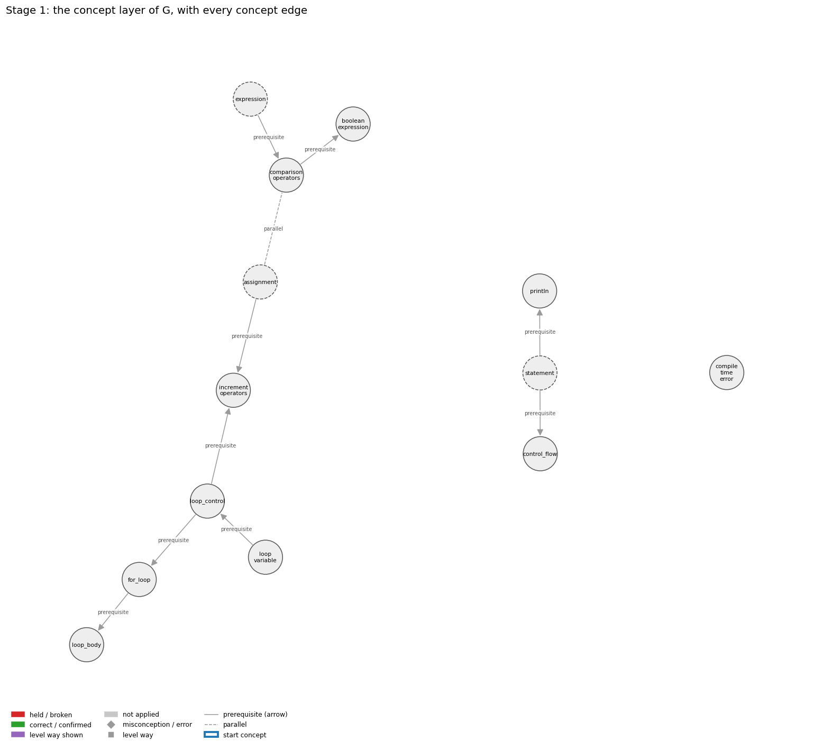
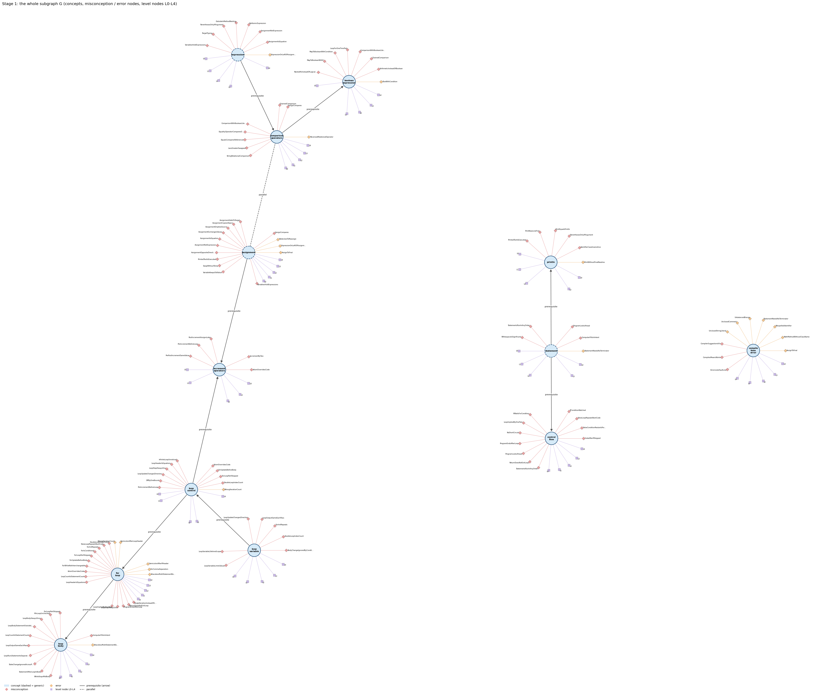
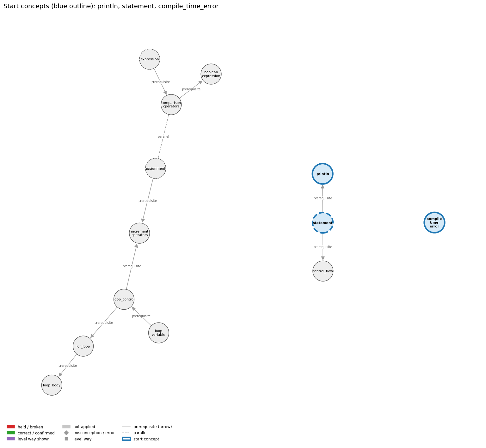
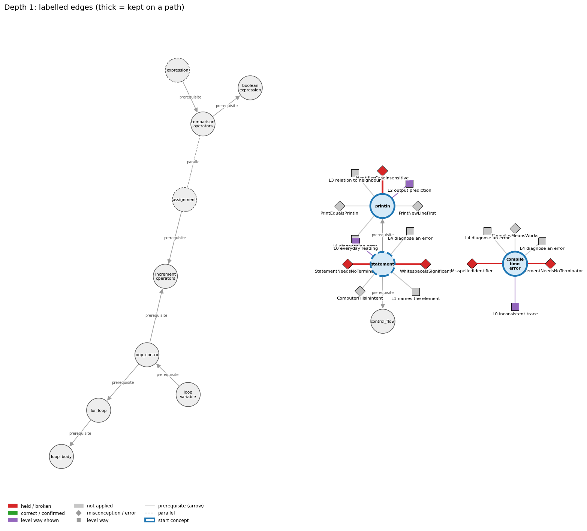
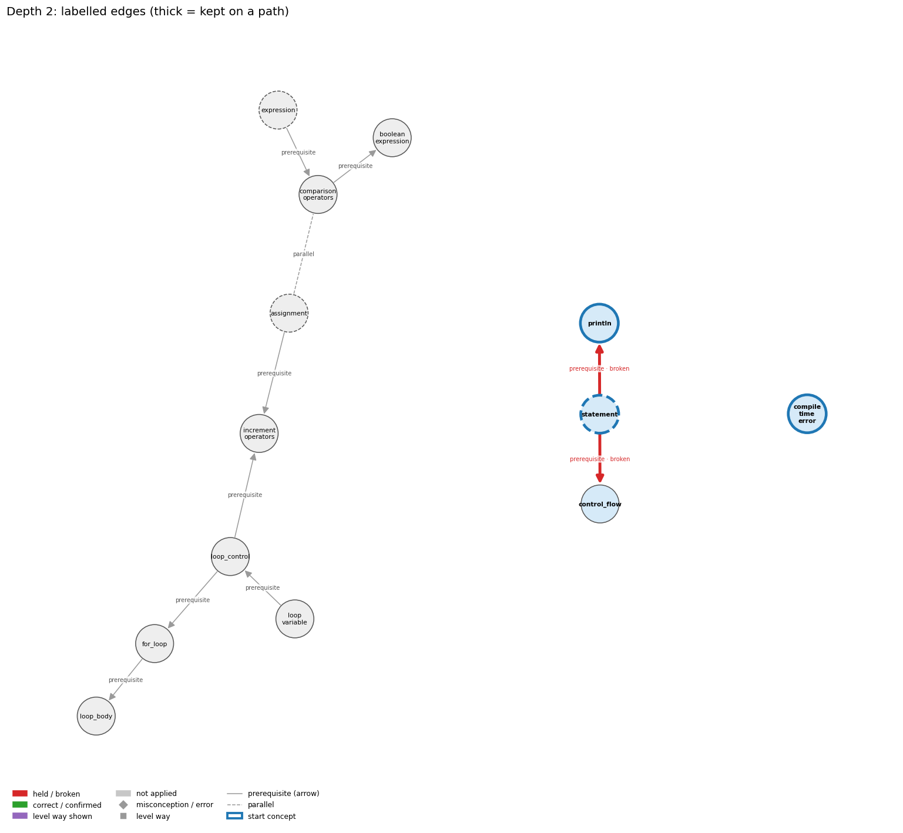
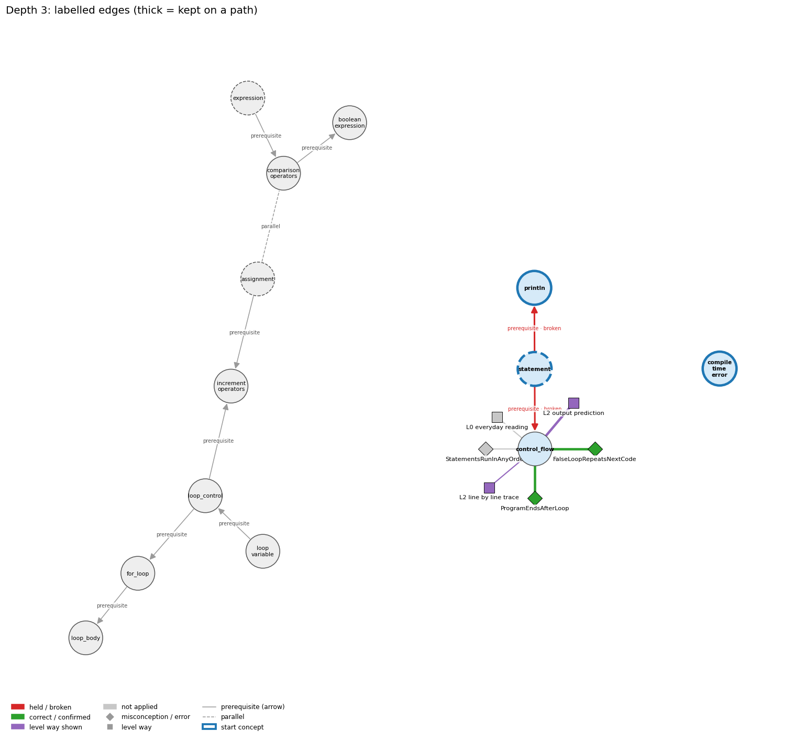

# Think on the Graph: every output of the run LP18

Files of this scenario: `input.json` (program, question, answer), `diagnosis.json`, `subgraph.json`, `traverse_log.txt`, `report.html` (this report as one full-page file, with the interactive graph `LP18_G.html`), `LP18.ipynb` (this report as a notebook).

## Level classification

This scenario tests **L0: misconception**. How the overall level is decided is explained in the [folder README](../../README.md).

- **Overall level: L0** (decided by: held mistake)
- **Shares of the components:** L0 0.75, L2 0.25; LOW coherence
- **Mistake held (root cause):** statement / StatementNeedsNoTerminator
- **Expected by design:** overall L0; components `identifier` L0, `statement` L0; held IdentifierCaseInsensitive, StatementNeedsNoTerminator; root statement
- **Overall level matches the expected one:** yes

### How the overall level of this run was calculated

1. **Find the parts of the answer.** The answer touches 4 concepts (the components in the table below). Each one got its own level from what the student wrote about it.
2. **Is a real mistake held?** Yes. The student holds the wrong rule **StatementNeedsNoTerminator** at `statement`.
3. **Result.** An answer that is built on a wrong rule is **L0**, however well the other parts are done. So the overall level is **L0**.
4. **For information, the count of the parts:** 3 at L0, 1 at L2. The parts are far apart (LOW coherence): the student handles some parts well and holds a wrong rule on others.

| Component | Level | Decided by | Student's words |
|---|---|---|---|
| `compile_time_error` | L0 | way: inconsistent trace | Yes, it compiles and prints 5 twice; The missing; do not matter; because each statement is on its own line, and system.out is the same as System.out |
| `control_flow` | L2 | way: output prediction | Yes, it compiles and prints 5 twice |
| `println` | L0 | holds IdentifierCaseInsensitive | because each statement is on its own line, and system.out is the same as System.out |
| `statement` | L0 | error StatementNeedsNoTerminator | Yes, it compiles and prints 5 twice; The missing; do not matter |

## 0. Input
Program:
```java
int i , n= 5
for(i=1;i<n;i++)
    i++;
    System.out.println(i)
system.out.println(i);
```
Question: Will this compile? What happens when you run it? Explain your reasoning.

Student's answer: Yes, it compiles and prints 5 twice. The missing ; do not matter because each statement is on its own line, and system.out is the same as System.out.
Settings: width 3, depth 3, prune llm, backend claude-cli, model claude-opus-5-5
## 1. Stage 1: the subgraph G from the code (no model)
Masked code (string and char literals and comments blanked; this is what the patterns see):
```
int i , n= 5
for(i=1;i<n;i++)
    i++;
    System.out.println(i)
system.out.println(i);
```
Which code text tagged which concept (a generic concept fires on almost any Java line; it starts the walk only if the answer repeats its tag):
| concept | generic | channel | matched text | line |
|---|---|---|---|---|
| assignment | True | pattern | '=' | 1 |
| boolean_expression | False | pattern | 'for(i=1;i<n;' | 2 |
| comparison_operators | False | pattern | 'for(i=1;i<' | 2 |
| compile_time_error | False | signal | '    System.out.println(i)' | 4 |
| control_flow | False | pattern | 'for(' | 2 |
| expression | True | pattern | 'i<' | 2 |
| expression | True | pattern | '=1;' | 2 |
| for_loop | False | pattern | 'for(' | 2 |
| increment_operators | False | pattern | '++' | 2 |
| loop_body | False | pattern | 'for(' | 2 |
| loop_control | False | signal | 'for(i=1;i<n;i++)' | 2 |
| loop_variable | False | pattern | 'for(i=' | 2 |
| println | False | pattern | 'System.out.println(' | 4 |
| statement | True | pattern | ';' | 2 |

G: 13 concept nodes (3 generic), 10 concept edges, 126 misconception / error edges, 92 misconception / error nodes, 65 level nodes, 125 level-misconception links, 3 connected piece(s).
Note: concept nodes form 3 pieces (the KG has no edge between them): assignment,boolean_expression,comparison_operators,expression,for_loop,increment_operators,loop_body,loop_control,loop_variable | compile_time_error | control_flow,println,statement
Note: compile_time_error.missing_semicolon: compiler-message signal, needs javac output; skipped

Concept edges of G (the links the walk can read; `pre:` = prerequisite A -> B, `par:` = parallel):
| edge | type | rule (logic) |
|---|---|---|
| par:assignment~comparison_operators | parallel | x = y stores the value of y in x (a statement with a side effect); x == y only tests whether the two values are equal and gives a boolean. Writing = where == is meant is a compile error with int operands and a silent bug with boolean operands. |
| pre:assignment->increment_operators | prerequisite | i++ is shorthand for the assignment i = i + 1. |
| pre:comparison_operators->boolean_expression | prerequisite | A comparison such as x < y produces a boolean result; comparisons together with boolean logic provide the basis for decision-making. |
| pre:expression->comparison_operators | prerequisite | Comparison operators build expressions whose value is a boolean, so one must already know what an expression is to understand a < b. |
| pre:for_loop->loop_body | prerequisite | The statements in braces after the for header are the loop body; they run once on every pass, between the test and the increment, exactly as in a while loop. |
| pre:loop_control->for_loop | prerequisite | The for header is exactly the three control slots, and the body runs after the test and before the update on each pass. |
| pre:loop_control->increment_operators | prerequisite | The loop update i = i + 1 comes first; ++ (and +=) are then introduced as shorthand for that update. |
| pre:loop_variable->loop_control | prerequisite | The init, condition and update all act on the loop variable: the init sets it, the condition tests it, the update changes it. |
| pre:statement->control_flow | prerequisite | Control flow is the order in which statements run. |
| pre:statement->println | prerequisite | System.out.println(s); is itself a statement, so its line of output appears at its own place in the sequence. |

Misconception / error edges per concept (count), and level ways per concept (count):
| concept | misconception / error edges | level ways (L1-L4 + L0 non-misconception) |
|---|---|---|
| assignment | 15 | 24 |
| boolean_expression | 8 | 19 |
| comparison_operators | 8 | 20 |
| compile_time_error | 10 | 21 |
| control_flow | 11 | 15 |
| expression | 8 | 19 |
| for_loop | 20 | 24 |
| increment_operators | 5 | 16 |
| loop_body | 12 | 14 |
| loop_control | 11 | 19 |
| loop_variable | 7 | 13 |
| println | 6 | 17 |
| statement | 5 | 19 |

**Figure 1**


**Figure 2**


## 2. Clauses and start concepts (no model)
The answer split into clauses (at sentence ends, ';', and before 'because' / 'so'; quotes removed):
| clause | text |
|---|---|
| c1 | Yes, it compiles and prints 5 twice |
| c2 | The missing |
| c3 | do not matter |
| c4 | because each statement is on its own line, and system.out is the same as System.out |

start: generic concepts whose tagging text occurs in the answer: statement

start: BM25 of the answer against each tagged concept: println 22.26 (hits 1), statement 17.97 (hits 1), compile_time_error 10.96 (hits 1), for_loop 9.13 (hits 1), control_flow 8.66 (hits 1), loop_body 8.27 (hits 1), loop_control 6.74 (hits 1), loop_variable 6.00 (hits 1), comparison_operators 3.41 (hits 1), increment_operators 3.01 (hits 1), boolean_expression 2.19 (hits 1)

start: chosen println, statement, compile_time_error

start concepts (3): println, statement, compile_time_error

Start concepts: println, statement, compile_time_error

**Figure 3**


## 3. The walk, depth by depth
At each depth, for each current concept: the edges offered (a concept entering as a start concept offers its misconception / error edges and its level ways, as two families; otherwise it offers its concept edges), the prune prompt and the model's reply, then the label prompt(s) and the model's reply, parsed into label / clauses / confidence. Score = prune score x confidence.

### Depth 1: current concepts 'println', 'statement', 'compile_time_error'

#### println, misconceptions: 6 edges offered
Edges offered:
| edge |
|---|
| err:println->PrintWithoutFinalNewline \| wrong rule: Ends the output with print and expects it to appear right away. \| right rule: Finish a line of print calls with println; some systems hold print output until a newline is printed. |
| mis:println->IdentifierCaseInsensitive \| wrong rule: System.out.Println and System.out.println name the same method. \| right rule: Java is case-sensitive: names of variables, methods and classes that differ only in capitalization are different names. |
| mis:println->ParenthesesOnlyIfArgument \| wrong rule: println with nothing to print can be written System.out.println; without the parentheses. \| right rule: A method call always needs parentheses, so an empty line is printed with System.out.println();. |
| mis:println->PrintEqualsPrintln \| wrong rule: print and println do the same thing, so print(s1); print(s2); puts s1 and s2 on separate lines. \| right rule: println ends the line after printing and print does not, so print(s1); print(s2); puts s1 and s2 on the same line. |
| mis:println->PrintNewLineFirst \| wrong rule: println(s) prints a newline and then s. \| right rule: println(s) prints s and then the newline. |
| mis:println->PrintedTextIsExecuted \| wrong rule: System.out.println("x is 5"); sets x to 5 (text inside the quotes is run as code). \| right rule: Characters inside double quotes are printed literally; println only displays them and changes no variable. Only an assignment such as x = 5; sets x. |

Prune: the model's reply (edge id and score; the kept edges sum to 1):
```
mis:println->IdentifierCaseInsensitive (0.80), mis:println->PrintEqualsPrintln (0.10), mis:println->PrintNewLineFirst (0.10)
```
Kept by pruning: mis:println->IdentifierCaseInsensitive (0.80), mis:println->PrintEqualsPrintln (0.10), mis:println->PrintNewLineFirst (0.10)

Label prompt for the misconception / error edges (judged together). The model saw the program, the question, the numbered clauses, and these edges with their wrong rule and right rule:
| edge |
|---|
| mis:println->IdentifierCaseInsensitive \| wrong rule: System.out.Println and System.out.println name the same method. \| right rule: Java is case-sensitive: names of variables, methods and classes that differ only in capitalization are different names. |
| mis:println->PrintEqualsPrintln \| wrong rule: print and println do the same thing, so print(s1); print(s2); puts s1 and s2 on separate lines. \| right rule: println ends the line after printing and print does not, so print(s1); print(s2); puts s1 and s2 on the same line. |
| mis:println->PrintNewLineFirst \| wrong rule: println(s) prints a newline and then s. \| right rule: println(s) prints s and then the newline. |
Model's reply:
```
mis:println->IdentifierCaseInsensitive | held | clauses: 4 | confidence: 0.95
mis:println->PrintEqualsPrintln | not applied | clauses: none | confidence: 0.85
mis:println->PrintNewLineFirst | not applied | clauses: none | confidence: 0.9
```

Parsed labels:
| edge | label | prune score | confidence | score | clauses | words |
|---|---|---|---|---|---|---|
| mis:println->IdentifierCaseInsensitive | held | 0.8 | 0.95 | 0.76 | c4 | because each statement is on its own line, and system.out is the same as System.out |
| mis:println->PrintEqualsPrintln | not applied |  |  | 0.0 |  |  |
| mis:println->PrintNewLineFirst | not applied |  |  | 0.0 |  |  |

#### println, level ways: 17 edges offered
Edges offered:
| edge |
|---|
| lvl:println@L0#0 \| level L0 way everyday_reading: Everyday reading: 'println' is just 'print', and 'new line' is something you do before writing. Java rule: println(x) prints x and then ends the line; println() alone just ends the line. |
| lvl:println@L0#3 \| level L0 way inconsistent_trace: Applies the println rule (print, then end line) unevenly: puts the newline before the text on one call and after it on another, or forgets that the next output starts on a new line. (here mixing in: "print and println behave the same (no newline difference)") |
| lvl:println@L1#0 \| level L1 way names_the_element: System.out.println is a library method that prints its argument followed by a line terminator ('print line'). |
| lvl:println@L1#1 \| level L1 way states_the_rule: println(String x) behaves as though it calls print(x) and then println(); println() terminates the current line by writing the line separator string. |
| lvl:println@L2#0 \| level L2 way line_by_line_trace: Evaluate the argument, print its characters at the current position, then write the line separator so the cursor moves to the beginning of the next line. |
| lvl:println@L2#1 \| level L2 way output_prediction: Output is the value's characters followed by a line break: println("Hello, "); println("World!"); prints two lines. |
| lvl:println@L2#2 \| level L2 way one_step_execution: One call appends the text and a line separator to the output; the cursor ends at the start of the next line; no variable changes and nothing is returned. |
| lvl:println@L3#0 \| level L3 way relation_to_neighbour: System.out.println(s); is a statement, so its line of output appears at its own place in the sequence. |
| lvl:println@L3#1 \| level L3 way relation_to_neighbour: println("s") outputs exactly the characters between the quotes and then ends the line. |
| lvl:println@L3#2 \| level L3 way relation_to_neighbour: print leaves the cursor on the line; println ends it; several prints followed by one println make one line. |
| lvl:println@L3#3 \| level L3 way relation_to_neighbour: println prints numbers with all their digits and always ends the line; printf formats each value by its conversion code and ends the line only where the format has %n or \n. |
| lvl:println@L3#4 \| level L3 way purpose_of_the_whole: Purpose: produce one complete line of output, e.g. each result on its own line, or end a line built with print. |
| lvl:println@L4#0 \| level L4 way predict_a_change: Replacing println with print joins the next output onto the same line (a typical logic error); the characters printed stay the same. |
| lvl:println@L4#1 \| level L4 way transfer_to_a_new_program: Use println when each output item belongs on its own line or to end a line; use print to continue a line and printf to control number formatting. |
| lvl:println@L4#2 \| level L4 way diagnose_an_error: rule broken: Finish a line of print calls with println. Kind: silent logic error. Trigger class: output ends with print, so the last line may not be shown or runs into the shell prompt |
| lvl:println@L4#3 \| level L4 way diagnose_an_error: rule broken: Method names are case-sensitive. Kind: compile-time. Trigger class: System.out.Println or system.out.println: cannot find symbol |
| lvl:println@L4#4 \| level L4 way diagnose_an_error: rule broken: Calls need parentheses. Kind: compile-time. Trigger class: System.out.println; without () |

Prune: the model's reply (edge id and score; the kept edges sum to 1):
```
{lvl:println@L4#3 (Score: 0.6)}
{lvl:println@L2#1 (Score: 0.25)}
{lvl:println@L3#0 (Score: 0.15)}
```
Kept by pruning: lvl:println@L4#3 (0.60), lvl:println@L2#1 (0.25), lvl:println@L3#0 (0.15)

Label prompt for level way lvl:println@L4#3 (the model saw the concept, the way's name 'diagnose an error', its text, where the way stops and whether the words must be correct; no level):
> rule broken: Method names are case-sensitive. Kind: compile-time. Trigger class: System.out.Println or system.out.println: cannot find symbol
>
> Where this way stops: Locating and fixing the mistake for one given failing case is L3. A compiler-flagged slip fixed from the message is weak evidence.

Model's reply:
```
Label: wrong
Clauses: 4
Confidence: 0.9
```

Label prompt for level way lvl:println@L2#1 (the model saw only the concept, the way's name 'output prediction' and its text; no level):
> Output is the value's characters followed by a line break: println("Hello, "); println("World!"); prints two lines.

Model's reply:
```
Label: shown
Clauses: 1
Confidence: 0.6
```

Label prompt for level way lvl:println@L3#0 (the model saw the concept, the way's name 'relation to neighbour', its text, where the way stops and whether the words must be correct; no level):
> System.out.println(s); is a statement, so its line of output appears at its own place in the sequence.
>
> Where this way stops: Two correct but separate rules are L1. Executing the two in sequence is L2. A relational answer may be correct or a relational error.

Model's reply:
```
Label: wrong
Clauses: 1, 4
Confidence: 0.6
```

Parsed labels:
(none)

#### statement, misconceptions: 5 edges offered
Edges offered:
| edge |
|---|
| err:statement->StatementNeedsNoTerminator \| wrong rule: A statement still compiles and runs if the semicolon at its end is left out, or if a stray ; is put right after if (c) or for (...). \| right rule: Each statement must end with ;, otherwise javac reports ';' expected. |
| mis:statement->ComputerFillsInIntent \| wrong rule: The computer fills in omitted steps or values that the programmer meant, e.g. REPEAT 4 [FORWARD 30] draws a square without a turn command. \| right rule: The computer executes only what the code states; every needed step and value must be written. |
| mis:statement->ProgramLooksAhead \| wrong rule: The program knows or sees what later lines will do and acts on those goals at the current line, e.g. it stops 'at ten' because it wants to draw a box. \| right rule: Each statement executes using only the current state; later lines have no effect until control reaches them. |
| mis:statement->StatementsRunInAnyOrder \| wrong rule: Statements in a program can run in any order. \| right rule: Without control statements, statements run once each, top to bottom. |
| mis:statement->WhitespaceIsSignificant \| wrong rule: Line breaks and indentation change what the program does, so each statement must be on its own line. \| right rule: Java compilers consider all whitespace in program text (outside quotation marks) to be equivalent; layout is for human readers. |

Prune: the model's reply (edge id and score; the kept edges sum to 1):
```
{err:statement->StatementNeedsNoTerminator (Score: 0.5)}
{mis:statement->WhitespaceIsSignificant (Score: 0.3)}
{mis:statement->ComputerFillsInIntent (Score: 0.2)}
```
Kept by pruning: err:statement->StatementNeedsNoTerminator (0.50), mis:statement->WhitespaceIsSignificant (0.30), mis:statement->ComputerFillsInIntent (0.20)

Label prompt for the misconception / error edges (judged together). The model saw the program, the question, the numbered clauses, and these edges with their wrong rule and right rule:
| edge |
|---|
| err:statement->StatementNeedsNoTerminator \| wrong rule: A statement still compiles and runs if the semicolon at its end is left out, or if a stray ; is put right after if (c) or for (...). \| right rule: Each statement must end with ;, otherwise javac reports ';' expected. |
| mis:statement->WhitespaceIsSignificant \| wrong rule: Line breaks and indentation change what the program does, so each statement must be on its own line. \| right rule: Java compilers consider all whitespace in program text (outside quotation marks) to be equivalent; layout is for human readers. |
| mis:statement->ComputerFillsInIntent \| wrong rule: The computer fills in omitted steps or values that the programmer meant, e.g. REPEAT 4 [FORWARD 30] draws a square without a turn command. \| right rule: The computer executes only what the code states; every needed step and value must be written. |
Model's reply:
```
err:statement->StatementNeedsNoTerminator | held | clauses: 1, 2, 3 | confidence: 0.9
mis:statement->WhitespaceIsSignificant | held | clauses: 4 | confidence: 0.8
mis:statement->ComputerFillsInIntent | not applied | clauses: none | confidence: 0.6
```

Parsed labels:
| edge | label | prune score | confidence | score | clauses | words |
|---|---|---|---|---|---|---|
| err:statement->StatementNeedsNoTerminator | held | 0.5 | 0.9 | 0.45 | c1, c2, c3 | Yes, it compiles and prints 5 twice; The missing; do not matter |
| mis:statement->WhitespaceIsSignificant | held | 0.3 | 0.8 | 0.24 | c4 | because each statement is on its own line, and system.out is the same as System.out |
| mis:statement->ComputerFillsInIntent | not applied |  |  | 0.0 |  |  |

#### statement, level ways: 19 edges offered
Edges offered:
| edge |
|---|
| lvl:statement@L0#0 \| level L0 way everyday_reading: Everyday reading: a program is read like a text or a list of wishes that the computer takes in all at once, so line order, goals of later lines or what the writer meant can matter. Java rule: each statement is one step, ended by ;, executed once, in written order, using only the current state. |
| lvl:statement@L0#2 \| level L0 way inconsistent_trace: Applies the sequencing rule (LT) unevenly: executes the statements in order on some lines but lets a later statement's effect leak into an earlier one, or skips or repeats a statement on one pass. (here mixing in: "The computer fills in omitted steps or values that the programmer meant, e.g. REPEAT 4 [FORWARD 30] draws a square without a turn command") |
| lvl:statement@L1#0 \| level L1 way names_the_element: A statement is one step of a program (a declaration, assignment, method call such as System.out.println(...), or control statement), ended by a semicolon when it is a simple statement. |
| lvl:statement@L1#1 \| level L1 way states_the_rule: A method body is a sequence of statements enclosed in braces and each followed by a semicolon; statements are executed for their effect and have no value; an expression statement evaluates its expression and discards any value. |
| lvl:statement@L2#0 \| level L2 way line_by_line_trace: Statements run one at a time, from first to last; each completes (normally or abruptly) before the next starts. |
| lvl:statement@L2#1 \| level L2 way output_prediction: A statement has no value; its result is its effect: a changed variable, printed output, or a change of control flow. |
| lvl:statement@L2#2 \| level L2 way one_step_execution: Executing one statement applies its single effect to the current state (e.g. prints one string, or stores one value) and then control moves to the next statement. |
| lvl:statement@L3#0 \| level L3 way relation_to_neighbour: Statements live in main's body; running the program executes main's statements in order. |
| lvl:statement@L3#1 \| level L3 way relation_to_neighbour: A block groups a sequence of statements in braces; the body of main() is such a block. |
| lvl:statement@L3#2 \| level L3 way relation_to_neighbour: System.out.print(s); is a statement, so its output appears exactly at its place in the sequence, with no newline. |
| lvl:statement@L3#3 \| level L3 way relation_to_neighbour: System.out.println(s); is a statement, so its line of output appears at its place in the sequence; swapping two println statements swaps the output lines. |
| lvl:statement@L3#4 \| level L3 way relation_to_neighbour: Control flow is the order in which statements run; without control statements it is straight-line, each once in order. |
| lvl:statement@L3#5 \| level L3 way relation_to_neighbour: A lone ; is the empty statement, which does nothing; it can fill a for-loop part or, by accident, end an if or loop header. |
| lvl:statement@L3#6 \| level L3 way relation_to_neighbour: An algorithm becomes a program as a sequence of statements, executed once each in the order given. |
| lvl:statement@L3#7 \| level L3 way purpose_of_the_whole: Purpose: a statement is the unit of action; a program is characterized by its sequence of statements, each doing one step of the algorithm. |
| lvl:statement@L4#0 \| level L4 way predict_a_change: Swapping two statements that touch the same variable or the output generally changes the result; swapping independent statements, or changing only whitespace between them, keeps it. |
| lvl:statement@L4#1 \| level L4 way diagnose_an_error: rule broken: Each simple statement must end with ;. Kind: compile-time. Trigger class: omitting the ; at the end of a statement: javac reports ';' expected (often at the end of that line or the next) |
| lvl:statement@L4#2 \| level L4 way transfer_to_a_new_program: Write one statement per step and order them as the algorithm requires; straight-line sequence suffices when every step runs once, otherwise use conditionals or loops. |
| lvl:statement@L4#3 \| level L4 way diagnose_an_error: rule broken: A ; directly after an if/while/for header is an empty statement. Kind: silent logic error. Trigger class: if (x > 0); or while (cond); followed by the intended body |

Prune: the model's reply (edge id and score; the kept edges sum to 1):
```
{lvl:statement@L4#1 (Score: 0.5)}
{lvl:statement@L0#0 (Score: 0.3)}
{lvl:statement@L1#0 (Score: 0.2)}
```
Kept by pruning: lvl:statement@L4#1 (0.50), lvl:statement@L0#0 (0.30), lvl:statement@L1#0 (0.20)

Label prompt for level way lvl:statement@L4#1 (the model saw the concept, the way's name 'diagnose an error', its text, where the way stops and whether the words must be correct; no level):
> rule broken: Each simple statement must end with ;. Kind: compile-time. Trigger class: omitting the ; at the end of a statement: javac reports ';' expected (often at the end of that line or the next)
>
> Where this way stops: Locating and fixing the mistake for one given failing case is L3. A compiler-flagged slip fixed from the message is weak evidence.

Model's reply:
```
Label: wrong
Clauses: 1, 2, 3, 4
Confidence: 0.85
```

Label prompt for level way lvl:statement@L0#0 (the model saw only the concept, the way's name 'everyday reading' and its text; no level):
> Everyday reading: a program is read like a text or a list of wishes that the computer takes in all at once, so line order, goals of later lines or what the writer meant can matter. Java rule: each statement is one step, ended by ;, executed once, in written order, using only the current state.

Model's reply:
```
Label: shown
Clauses: 2, 3, 4
Confidence: 0.8
```

Label prompt for level way lvl:statement@L1#0 (the model saw only the concept, the way's name 'names the element' and its text; no level):
> A statement is one step of a program (a declaration, assignment, method call such as System.out.println(...), or control statement), ended by a semicolon when it is a simple statement.

Model's reply:
```
Label: not shown
Clauses: none
Confidence: 0.8
```

Parsed labels:
(none)

#### compile_time_error, misconceptions: 10 edges offered
Edges offered:
| edge |
|---|
| err:compile_time_error->AssignToFinal \| wrong rule: Assigns a new value to a variable declared final. \| right rule: A final variable cannot be reassigned after it is initialized; the compiler reports an error. |
| err:compile_time_error->MathMethodWithoutClassName \| wrong rule: sqrt(x) calls the square-root method. \| right rule: Library methods are called with the class name, e.g. Math.sqrt(x). |
| err:compile_time_error->MisspelledIdentifier \| wrong rule: Writes Sytem.out.prinln or a misspelled variable name. \| right rule: Every name must be spelled exactly, including capitalization. |
| err:compile_time_error->StatementNeedsNoTerminator \| wrong rule: a statement runs without the ; \| right rule: Each statement must end with ;, otherwise javac reports ';' expected. |
| err:compile_time_error->UnbalancedBraces \| wrong rule: A missing { or } is harmless. \| right rule: Every { must be matched by a } so the class body and the method body are well formed. |
| err:compile_time_error->UnclosedComment \| wrong rule: Opens a comment with /* and never closes it. \| right rule: A /* comment is the text between /* and */, so the closing */ is required. |
| err:compile_time_error->UnclosedStringLiteral \| wrong rule: A string literal can be left without its closing quote. \| right rule: A String literal is enclosed in a pair of double quotes. |
| mis:compile_time_error->CompilerSuggestionIsFix \| wrong rule: Doing exactly what the compiler message suggests will fix the error. \| right rule: An error message is evidence that something is wrong, but its suggested remedy may be wrong; find the actual cause. |
| mis:compile_time_error->CompilesMeansWorks \| wrong rule: Code that compiles is code that works. \| right rule: Code that compiles can still have run-time and logical errors. |
| mis:compile_time_error->ErrorLineIsFaultLine \| wrong rule: The line number in a javac error is always the line that has the mistake. \| right rule: The compiler reports where it noticed the problem, which can be after the real fault; for example, omitting the second left brace of HelloWorld produces errors reported on later lines. |

Prune: the model's reply (edge id and score; the kept edges sum to 1):
```
{err:compile_time_error->StatementNeedsNoTerminator (Score: 0.5)}
{err:compile_time_error->MisspelledIdentifier (Score: 0.4)}
{mis:compile_time_error->CompilesMeansWorks (Score: 0.1)}
```
Kept by pruning: err:compile_time_error->StatementNeedsNoTerminator (0.50), err:compile_time_error->MisspelledIdentifier (0.40), mis:compile_time_error->CompilesMeansWorks (0.10)

Label prompt for the misconception / error edges (judged together). The model saw the program, the question, the numbered clauses, and these edges with their wrong rule and right rule:
| edge |
|---|
| err:compile_time_error->StatementNeedsNoTerminator \| wrong rule: a statement runs without the ; \| right rule: Each statement must end with ;, otherwise javac reports ';' expected. |
| err:compile_time_error->MisspelledIdentifier \| wrong rule: Writes Sytem.out.prinln or a misspelled variable name. \| right rule: Every name must be spelled exactly, including capitalization. |
| mis:compile_time_error->CompilesMeansWorks \| wrong rule: Code that compiles is code that works. \| right rule: Code that compiles can still have run-time and logical errors. |
Model's reply:
```
err:compile_time_error->StatementNeedsNoTerminator | held | clauses: 2, 3, 4 | confidence: 0.85
err:compile_time_error->MisspelledIdentifier | held | clauses: 4 | confidence: 0.9
mis:compile_time_error->CompilesMeansWorks | not applied | clauses: none | confidence: 0.75
```

Parsed labels:
| edge | label | prune score | confidence | score | clauses | words |
|---|---|---|---|---|---|---|
| err:compile_time_error->StatementNeedsNoTerminator | held | 0.5 | 0.85 | 0.42 | c2, c3, c4 | The missing; do not matter; because each statement is on its own line, and system.out is the same as System.out |
| err:compile_time_error->MisspelledIdentifier | held | 0.4 | 0.9 | 0.36 | c4 | because each statement is on its own line, and system.out is the same as System.out |
| mis:compile_time_error->CompilesMeansWorks | not applied |  |  | 0.0 |  |  |

#### compile_time_error, level ways: 21 edges offered
Edges offered:
| edge |
|---|
| lvl:compile_time_error@L0#0 \| level L0 way everyday_reading: Everyday reading: 'error' means the program will do something wrong when used, and a message points exactly at the mistake. Java rule: a compile-time error is a breach of the language rules found by javac before any execution; no .class is produced, and the reported line is where javac noticed it. |
| lvl:compile_time_error@L0#3 \| level L0 way inconsistent_trace: Applies the 'javac checks before running' rule unevenly: predicts output for a program that would not compile, or expects a compile error from a fault (such as division by zero) that only shows at run time. (here mixing in: "Code that compiles is code that works") |
| lvl:compile_time_error@L1#0 \| level L1 way names_the_element: A compile-time error (syntax error) is an error in the source code, caught by javac, that prevents the program from being translated. |
| lvl:compile_time_error@L1#1 \| level L1 way states_the_rule: Compile-time errors occur when the code violates the rules of the Java language (syntax, names, types); they are caught when you compile and prevent the translation. |
| lvl:compile_time_error@L2#0 \| level L2 way line_by_line_trace: javac reads the whole file, reports each error with file name, line number and message, tries to recover and continue, and prints a count; the first message is the most reliable. |
| lvl:compile_time_error@L2#1 \| level L2 way output_prediction: Result: messages such as Bad.java:4: ';' expected ... 3 errors, and no Name.class; nothing of the program runs. |
| lvl:compile_time_error@L2#2 \| level L2 way one_step_execution: A failed compile leaves the file system without a new Name.class (an older one, if any, is not updated) and changes no program state. |
| lvl:compile_time_error@L3#0 \| level L3 way relation_to_neighbour: A compile-time error is reported while javac compiles Name.java, so no new Name.class is produced. |
| lvl:compile_time_error@L3#1 \| level L3 way relation_to_neighbour: Each compile-time error comes with a message; reading it (first error first, line may be late) is how it is found and fixed. |
| lvl:compile_time_error@L3#2 \| level L3 way relation_to_neighbour: A compile-time error is found by javac before the program runs; a run-time error only while it runs, so code that compiles can still crash. |
| lvl:compile_time_error@L3#3 \| level L3 way purpose_of_the_whole: Purpose (of the check): catch rule violations automatically before running, so they cannot cause wrong behaviour; S&W say treat the compiler as a friend. |
| lvl:compile_time_error@L4#0 \| level L4 way predict_a_change: Fixing the first error and recompiling can remove many messages at once; a single missing brace or semicolon can cause several messages. |
| lvl:compile_time_error@L4#1 \| level L4 way diagnose_an_error: rule broken: Each statement must end with ;. Kind: compile-time. Trigger class: missing ; at the end of a statement: ';' expected |
| lvl:compile_time_error@L4#2 \| level L4 way diagnose_an_error: rule broken: Every { must be matched by a }. Kind: compile-time. Trigger class: missing or extra brace: '{' expected, 'class' or 'interface' expected, reached end of file while parsing |
| lvl:compile_time_error@L4#3 \| level L4 way diagnose_an_error: rule broken: A String literal is enclosed in a pair of double quotes. Kind: compile-time. Trigger class: missing closing quote: unclosed string literal, often with confusing follow-on errors |
| lvl:compile_time_error@L4#4 \| level L4 way diagnose_an_error: rule broken: Library static methods are called with the class name, e.g. Math.sqrt(x). Kind: compile-time. Trigger class: calling sqrt(x) without Math.: cannot find symbol |
| lvl:compile_time_error@L4#5 \| level L4 way diagnose_an_error: rule broken: Every name must be spelled exactly, including capitalization. Kind: compile-time. Trigger class: Sytem.out.prinln, Println, or a misspelled variable: cannot find symbol |
| lvl:compile_time_error@L4#6 \| level L4 way diagnose_an_error: rule broken: A /* comment needs its closing */. Kind: compile-time. Trigger class: /* with no */ swallows the rest of the file |
| lvl:compile_time_error@L4#7 \| level L4 way transfer_to_a_new_program: Expect compile-time errors for anything the compiler can check from the text alone (syntax, names, types, final); expect run-time or logic errors for faults that depend on input values or on what the program was meant to do. |
| lvl:compile_time_error@L4#8 \| level L4 way diagnose_an_error: rule broken: A final variable cannot be reassigned after it is initialized. Kind: compile-time. Trigger class: assigning a second value to a final variable |
| lvl:compile_time_error@L4#9 \| level L4 way diagnose_an_error: rule broken: Required keywords (class, static, void...) must be present and spelled right. Kind: compile-time. Trigger class: omitting or misspelling a keyword in public class Name or the main header |

Prune: the model's reply (edge id and score; the kept edges sum to 1):
```
{lvl:compile_time_error@L0#3 (Score: 0.4)}
{lvl:compile_time_error@L4#1 (Score: 0.3)}
{lvl:compile_time_error@L4#5 (Score: 0.3)}
```
Kept by pruning: lvl:compile_time_error@L0#3 (0.40), lvl:compile_time_error@L4#1 (0.30), lvl:compile_time_error@L4#5 (0.30)

Label prompt for level way lvl:compile_time_error@L0#3 (the model saw only the concept, the way's name 'inconsistent trace' and its text; no level):
> Applies the 'javac checks before running' rule unevenly: predicts output for a program that would not compile, or expects a compile error from a fault (such as division by zero) that only shows at run time. (here mixing in: "Code that compiles is code that works")

Model's reply:
```
Label: shown
Clauses: 1, 2, 3, 4
Confidence: 0.85
```

Label prompt for level way lvl:compile_time_error@L4#1 (the model saw the concept, the way's name 'diagnose an error', its text, where the way stops and whether the words must be correct; no level):
> rule broken: Each statement must end with ;. Kind: compile-time. Trigger class: missing ; at the end of a statement: ';' expected
>
> Where this way stops: Locating and fixing the mistake for one given failing case is L3. A compiler-flagged slip fixed from the message is weak evidence.

Model's reply:
```
Label: wrong
Clauses: 1, 2, 3, 4
Confidence: 0.85
```

Label prompt for level way lvl:compile_time_error@L4#5 (the model saw the concept, the way's name 'diagnose an error', its text, where the way stops and whether the words must be correct; no level):
> rule broken: Every name must be spelled exactly, including capitalization. Kind: compile-time. Trigger class: Sytem.out.prinln, Println, or a misspelled variable: cannot find symbol
>
> Where this way stops: Locating and fixing the mistake for one given failing case is L3. A compiler-flagged slip fixed from the message is weak evidence.

Model's reply:
```
Label: wrong
Clauses: 1, 4
Confidence: 0.85
```

Parsed labels:
| edge | label | prune score | confidence | score | clauses | words |
|---|---|---|---|---|---|---|
| lvl:compile_time_error@L0#3 | shown | 0.4 | 0.85 | 0.34 | c1, c2, c3, c4 | Yes, it compiles and prints 5 twice; The missing; do not matter; because each statement is on its own line, and system.out is the same as System.out |

**Kept on a path at this depth** (best N in tiers: held misconception / broken edge, then held error, then correct / confirmed / shown):

mis:println->IdentifierCaseInsensitive [held, tier 0, 0.76], mis:statement->WhitespaceIsSignificant [held, tier 0, 0.24], err:statement->StatementNeedsNoTerminator [held, tier 1, 0.45]

**Clause coverage after this depth:**
| clause | text | covered by |
|---|---|---|
| c1 | Yes, it compiles and prints 5 twice | err:statement->StatementNeedsNoTerminator |
| c2 | The missing | err:statement->StatementNeedsNoTerminator |
| c3 | do not matter | err:statement->StatementNeedsNoTerminator |
| c4 | because each statement is on its own line, and system.out is the same as System.out | mis:println->IdentifierCaseInsensitive |

**Graph check, not yet read (the walk may not stop while these remain):** pre:statement->control_flow, pre:statement->println

**Figure 4 (the graph after depth 1)**


### Depth 2: current concepts 'println', 'statement'

#### println, concept edges: 1 edges offered
Edges offered:
| edge |
|---|
| pre:statement->println \| rule: System.out.println(s); is itself a statement, so its line of output appears at its own place in the sequence. |

Prune: the model's reply (edge id and score; the kept edges sum to 1):
```
{pre:statement->println (Score: 1.0)}
```
Kept by pruning: pre:statement->println (1.00)

Label prompt for concept edge pre:statement->println (statement -> println, prerequisite):
> System.out.println(s); is itself a statement, so its line of output appears at its own place in the sequence.

Model's reply:
```
Label: broken
Clauses: 1, 2, 3, 4
Confidence: 0.7
```

Parsed labels:
| edge | label | prune score | confidence | score | clauses | words |
|---|---|---|---|---|---|---|
| pre:statement->println | broken | 1.0 | 0.7 | 0.7 | c1, c2, c3, c4 | Yes, it compiles and prints 5 twice; The missing; do not matter; because each statement is on its own line, and system.out is the same as System.out |

#### statement, concept edges: 1 edges offered
Edges offered:
| edge |
|---|
| pre:statement->control_flow \| rule: Control flow is the order in which statements run. |
| pre:statement->println \| rule: System.out.println(s); is itself a statement, so its line of output appears at its own place in the sequence. |

Prune: the model's reply (edge id and score; the kept edges sum to 1):
```
{pre:statement->control_flow (Score: 1.0)}
```
Kept by pruning: pre:statement->control_flow (1.00)

Label prompt for concept edge pre:statement->control_flow (statement -> control_flow, prerequisite):
> Control flow is the order in which statements run.

Model's reply:
```
Label: broken
Clauses: 1, 4
Confidence: 0.6
```

Parsed labels:
| edge | label | prune score | confidence | score | clauses | words |
|---|---|---|---|---|---|---|
| pre:statement->control_flow | broken | 1.0 | 0.6 | 0.6 | c1, c4 | Yes, it compiles and prints 5 twice; because each statement is on its own line, and system.out is the same as System.out |

**Kept on a path at this depth** (best N in tiers: held misconception / broken edge, then held error, then correct / confirmed / shown):

pre:statement->println [broken, tier 0, 0.70], pre:statement->control_flow [broken, tier 0, 0.60]

reached across pre:statement->control_flow, entered next: control_flow

**Clause coverage after this depth:**
| clause | text | covered by |
|---|---|---|
| c1 | Yes, it compiles and prints 5 twice | err:statement->StatementNeedsNoTerminator |
| c2 | The missing | err:statement->StatementNeedsNoTerminator |
| c3 | do not matter | err:statement->StatementNeedsNoTerminator |
| c4 | because each statement is on its own line, and system.out is the same as System.out | mis:println->IdentifierCaseInsensitive |

**Graph check, not yet read (the walk may not stop while these remain):** own edges of control_flow

**Figure 5 (the graph after depth 2)**


### Depth 3: current concepts 'statement', 'println', 'control_flow'

#### control_flow, misconceptions: 11 edges offered
Edges offered:
| edge |
|---|
| mis:control_flow->CodeAfterIfSkipped \| wrong rule: When the then branch runs, the code after the if is skipped. \| right rule: After the if finishes, execution continues with the next statement either way. |
| mis:control_flow->FalseConditionRestartsProgram \| wrong rule: When an if condition is false (and there is no else), control jumps back to the start of the program. \| right rule: A false condition skips the then branch and execution continues with the statement after the if statement. |
| mis:control_flow->FalseLoopRepeatsNextCode \| wrong rule: A loop is an iterative if-else: while the condition is true the body repeats, and when it is false the code after the loop repeats. \| right rule: Only the body is repeated; once the condition is false the code after the loop runs once. |
| mis:control_flow->IfConditionWatched \| wrong rule: An if statement watches its condition while the program runs and fires as soon as the condition becomes true (if = whenever). \| right rule: An if condition is tested once, when control reaches the if statement; later changes to the variables do not trigger the branch. |
| mis:control_flow->IfWaitsForCondition \| wrong rule: An IF statement earlier in the program stays active and fires later, e.g. inside a later loop, when its condition becomes true. \| right rule: An if is evaluated once when control reaches it; afterwards it is inactive unless control returns to it. |
| mis:control_flow->LoopImpliedByOneTest \| wrong rule: Testing one case is enough; Java will repeat the test for the other values by itself. \| right rule: A statement runs once each time control reaches it; repeating a test for many values needs a loop. |
| mis:control_flow->NoShortCircuit \| wrong rule: logical AND/OR always evaluate both sides (Java short-circuits them) \| right rule: In p && q, q is evaluated only when p is true; in p \|\| q, q is evaluated only when p is false. |
| mis:control_flow->ProgramEndsAfterLoop \| wrong rule: When a loop finishes the program ends, so code after the loop never runs. \| right rule: When the loop condition becomes false, control continues with the first statement after the loop. |
| mis:control_flow->ProgramLooksAhead \| wrong rule: The program knows or sees what later lines will do and acts on those goals at the current line, e.g. it stops 'at ten' because it wants to draw a box. \| right rule: Each statement executes using only the current state; later lines have no effect until control reaches them. |
| mis:control_flow->ReturnDoesNotExitLoop \| wrong rule: A return inside a loop does not end the loop; it sets a value each pass (the last one is returned) or returns several values. \| right rule: When return executes, the method ends at once, so the loop stops on that pass. |
| mis:control_flow->StatementsRunInAnyOrder \| wrong rule: Statements in a program can run in any order. \| right rule: Without control statements, statements run once each, top to bottom. |

Prune: the model's reply (edge id and score; the kept edges sum to 1):
```
mis:control_flow->ProgramEndsAfterLoop (0.40), mis:control_flow->FalseLoopRepeatsNextCode (0.35), mis:control_flow->StatementsRunInAnyOrder (0.25)
```
Kept by pruning: mis:control_flow->ProgramEndsAfterLoop (0.40), mis:control_flow->FalseLoopRepeatsNextCode (0.35), mis:control_flow->StatementsRunInAnyOrder (0.25)

Label prompt for the misconception / error edges (judged together). The model saw the program, the question, the numbered clauses, and these edges with their wrong rule and right rule:
| edge |
|---|
| mis:control_flow->ProgramEndsAfterLoop \| wrong rule: When a loop finishes the program ends, so code after the loop never runs. \| right rule: When the loop condition becomes false, control continues with the first statement after the loop. |
| mis:control_flow->FalseLoopRepeatsNextCode \| wrong rule: A loop is an iterative if-else: while the condition is true the body repeats, and when it is false the code after the loop repeats. \| right rule: Only the body is repeated; once the condition is false the code after the loop runs once. |
| mis:control_flow->StatementsRunInAnyOrder \| wrong rule: Statements in a program can run in any order. \| right rule: Without control statements, statements run once each, top to bottom. |
Model's reply:
```
mis:control_flow->ProgramEndsAfterLoop | correct | clauses: 1 | confidence: 0.8
mis:control_flow->FalseLoopRepeatsNextCode | correct | clauses: 1 | confidence: 0.6
mis:control_flow->StatementsRunInAnyOrder | not applied | clauses: none | confidence: 0.75
```

Parsed labels:
| edge | label | prune score | confidence | score | clauses | words |
|---|---|---|---|---|---|---|
| mis:control_flow->ProgramEndsAfterLoop | correct | 0.4 | 0.8 | 0.32 | c1 | Yes, it compiles and prints 5 twice |
| mis:control_flow->FalseLoopRepeatsNextCode | correct | 0.35 | 0.6 | 0.21 | c1 | Yes, it compiles and prints 5 twice |
| mis:control_flow->StatementsRunInAnyOrder | not applied |  |  | 0.0 |  |  |

#### control_flow, level ways: 15 edges offered
Edges offered:
| edge |
|---|
| lvl:control_flow@L0#0 \| level L0 way everyday_reading: Folk meaning: in everyday instructions a listener reads the whole list at once, does steps in a sensible order and infers what the writer wants. Java instead executes statements one at a time, top to bottom, each only when control reaches it, and nothing later in the program has any effect earlier. |
| lvl:control_flow@L0#3 \| level L0 way inconsistent_trace: Applies the sequencing rule (LT) unevenly: e.g. runs a later line before an earlier one, lets an if that was already passed fire again later, or ends the program when a loop or a false if ends instead of continuing with the next statement. (here mixing in: "Statements in a program can run in any order") |
| lvl:control_flow@L1#0 \| level L1 way names_the_element: Control flow is the order in which a program's statements are executed (statement sequencing); conditionals and loops are the statements that change it. |
| lvl:control_flow@L1#1 \| level L1 way states_the_rule: Without control statements every statement executes once, in the order given; a block executes its statements in order from first to last; if/if-else choose between one or two alternatives and loops repeat statements depending on a condition. |
| lvl:control_flow@L2#0 \| level L2 way line_by_line_trace: Execute the statement at the current point; when it completes normally, control passes to the next statement in the block. An if evaluates its condition once and then runs at most one branch; a loop evaluates its condition before each pass; after an if or a loop finishes, control continues with the statement after it. |
| lvl:control_flow@L2#1 \| level L2 way output_prediction: The output is the sequence of print statements that control actually reaches, in the order reached: e.g. TenHellos prints 1st, 2nd, 3rd Hello once each, then 4th to 10th Hello from the loop. |
| lvl:control_flow@L2#2 \| level L2 way one_step_execution: One step executes the single statement at the current control point using the current values, updates at most the variables it assigns, and moves the control point to the next statement (or, for an if/loop test, to the chosen branch, back to the test, or past the statement). |
| lvl:control_flow@L3#0 \| level L3 way relation_to_neighbour: Control flow is defined over statements: statements are executed for their effect, and if/while/for are themselves statements that may be used wherever a statement is allowed, so they can nest. |
| lvl:control_flow@L3#1 \| level L3 way relation_to_neighbour: An if changes the default top-to-bottom flow: its condition is tested once when control reaches it, its block runs only if true, and in both cases control then continues with the next statement. |
| lvl:control_flow@L3#2 \| level L3 way relation_to_neighbour: A flowchart draws control flow: each path through the diagram is a possible path of execution, with a decision box for each if or loop test. |
| lvl:control_flow@L3#3 \| level L3 way purpose_of_the_whole: Plan: control flow lets one program do different things for different inputs (selection) and do a thing many times (repetition), so a short program can specify a potentially unlimited number of executed statements. |
| lvl:control_flow@L4#0 \| level L4 way predict_a_change: Reordering two statements generally changes the result whenever one reads a variable that the other writes (e.g. swapping x = x + 1 and print(x)); reordering is safe only for statements that touch disjoint variables. Moving a statement into or out of a branch or loop body changes how many times it runs (0, 1 or n). |
| lvl:control_flow@L4#1 \| level L4 way transfer_to_a_new_program: Reason in terms of control flow whenever you must predict output or find why a statement did or did not run: trace which statement is reached next. Straight-line sequence suffices only when every input needs the same steps exactly once; otherwise add a conditional or a loop. |
| lvl:control_flow@L4#2 \| level L4 way diagnose_an_error: rule broken: A local variable must be definitely assigned on every control-flow path before it is read. Kind: compile-time. Trigger class: A variable assigned only inside an if branch (or only in a loop body) and read after it: the compiler reports 'variable might not have been initialized'. |
| lvl:control_flow@L4#3 \| level L4 way diagnose_an_error: rule broken: Statements run in the order written, so an update must come before the statement that needs the new value. Kind: silent logic error. Trigger class: Swapping two dependent statements (e.g. printing before updating, or incrementing the index before using it): output is shifted or off by one pass, with no error. |

Prune: the model's reply (edge id and score; the kept edges sum to 1):
```
{lvl:control_flow@L2#1 (Score: 0.4)}
{lvl:control_flow@L0#0 (Score: 0.35)}
{lvl:control_flow@L2#0 (Score: 0.25)}
```
Kept by pruning: lvl:control_flow@L2#1 (0.40), lvl:control_flow@L0#0 (0.35), lvl:control_flow@L2#0 (0.25)

Label prompt for level way lvl:control_flow@L2#1 (the model saw only the concept, the way's name 'output prediction' and its text; no level):
> The output is the sequence of print statements that control actually reaches, in the order reached: e.g. TenHellos prints 1st, 2nd, 3rd Hello once each, then 4th to 10th Hello from the loop.

Model's reply:
```
Label: shown
Clauses: 1
Confidence: 0.7
```

Label prompt for level way lvl:control_flow@L0#0 (the model saw only the concept, the way's name 'everyday reading' and its text; no level):
> Folk meaning: in everyday instructions a listener reads the whole list at once, does steps in a sensible order and infers what the writer wants. Java instead executes statements one at a time, top to bottom, each only when control reaches it, and nothing later in the program has any effect earlier.

Model's reply:
```
Label: not shown
Clauses: none
Confidence: 0.6
```

Label prompt for level way lvl:control_flow@L2#0 (the model saw only the concept, the way's name 'line by line trace' and its text; no level):
> Execute the statement at the current point; when it completes normally, control passes to the next statement in the block. An if evaluates its condition once and then runs at most one branch; a loop evaluates its condition before each pass; after an if or a loop finishes, control continues with the statement after it.

Model's reply:
```
Label: shown
Clauses: 1
Confidence: 0.6
```

Parsed labels:
| edge | label | prune score | confidence | score | clauses | words |
|---|---|---|---|---|---|---|
| lvl:control_flow@L2#1 | shown | 0.4 | 0.7 | 0.28 | c1 | Yes, it compiles and prints 5 twice |
| lvl:control_flow@L0#0 | not applied |  |  | 0.0 |  |  |
| lvl:control_flow@L2#0 | shown | 0.25 | 0.6 | 0.15 | c1 | Yes, it compiles and prints 5 twice |

**Kept on a path at this depth** (best N in tiers: held misconception / broken edge, then held error, then correct / confirmed / shown):

mis:control_flow->ProgramEndsAfterLoop [correct, tier 2, 0.32], lvl:control_flow@L2#1 [shown, tier 2, 0.28], mis:control_flow->FalseLoopRepeatsNextCode [correct, tier 2, 0.21]

**Clause coverage after this depth:**
| clause | text | covered by |
|---|---|---|
| c1 | Yes, it compiles and prints 5 twice | err:statement->StatementNeedsNoTerminator |
| c2 | The missing | err:statement->StatementNeedsNoTerminator |
| c3 | do not matter | err:statement->StatementNeedsNoTerminator |
| c4 | because each statement is on its own line, and system.out is the same as System.out | mis:println->IdentifierCaseInsensitive |

**Figure 6 (the graph after depth 3)**


Shadows (a held label on a prerequisite, on a generic concept, or at a concept where the graph attaches the misconception as context, resting on the words of a stronger label at the specific or primary concept, is one wrong sentence read twice; it marks no root cause and sets no level): mis:statement->WhitespaceIsSignificant (shadow of mis:println->IdentifierCaseInsensitive)

## 4. Diagnosis (rules over the labelled graph, no model)
Root-cause walk: held on ['println', 'statement'], broken at [] (consequences: pre:statement->println, pre:statement->control_flow), prerequisites {'increment_operators': ['assignment', 'loop_control'], 'boolean_expression': ['comparison_operators'], 'comparison_operators': ['expression'], 'loop_body': ['for_loop'], 'for_loop': ['loop_control'], 'loop_control': ['loop_variable'], 'control_flow': ['statement'], 'println': ['statement']}
- compile_time_error: L0 via inconsistent_trace "Yes, it compiles and prints 5 twice; The missing; do not matter; because each statement is on its own line, and system.out is the same as System.out"
- control_flow: L2 via output_prediction "Yes, it compiles and prints 5 twice"
- println: L0 via misconception "because each statement is on its own line, and system.out is the same as System.out"
- statement: L0 via everyday_reading "The missing; do not matter; because each statement is on its own line, and system.out is the same as System.out"
- statement: L0 via error "Yes, it compiles and prints 5 twice; The missing; do not matter" (root cause carries a held error)

**Stop:** sufficient at depth 3; prompts {'prune': 10, 'label': 18}, fresh model calls 0, cache hits 28

### Held misconceptions
| concept | misconception | kind | quote | score | shares_evidence_with |
|---|---|---|---|---|---|
| println | IdentifierCaseInsensitive | misconception | because each statement is on its own line, and system.out is the same as System.out | 0.76 |  |
| statement | StatementNeedsNoTerminator | error | Yes, it compiles and prints 5 twice; The missing; do not matter | 0.45 |  |

### Shadowed labels (held in the reading, folded into the label they shadow; not faults of their own)
| concept | misconception | shadow_of | quote | score |
|---|---|---|---|---|
| statement | WhitespaceIsSignificant | mis:println->IdentifierCaseInsensitive | because each statement is on its own line, and system.out is the same as System.out | 0.24 |

### Broken concept edges
| edge | quote | score | consequence_of |
|---|---|---|---|
| pre:statement->println | Yes, it compiles and prints 5 twice; The missing; do not matter; because each statement is on its own line, and system.out is the same as System.out | 0.7 | mis:println->IdentifierCaseInsensitive |
| pre:statement->control_flow | Yes, it compiles and prints 5 twice; because each statement is on its own line, and system.out is the same as System.out | 0.6 | mis:println->IdentifierCaseInsensitive |

### Root cause: statement / StatementNeedsNoTerminator

### Level per concept
| concept | level | way | misconception | source | quote | rule | also | note |
|---|---|---|---|---|---|---|---|---|
| compile_time_error | L0 | inconsistent_trace |  | level_way | Yes, it compiles and prints 5 twice; The missing; do not matter; because each statement is on its own line, and system.out is the same as System.out |  |  |  |
| control_flow | L2 | output_prediction |  | level_way | Yes, it compiles and prints 5 twice |  | L2 line_by_line_trace |  |
| println | L0 | misconception | IdentifierCaseInsensitive | level_mis_links | because each statement is on its own line, and system.out is the same as System.out | wrong rule: System.out.Println and System.out.println name the same method. Right rule: Java is case-sensitive: names that differ only in capitalization are different names. |  |  |
| statement | L0 | error |  | held_error | Yes, it compiles and prints 5 twice; The missing; do not matter | A statement still compiles and runs if the semicolon at its end is left out, or if a stray ; is put right after if (c) or for (...). |  |  |

Ways above L2 the model answered "wrong" (the kind of thing is done, but what is said contradicts Java; not shown):
| concept | edge | level | way | confidence | clauses | quote |
|---|---|---|---|---|---|---|
| println | lvl:println@L4#3 | L4 | diagnose_an_error | 0.9 | [4] | because each statement is on its own line, and system.out is the same as System.out |
| println | lvl:println@L3#0 | L3 | relation_to_neighbour | 0.6 | [1, 4] | Yes, it compiles and prints 5 twice; because each statement is on its own line, and system.out is the same as System.out |
| statement | lvl:statement@L4#1 | L4 | diagnose_an_error | 0.85 | [1, 2, 3, 4] | Yes, it compiles and prints 5 twice; The missing; do not matter; because each statement is on its own line, and system.out is the same as System.out |
| compile_time_error | lvl:compile_time_error@L4#1 | L4 | diagnose_an_error | 0.85 | [1, 2, 3, 4] | Yes, it compiles and prints 5 twice; The missing; do not matter; because each statement is on its own line, and system.out is the same as System.out |
| compile_time_error | lvl:compile_time_error@L4#5 | L4 | diagnose_an_error | 0.85 | [1, 4] | Yes, it compiles and prints 5 twice; because each statement is on its own line, and system.out is the same as System.out |

### Overall level: L0

Clause coverage (final):
| clause | covered by |
|---|---|
| Yes, it compiles and prints 5 twice | lvl:println@L2#1 |
| The missing | err:statement->StatementNeedsNoTerminator |
| do not matter | err:statement->StatementNeedsNoTerminator |
| because each statement is on its own line, and system.out is the same as System.out | mis:println->IdentifierCaseInsensitive |

**Figure 7 (final picture)**


## 5. Every labelled edge (the evidence list, kept or not)
| depth | source | edge | kind | label | prune_score | confidence | score | clauses | quote |
|---|---|---|---|---|---|---|---|---|---|
| 1 | println | mis:println->IdentifierCaseInsensitive | misconception | held | 0.8 | 0.95 | 0.76 | [4] | because each statement is on its own line, and system.out is the same as System.out |
| 1 | println | lvl:println@L2#1 | level | shown | 0.25 | 0.6 | 0.15 | [1] | Yes, it compiles and prints 5 twice |
| 1 | statement | err:statement->StatementNeedsNoTerminator | error | held | 0.5 | 0.9 | 0.45 | [1, 2, 3] | Yes, it compiles and prints 5 twice; The missing; do not matter |
| 1 | statement | mis:statement->WhitespaceIsSignificant | misconception | held | 0.3 | 0.8 | 0.24 | [4] | because each statement is on its own line, and system.out is the same as System.out |
| 1 | statement | lvl:statement@L0#0 | level | shown | 0.3 | 0.8 | 0.24 | [2, 3, 4] | The missing; do not matter; because each statement is on its own line, and system.out is the same as System.out |
| 1 | compile_time_error | err:compile_time_error->StatementNeedsNoTerminator | error | held | 0.5 | 0.85 | 0.425 | [2, 3, 4] | The missing; do not matter; because each statement is on its own line, and system.out is the same as System.out |
| 1 | compile_time_error | err:compile_time_error->MisspelledIdentifier | error | held | 0.4 | 0.9 | 0.36 | [4] | because each statement is on its own line, and system.out is the same as System.out |
| 1 | compile_time_error | lvl:compile_time_error@L0#3 | level | shown | 0.4 | 0.85 | 0.34 | [1, 2, 3, 4] | Yes, it compiles and prints 5 twice; The missing; do not matter; because each statement is on its own line, and system.out is the same as System.out |
| 2 | println | pre:statement->println | prerequisite | broken | 1.0 | 0.7 | 0.7 | [1, 2, 3, 4] | Yes, it compiles and prints 5 twice; The missing; do not matter; because each statement is on its own line, and system.out is the same as System.out |
| 2 | statement | pre:statement->control_flow | prerequisite | broken | 1.0 | 0.6 | 0.6 | [1, 4] | Yes, it compiles and prints 5 twice; because each statement is on its own line, and system.out is the same as System.out |
| 3 | control_flow | mis:control_flow->ProgramEndsAfterLoop | misconception | correct | 0.4 | 0.8 | 0.32 | [1] | Yes, it compiles and prints 5 twice |
| 3 | control_flow | mis:control_flow->FalseLoopRepeatsNextCode | misconception | correct | 0.35 | 0.6 | 0.21 | [1] | Yes, it compiles and prints 5 twice |
| 3 | control_flow | lvl:control_flow@L2#1 | level | shown | 0.4 | 0.7 | 0.28 | [1] | Yes, it compiles and prints 5 twice |
| 3 | control_flow | lvl:control_flow@L2#0 | level | shown | 0.25 | 0.6 | 0.15 | [1] | Yes, it compiles and prints 5 twice |

## 6. The paths (what the keep step kept, depth by depth)
| depth | source | edge | kind | label | score | clauses |
|---|---|---|---|---|---|---|
| 1 | println | mis:println->IdentifierCaseInsensitive | misconception | held | 0.76 | [4] |
| 1 | statement | mis:statement->WhitespaceIsSignificant | misconception | held | 0.24 | [4] |
| 1 | statement | err:statement->StatementNeedsNoTerminator | error | held | 0.45 | [1, 2, 3] |
| 2 | println | pre:statement->println | prerequisite | broken | 0.7 | [1, 2, 3, 4] |
| 2 | statement | pre:statement->control_flow | prerequisite | broken | 0.6 | [1, 4] |
| 3 | control_flow | mis:control_flow->ProgramEndsAfterLoop | misconception | correct | 0.32 | [1] |
| 3 | control_flow | lvl:control_flow@L2#1 | level | shown | 0.28 | [1] |
| 3 | control_flow | mis:control_flow->FalseLoopRepeatsNextCode | misconception | correct | 0.21 | [1] |

## 7. Raw traversal log
```
clauses: Yes, it compiles and prints 5 twice | The missing | do not matter | because each statement is on its own line, and system.out is the same as System.out
start: generic concepts whose tagging text occurs in the answer: statement
start: BM25 of the answer against each tagged concept: println 22.26 (hits 1), statement 17.97 (hits 1), compile_time_error 10.96 (hits 1), for_loop 9.13 (hits 1), control_flow 8.66 (hits 1), loop_body 8.27 (hits 1), loop_control 6.74 (hits 1), loop_variable 6.00 (hits 1), comparison_operators 3.41 (hits 1), increment_operators 3.01 (hits 1), boolean_expression 2.19 (hits 1)
start: chosen println, statement, compile_time_error
start concepts (3): println, statement, compile_time_error
--- depth 1: current concepts ['println', 'statement', 'compile_time_error']
  println (misconceptions): 6 candidates -> kept mis:println->IdentifierCaseInsensitive (0.80), mis:println->PrintEqualsPrintln (0.10), mis:println->PrintNewLineFirst (0.10)
    mis:println->IdentifierCaseInsensitive -> held (0.76) "because each statement is on its own line, and system.out is the same as System.out"
    mis:println->PrintEqualsPrintln -> not applied (0.00) ""
    mis:println->PrintNewLineFirst -> not applied (0.00) ""
  println (level ways): 17 candidates -> kept lvl:println@L4#3 (0.60), lvl:println@L2#1 (0.25), lvl:println@L3#0 (0.15)
    lvl:println@L4#3: wrong (0.90) -> not applied
    lvl:println@L4#3 -> not applied (0.00) ""
    lvl:println@L2#1 -> shown (0.15) "Yes, it compiles and prints 5 twice"
    lvl:println@L3#0: wrong (0.60) -> not applied
    lvl:println@L3#0 -> not applied (0.00) ""
  statement (misconceptions): 5 candidates -> kept err:statement->StatementNeedsNoTerminator (0.50), mis:statement->WhitespaceIsSignificant (0.30), mis:statement->ComputerFillsInIntent (0.20)
    err:statement->StatementNeedsNoTerminator -> held (0.45) "Yes, it compiles and prints 5 twice; The missing; do not matter"
    mis:statement->WhitespaceIsSignificant -> held (0.24) "because each statement is on its own line, and system.out is the same as System.out"
    mis:statement->ComputerFillsInIntent -> not applied (0.00) ""
  statement (level ways): 19 candidates -> kept lvl:statement@L4#1 (0.50), lvl:statement@L0#0 (0.30), lvl:statement@L1#0 (0.20)
    lvl:statement@L4#1: wrong (0.85) -> not applied
    lvl:statement@L4#1 -> not applied (0.00) ""
    lvl:statement@L0#0 -> shown (0.24) "The missing; do not matter; because each statement is on its own line, and system.out is the same as System.out"
    lvl:statement@L1#0 -> not applied (0.00) ""
  compile_time_error (misconceptions): 10 candidates -> kept err:compile_time_error->StatementNeedsNoTerminator (0.50), err:compile_time_error->MisspelledIdentifier (0.40), mis:compile_time_error->CompilesMeansWorks (0.10)
    err:compile_time_error->StatementNeedsNoTerminator -> held (0.42) "The missing; do not matter; because each statement is on its own line, and system.out is the same as System.out"
    err:compile_time_error->MisspelledIdentifier -> held (0.36) "because each statement is on its own line, and system.out is the same as System.out"
    mis:compile_time_error->CompilesMeansWorks -> not applied (0.00) ""
  compile_time_error (level ways): 21 candidates -> kept lvl:compile_time_error@L0#3 (0.40), lvl:compile_time_error@L4#1 (0.30), lvl:compile_time_error@L4#5 (0.30)
    lvl:compile_time_error@L0#3 -> shown (0.34) "Yes, it compiles and prints 5 twice; The missing; do not matter; because each statement is on its own line, and system.out is the same as System.out"
    lvl:compile_time_error@L4#1: wrong (0.85) -> not applied
    lvl:compile_time_error@L4#1 -> not applied (0.00) ""
    lvl:compile_time_error@L4#5: wrong (0.85) -> not applied
    lvl:compile_time_error@L4#5 -> not applied (0.00) ""
  kept: mis:println->IdentifierCaseInsensitive [held, tier 0, 0.76], mis:statement->WhitespaceIsSignificant [held, tier 0, 0.24], err:statement->StatementNeedsNoTerminator [held, tier 1, 0.45]
  clause coverage: c1 <- err:statement->StatementNeedsNoTerminator; c2 <- err:statement->StatementNeedsNoTerminator; c3 <- err:statement->StatementNeedsNoTerminator; c4 <- mis:println->IdentifierCaseInsensitive
  not yet read: pre:statement->control_flow, pre:statement->println
--- depth 2: current concepts ['println', 'statement']
  println (concept edges): 1 candidates -> kept pre:statement->println (1.00)
    pre:statement->println -> broken (0.70) "Yes, it compiles and prints 5 twice; The missing; do not matter; because each statement is on its own line, and system.out is the same as System.out"
  statement (concept edges): 1 candidates -> kept pre:statement->control_flow (1.00)
    pre:statement->control_flow -> broken (0.60) "Yes, it compiles and prints 5 twice; because each statement is on its own line, and system.out is the same as System.out"
  kept: pre:statement->println [broken, tier 0, 0.70], pre:statement->control_flow [broken, tier 0, 0.60]
  reached across pre:statement->control_flow, entered next: control_flow
  clause coverage: c1 <- err:statement->StatementNeedsNoTerminator; c2 <- err:statement->StatementNeedsNoTerminator; c3 <- err:statement->StatementNeedsNoTerminator; c4 <- mis:println->IdentifierCaseInsensitive
  not yet read: own edges of control_flow
--- depth 3: current concepts ['statement', 'println', 'control_flow']
  control_flow (misconceptions): 11 candidates -> kept mis:control_flow->ProgramEndsAfterLoop (0.40), mis:control_flow->FalseLoopRepeatsNextCode (0.35), mis:control_flow->StatementsRunInAnyOrder (0.25)
    mis:control_flow->ProgramEndsAfterLoop -> correct (0.32) "Yes, it compiles and prints 5 twice"
    mis:control_flow->FalseLoopRepeatsNextCode -> correct (0.21) "Yes, it compiles and prints 5 twice"
    mis:control_flow->StatementsRunInAnyOrder -> not applied (0.00) ""
  control_flow (level ways): 15 candidates -> kept lvl:control_flow@L2#1 (0.40), lvl:control_flow@L0#0 (0.35), lvl:control_flow@L2#0 (0.25)
    lvl:control_flow@L2#1 -> shown (0.28) "Yes, it compiles and prints 5 twice"
    lvl:control_flow@L0#0 -> not applied (0.00) ""
    lvl:control_flow@L2#0 -> shown (0.15) "Yes, it compiles and prints 5 twice"
  kept: mis:control_flow->ProgramEndsAfterLoop [correct, tier 2, 0.32], lvl:control_flow@L2#1 [shown, tier 2, 0.28], mis:control_flow->FalseLoopRepeatsNextCode [correct, tier 2, 0.21]
  clause coverage: c1 <- err:statement->StatementNeedsNoTerminator; c2 <- err:statement->StatementNeedsNoTerminator; c3 <- err:statement->StatementNeedsNoTerminator; c4 <- mis:println->IdentifierCaseInsensitive
  shadows: mis:statement->WhitespaceIsSignificant (shadow of mis:println->IdentifierCaseInsensitive)
  errors counted again (the misconceptions on their concept are shadows): err:statement->StatementNeedsNoTerminator
  root-cause walk: held on ['println', 'statement'], broken at [] (consequences: pre:statement->println, pre:statement->control_flow), prerequisites {'increment_operators': ['assignment', 'loop_control'], 'boolean_expression': ['comparison_operators'], 'comparison_operators': ['expression'], 'loop_body': ['for_loop'], 'for_loop': ['loop_control'], 'loop_control': ['loop_variable'], 'control_flow': ['statement'], 'println': ['statement']}
  level compile_time_error: L0 via inconsistent_trace "Yes, it compiles and prints 5 twice; The missing; do not matter; because each statement is on its own line, and system.out is the same as System.out"
  level control_flow: L2 via output_prediction "Yes, it compiles and prints 5 twice"
  level println: L0 via misconception "because each statement is on its own line, and system.out is the same as System.out"
  level statement: L0 via everyday_reading "The missing; do not matter; because each statement is on its own line, and system.out is the same as System.out"
  level statement: L0 via error "Yes, it compiles and prints 5 twice; The missing; do not matter" (root cause carries a held error)
```

## 8. Full diagnosis JSON
```json
{
 "scenario": "LP18",
 "settings": {
  "width": 3,
  "depth": 3,
  "prune_tools": "llm",
  "model": "claude-opus-5-5",
  "backend": "claude-cli",
  "rule_fixes": true,
  "level_v2": true
 },
 "clauses": [
  "Yes, it compiles and prints 5 twice",
  "The missing",
  "do not matter",
  "because each statement is on its own line, and system.out is the same as System.out"
 ],
 "start_concepts": [
  "println",
  "statement",
  "compile_time_error"
 ],
 "held_misconceptions": [
  {
   "concept": "println",
   "misconception": "IdentifierCaseInsensitive",
   "kind": "misconception",
   "quote": "because each statement is on its own line, and system.out is the same as System.out",
   "score": 0.76
  },
  {
   "concept": "statement",
   "misconception": "StatementNeedsNoTerminator",
   "kind": "error",
   "quote": "Yes, it compiles and prints 5 twice; The missing; do not matter",
   "score": 0.45
  }
 ],
 "error_evidence": [],
 "shadowed": [
  {
   "concept": "statement",
   "misconception": "WhitespaceIsSignificant",
   "shadow_of": "mis:println->IdentifierCaseInsensitive",
   "quote": "because each statement is on its own line, and system.out is the same as System.out",
   "score": 0.24
  }
 ],
 "broken_edges": [
  {
   "edge": "pre:statement->println",
   "quote": "Yes, it compiles and prints 5 twice; The missing; do not matter; because each statement is on its own line, and system.out is the same as System.out",
   "score": 0.7,
   "consequence_of": "mis:println->IdentifierCaseInsensitive"
  },
  {
   "edge": "pre:statement->control_flow",
   "quote": "Yes, it compiles and prints 5 twice; because each statement is on its own line, and system.out is the same as System.out",
   "score": 0.6,
   "consequence_of": "mis:println->IdentifierCaseInsensitive"
  }
 ],
 "root_cause": {
  "concept": "statement",
  "misconception": "StatementNeedsNoTerminator"
 },
 "levels": {
  "compile_time_error": {
   "level": "L0",
   "way": "inconsistent_trace",
   "quote": "Yes, it compiles and prints 5 twice; The missing; do not matter; because each statement is on its own line, and system.out is the same as System.out",
   "edge": "lvl:compile_time_error@L0#3",
   "source": "level_way",
   "also_shown": []
  },
  "control_flow": {
   "level": "L2",
   "way": "output_prediction",
   "quote": "Yes, it compiles and prints 5 twice",
   "edge": "lvl:control_flow@L2#1",
   "source": "level_way",
   "also_shown": [
    "L2 line_by_line_trace"
   ]
  },
  "println": {
   "level": "L0",
   "way": "misconception",
   "misconception": "IdentifierCaseInsensitive",
   "quote": "because each statement is on its own line, and system.out is the same as System.out",
   "edge": "mis:println->IdentifierCaseInsensitive",
   "rule": "wrong rule: System.out.Println and System.out.println name the same method. Right rule: Java is case-sensitive: names that differ only in capitalization are different names.",
   "source": "level_mis_links"
  },
  "statement": {
   "level": "L0",
   "way": "error",
   "error": "StatementNeedsNoTerminator",
   "quote": "Yes, it compiles and prints 5 twice; The missing; do not matter",
   "edge": "err:statement->StatementNeedsNoTerminator",
   "rule": "A statement still compiles and runs if the semicolon at its end is left out, or if a stray ; is put right after if (c) or for (...).",
   "source": "held_error",
   "level_from_ways": "L0"
  }
 },
 "overall_level": "L0",
 "paths": [
  {
   "depth": 1,
   "source": "println",
   "edge": "mis:println->IdentifierCaseInsensitive",
   "target": "IdentifierCaseInsensitive",
   "kind": "misconception",
   "label": "held",
   "clauses": [
    4
   ],
   "quote": "because each statement is on its own line, and system.out is the same as System.out",
   "confidence": 0.95,
   "prune_score": 0.8,
   "score": 0.76,
   "logic": "System.out.Println and System.out.println name the same method.",
   "twin_logic": "Java is case-sensitive: names of variables, methods and classes that differ only in capitalization are different names.",
   "role": "context"
  },
  {
   "depth": 1,
   "source": "statement",
   "edge": "mis:statement->WhitespaceIsSignificant",
   "target": "WhitespaceIsSignificant",
   "kind": "misconception",
   "label": "held",
   "clauses": [
    4
   ],
   "quote": "because each statement is on its own line, and system.out is the same as System.out",
   "confidence": 0.8,
   "prune_score": 0.3,
   "score": 0.24,
   "logic": "Line breaks and indentation change what the program does, so each statement must be on its own line.",
   "twin_logic": "Java compilers consider all whitespace in program text (outside quotation marks) to be equivalent; layout is for human readers.",
   "role": "context"
  },
  {
   "depth": 1,
   "source": "statement",
   "edge": "err:statement->StatementNeedsNoTerminator",
   "target": "StatementNeedsNoTerminator",
   "kind": "error",
   "label": "held",
   "clauses": [
    1,
    2,
    3
   ],
   "quote": "Yes, it compiles and prints 5 twice; The missing; do not matter",
   "confidence": 0.9,
   "prune_score": 0.5,
   "score": 0.45,
   "logic": "A statement still compiles and runs if the semicolon at its end is left out, or if a stray ; is put right after if (c) or for (...).",
   "twin_logic": "Each statement must end with ;, otherwise javac reports ';' expected.",
   "role": "primary"
  },
  {
   "depth": 2,
   "source": "println",
   "edge": "pre:statement->println",
   "target": "statement",
   "kind": "prerequisite",
   "label": "broken",
   "clauses": [
    1,
    2,
    3,
    4
   ],
   "quote": "Yes, it compiles and prints 5 twice; The missing; do not matter; because each statement is on its own line, and system.out is the same as System.out",
   "confidence": 0.7,
   "prune_score": 1.0,
   "score": 0.7,
   "logic": "System.out.println(s); is itself a statement, so its line of output appears at its own place in the sequence.",
   "twin_logic": null,
   "consequence_of": "mis:println->IdentifierCaseInsensitive"
  },
  {
   "depth": 2,
   "source": "statement",
   "edge": "pre:statement->control_flow",
   "target": "control_flow",
   "kind": "prerequisite",
   "label": "broken",
   "clauses": [
    1,
    4
   ],
   "quote": "Yes, it compiles and prints 5 twice; because each statement is on its own line, and system.out is the same as System.out",
   "confidence": 0.6,
   "prune_score": 1.0,
   "score": 0.6,
   "logic": "Control flow is the order in which statements run.",
   "twin_logic": null,
   "consequence_of": "mis:println->IdentifierCaseInsensitive"
  },
  {
   "depth": 3,
   "source": "control_flow",
   "edge": "mis:control_flow->ProgramEndsAfterLoop",
   "target": "ProgramEndsAfterLoop",
   "kind": "misconception",
   "label": "correct",
   "clauses": [
    1
   ],
   "quote": "Yes, it compiles and prints 5 twice",
   "confidence": 0.8,
   "prune_score": 0.4,
   "score": 0.32,
   "logic": "When a loop finishes the program ends, so code after the loop never runs.",
   "twin_logic": "When the loop condition becomes false, control continues with the first statement after the loop.",
   "role": "context"
  },
  {
   "depth": 3,
   "source": "control_flow",
   "edge": "lvl:control_flow@L2#1",
   "target": "control_flow@L2",
   "kind": "level",
   "label": "shown",
   "clauses": [
    1
   ],
   "quote": "Yes, it compiles and prints 5 twice",
   "confidence": 0.7,
   "prune_score": 0.4,
   "score": 0.28,
   "logic": "The output is the sequence of print statements that control actually reaches, in the order reached: e.g. TenHellos prints 1st, 2nd, 3rd Hello once each, then 4th to 10th Hello from the loop.",
   "twin_logic": null,
   "level": "L2",
   "way": "output_prediction"
  },
  {
   "depth": 3,
   "source": "control_flow",
   "edge": "mis:control_flow->FalseLoopRepeatsNextCode",
   "target": "FalseLoopRepeatsNextCode",
   "kind": "misconception",
   "label": "correct",
   "clauses": [
    1
   ],
   "quote": "Yes, it compiles and prints 5 twice",
   "confidence": 0.6,
   "prune_score": 0.35,
   "score": 0.21,
   "logic": "A loop is an iterative if-else: while the condition is true the body repeats, and when it is false the code after the loop repeats.",
   "twin_logic": "Only the body is repeated; once the condition is false the code after the loop runs once.",
   "role": "context"
  }
 ],
 "evidence": [
  {
   "depth": 1,
   "source": "println",
   "edge": "mis:println->IdentifierCaseInsensitive",
   "target": "IdentifierCaseInsensitive",
   "kind": "misconception",
   "label": "held",
   "clauses": [
    4
   ],
   "quote": "because each statement is on its own line, and system.out is the same as System.out",
   "confidence": 0.95,
   "prune_score": 0.8,
   "score": 0.76,
   "logic": "System.out.Println and System.out.println name the same method.",
   "twin_logic": "Java is case-sensitive: names of variables, methods and classes that differ only in capitalization are different names.",
   "role": "context"
  },
  {
   "depth": 1,
   "source": "println",
   "edge": "lvl:println@L2#1",
   "target": "println@L2",
   "kind": "level",
   "label": "shown",
   "clauses": [
    1
   ],
   "quote": "Yes, it compiles and prints 5 twice",
   "confidence": 0.6,
   "prune_score": 0.25,
   "score": 0.15,
   "logic": "Output is the value's characters followed by a line break: println(\"Hello, \"); println(\"World!\"); prints two lines.",
   "twin_logic": null,
   "level": "L2",
   "way": "output_prediction"
  },
  {
   "depth": 1,
   "source": "statement",
   "edge": "err:statement->StatementNeedsNoTerminator",
   "target": "StatementNeedsNoTerminator",
   "kind": "error",
   "label": "held",
   "clauses": [
    1,
    2,
    3
   ],
   "quote": "Yes, it compiles and prints 5 twice; The missing; do not matter",
   "confidence": 0.9,
   "prune_score": 0.5,
   "score": 0.45,
   "logic": "A statement still compiles and runs if the semicolon at its end is left out, or if a stray ; is put right after if (c) or for (...).",
   "twin_logic": "Each statement must end with ;, otherwise javac reports ';' expected.",
   "role": "primary"
  },
  {
   "depth": 1,
   "source": "statement",
   "edge": "mis:statement->WhitespaceIsSignificant",
   "target": "WhitespaceIsSignificant",
   "kind": "misconception",
   "label": "held",
   "clauses": [
    4
   ],
   "quote": "because each statement is on its own line, and system.out is the same as System.out",
   "confidence": 0.8,
   "prune_score": 0.3,
   "score": 0.24,
   "logic": "Line breaks and indentation change what the program does, so each statement must be on its own line.",
   "twin_logic": "Java compilers consider all whitespace in program text (outside quotation marks) to be equivalent; layout is for human readers.",
   "role": "context"
  },
  {
   "depth": 1,
   "source": "statement",
   "edge": "lvl:statement@L0#0",
   "target": "statement@L0",
   "kind": "level",
   "label": "shown",
   "clauses": [
    2,
    3,
    4
   ],
   "quote": "The missing; do not matter; because each statement is on its own line, and system.out is the same as System.out",
   "confidence": 0.8,
   "prune_score": 0.3,
   "score": 0.24,
   "logic": "Everyday reading: a program is read like a text or a list of wishes that the computer takes in all at once, so line order, goals of later lines or what the writer meant can matter. Java rule: each statement is one step, ended by ;, executed once, in written order, using only the current state.",
   "twin_logic": null,
   "level": "L0",
   "way": "everyday_reading"
  },
  {
   "depth": 1,
   "source": "compile_time_error",
   "edge": "err:compile_time_error->StatementNeedsNoTerminator",
   "target": "StatementNeedsNoTerminator",
   "kind": "error",
   "label": "held",
   "clauses": [
    2,
    3,
    4
   ],
   "quote": "The missing; do not matter; because each statement is on its own line, and system.out is the same as System.out",
   "confidence": 0.85,
   "prune_score": 0.5,
   "score": 0.425,
   "logic": "a statement runs without the ;",
   "twin_logic": "Each statement must end with ;, otherwise javac reports ';' expected.",
   "role": "context"
  },
  {
   "depth": 1,
   "source": "compile_time_error",
   "edge": "err:compile_time_error->MisspelledIdentifier",
   "target": "MisspelledIdentifier",
   "kind": "error",
   "label": "held",
   "clauses": [
    4
   ],
   "quote": "because each statement is on its own line, and system.out is the same as System.out",
   "confidence": 0.9,
   "prune_score": 0.4,
   "score": 0.36,
   "logic": "Writes Sytem.out.prinln or a misspelled variable name.",
   "twin_logic": "Every name must be spelled exactly, including capitalization.",
   "role": "context"
  },
  {
   "depth": 1,
   "source": "compile_time_error",
   "edge": "lvl:compile_time_error@L0#3",
   "target": "compile_time_error@L0",
   "kind": "level",
   "label": "shown",
   "clauses": [
    1,
    2,
    3,
    4
   ],
   "quote": "Yes, it compiles and prints 5 twice; The missing; do not matter; because each statement is on its own line, and system.out is the same as System.out",
   "confidence": 0.85,
   "prune_score": 0.4,
   "score": 0.34,
   "logic": "Applies the 'javac checks before running' rule unevenly: predicts output for a program that would not compile, or expects a compile error from a fault (such as division by zero) that only shows at run time. (here mixing in: \"Code that compiles is code that works\")",
   "twin_logic": null,
   "level": "L0",
   "way": "inconsistent_trace"
  },
  {
   "depth": 2,
   "source": "println",
   "edge": "pre:statement->println",
   "target": "statement",
   "kind": "prerequisite",
   "label": "broken",
   "clauses": [
    1,
    2,
    3,
    4
   ],
   "quote": "Yes, it compiles and prints 5 twice; The missing; do not matter; because each statement is on its own line, and system.out is the same as System.out",
   "confidence": 0.7,
   "prune_score": 1.0,
   "score": 0.7,
   "logic": "System.out.println(s); is itself a statement, so its line of output appears at its own place in the sequence.",
   "twin_logic": null,
   "consequence_of": "mis:println->IdentifierCaseInsensitive"
  },
  {
   "depth": 2,
   "source": "statement",
   "edge": "pre:statement->control_flow",
   "target": "control_flow",
   "kind": "prerequisite",
   "label": "broken",
   "clauses": [
    1,
    4
   ],
   "quote": "Yes, it compiles and prints 5 twice; because each statement is on its own line, and system.out is the same as System.out",
   "confidence": 0.6,
   "prune_score": 1.0,
   "score": 0.6,
   "logic": "Control flow is the order in which statements run.",
   "twin_logic": null,
   "consequence_of": "mis:println->IdentifierCaseInsensitive"
  },
  {
   "depth": 3,
   "source": "control_flow",
   "edge": "mis:control_flow->ProgramEndsAfterLoop",
   "target": "ProgramEndsAfterLoop",
   "kind": "misconception",
   "label": "correct",
   "clauses": [
    1
   ],
   "quote": "Yes, it compiles and prints 5 twice",
   "confidence": 0.8,
   "prune_score": 0.4,
   "score": 0.32,
   "logic": "When a loop finishes the program ends, so code after the loop never runs.",
   "twin_logic": "When the loop condition becomes false, control continues with the first statement after the loop.",
   "role": "context"
  },
  {
   "depth": 3,
   "source": "control_flow",
   "edge": "mis:control_flow->FalseLoopRepeatsNextCode",
   "target": "FalseLoopRepeatsNextCode",
   "kind": "misconception",
   "label": "correct",
   "clauses": [
    1
   ],
   "quote": "Yes, it compiles and prints 5 twice",
   "confidence": 0.6,
   "prune_score": 0.35,
   "score": 0.21,
   "logic": "A loop is an iterative if-else: while the condition is true the body repeats, and when it is false the code after the loop repeats.",
   "twin_logic": "Only the body is repeated; once the condition is false the code after the loop runs once.",
   "role": "context"
  },
  {
   "depth": 3,
   "source": "control_flow",
   "edge": "lvl:control_flow@L2#1",
   "target": "control_flow@L2",
   "kind": "level",
   "label": "shown",
   "clauses": [
    1
   ],
   "quote": "Yes, it compiles and prints 5 twice",
   "confidence": 0.7,
   "prune_score": 0.4,
   "score": 0.28,
   "logic": "The output is the sequence of print statements that control actually reaches, in the order reached: e.g. TenHellos prints 1st, 2nd, 3rd Hello once each, then 4th to 10th Hello from the loop.",
   "twin_logic": null,
   "level": "L2",
   "way": "output_prediction"
  },
  {
   "depth": 3,
   "source": "control_flow",
   "edge": "lvl:control_flow@L2#0",
   "target": "control_flow@L2",
   "kind": "level",
   "label": "shown",
   "clauses": [
    1
   ],
   "quote": "Yes, it compiles and prints 5 twice",
   "confidence": 0.6,
   "prune_score": 0.25,
   "score": 0.15,
   "logic": "Execute the statement at the current point; when it completes normally, control passes to the next statement in the block. An if evaluates its condition once and then runs at most one branch; a loop evaluates its condition before each pass; after an if or a loop finishes, control continues with the statement after it.",
   "twin_logic": null,
   "level": "L2",
   "way": "line_by_line_trace"
  }
 ],
 "clause_coverage": {
  "Yes, it compiles and prints 5 twice": "lvl:println@L2#1",
  "The missing": "err:statement->StatementNeedsNoTerminator",
  "do not matter": "err:statement->StatementNeedsNoTerminator",
  "because each statement is on its own line, and system.out is the same as System.out": "mis:println->IdentifierCaseInsensitive"
 },
 "unexplained_clauses": [],
 "stop_reason": "sufficient",
 "depth_reached": 3,
 "llm_calls": 0,
 "llm_cache_hits": 28,
 "llm_calls_by_step": {
  "prune": 10,
  "label": 18
 },
 "level_v2": {
  "wrong_ways": [
   {
    "concept": "println",
    "edge": "lvl:println@L4#3",
    "level": "L4",
    "way": "diagnose_an_error",
    "clauses": [
     4
    ],
    "quote": "because each statement is on its own line, and system.out is the same as System.out",
    "confidence": 0.9
   },
   {
    "concept": "println",
    "edge": "lvl:println@L3#0",
    "level": "L3",
    "way": "relation_to_neighbour",
    "clauses": [
     1,
     4
    ],
    "quote": "Yes, it compiles and prints 5 twice; because each statement is on its own line, and system.out is the same as System.out",
    "confidence": 0.6
   },
   {
    "concept": "statement",
    "edge": "lvl:statement@L4#1",
    "level": "L4",
    "way": "diagnose_an_error",
    "clauses": [
     1,
     2,
     3,
     4
    ],
    "quote": "Yes, it compiles and prints 5 twice; The missing; do not matter; because each statement is on its own line, and system.out is the same as System.out",
    "confidence": 0.85
   },
   {
    "concept": "compile_time_error",
    "edge": "lvl:compile_time_error@L4#1",
    "level": "L4",
    "way": "diagnose_an_error",
    "clauses": [
     1,
     2,
     3,
     4
    ],
    "quote": "Yes, it compiles and prints 5 twice; The missing; do not matter; because each statement is on its own line, and system.out is the same as System.out",
    "confidence": 0.85
   },
   {
    "concept": "compile_time_error",
    "edge": "lvl:compile_time_error@L4#5",
    "level": "L4",
    "way": "diagnose_an_error",
    "clauses": [
     1,
     4
    ],
    "quote": "Yes, it compiles and prints 5 twice; because each statement is on its own line, and system.out is the same as System.out",
    "confidence": 0.85
   }
  ],
  "not_counted": []
 }
}
```
