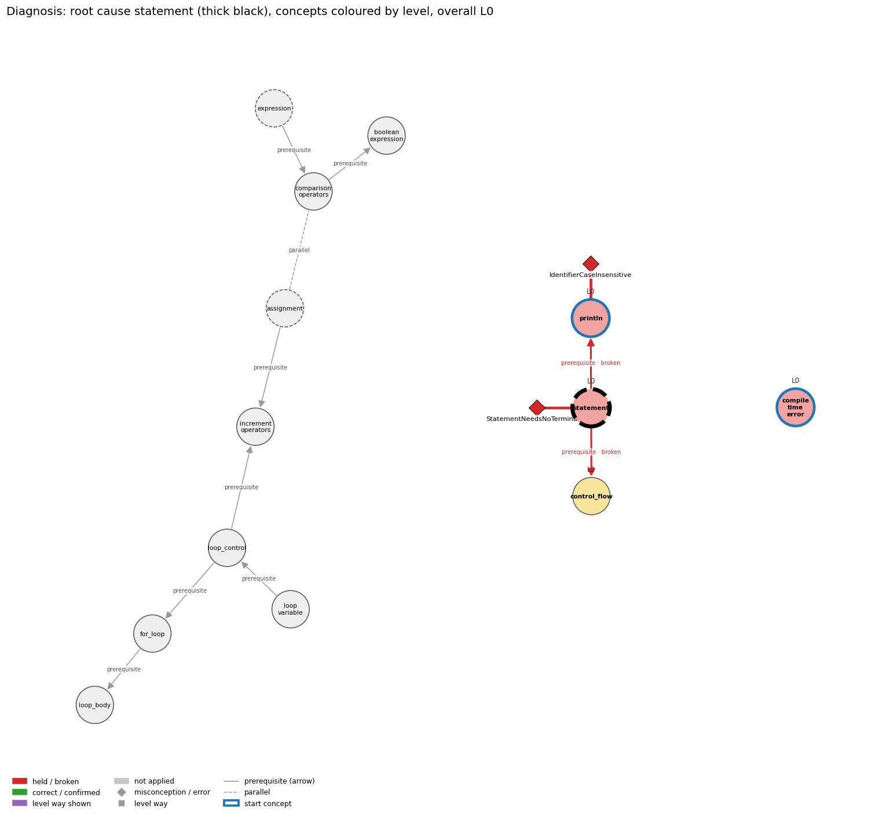

# LP18: the overall level and how it was arrived at

This page explains, with the numbers of this run, how one overall level was worked out for this answer. Every step of the run itself (what the graph offered, the model's replies, all labels, all figures) is in the notebook [`LP18.ipynb`](LP18.ipynb) and in `report.html`.

## The answer that was read

```java
int i , n= 5
for(i=1;i<n;i++)
    i++;
    System.out.println(i)
system.out.println(i);
```

**Question.** Will this compile? What happens when you run it? Explain your reasoning.

**Student's answer.** Yes, it compiles and prints 5 twice. The missing ; do not matter because each statement is on its own line, and system.out is the same as System.out.

**What this scenario was written to test.** L0: misconception.

## Result

- **Overall level: L0** (prestructural)
- **Decided by:** a real mistake is held, so the answer is L0 (step 3 below)
- **Expected by design:** L0. **Match: yes**

## The five levels

| Level | Name | What an answer at this level does |
|---|---|---|
| L0 | prestructural | holds a rule that contradicts Java, or reads the code in an everyday sense |
| L1 | unistructural | names a part or states one rule without applying it |
| L2 | multistructural | applies the rules to the code step by step (a trace, a predicted output, one step) |
| L3 | relational | relates the parts to each other or gives the purpose of the whole |
| L4 | extended abstract | reasons beyond the given code (a change, an error, a new program) |

A level is never asked from the model directly. For each concept the model only says which *ways* of showing a level the student's words show (for example "output prediction", which sits at L2) and which wrong rules the student holds. The level is then read off by fixed rules.

## Step 1. Which concepts were taken

Stage 1 read the program and found 13 concepts in it. Not all of them count for the overall level. A concept is taken as a **component** when two things hold:

- it is not a *generic* concept (one that almost every Java program has, such as `statement`), unless a real mistake is held on it;
- the student's answer shows something about it, so that it has a level.

| Concept | Generic | Level | Taken as a component? |
|---|---|---|---|
| `assignment` | yes | none | no: generic, and the answer shows nothing about it |
| `boolean_expression` |  | none | no: the answer shows nothing about it, so it has no level |
| `comparison_operators` |  | none | no: the answer shows nothing about it, so it has no level |
| `compile_time_error` |  | L0 | **yes** |
| `control_flow` |  | L2 | **yes** |
| `expression` | yes | none | no: generic, and the answer shows nothing about it |
| `for_loop` |  | none | no: the answer shows nothing about it, so it has no level |
| `increment_operators` |  | none | no: the answer shows nothing about it, so it has no level |
| `loop_body` |  | none | no: the answer shows nothing about it, so it has no level |
| `loop_control` |  | none | no: the answer shows nothing about it, so it has no level |
| `loop_variable` |  | none | no: the answer shows nothing about it, so it has no level |
| `println` |  | L0 | **yes** |
| `statement` | yes | L0 | **yes** (generic, but a mistake is held on it) |

**Components of this answer: 4.** `compile_time_error`, `control_flow`, `println`, `statement`.



*The concepts of this program and the links between them, after the run. A coloured concept has a level (red L0, orange L1, yellow L2, light green L3, green L4); a grey concept was found in the code but the answer shows nothing about it. A thick black outline marks the root cause, and a diamond is a wrong rule the student holds. The picture also colours generic concepts that have a level; the table above says which of them are counted.*

## Step 2. The level of each component

Each component gets its level by the first of these rules that fits:

- **(a)** a wrong rule (misconception) is held on the concept: **L0**, whatever else is shown;
- **(b)** only L0 ways are shown (everyday reading, inconsistent trace): **L0**;
- **(c)** otherwise the **highest** level at which a way is shown. One shown way is enough, because the levels build on each other.

A way above L2 is counted only when the model's confidence is above 0.60 and it does not rest only on the words of a held mistake.

### `compile_time_error`: L0

- **Rule (b).** Only L0 ways are shown: inconsistent trace.
- Student's words: "Yes, it compiles and prints 5 twice; The missing; do not matter; because each statement is on its own line, and system.out is the same as System.out"
- All ways shown on this concept: L0 "inconsistent trace" (confidence 0.85).
- The student does this kind of thing, but what is said is wrong in Java, so it is not counted: L4 "diagnose an error".

### `control_flow`: L2

- **Rule (c).** The highest way shown is **L2 "output prediction"**.
- Student's words: "Yes, it compiles and prints 5 twice"
- All ways shown on this concept: L2 "output prediction" (confidence 0.70); L2 "line by line trace" (confidence 0.60).

### `println`: L0

- **Rule (a).** The student holds the wrong rule **IdentifierCaseInsensitive** on this concept.
- Wrong rule: "System.out.Println and System.out.println name the same method."
- Right rule: "Java is case-sensitive: names of variables, methods and classes that differ only in capitalization are different names."
- Student's words: "because each statement is on its own line, and system.out is the same as System.out"
- Ways also shown on this concept (they do not change the L0): L2 "output prediction" (confidence 0.60).
- The student does this kind of thing, but what is said is wrong in Java, so it is not counted: L4 "diagnose an error"; L3 "relation to neighbour".

### `statement`: L0

- **Rule (a), for an error.** This concept is the root cause and the student's answer breaks the rule **StatementNeedsNoTerminator**, so it is L0.
- Rule broken: "Each statement must end with ;, otherwise javac reports ';' expected."
- Student's words: "Yes, it compiles and prints 5 twice; The missing; do not matter"
- Ways also shown on this concept (they do not change the L0): L0 "everyday reading" (confidence 0.80).
- The student does this kind of thing, but what is said is wrong in Java, so it is not counted: L4 "diagnose an error".

## Step 3. Is a real mistake held?

A real mistake is a wrong rule (misconception) or a broken rule (error) that the student's own words show, after the same mistake found at two concepts has been counted once. If there is one, the walk also names the concept where the mistake starts, the **root cause**: among the concepts with a mistake, the one furthest back along the prerequisite links.

| Mistake | Kind | At concept | Student's words |
|---|---|---|---|
| IdentifierCaseInsensitive | misconception | `println` | because each statement is on its own line, and system.out is the same as System.out |
| StatementNeedsNoTerminator | error | `statement` | Yes, it compiles and prints 5 twice; The missing; do not matter |

- **IdentifierCaseInsensitive.** Wrong rule: "System.out.Println and System.out.println name the same method." Right rule: "Java is case-sensitive: names of variables, methods and classes that differ only in capitalization are different names."
- **StatementNeedsNoTerminator.** Wrong rule: "A statement still compiles and runs if the semicolon at its end is left out, or if a stray ; is put right after if (c) or for (...)." Right rule: "Each statement must end with ;, otherwise javac reports ';' expected."

Read a second time at another concept and therefore not counted again: WhitespaceIsSignificant at `statement`.

**Yes.** Root cause: `statement`, with StatementNeedsNoTerminator.

**Rule: an answer that is built on a wrong rule is L0, however well its other parts are done.** So the overall level is **L0**, and the count in step 4 is given for information only.

## Step 4. Count the components at each level

| Level | Components at this level | Number | Share |
|---|---|---|---|
| L0 | `compile_time_error`, `println`, `statement` | 3 | 3 ÷ 4 = 0.75 |
| L2 | `control_flow` | 1 | 1 ÷ 4 = 0.25 |

The largest share is at **L0** (3 of 4 components).

Because a real mistake is held (step 3), this count does not decide: the overall level stays **L0**.

## Step 5. How far apart are the components?

The lowest component level is L0 and the highest is L2: 2 − 0 = 2.

The components are two or more levels apart, so the answer is marked **LOW coherence**: the one overall level hides real differences between the parts, and the table of step 2 should be read with it.

## Conclusion

4 components; a real mistake is held (StatementNeedsNoTerminator at `statement`); so the overall level is **L0**. Shares: L0 0.75, L2 0.25; LOW coherence.

| | Overall level | Components | Held mistake | Root cause |
|---|---|---|---|---|
| This run | L0 | `compile_time_error` L0, `control_flow` L2, `println` L0, `statement` L0 | IdentifierCaseInsensitive, StatementNeedsNoTerminator | `statement` |
| Expected by design | L0 | `identifier` L0, `statement` L0 | IdentifierCaseInsensitive, StatementNeedsNoTerminator | `statement` |

The expected result lists only the main concept the scenario was written for; the run levels every concept the answer touches, so it usually has more components.

The rule and how it was made are in the [folder README](../../README.md).
