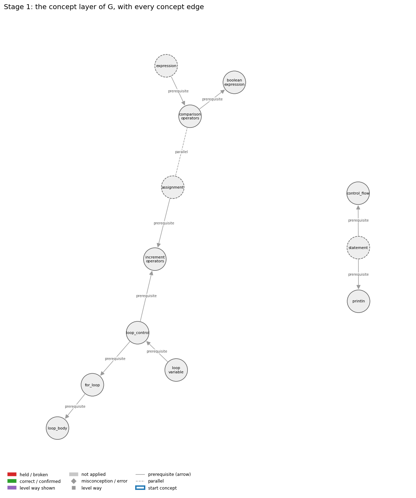
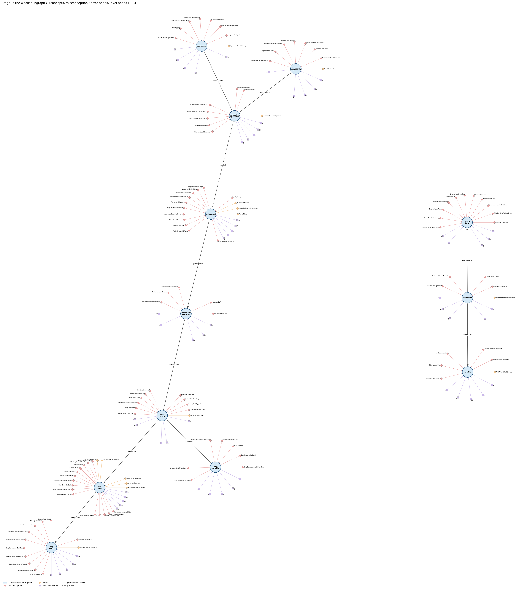
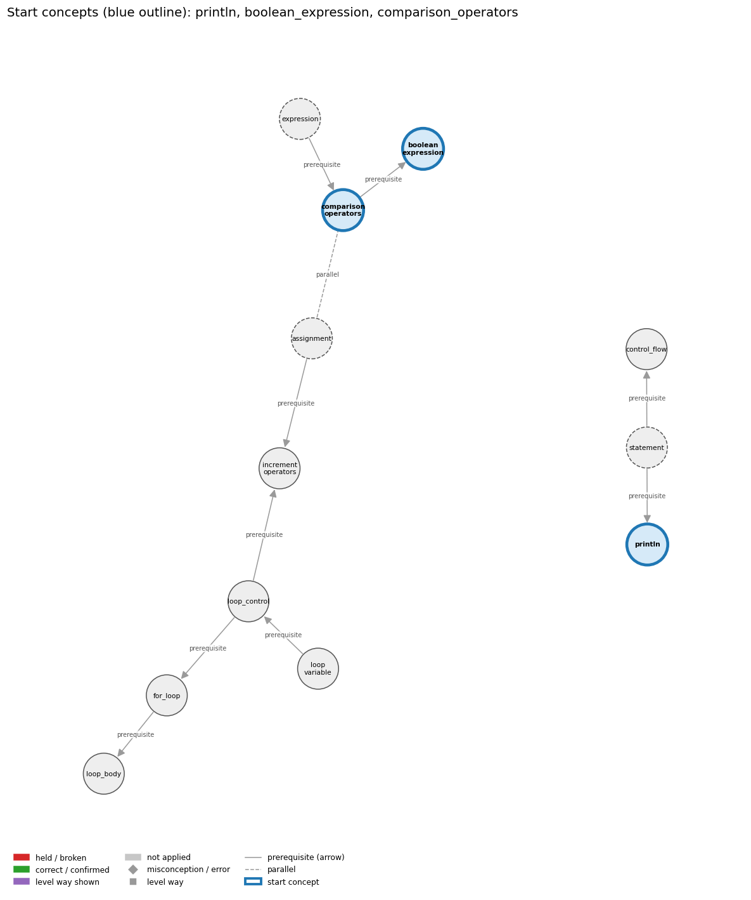
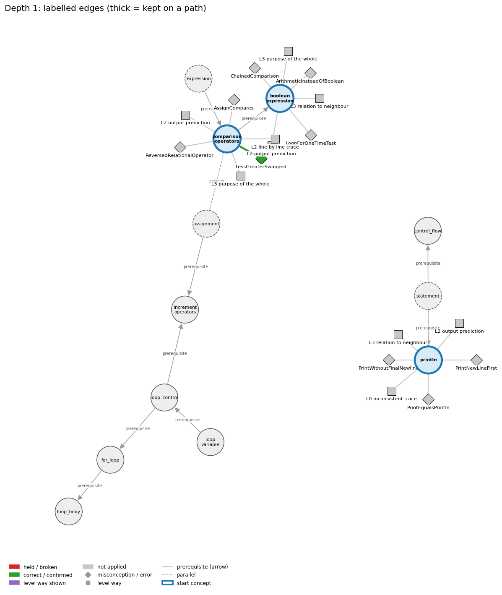
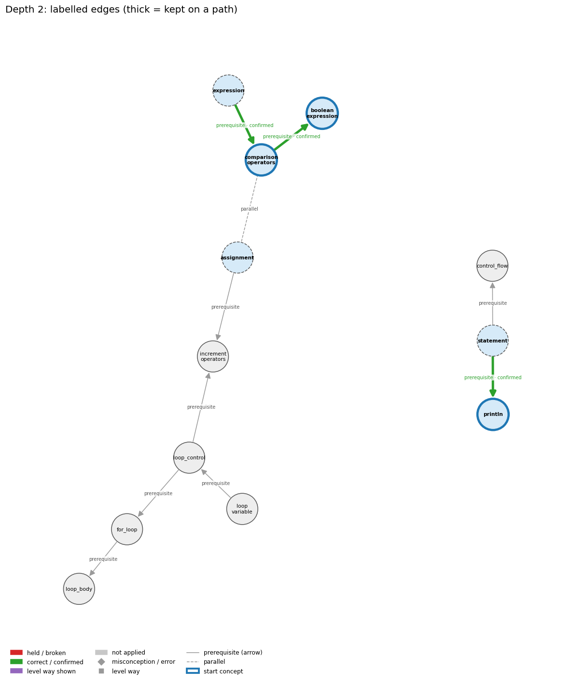
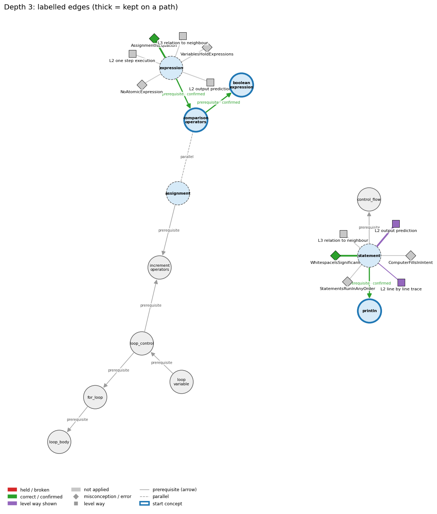
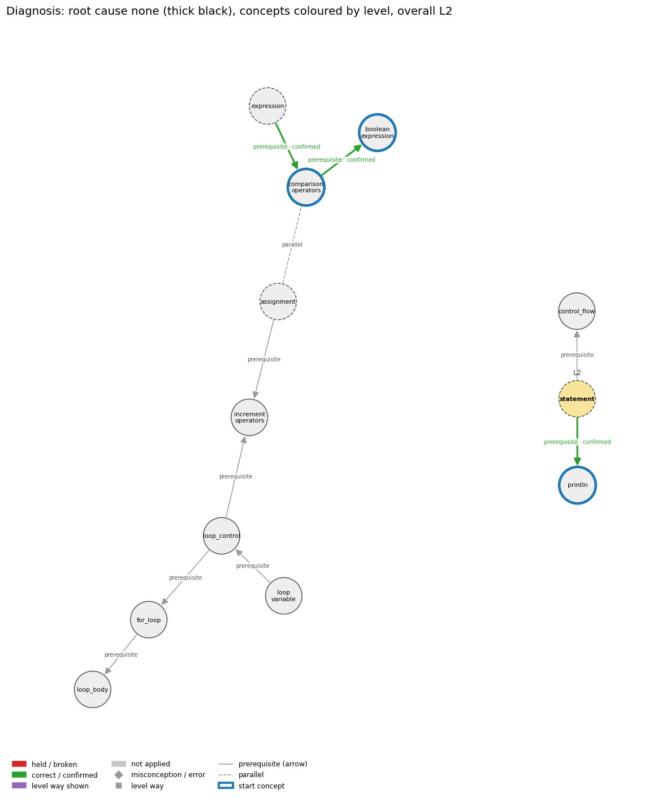

# Think on the Graph: every output of the run LP20

Files of this scenario: `input.json` (program, question, answer), `diagnosis.json`, `subgraph.json`, `traverse_log.txt`, `report.html` (this report as one full-page file, with the interactive graph `LP20_G.html`), `LP20.ipynb` (this report as a notebook).

## Level classification

This scenario tests **no level: none (bare correct output)**. How the overall level is decided is explained in the [folder README](../../README.md).

- **Overall level: no level** (decided by: no component)
- **Shares of the components:** no component
- **Mistake held (root cause):** none
- **Expected by design:** overall no level; components none; held none; root none
- **Overall level matches the expected one:** yes

No component has a level.

Generic concepts with a level (not counted as components): `statement` L2.

## 0. Input
Program:
```java
int i, n = 5;
for (i = 1; i < n; i++)
    i++;
    System.out.println(i);
System.out.println(i);
```
Question: What is printed? Explain, pass by pass, what happens to i.

Student's answer: 5 5
Settings: width 3, depth 3, prune llm, backend claude-cli, model claude-opus-5-5
## 1. Stage 1: the subgraph G from the code (no model)
Masked code (string and char literals and comments blanked; this is what the patterns see):
```
int i, n = 5;
for (i = 1; i < n; i++)
    i++;
    System.out.println(i);
System.out.println(i);
```
Which code text tagged which concept (a generic concept fires on almost any Java line; it starts the walk only if the answer repeats its tag):
| concept | generic | channel | matched text | line |
|---|---|---|---|---|
| assignment | True | pattern | '=' | 1 |
| boolean_expression | False | pattern | 'for (i = 1; i < n;' | 2 |
| comparison_operators | False | pattern | 'for (i = 1; i <' | 2 |
| control_flow | False | pattern | 'for (' | 2 |
| expression | True | pattern | 'i <' | 2 |
| expression | True | pattern | '= 5;' | 1 |
| for_loop | False | pattern | 'for (' | 2 |
| increment_operators | False | pattern | '++' | 2 |
| loop_body | False | pattern | 'for (' | 2 |
| loop_control | False | signal | 'for (i = 1; i < n; i++)' | 2 |
| loop_variable | False | pattern | 'for (i =' | 2 |
| println | False | pattern | 'System.out.println(' | 4 |
| statement | True | pattern | ';' | 1 |

G: 12 concept nodes (3 generic), 10 concept edges, 116 misconception / error edges, 84 misconception / error nodes, 60 level nodes, 120 level-misconception links, 2 connected piece(s).
Note: concept nodes form 2 pieces (the KG has no edge between them): assignment,boolean_expression,comparison_operators,expression,for_loop,increment_operators,loop_body,loop_control,loop_variable | control_flow,println,statement

Concept edges of G (the links the walk can read; `pre:` = prerequisite A -> B, `par:` = parallel):
| edge | type | rule (logic) |
|---|---|---|
| par:assignment~comparison_operators | parallel | x = y stores the value of y in x (a statement with a side effect); x == y only tests whether the two values are equal and gives a boolean. Writing = where == is meant is a compile error with int operands and a silent bug with boolean operands. |
| pre:assignment->increment_operators | prerequisite | i++ is shorthand for the assignment i = i + 1. |
| pre:comparison_operators->boolean_expression | prerequisite | A comparison such as x < y produces a boolean result; comparisons together with boolean logic provide the basis for decision-making. |
| pre:expression->comparison_operators | prerequisite | Comparison operators build expressions whose value is a boolean, so one must already know what an expression is to understand a < b. |
| pre:for_loop->loop_body | prerequisite | The statements in braces after the for header are the loop body; they run once on every pass, between the test and the increment, exactly as in a while loop. |
| pre:loop_control->for_loop | prerequisite | The for header is exactly the three control slots, and the body runs after the test and before the update on each pass. |
| pre:loop_control->increment_operators | prerequisite | The loop update i = i + 1 comes first; ++ (and +=) are then introduced as shorthand for that update. |
| pre:loop_variable->loop_control | prerequisite | The init, condition and update all act on the loop variable: the init sets it, the condition tests it, the update changes it. |
| pre:statement->control_flow | prerequisite | Control flow is the order in which statements run. |
| pre:statement->println | prerequisite | System.out.println(s); is itself a statement, so its line of output appears at its own place in the sequence. |

Misconception / error edges per concept (count), and level ways per concept (count):
| concept | misconception / error edges | level ways (L1-L4 + L0 non-misconception) |
|---|---|---|
| assignment | 15 | 24 |
| boolean_expression | 8 | 19 |
| comparison_operators | 8 | 20 |
| control_flow | 11 | 15 |
| expression | 8 | 19 |
| for_loop | 20 | 24 |
| increment_operators | 5 | 16 |
| loop_body | 12 | 14 |
| loop_control | 11 | 19 |
| loop_variable | 7 | 13 |
| println | 6 | 17 |
| statement | 5 | 19 |

**Figure 1**


**Figure 2**


## 2. Clauses and start concepts (no model)
The answer split into clauses (at sentence ends, ';', and before 'because' / 'so'; quotes removed):
| clause | text |
|---|---|
| c1 | 5 5 |

start: BM25 of the answer against each tagged concept: println 7.03 (hits 1), boolean_expression 0.00 (hits 1), comparison_operators 0.00 (hits 1), control_flow 0.00 (hits 1), for_loop 0.00 (hits 1), increment_operators 0.00 (hits 1), loop_body 0.00 (hits 1), loop_control 0.00 (hits 1), loop_variable 0.00 (hits 1)

start: chosen println, boolean_expression, comparison_operators

start concepts (3): println, boolean_expression, comparison_operators

Start concepts: println, boolean_expression, comparison_operators

**Figure 3**


## 3. The walk, depth by depth
At each depth, for each current concept: the edges offered (a concept entering as a start concept offers its misconception / error edges and its level ways, as two families; otherwise it offers its concept edges), the prune prompt and the model's reply, then the label prompt(s) and the model's reply, parsed into label / clauses / confidence. Score = prune score x confidence.

### Depth 1: current concepts 'println', 'boolean_expression', 'comparison_operators'

#### println, misconceptions: 6 edges offered
Edges offered:
| edge |
|---|
| err:println->PrintWithoutFinalNewline \| wrong rule: Ends the output with print and expects it to appear right away. \| right rule: Finish a line of print calls with println; some systems hold print output until a newline is printed. |
| mis:println->IdentifierCaseInsensitive \| wrong rule: System.out.Println and System.out.println name the same method. \| right rule: Java is case-sensitive: names of variables, methods and classes that differ only in capitalization are different names. |
| mis:println->ParenthesesOnlyIfArgument \| wrong rule: println with nothing to print can be written System.out.println; without the parentheses. \| right rule: A method call always needs parentheses, so an empty line is printed with System.out.println();. |
| mis:println->PrintEqualsPrintln \| wrong rule: print and println do the same thing, so print(s1); print(s2); puts s1 and s2 on separate lines. \| right rule: println ends the line after printing and print does not, so print(s1); print(s2); puts s1 and s2 on the same line. |
| mis:println->PrintNewLineFirst \| wrong rule: println(s) prints a newline and then s. \| right rule: println(s) prints s and then the newline. |
| mis:println->PrintedTextIsExecuted \| wrong rule: System.out.println("x is 5"); sets x to 5 (text inside the quotes is run as code). \| right rule: Characters inside double quotes are printed literally; println only displays them and changes no variable. Only an assignment such as x = 5; sets x. |

Prune: the model's reply (edge id and score; the kept edges sum to 1):
```
mis:println->PrintEqualsPrintln (0.60), mis:println->PrintNewLineFirst (0.25), err:println->PrintWithoutFinalNewline (0.15)
```
Kept by pruning: mis:println->PrintEqualsPrintln (0.60), mis:println->PrintNewLineFirst (0.25), err:println->PrintWithoutFinalNewline (0.15)

Label prompt for the misconception / error edges (judged together). The model saw the program, the question, the numbered clauses, and these edges with their wrong rule and right rule:
| edge |
|---|
| mis:println->PrintEqualsPrintln \| wrong rule: print and println do the same thing, so print(s1); print(s2); puts s1 and s2 on separate lines. \| right rule: println ends the line after printing and print does not, so print(s1); print(s2); puts s1 and s2 on the same line. |
| mis:println->PrintNewLineFirst \| wrong rule: println(s) prints a newline and then s. \| right rule: println(s) prints s and then the newline. |
| err:println->PrintWithoutFinalNewline \| wrong rule: Ends the output with print and expects it to appear right away. \| right rule: Finish a line of print calls with println; some systems hold print output until a newline is printed. |
Model's reply:
```
mis:println->PrintEqualsPrintln | not applied | clauses: none | confidence: 0.85
mis:println->PrintNewLineFirst | not applied | clauses: none | confidence: 0.85
err:println->PrintWithoutFinalNewline | not applied | clauses: none | confidence: 0.9
```

Parsed labels:
| edge | label | prune score | confidence | score | clauses | words |
|---|---|---|---|---|---|---|
| mis:println->PrintEqualsPrintln | not applied |  |  | 0.0 |  |  |
| mis:println->PrintNewLineFirst | not applied |  |  | 0.0 |  |  |
| err:println->PrintWithoutFinalNewline | not applied |  |  | 0.0 |  |  |

#### println, level ways: 17 edges offered
Edges offered:
| edge |
|---|
| lvl:println@L0#0 \| level L0 way everyday_reading: Everyday reading: 'println' is just 'print', and 'new line' is something you do before writing. Java rule: println(x) prints x and then ends the line; println() alone just ends the line. |
| lvl:println@L0#3 \| level L0 way inconsistent_trace: Applies the println rule (print, then end line) unevenly: puts the newline before the text on one call and after it on another, or forgets that the next output starts on a new line. (here mixing in: "print and println behave the same (no newline difference)") |
| lvl:println@L1#0 \| level L1 way names_the_element: System.out.println is a library method that prints its argument followed by a line terminator ('print line'). |
| lvl:println@L1#1 \| level L1 way states_the_rule: println(String x) behaves as though it calls print(x) and then println(); println() terminates the current line by writing the line separator string. |
| lvl:println@L2#0 \| level L2 way line_by_line_trace: Evaluate the argument, print its characters at the current position, then write the line separator so the cursor moves to the beginning of the next line. |
| lvl:println@L2#1 \| level L2 way output_prediction: Output is the value's characters followed by a line break: println("Hello, "); println("World!"); prints two lines. |
| lvl:println@L2#2 \| level L2 way one_step_execution: One call appends the text and a line separator to the output; the cursor ends at the start of the next line; no variable changes and nothing is returned. |
| lvl:println@L3#0 \| level L3 way relation_to_neighbour: System.out.println(s); is a statement, so its line of output appears at its own place in the sequence. |
| lvl:println@L3#1 \| level L3 way relation_to_neighbour: println("s") outputs exactly the characters between the quotes and then ends the line. |
| lvl:println@L3#2 \| level L3 way relation_to_neighbour: print leaves the cursor on the line; println ends it; several prints followed by one println make one line. |
| lvl:println@L3#3 \| level L3 way relation_to_neighbour: println prints numbers with all their digits and always ends the line; printf formats each value by its conversion code and ends the line only where the format has %n or \n. |
| lvl:println@L3#4 \| level L3 way purpose_of_the_whole: Purpose: produce one complete line of output, e.g. each result on its own line, or end a line built with print. |
| lvl:println@L4#0 \| level L4 way predict_a_change: Replacing println with print joins the next output onto the same line (a typical logic error); the characters printed stay the same. |
| lvl:println@L4#1 \| level L4 way transfer_to_a_new_program: Use println when each output item belongs on its own line or to end a line; use print to continue a line and printf to control number formatting. |
| lvl:println@L4#2 \| level L4 way diagnose_an_error: rule broken: Finish a line of print calls with println. Kind: silent logic error. Trigger class: output ends with print, so the last line may not be shown or runs into the shell prompt |
| lvl:println@L4#3 \| level L4 way diagnose_an_error: rule broken: Method names are case-sensitive. Kind: compile-time. Trigger class: System.out.Println or system.out.println: cannot find symbol |
| lvl:println@L4#4 \| level L4 way diagnose_an_error: rule broken: Calls need parentheses. Kind: compile-time. Trigger class: System.out.println; without () |

Prune: the model's reply (edge id and score; the kept edges sum to 1):
```
{lvl:println@L2#1 (Score: 0.5)}
{lvl:println@L3#0 (Score: 0.3)}
{lvl:println@L0#3 (Score: 0.2)}
```
Kept by pruning: lvl:println@L2#1 (0.50), lvl:println@L3#0 (0.30), lvl:println@L0#3 (0.20)

Label prompt for level way lvl:println@L2#1 (the model saw only the concept, the way's name 'output prediction' and its text; no level):
> Output is the value's characters followed by a line break: println("Hello, "); println("World!"); prints two lines.

Model's reply:
```
Label: not shown
Clauses: none
Confidence: 0.6
```

Label prompt for level way lvl:println@L3#0 (the model saw the concept, the way's name 'relation to neighbour', its text, where the way stops and whether the words must be correct; no level):
> System.out.println(s); is a statement, so its line of output appears at its own place in the sequence.
>
> Where this way stops: Two correct but separate rules are L1. Executing the two in sequence is L2. A relational answer may be correct or a relational error.

Model's reply:
```
Label: not shown
Clauses: none
Confidence: 0.85
```

Label prompt for level way lvl:println@L0#3 (the model saw only the concept, the way's name 'inconsistent trace' and its text; no level):
> Applies the println rule (print, then end line) unevenly: puts the newline before the text on one call and after it on another, or forgets that the next output starts on a new line. (here mixing in: "print and println behave the same (no newline difference)")

Model's reply:
```
Label: not shown
Clauses: none
Confidence: 0.6
```

Parsed labels:
| edge | label | prune score | confidence | score | clauses | words |
|---|---|---|---|---|---|---|
| lvl:println@L2#1 | not applied |  |  | 0.0 |  |  |
| lvl:println@L3#0 | not applied |  |  | 0.0 |  |  |
| lvl:println@L0#3 | not applied |  |  | 0.0 |  |  |

#### boolean_expression, misconceptions: 8 edges offered
Edges offered:
| edge |
|---|
| err:boolean_expression->ElseWithCondition \| wrong rule: Writes else (x > 0) with a condition but no if. \| right rule: else takes no condition; use else if (x > 0). |
| mis:boolean_expression->ArithmeticInsteadOfBoolean \| wrong rule: A true/false question is answered with arithmetic (e.g. 1 for true). \| right rule: A logic question is written as a boolean expression whose value is true or false. |
| mis:boolean_expression->ChainedComparison \| wrong rule: 90 <= grade <= 100 tests whether grade is between 90 and 100. \| right rule: a < b < c does not compile (a < b is a boolean); a range test is written 90 <= grade && grade <= 100. |
| mis:boolean_expression->ComparisonWithBooleanLiteral \| wrong rule: To test a boolean b you must write if (b == true). \| right rule: if (b) already tests b, so writing == true adds nothing. |
| mis:boolean_expression->LoopForOneTimeTest \| wrong rule: Uses a loop where a condition needs to be tested only once. \| right rule: A test made once is an if; a loop repeats. |
| mis:boolean_expression->MapToBooleanWithConditionalOperator \| wrong rule: To get a boolean from x > y you need ok = (x > y) ? true : false;. \| right rule: ok = (x > y); already gives the boolean, so the ? : is unnecessary. |
| mis:boolean_expression->MapToBooleanWithIf \| wrong rule: To store whether x > y in a boolean you need if (x > y) ok = true; else ok = false;. \| right rule: ok = (x > y); stores the result of the comparison directly. |
| mis:boolean_expression->NestedIfsInsteadOfLogicalOperators \| wrong rule: A condition on several values has to be written as nested if statements, one value per if. \| right rule: Several conditions combine into one boolean expression with && and \|\|, e.g. if (x == 0 && y == 0). |

Prune: the model's reply (edge id and score; the kept edges sum to 1):
```
mis:boolean_expression->ArithmeticInsteadOfBoolean (0.50), mis:boolean_expression->LoopForOneTimeTest (0.30), mis:boolean_expression->ChainedComparison (0.20)
```
Kept by pruning: mis:boolean_expression->ArithmeticInsteadOfBoolean (0.50), mis:boolean_expression->LoopForOneTimeTest (0.30), mis:boolean_expression->ChainedComparison (0.20)

Label prompt for the misconception / error edges (judged together). The model saw the program, the question, the numbered clauses, and these edges with their wrong rule and right rule:
| edge |
|---|
| mis:boolean_expression->ArithmeticInsteadOfBoolean \| wrong rule: A true/false question is answered with arithmetic (e.g. 1 for true). \| right rule: A logic question is written as a boolean expression whose value is true or false. |
| mis:boolean_expression->LoopForOneTimeTest \| wrong rule: Uses a loop where a condition needs to be tested only once. \| right rule: A test made once is an if; a loop repeats. |
| mis:boolean_expression->ChainedComparison \| wrong rule: 90 <= grade <= 100 tests whether grade is between 90 and 100. \| right rule: a < b < c does not compile (a < b is a boolean); a range test is written 90 <= grade && grade <= 100. |
Model's reply:
```
mis:boolean_expression->ArithmeticInsteadOfBoolean | not applied | clauses: none | confidence: 0.9
mis:boolean_expression->LoopForOneTimeTest | not applied | clauses: none | confidence: 0.9
mis:boolean_expression->ChainedComparison | not applied | clauses: none | confidence: 0.95
```

Parsed labels:
| edge | label | prune score | confidence | score | clauses | words |
|---|---|---|---|---|---|---|
| mis:boolean_expression->ArithmeticInsteadOfBoolean | not applied |  |  | 0.0 |  |  |
| mis:boolean_expression->LoopForOneTimeTest | not applied |  |  | 0.0 |  |  |
| mis:boolean_expression->ChainedComparison | not applied |  |  | 0.0 |  |  |

#### boolean_expression, level ways: 19 edges offered
Edges offered:
| edge |
|---|
| lvl:boolean_expression@L0#0 \| level L0 way everyday_reading: Folk meaning: maths writes a range as 90 <= grade <= 100 and English says 'if x is 1 or 2'. Java rule: each comparison is a separate boolean expression and they must be joined explicitly: 90 <= grade && grade <= 100, x == 1 \|\| x == 2; 90 <= grade <= 100 does not compile because 90 <= grade is already a boolean. |
| lvl:boolean_expression@L0#5 \| level L0 way inconsistent_trace: Points to LT (arithmetic first, then comparisons, then !, &&, \|\|, left to right, with short-circuit). Applied unevenly: the student evaluates && before a comparison in one sub-expression, or evaluates the right operand of && on a pass where the left was already false. (here mixing in: "you must write == true / == false to test a boolean") |
| lvl:boolean_expression@L1#0 \| level L1 way names_the_element: A boolean expression is any expression whose type is boolean: a boolean literal or variable, a comparison, or such parts combined with &&, \|\| and !. |
| lvl:boolean_expression@L1#1 \| level L1 way states_the_rule: A boolean expression has value true or false; it is built from comparisons (lower precedence than arithmetic, higher than boolean operators) and boolean operators; the condition of if, while and for must be one. |
| lvl:boolean_expression@L2#0 \| level L2 way line_by_line_trace: Operands are evaluated left to right; arithmetic sub-expressions first, then comparisons, then !, then &&, then \|\|; && and \|\| evaluate their right operand only when the left has not decided the result. |
| lvl:boolean_expression@L2#1 \| level L2 way output_prediction: The value is true or false: with year = 1900, (year % 4 == 0) && (year % 100 != 0) \|\| (year % 400 == 0) is false, so LeapYear prints false. |
| lvl:boolean_expression@L2#2 \| level L2 way one_step_execution: Evaluating a boolean expression changes no variable (unless it contains an assignment, ++ or a method with side effects); state changes only when its value is stored, as in isLeapYear = isLeapYear && (year % 100 != 0);. |
| lvl:boolean_expression@L3#0 \| level L3 way relation_to_neighbour: Comparisons are the atoms of boolean expressions; because they bind tighter than && and \|\|, month >= 1 && month <= 12 groups as (month >= 1) && (month <= 12) without parentheses. |
| lvl:boolean_expression@L3#1 \| level L3 way relation_to_neighbour: &&, \|\| and ! combine boolean sub-expressions into a larger one; ! binds tighter than comparisons, so negating a comparison needs parentheses: !(x > 0). |
| lvl:boolean_expression@L3#2 \| level L3 way relation_to_neighbour: The if statement evaluates its boolean expression once and runs its block only when the value is true; the expression must have type boolean, so if (x = 5) with int x does not compile. |
| lvl:boolean_expression@L3#3 \| level L3 way relation_to_neighbour: The while loop re-evaluates its boolean expression before every pass and stops the first time it is false, so some variable in the expression must change in the body or the loop never ends. |
| lvl:boolean_expression@L3#4 \| level L3 way relation_to_neighbour: In RandomSurfer the boolean expression r < sum is evaluated for each candidate page j in turn, as sum grows; the first j for which it is true is the chosen page. |
| lvl:boolean_expression@L3#5 \| level L3 way relation_to_neighbour: In the template if (<boolean expression>) { <statements> } the placeholder may be filled by any boolean-typed expression: a literal, a boolean variable, a comparison or a combination with logical operators. |
| lvl:boolean_expression@L3#6 \| level L3 way purpose_of_the_whole: Expresses a decision condition or guard (which branch runs, whether a loop continues) or computes a flag; common plans: range test lo <= x && x <= hi, divisibility test n % k == 0, combined rule as in LeapYear. |
| lvl:boolean_expression@L4#0 \| level L4 way predict_a_change: Rewriting with De Morgan (!(a && b) as !a \|\| !b) keeps the value for every input; swapping the operands of && keeps the truth value but can change whether the right operand is evaluated (and whether a guard still protects it); changing < to <= changes the result only at the boundary value. |
| lvl:boolean_expression@L4#1 \| level L4 way diagnose_an_error: rule broken: else takes no condition; a second condition needs else if (...). Kind: compile-time. Trigger class: Writing else (x > 0) { ... } after an if block (the compiler reports e.g. 'not a statement' or '; expected'). |
| lvl:boolean_expression@L4#2 \| level L4 way transfer_to_a_new_program: Use a boolean expression wherever code must decide or record a yes/no condition, and store it directly (ok = x > y) rather than via if or ? :; when different outcomes are needed for several cases use an if-else chain of such expressions. |
| lvl:boolean_expression@L4#3 \| level L4 way diagnose_an_error: rule broken: The condition must be a boolean expression; = assigns, == compares. Kind: compile-time. Trigger class: if (a = b) with int a and b (with boolean variables it compiles and silently assigns). |
| lvl:boolean_expression@L4#4 \| level L4 way diagnose_an_error: rule broken: Comparisons cannot be chained; each must be joined with && or \|\|. Kind: compile-time. Trigger class: Range written as a < b < c or 90 <= grade <= 100. |

Prune: the model's reply (edge id and score; the kept edges sum to 1):
```
{lvl:boolean_expression@L2#1 (Score: 0.5)}
{lvl:boolean_expression@L3#3 (Score: 0.3)}
{lvl:boolean_expression@L3#6 (Score: 0.2)}
```
Kept by pruning: lvl:boolean_expression@L2#1 (0.50), lvl:boolean_expression@L3#3 (0.30), lvl:boolean_expression@L3#6 (0.20)

Label prompt for level way lvl:boolean_expression@L2#1 (the model saw only the concept, the way's name 'output prediction' and its text; no level):
> The value is true or false: with year = 1900, (year % 4 == 0) && (year % 100 != 0) || (year % 400 == 0) is false, so LeapYear prints false.

Model's reply:
```
Label: not shown
Clauses: none
Confidence: 0.85
```

Label prompt for level way lvl:boolean_expression@L3#3 (the model saw the concept, the way's name 'relation to neighbour', its text, where the way stops and whether the words must be correct; no level):
> The while loop re-evaluates its boolean expression before every pass and stops the first time it is false, so some variable in the expression must change in the body or the loop never ends.
>
> Where this way stops: Two correct but separate rules are L1. Executing the two in sequence is L2. A relational answer may be correct or a relational error.

Model's reply:
```
Label: not shown
Clauses: none
Confidence: 0.9
```

Label prompt for level way lvl:boolean_expression@L3#6 (the model saw the concept, the way's name 'purpose of the whole', its text, where the way stops and whether the words must be correct; no level):
> Expresses a decision condition or guard (which branch runs, whether a loop continues) or computes a flag; common plans: range test lo <= x && x <= hi, divisibility test n % k == 0, combined rule as in LeapYear.
>
> Where this way stops: Narrating the lines is L2. A purpose induced from a few traced cases is L2. A wrong purpose is still L3, but with an error.

Model's reply:
```
Label: not shown
Clauses: none
Confidence: 0.95
```

Parsed labels:
| edge | label | prune score | confidence | score | clauses | words |
|---|---|---|---|---|---|---|
| lvl:boolean_expression@L2#1 | not applied |  |  | 0.0 |  |  |
| lvl:boolean_expression@L3#3 | not applied |  |  | 0.0 |  |  |
| lvl:boolean_expression@L3#6 | not applied |  |  | 0.0 |  |  |

#### comparison_operators, misconceptions: 8 edges offered
Edges offered:
| edge |
|---|
| err:comparison_operators->ReversedRelationalOperator \| wrong rule: Writes =< or => instead of <= and >=. \| right rule: The operators are written <= and >=. |
| mis:comparison_operators->AssignCompares \| wrong rule: = compares two values instead of assigning \| right rule: x = y copies the value of y into x; x == y is what compares them. |
| mis:comparison_operators->ChainedComparison \| wrong rule: 90 <= grade <= 100 tests whether grade is between 90 and 100. \| right rule: a < b < c does not compile (a < b is a boolean); a range test is written 90 <= grade && grade <= 100. |
| mis:comparison_operators->ComparisonWithBooleanLiteral \| wrong rule: you must write == true / == false to test a boolean \| right rule: if (b) already tests b, so writing == true adds nothing. |
| mis:comparison_operators->EqualityOperatorComparesObjectsValues \| wrong rule: s == t is true whenever the two Strings contain the same text. \| right rule: s == t is true only when s and t refer to the same object; s.equals(t) compares the text. |
| mis:comparison_operators->EqualsComparesReferences \| wrong rule: .equals() compares references, not contents \| right rule: s.equals(t) checks whether the two Strings contain the same characters. |
| mis:comparison_operators->LessGreaterSwapped \| wrong rule: < and > mean the same thing (or a < b means a is greater than b). \| right rule: a < b is true when a is smaller than b; a > b when a is larger. |
| mis:comparison_operators->StringRelationalComparison \| wrong rule: s < t compares two Strings alphabetically. \| right rule: < and > are defined only for primitive types; comparing Strings with them does not compile. |

Prune: the model's reply (edge id and score; the kept edges sum to 1):
```
mis:comparison_operators->LessGreaterSwapped (0.80), err:comparison_operators->ReversedRelationalOperator (0.10), mis:comparison_operators->AssignCompares (0.10)
```
Kept by pruning: mis:comparison_operators->LessGreaterSwapped (0.80), err:comparison_operators->ReversedRelationalOperator (0.10), mis:comparison_operators->AssignCompares (0.10)

Label prompt for the misconception / error edges (judged together). The model saw the program, the question, the numbered clauses, and these edges with their wrong rule and right rule:
| edge |
|---|
| mis:comparison_operators->LessGreaterSwapped \| wrong rule: < and > mean the same thing (or a < b means a is greater than b). \| right rule: a < b is true when a is smaller than b; a > b when a is larger. |
| err:comparison_operators->ReversedRelationalOperator \| wrong rule: Writes =< or => instead of <= and >=. \| right rule: The operators are written <= and >=. |
| mis:comparison_operators->AssignCompares \| wrong rule: = compares two values instead of assigning \| right rule: x = y copies the value of y into x; x == y is what compares them. |
Model's reply:
```
mis:comparison_operators->LessGreaterSwapped | correct | clauses: 1 | confidence: 0.7
err:comparison_operators->ReversedRelationalOperator | not applied | clauses: none | confidence: 0.95
mis:comparison_operators->AssignCompares | not applied | clauses: none | confidence: 0.9
```

Parsed labels:
| edge | label | prune score | confidence | score | clauses | words |
|---|---|---|---|---|---|---|
| mis:comparison_operators->LessGreaterSwapped | correct | 0.8 | 0.7 | 0.56 | c1 | 5 5 |
| err:comparison_operators->ReversedRelationalOperator | not applied |  |  | 0.0 |  |  |
| mis:comparison_operators->AssignCompares | not applied |  |  | 0.0 |  |  |

#### comparison_operators, level ways: 20 edges offered
Edges offered:
| edge |
|---|
| lvl:comparison_operators@L0#0 \| level L0 way everyday_reading: Folk meaning: in maths = states that two things are equal, and inequalities can be chained (a < b < c) or spoken as 'equal or less than' (=<). Java rule: = assigns while == compares; the operators are spelled <= and >= only; a < b < c does not compile; and on Strings == compares references. |
| lvl:comparison_operators@L0#5 \| level L0 way inconsistent_trace: Points to LT (evaluate both operands, promote to a common type, then compare). Applied unevenly: the student treats < as <= on the boundary pass of a loop, or compares an int with a double as ints on one line and as doubles on another. (here mixing in: "90 <= grade <= 100 tests whether grade is between 90 and 100") |
| lvl:comparison_operators@L1#0 \| level L1 way names_the_element: Comparison (relational) operators ==, !=, <, <=, >, >= are mixed-type operators: they take two operands of a numeric type and produce a boolean. |
| lvl:comparison_operators@L1#1 \| level L1 way states_the_rule: ==, !=, <, <=, >, >= are defined for each primitive numeric type and produce a boolean; they have lower precedence than arithmetic and higher than boolean operators; < and > are not defined for Strings, and == on non-primitive types compares identity. |
| lvl:comparison_operators@L2#0 \| level L2 way line_by_line_trace: Evaluate the left operand (including its arithmetic), then the right operand; if their types differ, promote the narrower one (int to double); then compare and produce true or false. |
| lvl:comparison_operators@L2#1 \| level L2 way output_prediction: The result is a boolean: (2 <= 2) is true, 2 < 2 is false, (x < 3.1) is true for int x = 3; any comparison involving NaN, even NaN == NaN, is false. |
| lvl:comparison_operators@L2#2 \| level L2 way one_step_execution: A comparison changes no variable and only returns a boolean, unlike =, which changes the value of the variable on its left. |
| lvl:comparison_operators@L3#0 \| level L3 way relation_to_neighbour: A comparison is itself an expression whose value is a boolean, so it can appear anywhere a boolean is needed, including on the right of an assignment (boolean ok = x > y;). |
| lvl:comparison_operators@L3#1 \| level L3 way relation_to_neighbour: Comparisons are the building blocks of conditions: together with boolean logic they provide the basis for decision-making. |
| lvl:comparison_operators@L3#2 \| level L3 way relation_to_neighbour: Comparisons bind tighter than && and \|\|, so they are evaluated first and logical operators combine their boolean results. |
| lvl:comparison_operators@L3#3 \| level L3 way relation_to_neighbour: Comparisons take numbers and produce a boolean; boolean values themselves can be compared only with == and != (not <), and testing them against true is unnecessary. |
| lvl:comparison_operators@L3#4 \| level L3 way relation_to_neighbour: x = y stores the value of y in x (a statement with a side effect); x == y only tests whether the two values are equal and gives a boolean. Writing = where == is meant is a compile error with int operands and a silent bug with boolean operands. |
| lvl:comparison_operators@L3#5 \| level L3 way purpose_of_the_whole: Used to test a numeric condition: thresholds and sign checks, range tests, divisibility (n % k == 0), loop continuation (i < N), sentinel checks, and running-extreme updates (if (x > max) max = x). |
| lvl:comparison_operators@L4#0 \| level L4 way predict_a_change: Changing < to <= (or > to >=) changes the result only at the boundary value, which in a loop guard means one more or one fewer iteration (off-by-one); mirroring the comparison (a < b to b > a) preserves the value; negating it gives the complementary operator (!(a < b) is a >= b). |
| lvl:comparison_operators@L4#1 \| level L4 way diagnose_an_error: rule broken: The operators are written <= and >=. Kind: compile-time. Trigger class: Writing =< or => (e.g. if (x => 0)). |
| lvl:comparison_operators@L4#2 \| level L4 way transfer_to_a_new_program: Use comparison operators for numeric and char tests; for Strings use equals (or compareTo); for computed doubles use a tolerance; for booleans use the variable itself instead of == true. |
| lvl:comparison_operators@L4#3 \| level L4 way diagnose_an_error: rule broken: == compares, = assigns. Kind: compile-time. Trigger class: if (a = b) with int operands (with boolean operands it compiles and silently assigns). |
| lvl:comparison_operators@L4#4 \| level L4 way diagnose_an_error: rule broken: == on Strings compares references, not text. Kind: silent logic error. Trigger class: Comparing a String built at run time (input, concatenation) with a literal using ==. |
| lvl:comparison_operators@L4#5 \| level L4 way diagnose_an_error: rule broken: < and > are defined only for primitive types; comparisons cannot be chained; both operands must be compatible. Kind: compile-time. Trigger class: s < t on Strings, a < b < c, or 5 < "6". |
| lvl:comparison_operators@L4#6 \| level L4 way diagnose_an_error: rule broken: Computed doubles should not be compared with ==. Kind: silent logic error. Trigger class: == between doubles produced by arithmetic, e.g. (0.1 + 0.1 + 0.1 == 0.3). |

Prune: the model's reply (edge id and score; the kept edges sum to 1):
```
{lvl:comparison_operators@L2#1 (Score: 0.4)}
{lvl:comparison_operators@L3#5 (Score: 0.35)}
{lvl:comparison_operators@L2#0 (Score: 0.25)}
```
Kept by pruning: lvl:comparison_operators@L2#1 (0.40), lvl:comparison_operators@L3#5 (0.35), lvl:comparison_operators@L2#0 (0.25)

Label prompt for level way lvl:comparison_operators@L2#1 (the model saw only the concept, the way's name 'output prediction' and its text; no level):
> The result is a boolean: (2 <= 2) is true, 2 < 2 is false, (x < 3.1) is true for int x = 3; any comparison involving NaN, even NaN == NaN, is false.

Model's reply:
```
Label: not shown
Clauses: none
Confidence: 0.7
```

Label prompt for level way lvl:comparison_operators@L3#5 (the model saw the concept, the way's name 'purpose of the whole', its text, where the way stops and whether the words must be correct; no level):
> Used to test a numeric condition: thresholds and sign checks, range tests, divisibility (n % k == 0), loop continuation (i < N), sentinel checks, and running-extreme updates (if (x > max) max = x).
>
> Where this way stops: Narrating the lines is L2. A purpose induced from a few traced cases is L2. A wrong purpose is still L3, but with an error.

Model's reply:
```
Label: not shown
Clauses: none
Confidence: 0.95
```

Label prompt for level way lvl:comparison_operators@L2#0 (the model saw only the concept, the way's name 'line by line trace' and its text; no level):
> Evaluate the left operand (including its arithmetic), then the right operand; if their types differ, promote the narrower one (int to double); then compare and produce true or false.

Model's reply:
```
Label: not shown
Clauses: none
Confidence: 0.75
```

Parsed labels:
| edge | label | prune score | confidence | score | clauses | words |
|---|---|---|---|---|---|---|
| lvl:comparison_operators@L2#1 | not applied |  |  | 0.0 |  |  |
| lvl:comparison_operators@L3#5 | not applied |  |  | 0.0 |  |  |
| lvl:comparison_operators@L2#0 | not applied |  |  | 0.0 |  |  |

**Kept on a path at this depth** (best N in tiers: held misconception / broken edge, then held error, then correct / confirmed / shown):

mis:comparison_operators->LessGreaterSwapped [correct, tier 2, 0.56]

**Clause coverage after this depth:**
| clause | text | covered by |
|---|---|---|
| c1 | 5 5 | mis:comparison_operators->LessGreaterSwapped |

**Graph check, not yet read (the walk may not stop while these remain):** par:assignment~comparison_operators, pre:comparison_operators->boolean_expression, pre:expression->comparison_operators, pre:statement->println

**Figure 4 (the graph after depth 1)**


### Depth 2: current concepts 'println', 'boolean_expression', 'comparison_operators'

#### println, concept edges: 1 edges offered
Edges offered:
| edge |
|---|
| pre:statement->println \| rule: System.out.println(s); is itself a statement, so its line of output appears at its own place in the sequence. |

Prune: the model's reply (edge id and score; the kept edges sum to 1):
```
{pre:statement->println (Score: 1.0)}
```
Kept by pruning: pre:statement->println (1.00)

Label prompt for concept edge pre:statement->println (statement -> println, prerequisite):
> System.out.println(s); is itself a statement, so its line of output appears at its own place in the sequence.

Model's reply:
```
Label: confirmed
Clauses: 1
Confidence: 0.7
```

Parsed labels:
| edge | label | prune score | confidence | score | clauses | words |
|---|---|---|---|---|---|---|
| pre:statement->println | confirmed | 1.0 | 0.7 | 0.7 | c1 | 5 5 |

#### boolean_expression, concept edges: 1 edges offered
Edges offered:
| edge |
|---|
| pre:comparison_operators->boolean_expression \| rule: A comparison such as x < y produces a boolean result; comparisons together with boolean logic provide the basis for decision-making. |

Prune: the model's reply (edge id and score; the kept edges sum to 1):
```
{pre:comparison_operators->boolean_expression (Score: 1.0)}
```
Kept by pruning: pre:comparison_operators->boolean_expression (1.00)

Label prompt for concept edge pre:comparison_operators->boolean_expression (comparison_operators -> boolean_expression, prerequisite):
> A comparison such as x < y produces a boolean result; comparisons together with boolean logic provide the basis for decision-making.

Model's reply:
```
Label: confirmed
Clauses: 1
Confidence: 0.7
```

Parsed labels:
| edge | label | prune score | confidence | score | clauses | words |
|---|---|---|---|---|---|---|
| pre:comparison_operators->boolean_expression | confirmed | 1.0 | 0.7 | 0.7 | c1 | 5 5 |

#### comparison_operators, concept edges: 2 edges offered
Edges offered:
| edge |
|---|
| par:assignment~comparison_operators \| rule: x = y stores the value of y in x (a statement with a side effect); x == y only tests whether the two values are equal and gives a boolean. Writing = where == is meant is a compile error with int operands and a silent bug with boolean operands. |
| pre:comparison_operators->boolean_expression \| rule: A comparison such as x < y produces a boolean result; comparisons together with boolean logic provide the basis for decision-making. |
| pre:expression->comparison_operators \| rule: Comparison operators build expressions whose value is a boolean, so one must already know what an expression is to understand a < b. |

Prune: the model's reply (edge id and score; the kept edges sum to 1):
```
pre:expression->comparison_operators (0.80), par:assignment~comparison_operators (0.20)
```
Kept by pruning: pre:expression->comparison_operators (0.80), par:assignment~comparison_operators (0.20)

Label prompt for concept edge pre:expression->comparison_operators (expression -> comparison_operators, prerequisite):
> Comparison operators build expressions whose value is a boolean, so one must already know what an expression is to understand a < b.

Model's reply:
```
Label: confirmed
Clauses: 1
Confidence: 0.55
```

Label prompt for concept edge par:assignment~comparison_operators (assignment -> comparison_operators, parallel):
> x = y stores the value of y in x (a statement with a side effect); x == y only tests whether the two values are equal and gives a boolean. Writing = where == is meant is a compile error with int operands and a silent bug with boolean operands.

Model's reply:
```
Label: not applied
Clauses: none
Confidence: 0.85
```

Parsed labels:
| edge | label | prune score | confidence | score | clauses | words |
|---|---|---|---|---|---|---|
| pre:expression->comparison_operators | confirmed | 0.8 | 0.55 | 0.44 | c1 | 5 5 |
| par:assignment~comparison_operators | not applied |  |  | 0.0 |  |  |

**Kept on a path at this depth** (best N in tiers: held misconception / broken edge, then held error, then correct / confirmed / shown):

pre:statement->println [confirmed, tier 2, 0.70], pre:comparison_operators->boolean_expression [confirmed, tier 2, 0.70], pre:expression->comparison_operators [confirmed, tier 2, 0.44]

reached across pre:statement->println, entered next: statement

reached across pre:expression->comparison_operators, entered next: expression

**Clause coverage after this depth:**
| clause | text | covered by |
|---|---|---|
| c1 | 5 5 | mis:comparison_operators->LessGreaterSwapped |

**Graph check, not yet read (the walk may not stop while these remain):** own edges of expression, own edges of statement

**Figure 5 (the graph after depth 2)**


### Depth 3: current concepts 'statement', 'println', 'comparison_operators', 'boolean_expression', 'expression'

#### statement, misconceptions: 5 edges offered
Edges offered:
| edge |
|---|
| err:statement->StatementNeedsNoTerminator \| wrong rule: A statement still compiles and runs if the semicolon at its end is left out, or if a stray ; is put right after if (c) or for (...). \| right rule: Each statement must end with ;, otherwise javac reports ';' expected. |
| mis:statement->ComputerFillsInIntent \| wrong rule: The computer fills in omitted steps or values that the programmer meant, e.g. REPEAT 4 [FORWARD 30] draws a square without a turn command. \| right rule: The computer executes only what the code states; every needed step and value must be written. |
| mis:statement->ProgramLooksAhead \| wrong rule: The program knows or sees what later lines will do and acts on those goals at the current line, e.g. it stops 'at ten' because it wants to draw a box. \| right rule: Each statement executes using only the current state; later lines have no effect until control reaches them. |
| mis:statement->StatementsRunInAnyOrder \| wrong rule: Statements in a program can run in any order. \| right rule: Without control statements, statements run once each, top to bottom. |
| mis:statement->WhitespaceIsSignificant \| wrong rule: Line breaks and indentation change what the program does, so each statement must be on its own line. \| right rule: Java compilers consider all whitespace in program text (outside quotation marks) to be equivalent; layout is for human readers. |

Prune: the model's reply (edge id and score; the kept edges sum to 1):
```
{mis:statement->WhitespaceIsSignificant (Score: 0.5)}
{mis:statement->ComputerFillsInIntent (Score: 0.3)}
{mis:statement->StatementsRunInAnyOrder (Score: 0.2)}
```
Kept by pruning: mis:statement->WhitespaceIsSignificant (0.50), mis:statement->ComputerFillsInIntent (0.30), mis:statement->StatementsRunInAnyOrder (0.20)

Label prompt for the misconception / error edges (judged together). The model saw the program, the question, the numbered clauses, and these edges with their wrong rule and right rule:
| edge |
|---|
| mis:statement->WhitespaceIsSignificant \| wrong rule: Line breaks and indentation change what the program does, so each statement must be on its own line. \| right rule: Java compilers consider all whitespace in program text (outside quotation marks) to be equivalent; layout is for human readers. |
| mis:statement->ComputerFillsInIntent \| wrong rule: The computer fills in omitted steps or values that the programmer meant, e.g. REPEAT 4 [FORWARD 30] draws a square without a turn command. \| right rule: The computer executes only what the code states; every needed step and value must be written. |
| mis:statement->StatementsRunInAnyOrder \| wrong rule: Statements in a program can run in any order. \| right rule: Without control statements, statements run once each, top to bottom. |
Model's reply:
```
mis:statement->WhitespaceIsSignificant | correct | clauses: 1 | confidence: 0.8
mis:statement->ComputerFillsInIntent | not applied | clauses: none | confidence: 0.85
mis:statement->StatementsRunInAnyOrder | not applied | clauses: none | confidence: 0.8
```

Parsed labels:
| edge | label | prune score | confidence | score | clauses | words |
|---|---|---|---|---|---|---|
| mis:statement->WhitespaceIsSignificant | correct | 0.5 | 0.8 | 0.4 | c1 | 5 5 |
| mis:statement->ComputerFillsInIntent | not applied |  |  | 0.0 |  |  |
| mis:statement->StatementsRunInAnyOrder | not applied |  |  | 0.0 |  |  |

#### statement, level ways: 19 edges offered
Edges offered:
| edge |
|---|
| lvl:statement@L0#0 \| level L0 way everyday_reading: Everyday reading: a program is read like a text or a list of wishes that the computer takes in all at once, so line order, goals of later lines or what the writer meant can matter. Java rule: each statement is one step, ended by ;, executed once, in written order, using only the current state. |
| lvl:statement@L0#2 \| level L0 way inconsistent_trace: Applies the sequencing rule (LT) unevenly: executes the statements in order on some lines but lets a later statement's effect leak into an earlier one, or skips or repeats a statement on one pass. (here mixing in: "The computer fills in omitted steps or values that the programmer meant, e.g. REPEAT 4 [FORWARD 30] draws a square without a turn command") |
| lvl:statement@L1#0 \| level L1 way names_the_element: A statement is one step of a program (a declaration, assignment, method call such as System.out.println(...), or control statement), ended by a semicolon when it is a simple statement. |
| lvl:statement@L1#1 \| level L1 way states_the_rule: A method body is a sequence of statements enclosed in braces and each followed by a semicolon; statements are executed for their effect and have no value; an expression statement evaluates its expression and discards any value. |
| lvl:statement@L2#0 \| level L2 way line_by_line_trace: Statements run one at a time, from first to last; each completes (normally or abruptly) before the next starts. |
| lvl:statement@L2#1 \| level L2 way output_prediction: A statement has no value; its result is its effect: a changed variable, printed output, or a change of control flow. |
| lvl:statement@L2#2 \| level L2 way one_step_execution: Executing one statement applies its single effect to the current state (e.g. prints one string, or stores one value) and then control moves to the next statement. |
| lvl:statement@L3#0 \| level L3 way relation_to_neighbour: Statements live in main's body; running the program executes main's statements in order. |
| lvl:statement@L3#1 \| level L3 way relation_to_neighbour: A block groups a sequence of statements in braces; the body of main() is such a block. |
| lvl:statement@L3#2 \| level L3 way relation_to_neighbour: System.out.print(s); is a statement, so its output appears exactly at its place in the sequence, with no newline. |
| lvl:statement@L3#3 \| level L3 way relation_to_neighbour: System.out.println(s); is a statement, so its line of output appears at its place in the sequence; swapping two println statements swaps the output lines. |
| lvl:statement@L3#4 \| level L3 way relation_to_neighbour: Control flow is the order in which statements run; without control statements it is straight-line, each once in order. |
| lvl:statement@L3#5 \| level L3 way relation_to_neighbour: A lone ; is the empty statement, which does nothing; it can fill a for-loop part or, by accident, end an if or loop header. |
| lvl:statement@L3#6 \| level L3 way relation_to_neighbour: An algorithm becomes a program as a sequence of statements, executed once each in the order given. |
| lvl:statement@L3#7 \| level L3 way purpose_of_the_whole: Purpose: a statement is the unit of action; a program is characterized by its sequence of statements, each doing one step of the algorithm. |
| lvl:statement@L4#0 \| level L4 way predict_a_change: Swapping two statements that touch the same variable or the output generally changes the result; swapping independent statements, or changing only whitespace between them, keeps it. |
| lvl:statement@L4#1 \| level L4 way diagnose_an_error: rule broken: Each simple statement must end with ;. Kind: compile-time. Trigger class: omitting the ; at the end of a statement: javac reports ';' expected (often at the end of that line or the next) |
| lvl:statement@L4#2 \| level L4 way transfer_to_a_new_program: Write one statement per step and order them as the algorithm requires; straight-line sequence suffices when every step runs once, otherwise use conditionals or loops. |
| lvl:statement@L4#3 \| level L4 way diagnose_an_error: rule broken: A ; directly after an if/while/for header is an empty statement. Kind: silent logic error. Trigger class: if (x > 0); or while (cond); followed by the intended body |

Prune: the model's reply (edge id and score; the kept edges sum to 1):
```
{lvl:statement@L2#1 (Score: 0.4)}
{lvl:statement@L3#3 (Score: 0.3)}
{lvl:statement@L2#0 (Score: 0.3)}
```
Kept by pruning: lvl:statement@L2#1 (0.40), lvl:statement@L3#3 (0.30), lvl:statement@L2#0 (0.30)

Label prompt for level way lvl:statement@L2#1 (the model saw only the concept, the way's name 'output prediction' and its text; no level):
> A statement has no value; its result is its effect: a changed variable, printed output, or a change of control flow.

Model's reply:
```
Label: shown
Clauses: 1
Confidence: 0.7
```

Label prompt for level way lvl:statement@L3#3 (the model saw the concept, the way's name 'relation to neighbour', its text, where the way stops and whether the words must be correct; no level):
> System.out.println(s); is a statement, so its line of output appears at its place in the sequence; swapping two println statements swaps the output lines.
>
> Where this way stops: Two correct but separate rules are L1. Executing the two in sequence is L2. A relational answer may be correct or a relational error.

Model's reply:
```
Label: not shown
Clauses: none
Confidence: 0.85
```

Label prompt for level way lvl:statement@L2#0 (the model saw only the concept, the way's name 'line by line trace' and its text; no level):
> Statements run one at a time, from first to last; each completes (normally or abruptly) before the next starts.

Model's reply:
```
Label: shown
Clauses: 1
Confidence: 0.6
```

Parsed labels:
| edge | label | prune score | confidence | score | clauses | words |
|---|---|---|---|---|---|---|
| lvl:statement@L2#1 | shown | 0.4 | 0.7 | 0.28 | c1 | 5 5 |
| lvl:statement@L3#3 | not applied |  |  | 0.0 |  |  |
| lvl:statement@L2#0 | shown | 0.3 | 0.6 | 0.18 | c1 | 5 5 |

#### comparison_operators, concept edges: 1 edges offered
Edges offered:
| edge |
|---|
| par:assignment~comparison_operators \| rule: x = y stores the value of y in x (a statement with a side effect); x == y only tests whether the two values are equal and gives a boolean. Writing = where == is meant is a compile error with int operands and a silent bug with boolean operands. |
| pre:comparison_operators->boolean_expression \| rule: A comparison such as x < y produces a boolean result; comparisons together with boolean logic provide the basis for decision-making. |
| pre:expression->comparison_operators \| rule: Comparison operators build expressions whose value is a boolean, so one must already know what an expression is to understand a < b. |

Prune: the model's reply (edge id and score; the kept edges sum to 1):
```
{par:assignment~comparison_operators (Score: 1.0)}
```
Kept by pruning: par:assignment~comparison_operators (1.00)

Label prompt for concept edge par:assignment~comparison_operators (assignment -> comparison_operators, parallel):
> x = y stores the value of y in x (a statement with a side effect); x == y only tests whether the two values are equal and gives a boolean. Writing = where == is meant is a compile error with int operands and a silent bug with boolean operands.

Model's reply:
```
Label: not applied
Clauses: none
Confidence: 0.85
```

Parsed labels:
| edge | label | prune score | confidence | score | clauses | words |
|---|---|---|---|---|---|---|
| par:assignment~comparison_operators | not applied |  |  | 0.0 |  |  |

#### expression, misconceptions: 8 edges offered
Edges offered:
| edge |
|---|
| err:expression->ExpressionOnLeftOfAssignment \| wrong rule: Writes a + b = c; or 7 = a; as if = were a math equation. \| right rule: The left side of an assignment must be a single variable; only the right side can be an expression. |
| mis:expression->AssignmentIsEquation \| wrong rule: An assignment states a lasting equality between its two sides, so y = x - y can be solved like the equation x = 2y and x = x + 5 relates two equal quantities. \| right rule: An assignment is a one-time action: evaluate the right side with current values, then store the result in the left variable. |
| mis:expression->AssignmentNotExpression \| wrong rule: An assignment cannot be used inside a larger expression, so a condition like (x = read()) != v is not allowed. \| right rule: An assignment is an expression whose value is the value assigned, so (x = v) both stores v in x and gives v. |
| mis:expression->NoAtomicExpression \| wrong rule: A single variable x or a literal on its own is not an expression. \| right rule: A single variable or literal is an expression whose value is just that value. |
| mis:expression->OutsideInMethodNesting \| wrong rule: In f(g(x)), f runs first and then g runs. \| right rule: In f(g(x)), g(x) is evaluated first and its result is passed to f. |
| mis:expression->ParenthesesOnlyIfArgument \| wrong rule: () are optional on a no-argument call like println \| right rule: A method call always needs parentheses, so an empty line is printed with System.out.println();. |
| mis:expression->TargetTyping \| wrong rule: The type of a numerical expression depends on the type expected by the surrounding context, so double d = a / b; keeps the fraction. \| right rule: The type of a numerical expression is determined by the expression, so double d = a / b; with int a and b still divides as ints. |
| mis:expression->VariablesHoldExpressions \| wrong rule: = stores the expression itself, not its computed value \| right rule: y = x + k; stores the value that x + k has at that moment, so later changes to x do not change y. |

Prune: the model's reply (edge id and score; the kept edges sum to 1):
```
mis:expression->AssignmentIsEquation (0.40), mis:expression->VariablesHoldExpressions (0.35), mis:expression->NoAtomicExpression (0.25)
```
Kept by pruning: mis:expression->AssignmentIsEquation (0.40), mis:expression->VariablesHoldExpressions (0.35), mis:expression->NoAtomicExpression (0.25)

Label prompt for the misconception / error edges (judged together). The model saw the program, the question, the numbered clauses, and these edges with their wrong rule and right rule:
| edge |
|---|
| mis:expression->AssignmentIsEquation \| wrong rule: An assignment states a lasting equality between its two sides, so y = x - y can be solved like the equation x = 2y and x = x + 5 relates two equal quantities. \| right rule: An assignment is a one-time action: evaluate the right side with current values, then store the result in the left variable. |
| mis:expression->VariablesHoldExpressions \| wrong rule: = stores the expression itself, not its computed value \| right rule: y = x + k; stores the value that x + k has at that moment, so later changes to x do not change y. |
| mis:expression->NoAtomicExpression \| wrong rule: A single variable x or a literal on its own is not an expression. \| right rule: A single variable or literal is an expression whose value is just that value. |
Model's reply:
```
mis:expression->AssignmentIsEquation | correct | clauses: 1 | confidence: 0.55
mis:expression->VariablesHoldExpressions | not applied | clauses: none | confidence: 0.8
mis:expression->NoAtomicExpression | not applied | clauses: none | confidence: 0.85
```

Parsed labels:
| edge | label | prune score | confidence | score | clauses | words |
|---|---|---|---|---|---|---|
| mis:expression->AssignmentIsEquation | correct | 0.4 | 0.55 | 0.22 | c1 | 5 5 |
| mis:expression->VariablesHoldExpressions | not applied |  |  | 0.0 |  |  |
| mis:expression->NoAtomicExpression | not applied |  |  | 0.0 |  |  |

#### expression, level ways: 19 edges offered
Edges offered:
| edge |
|---|
| lvl:expression@L0#0 \| level L0 way everyday_reading: In maths an expression such as 7/2 or x + y names an exact number, and 'expression' means a formula with operators. In Java, any code that evaluates to a typed value is an expression, including a lone literal or variable, and with ints 7/2 evaluates to 3. |
| lvl:expression@L0#2 \| level L0 way inconsistent_trace: Points to LT (replace each variable with its current value, then apply operators in precedence order). Applied unevenly, a student substitutes current values for some variables and old or future values for others, or respects precedence in one subexpression only. (here mixing in: "a single literal or variable "isn't an expression"") |
| lvl:expression@L1#0 \| level L1 way names_the_element: Expression: a literal, a variable, or a sequence of operations (operators, method calls) on them that produces one value. |
| lvl:expression@L1#1 \| level L1 way states_the_rule: Each operand of an operator can itself be any expression, and a parenthesized expression has the same value as the expression inside. Every expression has a type, determined by its operators and operands. |
| lvl:expression@L2#0 \| level L2 way line_by_line_trace: Operands are evaluated left to right, each fully before its operator is applied. Precedence and parentheses decide the grouping, and a method's arguments are all evaluated before the method is called. |
| lvl:expression@L2#1 \| level L2 way output_prediction: An expression produces one value of a type fixed by its operands: hour * 60 + minute with hour = 11 and minute = 59 is the int 719. |
| lvl:expression@L2#2 \| level L2 way one_step_execution: Evaluating an expression changes no variable unless it contains an assignment, ++/-- or a method with side effects. The value goes to the enclosing statement, and an expression statement discards it. |
| lvl:expression@L3#0 \| level L3 way relation_to_neighbour: A variable name inside an expression contributes the variable's value at the moment of evaluation. |
| lvl:expression@L3#1 \| level L3 way relation_to_neighbour: Operators combine operand values into a new value, and the operand types choose the operation (int / truncates, double / does not). |
| lvl:expression@L3#2 \| level L3 way relation_to_neighbour: With several operators, precedence and left associativity decide the grouping, and parentheses override both. |
| lvl:expression@L3#3 \| level L3 way relation_to_neighbour: A comparison takes numeric expressions and yields a boolean expression, and it has lower precedence than arithmetic, so a + b < c compares the sum. |
| lvl:expression@L3#4 \| level L3 way relation_to_neighbour: A method call is an expression usable wherever a value of its return type is, and its arguments are expressions evaluated before the call. |
| lvl:expression@L3#5 \| level L3 way purpose_of_the_whole: Expressions compute new values from existing ones. They form the right side of every assignment, every condition, every method argument and every printed value. |
| lvl:expression@L4#0 \| level L4 way predict_a_change: Adding parentheses that match the default grouping keeps the value, and rewriting with an equivalent formula (4 * (x - 3) as 4*x - 12) keeps it for ints. Changing one operand's type (3 to 3.0) can change both the result's type and its value. |
| lvl:expression@L4#1 \| level L4 way transfer_to_a_new_program: Use an expression wherever a value is needed. Split a long or unclear expression into named intermediate variables, and add parentheses wherever the grouping is not obvious. |
| lvl:expression@L4#2 \| level L4 way diagnose_an_error: rule broken: The left-hand side of = must be a single variable; only the right-hand side may be an arbitrary expression. Kind: compile-time. Trigger class: Any assignment whose left side is a literal or compound expression (7 = a; a + b = c;): 'unexpected type, required: variable'. |
| lvl:expression@L4#3 \| level L4 way diagnose_an_error: rule broken: Only assignments, increments, method calls and object creation can stand alone as statements. Kind: compile-time. Trigger class: A bare expression line such as x + 1; or a == b;: 'not a statement'. |
| lvl:expression@L4#4 \| level L4 way diagnose_an_error: rule broken: Operators accept only operands of suitable types. Kind: compile-time. Trigger class: Applying arithmetic to Strings ("Hello" - 1) or comparing booleans with <: 'bad operand types'. |
| lvl:expression@L4#5 \| level L4 way diagnose_an_error: rule broken: An int division or remainder by zero cannot be evaluated. Kind: run-time exception. Trigger class: Any int / or % whose right operand evaluates to 0: ArithmeticException. |

Prune: the model's reply (edge id and score; the kept edges sum to 1):
```
{lvl:expression@L2#1 (Score: 0.45)}
{lvl:expression@L3#0 (Score: 0.3)}
{lvl:expression@L2#2 (Score: 0.25)}
```
Kept by pruning: lvl:expression@L2#1 (0.45), lvl:expression@L3#0 (0.30), lvl:expression@L2#2 (0.25)

Label prompt for level way lvl:expression@L2#1 (the model saw only the concept, the way's name 'output prediction' and its text; no level):
> An expression produces one value of a type fixed by its operands: hour * 60 + minute with hour = 11 and minute = 59 is the int 719.

Model's reply:
```
Label: not shown
Clauses: none
Confidence: 0.6
```

Label prompt for level way lvl:expression@L3#0 (the model saw the concept, the way's name 'relation to neighbour', its text, where the way stops and whether the words must be correct; no level):
> A variable name inside an expression contributes the variable's value at the moment of evaluation.
>
> Where this way stops: Two correct but separate rules are L1. Executing the two in sequence is L2. A relational answer may be correct or a relational error.

Model's reply:
```
Label: not shown
Clauses: none
Confidence: 0.8
```

Label prompt for level way lvl:expression@L2#2 (the model saw only the concept, the way's name 'one step execution' and its text; no level):
> Evaluating an expression changes no variable unless it contains an assignment, ++/-- or a method with side effects. The value goes to the enclosing statement, and an expression statement discards it.

Model's reply:
```
Label: not shown
Clauses: none
Confidence: 0.6
```

Parsed labels:
| edge | label | prune score | confidence | score | clauses | words |
|---|---|---|---|---|---|---|
| lvl:expression@L2#1 | not applied |  |  | 0.0 |  |  |
| lvl:expression@L3#0 | not applied |  |  | 0.0 |  |  |
| lvl:expression@L2#2 | not applied |  |  | 0.0 |  |  |

**Kept on a path at this depth** (best N in tiers: held misconception / broken edge, then held error, then correct / confirmed / shown):

mis:statement->WhitespaceIsSignificant [correct, tier 2, 0.40], lvl:statement@L2#1 [shown, tier 2, 0.28], mis:expression->AssignmentIsEquation [correct, tier 2, 0.22]

**Clause coverage after this depth:**
| clause | text | covered by |
|---|---|---|
| c1 | 5 5 | mis:comparison_operators->LessGreaterSwapped |

**Graph check, not yet read (the walk may not stop while these remain):** pre:statement->control_flow

**Figure 6 (the graph after depth 3)**


## 4. Diagnosis (rules over the labelled graph, no model)
Root-cause walk: held on [], broken at [], prerequisites {'increment_operators': ['assignment', 'loop_control'], 'boolean_expression': ['comparison_operators'], 'comparison_operators': ['expression'], 'loop_body': ['for_loop'], 'for_loop': ['loop_control'], 'loop_control': ['loop_variable'], 'control_flow': ['statement'], 'println': ['statement']}
- statement: L2 via output_prediction "5 5"

**Stop:** max depth at depth 3; prompts {'prune': 14, 'label': 25}, fresh model calls 0, cache hits 39

### Held misconceptions
(none)

### Broken concept edges
(none)

### Root cause: none

### Level per concept
| concept | level | way | misconception | source | quote | rule | also | note |
|---|---|---|---|---|---|---|---|---|
| statement | L2 | output_prediction |  | level_way | 5 5 |  | L2 line_by_line_trace |  |

### Overall level: L2

Clause coverage (final):
| clause | covered by |
|---|---|
| 5 5 | mis:comparison_operators->LessGreaterSwapped |

**Figure 7 (final picture)**


## 5. Every labelled edge (the evidence list, kept or not)
| depth | source | edge | kind | label | prune_score | confidence | score | clauses | quote |
|---|---|---|---|---|---|---|---|---|---|
| 1 | comparison_operators | mis:comparison_operators->LessGreaterSwapped | misconception | correct | 0.8 | 0.7 | 0.56 | [1] | 5 5 |
| 2 | println | pre:statement->println | prerequisite | confirmed | 1.0 | 0.7 | 0.7 | [1] | 5 5 |
| 2 | boolean_expression | pre:comparison_operators->boolean_expression | prerequisite | confirmed | 1.0 | 0.7 | 0.7 | [1] | 5 5 |
| 2 | comparison_operators | pre:expression->comparison_operators | prerequisite | confirmed | 0.8 | 0.55 | 0.44 | [1] | 5 5 |
| 3 | statement | mis:statement->WhitespaceIsSignificant | misconception | correct | 0.5 | 0.8 | 0.4 | [1] | 5 5 |
| 3 | statement | lvl:statement@L2#1 | level | shown | 0.4 | 0.7 | 0.28 | [1] | 5 5 |
| 3 | statement | lvl:statement@L2#0 | level | shown | 0.3 | 0.6 | 0.18 | [1] | 5 5 |
| 3 | expression | mis:expression->AssignmentIsEquation | misconception | correct | 0.4 | 0.55 | 0.22 | [1] | 5 5 |

## 6. The paths (what the keep step kept, depth by depth)
| depth | source | edge | kind | label | score | clauses |
|---|---|---|---|---|---|---|
| 1 | comparison_operators | mis:comparison_operators->LessGreaterSwapped | misconception | correct | 0.56 | [1] |
| 2 | println | pre:statement->println | prerequisite | confirmed | 0.7 | [1] |
| 2 | boolean_expression | pre:comparison_operators->boolean_expression | prerequisite | confirmed | 0.7 | [1] |
| 2 | comparison_operators | pre:expression->comparison_operators | prerequisite | confirmed | 0.44 | [1] |
| 3 | statement | mis:statement->WhitespaceIsSignificant | misconception | correct | 0.4 | [1] |
| 3 | statement | lvl:statement@L2#1 | level | shown | 0.28 | [1] |
| 3 | expression | mis:expression->AssignmentIsEquation | misconception | correct | 0.22 | [1] |

## 7. Raw traversal log
```
clauses: 5 5
start: BM25 of the answer against each tagged concept: println 7.03 (hits 1), boolean_expression 0.00 (hits 1), comparison_operators 0.00 (hits 1), control_flow 0.00 (hits 1), for_loop 0.00 (hits 1), increment_operators 0.00 (hits 1), loop_body 0.00 (hits 1), loop_control 0.00 (hits 1), loop_variable 0.00 (hits 1)
start: chosen println, boolean_expression, comparison_operators
start concepts (3): println, boolean_expression, comparison_operators
--- depth 1: current concepts ['println', 'boolean_expression', 'comparison_operators']
  println (misconceptions): 6 candidates -> kept mis:println->PrintEqualsPrintln (0.60), mis:println->PrintNewLineFirst (0.25), err:println->PrintWithoutFinalNewline (0.15)
    mis:println->PrintEqualsPrintln -> not applied (0.00) ""
    mis:println->PrintNewLineFirst -> not applied (0.00) ""
    err:println->PrintWithoutFinalNewline -> not applied (0.00) ""
  println (level ways): 17 candidates -> kept lvl:println@L2#1 (0.50), lvl:println@L3#0 (0.30), lvl:println@L0#3 (0.20)
    lvl:println@L2#1 -> not applied (0.00) ""
    lvl:println@L3#0 -> not applied (0.00) ""
    lvl:println@L0#3 -> not applied (0.00) ""
  boolean_expression (misconceptions): 8 candidates -> kept mis:boolean_expression->ArithmeticInsteadOfBoolean (0.50), mis:boolean_expression->LoopForOneTimeTest (0.30), mis:boolean_expression->ChainedComparison (0.20)
    mis:boolean_expression->ArithmeticInsteadOfBoolean -> not applied (0.00) ""
    mis:boolean_expression->LoopForOneTimeTest -> not applied (0.00) ""
    mis:boolean_expression->ChainedComparison -> not applied (0.00) ""
  boolean_expression (level ways): 19 candidates -> kept lvl:boolean_expression@L2#1 (0.50), lvl:boolean_expression@L3#3 (0.30), lvl:boolean_expression@L3#6 (0.20)
    lvl:boolean_expression@L2#1 -> not applied (0.00) ""
    lvl:boolean_expression@L3#3 -> not applied (0.00) ""
    lvl:boolean_expression@L3#6 -> not applied (0.00) ""
  comparison_operators (misconceptions): 8 candidates -> kept mis:comparison_operators->LessGreaterSwapped (0.80), err:comparison_operators->ReversedRelationalOperator (0.10), mis:comparison_operators->AssignCompares (0.10)
    mis:comparison_operators->LessGreaterSwapped -> correct (0.56) "5 5"
    err:comparison_operators->ReversedRelationalOperator -> not applied (0.00) ""
    mis:comparison_operators->AssignCompares -> not applied (0.00) ""
  comparison_operators (level ways): 20 candidates -> kept lvl:comparison_operators@L2#1 (0.40), lvl:comparison_operators@L3#5 (0.35), lvl:comparison_operators@L2#0 (0.25)
    lvl:comparison_operators@L2#1 -> not applied (0.00) ""
    lvl:comparison_operators@L3#5 -> not applied (0.00) ""
    lvl:comparison_operators@L2#0 -> not applied (0.00) ""
  kept: mis:comparison_operators->LessGreaterSwapped [correct, tier 2, 0.56]
  clause coverage: c1 <- mis:comparison_operators->LessGreaterSwapped
  not yet read: par:assignment~comparison_operators, pre:comparison_operators->boolean_expression, pre:expression->comparison_operators, pre:statement->println
--- depth 2: current concepts ['println', 'boolean_expression', 'comparison_operators']
  println (concept edges): 1 candidates -> kept pre:statement->println (1.00)
    pre:statement->println -> confirmed (0.70) "5 5"
  boolean_expression (concept edges): 1 candidates -> kept pre:comparison_operators->boolean_expression (1.00)
    pre:comparison_operators->boolean_expression -> confirmed (0.70) "5 5"
  comparison_operators (concept edges): 2 candidates -> kept pre:expression->comparison_operators (0.80), par:assignment~comparison_operators (0.20)
    pre:expression->comparison_operators -> confirmed (0.44) "5 5"
    par:assignment~comparison_operators -> not applied (0.00) ""
  kept: pre:statement->println [confirmed, tier 2, 0.70], pre:comparison_operators->boolean_expression [confirmed, tier 2, 0.70], pre:expression->comparison_operators [confirmed, tier 2, 0.44]
  reached across pre:statement->println, entered next: statement
  reached across pre:expression->comparison_operators, entered next: expression
  clause coverage: c1 <- mis:comparison_operators->LessGreaterSwapped
  not yet read: own edges of expression, own edges of statement
--- depth 3: current concepts ['statement', 'println', 'comparison_operators', 'boolean_expression', 'expression']
  statement (misconceptions): 5 candidates -> kept mis:statement->WhitespaceIsSignificant (0.50), mis:statement->ComputerFillsInIntent (0.30), mis:statement->StatementsRunInAnyOrder (0.20)
    mis:statement->WhitespaceIsSignificant -> correct (0.40) "5 5"
    mis:statement->ComputerFillsInIntent -> not applied (0.00) ""
    mis:statement->StatementsRunInAnyOrder -> not applied (0.00) ""
  statement (level ways): 19 candidates -> kept lvl:statement@L2#1 (0.40), lvl:statement@L3#3 (0.30), lvl:statement@L2#0 (0.30)
    lvl:statement@L2#1 -> shown (0.28) "5 5"
    lvl:statement@L3#3 -> not applied (0.00) ""
    lvl:statement@L2#0 -> shown (0.18) "5 5"
  comparison_operators (concept edges): 1 candidates -> kept par:assignment~comparison_operators (1.00)
    par:assignment~comparison_operators -> not applied (0.00) ""
  expression (misconceptions): 8 candidates -> kept mis:expression->AssignmentIsEquation (0.40), mis:expression->VariablesHoldExpressions (0.35), mis:expression->NoAtomicExpression (0.25)
    mis:expression->AssignmentIsEquation -> correct (0.22) "5 5"
    mis:expression->VariablesHoldExpressions -> not applied (0.00) ""
    mis:expression->NoAtomicExpression -> not applied (0.00) ""
  expression (level ways): 19 candidates -> kept lvl:expression@L2#1 (0.45), lvl:expression@L3#0 (0.30), lvl:expression@L2#2 (0.25)
    lvl:expression@L2#1 -> not applied (0.00) ""
    lvl:expression@L3#0 -> not applied (0.00) ""
    lvl:expression@L2#2 -> not applied (0.00) ""
  kept: mis:statement->WhitespaceIsSignificant [correct, tier 2, 0.40], lvl:statement@L2#1 [shown, tier 2, 0.28], mis:expression->AssignmentIsEquation [correct, tier 2, 0.22]
  clause coverage: c1 <- mis:comparison_operators->LessGreaterSwapped
  not yet read: pre:statement->control_flow
  root-cause walk: held on [], broken at [], prerequisites {'increment_operators': ['assignment', 'loop_control'], 'boolean_expression': ['comparison_operators'], 'comparison_operators': ['expression'], 'loop_body': ['for_loop'], 'for_loop': ['loop_control'], 'loop_control': ['loop_variable'], 'control_flow': ['statement'], 'println': ['statement']}
  level statement: L2 via output_prediction "5 5"
```

## 8. Full diagnosis JSON
```json
{
 "scenario": "LP20",
 "settings": {
  "width": 3,
  "depth": 3,
  "prune_tools": "llm",
  "model": "claude-opus-5-5",
  "backend": "claude-cli",
  "rule_fixes": true,
  "level_v2": true
 },
 "clauses": [
  "5 5"
 ],
 "start_concepts": [
  "println",
  "boolean_expression",
  "comparison_operators"
 ],
 "held_misconceptions": [],
 "error_evidence": [],
 "shadowed": [],
 "broken_edges": [],
 "root_cause": null,
 "levels": {
  "statement": {
   "level": "L2",
   "way": "output_prediction",
   "quote": "5 5",
   "edge": "lvl:statement@L2#1",
   "source": "level_way",
   "also_shown": [
    "L2 line_by_line_trace"
   ]
  }
 },
 "overall_level": "L2",
 "paths": [
  {
   "depth": 1,
   "source": "comparison_operators",
   "edge": "mis:comparison_operators->LessGreaterSwapped",
   "target": "LessGreaterSwapped",
   "kind": "misconception",
   "label": "correct",
   "clauses": [
    1
   ],
   "quote": "5 5",
   "confidence": 0.7,
   "prune_score": 0.8,
   "score": 0.56,
   "logic": "< and > mean the same thing (or a < b means a is greater than b).",
   "twin_logic": "a < b is true when a is smaller than b; a > b when a is larger.",
   "role": "primary"
  },
  {
   "depth": 2,
   "source": "println",
   "edge": "pre:statement->println",
   "target": "statement",
   "kind": "prerequisite",
   "label": "confirmed",
   "clauses": [
    1
   ],
   "quote": "5 5",
   "confidence": 0.7,
   "prune_score": 1.0,
   "score": 0.7,
   "logic": "System.out.println(s); is itself a statement, so its line of output appears at its own place in the sequence.",
   "twin_logic": null
  },
  {
   "depth": 2,
   "source": "boolean_expression",
   "edge": "pre:comparison_operators->boolean_expression",
   "target": "comparison_operators",
   "kind": "prerequisite",
   "label": "confirmed",
   "clauses": [
    1
   ],
   "quote": "5 5",
   "confidence": 0.7,
   "prune_score": 1.0,
   "score": 0.7,
   "logic": "A comparison such as x < y produces a boolean result; comparisons together with boolean logic provide the basis for decision-making.",
   "twin_logic": null
  },
  {
   "depth": 2,
   "source": "comparison_operators",
   "edge": "pre:expression->comparison_operators",
   "target": "expression",
   "kind": "prerequisite",
   "label": "confirmed",
   "clauses": [
    1
   ],
   "quote": "5 5",
   "confidence": 0.55,
   "prune_score": 0.8,
   "score": 0.44,
   "logic": "Comparison operators build expressions whose value is a boolean, so one must already know what an expression is to understand a < b.",
   "twin_logic": null
  },
  {
   "depth": 3,
   "source": "statement",
   "edge": "mis:statement->WhitespaceIsSignificant",
   "target": "WhitespaceIsSignificant",
   "kind": "misconception",
   "label": "correct",
   "clauses": [
    1
   ],
   "quote": "5 5",
   "confidence": 0.8,
   "prune_score": 0.5,
   "score": 0.4,
   "logic": "Line breaks and indentation change what the program does, so each statement must be on its own line.",
   "twin_logic": "Java compilers consider all whitespace in program text (outside quotation marks) to be equivalent; layout is for human readers.",
   "role": "context"
  },
  {
   "depth": 3,
   "source": "statement",
   "edge": "lvl:statement@L2#1",
   "target": "statement@L2",
   "kind": "level",
   "label": "shown",
   "clauses": [
    1
   ],
   "quote": "5 5",
   "confidence": 0.7,
   "prune_score": 0.4,
   "score": 0.28,
   "logic": "A statement has no value; its result is its effect: a changed variable, printed output, or a change of control flow.",
   "twin_logic": null,
   "level": "L2",
   "way": "output_prediction"
  },
  {
   "depth": 3,
   "source": "expression",
   "edge": "mis:expression->AssignmentIsEquation",
   "target": "AssignmentIsEquation",
   "kind": "misconception",
   "label": "correct",
   "clauses": [
    1
   ],
   "quote": "5 5",
   "confidence": 0.55,
   "prune_score": 0.4,
   "score": 0.22,
   "logic": "An assignment states a lasting equality between its two sides, so y = x - y can be solved like the equation x = 2y and x = x + 5 relates two equal quantities.",
   "twin_logic": "An assignment is a one-time action: evaluate the right side with current values, then store the result in the left variable.",
   "role": "context"
  }
 ],
 "evidence": [
  {
   "depth": 1,
   "source": "comparison_operators",
   "edge": "mis:comparison_operators->LessGreaterSwapped",
   "target": "LessGreaterSwapped",
   "kind": "misconception",
   "label": "correct",
   "clauses": [
    1
   ],
   "quote": "5 5",
   "confidence": 0.7,
   "prune_score": 0.8,
   "score": 0.56,
   "logic": "< and > mean the same thing (or a < b means a is greater than b).",
   "twin_logic": "a < b is true when a is smaller than b; a > b when a is larger.",
   "role": "primary"
  },
  {
   "depth": 2,
   "source": "println",
   "edge": "pre:statement->println",
   "target": "statement",
   "kind": "prerequisite",
   "label": "confirmed",
   "clauses": [
    1
   ],
   "quote": "5 5",
   "confidence": 0.7,
   "prune_score": 1.0,
   "score": 0.7,
   "logic": "System.out.println(s); is itself a statement, so its line of output appears at its own place in the sequence.",
   "twin_logic": null
  },
  {
   "depth": 2,
   "source": "boolean_expression",
   "edge": "pre:comparison_operators->boolean_expression",
   "target": "comparison_operators",
   "kind": "prerequisite",
   "label": "confirmed",
   "clauses": [
    1
   ],
   "quote": "5 5",
   "confidence": 0.7,
   "prune_score": 1.0,
   "score": 0.7,
   "logic": "A comparison such as x < y produces a boolean result; comparisons together with boolean logic provide the basis for decision-making.",
   "twin_logic": null
  },
  {
   "depth": 2,
   "source": "comparison_operators",
   "edge": "pre:expression->comparison_operators",
   "target": "expression",
   "kind": "prerequisite",
   "label": "confirmed",
   "clauses": [
    1
   ],
   "quote": "5 5",
   "confidence": 0.55,
   "prune_score": 0.8,
   "score": 0.44,
   "logic": "Comparison operators build expressions whose value is a boolean, so one must already know what an expression is to understand a < b.",
   "twin_logic": null
  },
  {
   "depth": 3,
   "source": "statement",
   "edge": "mis:statement->WhitespaceIsSignificant",
   "target": "WhitespaceIsSignificant",
   "kind": "misconception",
   "label": "correct",
   "clauses": [
    1
   ],
   "quote": "5 5",
   "confidence": 0.8,
   "prune_score": 0.5,
   "score": 0.4,
   "logic": "Line breaks and indentation change what the program does, so each statement must be on its own line.",
   "twin_logic": "Java compilers consider all whitespace in program text (outside quotation marks) to be equivalent; layout is for human readers.",
   "role": "context"
  },
  {
   "depth": 3,
   "source": "statement",
   "edge": "lvl:statement@L2#1",
   "target": "statement@L2",
   "kind": "level",
   "label": "shown",
   "clauses": [
    1
   ],
   "quote": "5 5",
   "confidence": 0.7,
   "prune_score": 0.4,
   "score": 0.28,
   "logic": "A statement has no value; its result is its effect: a changed variable, printed output, or a change of control flow.",
   "twin_logic": null,
   "level": "L2",
   "way": "output_prediction"
  },
  {
   "depth": 3,
   "source": "statement",
   "edge": "lvl:statement@L2#0",
   "target": "statement@L2",
   "kind": "level",
   "label": "shown",
   "clauses": [
    1
   ],
   "quote": "5 5",
   "confidence": 0.6,
   "prune_score": 0.3,
   "score": 0.18,
   "logic": "Statements run one at a time, from first to last; each completes (normally or abruptly) before the next starts.",
   "twin_logic": null,
   "level": "L2",
   "way": "line_by_line_trace"
  },
  {
   "depth": 3,
   "source": "expression",
   "edge": "mis:expression->AssignmentIsEquation",
   "target": "AssignmentIsEquation",
   "kind": "misconception",
   "label": "correct",
   "clauses": [
    1
   ],
   "quote": "5 5",
   "confidence": 0.55,
   "prune_score": 0.4,
   "score": 0.22,
   "logic": "An assignment states a lasting equality between its two sides, so y = x - y can be solved like the equation x = 2y and x = x + 5 relates two equal quantities.",
   "twin_logic": "An assignment is a one-time action: evaluate the right side with current values, then store the result in the left variable.",
   "role": "context"
  }
 ],
 "clause_coverage": {
  "5 5": "mis:comparison_operators->LessGreaterSwapped"
 },
 "unexplained_clauses": [],
 "stop_reason": "max depth",
 "depth_reached": 3,
 "llm_calls": 0,
 "llm_cache_hits": 39,
 "llm_calls_by_step": {
  "prune": 14,
  "label": 25
 },
 "level_v2": {
  "wrong_ways": [],
  "not_counted": []
 }
}
```
