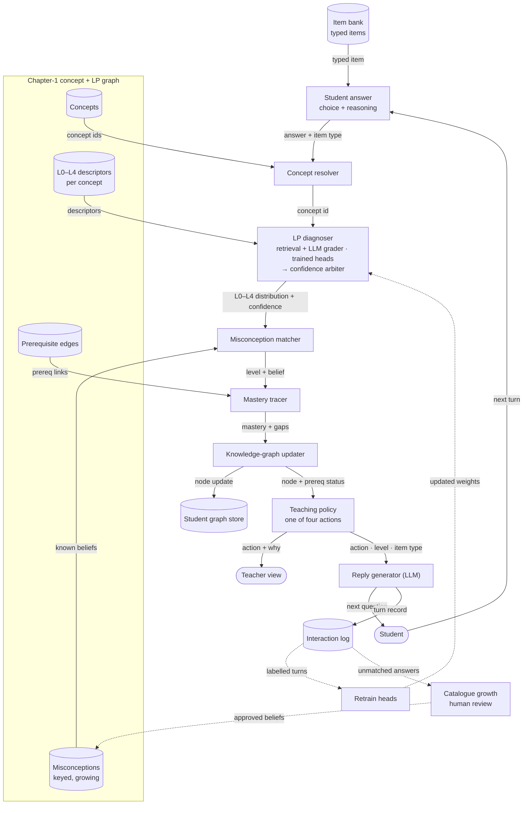
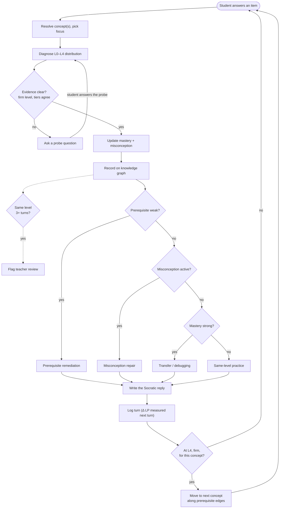

# CPAL — LP-grounded Java Tutor

CPAL is a Java tutor for Chapter 1 of *Introduction to Programming in Java*
(Sedgewick & Wayne §1.1–1.6). It doesn't just check whether a student's answer
is right. It reads **how deeply they understand the code**, places that on a
five-level **Learning Progression (LP)**, catches the **specific wrong belief**
behind a mistake, and picks a teaching move that fits that level.

Everything hangs off one graph: the **Chapter-1 concept + LP graph**
(`data/chapter1_concept_graph_percpt_lp.json`).

**Current scope (2026-10-01):** the system does two things only — it classifies
each student prompt on the graph's L0–L4 ladder for every concept the prompt is
about, and it keeps a self-updating concept map for each student. No tutor
reply is generated; mastery tracking, the teaching-move choice and hierarchical
RL are archived. The algorithm is specified in
[`docs/CPAL_LP_Classification_Algorithm.xlsx`](docs/CPAL_LP_Classification_Algorithm.xlsx)
and implemented in [`src/lp_percpt/`](src/lp_percpt/).

The design target is described in **[The ideal methodology](#the-ideal-methodology-design-target)**
below, with a framework diagram, a process diagram and a worked example.
**[Ideal vs current](#ideal-vs-current)** shows how far the code is from it.

---

## The ideal methodology (design target)

What the tutor should do on every student message. Sources:
`docs/wireframe/LP_LEARNING_PROGRESSION.md`,
`docs/cpal_trainable_dynamic_design.md` and the Chapter-1 graph itself.

### The loop

| Step | What happens |
|---|---|
| 0. Assessment item | Each answer is an item of a type: syntax identification → predict output → explanation → trace table → debugging. The student climbs this ladder as their level rises. |
| 1. LP level | A **probability for each level L0–L4**, judged against the concept's own description of each level. |
| 2. Mastery | Knowledge tracing over the LP distributions gives a trend per concept. A repeated later error points back to a prerequisite gap. |
| 3. Misconception | Matched against a catalogue keyed by concept, LP level, giveaway pattern, exposing trace step and remediation. Shown as **matched**, then **cleared** once the student reaches the mechanism. |
| 4. Knowledge graph | The concept node carries LP level, mastery and misconception. Typed nodes (LPLevel, Misconception, AssessmentItem, Resource, Evidence) and edges (`prerequisiteOf`, `alignedToLPLevel`, `indicatesMisconception`, `assessedBy`, `remediatedBy`, `demonstrates`) attach to it, turn by turn. |
| 5. Teaching action | **Exactly one of four**, each with a trigger (table below). |
| 6. Reply | Socratic, shaped by action + level + item type. It asks the next good question and never gives the answer. |

### The level scale (from the Chapter-1 graph)

| Level | Name | Notional machine |
|---|---|---|
| L0 | Reference / Prestructural | none; reads code as prose |
| L1 | Surface Recognition | recognises constructs; no working machine |
| L2 | Local Execution Tracing | hand-executes a fragment; partial machine |
| L3 | Relational State Reasoning | coordinates state into purpose; full machine |
| L4 | Integrated Transfer & Debugging | transfers and debugs the machine |

Levels and ordering follow Jin et al.'s construct map; each concept's level
descriptions are derived with the Block Model.

**Reporting rule:** report Lk only if its share is above **0.55** and the
neighbouring level's share is below **0.30**. Otherwise report
"between Lk and Lk+1".

### The four teaching actions

| Trigger | Action |
|---|---|
| A prerequisite of this concept is weak | Prerequisite remediation |
| A misconception is active | Misconception repair |
| Mastery is still developing | Same-level practice |
| Mastery is strong | Transfer / debugging |

### Framework and data flow

Solid arrows run on every turn; dotted arrows are the offline learning loop.



### Process flow for one turn



The probe loop has a cap: after it, the tutor teaches anyway.

### Worked example: one student learning `println`

Code: `System.out.print("A"); System.out.println("B"); System.out.print("C");`
Concept, misconception and level meanings come from the Chapter-1 graph;
the percentages are illustrative.

| Turn | Item type | Student says | LP distribution → reported | Misconception | Action | Tutor asks |
|---|---|---|---|---|---|---|
| 1 | predict output | "It prints ABC on one line." | L1 .62, L2 .22 → **L1 firm** | PrintEqualsPrintln **matched** | Misconception repair | "Where does the cursor sit after `println("B")` finishes?" |
| 2 | explanation | "println adds a newline, print doesn't." | L2 .52, L3 .33 → **between L2–L3** | still active | Same-level practice | "Trace it: after each call, which line is the cursor on?" |
| 3 | trace table | "After print A the cursor stays; println B ends the line, so C starts line 2." | L3 .71 → **L3 firm** | **cleared** | Transfer / debugging | "Someone wants a blank line between outputs. Which call adds it?" |
| 4 | debugging | "`println()` with no argument just outputs the newline." | L4 .64 → **L4 firm** | none | Next concept (`compile`) | "Which of these lines would the compiler reject, and why?" |

Mastery trends 31% → 59% → 74% → 89% (illustrative). Had `statement` or
`string_literal` (println's prerequisites) been weak at turn 1, the action
would have been prerequisite remediation instead.

**Student types, same loop:** a steady learner climbs L1 → L4 as above; a
confident-but-wrong student plateaus at L2 and is flagged for review; a
struggling student sits at L0 with same-level practice; an advanced student
skips to transfer and never grows a misconception node.

### How it keeps learning

- **Dynamic tier:** retrieval + an LLM grading against the level descriptions; improves as soon as knowledge is added, with no retraining.
- **Trainable tier:** the classifier heads, retrained from real sessions instead of synthetic paraphrases.
- **Confidence arbiter:** fuses the two; agreement → teach, disagreement → probe first.
- **Data flywheel:** every turn logged with the Δ LP that followed, used as the label for retraining.
- **Living catalogue:** unmatched answers clustered into candidate misconceptions that a person approves.
- **Golden evaluation set:** a fixed set of labelled turns run on every change.

---

## Ideal vs current

| Step | Ideal | Current code | Gap |
|---|---|---|---|
| Input | Typed assessment items climbing a ladder | Multiple-choice pick + reasoning; no item types | Medium |
| LP output | Distribution over L0–L4 + reporting rule | One label, L1–L4 (no L0) | Large |
| LP levels | Notional-machine levels, judged per concept | SOLO-style keywords; per-concept descriptions reach the prompt only | Large |
| Mastery | Tracing over LP, points back to prerequisites | DINA on right/wrong only, 20 legacy concepts; BKT value unused (bug) | Large |
| Misconceptions | One keyed, living catalogue | Two separate sets (20×3 catalogue and the graph's 90) | Medium |
| Knowledge graph | Typed nodes and edges, evidence per turn | Concept nodes + prerequisite / leads-to / parallel neighbours | Medium |
| Policy | Four actions driven by prerequisites, misconceptions, mastery | LP level alone picks the move; RL can't change it; plateau never fires in the chat app | Large |
| Reply | Socratic, never gives the answer, item-type aware | Six-step shapes per level include worked examples | Small–medium |
| Learning loop | Flywheel + retraining + golden set | Audit log only; RL learning isn't saved | Large |

The wireframe app in the separate `Personalized_Learning_Cleaned` project
already implements the L0–L4 distribution with a reported level and the
four-action policy (14/15 LP levels and 15/15 actions correct on its built-in
items), for 3 of the 7 chapters. Porting it here is the shortest route to the
ideal.

---

## Current status

| Part | Status |
|---|---|
| Chapter-1 concept + LP graph (70 concepts, 90 misconceptions, 350 level nodes, 900 edges) | ✅ works |
| Knowledge overlay: cues + 151 execution facts (`data/chapter1_execution_facts.json`) | ✅ draft, for teacher review |
| LP classification on the percpt graph (`src/lp_percpt/`) | ✅ works; `tests/test_lp_percpt.py` (19 tests) passes |
| Self-updating student graph + concept map (`output/concept_maps/<student>.html`) | ✅ works |
| CLI (`scripts/lp_concept_map.py`) | ✅ works |
| Gradio chat app (`scripts/cpal_chat_app.py`) | ⚠️ classifies + maps each message; won't start here: `configs/config.yaml` missing |
| Student quiz app (`api/student_app.py`) | ⚠️ classifies + maps each belief; `data/quiz_bank.json` and `data/mental_models/` missing |
| Thresholds | ⚠️ starting values; need checking against teacher-labelled prompts |
| Wrong-trace check by running the quiz code; edge-direction errors (G10) | ❌ not implemented yet |

The embedder (`sentence-transformers/all-MiniLM-L6-v2`) and the NLI model
(`cross-encoder/nli-deberta-v3-small`) download on first use. Nothing is trained.

---

## The current process: what the code does on one student prompt

```
 student prompt
   1  prompt gates ............... too little content? only asking for the answer?
   2  split into clauses
   3  link to concept nodes ...... code / word cues + meaning + misconception match
   4  attribute clauses .......... each clause to the concept it is about
   5  clause filters ............. questions, symptom reports, parroted text, pasted code
   6  evidence ................... E1 reference · E2 execution · E3 integration · E4 transfer
   7  validity filters ........... wrong trace, wrong mechanism, jargon, self-contradiction
   8  walk the ladder ............ concept@L0 → L1 → … along next_level edges
   9  caps ....................... boundary misconception, prerequisite, ambiguity
  10  stability .................. no silent drop, jump, repetition, staleness, override
  11  confidence
  12  inference rules ............ accumulate, cap, repair, inferred prerequisites,
                                   gaps, at risk, plateau, frontier
  13  save graph, redraw map, log misses for review
```

| Level node | Requires (graph elements) | Evidence |
|---|---|---|
| `concept@L0` | nothing — the start of every ladder | — |
| `concept@L1` | the concept node (cues, description) | E1 Reference |
| `concept@L2` | the concept's execution facts | E2 Execution |
| `concept@L3` | a causal link across a `prerequisite` / `parallel` edge or the overall purpose, **and** no boundary misconception (`lp_indicator`) held | E3 Integration |
| `concept@L4` | a boundary misconception refuted with the correct fact, or the mechanism applied to a sibling concept / new code | E4 Transfer / debug |

A clause is judged against the graph statement it matches best: a
misconception is held only if the clause matches its wrong belief at least as
well as any correct fact, and a contradiction counts only against the clause's
best-matching fact. All 22 gates, 9 inference rules and 25 thresholds are in
the workbook; the numbers live in `src/lp_percpt/thresholds.py`.

| Module | Role |
|---|---|
| `src/lp_percpt/knowledge.py` | loads the percpt graph + overlay |
| `src/lp_percpt/models.py` | embedder + NLI model (pretrained, not trained here) |
| `src/lp_percpt/identify.py` | Step 3: concept linking |
| `src/lp_percpt/evidence.py` | Steps 4–7: clauses, gates, E1–E4, misconception status |
| `src/lp_percpt/ladder.py` | Step 8: ladder walk |
| `src/lp_percpt/student_graph.py` | Steps 10, 12: stability gates, inference rules, persistence |
| `src/lp_percpt/engine.py` | Steps 1–13 in order; `get_engine().process(...)` |
| `src/lp_percpt/render.py` | concept map HTML |

---

## The Chapter-1 concept + LP graph

`data/chapter1_concept_graph_percpt_lp.json` (v1.1 + LP + ProgMiscon), loaded by
`src/knowledge_graph/chapter1_graph.py`.

| Layer | Contents | Count |
|---|---|---|
| 1 Chapter | Program structure, Types & expressions, Conditionals, Loops, Arrays, Input & output, Random web surfer | 7 |
| 2 Concept | e.g. `program_structure.println`, `arrays.array_bounds` | 70 |
| 3 Misconception | e.g. `PrintEqualsPrintln` — "println and print do the same thing" (ProgMiscon + CS1 additions) | 90 |
| 4 LP level | one L0–L4 ladder per concept, e.g. `program_structure.println@L2` | 350 |

Edges: `prerequisite` (A before B), `parallel` (sibling constructs),
`misconception` (concept → wrong belief), `chapter`, `lp_indicator` (concept →
its level, with a per-concept description of that level), `next_level`
(Lk → Lk+1).

The LP levels follow Jin et al.'s construct map; each per-concept level
description is derived with the Block Model (Izu et al.). The ordering is
marked *hypothesized until confirmed against student data*.

```python
from src.knowledge_graph.chapter1_graph import get_chapter1_graph
g = get_chapter1_graph()
g.canonical("println")                        # 'program_structure.println'
g.get_prerequisites("println")                # ['program_structure.statement', 'program_structure.string_literal']
g.misconceptions_for("println")               # [{'id': 'PrintEqualsPrintln', 'wrong_belief': ...}, ...]
g.lp_descriptor("println", "L2")              # what L2 looks like for println
```

Older CPAL concept ids (`string_equality`, `array_index`, …) are mapped to
Chapter-1 ids in `CPAL_TO_CHAPTER1`. Concepts outside Chapter 1
(`null_pointer`, `overloading`, …) stay as standalone nodes.

---

## Where things live

```
src/
  knowledge_graph/
    chapter1_graph.py            Chapter-1 concept + LP graph loader
    student_knowledge_graph.py   per-student graph (nodes = Chapter-1 concepts)
    student_graph_service.py     record_turn() + SQLite load/save
    mental_models.py             wrong-model (misconception) catalogue
    lp_index.py                  optional LP path lookup (data/java_curriculum/)
  orchestrator/
    lp_diagnostic.py             ① LP classifier, LP gate, post-reply check
    catalogue_rag.py             ② misconception retrieval
    depth_probe.py, rubric_grader.py, concept_resolver.py   ④ probing
    orchestrator.py              full pipeline (process_session)
    enhanced_personalized_generator.py   ⑥–⑦ prompt + Ollama reply
    student_state_tracker.py     cognitive + progression state, LP persistence
  models/                        HVSAE encoder, DINA, behavioral HMM/RNN, Nestor profiler
  reinforcement_learning/        DQN teaching agent, reward function, LP progression RNN
  student_modeling/              Bayesian knowledge tracing
  persistence/                   SQLite store (data/cpal.db), auth, A/B testing
  teaching/                      4-stage teaching engine
  system_registry.py             loads every component once for the apps
api/
  server.py                      FastAPI (port 8000): session, feedback, concept endpoints
  student_app.py                 FastAPI (port 8001): MCQ → belief → correction flow
scripts/
  cpal_chat_app.py               main Gradio chat app (port 7860)
  smoke_test_student_graph.py    student-graph smoke test
  setup_java_knowledge.py        writes data/java_curriculum/ (LP paths, rubric)
  cpal_train_*.py                train the LP / wrong-model heads
  run_*_scenarios*.py            scenario test suites
cpal_integration/                CPAL methodology integration notes, catalogues, tests
data/                            chapter1 graph, cpal.db, (restore: mental_models/, dina/, quiz_bank.json)
docs/                            reports, paper, wireframe + screenshots
_archive/knowledge_graph_models/ retired CSE-KG, Pedagogical KG and COKE code
```

---

## Running it

```bash
pip install -r requirements.txt

# classify prompts and draw the map
python scripts/lp_concept_map.py --student maya --text "the loop never ends because i is never incremented"
python scripts/lp_concept_map.py --student maya --override loops.while_loop=L3   # teacher override

python -m pytest tests/test_lp_percpt.py -q       # 19 tests

python scripts/cpal_chat_app.py                  # chat app → http://localhost:7860 (needs configs/config.yaml)
uvicorn api.student_app:app --port 8001          # quiz app → http://localhost:8001 (needs data/quiz_bank.json)
```

Student graphs are saved in `data/lp_percpt_students/`, maps in
`output/concept_maps/`, and the review log (unlinked prompts, meaning-only
matches, contradicted facts) in `data/lp_percpt_review.jsonl`.

---

## Retired components

The **CSE-KG** (CSO / SPARQL computer-science graph), **Pedagogical KG** and
**COKE** cognitive graph — plus GIKT and the explanation generators built on
them — were removed from the live code on 2026-09-28. They needed training
data that isn't part of this project, and the Chapter-1 graph now covers
their role (concept prerequisites and misconceptions). The code is kept in
`_archive/knowledge_graph_models/` if it's ever needed again.

**Emotion and the psychological channel** were removed as inputs on
2026-09-28 because they can't be read reliably from what the system sees. This
covers the emotion classifier, frustrated/confused/engaged labels, and the
anxiety, flow, attribution, self-efficacy, imposter and SRL-phase signals.
Nothing detects or uses them:
- the teaching-move rules no longer have psychological gates, and the
  `attribution_reframe` / `mastery_surface` interventions no longer exist;
- the prompt no longer has emotional-tone or psychological-state sections;
- rewards no longer have emotion or attribution terms (chat app:
  `0.375·learning gain + 0.25·engagement + 0.375·LP gain`);
- the RL state and LP-ranker vectors keep their old size so trained
  checkpoints still load, but the former emotion slots are always zero, and
  the behavioural RNN's emotion layer is kept only for checkpoint shape.

The emotion-classifier training script is in `_archive/emotion_and_psych/`.

**Reply generation, mastery tracking, the teaching-move choice and hierarchical
RL** were taken out of the live path on 2026-10-01: DINA, BKT, the RL teaching
agent, the LP-progression intervention ranker, the intervention orchestrator,
`src/teaching/`, the dynamic KG updater and `api/server.py` are in
`_archive/mastery_and_teaching_choice/` (with snapshots of the chat app, quiz
app and registry as they were). Scripts that still import them (the
`demo_full_stack*`, `run_*_scenarios*`, `start_evaluation` and older
`cpal_demo_*` scripts) no longer run.

## License

MIT
