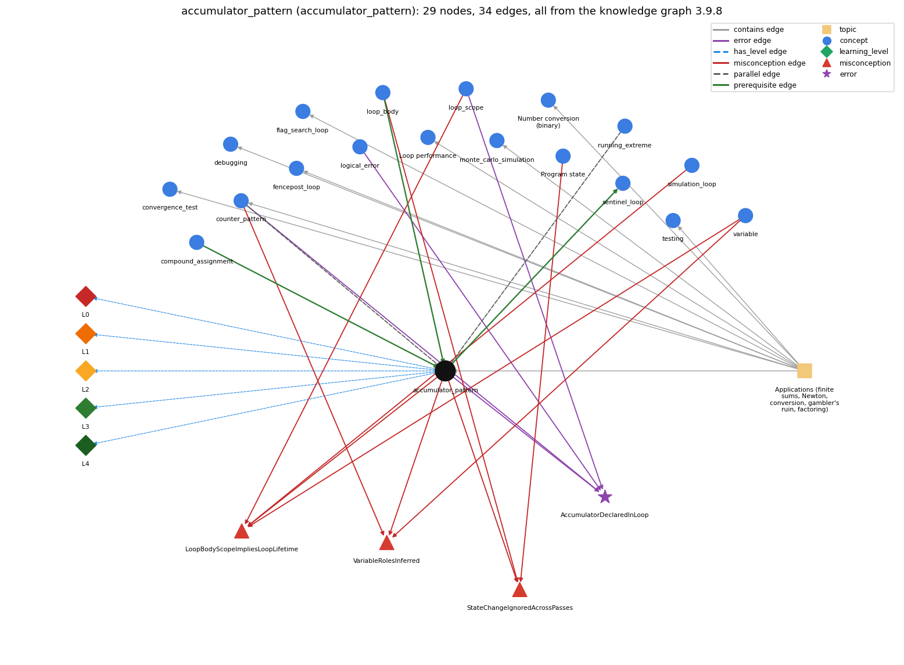

# accumulator_pattern (`accumulator_pattern`)

building up a running total/result

Section 1.3 Conditionals and Loops, topic 1.3.f Applications (finite sums, Newton, conversion, gambler's ruin, factoring). From the knowledge graph 3.9.8 (`data/raw/chapter1_kg_updated.json`).

## Concepts associated with accumulator\_pattern (18)

| Concept | Description | How it is associated |
| --- | --- | --- |
| **compound\_assignment** | x += e, x -= e, ... include a hidden cast | prerequisite of it (it needs this) |
| **convergence\_test** | stopping a loop when a floating-point result is close enough | same topic (topic1.3.f) |
| **counter\_pattern** | counting occurrences across passes | parallel concept composition rule (R) with it shares error AccumulatorDeclaredInLoop shares misconception VariableRolesInferred same topic (topic1.3.f) |
| **debugging** | finding and fixing the cause of a wrong result or error by forming a hypothesis, changing the program and checking the prediction | same topic (topic1.3.f) |
| **fencepost\_loop** | n items need n - 1 separators: one item handled outside the loop | same topic (topic1.3.f) |
| **flag\_search\_loop** | a boolean flag that a loop sets once and never resets | same topic (topic1.3.f) |
| **logical\_error** | the program runs but computes the wrong result | shares error AccumulatorDeclaredInLoop |
| **loop\_body** | the block repeated each pass | prerequisite of it (it needs this) composition rule (R) with it shares misconception StateChangeIgnoredAcrossPasses |
| **loop\_performance** | the running time of a loop program depends on how many iterations it makes | same topic (topic1.3.f) |
| **loop\_scope** | lifetime/scope of variables in/around the loop | shares misconception LoopBodyScopeImpliesLoopLifetime shares error AccumulatorDeclaredInLoop |
| **monte\_carlo\_simulation** | estimating a probability by repeating random trials | same topic (topic1.3.f) |
| **number\_conversion** | converting an integer to its binary representation by casting out powers of 2 in a loop | same topic (topic1.3.f) |
| **program\_state** | the information needed to know what a program will do next: the values of its variables and array entries and the next statement | shares misconception StateChangeIgnoredAcrossPasses |
| **running\_extreme** | tracking the max or min of a stream | parallel concept |
| **sentinel\_loop** | reading until a special stop value (Rainfall problem) | builds on it (needs it) composition rule (R) with it |
| **simulation\_loop** | take many random steps | shares misconception LoopBodyScopeImpliesLoopLifetime |
| **testing** | running a program on chosen inputs, including boundary and unusual ones, and comparing the output with what it should be | same topic (topic1.3.f) |
| **variable** | a named, typed box that holds a value | shares misconception LoopBodyScopeImpliesLoopLifetime shares misconception VariableRolesInferred |

## Every edge in this view and its full label (34)

| From | Edge | To | Full edge label |
| --- | --- | --- | --- |
| **accumulator\_pattern** | prerequisite | **sentinel\_loop** | Sum and count are accumulators. grounding: questionable composition rule (R) of accumulator\_pattern with sentinel\_loop: In a sentinel loop the sum and the count of the values read are both accumulators, updated only for values that are not the sentinel. composition rule (R) of sentinel\_loop with accumulator\_pattern: sum (a gatherer) and count must change only for values that are not the sentinel and pass the filter. The average is computed once, after the loop. |
| **compound\_assignment** | prerequisite | **accumulator\_pattern** | sum += x is the usual way a running total is updated on each pass. grounding: book\_passage |
| **loop\_body** | prerequisite | **accumulator\_pattern** | The accumulator update sum += x sits inside the body, so it runs once on every pass. grounding: book\_passage composition rule (R) of loop\_body with accumulator\_pattern: The accumulator update (sum += x) is placed inside the body so it runs once per pass, while the accumulator is declared and initialized before the loop. composition rule (R) of accumulator\_pattern with loop\_body: The update sum += x sits inside the body so it runs once per pass, while the declaration and initialization stay before the loop. |
| **accumulator\_pattern** | parallel | **counter\_pattern** | An accumulator adds the current value itself on each pass (sum += x); a counter adds 1 on each pass that matches (count++). grounding: order\_only composition rule (R) of accumulator\_pattern with counter\_pattern: A counter is an accumulator that adds 1 on each pass that matches (count++), whereas an accumulator adds the current value itself (sum += x). composition rule (R) of counter\_pattern with accumulator\_pattern: Same skeleton (initialise before, update inside, read after); the accumulator adds the current value (\`sum += x\`), the counter adds the constant 1 on matching passes (\`count++\`). The two are often combined to compute an average \`sum / count\`, which needs a guard against \`count == 0\`. |
| **running\_extreme** | parallel | **accumulator\_pattern** | Both make one pass over the values with one variable kept across passes. An accumulator (gatherer role) combines every value into it (sum += a[i]), so it starts at the identity 0.0; a running extreme (most-wanted holder) replaces it only when a better value is found (if (a[i] &gt; max) max = a[i]), so it starts at Double.NEGATIVE\_INFINITY or the first value. grounding: book\_passage |
| **accumulator\_pattern** | misconception | **LoopBodyScopeImpliesLoopLifetime** | **wrong rule:** a variable declared in the loop body lives across all iterations **right rule:** A variable declared inside the body is created anew on every pass and does not keep the previous pass's value. role: context |
| **accumulator\_pattern** | misconception | **StateChangeIgnoredAcrossPasses** | **wrong rule:** Values changed by one pass of a loop (other than the loop variable) do not affect later passes. **right rule:** Each pass starts from the state left by the previous pass, so a change in one pass carries into the next ones. role: context |
| **accumulator\_pattern** | misconception | **VariableRolesInferred** | **wrong rule:** The computer recognises that one variable plays two roles, e.g. input value and running total, and keeps the values apart; it knows which variable is the counter and which the sum. **right rule:** A variable holds one value at a time; each role (input, counter, running total) needs its own variable and explicit update. role: context |
| **counter\_pattern** | misconception | **VariableRolesInferred** | **wrong rule:** The computer recognises that one variable plays two roles, e.g. input value and running total, and keeps the values apart; it knows which variable is the counter and which the sum. **right rule:** A variable holds one value at a time; each role (input, counter, running total) needs its own variable and explicit update. role: context |
| **loop\_body** | misconception | **StateChangeIgnoredAcrossPasses** | **wrong rule:** Values changed by one pass of a loop (other than the loop variable) do not affect later passes. **right rule:** Each pass starts from the state left by the previous pass, so a change in one pass carries into the next ones. role: primary |
| **loop\_scope** | misconception | **LoopBodyScopeImpliesLoopLifetime** | **wrong rule:** A variable declared inside the loop body keeps its value from one pass to the next. **right rule:** A variable declared inside the body is created anew on every pass and does not keep the previous pass's value. role: primary |
| **program\_state** | misconception | **StateChangeIgnoredAcrossPasses** | **wrong rule:** Values changed by one pass of a loop (other than the loop variable) do not affect later passes. **right rule:** Each pass starts from the state left by the previous pass, so a change in one pass carries into the next ones. role: context |
| **simulation\_loop** | misconception | **LoopBodyScopeImpliesLoopLifetime** | **wrong rule:** Declaring page inside the simulation loop still lets the surfer continue from the previous page. **right rule:** If page is declared inside the loop body it is recreated each pass, so it must be declared before the loop to carry the walk forward. role: context |
| **variable** | misconception | **LoopBodyScopeImpliesLoopLifetime** | **wrong rule:** a variable declared in the loop body lives across all iterations **right rule:** A variable declared inside the body is created anew on every pass and does not keep the previous pass's value. role: context |
| **variable** | misconception | **VariableRolesInferred** | **wrong rule:** The computer recognises that one variable plays two roles, e.g. input value and running total, and keeps the values apart; it knows which variable is the counter and which the sum. **right rule:** A variable holds one value at a time; each role (input, counter, running total) needs its own variable and explicit update. role: primary |
| **accumulator\_pattern** | error | **AccumulatorDeclaredInLoop** | **wrong rule:** Declaring sum inside the loop body keeps a running total across passes. **right rule:** The accumulator must be declared and initialised before the loop. role: context |
| **counter\_pattern** | error | **AccumulatorDeclaredInLoop** | **wrong rule:** Declaring sum inside the loop body keeps a running total across passes. **right rule:** The accumulator must be declared and initialised before the loop. role: context |
| **logical\_error** | error | **AccumulatorDeclaredInLoop** | **wrong rule:** Declaring sum inside the loop body keeps a running total across passes. **right rule:** The accumulator must be declared and initialised before the loop. role: context |
| **loop\_scope** | error | **AccumulatorDeclaredInLoop** | **wrong rule:** Declaring sum inside the loop body keeps a running total across passes. **right rule:** The accumulator must be declared and initialised before the loop. role: primary |
| **accumulator\_pattern** | has\_level | **accumulator\_pattern@L0** | accumulator pattern -&gt; L0 (Prestructural): the answer holds a rule that contradicts Java (5 ways). **[0] everyday\_reading** (E): Folk meaning: 'the sum' is a single mathematical quantity that simply exists, and a person adding numbers keeps the running total in mind automatically. In Java the total is a variable that must be declared and initialized before the loop and explicitly updated on every pass (sum += x). **[1] misconception** (M) &rarr; LoopBodyScopeImpliesLoopLifetime: wrong rule: a variable declared in the loop body lives across all iterations. Right rule: A variable declared inside the body is in scope only to the end of the body, so each pass declares and initializes it afresh and it does not keep the previous pass's value. **[2] inconsistent\_trace** (T) &rarr; LoopBodyScopeImpliesLoopLifetime: Applies the update rule (LT) unevenly: adds the new value to the previous total on some passes but restarts from the initial value (or forgets to add) on others. (here mixing in: "a variable declared in the loop body lives across all iterations") **[3] misconception** (M) &rarr; VariableRolesInferred: wrong rule: The computer recognises that one variable plays two roles, e.g. input value and running total, and keeps the values apart; it knows which variable is the counter and which the sum. Right rule: A variable holds one value at a time; each role (input, counter, running total) needs its own variable and explicit update. **[4] misconception** (M) &rarr; StateChangeIgnoredAcrossPasses: wrong rule: Values changed by one pass of a loop (other than the loop variable) do not affect later passes. Right rule: Each pass starts from the state left by the previous pass, so a change in one pass carries into the next ones. |
| **accumulator\_pattern** | has\_level | **accumulator\_pattern@L1** | accumulator pattern -&gt; L1 (Unistructural): the answer states one correct rule without applying it (2 ways). **[0] names\_the\_element** (N): An accumulator is a variable used to accumulate results during a traversal, e.g. the running total of a sum. **[1] states\_the\_rule** (S): Initialize the accumulator before the loop (0 for a sum, 1 for a product), update it once per pass in the body (total += array[i]), and use it after the loop. |
| **accumulator\_pattern** | has\_level | **accumulator\_pattern@L2** | accumulator pattern -&gt; L2 (Multistructural): the answer applies the rules of accumulator pattern to every part of the code, in order (3 ways). **[0] line\_by\_line\_trace** (LT): Before the loop: total = initial value. Each pass: read total, combine with the current item, store back. After the loop: total holds the combination of all items. **[1] output\_prediction** (OP): After the loop the accumulator holds the reduce result: sum of 1..N is N(N+1)/2; Harmonic(2) = 1.5; the product loop gives N!. **[2] one\_step\_execution** (OS): One pass changes only the accumulator (and the loop variable): sum += x[i] turns sum = 1 into 5 when x[i] = 4. |
| **accumulator\_pattern** | has\_level | **accumulator\_pattern@L3** | accumulator pattern -&gt; L3 (Relational): the answer relates the parts (5 ways). **[0] relation\_to\_neighbour** (R): The update sum += x sits inside the body so it runs once per pass, while the declaration and initialization stay before the loop. **[1] relation\_to\_neighbour** (R): A counter is an accumulator that adds 1 on each pass that matches (count++), whereas an accumulator adds the current value itself (sum += x). **[2] relation\_to\_neighbour** (R): In a sentinel loop the sum and the count of the values read are both accumulators, updated only for values that are not the sentinel. **[3] relation\_to\_neighbour** (R): Both make one pass over the values with one variable kept across passes. An accumulator (gatherer role) combines every value into it (sum += a[i]), so it starts at the identity 0.0; a running extreme (most-wanted holder) replaces it only when a better value is found (if (a[i] &gt; max) max = a[i]), so it starts at Double.NEGATIVE\_INFINITY or the first value. **[4] purpose\_of\_the\_whole** (P): Role: gatherer - a data item accumulating the effect of individual values (running total, product, concatenated string). |
| **accumulator\_pattern** | has\_level | **accumulator\_pattern@L4** | accumulator pattern -&gt; L4 (Extended abstract): the answer reasons beyond the given code (5 ways). **[0] predict\_a\_change** (C) &rarr; LoopBodyScopeImpliesLoopLifetime: Changing the initial value shifts the result by that amount (sum starts at 1 gives sum + 1); a product starting at 0 stays 0; reordering the items does not change an integer sum (addition is commutative) but may change a floating-point sum slightly. **[1] diagnose\_an\_error** (D): rule broken: A variable declared in the body is in scope only to the end of the body and is re-declared and re-initialized on every pass. Kind: silent logic error. Trigger class: for (...) { int sum = 0; sum += a[i]; }: sum restarts at 0 each pass, so only the last term survives; printing sum after the loop is a compile-time error (cannot find symbol) because sum is out of scope. **[2] transfer\_to\_a\_new\_program** (X): Use an accumulator whenever many values must be reduced to one (sum, product, average, string); for a maximum or minimum use a most-wanted holder updated by an if instead. **[3] diagnose\_an\_error** (D): rule broken: The accumulator must be initialized before the loop. Kind: compile-time. Trigger class: Declaring int sum; and then sum += x in the loop: 'variable sum might not have been initialized'. **[4] diagnose\_an\_error** (D): rule broken: A sum must start at 0 and a product at 1. Kind: silent logic error. Trigger class: product initialized to 0 (result always 0) or sum initialized to the first element and then adding it again (first element counted twice). |
| **topic1.3.f** | contains | **accumulator\_pattern** | topic topic1.3.f contains accumulator\_pattern |
| **topic1.3.f** | contains | **convergence\_test** | topic topic1.3.f contains convergence\_test |
| **topic1.3.f** | contains | **counter\_pattern** | topic topic1.3.f contains counter\_pattern |
| **topic1.3.f** | contains | **debugging** | topic topic1.3.f contains debugging |
| **topic1.3.f** | contains | **fencepost\_loop** | topic topic1.3.f contains fencepost\_loop |
| **topic1.3.f** | contains | **flag\_search\_loop** | topic topic1.3.f contains flag\_search\_loop |
| **topic1.3.f** | contains | **loop\_performance** | topic topic1.3.f contains loop\_performance |
| **topic1.3.f** | contains | **monte\_carlo\_simulation** | topic topic1.3.f contains monte\_carlo\_simulation |
| **topic1.3.f** | contains | **number\_conversion** | topic topic1.3.f contains number\_conversion |
| **topic1.3.f** | contains | **testing** | topic topic1.3.f contains testing |
