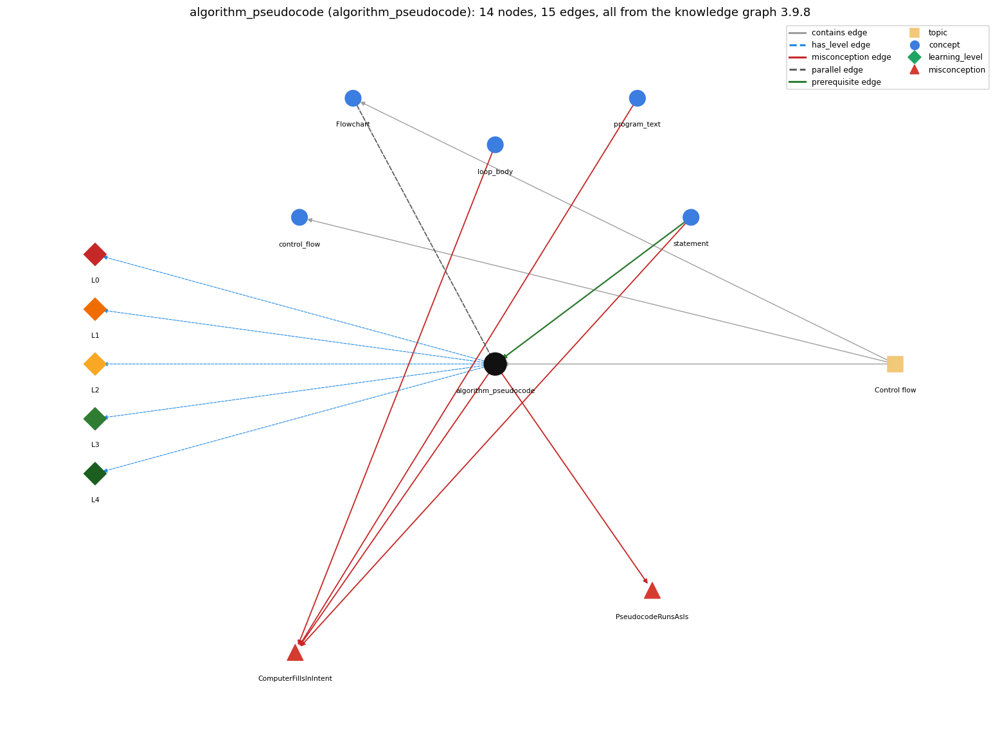

# algorithm_pseudocode (`algorithm_pseudocode`)

an algorithm is a sequence of steps that solves a problem; pseudocode outlines it in English and Java before it is coded

Section 1.3 Conditionals and Loops, topic 1.3.a Control flow. From the knowledge graph 3.9.8 (`data/raw/chapter1_kg_updated.json`).

## Concepts associated with algorithm\_pseudocode (5)

| Concept | Description | How it is associated |
| --- | --- | --- |
| **control\_flow** | the order in which statements are executed | same topic (topic1.3.a) |
| **flowchart** | a diagram whose paths correspond to the flow-of-control paths through a program | parallel concept composition rule (R) with it same topic (topic1.3.a) |
| **loop\_body** | the block repeated each pass | shares misconception ComputerFillsInIntent |
| **program\_text** | the source file; class name must match the filename | shares misconception ComputerFillsInIntent |
| **statement** | one step, terminated by ;, executed in sequence | prerequisite of it (it needs this) composition rule (R) with it shares misconception ComputerFillsInIntent |

## Every edge in this view and its full label (15)

| From | Edge | To | Full edge label |
| --- | --- | --- | --- |
| **statement** | prerequisite | **algorithm\_pseudocode** | An algorithm becomes a program as a sequence of statements, executed once each in the order given. grounding: book\_passage composition rule (R) of algorithm\_pseudocode with statement: Each step of the algorithm becomes one or more statements, executed in the same order. |
| **algorithm\_pseudocode** | parallel | **flowchart** | Both describe an algorithm before it is code: a flowchart draws the flow of control as boxes and arrows, pseudocode writes the steps as English and Java text. grounding: book\_passage composition rule (R) of algorithm\_pseudocode with flowchart: A flowchart and pseudocode describe the same algorithm: one as a diagram of the flow of control, the other as text. |
| **algorithm\_pseudocode** | misconception | **ComputerFillsInIntent** | **wrong rule:** The computer fills in omitted steps or values that the programmer meant, e.g. REPEAT 4 [FORWARD 30] draws a square without a turn command. **right rule:** The computer executes only what the code states; every needed step and value must be written. role: context |
| **algorithm\_pseudocode** | misconception | **PseudocodeRunsAsIs** | **wrong rule:** Pseudocode can be compiled and run as it is. **right rule:** Pseudocode mixes Java and English to outline the algorithm; every English step must still be written as Java statements before the program compiles. role: primary |
| **loop\_body** | misconception | **ComputerFillsInIntent** | **wrong rule:** The computer fills in omitted steps or values that the programmer meant, e.g. REPEAT 4 [FORWARD 30] draws a square without a turn command. **right rule:** The computer executes only what the code states; every needed step and value must be written. role: context |
| **program\_text** | misconception | **ComputerFillsInIntent** | **wrong rule:** The computer fills in omitted steps or values that the programmer meant, e.g. REPEAT 4 [FORWARD 30] draws a square without a turn command. **right rule:** The computer executes only what the code states; every needed step and value must be written. role: context |
| **statement** | misconception | **ComputerFillsInIntent** | **wrong rule:** The computer fills in omitted steps or values that the programmer meant, e.g. REPEAT 4 [FORWARD 30] draws a square without a turn command. **right rule:** The computer executes only what the code states; every needed step and value must be written. role: primary |
| **algorithm\_pseudocode** | has\_level | **algorithm\_pseudocode@L0** | algorithm pseudocode -&gt; L0 (Prestructural): the answer holds a rule that contradicts Java (4 ways). **[0] everyday\_reading** (E): Everyday instructions leave steps to the reader's common sense. An algorithm lists every step that specifies how to solve the problem, and the computer does exactly those steps in order. **[1] misconception** (M) &rarr; PseudocodeRunsAsIs: wrong rule: Pseudocode can be compiled and run as it is. Right rule: Pseudocode mixes Java and English to outline the algorithm; every English step must still be written as Java statements before the program compiles. **[2] inconsistent\_trace** (T) &rarr; PseudocodeRunsAsIs: Applies the algorithm idea unevenly: spells out every step for one part of the problem but leaves another part as a single vague step that the computer is expected to understand. (here mixing in: "Pseudocode can be compiled and run as it is") **[3] misconception** (M) &rarr; ComputerFillsInIntent: wrong rule: The computer fills in omitted steps or values that the programmer meant. Right rule: The computer executes exactly the statements written, once each in the order given; nothing that was meant but not written happens. |
| **algorithm\_pseudocode** | has\_level | **algorithm\_pseudocode@L1** | algorithm pseudocode -&gt; L1 (Unistructural): the answer states one correct rule without applying it (2 ways). **[0] names\_the\_element** (N): Algorithm: a sequence of steps that specifies how to solve a problem; pseudocode: an outline of it in English and Java. **[1] states\_the\_rule** (S): An algorithm is a sequence of steps that specifies how to solve a problem. Pseudocode outlines it with a mix of Java statements and English comments, and shows which smaller steps still have to be written. |
| **algorithm\_pseudocode** | has\_level | **algorithm\_pseudocode@L2** | algorithm pseudocode -&gt; L2 (Multistructural): the answer applies the rules of algorithm pseudocode to every part of the code, in order (3 ways). **[0] line\_by\_line\_trace** (LT): Sequencing: state the problem, write the steps in order in pseudocode, refine each English step until it is one or a few Java statements, then code and test. **[1] output\_prediction** (OP): Result: the outcome of an algorithm on an input is found by carrying out its steps by hand; Euclid's algorithm on 1440 and 408 gives 24. **[2] one\_step\_execution** (OS): State transition: one step of an algorithm changes the values it works on in one defined way, as one statement does in the program. |
| **algorithm\_pseudocode** | has\_level | **algorithm\_pseudocode@L3** | algorithm pseudocode -&gt; L3 (Relational): the answer relates the parts (3 ways). **[0] relation\_to\_neighbour** (R): Each step of the algorithm becomes one or more statements, executed in the same order. **[1] relation\_to\_neighbour** (R): A flowchart and pseudocode describe the same algorithm: one as a diagram of the flow of control, the other as text. **[2] purpose\_of\_the\_whole** (P): Plan: decide what the program must do, step by step, before writing Java, so that the code only translates the steps. |
| **algorithm\_pseudocode** | has\_level | **algorithm\_pseudocode@L4** | algorithm pseudocode -&gt; L4 (Extended abstract): the answer reasons beyond the given code (3 ways). **[0] predict\_a\_change** (C) &rarr; PseudocodeRunsAsIs: Conservation: refining a pseudocode step into Java keeps its meaning; a different algorithm for the same problem (for example Euclid versus trying every divisor) keeps the answer but changes the number of steps. **[1] transfer\_to\_a\_new\_program** (X): Before coding a non-trivial problem, write the algorithm as pseudocode, check it by hand on a small input, then translate each step into Java. **[2] diagnose\_an\_error** (D): rule broken: Every step of an algorithm must be stated. Kind: logic error. Trigger class: a step that was left implicit in the outline (an initialization, the last case, an exit test) is missing from the code |
| **topic1.3.a** | contains | **algorithm\_pseudocode** | topic topic1.3.a contains algorithm\_pseudocode |
| **topic1.3.a** | contains | **control\_flow** | topic topic1.3.a contains control\_flow |
| **topic1.3.a** | contains | **flowchart** | topic topic1.3.a contains flowchart |
