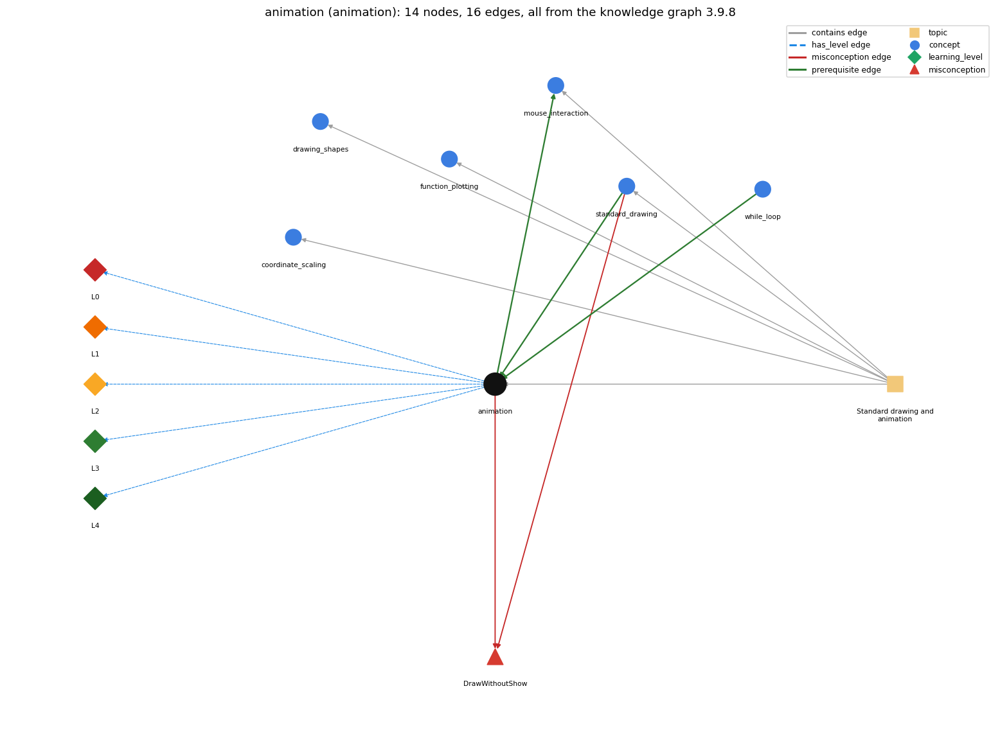

# animation (`animation`)

StdDraw animation: clear, draw, show, pause in a loop

Section 1.5 Input and Output, topic 1.5.e Standard drawing and animation. From the knowledge graph 3.9.8 (`data/raw/chapter1_kg_updated.json`).

## Concepts associated with animation (6)

| Concept | Description | How it is associated |
| --- | --- | --- |
| **coordinate\_scaling** | StdDraw's unit square and setXscale/setYscale | same topic (topic1.5.e) |
| **drawing\_shapes** | outline vs filled shapes, square half-length, colour and text | same topic (topic1.5.e) |
| **function\_plotting** | sampling a function and joining the points with lines | same topic (topic1.5.e) |
| **mouse\_interaction** | reading mouse position and clicks from StdDraw | builds on it (needs it) composition rule (R) with it same topic (topic1.5.e) |
| **standard\_drawing** | StdDraw -- graphical output (book-specific) | prerequisite of it (it needs this) composition rule (R) with it shares misconception DrawWithoutShow same topic (topic1.5.e) |
| **while\_loop** | repeat a block while a condition holds | prerequisite of it (it needs this) composition rule (R) with it |

## Every edge in this view and its full label (16)

| From | Edge | To | Full edge label |
| --- | --- | --- | --- |
| **animation** | prerequisite | **mouse\_interaction** | Mouse checks run inside the animation loop. grounding: questionable composition rule (R) of animation with mouse\_interaction: Mouse state is polled once per frame inside the animation loop, so it is checked about every dt milliseconds. composition rule (R) of mouse\_interaction with animation: Mouse checks run inside the frame loop. A click shorter than one frame (show(t) pause) can be missed. |
| **standard\_drawing** | prerequisite | **animation** | Animation uses StdDraw's clear() and show() methods to make dynamic changes to the image on the screen. grounding: book\_passage composition rule (R) of standard\_drawing with animation: Animation reuses StdDraw's drawing commands but adds clear() and show(t), which control when the canvas is erased and displayed. composition rule (R) of animation with standard\_drawing: Animation uses StdDraw's drawing commands plus clear() and show(t). show(t) switches off the default show-after-every-command. |
| **while\_loop** | prerequisite | **animation** | BouncingBall repeats erase, draw at the new position, and show with a pause inside a while (true) loop. grounding: book\_passage composition rule (R) of while\_loop with animation: An animation repeats clear/draw/show/pause steps inside a loop, typically one that runs indefinitely. composition rule (R) of animation with while\_loop: The frame loop is while (true): it never ends by its condition, so the animation runs until the window or program is closed. |
| **animation** | misconception | **DrawWithoutShow** | **wrong rule:** With double buffering on, each drawing command appears on screen immediately. **right rule:** By default each drawing command appears at once; after StdDraw.show(t) turns animation mode on, drawing is collected and appears only at the next show(t), which then pauses t milliseconds; show() with no argument turns per-command display back on. role: primary |
| **standard\_drawing** | misconception | **DrawWithoutShow** | **wrong rule:** With double buffering on, each drawing command appears on screen immediately. **right rule:** By default each drawing command appears at once; after StdDraw.show(t) turns animation mode on, drawing is collected and appears only at the next show(t), which then pauses t milliseconds; show() with no argument turns per-command display back on. role: context |
| **animation** | has\_level | **animation@L0** | animation -&gt; L0 (Prestructural): the answer holds a rule that contradicts Java (3 ways). **[0] everyday\_reading** (E): Everyday drawing (pen on paper) appears as you draw, and 'show' sounds like 'display what I drew'. In StdDraw animation mode, drawings are collected off-screen and appear all at once when show(t) is called, which then pauses t ms. **[1] misconception** (M) &rarr; DrawWithoutShow: wrong rule: With double buffering on, each drawing command appears on screen immediately. Right rule: Once show(t) has turned off per-command display, nothing new appears until the next show(t). Each frame must end with show(t). **[2] inconsistent\_trace** (T) &rarr; DrawWithoutShow: Points to LT (update the position, clear, draw, show and pause, in each frame). An uneven trace draws before updating on some frames, or checks the bounce after moving. (here mixing in: "With double buffering on, each drawing command appears on screen immediately") |
| **animation** | has\_level | **animation@L1** | animation -&gt; L1 (Unistructural): the answer states one correct rule without applying it (2 ways). **[0] names\_the\_element** (N): Animation is a StdDraw technique: a loop that repeatedly erases the canvas, draws the next frame and shows it with a pause, which creates the illusion of motion. **[1] states\_the\_rule** (S): clear() and show() support dynamic images. Each frame: erase the drawing (without showing it), draw the new frame, then show the result and wait briefly. |
| **animation** | has\_level | **animation@L2** | animation -&gt; L2 (Multistructural): the answer applies the rules of animation to every part of the code, in order (3 ways). **[0] line\_by\_line\_trace** (LT): In BouncingBall each pass of while (true) reverses vx or vy if the next position would cross a wall, then updates rx += vx and ry += vy, calls clear(), draws filledCircle(rx, ry, radius), and calls show(20), which displays the frame and pauses 20 ms. **[1] output\_prediction** (OP): The output is a sequence of frames: the ball appears to move in a straight line and bounce off the walls of the 2-by-2 box. Starting at rx = .480 with vx = .015, the x-positions are .495, .510, ... until a bounce. **[2] one\_step\_execution** (OS): One frame changes rx and ry by the velocity (flipping the sign of vx or vy at a wall) and replaces the displayed image with the ball at its new position. |
| **animation** | has\_level | **animation@L3** | animation -&gt; L3 (Relational): the answer relates the parts (4 ways). **[0] relation\_to\_neighbour** (R): Animation uses StdDraw's drawing commands plus clear() and show(t). show(t) switches off the default show-after-every-command. **[1] relation\_to\_neighbour** (R): The frame loop is while (true): it never ends by its condition, so the animation runs until the window or program is closed. **[2] relation\_to\_neighbour** (R): Mouse state is polled once per frame inside the animation loop, so it is checked about every dt milliseconds. **[3] purpose\_of\_the\_whole** (P): Plan: the simulation (time-step) loop. rx and ry are steppers (they advance by a fixed velocity each frame), and vx and vy change only by sign at a bounce. |
| **animation** | has\_level | **animation@L4** | animation -&gt; L4 (Extended abstract): the answer reasons beyond the given code (5 ways). **[0] predict\_a\_change** (C) &rarr; DrawWithoutShow: Changing the pause dt changes the speed but not the path. Removing clear() leaves a track of the ball (Exercise 1.5.34). Dropping show(t) and its pause makes the image flicker. **[1] transfer\_to\_a\_new\_program** (X): Use animation to show how something evolves over time (simulations, clocks, games). For a static plot, draw once without clear() or show(t). **[2] diagnose\_an\_error** (D): rule broken: In animation mode, each frame must end with show(t). Kind: silent logic error. Trigger class: show(t) is missing inside the loop after it has been called once, so the screen stops updating. **[3] diagnose\_an\_error** (D): rule broken: Without the show/pause control the frames flicker. Kind: silent logic error. Trigger class: clear() and drawing without show(t) (in default mode), so the ball flickers between black and white. **[4] diagnose\_an\_error** (D): rule broken: Each frame must erase the previous one. Kind: silent logic error. Trigger class: clear() is missing, so a trail of balls builds up. |
| **topic1.5.e** | contains | **animation** | topic topic1.5.e contains animation |
| **topic1.5.e** | contains | **coordinate\_scaling** | topic topic1.5.e contains coordinate\_scaling |
| **topic1.5.e** | contains | **drawing\_shapes** | topic topic1.5.e contains drawing\_shapes |
| **topic1.5.e** | contains | **function\_plotting** | topic topic1.5.e contains function\_plotting |
| **topic1.5.e** | contains | **mouse\_interaction** | topic topic1.5.e contains mouse\_interaction |
| **topic1.5.e** | contains | **standard\_drawing** | topic topic1.5.e contains standard\_drawing |
