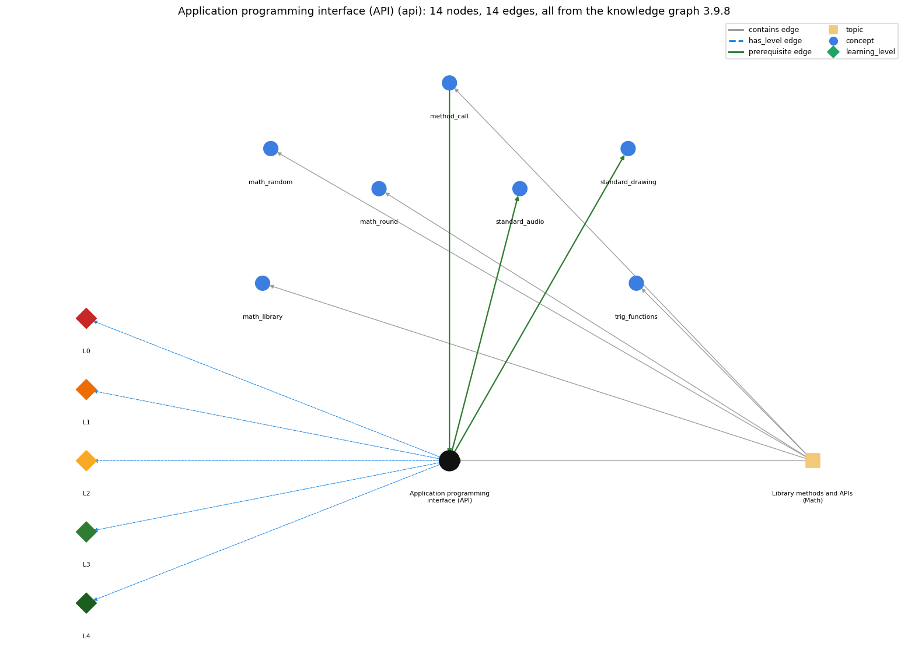

# Application programming interface (API) (`api`)

a table of library methods giving each method's signature and a short description of what it computes

Section 1.2 1.2 Built-in Types of Data, topic 1.2.g Library methods and APIs (Math).

## At a glance

- **Needs first:** `method_call`
- **Leads to:** `standard_audio`, `standard_drawing`
- **Learned alongside:** nothing
- **Misconceptions:** none
- **Errors:** none
- **Levels:** L0, L1, L2, L3, L4

Everything below comes from the knowledge graph 3.9.8 (`data/raw/chapter1_kg_updated.json`): 14 edges around this concept. The edge logic, the wrong and right rules and the exact rules of the ways are copied word for word from the graph.

## To work on (2)

- no misconception or error edge
- no aliases: a student's words cannot name this concept

## What it needs first (1)

A prerequisite edge means the other concept has to be understood before `api`.

### `method_call` comes before `api`

*name(arguments) -- invokes a library method and uses its return value*

- **Edge:** `pre:method_call->api`
- **Exact edge logic:** An API lists, for each library method, the signature you need in order to call it: name, argument types and return type.
- **Grounding:** book\_passage
- **Composition rule (R) of `api` with `method_call`:** Each call must match one API signature: same name, arguments of the listed types in the listed order, and use of the value consistent with the return type.
- **Composition rule (R) of `method_call` with `api`:** The call must match a signature in the API (name, number, order and types of arguments), and the API's return type tells how the value can be used.

## What it leads to (2)

These concepts need `api` first.

### `api` comes before `standard_audio`

*StdAudio: sound as an array of samples*

- **Edge:** `pre:api->standard_audio`
- **Exact edge logic:** StdAudio is a library used through its API of static methods.
- **Grounding:** book\_passage

### `api` comes before `standard_drawing`

*StdDraw -- graphical output (book-specific)*

- **Edge:** `pre:api->standard_drawing`
- **Exact edge logic:** StdDraw is a library used through its API of static methods.
- **Grounding:** book\_passage

## Learned alongside (0)

A parallel edge joins two concepts that sit side by side: neither is needed before the other.

No parallel edge touches this concept.

## Misconceptions (0)

A misconception edge states the wrong rule a student may hold about this concept, and the right rule.

The graph has no misconception edge from this concept.

## Errors (0)

An error edge states the rule that gets broken in a program, and the right rule.

The graph has no error edge from this concept.

## Levels L0 to L4 (5 of 5)

Each level edge lists the ways a student shows that level, each with its exact rule.

### L0: Prestructural / sensorimotor

L0 for Application programming interface (API): the answer holds a rule that contradicts Java.

*Deciding question: Does every rule the answer applies to Application programming interface (API) agree with the language rule? If it reads the code with everyday meanings, applies a wrong rule, or switches rules within one trace, it is L0. A slip in an otherwise rule-correct trace is L2 with an error, not L0.*

- **Edge:** `api` &rarr; `api@L0` (has_level)
- **Exact edge logic:** Application programming interface (API) -&gt; L0 (Prestructural): the answer holds a rule that contradicts Java (1 way).

Ways (1), each with its exact rule:

- **[0] everyday\_reading** (rule type E, folk-meaning rule): Folk meaning: an 'interface' is a screen you click on, and documentation shows the code you type. SW rule: an API is a table of library methods, each line giving the method's signature (return type, name, argument types) and what it computes; the signature is not the code you type to call it.

### L1: Unistructural / atom x text surface

L1 for Application programming interface (API): the answer states one correct rule without applying it.

*Deciding question: Does the answer cover every part of the code, in order, with the values (L2)? If it covers one part or only states the rule, it is L1.*

- **Edge:** `api` &rarr; `api@L1` (has_level)
- **Exact edge logic:** Application programming interface (API) -&gt; L1 (Unistructural): the answer states one correct rule without applying it (2 ways).

Ways (2), each with its exact rule:

- **[0] names\_the\_element** (rule type N, identity rule): An API (application programming interface) is a table of library methods giving, for each, its signature and a short description of what it computes.
- **[1] states\_the\_rule** (rule type S, declarative rule): Each API line specifies the return type, the method name and the types of its arguments (the signature), plus a description; it provides the information needed to write a program that uses the method.

### L2: Multistructural / block x execution / preoperational

L2 for Application programming interface (API): the answer applies these rules to every part of the code, in order.

*Deciding question: Is the answer many segments mapped onto lines (L2), or one segment stating the purpose of the whole (L3)? A correct output with no value-by-value justification is not levelled.*

- **Edge:** `api` &rarr; `api@L2` (has_level)
- **Exact edge logic:** Application programming interface (API) -&gt; L2 (Multistructural): the answer applies the rules of Application programming interface (API) to every part of the code, in order (3 ways).

Ways (3), each with its exact rule:

- **[0] line\_by\_line\_trace** (rule type LT, operational sequencing rule): To use an entry: find the method, read its signature left to right (return type, name, parameter types in order), write a call with the name and argument expressions of those types in that order, and use the returned value according to the return type (none for void).
- **[1] output\_prediction** (rule type OP, evaluation / result rule): From the API alone one predicts the type of a call's value: Math.sqrt returns a double, Math.round a long, Integer.parseInt an int, println nothing (void).
- **[2] one\_step\_execution** (rule type OS, state-transition rule): Reading the API changes nothing in the program; it states what each call returns, and (for void methods such as println) what effect the call has instead of a value.

### L3: Relational / relations x function (concrete operational begins)

L3 for Application programming interface (API): the answer relates the parts by these rules.

*Deciding question: Was the purpose deduced from the code, or only guessed from traced input/output pairs (then L2)? Does the answer stay within the given code (L3), or reason about changed code, an error class or a new program (L4)?*

- **Edge:** `api` &rarr; `api@L3` (has_level)
- **Exact edge logic:** Application programming interface (API) -&gt; L3 (Relational): the answer relates the parts (2 ways).

Ways (2), each with its exact rule:

- **[0] relation\_to\_neighbour** (rule type R, composition rule (with a neighbour)): Each call must match one API signature: same name, arguments of the listed types in the listed order, and use of the value consistent with the return type.
- **[1] purpose\_of\_the\_whole** (rule type P, plan / role rule): An API is a contract that separates the client, who needs only the signatures and descriptions, from the implementation; it lets programmers use large libraries without reading their code, and later to design their own libraries.

### L4: Extended abstract (concrete-operational reversibility and conservation)

L4 for Application programming interface (API): the answer reasons beyond the given code by these rules.

*Deciding question: Does the answer link the code to a broader context: a changed program, a class of inputs, an unseen problem? Re-tracing changed code value by value is L2; fixing one given failing case is L3.*

- **Edge:** `api` &rarr; `api@L4` (has_level)
- **Exact edge logic:** Application programming interface (API) -&gt; L4 (Extended abstract): the answer reasons beyond the given code (4 ways).

Ways (4), each with its exact rule:

- **[0] predict\_a\_change** (rule type C, conservation rule): Client code keeps working when a method's implementation changes but its signature and behaviour stay the same; changing a signature (name, parameter types, return type) breaks every call that relies on it. Choosing which methods an API includes is a trade-off between convenience and size.
- **[1] transfer\_to\_a\_new\_program** (rule type X, applicability rule): Consult the API whenever you use a library method (to get name, argument order and return type right); if no listed method fits, combine listed ones (e.g. secant from Math.cos) or write your own.
- **[2] diagnose\_an\_error** (rule type D, error rule): rule broken: A call must match the API signature (argument types/number/order and return type). Kind: compile-time. Trigger class: Wrong argument types or count (Math.sqrt("2")), or a return value stored in an incompatible variable (int n = Math.round(x)).
- **[3] diagnose\_an\_error** (rule type D, error rule): rule broken: The API describes what the method returns; a value-returning call does not change its arguments. Kind: silent logic error. Trigger class: Using a non-void method as a statement and expecting its argument to change (Math.round(x);).

## Same topic

`api` belongs to the topic **Library methods and APIs (Math)** (`topic1.2.g`). The topic also contains: `math_library`, `math_random`, `math_round`, `method_call`, `trig_functions`.

## Rules of the concept (13)

- **Book** (SW-1e, p. 29 (pdf 39)): "Such a table is known as an application programming interface (API )."
- **Book** (SW-1e, p. 29 (pdf 39)): "It provides the information that you need to write an application program that uses the methods."
- **E** (folk-meaning rule): Folk meaning: an 'interface' is a screen you click on, and documentation shows the code you type. SW rule: an API is a table of library methods, each line giving the method's signature (return type, name, argument types) and what it computes; the signature is not the code you type to call it.
- **T** (uneven-application rule): Points to LT (read an entry as return type, then name, then argument types in order, and write the call to match). Applied unevenly: the student matches the name and arguments of Math.round but ignores its return type (int n = Math.round(x)), or copies the parameter types into the call on some lines.
- **N** (identity rule): An API (application programming interface) is a table of library methods giving, for each, its signature and a short description of what it computes.
- **S** (declarative rule): Each API line specifies the return type, the method name and the types of its arguments (the signature), plus a description; it provides the information needed to write a program that uses the method.
- **LT** (operational sequencing rule): To use an entry: find the method, read its signature left to right (return type, name, parameter types in order), write a call with the name and argument expressions of those types in that order, and use the returned value according to the return type (none for void).
- **OP** (evaluation / result rule): From the API alone one predicts the type of a call's value: Math.sqrt returns a double, Math.round a long, Integer.parseInt an int, println nothing (void).
- **OS** (state-transition rule): Reading the API changes nothing in the program; it states what each call returns, and (for void methods such as println) what effect the call has instead of a value.
- **R** (composition rule (with a neighbour)): with method\_call: Each call must match one API signature: same name, arguments of the listed types in the listed order, and use of the value consistent with the return type.
- **P** (plan / role rule): An API is a contract that separates the client, who needs only the signatures and descriptions, from the implementation; it lets programmers use large libraries without reading their code, and later to design their own libraries.
- **C** (conservation rule): Client code keeps working when a method's implementation changes but its signature and behaviour stay the same; changing a signature (name, parameter types, return type) breaks every call that relies on it. Choosing which methods an API includes is a trade-off between convenience and size.
- **D** (error rule): rule broken: A call must match the API signature (argument types/number/order and return type). (compile-time)
- **D** (error rule): rule broken: The API describes what the method returns; a value-returning call does not change its arguments. (silent logic error)
- **X** (applicability rule): Consult the API whenever you use a library method (to get name, argument order and return type right); if no listed method fits, combine listed ones (e.g. secant from Math.cos) or write your own.

## How it is found in code and answers (reader block)

- **Aliases:** none
- **Code patterns:** `\b(?:Math|StdIn|StdOut|StdDraw|StdAudio|StdRandom|Integer|Double|String|Arrays)\.\w+\s*\(`, `\b\w+\.(?:length|charAt|substring|equals|equalsIgnoreCase|indexOf|toUpperCase|toLowerCase|compareTo|trim|split|contains|startsWith|endsWith)\s*\(`
- **Operator symbols:** none
- **Java types:** none

## The whole prerequisite chain

- **Everything it builds on (8):** `arithmetic_operators`, `data_type`, `expression`, `identifier`, `literal`, `method_call`, `primitive_type`, `variable`
- **Everything that builds on it (7):** `animation`, `coordinate_scaling`, `drawing_shapes`, `function_plotting`, `mouse_interaction`, `standard_audio`, `standard_drawing`

## Every edge in this view and its exact edge logic (14)

All the edges drawn in the picture, in the order: prerequisite, parallel, misconception, error, has_level, contains.

**1. `api` &rarr; `standard_audio`** (prerequisite)

- **Exact edge logic:** StdAudio is a library used through its API of static methods.
- **Grounding:** book\_passage

**2. `api` &rarr; `standard_drawing`** (prerequisite)

- **Exact edge logic:** StdDraw is a library used through its API of static methods.
- **Grounding:** book\_passage

**3. `method_call` &rarr; `api`** (prerequisite)

- **Exact edge logic:** An API lists, for each library method, the signature you need in order to call it: name, argument types and return type.
- **Grounding:** book\_passage
- **Composition rule (R) of `method_call` with `api`:** The call must match a signature in the API (name, number, order and types of arguments), and the API's return type tells how the value can be used.
- **Composition rule (R) of `api` with `method_call`:** Each call must match one API signature: same name, arguments of the listed types in the listed order, and use of the value consistent with the return type.

**4. `api` &rarr; `api@L0`** (has_level)

- **Exact edge logic:** Application programming interface (API) -&gt; L0 (Prestructural): the answer holds a rule that contradicts Java (1 way).
  - **[0] everyday\_reading** (rule type E, folk-meaning rule): Folk meaning: an 'interface' is a screen you click on, and documentation shows the code you type. SW rule: an API is a table of library methods, each line giving the method's signature (return type, name, argument types) and what it computes; the signature is not the code you type to call it.

**5. `api` &rarr; `api@L1`** (has_level)

- **Exact edge logic:** Application programming interface (API) -&gt; L1 (Unistructural): the answer states one correct rule without applying it (2 ways).
  - **[0] names\_the\_element** (rule type N, identity rule): An API (application programming interface) is a table of library methods giving, for each, its signature and a short description of what it computes.
  - **[1] states\_the\_rule** (rule type S, declarative rule): Each API line specifies the return type, the method name and the types of its arguments (the signature), plus a description; it provides the information needed to write a program that uses the method.

**6. `api` &rarr; `api@L2`** (has_level)

- **Exact edge logic:** Application programming interface (API) -&gt; L2 (Multistructural): the answer applies the rules of Application programming interface (API) to every part of the code, in order (3 ways).
  - **[0] line\_by\_line\_trace** (rule type LT, operational sequencing rule): To use an entry: find the method, read its signature left to right (return type, name, parameter types in order), write a call with the name and argument expressions of those types in that order, and use the returned value according to the return type (none for void).
  - **[1] output\_prediction** (rule type OP, evaluation / result rule): From the API alone one predicts the type of a call's value: Math.sqrt returns a double, Math.round a long, Integer.parseInt an int, println nothing (void).
  - **[2] one\_step\_execution** (rule type OS, state-transition rule): Reading the API changes nothing in the program; it states what each call returns, and (for void methods such as println) what effect the call has instead of a value.

**7. `api` &rarr; `api@L3`** (has_level)

- **Exact edge logic:** Application programming interface (API) -&gt; L3 (Relational): the answer relates the parts (2 ways).
  - **[0] relation\_to\_neighbour** (rule type R, composition rule (with a neighbour)): Each call must match one API signature: same name, arguments of the listed types in the listed order, and use of the value consistent with the return type.
  - **[1] purpose\_of\_the\_whole** (rule type P, plan / role rule): An API is a contract that separates the client, who needs only the signatures and descriptions, from the implementation; it lets programmers use large libraries without reading their code, and later to design their own libraries.

**8. `api` &rarr; `api@L4`** (has_level)

- **Exact edge logic:** Application programming interface (API) -&gt; L4 (Extended abstract): the answer reasons beyond the given code (4 ways).
  - **[0] predict\_a\_change** (rule type C, conservation rule): Client code keeps working when a method's implementation changes but its signature and behaviour stay the same; changing a signature (name, parameter types, return type) breaks every call that relies on it. Choosing which methods an API includes is a trade-off between convenience and size.
  - **[1] transfer\_to\_a\_new\_program** (rule type X, applicability rule): Consult the API whenever you use a library method (to get name, argument order and return type right); if no listed method fits, combine listed ones (e.g. secant from Math.cos) or write your own.
  - **[2] diagnose\_an\_error** (rule type D, error rule): rule broken: A call must match the API signature (argument types/number/order and return type). Kind: compile-time. Trigger class: Wrong argument types or count (Math.sqrt("2")), or a return value stored in an incompatible variable (int n = Math.round(x)).
  - **[3] diagnose\_an\_error** (rule type D, error rule): rule broken: The API describes what the method returns; a value-returning call does not change its arguments. Kind: silent logic error. Trigger class: Using a non-void method as a statement and expecting its argument to change (Math.round(x);).

**9. `topic1.2.g` &rarr; `api`** (contains)

- topic `topic1.2.g` contains `api`

**10. `topic1.2.g` &rarr; `math_library`** (contains)

- topic `topic1.2.g` contains `math_library`

**11. `topic1.2.g` &rarr; `math_random`** (contains)

- topic `topic1.2.g` contains `math_random`

**12. `topic1.2.g` &rarr; `math_round`** (contains)

- topic `topic1.2.g` contains `math_round`

**13. `topic1.2.g` &rarr; `method_call`** (contains)

- topic `topic1.2.g` contains `method_call`

**14. `topic1.2.g` &rarr; `trig_functions`** (contains)

- topic `topic1.2.g` contains `trig_functions`
