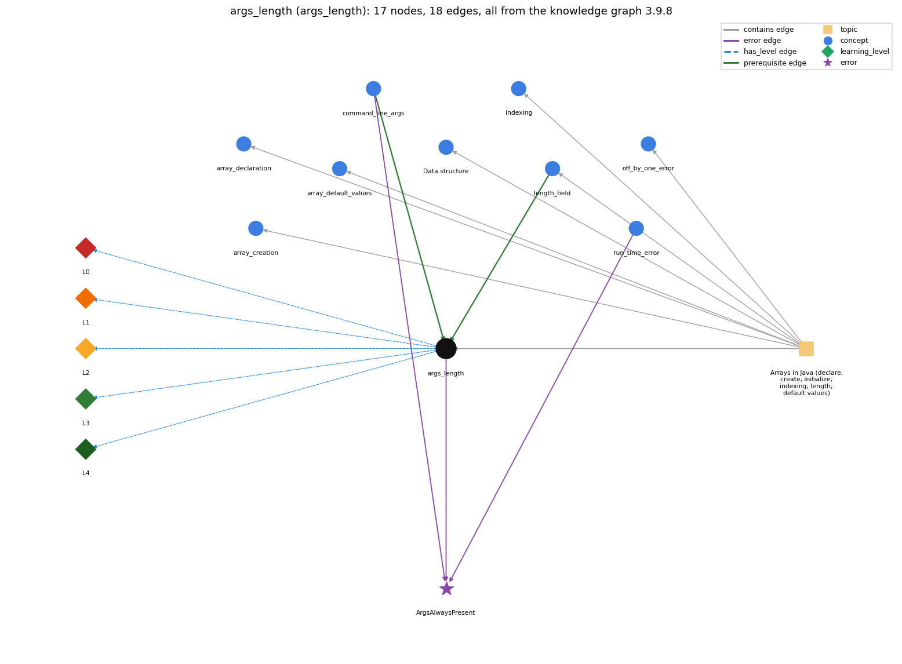

# args_length (`args_length`)

args.length gives the number of command-line arguments

Section 1.4 Arrays, topic 1.4.a Arrays in Java (declare, create, initialize; indexing; length; default values).

## At a glance

- **Needs first:** `command_line_args`, `length_field`
- **Leads to:** nothing
- **Learned alongside:** nothing
- **Misconceptions:** none
- **Errors:** `ArgsAlwaysPresent`
- **Levels:** L0, L1, L2, L3, L4

Everything below comes from the knowledge graph 3.9.8 (`data/raw/chapter1_kg_updated.json`): 18 edges around this concept, each explained in the graph's own words.

## What it needs first (2)

A prerequisite edge means the other concept has to be understood before `args_length`.

### `command_line_args` comes before `args_length`

*args[] -- strings passed at launch*

args is the array of command-line arguments.

- **Grounding:** book passage
- **How `args_length` combines with `command_line_args`:** args[i] may be read only for i &lt; args.length; with no arguments even args[0] is out of bounds.
- **How `command_line_args` combines with `args_length`:** args.length is the number of arguments typed (0 if none), so valid indices are 0 to args.length-1.

### `length_field` comes before `args_length`

*a.length is a field, not a method*

args is an ordinary String array, so args.length is its length field and counts the command-line arguments.

- **Grounding:** order only
- **How `args_length` combines with `length_field`:** args.length is the ordinary array length field applied to the String[] args.
- **How `length_field` combines with `args_length`:** args is an ordinary String[], so args.length is its length field and counts the command-line arguments (0 when none are typed).

## What it leads to (0)

These concepts need `args_length` first.

No concept has this one as a prerequisite.

## Learned alongside (0)

A parallel edge joins two concepts that sit side by side: neither is needed before the other.

No parallel edge touches this concept.

## Misconceptions (0)

A misconception edge states the wrong rule a student may hold about this concept, and the right rule.

The graph has no misconception edge from this concept.

## Errors (1)

An error edge states the rule that gets broken in a program, and the right rule.

### ArgsAlwaysPresent

- **Wrong rule:** args[0] can always be read.
- **Right rule:** If you run the program without typing the command-line argument it expects, reading args[0] fails with java.lang.ArrayIndexOutOfBoundsException: 0.
- **Role of this concept:** primary
- **Also an edge from `command_line_args`:** args[0] can always be read.
- **Also an edge from `run_time_error`:** args[0] can always be read.

## Levels L0 to L4 (5 of 5)

Each level edge lists the ways a student shows that level, each with its exact rule.

### L0: Prestructural / sensorimotor

L0 for args length: the answer holds a rule that contradicts Java.

*Deciding question: Does every rule the answer applies to args length agree with the language rule? If it reads the code with everyday meanings, applies a wrong rule, or switches rules within one trace, it is L0. A slip in an otherwise rule-correct trace is L2 with an error, not L0.*

args length -&gt; L0 (Prestructural): the answer holds a rule that contradicts Java (1 way).

- **everyday reading** (folk-meaning rule): Folk meaning: like a conversation partner, the program is thought to 'get' the input it expects; arguments are always there. Java rule: args holds exactly the strings typed after the class name, so args.length can be 0 and args[0] exists only when args.length &gt;= 1.

### L1: Unistructural / atom x text surface

L1 for args length: the answer states one correct rule without applying it.

*Deciding question: Does the answer cover every part of the code, in order, with the values (L2)? If it covers one part or only states the rule, it is L1.*

args length -&gt; L1 (Unistructural): the answer states one correct rule without applying it (2 ways).

- **names the element** (identity rule): Identity: args.length is the length field of main's String[] parameter args; it counts the command-line arguments.
- **states the rule** (declarative rule): Declarative: args is a String[] whose elements args[0] .. args[args.length-1] are the typed arguments, as strings; numbers must be converted with Integer.parseInt or Double.parseDouble.

### L2: Multistructural / block x execution / preoperational

L2 for args length: the answer applies these rules to every part of the code, in order.

*Deciding question: Is the answer many segments mapped onto lines (L2), or one segment stating the purpose of the whole (L3)? A correct output with no value-by-value justification is not levelled.*

args length -&gt; L2 (Multistructural): the answer applies the rules of args length to every part of the code, in order (3 ways).

- **line by line trace** (operational sequencing rule): Sequencing: the command line is split at whitespace, and the pieces are stored in order in args before main's first statement runs. Reading args.length then behaves like any length field.
- **output prediction** (evaluation / result rule): Result: an int equal to the number of typed arguments: 'java Max' gives 0, and 'java Max 10 -3 55 0 14' gives 5.
- **one step execution** (state-transition rule): State transition: reading args.length changes nothing; args itself is fixed for the whole run.

### L3: Relational / relations x function (concrete operational begins)

L3 for args length: the answer relates the parts by these rules.

*Deciding question: Was the purpose deduced from the code, or only guessed from traced input/output pairs (then L2)? Does the answer stay within the given code (L3), or reason about changed code, an error class or a new program (L4)?*

args length -&gt; L3 (Relational): the answer relates the parts (3 ways).

- **relation to neighbour** (composition rule (with a neighbour)): args[i] may be read only for i &lt; args.length; with no arguments even args[0] is out of bounds.
- **relation to neighbour** (composition rule (with a neighbour)): args.length is the ordinary array length field applied to the String[] args.
- **purpose of the whole** (plan / role rule): Plan/role: validate input before use (print a usage message and return when args.length is too small), or loop over a variable number of arguments.

### L4: Extended abstract (concrete-operational reversibility and conservation)

L4 for args length: the answer reasons beyond the given code by these rules.

*Deciding question: Does the answer link the code to a broader context: a changed program, a class of inputs, an unseen problem? Re-tracing changed code value by value is L2; fixing one given failing case is L3.*

args length -&gt; L4 (Extended abstract): the answer reasons beyond the given code (4 ways).

- **predict a change** (conservation rule): Conservation: extra arguments do not break code that reads args[0]; fewer arguments than the code reads break it at run time. Adding an args.length check keeps behaviour for correct input and only changes what happens for bad input.
- **diagnose an error** (error rule): rule broken: args[i] exists only if i &lt; args.length. Kind: run-time exception. Trigger class: the program is run with fewer command-line arguments than it reads, e.g. none at all (java.lang.ArrayIndexOutOfBoundsException: 0)
- **transfer to a new program** (applicability rule): Applicability: use args.length to validate or iterate over a small, variable number of command-line values. For large or open-ended input, read standard input instead.
- **diagnose an error** (error rule): rule broken: An argument is a String and must be a valid numeral to be parsed. Kind: run-time exception. Trigger class: a non-numeric argument is passed to Integer.parseInt, e.g. 'five' (NumberFormatException)

## Same topic

`args_length` belongs to the topic **Arrays in Java (declare, create, initialize; indexing; length; default values)** (`topic1.4.a`). The topic also contains: `array_creation`, `array_declaration`, `array_default_values`, `data_structure`, `indexing`, `length_field`, `off_by_one_error`.

## Rules of the concept (14)

- **folk-meaning rule:** Folk meaning: like a conversation partner, the program is thought to 'get' the input it expects; arguments are always there. Java rule: args holds exactly the strings typed after the class name, so args.length can be 0 and args[0] exists only when args.length &gt;= 1.
- **uneven-application rule:** Points to LT: args is built before main runs, and its length is fixed for the run. Inconsistent application: args[0] is read on one line, and args.length is checked only later (or never), as if checking were needed only sometimes.
- **identity rule:** Identity: args.length is the length field of main's String[] parameter args; it counts the command-line arguments.
- **declarative rule:** Declarative: args is a String[] whose elements args[0] .. args[args.length-1] are the typed arguments, as strings; numbers must be converted with Integer.parseInt or Double.parseDouble.
- **operational sequencing rule:** Sequencing: the command line is split at whitespace, and the pieces are stored in order in args before main's first statement runs. Reading args.length then behaves like any length field.
- **evaluation / result rule:** Result: an int equal to the number of typed arguments: 'java Max' gives 0, and 'java Max 10 -3 55 0 14' gives 5.
- **state-transition rule:** State transition: reading args.length changes nothing; args itself is fixed for the whole run.
- **composition rule (with a neighbour):** with command\_line\_args: args[i] may be read only for i &lt; args.length; with no arguments even args[0] is out of bounds.
- **composition rule (with a neighbour):** with length\_field: args.length is the ordinary array length field applied to the String[] args.
- **plan / role rule:** Plan/role: validate input before use (print a usage message and return when args.length is too small), or loop over a variable number of arguments.
- **conservation rule:** Conservation: extra arguments do not break code that reads args[0]; fewer arguments than the code reads break it at run time. Adding an args.length check keeps behaviour for correct input and only changes what happens for bad input.
- **error rule:** rule broken: args[i] exists only if i &lt; args.length. (run-time exception)
- **error rule:** rule broken: An argument is a String and must be a valid numeral to be parsed. (run-time exception)
- **applicability rule:** Applicability: use args.length to validate or iterate over a small, variable number of command-line values. For large or open-ended input, read standard input instead.

## The whole prerequisite chain

- **Everything it builds on (10):** `array_creation`, `array_declaration`, `array_initializer`, `class_declaration`, `command_line_args`, `data_structure`, `data_type`, `length_field`, `main_method`, `program_text`
- **Everything that builds on it (0):** nothing
