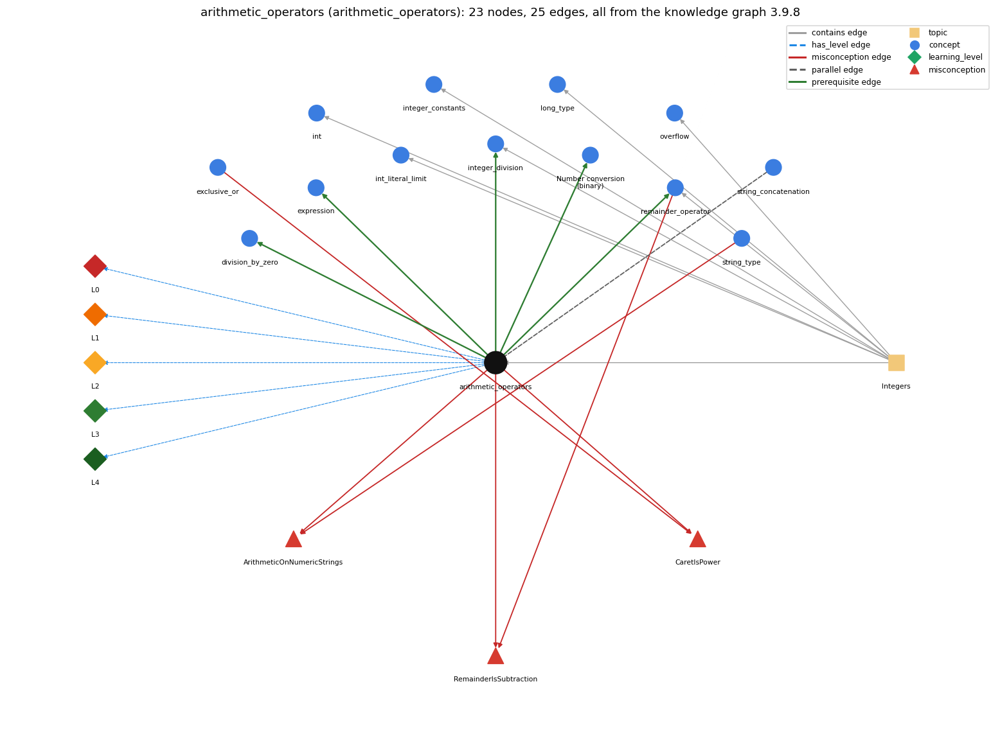

# arithmetic_operators (`arithmetic_operators`)

+ - \* / %

Section 1.2 Built-in Types of Data, topic 1.2.c Integers.

## At a glance

- **Needs first:** nothing
- **Leads to:** `division_by_zero`, `expression`, `integer_division`, `number_conversion`, `remainder_operator`
- **Learned alongside:** `string_concatenation`
- **Misconceptions:** `ArithmeticOnNumericStrings`, `CaretIsPower`, `RemainderIsSubtraction`
- **Errors:** none
- **Levels:** L0, L1, L2, L3, L4

Everything below comes from the knowledge graph 3.9.8 (`data/raw/chapter1_kg_updated.json`): 25 edges around this concept, each explained in the graph's own words.

## What it needs first (0)

A prerequisite edge means the other concept has to be understood before `arithmetic_operators`.

No prerequisite edge leads into this concept.

## What it leads to (5)

These concepts need `arithmetic_operators` first.

### `arithmetic_operators` comes before `division_by_zero`

*int division by zero throws; double division gives Infinity or NaN*

Integer division by zero (1/0) generates a run-time exception, while floating-point 1.0/0.0 is legal and has the value Infinity.

- **Grounding:** book passage
- **How `arithmetic_operators` combines with `division_by_zero`:** int / or % by zero throws a run-time exception, while floating-point division by zero gives Infinity or NaN.
- **How `division_by_zero` combines with `arithmetic_operators`:** The zero check belongs to the int / and % operators: they always produce an int except when the divisor is zero, in which case they throw; + - \* never throw.

### `arithmetic_operators` comes before `expression`

*anything that evaluates to a value*

An operator combines operand values a and b into a new value, so operators build larger expressions from smaller ones.

- **Grounding:** book passage
- **How `arithmetic_operators` combines with `expression`:** Operators build larger expressions from smaller ones, and each operand can itself be any expression.
- **How `expression` combines with `arithmetic_operators`:** Operators combine operand values into a new value, and the operand types choose the operation (int / truncates, double / does not).

### `arithmetic_operators` comes before `integer_division`

*/ on two ints truncates; % is the remainder*

For ints a and b, / gives the whole quotient q and % gives the remainder r, so that a = b \* q + r.

- **Grounding:** book passage
- **How `arithmetic_operators` combines with `integer_division`:** For ints, / gives the truncated quotient and % the remainder, so (a / b) \* b + a % b == a.
- **How `integer_division` combines with `arithmetic_operators`:** / and % on ints are paired: q = a / b and r = a % b always satisfy a = b \* q + r.

### `arithmetic_operators` comes before `number_conversion`

*Number conversion (binary): converting an integer to its binary representation by casting out powers of 2 in a loop*

Converting to binary works with powers of two, using / and % (or subtraction) on ints.

- **Grounding:** book passage

### `arithmetic_operators` comes before `remainder_operator`

*% gives the remainder of integer division*

% is one of the int arithmetic operators; it gives the remainder of the division.

- **Grounding:** book passage

## Learned alongside (1)

A parallel edge joins two concepts that sit side by side: neither is needed before the other.

### `arithmetic_operators` alongside `string_concatenation`

*+ with a String builds a new string*

+ adds when both operands are numbers and concatenates when either operand is a String, converting the other operand to a String. It is left-associative, so 1 + 2 + "3" is "33" but "1" + 2 + 3 is "123".

- **Grounding:** book passage

## Misconceptions (3)

A misconception edge states the wrong rule a student may hold about this concept, and the right rule.

### ArithmeticOnNumericStrings

- **Wrong rule:** "10" - 1 or "6" \* "2" works because the strings look like numbers.
- **Right rule:** Arithmetic operators other than + are not defined for Strings; a String of digits must first be converted to a number, e.g. with Integer.parseInt.
- **Role of this concept:** context
- **Shows at level L0 as:** misconception: wrong rule: "10" - 1 or "6" \* "2" works because the strings look like numbers. Right rule: Arithmetic operators other than + are not defined for Strings; a String of digits must first be converted to a number, e.g. with Integer.parseInt.
- **Also an edge from `string_type`:** "10" - 1 or "6" \* "2" works because the strings look like numbers.

### CaretIsPower

- **Wrong rule:** a^2 computes a squared.
- **Right rule:** Java has no exponent operator; ^ is exclusive or, and a \* a or Math.pow(a, 2) computes a squared.
- **Role of this concept:** primary
- **Shows at level L0 as:** misconception: wrong rule: a^2 computes a squared. Right rule: Java has no exponent operator; ^ is exclusive or, and a \* a or Math.pow(a, 2) computes a squared.
- **Shows at level L0 as:** inconsistent trace: Points to LT (evaluate operands, then apply the operator in the promoted type). Applied unevenly, a student uses integer division for one / and real division for another / in the same int expression. (here mixing in: "a^2 computes a squared")
- **Also an edge from `exclusive_or`:** a^2 computes a squared.

### RemainderIsSubtraction

- **Wrong rule:** 9 % 5 means 9 minus 5 (a % b subtracts b from a).
- **Right rule:** % gives the remainder after integer division: 9 % 5 is 4 because 9 = 1 \* 5 + 4, and 17 % 5 is 2, not 12.
- **Role of this concept:** context
- **Also an edge from `remainder_operator`:** 9 % 5 means 9 minus 5 (a % b subtracts b from a).

## Errors (0)

An error edge states the rule that gets broken in a program, and the right rule.

The graph has no error edge from this concept.

## Levels L0 to L4 (5 of 5)

Each level edge lists the ways a student shows that level, each with its exact rule.

### L0: Prestructural / sensorimotor

L0 for arithmetic operators: the answer holds a rule that contradicts Java.

*Deciding question: Does every rule the answer applies to arithmetic operators agree with the language rule? If it reads the code with everyday meanings, applies a wrong rule, or switches rules within one trace, it is L0. A slip in an otherwise rule-correct trace is L2 with an error, not L0.*

arithmetic operators -&gt; L0 (Prestructural): the answer holds a rule that contradicts Java (4 ways).

- **everyday reading** (folk-meaning rule): In maths notation, multiplication can be implicit (2x), ^ or a superscript means a power, ÷ is exact division, and % means percent. In Java \* must be written, / depends on the operand types, % is the remainder, and there is no power operator (^ is exclusive or).
- **misconception** (wrong rule / right rule; shows `CaretIsPower`): wrong rule: a^2 computes a squared. Right rule: Java has no exponent operator; ^ is exclusive or, and a \* a or Math.pow(a, 2) computes a squared.
- **inconsistent trace** (uneven-application rule; shows `CaretIsPower`): Points to LT (evaluate operands, then apply the operator in the promoted type). Applied unevenly, a student uses integer division for one / and real division for another / in the same int expression. (here mixing in: "a^2 computes a squared")
- **misconception** (wrong rule / right rule; shows `ArithmeticOnNumericStrings`): wrong rule: "10" - 1 or "6" \* "2" works because the strings look like numbers. Right rule: Arithmetic operators other than + are not defined for Strings; a String of digits must first be converted to a number, e.g. with Integer.parseInt.

### L1: Unistructural / atom x text surface

L1 for arithmetic operators: the answer states one correct rule without applying it.

*Deciding question: Does the answer cover every part of the code, in order, with the values (L2)? If it covers one part or only states the rule, it is L1.*

arithmetic operators -&gt; L1 (Unistructural): the answer states one correct rule without applying it (2 ways).

- **names the element** (identity rule): Arithmetic operators: the binary operators + - \* / % that combine two numeric operands into a numeric result.
- **states the rule** (declarative rule): Both operands must be numeric, and the result has the promoted type (int, long or double). \* / % bind tighter than + -, all group left to right, and int / or % by zero throws ArithmeticException. Unary minus negates its operand (-x) and unary plus leaves it unchanged; they bind more tightly than \* and /, so -a \* b is (-a) \* b.

### L2: Multistructural / block x execution / preoperational

L2 for arithmetic operators: the answer applies these rules to every part of the code, in order.

*Deciding question: Is the answer many segments mapped onto lines (L2), or one segment stating the purpose of the whole (L3)? A correct output with no value-by-value justification is not levelled.*

arithmetic operators -&gt; L2 (Multistructural): the answer applies the rules of arithmetic operators to every part of the code, in order (3 ways).

- **line by line trace** (operational sequencing rule): The left operand is evaluated fully, then the right operand, and then the operator is applied in the promoted type.
- **output prediction** (evaluation / result rule): With ints, 17 / 3 is 5 and 17 % 3 is 2. With doubles, 5.0 / 3.0 is 1.6666666666666667. With mixed operands, the int is promoted first (10 / 3.0 is 3.333...).
- **one step execution** (state-transition rule): An arithmetic operator never changes its operands. Each variable is replaced by its value, and only an assignment (or ++ or op=) stores the result.

### L3: Relational / relations x function (concrete operational begins)

L3 for arithmetic operators: the answer relates the parts by these rules.

*Deciding question: Was the purpose deduced from the code, or only guessed from traced input/output pairs (then L2)? Does the answer stay within the given code (L3), or reason about changed code, an error class or a new program (L4)?*

arithmetic operators -&gt; L3 (Relational): the answer relates the parts (5 ways).

- **relation to neighbour** (composition rule (with a neighbour)): Operators build larger expressions from smaller ones, and each operand can itself be any expression.
- **relation to neighbour** (composition rule (with a neighbour)): For ints, / gives the truncated quotient and % the remainder, so (a / b) \* b + a % b == a.
- **relation to neighbour** (composition rule (with a neighbour)): int / or % by zero throws a run-time exception, while floating-point division by zero gives Infinity or NaN.
- **relation to neighbour** (composition rule (with a neighbour)): + adds when both operands are numbers and concatenates when either operand is a String, converting the other operand to a String. It is left-associative, so 1 + 2 + "3" is "33" but "1" + 2 + 3 is "123".
- **purpose of the whole** (plan / role rule): Arithmetic operators turn formulas into code: totals, averages, unit conversions (inch \* CM\_PER\_INCH), and digit extraction (n % 10, n / 10).

### L4: Extended abstract (concrete-operational reversibility and conservation)

L4 for arithmetic operators: the answer reasons beyond the given code by these rules.

*Deciding question: Does the answer link the code to a broader context: a changed program, a class of inputs, an unseen problem? Re-tracing changed code value by value is L2; fixing one given failing case is L3.*

arithmetic operators -&gt; L4 (Extended abstract): the answer reasons beyond the given code (6 ways).

- **predict a change** (conservation rule; shows `CaretIsPower`): Changing an operand's type changes the operator's meaning (int / versus double /). Reordering \* and / changes integer results (59 \* 100 / 60 is 98, 59 / 60 \* 100 is 0). Replacing ^ with Math.pow gives a real power.
- **transfer to a new program** (applicability rule): Use the operators for arithmetic on numeric types. Use the Math library for powers, roots and absolute values, and parse numeric Strings before computing with them.
- **diagnose an error** (error rule): rule broken: int / and % by zero are undefined. Kind: run-time exception. Trigger class: A divisor that evaluates to 0 (empty count, zero input): ArithmeticException: / by zero.
- **diagnose an error** (error rule): rule broken: Arithmetic operators other than + are not defined for Strings. Kind: compile-time. Trigger class: "10" - 1 or "6" \* "2": 'bad operand types for binary operator'.
- **diagnose an error** (error rule): rule broken: ^ is not exponentiation. Kind: silent logic error. Trigger class: Writing x^2 or 10^6 for a power (10^6 is 12).
- **diagnose an error** (error rule): rule broken: int arithmetic wraps silently on overflow. Kind: silent logic error. Trigger class: Results outside the int range.

## Same topic

`arithmetic_operators` belongs to the topic **Integers** (`topic1.2.c`). The topic also contains: `int`, `int_literal_limit`, `integer_constants`, `integer_division`, `long_type`, `overflow`, `remainder_operator`.

## Rules of the concept (19)

- **folk-meaning rule:** In maths notation, multiplication can be implicit (2x), ^ or a superscript means a power, ÷ is exact division, and % means percent. In Java \* must be written, / depends on the operand types, % is the remainder, and there is no power operator (^ is exclusive or).
- **wrong rule / right rule:** CaretIsPower: wrong: a^2 computes a squared. \| right: Java has no exponent operator; ^ is exclusive or, and a \* a or Math.pow(a, 2) computes a squared.
- **wrong rule / right rule:** ArithmeticOnNumericStrings: wrong: "10" - 1 or "6" \* "2" works because the strings look like numbers. \| right: Arithmetic operators other than + are not defined for Strings; a String of digits must first be converted to a number, e.g. with Integer.parseInt.
- **uneven-application rule:** Points to LT (evaluate operands, then apply the operator in the promoted type). Applied unevenly, a student uses integer division for one / and real division for another / in the same int expression.
- **identity rule:** Arithmetic operators: the binary operators + - \* / % that combine two numeric operands into a numeric result.
- **declarative rule:** Both operands must be numeric, and the result has the promoted type (int, long or double). \* / % bind tighter than + -, all group left to right, and int / or % by zero throws ArithmeticException. Unary minus negates its operand (-x) and unary plus leaves it unchanged; they bind more tightly than \* and /, so -a \* b is (-a) \* b.
- **operational sequencing rule:** The left operand is evaluated fully, then the right operand, and then the operator is applied in the promoted type.
- **evaluation / result rule:** With ints, 17 / 3 is 5 and 17 % 3 is 2. With doubles, 5.0 / 3.0 is 1.6666666666666667. With mixed operands, the int is promoted first (10 / 3.0 is 3.333...).
- **state-transition rule:** An arithmetic operator never changes its operands. Each variable is replaced by its value, and only an assignment (or ++ or op=) stores the result.
- **composition rule (with a neighbour):** with expression: Operators build larger expressions from smaller ones, and each operand can itself be any expression.
- **composition rule (with a neighbour):** with integer\_division: For ints, / gives the truncated quotient and % the remainder, so (a / b) \* b + a % b == a.
- **composition rule (with a neighbour):** with division\_by\_zero: int / or % by zero throws a run-time exception, while floating-point division by zero gives Infinity or NaN.
- **plan / role rule:** Arithmetic operators turn formulas into code: totals, averages, unit conversions (inch \* CM\_PER\_INCH), and digit extraction (n % 10, n / 10).
- **conservation rule:** Changing an operand's type changes the operator's meaning (int / versus double /). Reordering \* and / changes integer results (59 \* 100 / 60 is 98, 59 / 60 \* 100 is 0). Replacing ^ with Math.pow gives a real power.
- **error rule:** rule broken: int / and % by zero are undefined. (run-time exception)
- **error rule:** rule broken: Arithmetic operators other than + are not defined for Strings. (compile-time)
- **error rule:** rule broken: ^ is not exponentiation. (silent logic error)
- **error rule:** rule broken: int arithmetic wraps silently on overflow. (silent logic error)
- **applicability rule:** Use the operators for arithmetic on numeric types. Use the Math library for powers, roots and absolute values, and parse numeric Strings before computing with them.

## The whole prerequisite chain

- **Everything it builds on (0):** nothing
- **Everything that builds on it (73):** `accumulator_pattern`, `animation`, `api`, `array_copy`, `array_reversal`, `array_traversal`, `boolean_expression`, `boolean_flag_array`, `break_statement`, `comparison_operators`, `compound_assignment`, `conditional_operator`, `continue_statement`, `convergence_rate`, `convergence_test`, `coordinate_scaling`, `counter_pattern`, `dangling_else`, `division_by_zero`, `do_while_loop`, `drawing_shapes`, `else_if_chain`, `enhanced_for`, `explicit_cast`, `expression`, `fencepost_loop`, `flag_search_loop`, `for_loop`, `frequency_counting`, `function_plotting`, `if_else_statement`, `if_statement`, `increment_operators`, `infinite_loop`, `integer_division`, `labeled_break`, `loop_body`, `loop_control`, `loop_invariant_reasoning`, `loop_performance`, `loop_scope`, `loop_variable`, `math_library`, `math_random`, `math_round`, `matrix_operations`, `method_call`, `monte_carlo_simulation`, `mouse_interaction`, `nested_conditionals`, `nested_loops`, `normalization`, `number_conversion`, `off_by_one_error`, `operator_precedence`, `power_method`, `random_move`, `remainder_operator`, `row_major_order`, `run_time_error`, `running_extreme`, `sampling_without_replacement`, `sentinel_loop`, `shuffle`, `side_effect_order`, `simulation_loop`, `standard_audio`, `standard_drawing`, `switch_statement`, `syntax_template`, `trig_functions`, `two_models`, `while_loop`
