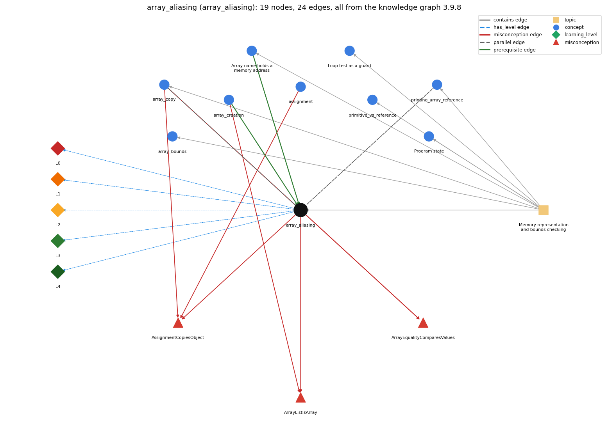

# array_aliasing (`array_aliasing`)

two variables can refer to the same array

Section 1.4 Arrays, topic 1.4.b Memory representation and bounds checking. From the knowledge graph 3.9.8 (`data/raw/chapter1_kg_updated.json`).

## Concepts associated with array\_aliasing (9)

| Concept | Description | How it is associated |
| --- | --- | --- |
| **array\_bounds** | valid indices are 0 .. length-1; otherwise throws | same topic (topic1.4.b) |
| **array\_copy** | making a second, independent array with the same elements: create a new array and copy element by element (or Arrays.copyOf) | parallel concept composition rule (R) with it shares misconception ArrayEqualityComparesValues shares misconception AssignmentCopiesObject same topic (topic1.4.b) |
| **array\_creation** | new int[n] -- allocates n slots | prerequisite of it (it needs this) composition rule (R) with it shares misconception ArrayListIsArray |
| **array\_reference** | the array variable stores the memory address (pointer) of the array; a[i] is found by adding i to that address | prerequisite of it (it needs this) same topic (topic1.4.b) |
| **assignment** | = stores the computed value of the right side | shares misconception AssignmentCopiesObject |
| **loop\_guard** | putting the bounds check in the loop condition so the body never makes an out-of-bounds array access | same topic (topic1.4.b) |
| **primitive\_vs\_reference** | a primitive variable holds its value; an array (or String) variable holds a reference to the object stored elsewhere | same topic (topic1.4.b) |
| **printing\_array\_reference** | printing an array variable prints a reference, not the elements | parallel concept composition rule (R) with it same topic (topic1.4.b) |
| **program\_state** | the information needed to know what a program will do next: the values of its variables and array entries and the next statement | same topic (topic1.4.b) |

## Every edge in this view and its full label (24)

| From | Edge | To | Full edge label |
| --- | --- | --- | --- |
| **array\_creation** | prerequisite | **array\_aliasing** | Because new creates one array and the variable stores only a reference to it, assigning that variable to another makes both names refer to the same array. grounding: book\_passage composition rule (R) of array\_creation with array\_aliasing: Only new makes a distinct array. Assignment copies the reference, so a separate copy needs new plus an element-by-element copy. composition rule (R) of array\_aliasing with array\_creation: Only new creates a distinct array; to copy, create a new array and copy each element (or use Arrays.copyOf). |
| **array\_reference** | prerequisite | **array\_aliasing** | Because an array variable holds a reference, b = a copies the reference, so a and b name the same array. grounding: book\_passage |
| **array\_aliasing** | parallel | **printing\_array\_reference** | Both follow from the array variable holding a reference (memory address): assignment and == act on that reference, and println(a) prints it. grounding: questionable composition rule (R) of array\_aliasing with printing\_array\_reference: Assignment, == and println(a) all act on the reference value: two aliases print the same address, while two equal-content arrays print different ones. composition rule (R) of printing\_array\_reference with array\_aliasing: Two aliases print the same text, and two separately created arrays with equal contents print different text, because println shows the reference that assignment and == also act on. |
| **array\_copy** | parallel | **array\_aliasing** | b = a makes a second name for the same array (an alias); copying makes a second array: after a copy, changing b[i] leaves a[i] unchanged. grounding: book\_passage composition rule (R) of array\_copy with array\_aliasing: b = a makes an alias of the same array; a copy is a different array: changes through one are not seen through the other. |
| **array\_aliasing** | misconception | **ArrayEqualityComparesValues** | **wrong rule:** a == b is true when a and b hold the same values. **right rule:** == compares whether the two arrays are the same array, not whether their values are equal. role: primary |
| **array\_aliasing** | misconception | **ArrayListIsArray** | **wrong rule:** An ArrayList is just an array, so it has a fixed length and is indexed with []. **right rule:** An array has a fixed length and uses [] and .length; an ArrayList can grow and uses get, set and size(). role: context |
| **array\_aliasing** | misconception | **AssignmentCopiesObject** | **wrong rule:** assigning a reference copies the object **right rule:** b = a; copies only the reference, so a and b refer to the same array and b[i] = v also changes a[i]. role: primary |
| **array\_copy** | misconception | **ArrayEqualityComparesValues** | **wrong rule:** a == b is true when a and b hold the same values. **right rule:** == compares whether the two arrays are the same array, not whether their values are equal. role: context |
| **array\_copy** | misconception | **AssignmentCopiesObject** | **wrong rule:** assigning a reference copies the object **right rule:** b = a; copies only the reference, so a and b refer to the same array and b[i] = v also changes a[i]. role: context |
| **array\_creation** | misconception | **ArrayListIsArray** | **wrong rule:** an ArrayList is an array (borderline; beyond Chapter 1 CS1) **right rule:** An array has a fixed length and uses [] and .length; an ArrayList can grow and uses get, set and size(). role: primary |
| **assignment** | misconception | **AssignmentCopiesObject** | **wrong rule:** b = a; for an array makes b a separate copy, so changing b[i] leaves a[i] unchanged. **right rule:** b = a; copies only the reference, so a and b refer to the same array and b[i] = v also changes a[i]. role: context |
| **array\_aliasing** | has\_level | **array\_aliasing@L0** | array aliasing -&gt; L0 (Prestructural): the answer holds a rule that contradicts Java (4 ways). **[0] everyday\_reading** (E): Folk meaning: in maths and English, 'b = a' means b becomes an equal but independent copy, and 'a == b' means 'have the same values'. Java rule: for arrays, b = a copies only the reference, so both names denote one array, and == tests whether two names refer to the same array. **[1] misconception** (M) &rarr; ArrayEqualityComparesValues: wrong rule: a == b is true when a and b hold the same values. Right rule: == compares whether a and b are the same array (same reference), not whether their elements are equal. **[2] misconception** (M) &rarr; AssignmentCopiesObject: wrong rule: Assigning an array reference copies the array. Right rule: b = a; copies only the reference, so a and b refer to the same array and b[i] = v also changes a[i]. **[3] inconsistent\_trace** (T) &rarr; ArrayEqualityComparesValues: Points to LT: b = a copies the reference, so every later write through b is a write to the shared array. Inconsistent application: after b = a the trace changes b[0] but leaves a[0] unchanged in its table, keeping two copies on some steps and one array on others. (here mixing in: "a == b is true when a and b hold the same values") |
| **array\_aliasing** | has\_level | **array\_aliasing@L1** | array aliasing -&gt; L1 (Unistructural): the answer states one correct rule without applying it (2 ways). **[0] names\_the\_element** (N): Identity: aliasing is the situation in which two or more array variables refer to the same array object. **[1] states\_the\_rule** (S): Declarative: an assignment makes the names a and b refer to the same array; an equality test a == b checks whether the two names refer to the same array. |
| **array\_aliasing** | has\_level | **array\_aliasing@L2** | array aliasing -&gt; L2 (Multistructural): the answer applies the rules of array aliasing to every part of the code, in order (3 ways). **[0] line\_by\_line\_trace** (LT): Sequencing: in b = a, a is evaluated to its reference value, which is then stored in b; no element is read or copied. In a == b both reference values are evaluated and compared. **[1] output\_prediction** (OP): Result: for int[] a = {1, 2, 3}; int[] b = {1, 2, 3};, the test a == b is false; after b = a it is true. A read through either name gives the same element. **[2] one\_step\_execution** (OS): State transition: b = a changes only the variable b (it now holds a's reference). A later b[0] = 17 changes the one shared array, so a[0] then reads 17 too. |
| **array\_aliasing** | has\_level | **array\_aliasing@L3** | array aliasing -&gt; L3 (Relational): the answer relates the parts (4 ways). **[0] relation\_to\_neighbour** (R): Only new creates a distinct array; to copy, create a new array and copy each element (or use Arrays.copyOf). **[1] relation\_to\_neighbour** (R): Assignment, == and println(a) all act on the reference value: two aliases print the same address, while two equal-content arrays print different ones. **[2] relation\_to\_neighbour** (R): b = a makes a second name for the same array (an alias); copying makes a second array: after a copy, changing b[i] leaves a[i] unchanged. **[3] purpose\_of\_the\_whole** (P): Plan/role: aliasing lets two names work on one array without copying (as when an array is passed to a method), but in Chapter 1 code it is mostly a source of subtle bugs. |
| **array\_aliasing** | has\_level | **array\_aliasing@L4** | array aliasing -&gt; L4 (Extended abstract): the answer reasons beyond the given code (4 ways). **[0] predict\_a\_change** (C) &rarr; ArrayEqualityComparesValues: Conservation: replacing b = a with an element-copy loop keeps b's initial contents but breaks the link, so later changes to a no longer show in b. Reassigning a = new int[n] after b = a leaves b on the old array. **[1] transfer\_to\_a\_new\_program** (X): Applicability: assign an array variable when you want a second name for the same data. Use a copy loop or Arrays.copyOf for an independent copy, and an element loop or Arrays.equals to compare contents. **[2] diagnose\_an\_error** (D): rule broken: Assignment copies the reference, not the elements. Kind: silent logic error. Trigger class: b = a is used as a 'copy', and then b is modified while a is expected to stay unchanged (or the reverse) **[3] diagnose\_an\_error** (D): rule broken: == on arrays compares references, not contents. Kind: silent logic error. Trigger class: two separately created arrays with equal elements are compared with == (always false) |
| **topic1.4.b** | contains | **array\_aliasing** | topic topic1.4.b contains array\_aliasing |
| **topic1.4.b** | contains | **array\_bounds** | topic topic1.4.b contains array\_bounds |
| **topic1.4.b** | contains | **array\_copy** | topic topic1.4.b contains array\_copy |
| **topic1.4.b** | contains | **array\_reference** | topic topic1.4.b contains array\_reference |
| **topic1.4.b** | contains | **loop\_guard** | topic topic1.4.b contains loop\_guard |
| **topic1.4.b** | contains | **primitive\_vs\_reference** | topic topic1.4.b contains primitive\_vs\_reference |
| **topic1.4.b** | contains | **printing\_array\_reference** | topic topic1.4.b contains printing\_array\_reference |
| **topic1.4.b** | contains | **program\_state** | topic topic1.4.b contains program\_state |
