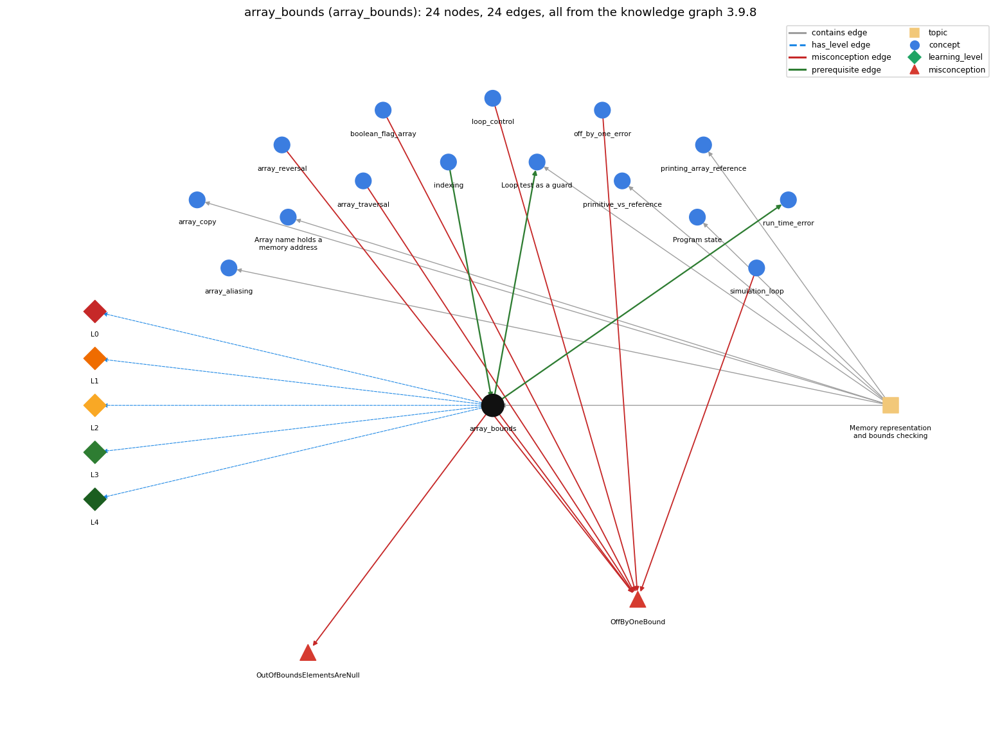

# array_bounds (`array_bounds`)

valid indices are 0 .. length-1; otherwise throws

Section 1.4 Arrays, topic 1.4.b Memory representation and bounds checking. From the knowledge graph 3.9.8 (`data/raw/chapter1_kg_updated.json`).

## Concepts associated with array\_bounds (15)

| Concept | Description | How it is associated |
| --- | --- | --- |
| **array\_aliasing** | two variables can refer to the same array | same topic (topic1.4.b) |
| **array\_copy** | making a second, independent array with the same elements: create a new array and copy element by element (or Arrays.copyOf) | same topic (topic1.4.b) |
| **array\_reference** | the array variable stores the memory address (pointer) of the array; a[i] is found by adding i to that address | same topic (topic1.4.b) |
| **array\_reversal** | reversing an array in place | shares misconception OffByOneBound |
| **array\_traversal** | walking the array with an index loop | shares misconception OffByOneBound |
| **boolean\_flag\_array** | boolean[] used to mark which values are seen (coupon collector, sieve) | shares misconception OffByOneBound |
| **indexing** | a[i] -- 0-based access | prerequisite of it (it needs this) composition rule (R) with it |
| **loop\_control** | the three slots: init ; condition ; update | shares misconception OffByOneBound |
| **loop\_guard** | putting the bounds check in the loop condition so the body never makes an out-of-bounds array access | builds on it (needs it) composition rule (R) with it same topic (topic1.4.b) |
| **off\_by\_one\_error** | a loop or index that runs one time too many or too few (&lt; vs &lt;=, 0..n vs 1..n, length vs length-1) | shares misconception OffByOneBound |
| **primitive\_vs\_reference** | a primitive variable holds its value; an array (or String) variable holds a reference to the object stored elsewhere | same topic (topic1.4.b) |
| **printing\_array\_reference** | printing an array variable prints a reference, not the elements | same topic (topic1.4.b) |
| **program\_state** | the information needed to know what a program will do next: the values of its variables and array entries and the next statement | same topic (topic1.4.b) |
| **run\_time\_error** | an error raised while the program executes (e.g. ArrayIndexOutOfBounds, NumberFormatException) | builds on it (needs it) |
| **simulation\_loop** | take many random steps | shares misconception OffByOneBound |

## Every edge in this view and its full label (24)

| From | Edge | To | Full edge label |
| --- | --- | --- | --- |
| **array\_bounds** | prerequisite | **loop\_guard** | Because an out-of-bounds index stops the program, the while test checks the bounds before the body uses the index. grounding: book\_passage composition rule (R) of array\_bounds with loop\_guard: Because an out-of-bounds index stops the program, the loop test checks the bounds before the body uses the index (e.g. x &gt; 0 &amp;&amp; x &lt; N-1 before a[x-1], a[x+1]). composition rule (R) of loop\_guard with array\_bounds: Because an out-of-bounds index stops the program, the guard tests the bounds before the body uses the index, and it must cover every neighbour index (x-1, x+1) the body reads. |
| **array\_bounds** | prerequisite | **run\_time\_error** | An index outside 0 .. length-1 is not caught by the compiler; the access is checked when the program runs and stops it with ArrayIndexOutOfBoundsException. grounding: book\_passage |
| **indexing** | prerequisite | **array\_bounds** | Valid indexes run from 0 to a.length - 1; any other index throws an exception when it is used. grounding: book\_passage composition rule (R) of indexing with array\_bounds: Every index value is checked against 0 and a.length at run time; any other value throws. composition rule (R) of array\_bounds with indexing: Every index value used in a[i] must satisfy 0 &lt;= i &lt;= a.length-1; the last element is a[a.length-1]. |
| **array\_bounds** | misconception | **OffByOneBound** | **wrong rule:** &lt; vs &lt;= and 0..n vs 0..n-1 are interchangeable **right rule:** for (i = 0; i &lt; n; i++) runs n times with i going up to n - 1; with &lt;= it runs n + 1 times and reaches i = n. role: context |
| **array\_bounds** | misconception | **OutOfBoundsElementsAreNull** | **wrong rule:** Reading a[a.length] just gives null or 0. **right rule:** Reading any index outside 0 to a.length - 1 throws ArrayIndexOutOfBoundsException. role: primary |
| **array\_reversal** | misconception | **OffByOneBound** | **wrong rule:** &lt; vs &lt;= and 0..n vs 0..n-1 are interchangeable **right rule:** for (i = 0; i &lt; n; i++) runs n times with i going up to n - 1; with &lt;= it runs n + 1 times and reaches i = n. role: context |
| **array\_traversal** | misconception | **OffByOneBound** | **wrong rule:** &lt; vs &lt;= and 0..n vs 0..n-1 are interchangeable **right rule:** for (i = 0; i &lt; n; i++) runs n times with i going up to n - 1; with &lt;= it runs n + 1 times and reaches i = n. role: context |
| **boolean\_flag\_array** | misconception | **OffByOneBound** | **wrong rule:** &lt; vs &lt;= and 0..n vs 0..n-1 are interchangeable **right rule:** for (i = 0; i &lt; n; i++) runs n times with i going up to n - 1; with &lt;= it runs n + 1 times and reaches i = n. role: context |
| **loop\_control** | misconception | **OffByOneBound** | **wrong rule:** i &lt; n and i &lt;= n mean the same, so the loop runs until i equals n and the last pass can use a[n]. **right rule:** for (i = 0; i &lt; n; i++) runs n times with i going up to n - 1; with &lt;= it runs n + 1 times and reaches i = n. role: primary |
| **off\_by\_one\_error** | misconception | **OffByOneBound** | **wrong rule:** &lt; vs &lt;= and 0..n vs 0..n-1 are interchangeable **right rule:** for (i = 0; i &lt; n; i++) runs n times with i going up to n - 1; with &lt;= it runs n + 1 times and reaches i = n. role: context |
| **simulation\_loop** | misconception | **OffByOneBound** | **wrong rule:** t &lt; T and t &lt;= T give the same number of moves. **right rule:** for (t = 0; t &lt; T; t++) makes exactly T moves; with &lt;= it makes T + 1. role: context |
| **array\_bounds** | has\_level | **array\_bounds@L0** | array bounds -&gt; L0 (Prestructural): the answer holds a rule that contradicts Java (4 ways). **[0] everyday\_reading** (E): Folk meaning: in English, 'items 1 to 10' or 'up to n' includes the end point, and reading past the end of a list just gives 'nothing'. Java rule: the legal indices are 0..length-1, and any other index throws ArrayIndexOutOfBoundsException instead of returning a value. **[1] misconception** (M) &rarr; OutOfBoundsElementsAreNull: wrong rule: An out-of-bounds read returns null (or 0). Right rule: Reading or writing any index outside 0 to a.length - 1 throws ArrayIndexOutOfBoundsException and returns no value. **[2] inconsistent\_trace** (T) &rarr; OutOfBoundsElementsAreNull: Points to LT: the bounds check runs at every access, at run time. Inconsistent application: the trace accepts an index of a.length on the last pass (or -1 on the first) but rejects it elsewhere, or reads 'some value' there. (here mixing in: "an out-of-bounds read returns null (it throws)") **[3] misconception** (M) &rarr; OffByOneBound: wrong rule: &lt; vs &lt;= and 0..n vs 0..n-1 are interchangeable. Right rule: for (i = 0; i &lt; n; i++) runs n times with i going up to n - 1; with &lt;= it runs n + 1 times and reaches i = n, which is out of bounds for an array of length n. |
| **array\_bounds** | has\_level | **array\_bounds@L1** | array bounds -&gt; L1 (Unistructural): the answer states one correct rule without applying it (2 ways). **[0] names\_the\_element** (N): Identity: the bounds of an array are its legal index range, 0 to length-1. **[1] states\_the\_rule** (S): Declarative: an index less than 0 or greater than length-1 makes the program terminate with an ArrayIndexOutOfBoundsException; it is the programmer's responsibility to use legal indices. |
| **array\_bounds** | has\_level | **array\_bounds@L2** | array bounds -&gt; L2 (Multistructural): the answer applies the rules of array bounds to every part of the code, in order (3 ways). **[0] line\_by\_line\_trace** (LT): Sequencing: at each access the index expression is evaluated first and then compared with 0 and a.length. Only if it is in range is the element read or written; otherwise the exception is thrown before any element changes. **[1] output\_prediction** (OP): Result: a legal access yields the element. An illegal one yields no value; the program stops with ArrayIndexOutOfBoundsException naming the bad index (old JVMs print ': 10', current ones 'Index 10 out of bounds for length 10'). **[2] one\_step\_execution** (OS): State transition: an out-of-bounds write changes no element, because the exception is raised before the store. Control leaves the statement, and main terminates unless the exception is caught. |
| **array\_bounds** | has\_level | **array\_bounds@L3** | array bounds -&gt; L3 (Relational): the answer relates the parts (3 ways). **[0] relation\_to\_neighbour** (R): Every index value used in a[i] must satisfy 0 &lt;= i &lt;= a.length-1; the last element is a[a.length-1]. **[1] relation\_to\_neighbour** (R): Because an out-of-bounds index stops the program, the loop test checks the bounds before the body uses the index (e.g. x &gt; 0 &amp;&amp; x &lt; N-1 before a[x-1], a[x+1]). **[2] purpose\_of\_the\_whole** (P): Plan/role: run-time bounds checking makes an indexing mistake a visible error instead of silent memory corruption (buffer overflow). |
| **array\_bounds** | has\_level | **array\_bounds@L4** | array bounds -&gt; L4 (Extended abstract): the answer reasons beyond the given code (4 ways). **[0] predict\_a\_change** (C) &rarr; OutOfBoundsElementsAreNull: Conservation: a loop bounded by i &lt; a.length stays within bounds when the array size changes. Changing &lt; to &lt;= adds one pass that throws, and starting at 1 or ending at a.length-1 silently skips an element. **[1] transfer\_to\_a\_new\_program** (X): Applicability: check indices explicitly (or restrict the loop range) whenever an index is computed from data, a random number or a neighbour (i-1, i+1). A plain i &lt; a.length traversal or an enhanced for loop needs no extra check. **[2] diagnose\_an\_error** (D): rule broken: Indices must be in 0..a.length-1. Kind: run-time exception. Trigger class: index &gt;= a.length or &lt; 0: i &lt;= a.length, a[i+1] on the last pass, a[i-1] at i = 0, a[0] on an empty array, or the Sample program run with M &gt; N (ArrayIndexOutOfBoundsException) **[3] diagnose\_an\_error** (D): rule broken: A traversal must reach the last valid index a.length-1. Kind: silent logic error. Trigger class: the loop stops one short (i &lt; a.length-1) or starts at 1, so the last or first element is never processed |
| **topic1.4.b** | contains | **array\_aliasing** | topic topic1.4.b contains array\_aliasing |
| **topic1.4.b** | contains | **array\_bounds** | topic topic1.4.b contains array\_bounds |
| **topic1.4.b** | contains | **array\_copy** | topic topic1.4.b contains array\_copy |
| **topic1.4.b** | contains | **array\_reference** | topic topic1.4.b contains array\_reference |
| **topic1.4.b** | contains | **loop\_guard** | topic topic1.4.b contains loop\_guard |
| **topic1.4.b** | contains | **primitive\_vs\_reference** | topic topic1.4.b contains primitive\_vs\_reference |
| **topic1.4.b** | contains | **printing\_array\_reference** | topic topic1.4.b contains printing\_array\_reference |
| **topic1.4.b** | contains | **program\_state** | topic topic1.4.b contains program\_state |
