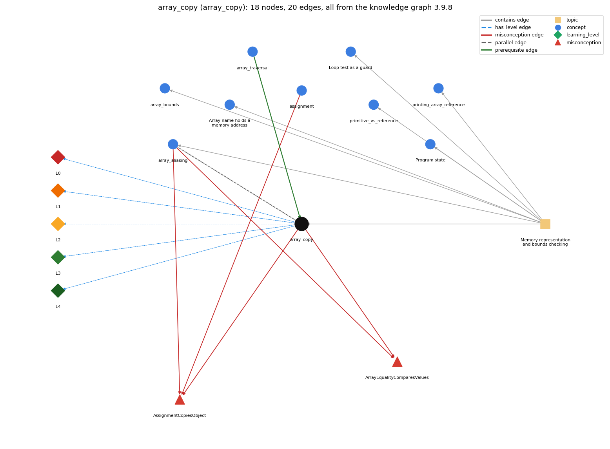

# array_copy (`array_copy`)

making a second, independent array with the same elements: create a new array and copy element by element (or Arrays.copyOf)

Section 1.4 Arrays, topic 1.4.b Memory representation and bounds checking.

## At a glance

- **Needs first:** `array_traversal`
- **Leads to:** nothing
- **Learned alongside:** `array_aliasing`
- **Misconceptions:** `ArrayEqualityComparesValues`, `AssignmentCopiesObject`
- **Errors:** none
- **Levels:** L0, L1, L2, L3, L4

Everything below comes from the knowledge graph 3.9.8 (`data/raw/chapter1_kg_updated.json`): 20 edges around this concept, each explained in the graph's own words.

## What it needs first (1)

A prerequisite edge means the other concept has to be understood before `array_copy`.

### `array_traversal` comes before `array_copy`

*walking the array with an index loop*

The elements are copied one at a time by a loop over every index.

- **Grounding:** book passage
- **How `array_copy` combines with `array_traversal`:** The copy is a traversal of every index of the original.

## What it leads to (0)

These concepts need `array_copy` first.

No concept has this one as a prerequisite.

## Learned alongside (1)

A parallel edge joins two concepts that sit side by side: neither is needed before the other.

### `array_copy` alongside `array_aliasing`

*two variables can refer to the same array*

b = a makes a second name for the same array (an alias); copying makes a second array: after a copy, changing b[i] leaves a[i] unchanged.

- **Grounding:** book passage
- **How `array_copy` combines with `array_aliasing`:** b = a makes an alias of the same array; a copy is a different array: changes through one are not seen through the other.

## Misconceptions (2)

A misconception edge states the wrong rule a student may hold about this concept, and the right rule.

### ArrayEqualityComparesValues

- **Wrong rule:** a == b is true when a and b hold the same values.
- **Right rule:** == compares whether the two arrays are the same array, not whether their values are equal.
- **Role of this concept:** context
- **Shows at level L0 as:** misconception: wrong rule: a == b is true when a and b hold the same values. Right rule: == compares whether a and b are the same array, so a copy and its original are not ==, even with equal elements.
- **Also an edge from `array_aliasing`:** a == b is true when a and b hold the same values.

### AssignmentCopiesObject

- **Wrong rule:** assigning a reference copies the object
- **Right rule:** b = a; copies only the reference, so a and b refer to the same array and b[i] = v also changes a[i].
- **Role of this concept:** context
- **Shows at level L0 as:** misconception: wrong rule: Assigning an array reference copies the array. Right rule: b = a copies only the reference, so a and b refer to the same array; to copy, create a new array and copy each element.
- **Shows at level L0 as:** inconsistent trace: Applies the copy rule unevenly: copies element by element in one place but writes b = a in another and expects b to be independent. (here mixing in: "assigning a reference copies the object")
- **Also an edge from `array_aliasing`:** assigning a reference copies the object
- **Also an edge from `assignment`:** b = a; for an array makes b a separate copy, so changing b[i] leaves a[i] unchanged.

## Errors (0)

An error edge states the rule that gets broken in a program, and the right rule.

The graph has no error edge from this concept.

## Levels L0 to L4 (5 of 5)

Each level edge lists the ways a student shows that level, each with its exact rule.

### L0: Prestructural / sensorimotor

L0 for array copy: the answer holds a rule that contradicts Java.

*Deciding question: Does every rule the answer applies to array copy agree with the language rule? If it reads the code with everyday meanings, applies a wrong rule, or switches rules within one trace, it is L0. A slip in an otherwise rule-correct trace is L2 with an error, not L0.*

array copy -&gt; L0 (Prestructural): the answer holds a rule that contradicts Java (4 ways).

- **everyday reading** (folk-meaning rule): Everyday 'copy' (b = a, like copying a value onto paper) suggests a second, separate thing. For arrays, b = a only copies the reference; a separate copy needs a new array with each element copied.
- **misconception** (wrong rule / right rule; shows `AssignmentCopiesObject`): wrong rule: Assigning an array reference copies the array. Right rule: b = a copies only the reference, so a and b refer to the same array; to copy, create a new array and copy each element.
- **inconsistent trace** (uneven-application rule; shows `AssignmentCopiesObject`): Applies the copy rule unevenly: copies element by element in one place but writes b = a in another and expects b to be independent. (here mixing in: "assigning a reference copies the object")
- **misconception** (wrong rule / right rule; shows `ArrayEqualityComparesValues`): wrong rule: a == b is true when a and b hold the same values. Right rule: == compares whether a and b are the same array, so a copy and its original are not ==, even with equal elements.

### L1: Unistructural / atom x text surface

L1 for array copy: the answer states one correct rule without applying it.

*Deciding question: Does the answer cover every part of the code, in order, with the values (L2)? If it covers one part or only states the rule, it is L1.*

array copy -&gt; L1 (Unistructural): the answer states one correct rule without applying it (2 ways).

- **names the element** (identity rule): Array copy: a second, independent array holding the same elements as the first.
- **states the rule** (declarative rule): To copy an array, create a new array of the same length and copy the elements one by one: double[] b = new double[N]; for (int i = 0; i &lt; N; i++) b[i] = a[i]; (java.util.Arrays.copyOf does the same).

### L2: Multistructural / block x execution / preoperational

L2 for array copy: the answer applies these rules to every part of the code, in order.

*Deciding question: Is the answer many segments mapped onto lines (L2), or one segment stating the purpose of the whole (L3)? A correct output with no value-by-value justification is not levelled.*

array copy -&gt; L2 (Multistructural): the answer applies the rules of array copy to every part of the code, in order (3 ways).

- **line by line trace** (operational sequencing rule): Sequencing: new creates the second array first, then the loop copies a[0], a[1], ... in order into b[0], b[1], ...; after the loop, a and b are separate arrays with equal elements.
- **output prediction** (evaluation / result rule): Result: after copying, b[i] == a[i] for every i, but a == b is false; after b[0] = 9, a[0] is unchanged.
- **one step execution** (state-transition rule): State transition: each pass of the copy loop sets one element of the new array and leaves the original unchanged.

### L3: Relational / relations x function (concrete operational begins)

L3 for array copy: the answer relates the parts by these rules.

*Deciding question: Was the purpose deduced from the code, or only guessed from traced input/output pairs (then L2)? Does the answer stay within the given code (L3), or reason about changed code, an error class or a new program (L4)?*

array copy -&gt; L3 (Relational): the answer relates the parts (3 ways).

- **relation to neighbour** (composition rule (with a neighbour)): The copy is a traversal of every index of the original.
- **relation to neighbour** (composition rule (with a neighbour)): b = a makes an alias of the same array; a copy is a different array: changes through one are not seen through the other.
- **purpose of the whole** (plan / role rule): Plan: copy an array when the original must stay unchanged while the copy is modified (for example shuffling or sorting a copy).

### L4: Extended abstract (concrete-operational reversibility and conservation)

L4 for array copy: the answer reasons beyond the given code by these rules.

*Deciding question: Does the answer link the code to a broader context: a changed program, a class of inputs, an unseen problem? Re-tracing changed code value by value is L2; fixing one given failing case is L3.*

array copy -&gt; L4 (Extended abstract): the answer reasons beyond the given code (3 ways).

- **predict a change** (conservation rule; shows `AssignmentCopiesObject`): Conservation: changing the copy never changes the original, and the reverse; with an alias every change is shared.
- **transfer to a new program** (applicability rule): When an algorithm must change an array but the original is still needed, work on a copy made with new and a loop (or Arrays.copyOf).
- **diagnose an error** (error rule): rule broken: Assignment copies the reference, not the elements. Kind: silent logic error. Trigger class: b = a is used as a copy and then b is modified while a is expected to stay unchanged

## Same topic

`array_copy` belongs to the topic **Memory representation and bounds checking** (`topic1.4.b`). The topic also contains: `array_aliasing`, `array_bounds`, `array_reference`, `loop_guard`, `primitive_vs_reference`, `printing_array_reference`, `program_state`.

## Rules of the concept (15)

- **folk-meaning rule:** Everyday 'copy' (b = a, like copying a value onto paper) suggests a second, separate thing. For arrays, b = a only copies the reference; a separate copy needs a new array with each element copied.
- **wrong rule / right rule:** AssignmentCopiesObject: wrong: Assigning an array reference copies the array. \| right: b = a copies only the reference, so a and b refer to the same array; to copy, create a new array and copy each element.
- **wrong rule / right rule:** ArrayEqualityComparesValues: wrong: a == b is true when a and b hold the same values. \| right: == compares whether a and b are the same array, so a copy and its original are not ==, even with equal elements.
- **uneven-application rule:** Applies the copy rule unevenly: copies element by element in one place but writes b = a in another and expects b to be independent.
- **identity rule:** Array copy: a second, independent array holding the same elements as the first.
- **declarative rule:** To copy an array, create a new array of the same length and copy the elements one by one: double[] b = new double[N]; for (int i = 0; i &lt; N; i++) b[i] = a[i]; (java.util.Arrays.copyOf does the same).
- **operational sequencing rule:** Sequencing: new creates the second array first, then the loop copies a[0], a[1], ... in order into b[0], b[1], ...; after the loop, a and b are separate arrays with equal elements.
- **evaluation / result rule:** Result: after copying, b[i] == a[i] for every i, but a == b is false; after b[0] = 9, a[0] is unchanged.
- **state-transition rule:** State transition: each pass of the copy loop sets one element of the new array and leaves the original unchanged.
- **composition rule (with a neighbour):** with array\_traversal: The copy is a traversal of every index of the original.
- **composition rule (with a neighbour):** with array\_aliasing: b = a makes an alias of the same array; a copy is a different array: changes through one are not seen through the other.
- **plan / role rule:** Plan: copy an array when the original must stay unchanged while the copy is modified (for example shuffling or sorting a copy).
- **conservation rule:** Conservation: changing the copy never changes the original, and the reverse; with an alias every change is shared.
- **error rule:** rule broken: Assignment copies the reference, not the elements. (silent logic error)
- **applicability rule:** When an algorithm must change an array but the original is still needed, work on a copy made with new and a loop (or Arrays.copyOf).

## The whole prerequisite chain

- **Everything it builds on (23):** `arithmetic_operators`, `array_creation`, `array_declaration`, `array_initializer`, `array_traversal`, `boolean`, `boolean_expression`, `comparison_operators`, `data_structure`, `data_type`, `do_while_loop`, `expression`, `for_loop`, `identifier`, `indexing`, `length_field`, `literal`, `logical_operators`, `loop_control`, `loop_variable`, `primitive_type`, `variable`, `while_loop`
- **Everything that builds on it (0):** nothing
