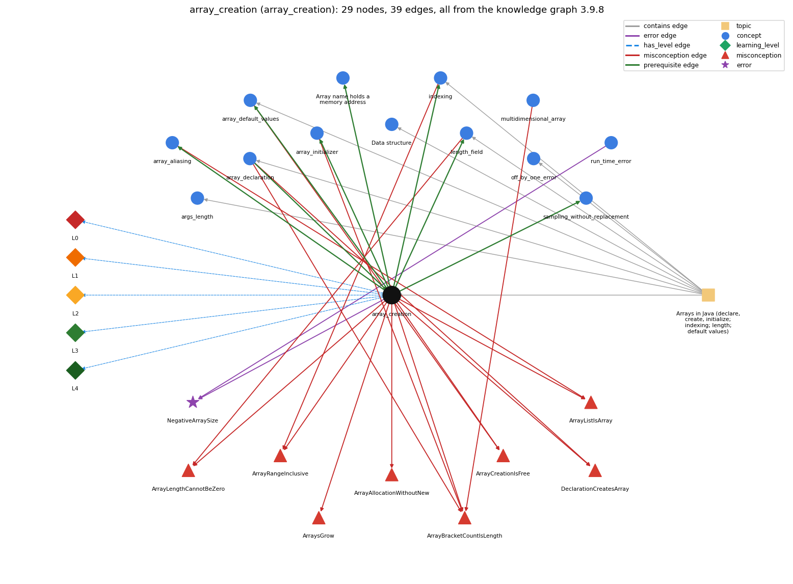

# array_creation (`array_creation`)

new int[n] -- allocates n slots

Section 1.4 Arrays, topic 1.4.a Arrays in Java (declare, create, initialize; indexing; length; default values). From the knowledge graph 3.9.8 (`data/raw/chapter1_kg_updated.json`).

## Concepts associated with array\_creation (13)

| Concept | Description | How it is associated |
| --- | --- | --- |
| **args\_length** | args.length gives the number of command-line arguments | same topic (topic1.4.a) |
| **array\_aliasing** | two variables can refer to the same array | builds on it (needs it) composition rule (R) with it shares misconception ArrayListIsArray |
| **array\_declaration** | int[] a; -- declares an array variable | prerequisite of it (it needs this) composition rule (R) with it shares misconception DeclarationCreatesArray shares misconception ArrayBracketCountIsLength same topic (topic1.4.a) |
| **array\_default\_values** | new slots start at 0 / false / null | builds on it (needs it) composition rule (R) with it shares misconception ArrayCreationIsFree same topic (topic1.4.a) |
| **array\_initializer** | {1, 2, 3} literal initialization | builds on it (needs it) composition rule (R) with it shares misconception ArrayBracketCountIsLength |
| **array\_reference** | the array variable stores the memory address (pointer) of the array; a[i] is found by adding i to that address | builds on it (needs it) composition rule (R) with it |
| **data\_structure** | a method for organizing data; the one-dimensional array is the first example | same topic (topic1.4.a) |
| **indexing** | a[i] -- 0-based access | builds on it (needs it) composition rule (R) with it shares misconception ArrayRangeInclusive same topic (topic1.4.a) |
| **length\_field** | a.length is a field, not a method | builds on it (needs it) composition rule (R) with it shares misconception ArrayLengthCannotBeZero same topic (topic1.4.a) |
| **multidimensional\_array** | arrays with three or more indices | shares misconception ArrayBracketCountIsLength |
| **off\_by\_one\_error** | a loop or index that runs one time too many or too few (&lt; vs &lt;=, 0..n vs 1..n, length vs length-1) | same topic (topic1.4.a) |
| **run\_time\_error** | an error raised while the program executes (e.g. ArrayIndexOutOfBounds, NumberFormatException) | shares error NegativeArraySize |
| **sampling\_without\_replacement** | choosing m distinct items at random | builds on it (needs it) |

## Every edge in this view and its full label (39)

| From | Edge | To | Full edge label |
| --- | --- | --- | --- |
| **array\_creation** | prerequisite | **array\_aliasing** | Because new creates one array and the variable stores only a reference to it, assigning that variable to another makes both names refer to the same array. grounding: book\_passage composition rule (R) of array\_creation with array\_aliasing: Only new makes a distinct array. Assignment copies the reference, so a separate copy needs new plus an element-by-element copy. composition rule (R) of array\_aliasing with array\_creation: Only new creates a distinct array; to copy, create a new array and copy each element (or use Arrays.copyOf). |
| **array\_creation** | prerequisite | **array\_default\_values** | new fills every slot with the type's default value: 0, 0.0, false or null. grounding: book\_passage composition rule (R) of array\_creation with array\_default\_values: Creation is what puts the default value (0, 0.0, false, null) in every slot; each execution of new gives fresh defaults. composition rule (R) of array\_default\_values with array\_creation: Defaults come from creation, so every execution of new resets them; creating the array inside the trial loop gives each experiment a clean all-false grid. |
| **array\_creation** | prerequisite | **array\_initializer** | {v0, v1, ..., vk} is a shorthand that creates an array of length k + 1 and fills it in one step. grounding: book\_passage composition rule (R) of array\_creation with array\_initializer: An initializer {v0, ..., vk} implies creation of an array of length k+1, so new is not written. composition rule (R) of array\_initializer with array\_creation: An initializer implies array creation: it is shorthand for new T[k+1] followed by k+1 element assignments, so new is not written. |
| **array\_creation** | prerequisite | **array\_reference** | When an array is created, the array name stores the memory address of its values; a[i] is found by adding i to that address. grounding: book\_passage composition rule (R) of array\_creation with array\_reference: new yields the reference (address) of the array, and the array variable stores that reference, not the elements. composition rule (R) of array\_reference with array\_creation: new reserves the memory and yields the array's address, which the array variable then stores. |
| **array\_creation** | prerequisite | **indexing** | An array must be created with new before any of its elements a[i] can be accessed. grounding: book\_passage composition rule (R) of array\_creation with indexing: Elements can be indexed only after creation, and the n given to new fixes the valid index range 0..n-1. composition rule (R) of indexing with array\_creation: An element can be indexed only after the array is created, and the n given to new sets the valid indices 0..n-1. |
| **array\_creation** | prerequisite | **length\_field** | The size n given to new becomes a.length and stays fixed for the array's lifetime. grounding: book\_passage composition rule (R) of array\_creation with length\_field: The size n given to new becomes a.length and never changes for that array object. composition rule (R) of length\_field with array\_creation: The n given to new becomes a.length and stays fixed for that array object. |
| **array\_creation** | prerequisite | **sampling\_without\_replacement** | Sampling without replacement first creates an array of all candidates (perm), then picks from the part not yet chosen. grounding: book\_passage |
| **array\_declaration** | prerequisite | **array\_creation** | double[] a; declares the array name and type; a = new double[N]; then creates the array. grounding: book\_passage composition rule (R) of array\_declaration with array\_creation: Composition: the declaration fixes the name and element type, and the creation must match it. 'double[] a = new double[N];' is legal, but 'double[] a = new int[N];' is a compile-time type error, because int[] does not convert to double[]. composition rule (R) of array\_creation with array\_declaration: The declared element type must match the created one; in 'double[] a = new double[N];' the left side is the declaration and the right side is the creation. |
| **array\_aliasing** | misconception | **ArrayListIsArray** | **wrong rule:** An ArrayList is just an array, so it has a fixed length and is indexed with []. **right rule:** An array has a fixed length and uses [] and .length; an ArrayList can grow and uses get, set and size(). role: context |
| **array\_creation** | misconception | **ArrayAllocationWithoutNew** | **wrong rule:** Arrays are created without the new keyword. **right rule:** An array is created with new (or with an initializer list in a declaration). role: primary |
| **array\_creation** | misconception | **ArrayBracketCountIsLength** | **wrong rule:** The number of brackets in an array type or initializer is the array's length. **right rule:** Brackets give the number of dimensions; the length is set at creation. role: context |
| **array\_creation** | misconception | **ArrayCreationIsFree** | **wrong rule:** Creating a big array with new takes no time because the elements are not set yet. **right rule:** Java initializes every element when the array is created, so creation takes time proportional to its length. role: primary |
| **array\_creation** | misconception | **ArrayLengthCannotBeZero** | **wrong rule:** An array cannot have length 0. **right rule:** new int[0] is a legal array of length 0. role: primary |
| **array\_creation** | misconception | **ArrayListIsArray** | **wrong rule:** an ArrayList is an array (borderline; beyond Chapter 1 CS1) **right rule:** An array has a fixed length and uses [] and .length; an ArrayList can grow and uses get, set and size(). role: primary |
| **array\_creation** | misconception | **ArrayRangeInclusive** | **wrong rule:** new int[n] has slots 0 to n, inclusive. **right rule:** The slots are 0 to n - 1. role: context |
| **array\_creation** | misconception | **ArraysGrow** | **wrong rule:** Storing a value at a[n] in an array of length n makes the array grow. **right rule:** An array's length is fixed when it is created, so a[n] throws an exception. role: primary |
| **array\_creation** | misconception | **DeclarationCreatesArray** | **wrong rule:** int[] a; already makes an array that can be indexed. **right rule:** The declaration only names the array; until new (or an initializer) creates it, using a[i] gives a 'variable might not have been initialized' compile-time error. role: context |
| **array\_declaration** | misconception | **ArrayBracketCountIsLength** | **wrong rule:** The number of brackets in an array type or initializer is the array's length. **right rule:** Brackets give the number of dimensions; the length is set at creation. role: primary |
| **array\_declaration** | misconception | **DeclarationCreatesArray** | **wrong rule:** int[] a; already makes an array that can be indexed. **right rule:** The declaration only names the array; until new (or an initializer) creates it, using a[i] gives a 'variable might not have been initialized' compile-time error. role: primary |
| **array\_default\_values** | misconception | **ArrayCreationIsFree** | **wrong rule:** Creating a big array with new takes no time because the elements are not set yet. **right rule:** Java initializes every element when the array is created, so creation takes time proportional to its length. role: context |
| **array\_initializer** | misconception | **ArrayBracketCountIsLength** | **wrong rule:** The number of brackets in an array type or initializer is the array's length. **right rule:** Brackets give the number of dimensions; the length is set at creation. role: context |
| **indexing** | misconception | **ArrayRangeInclusive** | **wrong rule:** new int[n] has slots 0 to n, inclusive. **right rule:** The slots are 0 to n - 1. role: primary |
| **length\_field** | misconception | **ArrayLengthCannotBeZero** | **wrong rule:** An array cannot have length 0. **right rule:** new int[0] is a legal array of length 0. role: context |
| **multidimensional\_array** | misconception | **ArrayBracketCountIsLength** | **wrong rule:** The number of brackets in an array type or initializer is the array's length. **right rule:** Brackets give the number of dimensions; the length is set at creation. role: context |
| **array\_creation** | error | **NegativeArraySize** | **wrong rule:** new int[n] with a negative n creates an empty array. **right rule:** Creating an array with a negative length throws NegativeArraySizeException at run time. role: primary |
| **run\_time\_error** | error | **NegativeArraySize** | **wrong rule:** new int[n] with a negative n creates an empty array. **right rule:** Creating an array with a negative length throws NegativeArraySizeException at run time. role: context |
| **array\_creation** | has\_level | **array\_creation@L0** | array creation -&gt; L0 (Prestructural): the answer holds a rule that contradicts Java (9 ways). **[0] everyday\_reading** (E): Folk meaning: in maths, a[5] or a\_5 names element 5, and 'new' means 'fresh, empty, ready to fill', so 'new int[5]' is read as 'element 5' or as an empty list that grows. Java rule: new int[n] allocates exactly n elements, indexed 0 to n-1, each already set to the default value, and the length can never change. **[1] misconception** (M) &rarr; ArraysGrow: wrong rule: An array grows as you add elements. Right rule: An array's length is fixed when it is created, so writing to a[n] throws an exception instead of adding a slot. **[2] misconception** (M) &rarr; ArrayAllocationWithoutNew: wrong rule: Arrays are created without the new keyword. Right rule: An array exists only after new T[n] (or an initializer list in a declaration, which implies creation) has run. **[3] misconception** (M) &rarr; ArrayLengthCannotBeZero: wrong rule: An array cannot have length 0. Right rule: new int[0] is a legal array with a.length == 0 (no element can be indexed). **[4] misconception** (M) &rarr; ArrayCreationIsFree: wrong rule: Creating a big array with new takes no time because the elements are not set yet. Right rule: Java initializes every element when the array is created, so creation takes time proportional to its length. **[5] inconsistent\_trace** (T) &rarr; ArraysGrow: Points to LT: evaluate the size, allocate the array, fill it with defaults, return the reference, then assign it. Inconsistent application: the size n is treated as the last index on some lines, or the array is assumed to exist already at its declaration. (here mixing in: "an array grows as you add elements") **[6] misconception** (M) &rarr; ArrayRangeInclusive: wrong rule: new int[n] has slots 0 to n, inclusive. Right rule: new int[n] has exactly n slots, a[0] through a[n-1]; a[n] does not exist. **[7] misconception** (M) &rarr; DeclarationCreatesArray: wrong rule: int[] a; already makes an array that can be indexed. Right rule: Only new (or an initializer) creates the array; before that, using a[i] is the compile-time error 'variable a might not have been initialized'. **[8] misconception** (M) &rarr; ArrayBracketCountIsLength: wrong rule: The number of brackets in new int[][] is the array's length. Right rule: Bracket pairs give the number of dimensions; the length is the value of the dimension expression inside them. |
| **array\_creation** | has\_level | **array\_creation@L1** | array creation -&gt; L1 (Unistructural): the answer states one correct rule without applying it (2 ways). **[0] names\_the\_element** (N): Identity: an array creation expression; new T[n] makes a new array object with n elements of type T and yields a reference to it. **[1] states\_the\_rule** (S): Declarative: 'new T[expr]', where expr is any int-valued expression evaluated at run time; the resulting length is fixed for the array's lifetime. |
| **array\_creation** | has\_level | **array\_creation@L2** | array creation -&gt; L2 (Multistructural): the answer applies the rules of array creation to every part of the code, in order (3 ways). **[0] line\_by\_line\_trace** (LT): Sequencing: (1) the dimension expression is evaluated; (2) if it is negative, NegativeArraySizeException is thrown; (3) space for n elements is reserved and every element is set to its default; (4) the expression yields the reference, which an enclosing assignment then stores. **[1] output\_prediction** (OP): Result: a value of type T[], namely a reference to a new array of length n whose elements all hold the default (0, 0.0, false or null). It produces no output; printing it shows an address, not the elements. **[2] one\_step\_execution** (OS): State transition: one execution creates one new array object (n new element variables at their defaults) and returns its reference. No existing variable changes until that reference is assigned. |
| **array\_creation** | has\_level | **array\_creation@L3** | array creation -&gt; L3 (Relational): the answer relates the parts (8 ways). **[0] relation\_to\_neighbour** (R): The declared element type must match the created one; in 'double[] a = new double[N];' the left side is the declaration and the right side is the creation. **[1] relation\_to\_neighbour** (R): Elements can be indexed only after creation, and the n given to new fixes the valid index range 0..n-1. **[2] relation\_to\_neighbour** (R): Creation is what puts the default value (0, 0.0, false, null) in every slot; each execution of new gives fresh defaults. **[3] relation\_to\_neighbour** (R): The size n given to new becomes a.length and never changes for that array object. **[4] relation\_to\_neighbour** (R): An initializer {v0, ..., vk} implies creation of an array of length k+1, so new is not written. **[5] relation\_to\_neighbour** (R): Only new makes a distinct array. Assignment copies the reference, so a separate copy needs new plus an element-by-element copy. **[6] relation\_to\_neighbour** (R): new yields the reference (address) of the array, and the array variable stores that reference, not the elements. **[7] purpose\_of\_the\_whole** (P): Plan/role: reserve storage for a number of values that may be known only at run time (e.g. N from the command line), before any value is stored. |
| **array\_creation** | has\_level | **array\_creation@L4** | array creation -&gt; L4 (Extended abstract): the answer reasons beyond the given code (6 ways). **[0] predict\_a\_change** (C) &rarr; ArraysGrow: Conservation: changing n changes a.length and the valid index range but not the element type. Moving 'new' inside a loop gives a fresh array of defaults on every pass (SelfAvoidingWalk relies on this). Re-creating an array never changes arrays that other variables already refer to. **[1] diagnose\_an\_error** (D): rule broken: The dimension expression of new must be &gt;= 0. Kind: run-time exception. Trigger class: the size evaluates to a negative int, e.g. a negative command-line value, or int overflow such as new int[N\*N\*N\*N] with N = 1000 (NegativeArraySizeException) **[2] transfer\_to\_a\_new\_program** (X): Applicability: use new T[n] when the number of values is known (at least at run time) before they are stored and stays fixed. Use an initializer when the values are compile-time constants, and a resizing structure when the count is unknown in advance. **[3] diagnose\_an\_error** (D): rule broken: An array must be allocated with new before its elements are accessed. Kind: compile-time. Trigger class: 'int[] a;' followed by a[i] = ... with no creation (variable a might not have been initialized) **[4] diagnose\_an\_error** (D): rule broken: The dimension expression must have an integral type (int after promotion). Kind: compile-time. Trigger class: a double or long size such as new int[2.5] or new int[n] with long n (incompatible types: possible lossy conversion) **[5] diagnose\_an\_error** (D): rule broken: The requested array must fit in the memory available to Java. Kind: run-time exception. Trigger class: a very large n such as new boolean[N+1] for huge N in PrimeSieve (OutOfMemoryError) |
| **topic1.4.a** | contains | **args\_length** | topic topic1.4.a contains args\_length |
| **topic1.4.a** | contains | **array\_creation** | topic topic1.4.a contains array\_creation |
| **topic1.4.a** | contains | **array\_declaration** | topic topic1.4.a contains array\_declaration |
| **topic1.4.a** | contains | **array\_default\_values** | topic topic1.4.a contains array\_default\_values |
| **topic1.4.a** | contains | **data\_structure** | topic topic1.4.a contains data\_structure |
| **topic1.4.a** | contains | **indexing** | topic topic1.4.a contains indexing |
| **topic1.4.a** | contains | **length\_field** | topic topic1.4.a contains length\_field |
| **topic1.4.a** | contains | **off\_by\_one\_error** | topic topic1.4.a contains off\_by\_one\_error |
