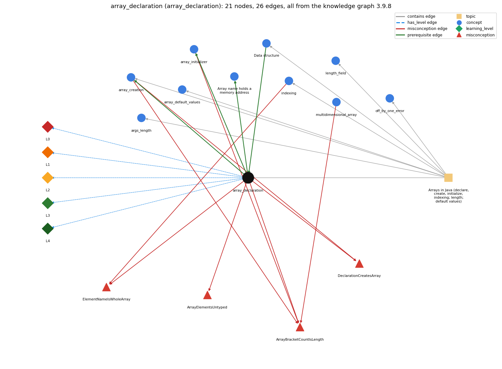

# array_declaration (`array_declaration`)

int[] a; -- declares an array variable

Section 1.4 Arrays, topic 1.4.a Arrays in Java (declare, create, initialize; indexing; length; default values). From the knowledge graph 3.9.8 (`data/raw/chapter1_kg_updated.json`).

## Concepts associated with array\_declaration (10)

| Concept | Description | How it is associated |
| --- | --- | --- |
| **args\_length** | args.length gives the number of command-line arguments | same topic (topic1.4.a) |
| **array\_creation** | new int[n] -- allocates n slots | builds on it (needs it) composition rule (R) with it shares misconception DeclarationCreatesArray shares misconception ArrayBracketCountIsLength same topic (topic1.4.a) |
| **array\_default\_values** | new slots start at 0 / false / null | same topic (topic1.4.a) |
| **array\_initializer** | {1, 2, 3} literal initialization | builds on it (needs it) shares misconception ArrayBracketCountIsLength |
| **array\_reference** | the array variable stores the memory address (pointer) of the array; a[i] is found by adding i to that address | builds on it (needs it) |
| **data\_structure** | a method for organizing data; the one-dimensional array is the first example | prerequisite of it (it needs this) same topic (topic1.4.a) |
| **indexing** | a[i] -- 0-based access | shares misconception ElementNameIsWholeArray same topic (topic1.4.a) |
| **length\_field** | a.length is a field, not a method | same topic (topic1.4.a) |
| **multidimensional\_array** | arrays with three or more indices | shares misconception ArrayBracketCountIsLength |
| **off\_by\_one\_error** | a loop or index that runs one time too many or too few (&lt; vs &lt;=, 0..n vs 1..n, length vs length-1) | same topic (topic1.4.a) |

## Every edge in this view and its full label (26)

| From | Edge | To | Full edge label |
| --- | --- | --- | --- |
| **array\_declaration** | prerequisite | **array\_creation** | double[] a; declares the array name and type; a = new double[N]; then creates the array. grounding: book\_passage composition rule (R) of array\_declaration with array\_creation: Composition: the declaration fixes the name and element type, and the creation must match it. 'double[] a = new double[N];' is legal, but 'double[] a = new int[N];' is a compile-time type error, because int[] does not convert to double[]. composition rule (R) of array\_creation with array\_declaration: The declared element type must match the created one; in 'double[] a = new double[N];' the left side is the declaration and the right side is the creation. |
| **array\_declaration** | prerequisite | **array\_initializer** | int[] a = {1, 2, 3}; declares the array variable and creates and fills the array in one statement. grounding: book\_passage |
| **array\_declaration** | prerequisite | **array\_reference** | Declaring an array variable creates only a variable that holds a reference to an array; the array itself is a separate object. grounding: spec\_passage |
| **data\_structure** | prerequisite | **array\_declaration** | An array is a data structure: one name for a sequence of values of the same type, organised by index. grounding: book\_passage |
| **array\_creation** | misconception | **ArrayBracketCountIsLength** | **wrong rule:** The number of brackets in an array type or initializer is the array's length. **right rule:** Brackets give the number of dimensions; the length is set at creation. role: context |
| **array\_creation** | misconception | **DeclarationCreatesArray** | **wrong rule:** int[] a; already makes an array that can be indexed. **right rule:** The declaration only names the array; until new (or an initializer) creates it, using a[i] gives a 'variable might not have been initialized' compile-time error. role: context |
| **array\_declaration** | misconception | **ArrayBracketCountIsLength** | **wrong rule:** The number of brackets in an array type or initializer is the array's length. **right rule:** Brackets give the number of dimensions; the length is set at creation. role: primary |
| **array\_declaration** | misconception | **ArrayElementsUntyped** | **wrong rule:** An array can hold elements of any type. **right rule:** All elements of an array have the declared element type. role: primary |
| **array\_declaration** | misconception | **DeclarationCreatesArray** | **wrong rule:** int[] a; already makes an array that can be indexed. **right rule:** The declaration only names the array; until new (or an initializer) creates it, using a[i] gives a 'variable might not have been initialized' compile-time error. role: primary |
| **array\_declaration** | misconception | **ElementNameIsWholeArray** | **wrong rule:** X[i] names the whole array, not one element. **right rule:** The array is a; a[i] is the single element at index i. role: context |
| **array\_initializer** | misconception | **ArrayBracketCountIsLength** | **wrong rule:** The number of brackets in an array type or initializer is the array's length. **right rule:** Brackets give the number of dimensions; the length is set at creation. role: context |
| **indexing** | misconception | **ElementNameIsWholeArray** | **wrong rule:** X[i] names the whole array, not one element. **right rule:** The array is a; a[i] is the single element at index i. role: primary |
| **multidimensional\_array** | misconception | **ArrayBracketCountIsLength** | **wrong rule:** The number of brackets in an array type or initializer is the array's length. **right rule:** Brackets give the number of dimensions; the length is set at creation. role: context |
| **array\_declaration** | has\_level | **array\_declaration@L0** | array declaration -&gt; L0 (Prestructural): the answer holds a rule that contradicts Java (6 ways). **[0] everyday\_reading** (E): Folk meaning: in maths and English, writing 'int[] a' reads as 'a is an array of ints', as if naming a list brings it into existence. Java rule: the declaration only creates a variable that can hold a reference to an int array; no array object or element space exists until new or an initializer creates one. **[1] misconception** (M) &rarr; DeclarationCreatesArray: wrong rule: int[] a; already makes an array that can be indexed. Right rule: The declaration only names the array variable; until new (or an initializer) creates the array, a[i] gives the compile-time error 'variable a might not have been initialized'. **[2] misconception** (M) &rarr; ArrayElementsUntyped: wrong rule: An array can hold elements of any type. Right rule: Every element of an array has the declared element type: an int[] holds only int values, a String[] only String references. **[3] misconception** (M) &rarr; ArrayBracketCountIsLength: wrong rule: The number of brackets in an array type is the array's length. Right rule: Each bracket pair adds one dimension (int[] is 1-D, int[][] is 2-D); the length is not part of the type and is fixed only when the array is created. **[4] inconsistent\_trace** (T) &rarr; DeclarationCreatesArray: Points to LT: declare, then create, then initialize, in that order. Inconsistent application: the trace treats a as already created on some lines (reading a[i] straight after 'int[] a;') while requiring new on others. (here mixing in: "int[] a; already makes an array that can be indexed") **[5] misconception** (M) &rarr; ElementNameIsWholeArray: wrong rule: X[i] names the whole array, not one element. Right rule: The name a (written a[] in the book) denotes the whole array; a[i] denotes the single element at index i. |
| **array\_declaration** | has\_level | **array\_declaration@L1** | array declaration -&gt; L1 (Unistructural): the answer states one correct rule without applying it (2 ways). **[0] names\_the\_element** (N): Identity: a local variable declaration whose type is T[]; it introduces a name for a reference to an array whose elements have type T. **[1] states\_the\_rule** (S): Declarative: 'T[] name;' declares an array variable of element type T (the C-style 'T name[]' is also legal); the length is not part of the type, so 'int[5] a;' is illegal. |
| **array\_declaration** | has\_level | **array\_declaration@L2** | array declaration -&gt; L2 (Multistructural): the answer applies the rules of array declaration to every part of the code, in order (3 ways). **[0] line\_by\_line\_trace** (LT): Sequencing: 'double[] a;' only adds the variable a. In 'double[] a = new double[N];' the right side runs first (N is evaluated, the array is allocated and filled with defaults), and then the reference is stored in a. **[1] output\_prediction** (OP): Result: a declaration produces no value and no output. A declared but unassigned local array variable cannot be read at all, so any use of a or a[i] before an assignment is rejected at compile time. **[2] one\_step\_execution** (OS): State transition: after 'int[] a;' the state gains a variable a with no value (not definitely assigned). No array object and no element variables exist yet. |
| **array\_declaration** | has\_level | **array\_declaration@L3** | array declaration -&gt; L3 (Relational): the answer relates the parts (2 ways). **[0] relation\_to\_neighbour** (R): Composition: the declaration fixes the name and element type, and the creation must match it. 'double[] a = new double[N];' is legal, but 'double[] a = new int[N];' is a compile-time type error, because int[] does not convert to double[]. **[1] purpose\_of\_the\_whole** (P): Plan/role: give one name to a whole sequence of same-type values, so a program reaches any of N values as a[i] instead of declaring N separate variables a0, a1, ... |
| **array\_declaration** | has\_level | **array\_declaration@L4** | array declaration -&gt; L4 (Extended abstract): the answer reasons beyond the given code (4 ways). **[0] predict\_a\_change** (C) &rarr; DeclarationCreatesArray: Conservation: rewriting 'int[] a' as 'int a[]' keeps the meaning. Changing the element type changes which values may be stored and the default values. Deleting the creation step breaks the program at compile time. **[1] transfer\_to\_a\_new\_program** (X): Applicability: declare an array when a program must hold many values of one type and reach them by position. Do not use one for a single value, for values of different types, or for a collection that must grow as values arrive (a resizing structure such as ArrayList fits that case). **[2] diagnose\_an\_error** (D): rule broken: An array variable must refer to a created array before it is used (definite assignment). Kind: compile-time. Trigger class: a[i] is read or written after 'int[] a;' with no 'a = new int[n]' or initializer on every path to that use **[3] diagnose\_an\_error** (D): rule broken: All elements have the declared element type. Kind: compile-time. Trigger class: a value or array of a different type is stored, e.g. 'int[] a = new double[5];' or 'a[0] = 2.5;' for an int[] a (incompatible types / possible lossy conversion) |
| **topic1.4.a** | contains | **args\_length** | topic topic1.4.a contains args\_length |
| **topic1.4.a** | contains | **array\_creation** | topic topic1.4.a contains array\_creation |
| **topic1.4.a** | contains | **array\_declaration** | topic topic1.4.a contains array\_declaration |
| **topic1.4.a** | contains | **array\_default\_values** | topic topic1.4.a contains array\_default\_values |
| **topic1.4.a** | contains | **data\_structure** | topic topic1.4.a contains data\_structure |
| **topic1.4.a** | contains | **indexing** | topic topic1.4.a contains indexing |
| **topic1.4.a** | contains | **length\_field** | topic topic1.4.a contains length\_field |
| **topic1.4.a** | contains | **off\_by\_one\_error** | topic topic1.4.a contains off\_by\_one\_error |
