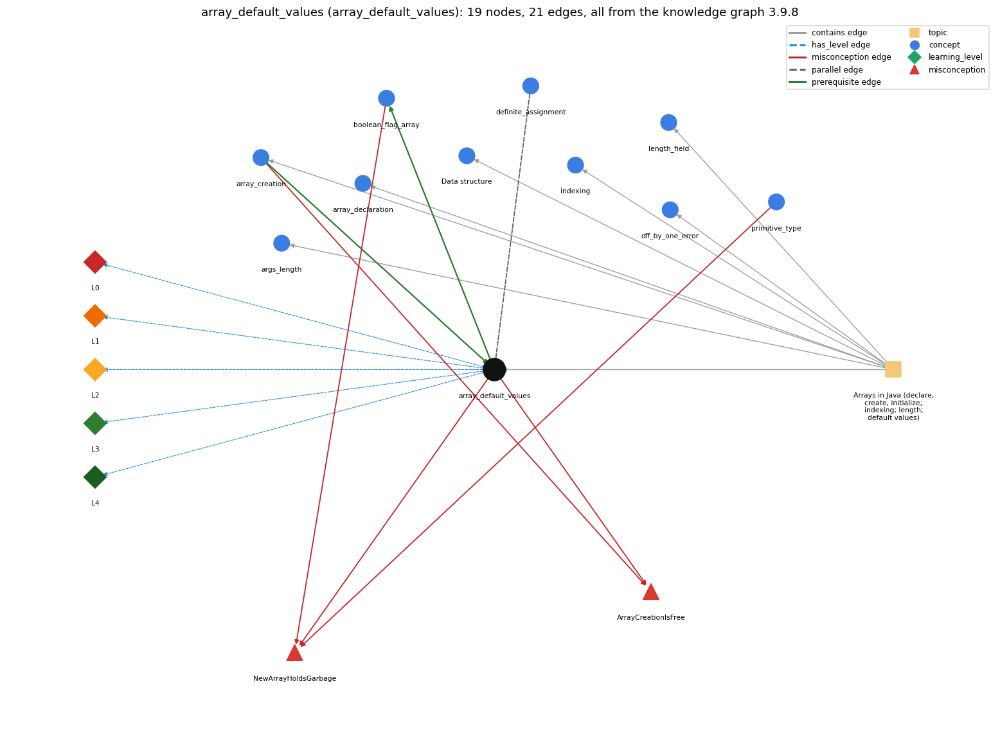

# array_default_values (`array_default_values`)

new slots start at 0 / false / null

Section 1.4 Arrays, topic 1.4.a Arrays in Java (declare, create, initialize; indexing; length; default values).

## At a glance

- **Needs first:** `array_creation`
- **Leads to:** `boolean_flag_array`
- **Learned alongside:** `definite_assignment`
- **Misconceptions:** `ArrayCreationIsFree`, `NewArrayHoldsGarbage`
- **Errors:** none
- **Levels:** L0, L1, L2, L3, L4

Everything below comes from the knowledge graph 3.9.8 (`data/raw/chapter1_kg_updated.json`): 21 edges around this concept, each explained in the graph's own words.

## What it needs first (1)

A prerequisite edge means the other concept has to be understood before `array_default_values`.

### `array_creation` comes before `array_default_values`

*new int[n] -- allocates n slots*

new fills every slot with the type's default value: 0, 0.0, false or null.

- **Grounding:** book passage
- **How `array_default_values` combines with `array_creation`:** Defaults come from creation, so every execution of new resets them; creating the array inside the trial loop gives each experiment a clean all-false grid.
- **How `array_creation` combines with `array_default_values`:** Creation is what puts the default value (0, 0.0, false, null) in every slot; each execution of new gives fresh defaults.

## What it leads to (1)

These concepts need `array_default_values` first.

### `array_default_values` comes before `boolean_flag_array`

*boolean[] used to mark which values are seen (coupon collector, sieve)*

new boolean[n] starts every flag at false.

- **Grounding:** order only
- **How `array_default_values` combines with `boolean_flag_array`:** new boolean[n] starts every flag at false ('not seen yet'), so CouponCollector needs no initialization loop. PrimeSieve needs true as its start value and so must loop to set it.
- **How `boolean_flag_array` combines with `array_default_values`:** new boolean[n] starts every flag at false, which CouponCollector relies on; PrimeSieve needs true and so sets it with a loop.

## Learned alongside (1)

A parallel edge joins two concepts that sit side by side: neither is needed before the other.

### `array_default_values` alongside `definite_assignment`

*a local variable must be assigned before it is read*

A local variable has no value until it is assigned: using it first is a compile-time error. An array element is given a default value (0, 0.0, false) when the array is created with new, so it can be read before any assignment.

- **Grounding:** book passage

## Misconceptions (2)

A misconception edge states the wrong rule a student may hold about this concept, and the right rule.

### ArrayCreationIsFree

- **Wrong rule:** Creating a big array with new takes no time because the elements are not set yet.
- **Right rule:** Java initializes every element when the array is created, so creation takes time proportional to its length.
- **Role of this concept:** context
- **Shows at level L0 as:** misconception: wrong rule: Creating a big array with new takes no time because the elements are not set yet. Right rule: Because Java sets every element to its default at creation, creating an array takes time proportional to its length.
- **Also an edge from `array_creation`:** Creating a big array with new takes no time because the elements are not set yet.

### NewArrayHoldsGarbage

- **Wrong rule:** The slots of a new int[n] hold unpredictable values until assigned.
- **Right rule:** new fills every element with a default: 0 for numeric types, false for boolean, null for String and other non-primitive types.
- **Role of this concept:** primary
- **Shows at level L0 as:** misconception: wrong rule: The slots of a new int[n] hold unpredictable values until assigned. Right rule: new fills every element with a default: 0 for numeric types, false for boolean, null for String and other non-primitive types.
- **Shows at level L0 as:** inconsistent trace: Points to LT: creation stores the default in every element before any statement can read one. Inconsistent application: the trace reads a fresh a[i] as 0 on one pass but as 'empty' or 'unknown' on another, or gives a new boolean[] the value true. (here mixing in: "The slots of a new int[n] hold unpredictable values until assigned")
- **Also an edge from `boolean_flag_array`:** The slots of a new int[n] hold unpredictable values until assigned.
- **Also an edge from `primitive_type`:** The slots of a new int[n] hold unpredictable values until assigned.

## Errors (0)

An error edge states the rule that gets broken in a program, and the right rule.

The graph has no error edge from this concept.

## Levels L0 to L4 (5 of 5)

Each level edge lists the ways a student shows that level, each with its exact rule.

### L0: Prestructural / sensorimotor

L0 for array default values: the answer holds a rule that contradicts Java.

*Deciding question: Does every rule the answer applies to array default values agree with the language rule? If it reads the code with everyday meanings, applies a wrong rule, or switches rules within one trace, it is L0. A slip in an otherwise rule-correct trace is L2 with an error, not L0.*

array default values -&gt; L0 (Prestructural): the answer holds a rule that contradicts Java (4 ways).

- **everyday reading** (folk-meaning rule): Folk meaning: an everyday new box is 'empty' (nothing in it), and C-trained intuition says new memory holds garbage. Java rule: every element of a new array holds a definite default (0 for numbers, 0.0 for double, false for boolean, null for String and other reference types).
- **misconception** (wrong rule / right rule; shows `NewArrayHoldsGarbage`): wrong rule: The slots of a new int[n] hold unpredictable values until assigned. Right rule: new fills every element with a default: 0 for numeric types, false for boolean, null for String and other non-primitive types.
- **inconsistent trace** (uneven-application rule; shows `NewArrayHoldsGarbage`): Points to LT: creation stores the default in every element before any statement can read one. Inconsistent application: the trace reads a fresh a[i] as 0 on one pass but as 'empty' or 'unknown' on another, or gives a new boolean[] the value true. (here mixing in: "The slots of a new int[n] hold unpredictable values until assigned")
- **misconception** (wrong rule / right rule; shows `ArrayCreationIsFree`): wrong rule: Creating a big array with new takes no time because the elements are not set yet. Right rule: Because Java sets every element to its default at creation, creating an array takes time proportional to its length.

### L1: Unistructural / atom x text surface

L1 for array default values: the answer states one correct rule without applying it.

*Deciding question: Does the answer cover every part of the code, in order, with the values (L2)? If it covers one part or only states the rule, it is L1.*

array default values -&gt; L1 (Unistructural): the answer states one correct rule without applying it (2 ways).

- **names the element** (identity rule): Identity: the initial value Java gives each element of a newly created array: zero for numeric types, false for boolean, null for references.
- **states the rule** (declarative rule): Declarative: 'The default initial value is zero for all numbers and false for type boolean'; for String and other non-primitive types it is null. The same holds for every entry of a 2-D array.

### L2: Multistructural / block x execution / preoperational

L2 for array default values: the answer applies these rules to every part of the code, in order.

*Deciding question: Is the answer many segments mapped onto lines (L2), or one segment stating the purpose of the whole (L3)? A correct output with no value-by-value justification is not levelled.*

array default values -&gt; L2 (Multistructural): the answer applies the rules of array default values to every part of the code, in order (3 ways).

- **line by line trace** (operational sequencing rule): Sequencing: defaults are stored during creation, before the reference is returned. An explicit initialization loop that follows simply overwrites them, so the loop is needed only for a non-default start value.
- **output prediction** (evaluation / result rule): Result: reading an element never assigned gives 0 in an int[], 0.0 in a double[], false in a boolean[] and null in a String[] (println prints the text null).
- **one step execution** (state-transition rule): State transition: the creation step sets all n element variables to the default in one go. Reading a default changes nothing.

### L3: Relational / relations x function (concrete operational begins)

L3 for array default values: the answer relates the parts by these rules.

*Deciding question: Was the purpose deduced from the code, or only guessed from traced input/output pairs (then L2)? Does the answer stay within the given code (L3), or reason about changed code, an error class or a new program (L4)?*

array default values -&gt; L3 (Relational): the answer relates the parts (4 ways).

- **relation to neighbour** (composition rule (with a neighbour)): Defaults come from creation, so every execution of new resets them; creating the array inside the trial loop gives each experiment a clean all-false grid.
- **relation to neighbour** (composition rule (with a neighbour)): new boolean[n] starts every flag at false ('not seen yet'), so CouponCollector needs no initialization loop. PrimeSieve needs true as its start value and so must loop to set it.
- **relation to neighbour** (composition rule (with a neighbour)): A local variable has no value until it is assigned: using it first is a compile-time error. An array element is given a default value (0, 0.0, false) when the array is created with new, so it can be read before any assignment.
- **purpose of the whole** (plan / role rule): Plan/role: lets counter and flag arrays (counts[], found[]) start at 0 or false, ready to accumulate, with no initialization loop; the book calls this using Java's default array initialization convention.

### L4: Extended abstract (concrete-operational reversibility and conservation)

L4 for array default values: the answer reasons beyond the given code by these rules.

*Deciding question: Does the answer link the code to a broader context: a changed program, a class of inputs, an unseen problem? Re-tracing changed code value by value is L2; fixing one given failing case is L3.*

array default values -&gt; L4 (Extended abstract): the answer reasons beyond the given code (4 ways).

- **predict a change** (conservation rule; shows `NewArrayHoldsGarbage`): Conservation: changing the element type changes the default (int 0, double 0.0, boolean false, String null). Moving the creation into a loop resets the defaults on each pass. Adding an explicit loop that stores the default changes nothing.
- **transfer to a new program** (applicability rule): Applicability: rely on the defaults when the needed start value is exactly 0, 0.0, false or null (counters, flags, accumulators). Write an initialization loop for any other start value. Plain local variables get no default, so the convenience applies only to array elements.
- **diagnose an error** (error rule): rule broken: Defaults are 0/false/null; any other start value must be assigned explicitly. Kind: silent logic error. Trigger class: the code assumes a non-default start value without setting it, e.g. PrimeSieve with its 'isPrime[i] = true' loop removed counts 0 primes
- **diagnose an error** (error rule): rule broken: Elements of a reference-type array start as null, which refers to no object. Kind: run-time exception. Trigger class: a method is called on an element of a new String[] (or other object array) before it is assigned, e.g. s[0].length() (NullPointerException)

## Same topic

`array_default_values` belongs to the topic **Arrays in Java (declare, create, initialize; indexing; length; default values)** (`topic1.4.a`). The topic also contains: `args_length`, `array_creation`, `array_declaration`, `data_structure`, `indexing`, `length_field`, `off_by_one_error`.

## Rules of the concept (16)

- **folk-meaning rule:** Folk meaning: an everyday new box is 'empty' (nothing in it), and C-trained intuition says new memory holds garbage. Java rule: every element of a new array holds a definite default (0 for numbers, 0.0 for double, false for boolean, null for String and other reference types).
- **wrong rule / right rule:** NewArrayHoldsGarbage: wrong: The slots of a new int[n] hold unpredictable values until assigned. \| right: new fills every element with a default: 0 for numeric types, false for boolean, null for String and other non-primitive types.
- **wrong rule / right rule:** ArrayCreationIsFree: wrong: Creating a big array with new takes no time because the elements are not set yet. \| right: Because Java sets every element to its default at creation, creating an array takes time proportional to its length.
- **uneven-application rule:** Points to LT: creation stores the default in every element before any statement can read one. Inconsistent application: the trace reads a fresh a[i] as 0 on one pass but as 'empty' or 'unknown' on another, or gives a new boolean[] the value true.
- **identity rule:** Identity: the initial value Java gives each element of a newly created array: zero for numeric types, false for boolean, null for references.
- **declarative rule:** Declarative: 'The default initial value is zero for all numbers and false for type boolean'; for String and other non-primitive types it is null. The same holds for every entry of a 2-D array.
- **operational sequencing rule:** Sequencing: defaults are stored during creation, before the reference is returned. An explicit initialization loop that follows simply overwrites them, so the loop is needed only for a non-default start value.
- **evaluation / result rule:** Result: reading an element never assigned gives 0 in an int[], 0.0 in a double[], false in a boolean[] and null in a String[] (println prints the text null).
- **state-transition rule:** State transition: the creation step sets all n element variables to the default in one go. Reading a default changes nothing.
- **composition rule (with a neighbour):** with array\_creation: Defaults come from creation, so every execution of new resets them; creating the array inside the trial loop gives each experiment a clean all-false grid.
- **composition rule (with a neighbour):** with boolean\_flag\_array: new boolean[n] starts every flag at false ('not seen yet'), so CouponCollector needs no initialization loop. PrimeSieve needs true as its start value and so must loop to set it.
- **plan / role rule:** Plan/role: lets counter and flag arrays (counts[], found[]) start at 0 or false, ready to accumulate, with no initialization loop; the book calls this using Java's default array initialization convention.
- **conservation rule:** Conservation: changing the element type changes the default (int 0, double 0.0, boolean false, String null). Moving the creation into a loop resets the defaults on each pass. Adding an explicit loop that stores the default changes nothing.
- **error rule:** rule broken: Defaults are 0/false/null; any other start value must be assigned explicitly. (silent logic error)
- **error rule:** rule broken: Elements of a reference-type array start as null, which refers to no object. (run-time exception)
- **applicability rule:** Applicability: rely on the defaults when the needed start value is exactly 0, 0.0, false or null (counters, flags, accumulators). Write an initialization loop for any other start value. Plain local variables get no default, so the convenience applies only to array elements.

## The whole prerequisite chain

- **Everything it builds on (4):** `array_creation`, `array_declaration`, `data_structure`, `data_type`
- **Everything that builds on it (1):** `boolean_flag_array`
