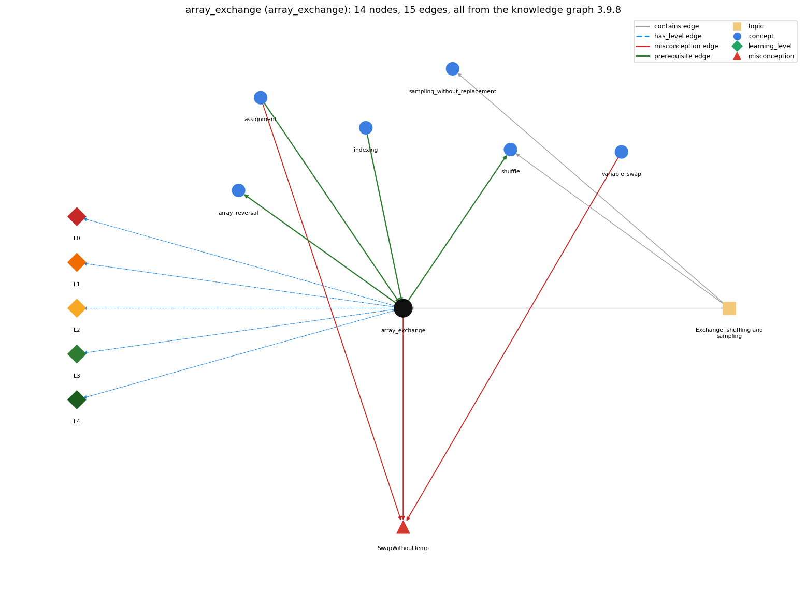

# array_exchange (`array_exchange`)

swap a[i] and a[j] through a temporary variable

Section 1.4 Arrays, topic 1.4.d Exchange, shuffling and sampling.

## At a glance

- **Needs first:** `assignment`, `indexing`
- **Leads to:** `array_reversal`, `shuffle`
- **Learned alongside:** nothing
- **Misconceptions:** `SwapWithoutTemp`
- **Errors:** none
- **Levels:** L0, L1, L2, L3, L4

Everything below comes from the knowledge graph 3.9.8 (`data/raw/chapter1_kg_updated.json`): 15 edges around this concept, each explained in the graph's own words.

## What it needs first (2)

A prerequisite edge means the other concept has to be understood before `array_exchange`.

### `assignment` comes before `array_exchange`

*= stores the computed value of the right side*

The exchange is three assignments in a fixed order through a temporary variable.

- **Grounding:** book passage
- **How `array_exchange` combines with `assignment`:** Each of the three steps is an ordinary assignment whose left side is a single variable (here an array element), executed in order.
- **How `assignment` combines with `array_exchange`:** Exchanging a[i] and a[j] takes three assignments in a fixed order through a temporary, because each assignment overwrites its target.

### `indexing` comes before `array_exchange`

*a[i] -- 0-based access*

An exchange reads and writes a[i] and a[j] by index.

- **Grounding:** book passage
- **How `array_exchange` combines with `indexing`:** The exchange reads and writes elements only through their indices a[i] and a[j], which must both be in bounds.
- **How `indexing` combines with `array_exchange`:** The exchange reads and writes elements only through their indices: t = a[i]; a[i] = a[j]; a[j] = t.

## What it leads to (2)

These concepts need `array_exchange` first.

### `array_exchange` comes before `array_reversal`

*reversing an array in place*

Reversal exchanges a[i] with a[N-1-i] for each i in the first half of the array.

- **Grounding:** book passage
- **How `array_exchange` combines with `array_reversal`:** Reversal exchanges a[i] with a[N-1-i] for each i in the first half.
- **How `array_reversal` combines with `array_exchange`:** Reversal is a loop of exchanges a[i] &lt;-&gt; a[N-1-i], so it inherits the exchange idiom and its temporary variable.

### `array_exchange` comes before `shuffle`

*Knuth shuffle -- swap a[i] with a random a[r], r in i..n-1*

Shuffling is a loop of exchanges with randomly chosen positions.

- **Grounding:** book passage
- **How `array_exchange` combines with `shuffle`:** Shuffling is a loop of exchanges with random partner positions; using exchanges guarantees the same cards before and after.
- **How `shuffle` combines with `array_exchange`:** Using the exchange idiom guarantees the deck holds the same cards after the shuffle.

## Learned alongside (0)

A parallel edge joins two concepts that sit side by side: neither is needed before the other.

No parallel edge touches this concept.

## Misconceptions (1)

A misconception edge states the wrong rule a student may hold about this concept, and the right rule.

### SwapWithoutTemp

- **Wrong rule:** a[i] = a[j]; a[j] = a[i]; exchanges the two values.
- **Right rule:** A temporary variable must save a[i] before it is overwritten.
- **Role of this concept:** primary
- **Shows at level L0 as:** misconception: wrong rule: a[i] = a[j]; a[j] = a[i]; exchanges the two values. Right rule: A temporary variable must save a[i] before it is overwritten: t = a[i]; a[i] = a[j]; a[j] = t;.
- **Shows at level L0 as:** inconsistent trace: Points to LT: save a[i] in t, copy a[j] into a[i], copy t into a[j], in that order. Inconsistent application: the trace performs the second assignment with the old a[i] (as if both happened at once) on some passes. (here mixing in: "a[i] = a[j]; a[j] = a[i]; exchanges the two values")
- **Also an edge from `assignment`:** a[i] = a[j]; a[j] = a[i]; exchanges the two values.
- **Also an edge from `variable_swap`:** a[i] = a[j]; a[j] = a[i]; exchanges the two values.

## Errors (0)

An error edge states the rule that gets broken in a program, and the right rule.

The graph has no error edge from this concept.

## Levels L0 to L4 (5 of 5)

Each level edge lists the ways a student shows that level, each with its exact rule.

### L0: Prestructural / sensorimotor

L0 for array exchange: the answer holds a rule that contradicts Java.

*Deciding question: Does every rule the answer applies to array exchange agree with the language rule? If it reads the code with everyday meanings, applies a wrong rule, or switches rules within one trace, it is L0. A slip in an otherwise rule-correct trace is L2 with an error, not L0.*

array exchange -&gt; L0 (Prestructural): the answer holds a rule that contradicts Java (3 ways).

- **everyday reading** (folk-meaning rule): Folk meaning: in everyday life two people swap objects simultaneously, and in maths 'a = b, b = a' reads as a symmetric relation. Java rule: assignments run one at a time, so the first overwrites a value that must be saved in a temporary first.
- **misconception** (wrong rule / right rule; shows `SwapWithoutTemp`): wrong rule: a[i] = a[j]; a[j] = a[i]; exchanges the two values. Right rule: A temporary variable must save a[i] before it is overwritten: t = a[i]; a[i] = a[j]; a[j] = t;.
- **inconsistent trace** (uneven-application rule; shows `SwapWithoutTemp`): Points to LT: save a[i] in t, copy a[j] into a[i], copy t into a[j], in that order. Inconsistent application: the trace performs the second assignment with the old a[i] (as if both happened at once) on some passes. (here mixing in: "a[i] = a[j]; a[j] = a[i]; exchanges the two values")

### L1: Unistructural / atom x text surface

L1 for array exchange: the answer states one correct rule without applying it.

*Deciding question: Does the answer cover every part of the code, in order, with the values (L2)? If it covers one part or only states the rule, it is L1.*

array exchange -&gt; L1 (Unistructural): the answer states one correct rule without applying it (2 ways).

- **names the element** (identity rule): Identity: the exchange idiom, three assignments through a temporary variable that trade the values of two array elements.
- **states the rule** (declarative rule): Declarative: T t = a[i]; a[i] = a[j]; a[j] = t; where t has the element type T.

### L2: Multistructural / block x execution / preoperational

L2 for array exchange: the answer applies these rules to every part of the code, in order.

*Deciding question: Is the answer many segments mapped onto lines (L2), or one segment stating the purpose of the whole (L3)? A correct output with no value-by-value justification is not levelled.*

array exchange -&gt; L2 (Multistructural): the answer applies the rules of array exchange to every part of the code, in order (3 ways).

- **line by line trace** (operational sequencing rule): Sequencing: (1) t receives a[i]; (2) a[i] receives a[j]; (3) a[j] receives t. Each statement uses the state left by the previous one.
- **output prediction** (evaluation / result rule): Result: the values at i and j have traded places. With i = 1 and j = 4 in the deck, 3 of Clubs ends in deck[1] and 2 of Diamonds in deck[4].
- **one step execution** (state-transition rule): State transition: exactly two elements (and t) change; when i == j nothing changes.

### L3: Relational / relations x function (concrete operational begins)

L3 for array exchange: the answer relates the parts by these rules.

*Deciding question: Was the purpose deduced from the code, or only guessed from traced input/output pairs (then L2)? Does the answer stay within the given code (L3), or reason about changed code, an error class or a new program (L4)?*

array exchange -&gt; L3 (Relational): the answer relates the parts (5 ways).

- **relation to neighbour** (composition rule (with a neighbour)): The exchange reads and writes elements only through their indices a[i] and a[j], which must both be in bounds.
- **relation to neighbour** (composition rule (with a neighbour)): Each of the three steps is an ordinary assignment whose left side is a single variable (here an array element), executed in order.
- **relation to neighbour** (composition rule (with a neighbour)): Shuffling is a loop of exchanges with random partner positions; using exchanges guarantees the same cards before and after.
- **relation to neighbour** (composition rule (with a neighbour)): Reversal exchanges a[i] with a[N-1-i] for each i in the first half.
- **purpose of the whole** (plan / role rule): Plan/role: t is a Sajaniemi temporary. The exchange reorders an array (the array as organizer) without changing its set of values, the building block of shuffling, reversing and sorting.

### L4: Extended abstract (concrete-operational reversibility and conservation)

L4 for array exchange: the answer reasons beyond the given code by these rules.

*Deciding question: Does the answer link the code to a broader context: a changed program, a class of inputs, an unseen problem? Re-tracing changed code value by value is L2; fixing one given failing case is L3.*

array exchange -&gt; L4 (Extended abstract): the answer reasons beyond the given code (5 ways).

- **predict a change** (conservation rule; shows `SwapWithoutTemp`): Conservation: the set of values in the array is unchanged; doing the same exchange again restores the original order; i == j leaves the array unchanged. Changing the order of the three statements breaks it.
- **transfer to a new program** (applicability rule): Applicability: use the exchange whenever two elements must change places (shuffle, reverse, sort, permute). It is not a copy: to duplicate a value, use one assignment.
- **diagnose an error** (error rule): rule broken: The old value must be saved before it is overwritten. Kind: silent logic error. Trigger class: a[i] = a[j]; a[j] = a[i]; (or the three statements reordered), with a[i] != a[j], leaves both elements equal to the old a[j]
- **diagnose an error** (error rule): rule broken: The temporary must have the element type. Kind: compile-time. Trigger class: int t = deck[i]; for a String[] deck (incompatible types)
- **diagnose an error** (error rule): rule broken: Both indices must be legal. Kind: run-time exception. Trigger class: i or j outside 0..a.length-1 (ArrayIndexOutOfBoundsException)

## Same topic

`array_exchange` belongs to the topic **Exchange, shuffling and sampling** (`topic1.4.d`). The topic also contains: `sampling_without_replacement`, `shuffle`.

## Rules of the concept (18)

- **folk-meaning rule:** Folk meaning: in everyday life two people swap objects simultaneously, and in maths 'a = b, b = a' reads as a symmetric relation. Java rule: assignments run one at a time, so the first overwrites a value that must be saved in a temporary first.
- **wrong rule / right rule:** SwapWithoutTemp: wrong: a[i] = a[j]; a[j] = a[i]; exchanges the two values. \| right: A temporary variable must save a[i] before it is overwritten: t = a[i]; a[i] = a[j]; a[j] = t;.
- **uneven-application rule:** Points to LT: save a[i] in t, copy a[j] into a[i], copy t into a[j], in that order. Inconsistent application: the trace performs the second assignment with the old a[i] (as if both happened at once) on some passes.
- **identity rule:** Identity: the exchange idiom, three assignments through a temporary variable that trade the values of two array elements.
- **declarative rule:** Declarative: T t = a[i]; a[i] = a[j]; a[j] = t; where t has the element type T.
- **operational sequencing rule:** Sequencing: (1) t receives a[i]; (2) a[i] receives a[j]; (3) a[j] receives t. Each statement uses the state left by the previous one.
- **evaluation / result rule:** Result: the values at i and j have traded places. With i = 1 and j = 4 in the deck, 3 of Clubs ends in deck[1] and 2 of Diamonds in deck[4].
- **state-transition rule:** State transition: exactly two elements (and t) change; when i == j nothing changes.
- **composition rule (with a neighbour):** with indexing: The exchange reads and writes elements only through their indices a[i] and a[j], which must both be in bounds.
- **composition rule (with a neighbour):** with assignment: Each of the three steps is an ordinary assignment whose left side is a single variable (here an array element), executed in order.
- **composition rule (with a neighbour):** with shuffle: Shuffling is a loop of exchanges with random partner positions; using exchanges guarantees the same cards before and after.
- **composition rule (with a neighbour):** with array\_reversal: Reversal exchanges a[i] with a[N-1-i] for each i in the first half.
- **plan / role rule:** Plan/role: t is a Sajaniemi temporary. The exchange reorders an array (the array as organizer) without changing its set of values, the building block of shuffling, reversing and sorting.
- **conservation rule:** Conservation: the set of values in the array is unchanged; doing the same exchange again restores the original order; i == j leaves the array unchanged. Changing the order of the three statements breaks it.
- **error rule:** rule broken: The old value must be saved before it is overwritten. (silent logic error)
- **error rule:** rule broken: The temporary must have the element type. (compile-time)
- **error rule:** rule broken: Both indices must be legal. (run-time exception)
- **applicability rule:** Applicability: use the exchange whenever two elements must change places (shuffle, reverse, sort, permute). It is not a copy: to duplicate a value, use one assignment.

## The whole prerequisite chain

- **Everything it builds on (12):** `array_creation`, `array_declaration`, `array_initializer`, `assignment`, `data_structure`, `data_type`, `declaration`, `identifier`, `indexing`, `literal`, `primitive_type`, `variable`
- **Everything that builds on it (3):** `array_reversal`, `sampling_without_replacement`, `shuffle`
