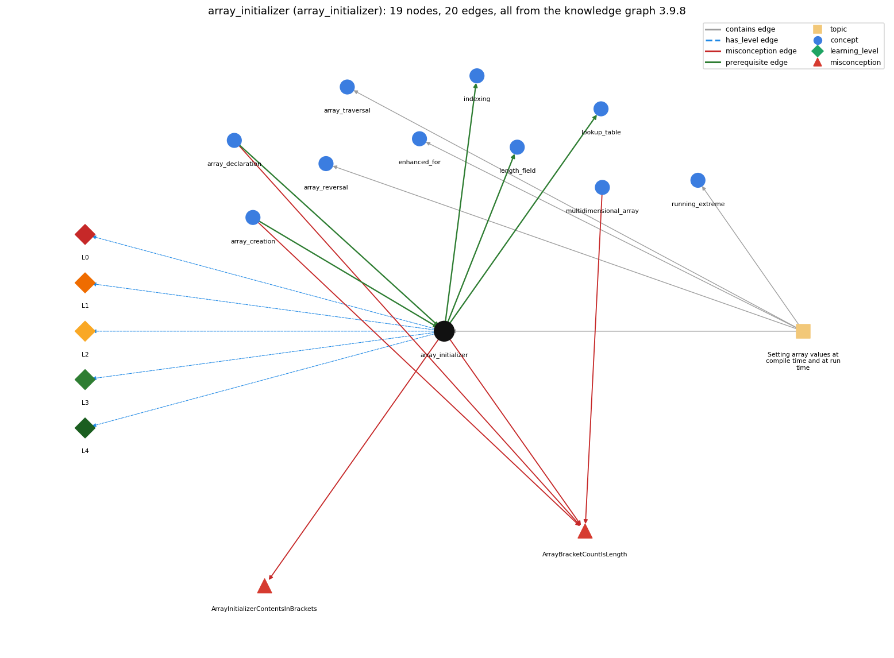

# array_initializer (`array_initializer`)

{1, 2, 3} literal initialization

Section 1.4 Arrays, topic 1.4.c Setting array values at compile time and at run time. From the knowledge graph 3.9.8 (`data/raw/chapter1_kg_updated.json`).

## Concepts associated with array\_initializer (10)

| Concept | Description | How it is associated |
| --- | --- | --- |
| **array\_creation** | new int[n] -- allocates n slots | prerequisite of it (it needs this) composition rule (R) with it shares misconception ArrayBracketCountIsLength |
| **array\_declaration** | int[] a; -- declares an array variable | prerequisite of it (it needs this) shares misconception ArrayBracketCountIsLength |
| **array\_reversal** | reversing an array in place | same topic (topic1.4.c) |
| **array\_traversal** | walking the array with an index loop | same topic (topic1.4.c) |
| **enhanced\_for** | for (int x : a) -- the for-each form | same topic (topic1.4.c) |
| **indexing** | a[i] -- 0-based access | builds on it (needs it) |
| **length\_field** | a.length is a field, not a method | builds on it (needs it) |
| **lookup\_table** | an array of precomputed values or names indexed by position | builds on it (needs it) |
| **multidimensional\_array** | arrays with three or more indices | shares misconception ArrayBracketCountIsLength |
| **running\_extreme** | tracking the max or min of a stream | same topic (topic1.4.c) |

## Every edge in this view and its full label (20)

| From | Edge | To | Full edge label |
| --- | --- | --- | --- |
| **array\_creation** | prerequisite | **array\_initializer** | {v0, v1, ..., vk} is a shorthand that creates an array of length k + 1 and fills it in one step. grounding: book\_passage composition rule (R) of array\_creation with array\_initializer: An initializer {v0, ..., vk} implies creation of an array of length k+1, so new is not written. composition rule (R) of array\_initializer with array\_creation: An initializer implies array creation: it is shorthand for new T[k+1] followed by k+1 element assignments, so new is not written. |
| **array\_declaration** | prerequisite | **array\_initializer** | int[] a = {1, 2, 3}; declares the array variable and creates and fills the array in one statement. grounding: book\_passage |
| **array\_initializer** | prerequisite | **indexing** | The values listed in braces are stored at indices 0, 1, 2, ... in order, and a[i] reads the value at index i. grounding: spec\_passage |
| **array\_initializer** | prerequisite | **length\_field** | An array made from a literal has as many elements as values listed, and a.length gives that number. grounding: spec\_passage |
| **array\_initializer** | prerequisite | **lookup\_table** | A lookup table is usually an array of fixed values written as a literal and read by index. grounding: book\_passage |
| **array\_creation** | misconception | **ArrayBracketCountIsLength** | **wrong rule:** The number of brackets in an array type or initializer is the array's length. **right rule:** Brackets give the number of dimensions; the length is set at creation. role: context |
| **array\_declaration** | misconception | **ArrayBracketCountIsLength** | **wrong rule:** The number of brackets in an array type or initializer is the array's length. **right rule:** Brackets give the number of dimensions; the length is set at creation. role: primary |
| **array\_initializer** | misconception | **ArrayBracketCountIsLength** | **wrong rule:** The number of brackets in an array type or initializer is the array's length. **right rule:** Brackets give the number of dimensions; the length is set at creation. role: context |
| **array\_initializer** | misconception | **ArrayInitializerContentsInBrackets** | **wrong rule:** Starting values go in square brackets, like int[] a = [v0, v1];. **right rule:** Starting values go in braces, like int[] a = {v0, v1};. role: primary |
| **multidimensional\_array** | misconception | **ArrayBracketCountIsLength** | **wrong rule:** The number of brackets in an array type or initializer is the array's length. **right rule:** Brackets give the number of dimensions; the length is set at creation. role: context |
| **array\_initializer** | has\_level | **array\_initializer@L0** | array initializer -&gt; L0 (Prestructural): the answer holds a rule that contradicts Java (4 ways). **[0] everyday\_reading** (E): Folk meaning: in maths, braces {1, 2, 3} denote a set (unordered, no repeats) and brackets [1, 2, 3] a list, so novices write int[] a = [1, 2, 3] or expect {1, 1, 2} to have 2 elements. Java rule: braces enclose an ordered, comma-separated list whose count (repeats included) is the length. **[1] misconception** (M) &rarr; ArrayInitializerContentsInBrackets: wrong rule: Initializer values go in [] instead of {}. Right rule: Starting values go in braces, as in int[] a = {v0, v1};; brackets only mark the type or an index. **[2] inconsistent\_trace** (T) &rarr; ArrayInitializerContentsInBrackets: Points to LT: an array of length k+1 is created, then v0..vk are stored at indices 0..k in order. Inconsistent application: the trace puts the first value at index 1 for one initializer but at index 0 for another, or counts the length differently. (here mixing in: "initializer values go in [] instead of {}") **[3] misconception** (M) &rarr; ArrayBracketCountIsLength: wrong rule: The number of brackets in an array type or initializer is the array's length. Right rule: Brackets give the number of dimensions; an initializer's length is the number of values between its braces. |
| **array\_initializer** | has\_level | **array\_initializer@L1** | array initializer -&gt; L1 (Unistructural): the answer states one correct rule without applying it (2 ways). **[0] names\_the\_element** (N): Identity: an array initializer is a brace-enclosed, comma-separated list of values that creates and fills an array in one step. **[1] states\_the\_rule** (S): Declarative: 'T[] a = {v0, ..., vk};' declares, creates (no new needed) and initializes an array of length k+1. For 2-D arrays each row is its own brace list. The bare form is legal only in a declaration; elsewhere write new T[]{...}. |
| **array\_initializer** | has\_level | **array\_initializer@L2** | array initializer -&gt; L2 (Multistructural): the answer applies the rules of array initializer to every part of the code, in order (3 ways). **[0] line\_by\_line\_trace** (LT): Sequencing: the array of length k+1 is created, the initializer expressions are evaluated left to right and stored in a[0], a[1], ..., a[k], and then the reference is assigned to a. **[1] output\_prediction** (OP): Result: int[] a = {1, 2, 3}; gives a.length == 3, a[0] == 1, a[2] == 3. String[] suit = {"Clubs", "Diamonds", "Hearts", "Spades"}; gives suit.length == 4. **[2] one\_step\_execution** (OS): State transition: one execution creates one array holding the listed values and sets the variable to its reference. |
| **array\_initializer** | has\_level | **array\_initializer@L3** | array initializer -&gt; L3 (Relational): the answer relates the parts (2 ways). **[0] relation\_to\_neighbour** (R): An initializer implies array creation: it is shorthand for new T[k+1] followed by k+1 element assignments, so new is not written. **[1] purpose\_of\_the\_whole** (P): Plan/role: build small fixed tables of constants known when the program is written (suits, ranks, month names), usually used as fixed-value lookup tables. |
| **array\_initializer** | has\_level | **array\_initializer@L4** | array initializer -&gt; L4 (Extended abstract): the answer reasons beyond the given code (5 ways). **[0] predict\_a\_change** (C) &rarr; ArrayInitializerContentsInBrackets: Conservation: adding or removing a value changes the length. Code that uses a.length (e.g. rank.length) adapts, while code with a hard-coded size breaks. Reordering values changes which index holds which value. **[1] transfer\_to\_a\_new\_program** (X): Applicability: use an initializer when all values are known at compile time and the array is small. When the values must be computed at run time, create the array with new and fill it in a loop. **[2] diagnose\_an\_error** (D): rule broken: Initializer values are enclosed in braces. Kind: compile-time. Trigger class: brackets are used, as in int[] a = [1, 2, 3]; (illegal start of expression) **[3] diagnose\_an\_error** (D): rule broken: The bare {...} form is allowed only in a declaration. Kind: compile-time. Trigger class: a = {1, 2, 3}; used as a later assignment (array constants can only be used in initializers) **[4] diagnose\_an\_error** (D): rule broken: Each value must be assignable to the element type. Kind: compile-time. Trigger class: int[] a = {1, 2.5}; (incompatible types: possible lossy conversion from double to int) |
| **topic1.4.c** | contains | **array\_initializer** | topic topic1.4.c contains array\_initializer |
| **topic1.4.c** | contains | **array\_reversal** | topic topic1.4.c contains array\_reversal |
| **topic1.4.c** | contains | **array\_traversal** | topic topic1.4.c contains array\_traversal |
| **topic1.4.c** | contains | **enhanced\_for** | topic topic1.4.c contains enhanced\_for |
| **topic1.4.c** | contains | **running\_extreme** | topic topic1.4.c contains running\_extreme |
