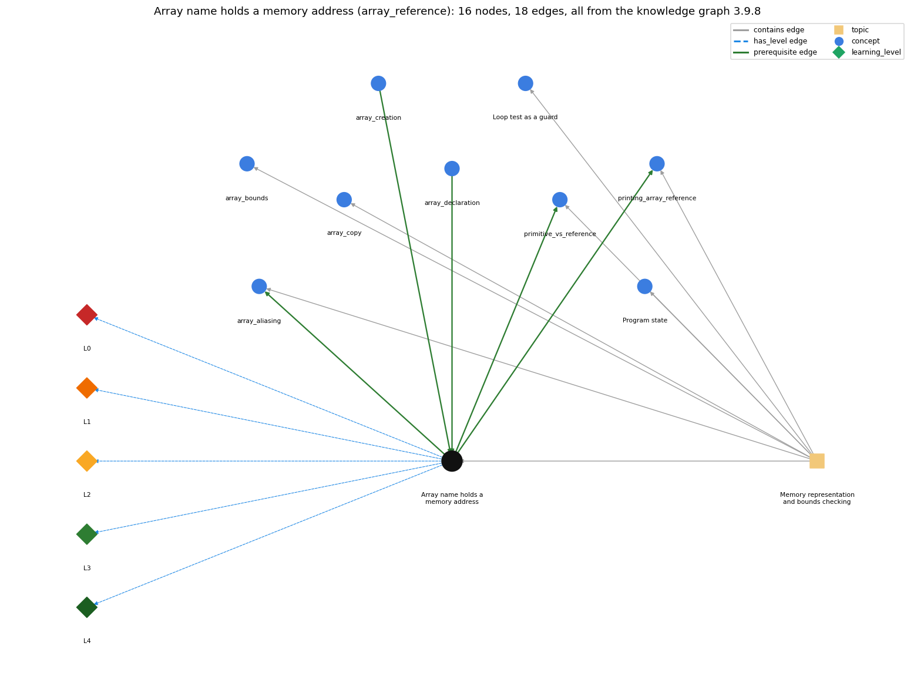

# Array name holds a memory address (`array_reference`)

the array variable stores the memory address (pointer) of the array; a[i] is found by adding i to that address

Section 1.4 1.4 Arrays, topic 1.4.b Memory representation and bounds checking. From the knowledge graph 3.9.8 (`data/raw/chapter1_kg_updated.json`).

## Concepts associated with array\_reference (9)

| Concept | Description | How it is associated |
| --- | --- | --- |
| **array\_aliasing** | two variables can refer to the same array | builds on it (needs it) same topic (topic1.4.b) |
| **array\_bounds** | valid indices are 0 .. length-1; otherwise throws | same topic (topic1.4.b) |
| **array\_copy** | making a second, independent array with the same elements: create a new array and copy element by element (or Arrays.copyOf) | same topic (topic1.4.b) |
| **array\_creation** | new int[n] -- allocates n slots | prerequisite of it (it needs this) composition rule (R) with it |
| **array\_declaration** | int[] a; -- declares an array variable | prerequisite of it (it needs this) |
| **loop\_guard** | putting the bounds check in the loop condition so the body never makes an out-of-bounds array access | same topic (topic1.4.b) |
| **primitive\_vs\_reference** | a primitive variable holds its value; an array (or String) variable holds a reference to the object stored elsewhere | builds on it (needs it) composition rule (R) with it same topic (topic1.4.b) |
| **printing\_array\_reference** | printing an array variable prints a reference, not the elements | builds on it (needs it) same topic (topic1.4.b) |
| **program\_state** | the information needed to know what a program will do next: the values of its variables and array entries and the next statement | same topic (topic1.4.b) |

## Every edge in this view and its full label (18)

| From | Edge | To | Full edge label |
| --- | --- | --- | --- |
| **array\_creation** | prerequisite | **array\_reference** | When an array is created, the array name stores the memory address of its values; a[i] is found by adding i to that address. grounding: book\_passage composition rule (R) of array\_creation with array\_reference: new yields the reference (address) of the array, and the array variable stores that reference, not the elements. composition rule (R) of array\_reference with array\_creation: new reserves the memory and yields the array's address, which the array variable then stores. |
| **array\_declaration** | prerequisite | **array\_reference** | Declaring an array variable creates only a variable that holds a reference to an array; the array itself is a separate object. grounding: spec\_passage |
| **array\_reference** | prerequisite | **array\_aliasing** | Because an array variable holds a reference, b = a copies the reference, so a and b name the same array. grounding: book\_passage |
| **array\_reference** | prerequisite | **primitive\_vs\_reference** | An array variable stores the memory address of the array, not its elements. grounding: book\_passage composition rule (R) of primitive\_vs\_reference with array\_reference: An array variable is the standard example of a reference: its value is the memory address of the array. |
| **array\_reference** | prerequisite | **printing\_array\_reference** | Printing an array variable prints the reference it holds, not the elements. grounding: book\_passage |
| **array\_reference** | has\_level | **array\_reference@L0** | Array name holds a memory address -&gt; L0 (Prestructural): the answer holds a rule that contradicts Java (1 way). **[0] everyday\_reading** (E): Folk meaning: a variable is a box, so the array's values are 'inside' a. Java rule: the variable a holds only a reference (memory address, pointer) to the array object, which lives elsewhere. |
| **array\_reference** | has\_level | **array\_reference@L1** | Array name holds a memory address -&gt; L1 (Unistructural): the answer states one correct rule without applying it (2 ways). **[0] names\_the\_element** (N): Identity: an array reference, the value of an array variable; it is the memory address of the array, called a pointer. **[1] states\_the\_rule** (S): Declarative: a variable of array type holds a reference to an array object; operations on the name itself (assignment, ==, printing) act on that address. |
| **array\_reference** | has\_level | **array\_reference@L2** | Array name holds a memory address -&gt; L2 (Multistructural): the answer applies the rules of Array name holds a memory address to every part of the code, in order (3 ways). **[0] line\_by\_line\_trace** (LT): Sequencing: for a[i], the address stored in a is read, the index i is added (scaled by the element size), and the memory at the resulting address is accessed: two elementary operations. **[1] output\_prediction** (OP): Result: the value of a is a reference (printed as hexadecimal). With the array at locations 523..530, a[4] is found at location 523 + 4 = 527. **[2] one\_step\_execution** (OS): State transition: assigning a reference (a = b, or a = new ...) changes only which array the variable points to; the arrays themselves are unchanged. |
| **array\_reference** | has\_level | **array\_reference@L3** | Array name holds a memory address -&gt; L3 (Relational): the answer relates the parts (3 ways). **[0] relation\_to\_neighbour** (R): new reserves the memory and yields the array's address, which the array variable then stores. **[1] relation\_to\_neighbour** (R): An array variable stores the memory address of the array, not its elements. **[2] purpose\_of\_the\_whole** (P): Plan/role: the model that explains constant-time indexing, aliasing, reference equality and printing of arrays. |
| **array\_reference** | has\_level | **array\_reference@L4** | Array name holds a memory address -&gt; L4 (Extended abstract): the answer reasons beyond the given code (3 ways). **[0] predict\_a\_change** (C): Conservation: copying a reference keeps one shared array (changes through either name are seen by both); assigning a new reference breaks the link without changing either array. **[1] transfer\_to\_a\_new\_program** (X): Applicability: reason in terms of references whenever arrays are assigned, compared, printed or passed to methods. Reason in terms of elements when indexing. **[2] diagnose\_an\_error** (D): rule broken: A reference must point to an array before it is indexed. Kind: run-time exception. Trigger class: an array variable holding null (e.g. an element of a String[][] row not yet created, or a field never assigned) is indexed (NullPointerException) |
| **topic1.4.b** | contains | **array\_aliasing** | topic topic1.4.b contains array\_aliasing |
| **topic1.4.b** | contains | **array\_bounds** | topic topic1.4.b contains array\_bounds |
| **topic1.4.b** | contains | **array\_copy** | topic topic1.4.b contains array\_copy |
| **topic1.4.b** | contains | **array\_reference** | topic topic1.4.b contains array\_reference |
| **topic1.4.b** | contains | **loop\_guard** | topic topic1.4.b contains loop\_guard |
| **topic1.4.b** | contains | **primitive\_vs\_reference** | topic topic1.4.b contains primitive\_vs\_reference |
| **topic1.4.b** | contains | **printing\_array\_reference** | topic topic1.4.b contains printing\_array\_reference |
| **topic1.4.b** | contains | **program\_state** | topic topic1.4.b contains program\_state |
