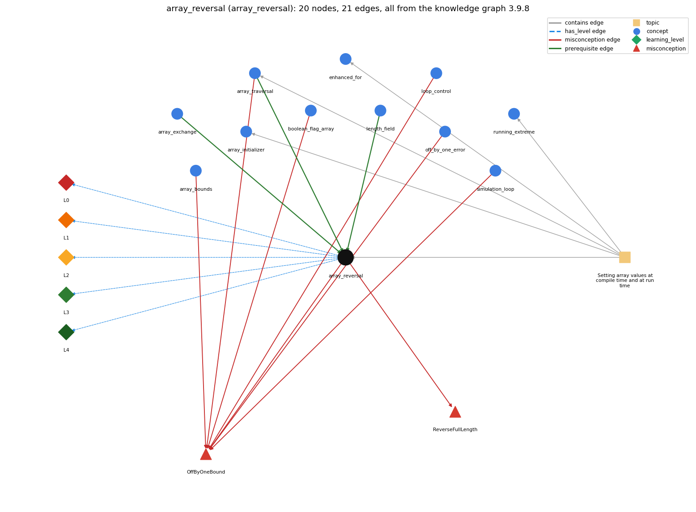

# array_reversal (`array_reversal`)

reversing an array in place

Section 1.4 Arrays, topic 1.4.c Setting array values at compile time and at run time.

## At a glance

- **Needs first:** `array_exchange`, `array_traversal`, `length_field`
- **Leads to:** nothing
- **Learned alongside:** nothing
- **Misconceptions:** `OffByOneBound`, `ReverseFullLength`
- **Errors:** none
- **Levels:** L0, L1, L2, L3, L4

Everything below comes from the knowledge graph 3.9.8 (`data/raw/chapter1_kg_updated.json`): 21 edges around this concept. The edge logic, the wrong and right rules and the exact rules of the ways are copied word for word from the graph.

## To work on (1)

- no aliases: a student's words cannot name this concept

## What it needs first (3)

A prerequisite edge means the other concept has to be understood before `array_reversal`.

### `array_exchange` comes before `array_reversal`

*swap a[i] and a[j] through a temporary variable*

- **Edge:** `pre:array_exchange->array_reversal`
- **Exact edge logic:** Reversal exchanges a[i] with a[N-1-i] for each i in the first half of the array.
- **Grounding:** book\_passage
- **Composition rule (R) of `array_reversal` with `array_exchange`:** Reversal is a loop of exchanges a[i] &lt;-&gt; a[N-1-i], so it inherits the exchange idiom and its temporary variable.
- **Composition rule (R) of `array_exchange` with `array_reversal`:** Reversal exchanges a[i] with a[N-1-i] for each i in the first half.

### `array_traversal` comes before `array_reversal`

*walking the array with an index loop*

- **Edge:** `pre:array_traversal->array_reversal`
- **Exact edge logic:** Reversal traverses only the first half of the array (i &lt; N/2), exchanging each a[i] with its mirror a[N-1-i].
- **Grounding:** book\_passage
- **Composition rule (R) of `array_reversal` with `array_traversal`:** Reversal traverses only the first half (i &lt; N/2) while indexing the second half through the mirror index.
- **Composition rule (R) of `array_traversal` with `array_reversal`:** Reversal traverses only the first half (i &lt; N/2), exchanging each a[i] with its mirror a[N-1-i].

### `length_field` comes before `array_reversal`

*a.length is a field, not a method*

- **Edge:** `pre:length_field->array_reversal`
- **Exact edge logic:** Reversal pairs a[i] with a[a.length-1-i], counting back from the last index a.length-1.
- **Grounding:** book\_passage

## What it leads to (0)

These concepts need `array_reversal` first.

No concept has this one as a prerequisite.

## Learned alongside (0)

A parallel edge joins two concepts that sit side by side: neither is needed before the other.

No parallel edge touches this concept.

## Misconceptions (2)

A misconception edge states the wrong rule a student may hold about this concept, and the right rule.

### OffByOneBound

- **Edge:** `array_reversal` &rarr; `OffByOneBound` (misconception)
- **Exact edge logic (the wrong rule):** &lt; vs &lt;= and 0..n vs 0..n-1 are interchangeable
- **Twin logic (the right rule):** for (i = 0; i &lt; n; i++) runs n times with i going up to n - 1; with &lt;= it runs n + 1 times and reaches i = n.
- **Wrong belief (on the node):** &lt; vs &lt;= and 0..n vs 0..n-1 are interchangeable
- **Correct rule (on the node):** for (i = 0; i &lt; n; i++) runs n times with i going up to n - 1; with &lt;= it runs n + 1 times and reaches i = n.
- **Provenance:** published
- **Role of this concept:** context
- **L0 way linked to it:** yes
- **L0 way [3] misconception, exact rule:** wrong rule: &lt; vs &lt;= and 0..n vs 0..n-1 are interchangeable. Right rule: The mirror of a[i] is a[N-1-i] (not a[N-i]), and the loop runs while i &lt; N/2.
- **Edge `array_bounds` &rarr; `OffByOneBound`, exact edge logic:** &lt; vs &lt;= and 0..n vs 0..n-1 are interchangeable **Twin logic:** for (i = 0; i &lt; n; i++) runs n times with i going up to n - 1; with &lt;= it runs n + 1 times and reaches i = n. (role: context)
- **Edge `array_traversal` &rarr; `OffByOneBound`, exact edge logic:** &lt; vs &lt;= and 0..n vs 0..n-1 are interchangeable **Twin logic:** for (i = 0; i &lt; n; i++) runs n times with i going up to n - 1; with &lt;= it runs n + 1 times and reaches i = n. (role: context)
- **Edge `boolean_flag_array` &rarr; `OffByOneBound`, exact edge logic:** &lt; vs &lt;= and 0..n vs 0..n-1 are interchangeable **Twin logic:** for (i = 0; i &lt; n; i++) runs n times with i going up to n - 1; with &lt;= it runs n + 1 times and reaches i = n. (role: context)
- **Edge `loop_control` &rarr; `OffByOneBound`, exact edge logic:** i &lt; n and i &lt;= n mean the same, so the loop runs until i equals n and the last pass can use a[n]. **Twin logic:** for (i = 0; i &lt; n; i++) runs n times with i going up to n - 1; with &lt;= it runs n + 1 times and reaches i = n. (role: primary)
- **Edge `off_by_one_error` &rarr; `OffByOneBound`, exact edge logic:** &lt; vs &lt;= and 0..n vs 0..n-1 are interchangeable **Twin logic:** for (i = 0; i &lt; n; i++) runs n times with i going up to n - 1; with &lt;= it runs n + 1 times and reaches i = n. (role: context)
- **Edge `simulation_loop` &rarr; `OffByOneBound`, exact edge logic:** t &lt; T and t &lt;= T give the same number of moves. **Twin logic:** for (t = 0; t &lt; T; t++) makes exactly T moves; with &lt;= it makes T + 1. (role: context)

### ReverseFullLength

- **Edge:** `array_reversal` &rarr; `ReverseFullLength` (misconception)
- **Exact edge logic (the wrong rule):** Reversing an array needs a swap for every one of the n positions.
- **Twin logic (the right rule):** Swapping for i &lt; n/2 is enough; going to n undoes the reversal.
- **Wrong belief (on the node):** Reversing an array needs a swap for every one of the n positions.
- **Correct rule (on the node):** Swapping for i &lt; n/2 is enough; going to n undoes the reversal.
- **Provenance:** derived
- **Role of this concept:** primary
- **L0 way linked to it:** yes
- **L0 way [1] misconception, exact rule:** wrong rule: Reversing an array needs a swap for every one of the n positions. Right rule: Swapping for i &lt; n/2 is enough; going to n undoes the reversal.
- **L0 way [2] inconsistent\_trace, exact rule:** Points to LT: for i from 0 while i &lt; N/2, save a[i] in temp, copy a[N-1-i] to a[i], and copy temp to a[N-1-i]. Inconsistent application: the trace exchanges a mirror pair on some passes but only copies one way on others, or computes the mirror with an updated i. (here mixing in: "Reversing an array needs a swap for every one of the n positions")

## Errors (0)

An error edge states the rule that gets broken in a program, and the right rule.

The graph has no error edge from this concept.

## Levels L0 to L4 (5 of 5)

Each level edge lists the ways a student shows that level, each with its exact rule.

### L0: Prestructural / sensorimotor

L0 for array reversal: the answer holds a rule that contradicts Java.

*Deciding question: Does every rule the answer applies to array reversal agree with the language rule? If it reads the code with everyday meanings, applies a wrong rule, or switches rules within one trace, it is L0. A slip in an otherwise rule-correct trace is L2 with an error, not L0.*

- **Edge:** `array_reversal` &rarr; `array_reversal@L0` (has_level)
- **Exact edge logic:** array reversal -&gt; L0 (Prestructural): the answer holds a rule that contradicts Java (4 ways).

Ways (4), each with its exact rule:

- **[0] everyday\_reading** (rule type E, folk-meaning rule): Folk meaning: 'reverse every element' suggests one swap per position, so the loop runs over all n positions. Java rule: each exchange moves two elements, so n/2 exchanges (i &lt; N/2) reverse the array, and n exchanges reverse it twice, restoring the original.
- **[1] misconception** (rule type M, wrong rule / right rule) &rarr; `ReverseFullLength`: wrong rule: Reversing an array needs a swap for every one of the n positions. Right rule: Swapping for i &lt; n/2 is enough; going to n undoes the reversal.
- **[2] inconsistent\_trace** (rule type T, uneven-application rule) &rarr; `ReverseFullLength`: Points to LT: for i from 0 while i &lt; N/2, save a[i] in temp, copy a[N-1-i] to a[i], and copy temp to a[N-1-i]. Inconsistent application: the trace exchanges a mirror pair on some passes but only copies one way on others, or computes the mirror with an updated i. (here mixing in: "Reversing an array needs a swap for every one of the n positions")
- **[3] misconception** (rule type M, wrong rule / right rule) &rarr; `OffByOneBound`: wrong rule: &lt; vs &lt;= and 0..n vs 0..n-1 are interchangeable. Right rule: The mirror of a[i] is a[N-1-i] (not a[N-i]), and the loop runs while i &lt; N/2.

### L1: Unistructural / atom x text surface

L1 for array reversal: the answer states one correct rule without applying it.

*Deciding question: Does the answer cover every part of the code, in order, with the values (L2)? If it covers one part or only states the rule, it is L1.*

- **Edge:** `array_reversal` &rarr; `array_reversal@L1` (has_level)
- **Exact edge logic:** array reversal -&gt; L1 (Unistructural): the answer states one correct rule without applying it (2 ways).

Ways (2), each with its exact rule:

- **[0] names\_the\_element** (rule type N, identity rule): Identity: in-place reversal rearranges an array so that a[i] and a[N-1-i] trade places for every i, without a second array.
- **[1] states\_the\_rule** (rule type S, declarative rule): Declarative: for (int i = 0; i &lt; N/2; i++) { temp = b[i]; b[i] = b[N-1-i]; b[N-1-i] = temp; }.

### L2: Multistructural / block x execution / preoperational

L2 for array reversal: the answer applies these rules to every part of the code, in order.

*Deciding question: Is the answer many segments mapped onto lines (L2), or one segment stating the purpose of the whole (L3)? A correct output with no value-by-value justification is not levelled.*

- **Edge:** `array_reversal` &rarr; `array_reversal@L2` (has_level)
- **Exact edge logic:** array reversal -&gt; L2 (Multistructural): the answer applies the rules of array reversal to every part of the code, in order (3 ways).

Ways (3), each with its exact rule:

- **[0] line\_by\_line\_trace** (rule type LT, operational sequencing rule): Sequencing: pass i exchanges the i-th pair from the outside in: (0, N-1), (1, N-2), ... For odd N the middle element is never touched, because N/2 rounds down.
- **[1] output\_prediction** (rule type OP, evaluation / result rule): Result: {1, 2, 3, 4, 5} becomes {5, 4, 3, 2, 1} with the same length and the same values.
- **[2] one\_step\_execution** (rule type OS, state-transition rule): State transition: each pass changes exactly two elements, a[i] and a[N-1-i] (plus temp); other elements and N are unchanged.

### L3: Relational / relations x function (concrete operational begins)

L3 for array reversal: the answer relates the parts by these rules.

*Deciding question: Was the purpose deduced from the code, or only guessed from traced input/output pairs (then L2)? Does the answer stay within the given code (L3), or reason about changed code, an error class or a new program (L4)?*

- **Edge:** `array_reversal` &rarr; `array_reversal@L3` (has_level)
- **Exact edge logic:** array reversal -&gt; L3 (Relational): the answer relates the parts (3 ways).

Ways (3), each with its exact rule:

- **[0] relation\_to\_neighbour** (rule type R, composition rule (with a neighbour)): Reversal is a loop of exchanges a[i] &lt;-&gt; a[N-1-i], so it inherits the exchange idiom and its temporary variable.
- **[1] relation\_to\_neighbour** (rule type R, composition rule (with a neighbour)): Reversal traverses only the first half (i &lt; N/2) while indexing the second half through the mirror index.
- **[2] purpose\_of\_the\_whole** (rule type P, plan / role rule): Plan/role: a two-ended mirror-swap plan in which the array plays the role of an organizer, its elements rearranged in place.

### L4: Extended abstract (concrete-operational reversibility and conservation)

L4 for array reversal: the answer reasons beyond the given code by these rules.

*Deciding question: Does the answer link the code to a broader context: a changed program, a class of inputs, an unseen problem? Re-tracing changed code value by value is L2; fixing one given failing case is L3.*

- **Edge:** `array_reversal` &rarr; `array_reversal@L4` (has_level)
- **Exact edge logic:** array reversal -&gt; L4 (Extended abstract): the answer reasons beyond the given code (5 ways).

Ways (5), each with its exact rule:

- **[0] predict\_a\_change** (rule type C, conservation rule) &rarr; `ReverseFullLength`: Conservation: the multiset of values is preserved (only exchanges are used). Reversal is its own inverse: reversing twice, or running the loop to N instead of N/2, gives back the original order.
- **[1] transfer\_to\_a\_new\_program** (rule type X, applicability rule): Applicability: reverse in place when the original order is no longer needed and memory matters. When the original must be kept, copy into a new array (b[N-1-i] = a[i]) or just traverse backwards.
- **[2] diagnose\_an\_error** (rule type D, error rule): rule broken: Only the first half is traversed. Kind: silent logic error. Trigger class: the loop runs i &lt; N, so every pair is swapped twice and the array ends unchanged
- **[3] diagnose\_an\_error** (rule type D, error rule): rule broken: The mirror index is N-1-i. Kind: run-time exception. Trigger class: the mirror is written a[N-i], which is a[N] at i = 0 (ArrayIndexOutOfBoundsException)
- **[4] diagnose\_an\_error** (rule type D, error rule): rule broken: The exchange needs a temporary variable. Kind: silent logic error. Trigger class: a[i] = a[N-1-i]; a[N-1-i] = a[i]; leaves the array a palindrome of its second half

## Same topic

`array_reversal` belongs to the topic **Setting array values at compile time and at run time** (`topic1.4.c`). The topic also contains: `array_initializer`, `array_traversal`, `enhanced_for`, `running_extreme`.

## Rules of the concept (17)

- **Book** (SW-1e, p. 113 (pdf 123)): "Write a code fragment that reverses the order of a one-dimensional array a[] of String values."
- **Book** (SW-1e, p. 113 (pdf 123)): "Do not create another array to hold the result."
- **Book** (SW-1.4, ): "reverses the order of values in a one-dimensional string array. Do not create another array to hold the result."
- **E** (folk-meaning rule): Folk meaning: 'reverse every element' suggests one swap per position, so the loop runs over all n positions. Java rule: each exchange moves two elements, so n/2 exchanges (i &lt; N/2) reverse the array, and n exchanges reverse it twice, restoring the original.
- **M** (wrong rule / right rule): OffByOneBound: wrong: &lt; vs &lt;= and 0..n vs 0..n-1 are interchangeable. \| right: The mirror of a[i] is a[N-1-i] (not a[N-i]), and the loop runs while i &lt; N/2.
- **M** (wrong rule / right rule): ReverseFullLength: wrong: Reversing an array needs a swap for every one of the n positions. \| right: Swapping for i &lt; n/2 is enough; going to n undoes the reversal.
- **T** (uneven-application rule): Points to LT: for i from 0 while i &lt; N/2, save a[i] in temp, copy a[N-1-i] to a[i], and copy temp to a[N-1-i]. Inconsistent application: the trace exchanges a mirror pair on some passes but only copies one way on others, or computes the mirror with an updated i.
- **N** (identity rule): Identity: in-place reversal rearranges an array so that a[i] and a[N-1-i] trade places for every i, without a second array.
- **S** (declarative rule): Declarative: for (int i = 0; i &lt; N/2; i++) { temp = b[i]; b[i] = b[N-1-i]; b[N-1-i] = temp; }.
- **LT** (operational sequencing rule): Sequencing: pass i exchanges the i-th pair from the outside in: (0, N-1), (1, N-2), ... For odd N the middle element is never touched, because N/2 rounds down.
- **OP** (evaluation / result rule): Result: {1, 2, 3, 4, 5} becomes {5, 4, 3, 2, 1} with the same length and the same values.
- **OS** (state-transition rule): State transition: each pass changes exactly two elements, a[i] and a[N-1-i] (plus temp); other elements and N are unchanged.
- **R** (composition rule (with a neighbour)): with array\_exchange: Reversal is a loop of exchanges a[i] &lt;-&gt; a[N-1-i], so it inherits the exchange idiom and its temporary variable.
- **R** (composition rule (with a neighbour)): with array\_traversal: Reversal traverses only the first half (i &lt; N/2) while indexing the second half through the mirror index.
- **P** (plan / role rule): Plan/role: a two-ended mirror-swap plan in which the array plays the role of an organizer, its elements rearranged in place.
- **C** (conservation rule): Conservation: the multiset of values is preserved (only exchanges are used). Reversal is its own inverse: reversing twice, or running the loop to N instead of N/2, gives back the original order.
- **D** (error rule): rule broken: Only the first half is traversed. (silent logic error)
- **D** (error rule): rule broken: The mirror index is N-1-i. (run-time exception)
- **D** (error rule): rule broken: The exchange needs a temporary variable. (silent logic error)
- **X** (applicability rule): Applicability: reverse in place when the original order is no longer needed and memory matters. When the original must be kept, copy into a new array (b[N-1-i] = a[i]) or just traverse backwards.

## How it is found in code and answers (reader block)

- **Aliases:** none
- **Code patterns:** `\[\s*\w+\.length\s*-\s*1\s*-\s*\w+\s*\]`, `\[\s*\w+\s*-\s*1\s*-\s*\w+\s*\]`, `\w+\s*<\s*\w+(?:\.length)?\s*/\s*2\b`, `\[\s*\w+\s*-\s*\w+\s*-\s*1\s*\]`
- **Operator symbols:** none
- **Java types:** none

## The whole prerequisite chain

- **Everything it builds on (26):** `arithmetic_operators`, `array_creation`, `array_declaration`, `array_exchange`, `array_initializer`, `array_traversal`, `assignment`, `boolean`, `boolean_expression`, `comparison_operators`, `data_structure`, `data_type`, `declaration`, `do_while_loop`, `expression`, `for_loop`, `identifier`, `indexing`, `length_field`, `literal`, `logical_operators`, `loop_control`, `loop_variable`, `primitive_type`, `variable`, `while_loop`
- **Everything that builds on it (0):** nothing

## Every edge in this view and its exact edge logic (21)

All the edges drawn in the picture, in the order: prerequisite, parallel, misconception, error, has_level, contains.

**1. `array_exchange` &rarr; `array_reversal`** (prerequisite)

- **Exact edge logic:** Reversal exchanges a[i] with a[N-1-i] for each i in the first half of the array.
- **Grounding:** book\_passage
- **Composition rule (R) of `array_exchange` with `array_reversal`:** Reversal exchanges a[i] with a[N-1-i] for each i in the first half.
- **Composition rule (R) of `array_reversal` with `array_exchange`:** Reversal is a loop of exchanges a[i] &lt;-&gt; a[N-1-i], so it inherits the exchange idiom and its temporary variable.

**2. `array_traversal` &rarr; `array_reversal`** (prerequisite)

- **Exact edge logic:** Reversal traverses only the first half of the array (i &lt; N/2), exchanging each a[i] with its mirror a[N-1-i].
- **Grounding:** book\_passage
- **Composition rule (R) of `array_traversal` with `array_reversal`:** Reversal traverses only the first half (i &lt; N/2), exchanging each a[i] with its mirror a[N-1-i].
- **Composition rule (R) of `array_reversal` with `array_traversal`:** Reversal traverses only the first half (i &lt; N/2) while indexing the second half through the mirror index.

**3. `length_field` &rarr; `array_reversal`** (prerequisite)

- **Exact edge logic:** Reversal pairs a[i] with a[a.length-1-i], counting back from the last index a.length-1.
- **Grounding:** book\_passage

**4. `array_reversal` &rarr; `OffByOneBound`** (misconception)

- **Exact edge logic (the wrong rule):** &lt; vs &lt;= and 0..n vs 0..n-1 are interchangeable
- **Twin logic (the right rule):** for (i = 0; i &lt; n; i++) runs n times with i going up to n - 1; with &lt;= it runs n + 1 times and reaches i = n.
- **Role:** context

**5. `array_reversal` &rarr; `ReverseFullLength`** (misconception)

- **Exact edge logic (the wrong rule):** Reversing an array needs a swap for every one of the n positions.
- **Twin logic (the right rule):** Swapping for i &lt; n/2 is enough; going to n undoes the reversal.
- **Role:** primary

**6. `array_bounds` &rarr; `OffByOneBound`** (misconception)

- **Exact edge logic (the wrong rule):** &lt; vs &lt;= and 0..n vs 0..n-1 are interchangeable
- **Twin logic (the right rule):** for (i = 0; i &lt; n; i++) runs n times with i going up to n - 1; with &lt;= it runs n + 1 times and reaches i = n.
- **Role:** context

**7. `array_traversal` &rarr; `OffByOneBound`** (misconception)

- **Exact edge logic (the wrong rule):** &lt; vs &lt;= and 0..n vs 0..n-1 are interchangeable
- **Twin logic (the right rule):** for (i = 0; i &lt; n; i++) runs n times with i going up to n - 1; with &lt;= it runs n + 1 times and reaches i = n.
- **Role:** context

**8. `boolean_flag_array` &rarr; `OffByOneBound`** (misconception)

- **Exact edge logic (the wrong rule):** &lt; vs &lt;= and 0..n vs 0..n-1 are interchangeable
- **Twin logic (the right rule):** for (i = 0; i &lt; n; i++) runs n times with i going up to n - 1; with &lt;= it runs n + 1 times and reaches i = n.
- **Role:** context

**9. `loop_control` &rarr; `OffByOneBound`** (misconception)

- **Exact edge logic (the wrong rule):** i &lt; n and i &lt;= n mean the same, so the loop runs until i equals n and the last pass can use a[n].
- **Twin logic (the right rule):** for (i = 0; i &lt; n; i++) runs n times with i going up to n - 1; with &lt;= it runs n + 1 times and reaches i = n.
- **Role:** primary

**10. `off_by_one_error` &rarr; `OffByOneBound`** (misconception)

- **Exact edge logic (the wrong rule):** &lt; vs &lt;= and 0..n vs 0..n-1 are interchangeable
- **Twin logic (the right rule):** for (i = 0; i &lt; n; i++) runs n times with i going up to n - 1; with &lt;= it runs n + 1 times and reaches i = n.
- **Role:** context

**11. `simulation_loop` &rarr; `OffByOneBound`** (misconception)

- **Exact edge logic (the wrong rule):** t &lt; T and t &lt;= T give the same number of moves.
- **Twin logic (the right rule):** for (t = 0; t &lt; T; t++) makes exactly T moves; with &lt;= it makes T + 1.
- **Role:** context

**12. `array_reversal` &rarr; `array_reversal@L0`** (has_level)

- **Exact edge logic:** array reversal -&gt; L0 (Prestructural): the answer holds a rule that contradicts Java (4 ways).
  - **[0] everyday\_reading** (rule type E, folk-meaning rule): Folk meaning: 'reverse every element' suggests one swap per position, so the loop runs over all n positions. Java rule: each exchange moves two elements, so n/2 exchanges (i &lt; N/2) reverse the array, and n exchanges reverse it twice, restoring the original.
  - **[1] misconception** (rule type M, wrong rule / right rule) &rarr; `ReverseFullLength`: wrong rule: Reversing an array needs a swap for every one of the n positions. Right rule: Swapping for i &lt; n/2 is enough; going to n undoes the reversal.
  - **[2] inconsistent\_trace** (rule type T, uneven-application rule) &rarr; `ReverseFullLength`: Points to LT: for i from 0 while i &lt; N/2, save a[i] in temp, copy a[N-1-i] to a[i], and copy temp to a[N-1-i]. Inconsistent application: the trace exchanges a mirror pair on some passes but only copies one way on others, or computes the mirror with an updated i. (here mixing in: "Reversing an array needs a swap for every one of the n positions")
  - **[3] misconception** (rule type M, wrong rule / right rule) &rarr; `OffByOneBound`: wrong rule: &lt; vs &lt;= and 0..n vs 0..n-1 are interchangeable. Right rule: The mirror of a[i] is a[N-1-i] (not a[N-i]), and the loop runs while i &lt; N/2.

**13. `array_reversal` &rarr; `array_reversal@L1`** (has_level)

- **Exact edge logic:** array reversal -&gt; L1 (Unistructural): the answer states one correct rule without applying it (2 ways).
  - **[0] names\_the\_element** (rule type N, identity rule): Identity: in-place reversal rearranges an array so that a[i] and a[N-1-i] trade places for every i, without a second array.
  - **[1] states\_the\_rule** (rule type S, declarative rule): Declarative: for (int i = 0; i &lt; N/2; i++) { temp = b[i]; b[i] = b[N-1-i]; b[N-1-i] = temp; }.

**14. `array_reversal` &rarr; `array_reversal@L2`** (has_level)

- **Exact edge logic:** array reversal -&gt; L2 (Multistructural): the answer applies the rules of array reversal to every part of the code, in order (3 ways).
  - **[0] line\_by\_line\_trace** (rule type LT, operational sequencing rule): Sequencing: pass i exchanges the i-th pair from the outside in: (0, N-1), (1, N-2), ... For odd N the middle element is never touched, because N/2 rounds down.
  - **[1] output\_prediction** (rule type OP, evaluation / result rule): Result: {1, 2, 3, 4, 5} becomes {5, 4, 3, 2, 1} with the same length and the same values.
  - **[2] one\_step\_execution** (rule type OS, state-transition rule): State transition: each pass changes exactly two elements, a[i] and a[N-1-i] (plus temp); other elements and N are unchanged.

**15. `array_reversal` &rarr; `array_reversal@L3`** (has_level)

- **Exact edge logic:** array reversal -&gt; L3 (Relational): the answer relates the parts (3 ways).
  - **[0] relation\_to\_neighbour** (rule type R, composition rule (with a neighbour)): Reversal is a loop of exchanges a[i] &lt;-&gt; a[N-1-i], so it inherits the exchange idiom and its temporary variable.
  - **[1] relation\_to\_neighbour** (rule type R, composition rule (with a neighbour)): Reversal traverses only the first half (i &lt; N/2) while indexing the second half through the mirror index.
  - **[2] purpose\_of\_the\_whole** (rule type P, plan / role rule): Plan/role: a two-ended mirror-swap plan in which the array plays the role of an organizer, its elements rearranged in place.

**16. `array_reversal` &rarr; `array_reversal@L4`** (has_level)

- **Exact edge logic:** array reversal -&gt; L4 (Extended abstract): the answer reasons beyond the given code (5 ways).
  - **[0] predict\_a\_change** (rule type C, conservation rule) &rarr; `ReverseFullLength`: Conservation: the multiset of values is preserved (only exchanges are used). Reversal is its own inverse: reversing twice, or running the loop to N instead of N/2, gives back the original order.
  - **[1] transfer\_to\_a\_new\_program** (rule type X, applicability rule): Applicability: reverse in place when the original order is no longer needed and memory matters. When the original must be kept, copy into a new array (b[N-1-i] = a[i]) or just traverse backwards.
  - **[2] diagnose\_an\_error** (rule type D, error rule): rule broken: Only the first half is traversed. Kind: silent logic error. Trigger class: the loop runs i &lt; N, so every pair is swapped twice and the array ends unchanged
  - **[3] diagnose\_an\_error** (rule type D, error rule): rule broken: The mirror index is N-1-i. Kind: run-time exception. Trigger class: the mirror is written a[N-i], which is a[N] at i = 0 (ArrayIndexOutOfBoundsException)
  - **[4] diagnose\_an\_error** (rule type D, error rule): rule broken: The exchange needs a temporary variable. Kind: silent logic error. Trigger class: a[i] = a[N-1-i]; a[N-1-i] = a[i]; leaves the array a palindrome of its second half

**17. `topic1.4.c` &rarr; `array_reversal`** (contains)

- topic `topic1.4.c` contains `array_reversal`

**18. `topic1.4.c` &rarr; `array_initializer`** (contains)

- topic `topic1.4.c` contains `array_initializer`

**19. `topic1.4.c` &rarr; `array_traversal`** (contains)

- topic `topic1.4.c` contains `array_traversal`

**20. `topic1.4.c` &rarr; `enhanced_for`** (contains)

- topic `topic1.4.c` contains `enhanced_for`

**21. `topic1.4.c` &rarr; `running_extreme`** (contains)

- topic `topic1.4.c` contains `running_extreme`
