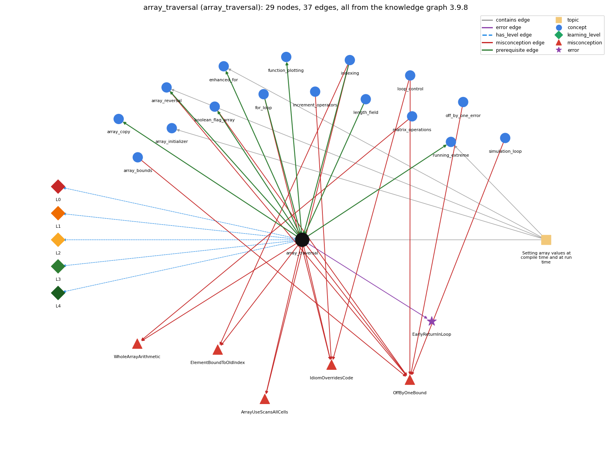

# array_traversal (`array_traversal`)

walking the array with an index loop

Section 1.4 Arrays, topic 1.4.c Setting array values at compile time and at run time.

## At a glance

- **Needs first:** `for_loop`, `indexing`, `length_field`
- **Leads to:** `array_copy`, `array_reversal`, `boolean_flag_array`, `enhanced_for`, `function_plotting`, `running_extreme`
- **Learned alongside:** nothing
- **Misconceptions:** `ArrayUseScansAllCells`, `ElementBoundToOldIndex`, `IdiomOverridesCode`, `OffByOneBound`, `WholeArrayArithmetic`
- **Errors:** `EarlyReturnInLoop`
- **Levels:** L0, L1, L2, L3, L4

Everything below comes from the knowledge graph 3.9.8 (`data/raw/chapter1_kg_updated.json`): 37 edges around this concept, each explained in the graph's own words.

## What it needs first (3)

A prerequisite edge means the other concept has to be understood before `array_traversal`.

### `for_loop` comes before `array_traversal`

*a while with init/condition/update packaged together*

for (int i = 0; i &lt; a.length; i++) gives i every valid index exactly once, in increasing order.

- **Grounding:** book passage
- **How `array_traversal` combines with `for_loop`:** for (int i = 0; i &lt; a.length; i++) gives i every valid index exactly once, in increasing order; the bound must be &lt; a.length, not &lt;=.
- **How `for_loop` combines with `array_traversal`:** for (int i = 0; i &lt; N; i++) gives i each valid index 0..N-1 exactly once in increasing order, the standard way to process every array element.

### `indexing` comes before `array_traversal`

*a[i] -- 0-based access*

A traversal uses the loop variable i as the index, so a[i] reaches a different element on each pass.

- **Grounding:** book passage
- **How `array_traversal` combines with `indexing`:** The loop variable is used as the index, so a[i] reaches a different element on each pass.
- **How `indexing` combines with `array_traversal`:** A traversal uses the loop variable as the index, so the same expression a[i] reaches a different element on each pass.

### `length_field` comes before `array_traversal`

*a.length is a field, not a method*

A traversal loop runs its index from 0 while it is below a.length, so it visits every element once.

- **Grounding:** book passage

## What it leads to (6)

These concepts need `array_traversal` first.

### `array_traversal` comes before `array_copy`

*making a second, independent array with the same elements: create a new array and copy element by element (or Arrays.copyOf)*

The elements are copied one at a time by a loop over every index.

- **Grounding:** book passage
- **How `array_copy` combines with `array_traversal`:** The copy is a traversal of every index of the original.

### `array_traversal` comes before `array_reversal`

*reversing an array in place*

Reversal traverses only the first half of the array (i &lt; N/2), exchanging each a[i] with its mirror a[N-1-i].

- **Grounding:** book passage
- **How `array_traversal` combines with `array_reversal`:** Reversal traverses only the first half (i &lt; N/2), exchanging each a[i] with its mirror a[N-1-i].
- **How `array_reversal` combines with `array_traversal`:** Reversal traverses only the first half (i &lt; N/2) while indexing the second half through the mirror index.

### `array_traversal` comes before `boolean_flag_array`

*boolean[] used to mark which values are seen (coupon collector, sieve)*

The sieve traverses isPrime[] to set every flag to true and later traverses it again to count the flags that are still true.

- **Grounding:** book passage
- **How `array_traversal` combines with `boolean_flag_array`:** The sieve traverses isPrime[] once to set every flag to true and again at the end to count the flags still true.
- **How `boolean_flag_array` combines with `array_traversal`:** The sieve traverses isPrime[] to set every flag to true and later traverses it again to count the flags still true.

### `array_traversal` comes before `enhanced_for`

*for (int x : a) -- the for-each form*

for (int x : a) is a traversal that hands the body each value a[i] instead of the index i.

- **Grounding:** book passage
- **How `array_traversal` combines with `enhanced_for`:** for (int x : a) is a traversal that hands the body each value a[i] and hides the index i.
- **How `enhanced_for` combines with `array_traversal`:** It is a full forward traversal with the index hidden, so it cannot skip, go backward, stop at a computed index or write a[i].

### `array_traversal` comes before `function_plotting`

*sampling a function and joining the points with lines*

The sample points are kept in arrays and traversed.

- **Grounding:** book passage
- **How `array_traversal` combines with `function_plotting`:** Sample points are computed into x[] and y[] by one traversal and drawn by another.
- **How `function_plotting` combines with `array_traversal`:** The arrays have N+1 elements (indices 0..N). The drawing loop starts at i = 1 so that x[i-1] stays in bounds; starting at 0 would access x[-1].

### `array_traversal` comes before `running_extreme`

*tracking the max or min of a stream*

The running maximum is found by traversing the array once, keeping the largest value seen so far (starting from Double.NEGATIVE\_INFINITY).

- **Grounding:** book passage
- **How `array_traversal` combines with `running_extreme`:** The running maximum is found in one traversal that keeps the largest value seen so far, starting from Double.NEGATIVE\_INFINITY.
- **How `running_extreme` combines with `array_traversal`:** The maximum is found in one traversal, keeping the largest value seen so far, starting from Double.NEGATIVE\_INFINITY.

## Learned alongside (0)

A parallel edge joins two concepts that sit side by side: neither is needed before the other.

No parallel edge touches this concept.

## Misconceptions (5)

A misconception edge states the wrong rule a student may hold about this concept, and the right rule.

### ArrayUseScansAllCells

- **Wrong rule:** Using an array means every cell must be scanned.
- **Right rule:** Arrays allow random access: a[i] reaches one element directly, and a loop visits only the elements the task needs.
- **Role of this concept:** primary
- **Shows at level L0 as:** misconception: wrong rule: Using an array means every cell must be scanned. Right rule: A traversal may cover only part of the array or stop early (as in a search); indexing reaches single elements directly.
- **Also an edge from `indexing`:** Using an array means every cell must be scanned.

### ElementBoundToOldIndex

- **Wrong rule:** After i changes, X[i] still refers to the element at the old value of i.
- **Right rule:** a[i] is evaluated with the current value of i each time it is used.
- **Role of this concept:** context
- **Shows at level L0 as:** misconception: wrong rule: After i changes, X[i] still refers to the element at the old value of i. Right rule: a[i] is evaluated with the current value of i each time it is used.
- **Also an edge from `indexing`:** After i changes, X[i] still refers to the element at the old value of i.

### IdiomOverridesCode

- **Wrong rule:** An array loop processes the whole array from index 0 to length-1 and increments its index at the end of the body, whatever the code says.
- **Right rule:** The loop visits exactly the indices that its initialisation, guard and update produce, in the order in which its statements are written.
- **Role of this concept:** primary
- **Shows at level L0 as:** misconception: wrong rule: An array loop processes the whole array from index 0 to length-1 and increments its index at the end of the body, whatever the code says. Right rule: The loop visits exactly the indices that its initialisation, guard and update produce, in the order in which its statements are written.
- **Also an edge from `for_loop`:** An array loop processes the whole array from index 0 to length-1 and increments its index at the end of the body, whatever the code says.
- **Also an edge from `increment_operators`:** An array loop processes the whole array from index 0 to length-1 and increments its index at the end of the body, whatever the code says.
- **Also an edge from `loop_control`:** An array loop processes the whole array from index 0 to length-1 and increments its index at the end of the body, whatever the code says.

### OffByOneBound

- **Wrong rule:** &lt; vs &lt;= and 0..n vs 0..n-1 are interchangeable
- **Right rule:** for (i = 0; i &lt; n; i++) runs n times with i going up to n - 1; with &lt;= it runs n + 1 times and reaches i = n.
- **Role of this concept:** context
- **Shows at level L0 as:** misconception: wrong rule: &lt; vs &lt;= and 0..n vs 0..n-1 are interchangeable. Right rule: for (i = 0; i &lt; n; i++) runs n times with i going up to n - 1; with &lt;= it runs n + 1 times and reaches i = n.
- **Also an edge from `array_bounds`:** &lt; vs &lt;= and 0..n vs 0..n-1 are interchangeable
- **Also an edge from `array_reversal`:** &lt; vs &lt;= and 0..n vs 0..n-1 are interchangeable
- **Also an edge from `boolean_flag_array`:** &lt; vs &lt;= and 0..n vs 0..n-1 are interchangeable
- **Also an edge from `loop_control`:** i &lt; n and i &lt;= n mean the same, so the loop runs until i equals n and the last pass can use a[n].
- **Also an edge from `off_by_one_error`:** &lt; vs &lt;= and 0..n vs 0..n-1 are interchangeable
- **Also an edge from `simulation_loop`:** t &lt; T and t &lt;= T give the same number of moves.

### WholeArrayArithmetic

- **Wrong rule:** a = a + b adds the arrays element by element.
- **Right rule:** Java has no arithmetic on whole arrays; write a loop that adds a[i] + b[i] for each i.
- **Role of this concept:** primary
- **Shows at level L0 as:** misconception: wrong rule: a = a + b adds the arrays element by element. Right rule: Java has no arithmetic on whole arrays; write a loop that adds a[i] + b[i] for each i.
- **Shows at level L0 as:** inconsistent trace: Points to LT: initialize i, test, run the body with the current i, update, test again. Inconsistent application: on some passes the update is applied before the body, or a[i] is traced with the previous i. (here mixing in: "a = a + b adds the arrays element by element")
- **Also an edge from `matrix_operations`:** a = a + b adds the arrays element by element.

## Errors (1)

An error edge states the rule that gets broken in a program, and the right rule.

### EarlyReturnInLoop

- **Wrong rule:** Leaves a traversal loop with return before every element has been processed.
- **Right rule:** A result that depends on all elements is known only after the loop ends.
- **Role of this concept:** primary

## Levels L0 to L4 (5 of 5)

Each level edge lists the ways a student shows that level, each with its exact rule.

### L0: Prestructural / sensorimotor

L0 for array traversal: the answer holds a rule that contradicts Java.

*Deciding question: Does every rule the answer applies to array traversal agree with the language rule? If it reads the code with everyday meanings, applies a wrong rule, or switches rules within one trace, it is L0. A slip in an otherwise rule-correct trace is L2 with an error, not L0.*

array traversal -&gt; L0 (Prestructural): the answer holds a rule that contradicts Java (7 ways).

- **everyday reading** (folk-meaning rule): Folk meaning: 'go through the list' in English means look at every item once, first to last, so an array loop is assumed to process the whole array whatever its code says. Java rule: the loop visits exactly the indices its initialization, guard and update generate, in that order.
- **misconception** (wrong rule / right rule; shows `WholeArrayArithmetic`): wrong rule: a = a + b adds the arrays element by element. Right rule: Java has no arithmetic on whole arrays; write a loop that adds a[i] + b[i] for each i.
- **misconception** (wrong rule / right rule; shows `IdiomOverridesCode`): wrong rule: An array loop processes the whole array from index 0 to length-1 and increments its index at the end of the body, whatever the code says. Right rule: The loop visits exactly the indices that its initialisation, guard and update produce, in the order in which its statements are written.
- **misconception** (wrong rule / right rule; shows `ArrayUseScansAllCells`): wrong rule: Using an array means every cell must be scanned. Right rule: A traversal may cover only part of the array or stop early (as in a search); indexing reaches single elements directly.
- **inconsistent trace** (uneven-application rule; shows `WholeArrayArithmetic`): Points to LT: initialize i, test, run the body with the current i, update, test again. Inconsistent application: on some passes the update is applied before the body, or a[i] is traced with the previous i. (here mixing in: "a = a + b adds the arrays element by element")
- **misconception** (wrong rule / right rule; shows `OffByOneBound`): wrong rule: &lt; vs &lt;= and 0..n vs 0..n-1 are interchangeable. Right rule: for (i = 0; i &lt; n; i++) runs n times with i going up to n - 1; with &lt;= it runs n + 1 times and reaches i = n.
- **misconception** (wrong rule / right rule; shows `ElementBoundToOldIndex`): wrong rule: After i changes, X[i] still refers to the element at the old value of i. Right rule: a[i] is evaluated with the current value of i each time it is used.

### L1: Unistructural / atom x text surface

L1 for array traversal: the answer states one correct rule without applying it.

*Deciding question: Does the answer cover every part of the code, in order, with the values (L2)? If it covers one part or only states the rule, it is L1.*

array traversal -&gt; L1 (Unistructural): the answer states one correct rule without applying it (2 ways).

- **names the element** (identity rule): Identity: a traversal is a loop that steps an index through the array and performs the same operation on each element it visits.
- **states the rule** (declarative rule): Declarative: the canonical traversal is 'for (int i = 0; i &lt; a.length; i++) { ... a[i] ... }', which gives i every valid index exactly once, in increasing order; the for loop is equivalent to initialize; while (test) { body; increment; }.

### L2: Multistructural / block x execution / preoperational

L2 for array traversal: the answer applies these rules to every part of the code, in order.

*Deciding question: Is the answer many segments mapped onto lines (L2), or one segment stating the purpose of the whole (L3)? A correct output with no value-by-value justification is not levelled.*

array traversal -&gt; L2 (Multistructural): the answer applies the rules of array traversal to every part of the code, in order (3 ways).

- **line by line trace** (operational sequencing rule): Sequencing: i = 0; test i &lt; a.length; body using a[i]; i++; test; ... When i == a.length the test fails and the body is not executed, so a[a.length] is never touched.
- **output prediction** (evaluation / result rule): Result: the body runs a.length times, and the result depends on the body. Squaring each element of {1, 2, 3, 4, 5} leaves {1, 4, 9, 16, 25}; summing leaves the total in the accumulator.
- **one step execution** (state-transition rule): State transition: one pass applies the body to element i (reading or writing a[i] and possibly updating an accumulator), then i increases by 1; no other element is touched unless the body indexes it.

### L3: Relational / relations x function (concrete operational begins)

L3 for array traversal: the answer relates the parts by these rules.

*Deciding question: Was the purpose deduced from the code, or only guessed from traced input/output pairs (then L2)? Does the answer stay within the given code (L3), or reason about changed code, an error class or a new program (L4)?*

array traversal -&gt; L3 (Relational): the answer relates the parts (9 ways).

- **relation to neighbour** (composition rule (with a neighbour)): The loop variable is used as the index, so a[i] reaches a different element on each pass.
- **relation to neighbour** (composition rule (with a neighbour)): for (int x : a) is a traversal that hands the body each value a[i] and hides the index i.
- **relation to neighbour** (composition rule (with a neighbour)): for (int i = 0; i &lt; a.length; i++) gives i every valid index exactly once, in increasing order; the bound must be &lt; a.length, not &lt;=.
- **relation to neighbour** (composition rule (with a neighbour)): The sieve traverses isPrime[] once to set every flag to true and again at the end to count the flags still true.
- **relation to neighbour** (composition rule (with a neighbour)): Reversal traverses only the first half (i &lt; N/2), exchanging each a[i] with its mirror a[N-1-i].
- **relation to neighbour** (composition rule (with a neighbour)): Sample points are computed into x[] and y[] by one traversal and drawn by another.
- **relation to neighbour** (composition rule (with a neighbour)): The running maximum is found in one traversal that keeps the largest value seen so far, starting from Double.NEGATIVE\_INFINITY.
- **relation to neighbour** (composition rule (with a neighbour)): The elements are copied one at a time by a loop over every index.
- **purpose of the whole** (plan / role rule): Plan/role: the index is a stepper, and the loop carries out a Soloway-style plan (accumulate/sum with a gatherer, count, search, find the extreme, copy) once for each element.

### L4: Extended abstract (concrete-operational reversibility and conservation)

L4 for array traversal: the answer reasons beyond the given code by these rules.

*Deciding question: Does the answer link the code to a broader context: a changed program, a class of inputs, an unseen problem? Re-tracing changed code value by value is L2; fixing one given failing case is L3.*

array traversal -&gt; L4 (Extended abstract): the answer reasons beyond the given code (6 ways).

- **predict a change** (conservation rule; shows `WholeArrayArithmetic`): Conservation: running the index downward (a.length-1 to 0) visits the same set of elements in reverse order, harmless for a sum but not for a shift. Starting at 1 or stopping at a.length-1 drops an element. Invariant: before pass i, elements 0..i-1 have been processed.
- **diagnose an error** (error rule): rule broken: A result that depends on all elements is known only after the loop ends. Kind: silent logic error. Trigger class: a return (or break) placed inside the loop body fires on the first element, e.g. returning false/-1 in the else branch of a search, or returning the sum inside the loop
- **transfer to a new program** (applicability rule): Applicability: use an index traversal when every element (or a contiguous range) must be processed and the index matters (writing a[i], comparing neighbours, reporting positions). Use enhanced for when only the values matter, and stop early when one element settles the answer (search).
- **diagnose an error** (error rule): rule broken: The guard must be i &lt; a.length. Kind: run-time exception. Trigger class: i &lt;= a.length (or a body that reads a[i+1]) makes the last pass index a.length (ArrayIndexOutOfBoundsException)
- **diagnose an error** (error rule): rule broken: The traversal must cover every element it is meant to process. Kind: silent logic error. Trigger class: the loop starts at 1 or stops at a.length-1, so an end element is skipped
- **diagnose an error** (error rule): rule broken: Arithmetic operators do not apply to whole arrays. Kind: compile-time. Trigger class: a + b or a \* 2 written for arrays (bad operand types for binary operator)

## Same topic

`array_traversal` belongs to the topic **Setting array values at compile time and at run time** (`topic1.4.c`). The topic also contains: `array_initializer`, `array_reversal`, `enhanced_for`, `running_extreme`.

## Rules of the concept (26)

- **folk-meaning rule:** Folk meaning: 'go through the list' in English means look at every item once, first to last, so an array loop is assumed to process the whole array whatever its code says. Java rule: the loop visits exactly the indices its initialization, guard and update generate, in that order.
- **wrong rule / right rule:** OffByOneBound: wrong: &lt; vs &lt;= and 0..n vs 0..n-1 are interchangeable. \| right: for (i = 0; i &lt; n; i++) runs n times with i going up to n - 1; with &lt;= it runs n + 1 times and reaches i = n.
- **wrong rule / right rule:** WholeArrayArithmetic: wrong: a = a + b adds the arrays element by element. \| right: Java has no arithmetic on whole arrays; write a loop that adds a[i] + b[i] for each i.
- **wrong rule / right rule:** IdiomOverridesCode: wrong: An array loop processes the whole array from index 0 to length-1 and increments its index at the end of the body, whatever the code says. \| right: The loop visits exactly the indices that its initialisation, guard and update produce, in the order in which its statements are written.
- **wrong rule / right rule:** ElementBoundToOldIndex: wrong: After i changes, X[i] still refers to the element at the old value of i. \| right: a[i] is evaluated with the current value of i each time it is used.
- **wrong rule / right rule:** ArrayUseScansAllCells: wrong: Using an array means every cell must be scanned. \| right: A traversal may cover only part of the array or stop early (as in a search); indexing reaches single elements directly.
- **uneven-application rule:** Points to LT: initialize i, test, run the body with the current i, update, test again. Inconsistent application: on some passes the update is applied before the body, or a[i] is traced with the previous i.
- **identity rule:** Identity: a traversal is a loop that steps an index through the array and performs the same operation on each element it visits.
- **declarative rule:** Declarative: the canonical traversal is 'for (int i = 0; i &lt; a.length; i++) { ... a[i] ... }', which gives i every valid index exactly once, in increasing order; the for loop is equivalent to initialize; while (test) { body; increment; }.
- **operational sequencing rule:** Sequencing: i = 0; test i &lt; a.length; body using a[i]; i++; test; ... When i == a.length the test fails and the body is not executed, so a[a.length] is never touched.
- **evaluation / result rule:** Result: the body runs a.length times, and the result depends on the body. Squaring each element of {1, 2, 3, 4, 5} leaves {1, 4, 9, 16, 25}; summing leaves the total in the accumulator.
- **state-transition rule:** State transition: one pass applies the body to element i (reading or writing a[i] and possibly updating an accumulator), then i increases by 1; no other element is touched unless the body indexes it.
- **composition rule (with a neighbour):** with indexing: The loop variable is used as the index, so a[i] reaches a different element on each pass.
- **composition rule (with a neighbour):** with enhanced\_for: for (int x : a) is a traversal that hands the body each value a[i] and hides the index i.
- **composition rule (with a neighbour):** with for\_loop: for (int i = 0; i &lt; a.length; i++) gives i every valid index exactly once, in increasing order; the bound must be &lt; a.length, not &lt;=.
- **composition rule (with a neighbour):** with boolean\_flag\_array: The sieve traverses isPrime[] once to set every flag to true and again at the end to count the flags still true.
- **composition rule (with a neighbour):** with array\_reversal: Reversal traverses only the first half (i &lt; N/2), exchanging each a[i] with its mirror a[N-1-i].
- **composition rule (with a neighbour):** with function\_plotting: Sample points are computed into x[] and y[] by one traversal and drawn by another.
- **composition rule (with a neighbour):** with running\_extreme: The running maximum is found in one traversal that keeps the largest value seen so far, starting from Double.NEGATIVE\_INFINITY.
- **plan / role rule:** Plan/role: the index is a stepper, and the loop carries out a Soloway-style plan (accumulate/sum with a gatherer, count, search, find the extreme, copy) once for each element.
- **conservation rule:** Conservation: running the index downward (a.length-1 to 0) visits the same set of elements in reverse order, harmless for a sum but not for a shift. Starting at 1 or stopping at a.length-1 drops an element. Invariant: before pass i, elements 0..i-1 have been processed.
- **error rule:** rule broken: A result that depends on all elements is known only after the loop ends. (silent logic error)
- **error rule:** rule broken: The guard must be i &lt; a.length. (run-time exception)
- **error rule:** rule broken: The traversal must cover every element it is meant to process. (silent logic error)
- **error rule:** rule broken: Arithmetic operators do not apply to whole arrays. (compile-time)
- **applicability rule:** Applicability: use an index traversal when every element (or a contiguous range) must be processed and the index matters (writing a[i], comparing neighbours, reporting positions). Use enhanced for when only the values matter, and stop early when one element settles the answer (search).

## The whole prerequisite chain

- **Everything it builds on (22):** `arithmetic_operators`, `array_creation`, `array_declaration`, `array_initializer`, `boolean`, `boolean_expression`, `comparison_operators`, `data_structure`, `data_type`, `do_while_loop`, `expression`, `for_loop`, `identifier`, `indexing`, `length_field`, `literal`, `logical_operators`, `loop_control`, `loop_variable`, `primitive_type`, `variable`, `while_loop`
- **Everything that builds on it (7):** `array_copy`, `array_reversal`, `boolean_flag_array`, `enhanced_for`, `function_plotting`, `running_extreme`, `standard_audio`
