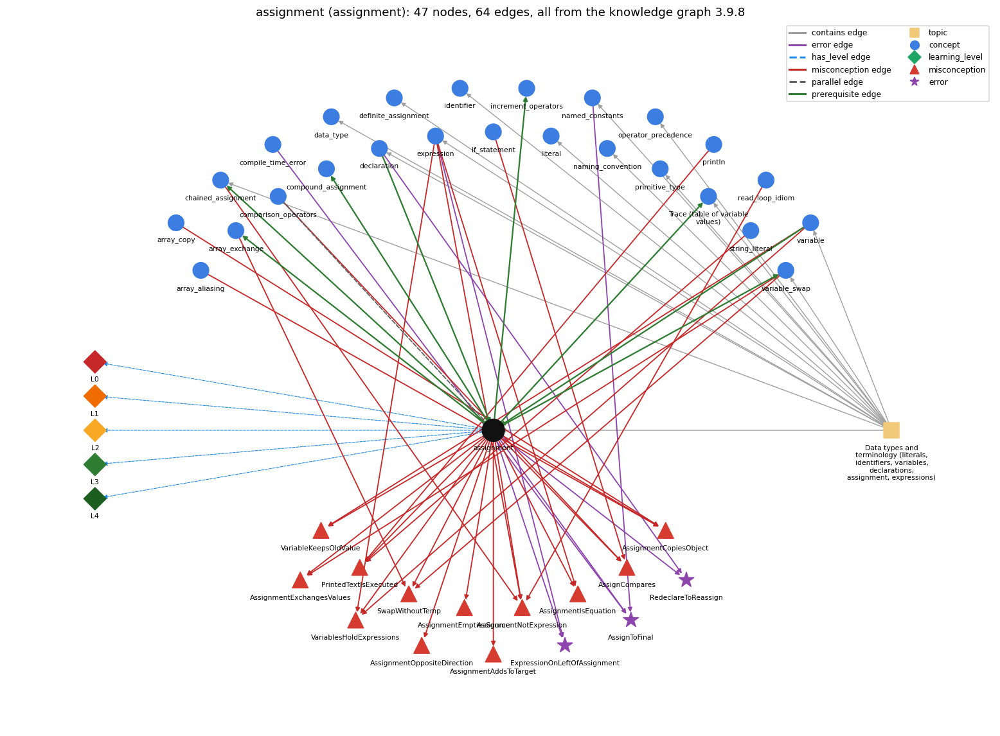

# assignment (`assignment`)

= stores the computed value of the right side

Section 1.2 Built-in Types of Data, topic 1.2.a Data types and terminology (literals, identifiers, variables, declarations, assignment, expressions). From the knowledge graph 3.9.8 (`data/raw/chapter1_kg_updated.json`).

## Concepts associated with assignment (25)

| Concept | Description | How it is associated |
| --- | --- | --- |
| **array\_aliasing** | two variables can refer to the same array | shares misconception AssignmentCopiesObject |
| **array\_copy** | making a second, independent array with the same elements: create a new array and copy element by element (or Arrays.copyOf) | shares misconception AssignmentCopiesObject |
| **array\_exchange** | swap a[i] and a[j] through a temporary variable | builds on it (needs it) composition rule (R) with it shares misconception SwapWithoutTemp |
| **chained\_assignment** | a = b = 0 assigns right to left | builds on it (needs it) composition rule (R) with it shares misconception AssignmentNotExpression same topic (topic1.2.a) |
| **comparison\_operators** | == != &lt; &gt; &lt;= &gt;= | parallel concept shares misconception AssignCompares |
| **compile\_time\_error** | an error javac reports before the program can run (syntax, types) | shares error AssignToFinal |
| **compound\_assignment** | x += e, x -= e, ... include a hidden cast | builds on it (needs it) composition rule (R) with it |
| **data\_type** | a set of values and the operations defined on them | same topic (topic1.2.a) |
| **declaration** | int x; -- introduces a variable name and its type | prerequisite of it (it needs this) composition rule (R) with it shares error RedeclareToReassign same topic (topic1.2.a) |
| **definite\_assignment** | a local variable must be assigned before it is read | same topic (topic1.2.a) |
| **expression** | anything that evaluates to a value | shares misconception VariablesHoldExpressions shares misconception AssignmentNotExpression shares error ExpressionOnLeftOfAssignment shares misconception AssignmentIsEquation same topic (topic1.2.a) |
| **identifier** | a name for a variable, method or class; case-sensitive, no spaces, not a keyword | same topic (topic1.2.a) |
| **if\_statement** | run a block only when the condition holds | shares misconception AssignCompares |
| **increment\_operators** | ++ / -- (and +=) | builds on it (needs it) composition rule (R) with it |
| **literal** | a constant value written in code (42, 3.14, true, 'a', "hi") | same topic (topic1.2.a) |
| **named\_constants** | final constants in UPPER\_CASE instead of magic numbers | shares error AssignToFinal same topic (topic1.2.a) |
| **naming\_convention** | choosing meaningful names: full words, lowerCamelCase, single letters only for throwaway loop counters | same topic (topic1.2.a) |
| **operator\_precedence** | the order operators bind in an expression | same topic (topic1.2.a) |
| **primitive\_type** | int, double, boolean, char | same topic (topic1.2.a) |
| **println** | System.out.println -- output with a trailing newline | shares misconception PrintedTextIsExecuted |
| **program\_trace** | a table of the values of the variables after each statement, used to check what code does | builds on it (needs it) composition rule (R) with it same topic (topic1.2.a) |
| **read\_loop\_idiom** | reading until end-of-input | shares misconception AssignmentNotExpression |
| **string\_literal** | "Hello, World" -- the text being printed | shares misconception PrintedTextIsExecuted |
| **variable** | a named, typed box that holds a value | prerequisite of it (it needs this) composition rule (R) with it shares misconception VariablesHoldExpressions shares misconception VariableKeepsOldValue same topic (topic1.2.a) |
| **variable\_swap** | exchanging two variables needs a temporary | builds on it (needs it) composition rule (R) with it shares misconception SwapWithoutTemp shares misconception AssignmentExchangesValues same topic (topic1.2.a) |

## Every edge in this view and its full label (64)

| From | Edge | To | Full edge label |
| --- | --- | --- | --- |
| **assignment** | prerequisite | **array\_exchange** | The exchange is three assignments in a fixed order through a temporary variable. grounding: book\_passage composition rule (R) of assignment with array\_exchange: Exchanging a[i] and a[j] takes three assignments in a fixed order through a temporary, because each assignment overwrites its target. composition rule (R) of array\_exchange with assignment: Each of the three steps is an ordinary assignment whose left side is a single variable (here an array element), executed in order. |
| **assignment** | prerequisite | **chained\_assignment** | An assignment such as x = y is treated as an expression: it assigns the value of y to x and evaluates to that value. grounding: questionable composition rule (R) of assignment with chained\_assignment: Because an assignment is an expression whose value is the value stored, and = groups right to left, a = b = 0 first stores 0 in b and then stores that 0 in a. composition rule (R) of chained\_assignment with assignment: A chain works only because an assignment is itself an expression whose value is the value stored, so it can be the right side of another =. |
| **assignment** | prerequisite | **compound\_assignment** | x op= e is shorthand for the assignment x = x op e. grounding: book\_passage composition rule (R) of assignment with compound\_assignment: x op= e is shorthand for x = x op e. The left variable's current value is fetched first and then combined with e. composition rule (R) of compound\_assignment with assignment: x op= e is shorthand for the assignment x = x op e, so the new value depends on the old one (x is read, then written). |
| **assignment** | prerequisite | **increment\_operators** | i++ is shorthand for the assignment i = i + 1. grounding: book\_passage composition rule (R) of assignment with increment\_operators: As a statement, i++ has the same effect as the assignment i = i + 1. composition rule (R) of increment\_operators with assignment: i++ is shorthand for the assignment i = i + 1 (and i += k for i = i + k), so it changes the variable's stored value. |
| **assignment** | prerequisite | **program\_trace** | A trace records the value each variable holds after each assignment statement runs. grounding: book\_passage composition rule (R) of assignment with program\_trace: A trace records the value of each variable after each assignment runs, one row per statement. composition rule (R) of program\_trace with assignment: Each assignment statement produces the next row of the trace, changing exactly the column of the variable on its left-hand side. |
| **assignment** | prerequisite | **variable\_swap** | The three assignments int t = a; a = b; b = t; exchange the values of a and b, as a trace of the variable values after each statement shows. grounding: book\_passage composition rule (R) of assignment with variable\_swap: int t = a; a = b; b = t; works only in this order, because every assignment destroys its left variable's old value. composition rule (R) of variable\_swap with assignment: A swap is three assignments whose order matters, because each one overwrites the old value of its left variable. |
| **declaration** | prerequisite | **assignment** | A variable must be declared before an assignment can store a value into it. grounding: book\_passage composition rule (R) of declaration with assignment: An assignment can store into a variable only after the variable's declaration, and only a value of a compatible type. composition rule (R) of assignment with declaration: A declaration can include the first assignment (int x = 5;). Assigning to a variable that was never declared does not compile. |
| **variable** | prerequisite | **assignment** | Assignment needs a declared variable on its left side to store the computed value into. grounding: book\_passage composition rule (R) of variable with assignment: Assignment is the only statement that changes a variable, and its left-hand side must be a single variable. composition rule (R) of assignment with variable: The left side must be a declared variable whose type accepts the value. Assignment is how that variable's value changes. |
| **assignment** | parallel | **comparison\_operators** | x = y stores the value of y in x (a statement with a side effect); x == y only tests whether the two values are equal and gives a boolean. Writing = where == is meant is a compile error with int operands and a silent bug with boolean operands. grounding: book\_passage |
| **array\_aliasing** | misconception | **AssignmentCopiesObject** | **wrong rule:** assigning a reference copies the object **right rule:** b = a; copies only the reference, so a and b refer to the same array and b[i] = v also changes a[i]. role: primary |
| **array\_copy** | misconception | **AssignmentCopiesObject** | **wrong rule:** assigning a reference copies the object **right rule:** b = a; copies only the reference, so a and b refer to the same array and b[i] = v also changes a[i]. role: context |
| **array\_exchange** | misconception | **SwapWithoutTemp** | **wrong rule:** a[i] = a[j]; a[j] = a[i]; exchanges the two values. **right rule:** A temporary variable must save a[i] before it is overwritten. role: primary |
| **assignment** | misconception | **AssignCompares** | **wrong rule:** x = y checks whether x and y are equal. **right rule:** x = y copies the value of y into x; x == y is what compares them. role: primary |
| **assignment** | misconception | **AssignmentAddsToTarget** | **wrong rule:** a = b adds the value of b to the value already in a (the accumulator model). **right rule:** a = b replaces the old value of a with the value of b; the old value is lost. role: primary |
| **assignment** | misconception | **AssignmentCopiesObject** | **wrong rule:** b = a; for an array makes b a separate copy, so changing b[i] leaves a[i] unchanged. **right rule:** b = a; copies only the reference, so a and b refer to the same array and b[i] = v also changes a[i]. role: context |
| **assignment** | misconception | **AssignmentEmptiesSource** | **wrong rule:** After b = a, a no longer holds a value, as if the value had been moved. **right rule:** Assignment copies; the variable on the right keeps its value. role: primary |
| **assignment** | misconception | **AssignmentExchangesValues** | **wrong rule:** b = a exchanges the values of a and b. **right rule:** b = a copies a into b and leaves a unchanged; an exchange needs a temporary variable and three assignments. role: primary |
| **assignment** | misconception | **AssignmentIsEquation** | **wrong rule:** An assignment states a lasting equality between its two sides, so y = x - y can be solved like the equation x = 2y and x = x + 5 relates two equal quantities. **right rule:** An assignment is a one-time action: evaluate the right side with current values, then store the result in the left variable. role: primary |
| **assignment** | misconception | **AssignmentNotExpression** | **wrong rule:** An assignment cannot be used inside a larger expression, so a condition like (x = read()) != v is not allowed. **right rule:** An assignment is an expression whose value is the value assigned, so (x = v) both stores v in x and gives v. role: primary |
| **assignment** | misconception | **AssignmentOppositeDirection** | **wrong rule:** a = b copies the value of a into b. **right rule:** Assignment stores the value of the right side into the variable on the left. role: primary |
| **assignment** | misconception | **PrintedTextIsExecuted** | **wrong rule:** System.out.println("x is 5"); sets x to 5 (text inside the quotes is run as code). **right rule:** Characters inside double quotes are printed literally; println only displays them and changes no variable. Only an assignment such as x = 5; sets x. role: context |
| **assignment** | misconception | **SwapWithoutTemp** | **wrong rule:** a[i] = a[j]; a[j] = a[i]; exchanges the two values. **right rule:** A temporary variable must save a[i] before it is overwritten. role: context |
| **assignment** | misconception | **VariableKeepsOldValue** | **wrong rule:** A variable keeps its first value after a new assignment (the static model). **right rule:** Each assignment or read replaces the variable's current value. role: context |
| **assignment** | misconception | **VariablesHoldExpressions** | **wrong rule:** y = x + k; makes y always equal to x + k, so when x changes later, y changes too. **right rule:** y = x + k; stores the value that x + k has at that moment, so later changes to x do not change y. role: primary |
| **chained\_assignment** | misconception | **AssignmentNotExpression** | **wrong rule:** an assignment cannot be used inside a larger expression **right rule:** An assignment is an expression whose value is the value assigned, so (x = v) both stores v in x and gives v. role: context |
| **comparison\_operators** | misconception | **AssignCompares** | **wrong rule:** = compares two values instead of assigning **right rule:** x = y copies the value of y into x; x == y is what compares them. role: context |
| **expression** | misconception | **AssignmentIsEquation** | **wrong rule:** An assignment states a lasting equality between its two sides, so y = x - y can be solved like the equation x = 2y and x = x + 5 relates two equal quantities. **right rule:** An assignment is a one-time action: evaluate the right side with current values, then store the result in the left variable. role: context |
| **expression** | misconception | **AssignmentNotExpression** | **wrong rule:** An assignment cannot be used inside a larger expression, so a condition like (x = read()) != v is not allowed. **right rule:** An assignment is an expression whose value is the value assigned, so (x = v) both stores v in x and gives v. role: context |
| **expression** | misconception | **VariablesHoldExpressions** | **wrong rule:** = stores the expression itself, not its computed value **right rule:** y = x + k; stores the value that x + k has at that moment, so later changes to x do not change y. role: context |
| **if\_statement** | misconception | **AssignCompares** | **wrong rule:** = compares two values instead of assigning **right rule:** x = y copies the value of y into x; x == y is what compares them. role: context |
| **println** | misconception | **PrintedTextIsExecuted** | **wrong rule:** System.out.println("x is 5"); sets x to 5 (text inside the quotes is run as code). **right rule:** Characters inside double quotes are printed literally; println only displays them and changes no variable. Only an assignment such as x = 5; sets x. role: primary |
| **read\_loop\_idiom** | misconception | **AssignmentNotExpression** | **wrong rule:** A read and a test cannot be combined, so while ((x = read()) != end) is not allowed. **right rule:** while ((x = read()) != end) reads a value into x and tests that same value in one expression. role: context |
| **string\_literal** | misconception | **PrintedTextIsExecuted** | **wrong rule:** System.out.println("x is 5"); sets x to 5 (text inside the quotes is run as code). **right rule:** Characters inside double quotes are printed literally; println only displays them and changes no variable. Only an assignment such as x = 5; sets x. role: context |
| **variable** | misconception | **VariableKeepsOldValue** | **wrong rule:** A variable keeps its first value after a new assignment (the static model). **right rule:** Each assignment or read replaces the variable's current value. role: primary |
| **variable** | misconception | **VariablesHoldExpressions** | **wrong rule:** = stores the expression itself, not its computed value **right rule:** y = x + k; stores the value that x + k has at that moment, so later changes to x do not change y. role: context |
| **variable\_swap** | misconception | **AssignmentExchangesValues** | **wrong rule:** b = a exchanges the values of a and b. **right rule:** b = a copies a into b and leaves a unchanged; an exchange needs a temporary variable and three assignments. role: context |
| **variable\_swap** | misconception | **SwapWithoutTemp** | **wrong rule:** a[i] = a[j]; a[j] = a[i]; exchanges the two values. **right rule:** A temporary variable must save a[i] before it is overwritten. role: context |
| **assignment** | error | **AssignToFinal** | **wrong rule:** Assigns a new value to a variable declared final. **right rule:** A final variable cannot be reassigned after it is initialized; the compiler reports an error. role: context |
| **assignment** | error | **ExpressionOnLeftOfAssignment** | **wrong rule:** Writes a + b = c; or 7 = a; as if = were a math equation. **right rule:** The left side of an assignment must be a single variable; only the right side can be an expression. role: primary |
| **assignment** | error | **RedeclareToReassign** | **wrong rule:** Writes int x = 5; ... int x = 10; to change x. **right rule:** A declaration gives a variable its name and type; a later change of value is an assignment statement such as x = 10;, not a second declaration. role: context |
| **compile\_time\_error** | error | **AssignToFinal** | **wrong rule:** Assigns a new value to a variable declared final. **right rule:** A final variable cannot be reassigned after it is initialized; the compiler reports an error. role: context |
| **declaration** | error | **RedeclareToReassign** | **wrong rule:** Writes int x = 5; ... int x = 10; to change x. **right rule:** A declaration gives a variable its name and type; a later change of value is an assignment statement such as x = 10;, not a second declaration. role: primary |
| **expression** | error | **ExpressionOnLeftOfAssignment** | **wrong rule:** Writes a + b = c; or 7 = a; as if = were a math equation. **right rule:** The left side of an assignment must be a single variable; only the right side can be an expression. role: context |
| **named\_constants** | error | **AssignToFinal** | **wrong rule:** Assigns a new value to a variable declared final. **right rule:** A final variable cannot be reassigned after it is initialized; the compiler reports an error. role: primary |
| **assignment** | has\_level | **assignment@L0** | assignment -&gt; L0 (Prestructural): the answer holds a rule that contradicts Java (13 ways). **[0] everyday\_reading** (E): In maths, = states a symmetric, lasting equality (a = b means b = a, and x = x + 5 is false). In Java, = is a one-time, directed action: evaluate the right side, then store the result in the variable on the left. **[1] misconception** (M) &rarr; VariablesHoldExpressions: wrong rule: = stores the expression itself, not its computed value. Right rule: y = x + k; stores the value that x + k has at that moment, so later changes to x do not change y. **[2] misconception** (M) &rarr; AssignCompares: wrong rule: = compares two values instead of assigning. Right rule: x = y copies the value of y into x; x == y is what compares them. **[3] misconception** (M) &rarr; AssignmentNotExpression: wrong rule: an assignment cannot be used inside a larger expression. Right rule: An assignment is an expression whose value is the value assigned, so (x = v) both stores v in x and gives v. **[4] misconception** (M) &rarr; AssignmentOppositeDirection: wrong rule: a = b copies the value of a into b. Right rule: Assignment stores the value of the right side into the variable on the left. **[5] misconception** (M) &rarr; AssignmentAddsToTarget: wrong rule: a = b adds the value of b to the value already in a (the accumulator model). Right rule: a = b replaces the old value of a with the value of b; the old value is lost. **[6] misconception** (M) &rarr; AssignmentIsEquation: wrong rule: An assignment states a lasting equality between its two sides, so y = x - y can be solved like the equation x = 2y and x = x + 5 relates two equal quantities. Right rule: An assignment is a one-time action: evaluate the right side with current values, then store the result in the left variable. **[7] misconception** (M) &rarr; AssignmentExchangesValues: wrong rule: b = a exchanges the values of a and b. Right rule: b = a copies a into b and leaves a unchanged; an exchange needs a temporary variable and three assignments. **[8] misconception** (M) &rarr; AssignmentEmptiesSource: wrong rule: After b = a, a no longer holds a value, as if the value had been moved. Right rule: Assignment copies; the variable on the right keeps its value. **[9] inconsistent\_trace** (T) &rarr; VariablesHoldExpressions: Points to LT (evaluate the right side with current values, then overwrite the left variable). Applied unevenly, a student traces one segment correctly but reads the next as simultaneous equations or as a swap, giving 15 and 15 for one segment and 5 and 10 for the other. (here mixing in: "= stores the expression itself, not its computed value") **[10] misconception** (M) &rarr; SwapWithoutTemp: wrong rule: a[i] = a[j]; a[j] = a[i]; exchanges the two values. Right rule: A temporary variable must save a[i] before it is overwritten. **[11] misconception** (M) &rarr; AssignmentCopiesObject: wrong rule: assigning a reference copies the object. Right rule: b = a; copies only the reference, so a and b refer to the same array and b[i] = v also changes a[i]. **[12] misconception** (M) &rarr; VariableKeepsOldValue: wrong rule: A variable keeps its first value after a new assignment (the static model). Right rule: Each assignment or read replaces the variable's current value. |
| **assignment** | has\_level | **assignment@L1** | assignment -&gt; L1 (Unistructural): the answer states one correct rule without applying it (2 ways). **[0] names\_the\_element** (N): Assignment statement: the statement variable = expression; which stores a data-type value in a variable. **[1] states\_the\_rule** (S): The left-hand side must be a single variable. The right-hand side can be any expression whose type is compatible with the variable's type. = is not mathematical equality (a + b = b + a and 1 = a are illegal). |
| **assignment** | has\_level | **assignment@L2** | assignment -&gt; L2 (Multistructural): the answer applies the rules of assignment to every part of the code, in order (3 ways). **[0] line\_by\_line\_trace** (LT): First the right-hand side is fully evaluated using the variables' current values (left to right). Then that value is stored in the left-hand variable, replacing its old value, and execution moves to the next statement. **[1] output\_prediction** (OP): As a statement it prints nothing; its result is the new value of the left variable (after c = a + b; with a = 1234 and b = 99, c is 1333). Used as an expression, its value is the value assigned. **[2] one\_step\_execution** (OS): Exactly one variable, the left one, changes, and its old value is lost. Variables on the right keep their values: x = x + 5; with x = 5 makes x 10. |
| **assignment** | has\_level | **assignment@L3** | assignment -&gt; L3 (Relational): the answer relates the parts (10 ways). **[0] relation\_to\_neighbour** (R): The left side must be a declared variable whose type accepts the value. Assignment is how that variable's value changes. **[1] relation\_to\_neighbour** (R): A declaration can include the first assignment (int x = 5;). Assigning to a variable that was never declared does not compile. **[2] relation\_to\_neighbour** (R): Exchanging a[i] and a[j] takes three assignments in a fixed order through a temporary, because each assignment overwrites its target. **[3] relation\_to\_neighbour** (R): int t = a; a = b; b = t; works only in this order, because every assignment destroys its left variable's old value. **[4] relation\_to\_neighbour** (R): x op= e is shorthand for x = x op e. The left variable's current value is fetched first and then combined with e. **[5] relation\_to\_neighbour** (R): Because an assignment is an expression whose value is the value stored, and = groups right to left, a = b = 0 first stores 0 in b and then stores that 0 in a. **[6] relation\_to\_neighbour** (R): As a statement, i++ has the same effect as the assignment i = i + 1. **[7] relation\_to\_neighbour** (R): A trace records the value of each variable after each assignment runs, one row per statement. **[8] relation\_to\_neighbour** (R): x = y stores the value of y in x (a statement with a side effect); x == y only tests whether the two values are equal and gives a boolean. Writing = where == is meant is a compile error with int operands and a silent bug with boolean operands. **[9] purpose\_of\_the\_whole** (P): Assignment gives a variable its value in each role: initialization, counter update (n = n + 1), gatherer update (sum = sum + x), most-wanted holder update (max = x), or temporary (t = a). |
| **assignment** | has\_level | **assignment@L4** | assignment -&gt; L4 (Extended abstract): the answer reasons beyond the given code (7 ways). **[0] predict\_a\_change** (C) &rarr; VariablesHoldExpressions: Swapping the two sides (a = b versus b = a) changes which variable changes. Reordering assignments changes the final values. An assignment cannot be undone, because the old value is lost unless it was first saved in a temporary. **[1] diagnose\_an\_error** (D): rule broken: The left-hand side of = must be a single variable; only the right-hand side may be an arbitrary expression. Kind: compile-time. Trigger class: Any assignment whose left side is a literal or compound expression (7 = a; a + b = c;): 'unexpected type, required: variable'. **[2] transfer\_to\_a\_new\_program** (X): Use assignment whenever a variable's value must be set or updated. Use == to compare, final to forbid updates, and op= or ++ for x = x op e. **[3] diagnose\_an\_error** (D): rule broken: A local variable may be declared only once in its scope; later changes use an assignment without the type. Kind: compile-time. Trigger class: A second 'int x = ...' for a name already declared in the same or an enclosing block: 'variable x is already defined'. **[4] diagnose\_an\_error** (D): rule broken: A final variable is assigned exactly once; it cannot be reassigned after initialization. Kind: compile-time. Trigger class: Any assignment, ++ or op= to a final variable after its initialization: 'cannot assign a value to final variable'. **[5] diagnose\_an\_error** (D): rule broken: = assigns and == compares; a condition needs a boolean. Kind: compile-time. Trigger class: Writing if (a = b) with int a, b gives 'incompatible types: int cannot be converted to boolean'. With boolean variables it compiles and silently assigns. **[6] diagnose\_an\_error** (D): rule broken: The assigned value's type must fit the variable's type. Kind: compile-time. Trigger class: Assigning a double to an int, an int to a String, and so on: 'incompatible types'. |
| **topic1.2.a** | contains | **assignment** | topic topic1.2.a contains assignment |
| **topic1.2.a** | contains | **chained\_assignment** | topic topic1.2.a contains chained\_assignment |
| **topic1.2.a** | contains | **data\_type** | topic topic1.2.a contains data\_type |
| **topic1.2.a** | contains | **declaration** | topic topic1.2.a contains declaration |
| **topic1.2.a** | contains | **definite\_assignment** | topic topic1.2.a contains definite\_assignment |
| **topic1.2.a** | contains | **expression** | topic topic1.2.a contains expression |
| **topic1.2.a** | contains | **identifier** | topic topic1.2.a contains identifier |
| **topic1.2.a** | contains | **literal** | topic topic1.2.a contains literal |
| **topic1.2.a** | contains | **named\_constants** | topic topic1.2.a contains named\_constants |
| **topic1.2.a** | contains | **naming\_convention** | topic topic1.2.a contains naming\_convention |
| **topic1.2.a** | contains | **operator\_precedence** | topic topic1.2.a contains operator\_precedence |
| **topic1.2.a** | contains | **primitive\_type** | topic topic1.2.a contains primitive\_type |
| **topic1.2.a** | contains | **program\_trace** | topic topic1.2.a contains program\_trace |
| **topic1.2.a** | contains | **variable** | topic topic1.2.a contains variable |
| **topic1.2.a** | contains | **variable\_swap** | topic topic1.2.a contains variable\_swap |
