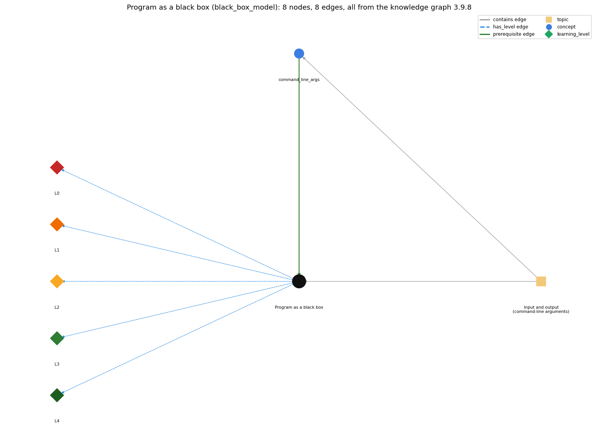

# Program as a black box (`black_box_model`)

a program viewed as a black box that turns an input string (the command-line argument) into an output string

Section 1.1 1.1 Your First Program, topic 1.1.d Input and output (command-line arguments). From the knowledge graph 3.9.8 (`data/raw/chapter1_kg_updated.json`).

## Concepts associated with black\_box\_model (1)

| Concept | Description | How it is associated |
| --- | --- | --- |
| **command\_line\_args** | args[] -- strings passed at launch | prerequisite of it (it needs this) composition rule (R) with it same topic (topic1.1.d) |

## Every edge in this view and its full label (8)

| From | Edge | To | Full edge label |
| --- | --- | --- | --- |
| **command\_line\_args** | prerequisite | **black\_box\_model** | The black-box view treats the command-line argument as the input string and what the program prints as the output string. grounding: book\_passage composition rule (R) of command\_line\_args with black\_box\_model: In the black-box view the command-line argument is the input string and what the program prints is the output string. composition rule (R) of black\_box\_model with command\_line\_args: The command-line argument is the box's input string, and what the program prints is its output string; parseInt lets the strings be read as numbers. |
| **black\_box\_model** | has\_level | **black\_box\_model@L0** | Program as a black box -&gt; L0 (Prestructural): the answer holds a rule that contradicts Java (1 way). **[0] everyday\_reading** (E): Everyday meaning: a 'black box' is something mysterious or a flight recorder. Here it means treating a program purely as a function from its input string (the command-line argument) to its output string, ignoring how it works inside. |
| **black\_box\_model** | has\_level | **black\_box\_model@L1** | Program as a black box -&gt; L1 (Unistructural): the answer states one correct rule without applying it (2 ways). **[0] names\_the\_element** (N): The black-box model is the view of a Java program as a box that converts an input string (the command-line argument) into an output string (what it prints). **[1] states\_the\_rule** (S): A program like UseArgument implements a function that maps a string of characters (the argument) into another string of characters (the message printed); the model is general enough, in principle, for any computational task. |
| **black\_box\_model** | has\_level | **black\_box\_model@L2** | Program as a black box -&gt; L2 (Multistructural): the answer applies the rules of Program as a black box to every part of the code, in order (3 ways). **[0] line\_by\_line\_trace** (LT): Input is supplied at launch, the program computes, output is produced; the model hides the order of internal steps. **[1] output\_prediction** (OP): Prediction at this level is input-output: for UseArgument, input Alice gives output Hi, Alice. How are you? **[2] one\_step\_execution** (OS): One run maps one input string to one output string; nothing persists between runs. |
| **black\_box\_model** | has\_level | **black\_box\_model@L3** | Program as a black box -&gt; L3 (Relational): the answer relates the parts (2 ways). **[0] relation\_to\_neighbour** (R): The command-line argument is the box's input string, and what the program prints is its output string; parseInt lets the strings be read as numbers. **[1] purpose\_of\_the\_whole** (P): Purpose: describe what a program does (its specification, input to output) separately from how it does it; the compiler itself fits the model (.java text in, .class out). |
| **black\_box\_model** | has\_level | **black\_box\_model@L4** | Program as a black box -&gt; L4 (Extended abstract): the answer reasons beyond the given code (4 ways). **[0] predict\_a\_change** (C): Any change inside the box that keeps every input-output pair the same keeps the program's behaviour; a change that alters any pair is a behaviour change. **[1] transfer\_to\_a\_new\_program** (X): Use the black-box view to specify and test programs by input/output pairs; it extends in 1.5 to standard input, standard output, drawing and audio. It does not help to locate an error inside the box; for that, trace the code. **[2] diagnose\_an\_error** (D): rule broken: The output depends only on the input given. Kind: run-time exception. Trigger class: running the box with missing input (no argument): the box fails with ArrayIndexOutOfBoundsException rather than mapping input to output **[3] diagnose\_an\_error** (D): rule broken: Input and output in 1.1 are limited to strings of limited size. Kind: silent logic error. Trigger class: expecting numeric or long input to be used directly without parsing or standard input |
| **topic1.1.d** | contains | **black\_box\_model** | topic topic1.1.d contains black\_box\_model |
| **topic1.1.d** | contains | **command\_line\_args** | topic topic1.1.d contains command\_line\_args |
