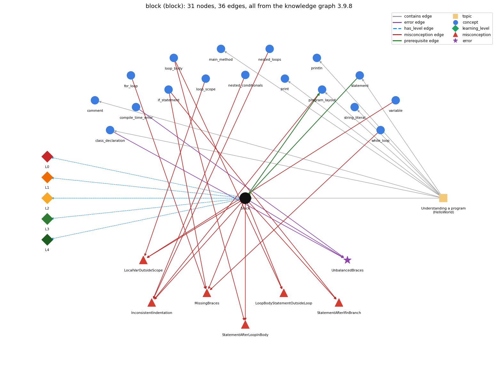

# block (`block`)

{ ... } grouping statements

Section 1.1 Your First Program, topic 1.1.b Understanding a program (HelloWorld).

## At a glance

- **Needs first:** `statement`
- **Leads to:** `program_layout`
- **Learned alongside:** nothing
- **Misconceptions:** `InconsistentIndentation`, `LocalVarOutsideScope`, `LoopBodyStatementOutsideLoop`, `MissingBraces`, `StatementAfterIfInBranch`, `StatementAfterLoopInBody`
- **Errors:** `UnbalancedBraces`
- **Levels:** L0, L1, L2, L3, L4

Everything below comes from the knowledge graph 3.9.8 (`data/raw/chapter1_kg_updated.json`): 36 edges around this concept, each explained in the graph's own words.

## What it needs first (1)

A prerequisite edge means the other concept has to be understood before `block`.

### `statement` comes before `block`

*one step, terminated by ;, executed in sequence*

A statement block is a sequence of statements, each terminated by a semicolon, enclosed in braces; the body of main() is such a sequence.

- **Grounding:** book passage
- **How `block` combines with `statement`:** A block is built from statements, each ended by ;, and is itself usable as a single statement (e.g. a loop body).
- **How `statement` combines with `block`:** A block groups a sequence of statements in braces; the body of main() is such a block.

## What it leads to (1)

These concepts need `block` first.

### `block` comes before `program_layout`

*one statement per line and indentation that shows nesting*

Indentation makes the nesting of blocks visible, so the reader can see which statements belong to which block.

- **Grounding:** book passage
- **How `block` combines with `program_layout`:** Indentation should show block nesting, but only braces define it; layout that disagrees with the braces misleads the reader, not the compiler.
- **How `program_layout` combines with `block`:** Indentation should show which statements belong to which block; braces, not indentation, decide it, so wrong indentation misleads.

## Learned alongside (0)

A parallel edge joins two concepts that sit side by side: neither is needed before the other.

No parallel edge touches this concept.

## Misconceptions (6)

A misconception edge states the wrong rule a student may hold about this concept, and the right rule.

### InconsistentIndentation

- **Wrong rule:** Indents nested blocks inconsistently, so the visual nesting differs from the real nesting.
- **Right rule:** Indent consistently, one level deeper for each nested block, so the layout shows the real nesting; the compiler ignores indentation.
- **Role of this concept:** context
- **Also an edge from `nested_conditionals`:** Indents nested blocks inconsistently, so the visual nesting differs from the real nesting.
- **Also an edge from `nested_loops`:** Indents nested blocks inconsistently, so the visual nesting differs from the real nesting.
- **Also an edge from `program_layout`:** Indents nested blocks inconsistently, so the visual nesting differs from the real nesting.

### LocalVarOutsideScope

- **Wrong rule:** A variable declared inside a block can be used anywhere in the program, like a global.
- **Right rule:** A local variable exists only from its declaration to the end of its block.
- **Role of this concept:** context
- **Shows at level L0 as:** misconception: wrong rule: A variable declared inside a block can be used anywhere in the program, like a global. Right rule: A local variable's scope runs from its declaration to the end of the enclosing block.
- **Shows at level L0 as:** inconsistent trace: Applies the block rule (LT: all statements of the block in order, the whole block as one unit) unevenly: includes the statement after the closing brace in the body on one pass but not another, or runs only part of the body. (here mixing in: "A variable declared inside a block can be used anywhere in the program, like a global")
- **Also an edge from `loop_scope`:** A variable declared inside a block can be used anywhere in the program, like a global.
- **Also an edge from `variable`:** A variable declared inside a block can be used anywhere in the program, like a global.

### LoopBodyStatementOutsideLoop

- **Wrong rule:** Some statements inside the braces of a loop body are not repeated; they run once, before or after the loop.
- **Right rule:** Every statement inside the loop braces is part of the body and runs on every pass.
- **Role of this concept:** context
- **Shows at level L0 as:** misconception: wrong rule: Some statements inside the loop braces are not repeated; they run once, before or after the loop. Right rule: Every statement inside the loop braces is part of the body and runs on every pass.
- **Also an edge from `loop_body`:** Some statements inside the braces of a loop body are not repeated; they run once, before or after the loop.

### MissingBraces

- **Wrong rule:** Omits braces around a single-statement body of if, for or while.
- **Right rule:** Braces are optional for a single-statement body, but using them anyway avoids bugs when statements are added later.
- **Role of this concept:** context
- **Also an edge from `for_loop`:** Omits braces around a single-statement body of if, for or while.
- **Also an edge from `if_statement`:** Omits braces around a single-statement body of if, for or while.
- **Also an edge from `while_loop`:** Omits braces around a single-statement body of if, for or while.

### StatementAfterIfInBranch

- **Wrong rule:** A statement placed after the if statement belongs to its branch, so it runs only when the condition is true.
- **Right rule:** The branch ends at its closing brace (or after its single statement); the next statement runs whatever the condition was.
- **Role of this concept:** context
- **Shows at level L0 as:** misconception: wrong rule: A statement placed after the if statement belongs to its branch, so it runs only when the condition is true. Right rule: The branch ends at its closing brace (or after its single statement); the next statement runs whatever the condition was.
- **Also an edge from `if_statement`:** A statement placed after the if statement belongs to its branch, so it runs only when the condition is true.

### StatementAfterLoopInBody

- **Wrong rule:** A statement written after the loop is repeated with the loop body.
- **Right rule:** The body ends at the closing brace (or after its single statement); code after it runs once, after the loop ends.
- **Role of this concept:** context
- **Shows at level L0 as:** misconception: wrong rule: A statement written after the loop is repeated with the loop body. Right rule: The body ends at the closing brace (or after its single statement); code after it runs once, after the loop ends.
- **Also an edge from `loop_body`:** A statement written after the loop is repeated with the loop body.

## Errors (1)

An error edge states the rule that gets broken in a program, and the right rule.

### UnbalancedBraces

- **Wrong rule:** A missing { or } is harmless.
- **Right rule:** Every { must be matched by a } so the class body and the method body are well formed.
- **Role of this concept:** primary
- **Also an edge from `class_declaration`:** A missing { or } is harmless.
- **Also an edge from `compile_time_error`:** A missing { or } is harmless.

## Levels L0 to L4 (5 of 5)

Each level edge lists the ways a student shows that level, each with its exact rule.

### L0: Prestructural / sensorimotor

L0 for block: the answer holds a rule that contradicts Java.

*Deciding question: Does every rule the answer applies to block agree with the language rule? If it reads the code with everyday meanings, applies a wrong rule, or switches rules within one trace, it is L0. A slip in an otherwise rule-correct trace is L2 with an error, not L0.*

block -&gt; L0 (Prestructural): the answer holds a rule that contradicts Java (6 ways).

- **everyday reading** (folk-meaning rule): Everyday/visual reading: indentation or line position tells you what belongs together, as in an outline. Java rule: only braces delimit a block; indentation is ignored, and without braces an if or loop body is just the next single statement.
- **misconception** (wrong rule / right rule; shows `LocalVarOutsideScope`): wrong rule: A variable declared inside a block can be used anywhere in the program, like a global. Right rule: A local variable's scope runs from its declaration to the end of the enclosing block.
- **inconsistent trace** (uneven-application rule; shows `LocalVarOutsideScope`): Applies the block rule (LT: all statements of the block in order, the whole block as one unit) unevenly: includes the statement after the closing brace in the body on one pass but not another, or runs only part of the body. (here mixing in: "A variable declared inside a block can be used anywhere in the program, like a global")
- **misconception** (wrong rule / right rule; shows `StatementAfterIfInBranch`): wrong rule: A statement placed after the if statement belongs to its branch, so it runs only when the condition is true. Right rule: The branch ends at its closing brace (or after its single statement); the next statement runs whatever the condition was.
- **misconception** (wrong rule / right rule; shows `LoopBodyStatementOutsideLoop`): wrong rule: Some statements inside the loop braces are not repeated; they run once, before or after the loop. Right rule: Every statement inside the loop braces is part of the body and runs on every pass.
- **misconception** (wrong rule / right rule; shows `StatementAfterLoopInBody`): wrong rule: A statement written after the loop is repeated with the loop body. Right rule: The body ends at the closing brace (or after its single statement); code after it runs once, after the loop ends.

### L1: Unistructural / atom x text surface

L1 for block: the answer states one correct rule without applying it.

*Deciding question: Does the answer cover every part of the code, in order, with the values (L2)? If it covers one part or only states the rule, it is L1.*

block -&gt; L1 (Unistructural): the answer states one correct rule without applying it (2 ways).

- **names the element** (identity rule): A block (statement block) is a sequence of statements enclosed in braces { }; it counts as one statement where a single statement is expected.
- **states the rule** (declarative rule): A block is a sequence of statements and local variable declarations within braces; a variable declared in a block is in scope only from its declaration to the end of that block.

### L2: Multistructural / block x execution / preoperational

L2 for block: the answer applies these rules to every part of the code, in order.

*Deciding question: Is the answer many segments mapped onto lines (L2), or one segment stating the purpose of the whole (L3)? A correct output with no value-by-value justification is not levelled.*

block -&gt; L2 (Multistructural): the answer applies the rules of block to every part of the code, in order (3 ways).

- **line by line trace** (operational sequencing rule): A block executes each of its statements in order from first to last; if a statement completes abruptly, the rest of the block is skipped.
- **output prediction** (evaluation / result rule): A block has no value; its result is the combined effect of its statements, in order.
- **one step execution** (state-transition rule): Entering a block makes room for its local variables; leaving it (at the closing brace) ends their scope, so they can no longer be used.

### L3: Relational / relations x function (concrete operational begins)

L3 for block: the answer relates the parts by these rules.

*Deciding question: Was the purpose deduced from the code, or only guessed from traced input/output pairs (then L2)? Does the answer stay within the given code (L3), or reason about changed code, an error class or a new program (L4)?*

block -&gt; L3 (Relational): the answer relates the parts (3 ways).

- **relation to neighbour** (composition rule (with a neighbour)): A block is built from statements, each ended by ;, and is itself usable as a single statement (e.g. a loop body).
- **relation to neighbour** (composition rule (with a neighbour)): Indentation should show block nesting, but only braces define it; layout that disagrees with the braces misleads the reader, not the compiler.
- **purpose of the whole** (plan / role rule): Purpose: group several statements so they act as one body (of main, an if branch or a loop) and limit the scope of variables to where they are needed.

### L4: Extended abstract (concrete-operational reversibility and conservation)

L4 for block: the answer reasons beyond the given code by these rules.

*Deciding question: Does the answer link the code to a broader context: a changed program, a class of inputs, an unseen problem? Re-tracing changed code value by value is L2; fixing one given failing case is L3.*

block -&gt; L4 (Extended abstract): the answer reasons beyond the given code (5 ways).

- **predict a change** (conservation rule; shows `LocalVarOutsideScope`): Adding braces around a single-statement body keeps behaviour; adding a second statement to a braceless body changes it (the new statement runs outside); moving a declaration into a block makes later uses outside the block fail to compile.
- **diagnose an error** (error rule): rule broken: Every { must be matched by a }. Kind: compile-time. Trigger class: a missing or extra brace: javac reports '{' expected, 'class' or 'interface' expected, or reached end of file while parsing, often on a later line
- **transfer to a new program** (applicability rule): Use a block whenever a body has more than one statement (S&amp;W and TJ advise braces even for one), and declare variables in the innermost block that needs them.
- **diagnose an error** (error rule): rule broken: Without braces only one statement is the body. Kind: silent logic error. Trigger class: a multi-statement body written without braces, indented as if all were inside
- **diagnose an error** (error rule): rule broken: A local variable is visible only inside its block. Kind: compile-time. Trigger class: using a variable after the block that declared it has closed (cannot find symbol)

## Same topic

`block` belongs to the topic **Understanding a program (HelloWorld)** (`topic1.1.b`). The topic also contains: `class_declaration`, `comment`, `main_method`, `print`, `println`, `program_layout`, `statement`, `string_literal`.

## Rules of the concept (19)

- **folk-meaning rule:** Everyday/visual reading: indentation or line position tells you what belongs together, as in an outline. Java rule: only braces delimit a block; indentation is ignored, and without braces an if or loop body is just the next single statement.
- **wrong rule / right rule:** LocalVarOutsideScope: wrong: A variable declared inside a block can be used anywhere in the program, like a global. \| right: A local variable's scope runs from its declaration to the end of the enclosing block.
- **wrong rule / right rule:** StatementAfterIfInBranch: wrong: A statement placed after the if statement belongs to its branch, so it runs only when the condition is true. \| right: The branch ends at its closing brace (or after its single statement); the next statement runs whatever the condition was.
- **wrong rule / right rule:** LoopBodyStatementOutsideLoop: wrong: Some statements inside the loop braces are not repeated; they run once, before or after the loop. \| right: Every statement inside the loop braces is part of the body and runs on every pass.
- **wrong rule / right rule:** StatementAfterLoopInBody: wrong: A statement written after the loop is repeated with the loop body. \| right: The body ends at the closing brace (or after its single statement); code after it runs once, after the loop ends.
- **uneven-application rule:** Applies the block rule (LT: all statements of the block in order, the whole block as one unit) unevenly: includes the statement after the closing brace in the body on one pass but not another, or runs only part of the body.
- **identity rule:** A block (statement block) is a sequence of statements enclosed in braces { }; it counts as one statement where a single statement is expected.
- **declarative rule:** A block is a sequence of statements and local variable declarations within braces; a variable declared in a block is in scope only from its declaration to the end of that block.
- **operational sequencing rule:** A block executes each of its statements in order from first to last; if a statement completes abruptly, the rest of the block is skipped.
- **evaluation / result rule:** A block has no value; its result is the combined effect of its statements, in order.
- **state-transition rule:** Entering a block makes room for its local variables; leaving it (at the closing brace) ends their scope, so they can no longer be used.
- **composition rule (with a neighbour):** with statement: A block is built from statements, each ended by ;, and is itself usable as a single statement (e.g. a loop body).
- **composition rule (with a neighbour):** with program\_layout: Indentation should show block nesting, but only braces define it; layout that disagrees with the braces misleads the reader, not the compiler.
- **plan / role rule:** Purpose: group several statements so they act as one body (of main, an if branch or a loop) and limit the scope of variables to where they are needed.
- **conservation rule:** Adding braces around a single-statement body keeps behaviour; adding a second statement to a braceless body changes it (the new statement runs outside); moving a declaration into a block makes later uses outside the block fail to compile.
- **error rule:** rule broken: Every { must be matched by a } (compile-time)
- **error rule:** rule broken: Without braces only one statement is the body (silent logic error)
- **error rule:** rule broken: A local variable is visible only inside its block (compile-time)
- **applicability rule:** Use a block whenever a body has more than one statement (S&amp;W and TJ advise braces even for one), and declare variables in the innermost block that needs them.

## The whole prerequisite chain

- **Everything it builds on (4):** `class_declaration`, `main_method`, `program_text`, `statement`
- **Everything that builds on it (1):** `program_layout`
