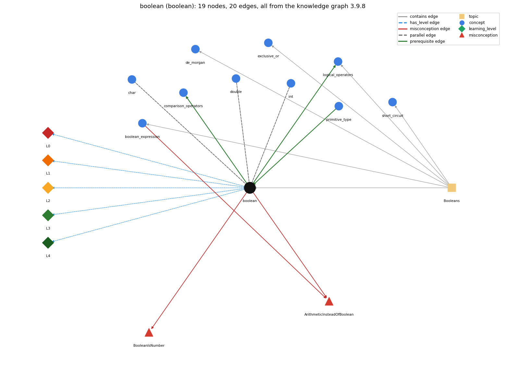

# boolean (`boolean`)

true/false primitive

Section 1.2 Built-in Types of Data, topic 1.2.e Booleans.

## At a glance

- **Needs first:** `primitive_type`
- **Leads to:** `comparison_operators`, `logical_operators`
- **Learned alongside:** `char`, `double`, `int`
- **Misconceptions:** `ArithmeticInsteadOfBoolean`, `BooleanIsNumber`
- **Errors:** none
- **Levels:** L0, L1, L2, L3, L4

Everything below comes from the knowledge graph 3.9.8 (`data/raw/chapter1_kg_updated.json`): 20 edges around this concept. The edge logic, the wrong and right rules and the exact rules of the ways are copied word for word from the graph.

## To work on (0)

Nothing is missing for this concept.

## What it needs first (1)

A prerequisite edge means the other concept has to be understood before `boolean`.

### `primitive_type` comes before `boolean`

*int, double, boolean, char*

- **Edge:** `pre:primitive_type->boolean`
- **Exact edge logic:** boolean is one of the eight primitive types, the one used for true-false values.
- **Grounding:** book\_passage
- **Composition rule (R) of `boolean` with `primitive_type`:** boolean is one of the eight primitive types and the only non-numeric one.
- **Composition rule (R) of `primitive_type` with `boolean`:** boolean is the primitive with only true and false. It does not mix with numeric primitives: it cannot be cast to them, and only booleans may be used as conditions.

## What it leads to (2)

These concepts need `boolean` first.

### `boolean` comes before `comparison_operators`

*== != &lt; &gt; &lt;= &gt;=*

- **Edge:** `pre:boolean->comparison_operators`
- **Exact edge logic:** A comparison such as a &lt; b takes two numbers and produces a boolean result.
- **Grounding:** book\_passage
- **Composition rule (R) of `boolean` with `comparison_operators`:** Comparisons are the main producers of boolean values: they take two numbers and return true or false, which can then be stored in a boolean variable.
- **Composition rule (R) of `comparison_operators` with `boolean`:** Comparisons take numbers and produce a boolean; boolean values themselves can be compared only with == and != (not &lt;), and testing them against true is unnecessary.

### `boolean` comes before `logical_operators`

*&amp;&amp; \|\| !*

- **Edge:** `pre:boolean->logical_operators`
- **Exact edge logic:** &amp;&amp;, \|\| and ! are the operations defined on the boolean type: they take booleans and give a boolean.
- **Grounding:** book\_passage
- **Composition rule (R) of `boolean` with `logical_operators`:** &amp;&amp;, \|\| and ! accept only boolean operands and return a boolean; applying them to ints (if (x &amp;&amp; y) with int x, y) is a compile-time error.
- **Composition rule (R) of `logical_operators` with `boolean`:** The operands must be boolean, and the result is boolean; int operands are a compile-time error.

## Learned alongside (3)

A parallel edge joins two concepts that sit side by side: neither is needed before the other.

### `boolean` alongside `char`

*16-bit character primitive*

- **Edge:** `par:boolean~char`
- **Exact edge logic:** A boolean holds true or false; a char holds a single character such as 'c'.
- **Grounding:** book\_passage
- **Composition rule (R) of `boolean` with `char`:** char is a numeric (integral) type whose values can be compared ('a' &lt; 'b' is a boolean), whereas boolean is not numeric; neither converts to the other.
- **Composition rule (R) of `char` with `boolean`:** char and boolean are unrelated: there is no conversion or cast between them, and 'c' is never true or false.

### `boolean` alongside `double`

*64-bit floating-point primitive*

- **Edge:** `par:double~boolean`
- **Exact edge logic:** A double holds a number with a fractional part; a boolean holds only true or false.
- **Grounding:** book\_passage
- **Composition rule (R) of `boolean` with `double`:** A double reaches the boolean world only through a comparison such as (x &lt; 3.1), which yields a boolean; there is no cast between double and boolean.
- **Composition rule (R) of `double` with `boolean`:** double and boolean never convert into each other (no cast is allowed either way); they meet only through comparisons, which take doubles and produce a boolean, e.g. (x &lt; 3.1).

### `boolean` alongside `int`

*32-bit integer primitive*

- **Edge:** `par:int~boolean`
- **Exact edge logic:** An int holds an integer and is a numeric type for computing with numbers; a boolean holds only true or false and is used for computing with logical values.
- **Grounding:** book\_passage
- **Composition rule (R) of `boolean` with `int`:** int and boolean never convert into each other; an int becomes a boolean only through a comparison (year % 4 == 0), and an int condition such as if (n) does not compile.
- **Composition rule (R) of `int` with `boolean`:** int and boolean do not convert into each other. Comparing ints gives a boolean (x &gt; 0), and an int cannot itself be used as a condition.

## Misconceptions (2)

A misconception edge states the wrong rule a student may hold about this concept, and the right rule.

### ArithmeticInsteadOfBoolean

- **Edge:** `boolean` &rarr; `ArithmeticInsteadOfBoolean` (misconception)
- **Exact edge logic (the wrong rule):** A true/false question is answered with arithmetic (e.g. 1 for true).
- **Twin logic (the right rule):** A logic question is written as a boolean expression whose value is true or false.
- **Wrong belief (on the node):** A true/false question is answered with arithmetic (e.g. 1 for true).
- **Correct rule (on the node):** A logic question is written as a boolean expression whose value is true or false.
- **Provenance:** published
- **Role of this concept:** primary
- **L0 way linked to it:** yes
- **L0 way [3] misconception, exact rule:** wrong rule: A true/false question is answered with arithmetic (e.g. 1 for true). Right rule: A logic question is written as a boolean expression whose value is true or false, e.g. boolean isLeapYear = (year % 4 == 0);.
- **Edge `boolean_expression` &rarr; `ArithmeticInsteadOfBoolean`, exact edge logic:** A true/false question is answered with arithmetic (e.g. 1 for true). **Twin logic:** A logic question is written as a boolean expression whose value is true or false. (role: context)

### BooleanIsNumber

- **Edge:** `boolean` &rarr; `BooleanIsNumber` (misconception)
- **Exact edge logic (the wrong rule):** true and false are the numbers 1 and 0, so a boolean can be used in arithmetic.
- **Twin logic (the right rule):** The boolean data type has only two possible values: true and false, and they are not numbers in Java.
- **Wrong belief (on the node):** true and false are the numbers 1 and 0, so a boolean can be used in arithmetic.
- **Correct rule (on the node):** The boolean data type has only two possible values: true and false, and they are not numbers in Java.
- **Provenance:** textbook
- **Role of this concept:** primary
- **L0 way linked to it:** yes
- **L0 way [1] misconception, exact rule:** wrong rule: true and false are the numbers 1 and 0, so a boolean can be used in arithmetic. Right rule: The boolean type has only the values true and false; they are not numbers in Java, so true + 1 and (int) true do not compile.
- **L0 way [2] inconsistent\_trace, exact rule:** Points to LT (boolean operators are evaluated from their truth tables, left operand first). Applied unevenly: the student uses the truth table for &amp;&amp; in one row of a trace but an everyday reading (e.g. exclusive 'or', or 1/0 arithmetic) in another. (here mixing in: "true and false are the numbers 1 and 0, so a boolean can be used in arithmetic")

## Errors (0)

An error edge states the rule that gets broken in a program, and the right rule.

The graph has no error edge from this concept.

## Levels L0 to L4 (5 of 5)

Each level edge lists the ways a student shows that level, each with its exact rule.

### L0: Prestructural / sensorimotor

L0 for boolean: the answer holds a rule that contradicts Java.

*Deciding question: Does every rule the answer applies to boolean agree with the language rule? If it reads the code with everyday meanings, applies a wrong rule, or switches rules within one trace, it is L0. A slip in an otherwise rule-correct trace is L2 with an error, not L0.*

- **Edge:** `boolean` &rarr; `boolean@L0` (has_level)
- **Exact edge logic:** boolean -&gt; L0 (Prestructural): the answer holds a rule that contradicts Java (4 ways).

Ways (4), each with its exact rule:

- **[0] everyday\_reading** (rule type E, folk-meaning rule): Folk meaning: true and false are yes/no answers that, as in C, spreadsheets or maths logic, can be written as 1 and 0 and added or multiplied. Java rule: boolean is a separate primitive type with only the two values true and false; they are not numbers, cannot take part in arithmetic and cannot be cast to or from int.
- **[1] misconception** (rule type M, wrong rule / right rule) &rarr; `BooleanIsNumber`: wrong rule: true and false are the numbers 1 and 0, so a boolean can be used in arithmetic. Right rule: The boolean type has only the values true and false; they are not numbers in Java, so true + 1 and (int) true do not compile.
- **[2] inconsistent\_trace** (rule type T, uneven-application rule) &rarr; `BooleanIsNumber`: Points to LT (boolean operators are evaluated from their truth tables, left operand first). Applied unevenly: the student uses the truth table for &amp;&amp; in one row of a trace but an everyday reading (e.g. exclusive 'or', or 1/0 arithmetic) in another. (here mixing in: "true and false are the numbers 1 and 0, so a boolean can be used in arithmetic")
- **[3] misconception** (rule type M, wrong rule / right rule) &rarr; `ArithmeticInsteadOfBoolean`: wrong rule: A true/false question is answered with arithmetic (e.g. 1 for true). Right rule: A logic question is written as a boolean expression whose value is true or false, e.g. boolean isLeapYear = (year % 4 == 0);.

### L1: Unistructural / atom x text surface

L1 for boolean: the answer states one correct rule without applying it.

*Deciding question: Does the answer cover every part of the code, in order, with the values (L2)? If it covers one part or only states the rule, it is L1.*

- **Edge:** `boolean` &rarr; `boolean@L1` (has_level)
- **Exact edge logic:** boolean -&gt; L1 (Unistructural): the answer states one correct rule without applying it (2 ways).

Ways (2), each with its exact rule:

- **[0] names\_the\_element** (rule type N, identity rule): boolean is a primitive data type whose only values are the literals true and false.
- **[1] states\_the\_rule** (rule type S, declarative rule): The boolean type has exactly two values, true and false; its operations are &amp;&amp; (and), \|\| (or) and ! (not); comparisons produce booleans; only boolean expressions can control if, while and for; no cast converts between boolean and a numeric type.

### L2: Multistructural / block x execution / preoperational

L2 for boolean: the answer applies these rules to every part of the code, in order.

*Deciding question: Is the answer many segments mapped onto lines (L2), or one segment stating the purpose of the whole (L3)? A correct output with no value-by-value justification is not levelled.*

- **Edge:** `boolean` &rarr; `boolean@L2` (has_level)
- **Exact edge logic:** boolean -&gt; L2 (Multistructural): the answer applies the rules of boolean to every part of the code, in order (3 ways).

Ways (3), each with its exact rule:

- **[0] line\_by\_line\_trace** (rule type LT, operational sequencing rule): A boolean variable's value is fetched when the expression that contains it is evaluated; !, &amp;&amp; and \|\| then combine those values by their truth tables, left operand first, skipping the right operand of &amp;&amp; or \|\| when the left already decides the result.
- **[1] output\_prediction** (rule type OP, evaluation / result rule): The value is true or false, and println prints the words true or false; e.g. LeapYear prints true for 2004 and false for 1900.
- **[2] one\_step\_execution** (rule type OS, state-transition rule): An assignment replaces the variable's value with true or false; a = !a flips it, so three flips starting from true leave false.

### L3: Relational / relations x function (concrete operational begins)

L3 for boolean: the answer relates the parts by these rules.

*Deciding question: Was the purpose deduced from the code, or only guessed from traced input/output pairs (then L2)? Does the answer stay within the given code (L3), or reason about changed code, an error class or a new program (L4)?*

- **Edge:** `boolean` &rarr; `boolean@L3` (has_level)
- **Exact edge logic:** boolean -&gt; L3 (Relational): the answer relates the parts (7 ways).

Ways (7), each with its exact rule:

- **[0] relation\_to\_neighbour** (rule type R, composition rule (with a neighbour)): int and boolean never convert into each other; an int becomes a boolean only through a comparison (year % 4 == 0), and an int condition such as if (n) does not compile.
- **[1] relation\_to\_neighbour** (rule type R, composition rule (with a neighbour)): A double reaches the boolean world only through a comparison such as (x &lt; 3.1), which yields a boolean; there is no cast between double and boolean.
- **[2] relation\_to\_neighbour** (rule type R, composition rule (with a neighbour)): char is a numeric (integral) type whose values can be compared ('a' &lt; 'b' is a boolean), whereas boolean is not numeric; neither converts to the other.
- **[3] relation\_to\_neighbour** (rule type R, composition rule (with a neighbour)): &amp;&amp;, \|\| and ! accept only boolean operands and return a boolean; applying them to ints (if (x &amp;&amp; y) with int x, y) is a compile-time error.
- **[4] relation\_to\_neighbour** (rule type R, composition rule (with a neighbour)): Comparisons are the main producers of boolean values: they take two numbers and return true or false, which can then be stored in a boolean variable.
- **[5] relation\_to\_neighbour** (rule type R, composition rule (with a neighbour)): boolean is one of the eight primitive types and the only non-numeric one.
- **[6] purpose\_of\_the\_whole** (rule type P, plan / role rule): A boolean variable plays the flag role: it records whether a condition holds (isLeapYear) or, as a one-way flag (Sajaniemi), whether something has happened yet, e.g. found = true inside a search loop and never reset.

### L4: Extended abstract (concrete-operational reversibility and conservation)

L4 for boolean: the answer reasons beyond the given code by these rules.

*Deciding question: Does the answer link the code to a broader context: a changed program, a class of inputs, an unseen problem? Re-tracing changed code value by value is L2; fixing one given failing case is L3.*

- **Edge:** `boolean` &rarr; `boolean@L4` (has_level)
- **Exact edge logic:** boolean -&gt; L4 (Extended abstract): the answer reasons beyond the given code (3 ways).

Ways (3), each with its exact rule:

- **[0] predict\_a\_change** (rule type C, conservation rule) &rarr; `BooleanIsNumber`: Applying ! twice restores the value (negation is its own inverse), so an even number of a = !a statements leaves a unchanged and an odd number flips it; changing a one-way flag's initial value from false to true breaks the search it records.
- **[1] transfer\_to\_a\_new\_program** (rule type X, applicability rule): Use boolean to hold a yes/no fact or a flag that later code tests; do not use it for counts or for more than two states (use int), and do not encode it as 0/1 ints.
- **[2] diagnose\_an\_error** (rule type D, error rule): rule broken: Conditions and boolean variables require boolean values; numbers are not booleans. Kind: compile-time. Trigger class: An int used as a condition (if (n), while (count)), an int assignment inside a condition (if (x = 5)), arithmetic on booleans (flag + 1) or a cast (int) flag.

## Same topic

`boolean` belongs to the topic **Booleans** (`topic1.2.e`). The topic also contains: `boolean_expression`, `de_morgan`, `exclusive_or`, `logical_operators`, `short_circuit`.

## Rules of the concept (19)

- **Book** (SW-1e, p. 25 (pdf 35)): "The boolean type has just two values: true and false."
- **Book** (OT-Datatypes, ): "The boolean data type has only two possible values: true and false."
- **Book** (SW-1.2, ): "The boolean type has just two values: true or false."
- **E** (folk-meaning rule): Folk meaning: true and false are yes/no answers that, as in C, spreadsheets or maths logic, can be written as 1 and 0 and added or multiplied. Java rule: boolean is a separate primitive type with only the two values true and false; they are not numbers, cannot take part in arithmetic and cannot be cast to or from int.
- **M** (wrong rule / right rule): ArithmeticInsteadOfBoolean: wrong: A true/false question is answered with arithmetic (e.g. 1 for true). \| right: A logic question is written as a boolean expression whose value is true or false, e.g. boolean isLeapYear = (year % 4 == 0);.
- **M** (wrong rule / right rule): BooleanIsNumber: wrong: true and false are the numbers 1 and 0, so a boolean can be used in arithmetic. \| right: The boolean type has only the values true and false; they are not numbers in Java, so true + 1 and (int) true do not compile.
- **T** (uneven-application rule): Points to LT (boolean operators are evaluated from their truth tables, left operand first). Applied unevenly: the student uses the truth table for &amp;&amp; in one row of a trace but an everyday reading (e.g. exclusive 'or', or 1/0 arithmetic) in another.
- **N** (identity rule): boolean is a primitive data type whose only values are the literals true and false.
- **S** (declarative rule): The boolean type has exactly two values, true and false; its operations are &amp;&amp; (and), \|\| (or) and ! (not); comparisons produce booleans; only boolean expressions can control if, while and for; no cast converts between boolean and a numeric type.
- **LT** (operational sequencing rule): A boolean variable's value is fetched when the expression that contains it is evaluated; !, &amp;&amp; and \|\| then combine those values by their truth tables, left operand first, skipping the right operand of &amp;&amp; or \|\| when the left already decides the result.
- **OP** (evaluation / result rule): The value is true or false, and println prints the words true or false; e.g. LeapYear prints true for 2004 and false for 1900.
- **OS** (state-transition rule): An assignment replaces the variable's value with true or false; a = !a flips it, so three flips starting from true leave false.
- **R** (composition rule (with a neighbour)): with int: int and boolean never convert into each other; an int becomes a boolean only through a comparison (year % 4 == 0), and an int condition such as if (n) does not compile.
- **R** (composition rule (with a neighbour)): with double: A double reaches the boolean world only through a comparison such as (x &lt; 3.1), which yields a boolean; there is no cast between double and boolean.
- **R** (composition rule (with a neighbour)): with char: char is a numeric (integral) type whose values can be compared ('a' &lt; 'b' is a boolean), whereas boolean is not numeric; neither converts to the other.
- **R** (composition rule (with a neighbour)): with logical\_operators: &amp;&amp;, \|\| and ! accept only boolean operands and return a boolean; applying them to ints (if (x &amp;&amp; y) with int x, y) is a compile-time error.
- **R** (composition rule (with a neighbour)): with comparison\_operators: Comparisons are the main producers of boolean values: they take two numbers and return true or false, which can then be stored in a boolean variable.
- **R** (composition rule (with a neighbour)): with primitive\_type: boolean is one of the eight primitive types and the only non-numeric one.
- **P** (plan / role rule): A boolean variable plays the flag role: it records whether a condition holds (isLeapYear) or, as a one-way flag (Sajaniemi), whether something has happened yet, e.g. found = true inside a search loop and never reset.
- **C** (conservation rule): Applying ! twice restores the value (negation is its own inverse), so an even number of a = !a statements leaves a unchanged and an odd number flips it; changing a one-way flag's initial value from false to true breaks the search it records.
- **D** (error rule): rule broken: Conditions and boolean variables require boolean values; numbers are not booleans. (compile-time)
- **X** (applicability rule): Use boolean to hold a yes/no fact or a flag that later code tests; do not use it for counts or for more than two states (use int), and do not encode it as 0/1 ints.

## How it is found in code and answers (reader block)

- **Aliases:** boolean, booleans, true or false
- **Code patterns:** `\bboolean\b`, `\btrue\b|\bfalse\b`
- **Operator symbols:** none
- **Java types:** `boolean`

## The whole prerequisite chain

- **Everything it builds on (2):** `data_type`, `primitive_type`
- **Everything that builds on it (57):** `accumulator_pattern`, `animation`, `array_copy`, `array_reversal`, `array_traversal`, `boolean_expression`, `boolean_flag_array`, `break_statement`, `comparison_operators`, `conditional_operator`, `continue_statement`, `convergence_rate`, `convergence_test`, `counter_pattern`, `dangling_else`, `de_morgan`, `do_while_loop`, `else_if_chain`, `enhanced_for`, `exclusive_or`, `fencepost_loop`, `flag_search_loop`, `for_loop`, `frequency_counting`, `function_plotting`, `if_else_statement`, `if_statement`, `increment_operators`, `infinite_loop`, `labeled_break`, `logical_operators`, `loop_body`, `loop_control`, `loop_invariant_reasoning`, `loop_performance`, `loop_scope`, `loop_variable`, `matrix_operations`, `monte_carlo_simulation`, `mouse_interaction`, `nested_conditionals`, `nested_loops`, `number_conversion`, `off_by_one_error`, `power_method`, `random_move`, `row_major_order`, `running_extreme`, `sentinel_loop`, `short_circuit`, `side_effect_order`, `simulation_loop`, `standard_audio`, `switch_statement`, `syntax_template`, `two_models`, `while_loop`

## Every edge in this view and its exact edge logic (20)

All the edges drawn in the picture, in the order: prerequisite, parallel, misconception, error, has_level, contains.

**1. `boolean` &rarr; `comparison_operators`** (prerequisite)

- **Exact edge logic:** A comparison such as a &lt; b takes two numbers and produces a boolean result.
- **Grounding:** book\_passage
- **Composition rule (R) of `boolean` with `comparison_operators`:** Comparisons are the main producers of boolean values: they take two numbers and return true or false, which can then be stored in a boolean variable.
- **Composition rule (R) of `comparison_operators` with `boolean`:** Comparisons take numbers and produce a boolean; boolean values themselves can be compared only with == and != (not &lt;), and testing them against true is unnecessary.

**2. `boolean` &rarr; `logical_operators`** (prerequisite)

- **Exact edge logic:** &amp;&amp;, \|\| and ! are the operations defined on the boolean type: they take booleans and give a boolean.
- **Grounding:** book\_passage
- **Composition rule (R) of `boolean` with `logical_operators`:** &amp;&amp;, \|\| and ! accept only boolean operands and return a boolean; applying them to ints (if (x &amp;&amp; y) with int x, y) is a compile-time error.
- **Composition rule (R) of `logical_operators` with `boolean`:** The operands must be boolean, and the result is boolean; int operands are a compile-time error.

**3. `primitive_type` &rarr; `boolean`** (prerequisite)

- **Exact edge logic:** boolean is one of the eight primitive types, the one used for true-false values.
- **Grounding:** book\_passage
- **Composition rule (R) of `primitive_type` with `boolean`:** boolean is the primitive with only true and false. It does not mix with numeric primitives: it cannot be cast to them, and only booleans may be used as conditions.
- **Composition rule (R) of `boolean` with `primitive_type`:** boolean is one of the eight primitive types and the only non-numeric one.

**4. `boolean` &harr; `char`** (parallel)

- **Exact edge logic:** A boolean holds true or false; a char holds a single character such as 'c'.
- **Grounding:** book\_passage
- **Composition rule (R) of `boolean` with `char`:** char is a numeric (integral) type whose values can be compared ('a' &lt; 'b' is a boolean), whereas boolean is not numeric; neither converts to the other.
- **Composition rule (R) of `char` with `boolean`:** char and boolean are unrelated: there is no conversion or cast between them, and 'c' is never true or false.

**5. `double` &harr; `boolean`** (parallel)

- **Exact edge logic:** A double holds a number with a fractional part; a boolean holds only true or false.
- **Grounding:** book\_passage
- **Composition rule (R) of `double` with `boolean`:** double and boolean never convert into each other (no cast is allowed either way); they meet only through comparisons, which take doubles and produce a boolean, e.g. (x &lt; 3.1).
- **Composition rule (R) of `boolean` with `double`:** A double reaches the boolean world only through a comparison such as (x &lt; 3.1), which yields a boolean; there is no cast between double and boolean.

**6. `int` &harr; `boolean`** (parallel)

- **Exact edge logic:** An int holds an integer and is a numeric type for computing with numbers; a boolean holds only true or false and is used for computing with logical values.
- **Grounding:** book\_passage
- **Composition rule (R) of `int` with `boolean`:** int and boolean do not convert into each other. Comparing ints gives a boolean (x &gt; 0), and an int cannot itself be used as a condition.
- **Composition rule (R) of `boolean` with `int`:** int and boolean never convert into each other; an int becomes a boolean only through a comparison (year % 4 == 0), and an int condition such as if (n) does not compile.

**7. `boolean` &rarr; `ArithmeticInsteadOfBoolean`** (misconception)

- **Exact edge logic (the wrong rule):** A true/false question is answered with arithmetic (e.g. 1 for true).
- **Twin logic (the right rule):** A logic question is written as a boolean expression whose value is true or false.
- **Role:** primary

**8. `boolean` &rarr; `BooleanIsNumber`** (misconception)

- **Exact edge logic (the wrong rule):** true and false are the numbers 1 and 0, so a boolean can be used in arithmetic.
- **Twin logic (the right rule):** The boolean data type has only two possible values: true and false, and they are not numbers in Java.
- **Role:** primary

**9. `boolean_expression` &rarr; `ArithmeticInsteadOfBoolean`** (misconception)

- **Exact edge logic (the wrong rule):** A true/false question is answered with arithmetic (e.g. 1 for true).
- **Twin logic (the right rule):** A logic question is written as a boolean expression whose value is true or false.
- **Role:** context

**10. `boolean` &rarr; `boolean@L0`** (has_level)

- **Exact edge logic:** boolean -&gt; L0 (Prestructural): the answer holds a rule that contradicts Java (4 ways).
  - **[0] everyday\_reading** (rule type E, folk-meaning rule): Folk meaning: true and false are yes/no answers that, as in C, spreadsheets or maths logic, can be written as 1 and 0 and added or multiplied. Java rule: boolean is a separate primitive type with only the two values true and false; they are not numbers, cannot take part in arithmetic and cannot be cast to or from int.
  - **[1] misconception** (rule type M, wrong rule / right rule) &rarr; `BooleanIsNumber`: wrong rule: true and false are the numbers 1 and 0, so a boolean can be used in arithmetic. Right rule: The boolean type has only the values true and false; they are not numbers in Java, so true + 1 and (int) true do not compile.
  - **[2] inconsistent\_trace** (rule type T, uneven-application rule) &rarr; `BooleanIsNumber`: Points to LT (boolean operators are evaluated from their truth tables, left operand first). Applied unevenly: the student uses the truth table for &amp;&amp; in one row of a trace but an everyday reading (e.g. exclusive 'or', or 1/0 arithmetic) in another. (here mixing in: "true and false are the numbers 1 and 0, so a boolean can be used in arithmetic")
  - **[3] misconception** (rule type M, wrong rule / right rule) &rarr; `ArithmeticInsteadOfBoolean`: wrong rule: A true/false question is answered with arithmetic (e.g. 1 for true). Right rule: A logic question is written as a boolean expression whose value is true or false, e.g. boolean isLeapYear = (year % 4 == 0);.

**11. `boolean` &rarr; `boolean@L1`** (has_level)

- **Exact edge logic:** boolean -&gt; L1 (Unistructural): the answer states one correct rule without applying it (2 ways).
  - **[0] names\_the\_element** (rule type N, identity rule): boolean is a primitive data type whose only values are the literals true and false.
  - **[1] states\_the\_rule** (rule type S, declarative rule): The boolean type has exactly two values, true and false; its operations are &amp;&amp; (and), \|\| (or) and ! (not); comparisons produce booleans; only boolean expressions can control if, while and for; no cast converts between boolean and a numeric type.

**12. `boolean` &rarr; `boolean@L2`** (has_level)

- **Exact edge logic:** boolean -&gt; L2 (Multistructural): the answer applies the rules of boolean to every part of the code, in order (3 ways).
  - **[0] line\_by\_line\_trace** (rule type LT, operational sequencing rule): A boolean variable's value is fetched when the expression that contains it is evaluated; !, &amp;&amp; and \|\| then combine those values by their truth tables, left operand first, skipping the right operand of &amp;&amp; or \|\| when the left already decides the result.
  - **[1] output\_prediction** (rule type OP, evaluation / result rule): The value is true or false, and println prints the words true or false; e.g. LeapYear prints true for 2004 and false for 1900.
  - **[2] one\_step\_execution** (rule type OS, state-transition rule): An assignment replaces the variable's value with true or false; a = !a flips it, so three flips starting from true leave false.

**13. `boolean` &rarr; `boolean@L3`** (has_level)

- **Exact edge logic:** boolean -&gt; L3 (Relational): the answer relates the parts (7 ways).
  - **[0] relation\_to\_neighbour** (rule type R, composition rule (with a neighbour)): int and boolean never convert into each other; an int becomes a boolean only through a comparison (year % 4 == 0), and an int condition such as if (n) does not compile.
  - **[1] relation\_to\_neighbour** (rule type R, composition rule (with a neighbour)): A double reaches the boolean world only through a comparison such as (x &lt; 3.1), which yields a boolean; there is no cast between double and boolean.
  - **[2] relation\_to\_neighbour** (rule type R, composition rule (with a neighbour)): char is a numeric (integral) type whose values can be compared ('a' &lt; 'b' is a boolean), whereas boolean is not numeric; neither converts to the other.
  - **[3] relation\_to\_neighbour** (rule type R, composition rule (with a neighbour)): &amp;&amp;, \|\| and ! accept only boolean operands and return a boolean; applying them to ints (if (x &amp;&amp; y) with int x, y) is a compile-time error.
  - **[4] relation\_to\_neighbour** (rule type R, composition rule (with a neighbour)): Comparisons are the main producers of boolean values: they take two numbers and return true or false, which can then be stored in a boolean variable.
  - **[5] relation\_to\_neighbour** (rule type R, composition rule (with a neighbour)): boolean is one of the eight primitive types and the only non-numeric one.
  - **[6] purpose\_of\_the\_whole** (rule type P, plan / role rule): A boolean variable plays the flag role: it records whether a condition holds (isLeapYear) or, as a one-way flag (Sajaniemi), whether something has happened yet, e.g. found = true inside a search loop and never reset.

**14. `boolean` &rarr; `boolean@L4`** (has_level)

- **Exact edge logic:** boolean -&gt; L4 (Extended abstract): the answer reasons beyond the given code (3 ways).
  - **[0] predict\_a\_change** (rule type C, conservation rule) &rarr; `BooleanIsNumber`: Applying ! twice restores the value (negation is its own inverse), so an even number of a = !a statements leaves a unchanged and an odd number flips it; changing a one-way flag's initial value from false to true breaks the search it records.
  - **[1] transfer\_to\_a\_new\_program** (rule type X, applicability rule): Use boolean to hold a yes/no fact or a flag that later code tests; do not use it for counts or for more than two states (use int), and do not encode it as 0/1 ints.
  - **[2] diagnose\_an\_error** (rule type D, error rule): rule broken: Conditions and boolean variables require boolean values; numbers are not booleans. Kind: compile-time. Trigger class: An int used as a condition (if (n), while (count)), an int assignment inside a condition (if (x = 5)), arithmetic on booleans (flag + 1) or a cast (int) flag.

**15. `topic1.2.e` &rarr; `boolean`** (contains)

- topic `topic1.2.e` contains `boolean`

**16. `topic1.2.e` &rarr; `boolean_expression`** (contains)

- topic `topic1.2.e` contains `boolean_expression`

**17. `topic1.2.e` &rarr; `de_morgan`** (contains)

- topic `topic1.2.e` contains `de_morgan`

**18. `topic1.2.e` &rarr; `exclusive_or`** (contains)

- topic `topic1.2.e` contains `exclusive_or`

**19. `topic1.2.e` &rarr; `logical_operators`** (contains)

- topic `topic1.2.e` contains `logical_operators`

**20. `topic1.2.e` &rarr; `short_circuit`** (contains)

- topic `topic1.2.e` contains `short_circuit`
