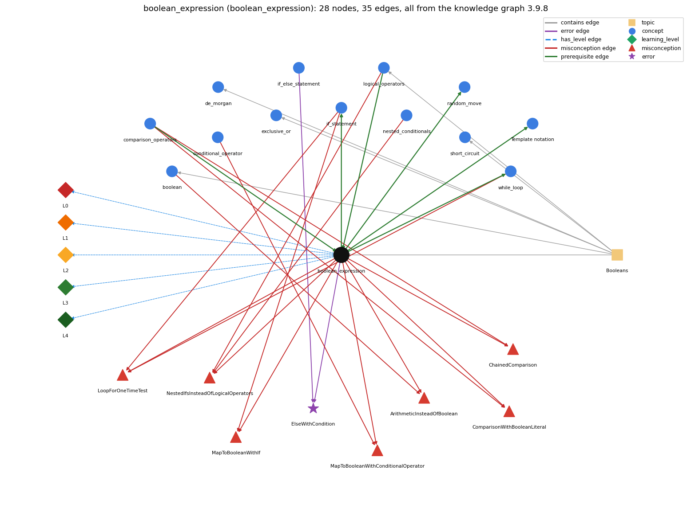

# boolean_expression (`boolean_expression`)

an expression that evaluates to true/false

Section 1.2 Built-in Types of Data, topic 1.2.e Booleans. From the knowledge graph 3.9.8 (`data/raw/chapter1_kg_updated.json`).

## Concepts associated with boolean\_expression (13)

| Concept | Description | How it is associated |
| --- | --- | --- |
| **boolean** | true/false primitive | shares misconception ArithmeticInsteadOfBoolean same topic (topic1.2.e) |
| **comparison\_operators** | == != &lt; &gt; &lt;= &gt;= | prerequisite of it (it needs this) composition rule (R) with it shares misconception ComparisonWithBooleanLiteral shares misconception ChainedComparison |
| **conditional\_operator** | c ? a : b -- an expression that picks one of two values | shares misconception MapToBooleanWithConditionalOperator |
| **de\_morgan** | !(a &amp;&amp; b) == !a \|\| !b and !(a \|\| b) == !a &amp;&amp; !b | same topic (topic1.2.e) |
| **exclusive\_or** | ^ on booleans is true when the operands differ | same topic (topic1.2.e) |
| **if\_else\_statement** | choose one of two blocks | shares error ElseWithCondition |
| **if\_statement** | run a block only when the condition holds | builds on it (needs it) composition rule (R) with it shares misconception MapToBooleanWithIf shares misconception LoopForOneTimeTest |
| **logical\_operators** | &amp;&amp; \|\| ! | prerequisite of it (it needs this) composition rule (R) with it shares misconception NestedIfsInsteadOfLogicalOperators same topic (topic1.2.e) |
| **nested\_conditionals** | else-if chains and conditionals inside conditionals | shares misconception NestedIfsInsteadOfLogicalOperators |
| **random\_move** | pick the next page from a cumulative-probability test | builds on it (needs it) composition rule (R) with it |
| **short\_circuit** | &amp;&amp;/\|\| stop evaluating once the result is known | same topic (topic1.2.e) |
| **syntax\_template** | the book's notation for a construct: a name in angle brackets, such as &lt;boolean expression&gt;, stands for any instance of that construct | builds on it (needs it) composition rule (R) with it |
| **while\_loop** | repeat a block while a condition holds | builds on it (needs it) composition rule (R) with it shares misconception LoopForOneTimeTest |

## Every edge in this view and its full label (35)

| From | Edge | To | Full edge label |
| --- | --- | --- | --- |
| **boolean\_expression** | prerequisite | **if\_statement** | An if runs its block only when its boolean expression evaluates to true. grounding: book\_passage composition rule (R) of boolean\_expression with if\_statement: The if statement evaluates its boolean expression once and runs its block only when the value is true; the expression must have type boolean, so if (x = 5) with int x does not compile. composition rule (R) of if\_statement with boolean\_expression: The condition must be a boolean expression; a non-boolean condition such as if (t = goal) with int t is a compile-time error, while if (b = false) with boolean b compiles and assigns. |
| **boolean\_expression** | prerequisite | **random\_move** | The next page is chosen by testing the condition r &lt; sum for each candidate page j in turn. grounding: book\_passage composition rule (R) of boolean\_expression with random\_move: In RandomSurfer the boolean expression r &lt; sum is evaluated for each candidate page j in turn, as sum grows; the first j for which it is true is the chosen page. composition rule (R) of random\_move with boolean\_expression: The relational test r &lt; sum decides both the chosen page and the early break; &lt; (not &lt;=) matches the half-open interval endpoint tracked by sum. |
| **boolean\_expression** | prerequisite | **syntax\_template** | In the template if (&lt;boolean expression&gt;) { &lt;statements&gt; }, &lt;boolean expression&gt; stands for any expression of type boolean. grounding: book\_passage composition rule (R) of boolean\_expression with syntax\_template: In the template if (&lt;boolean expression&gt;) { &lt;statements&gt; } the placeholder may be filled by any boolean-typed expression: a literal, a boolean variable, a comparison or a combination with logical operators. composition rule (R) of syntax\_template with boolean\_expression: The \`&lt;boolean expression&gt;\` slot accepts only expressions of type boolean (\`x &gt; y\`, \`found\`, \`a &amp;&amp; b\`). An int expression or an assignment such as \`x = y\` with int x is a compile error in that slot. |
| **boolean\_expression** | prerequisite | **while\_loop** | A while tests its boolean condition before every pass and stops the first time it evaluates to false. grounding: book\_passage composition rule (R) of boolean\_expression with while\_loop: The while loop re-evaluates its boolean expression before every pass and stops the first time it is false, so some variable in the expression must change in the body or the loop never ends. composition rule (R) of while\_loop with boolean\_expression: The loop condition is a boolean expression evaluated before every pass; the loop stops the first time it is false, so the body must eventually make it false. |
| **comparison\_operators** | prerequisite | **boolean\_expression** | A comparison such as x &lt; y produces a boolean result; comparisons together with boolean logic provide the basis for decision-making. grounding: book\_passage composition rule (R) of comparison\_operators with boolean\_expression: Comparisons are the building blocks of conditions: together with boolean logic they provide the basis for decision-making. composition rule (R) of boolean\_expression with comparison\_operators: Comparisons are the atoms of boolean expressions; because they bind tighter than &amp;&amp; and \|\|, month &gt;= 1 &amp;&amp; month &lt;= 12 groups as (month &gt;= 1) &amp;&amp; (month &lt;= 12) without parentheses. |
| **logical\_operators** | prerequisite | **boolean\_expression** | &amp;&amp;, \|\| and ! combine conditions p and q into one larger condition that is still true or false. grounding: book\_passage composition rule (R) of logical\_operators with boolean\_expression: Combining boolean sub-expressions with &amp;&amp;, \|\| and ! yields another boolean expression, so arbitrarily complex conditions can be built with parentheses. composition rule (R) of boolean\_expression with logical\_operators: &amp;&amp;, \|\| and ! combine boolean sub-expressions into a larger one; ! binds tighter than comparisons, so negating a comparison needs parentheses: !(x &gt; 0). |
| **boolean** | misconception | **ArithmeticInsteadOfBoolean** | **wrong rule:** A true/false question is answered with arithmetic (e.g. 1 for true). **right rule:** A logic question is written as a boolean expression whose value is true or false. role: primary |
| **boolean\_expression** | misconception | **ArithmeticInsteadOfBoolean** | **wrong rule:** A true/false question is answered with arithmetic (e.g. 1 for true). **right rule:** A logic question is written as a boolean expression whose value is true or false. role: context |
| **boolean\_expression** | misconception | **ChainedComparison** | **wrong rule:** 90 &lt;= grade &lt;= 100 tests whether grade is between 90 and 100. **right rule:** a &lt; b &lt; c does not compile (a &lt; b is a boolean); a range test is written 90 &lt;= grade &amp;&amp; grade &lt;= 100. role: context |
| **boolean\_expression** | misconception | **ComparisonWithBooleanLiteral** | **wrong rule:** To test a boolean b you must write if (b == true). **right rule:** if (b) already tests b, so writing == true adds nothing. role: primary |
| **boolean\_expression** | misconception | **LoopForOneTimeTest** | **wrong rule:** Uses a loop where a condition needs to be tested only once. **right rule:** A test made once is an if; a loop repeats. role: context |
| **boolean\_expression** | misconception | **MapToBooleanWithConditionalOperator** | **wrong rule:** To get a boolean from x &gt; y you need ok = (x &gt; y) ? true : false;. **right rule:** ok = (x &gt; y); already gives the boolean, so the ? : is unnecessary. role: primary |
| **boolean\_expression** | misconception | **MapToBooleanWithIf** | **wrong rule:** To store whether x &gt; y in a boolean you need if (x &gt; y) ok = true; else ok = false;. **right rule:** ok = (x &gt; y); stores the result of the comparison directly. role: primary |
| **boolean\_expression** | misconception | **NestedIfsInsteadOfLogicalOperators** | **wrong rule:** A condition on several values has to be written as nested if statements, one value per if. **right rule:** Several conditions combine into one boolean expression with &amp;&amp; and \|\|, e.g. if (x == 0 &amp;&amp; y == 0). role: context |
| **comparison\_operators** | misconception | **ChainedComparison** | **wrong rule:** 90 &lt;= grade &lt;= 100 tests whether grade is between 90 and 100. **right rule:** a &lt; b &lt; c does not compile (a &lt; b is a boolean); a range test is written 90 &lt;= grade &amp;&amp; grade &lt;= 100. role: primary |
| **comparison\_operators** | misconception | **ComparisonWithBooleanLiteral** | **wrong rule:** you must write == true / == false to test a boolean **right rule:** if (b) already tests b, so writing == true adds nothing. role: context |
| **conditional\_operator** | misconception | **MapToBooleanWithConditionalOperator** | **wrong rule:** you need ? : to do the same **right rule:** ok = (x &gt; y); already gives the boolean, so the ? : is unnecessary. role: context |
| **if\_statement** | misconception | **LoopForOneTimeTest** | **wrong rule:** Uses a loop where a condition needs to be tested only once. **right rule:** A test made once is an if; a loop repeats. role: context |
| **if\_statement** | misconception | **MapToBooleanWithIf** | **wrong rule:** you need an if to turn a boolean expression into a boolean **right rule:** ok = (x &gt; y); stores the result of the comparison directly. role: context |
| **logical\_operators** | misconception | **NestedIfsInsteadOfLogicalOperators** | **wrong rule:** A condition on several values has to be written as nested if statements, one value per if. **right rule:** Several conditions combine into one boolean expression with &amp;&amp; and \|\|, e.g. if (x == 0 &amp;&amp; y == 0). role: primary |
| **nested\_conditionals** | misconception | **NestedIfsInsteadOfLogicalOperators** | **wrong rule:** A condition on several values has to be written as nested if statements, one value per if. **right rule:** Several conditions combine into one boolean expression with &amp;&amp; and \|\|, e.g. if (x == 0 &amp;&amp; y == 0). role: context |
| **while\_loop** | misconception | **LoopForOneTimeTest** | **wrong rule:** Uses a loop where a condition needs to be tested only once. **right rule:** A test made once is an if; a loop repeats. role: primary |
| **boolean\_expression** | error | **ElseWithCondition** | **wrong rule:** Writes else (x &gt; 0) with a condition but no if. **right rule:** else takes no condition; use else if (x &gt; 0). role: context |
| **if\_else\_statement** | error | **ElseWithCondition** | **wrong rule:** Writes else (x &gt; 0) with a condition but no if. **right rule:** else takes no condition; use else if (x &gt; 0). role: primary |
| **boolean\_expression** | has\_level | **boolean\_expression@L0** | boolean expression -&gt; L0 (Prestructural): the answer holds a rule that contradicts Java (9 ways). **[0] everyday\_reading** (E): Folk meaning: maths writes a range as 90 &lt;= grade &lt;= 100 and English says 'if x is 1 or 2'. Java rule: each comparison is a separate boolean expression and they must be joined explicitly: 90 &lt;= grade &amp;&amp; grade &lt;= 100, x == 1 \|\| x == 2; 90 &lt;= grade &lt;= 100 does not compile because 90 &lt;= grade is already a boolean. **[1] misconception** (M) &rarr; ComparisonWithBooleanLiteral: wrong rule: You must write == true / == false to test a boolean. Right rule: if (b) already tests b, and if (!b) tests that it is false, so == true adds nothing. **[2] misconception** (M) &rarr; MapToBooleanWithIf: wrong rule: You need an if to turn a boolean expression into a boolean. Right rule: ok = (x &gt; y); stores the result of the comparison directly. **[3] misconception** (M) &rarr; MapToBooleanWithConditionalOperator: wrong rule: You need ? : to turn a boolean expression into a boolean (ok = x &gt; y ? true : false). Right rule: ok = (x &gt; y); already gives the boolean, so the ? : is unnecessary. **[4] misconception** (M) &rarr; ArithmeticInsteadOfBoolean: wrong rule: A true/false question is answered with arithmetic (e.g. 1 for true). Right rule: A logic question is written as a boolean expression whose value is true or false, e.g. (year % 4 == 0). **[5] inconsistent\_trace** (T) &rarr; ComparisonWithBooleanLiteral: Points to LT (arithmetic first, then comparisons, then !, &amp;&amp;, \|\|, left to right, with short-circuit). Applied unevenly: the student evaluates &amp;&amp; before a comparison in one sub-expression, or evaluates the right operand of &amp;&amp; on a pass where the left was already false. (here mixing in: "you must write == true / == false to test a boolean") **[6] misconception** (M) &rarr; ChainedComparison: wrong rule: 90 &lt;= grade &lt;= 100 tests whether grade is between 90 and 100. Right rule: a &lt; b &lt; c does not compile (a &lt; b is a boolean, which cannot be compared with &lt;); a range test is written 90 &lt;= grade &amp;&amp; grade &lt;= 100. **[7] misconception** (M) &rarr; LoopForOneTimeTest: wrong rule: Uses a loop where a condition needs to be tested only once. Right rule: A test made once is an if; a while re-tests its condition and repeats its body for as long as the condition is true. **[8] misconception** (M) &rarr; NestedIfsInsteadOfLogicalOperators: wrong rule: A condition on several values has to be written as nested if statements, one value per if. Right rule: Several conditions combine into one boolean expression with &amp;&amp; and \|\|, e.g. if (x == 0 &amp;&amp; y == 0). |
| **boolean\_expression** | has\_level | **boolean\_expression@L1** | boolean expression -&gt; L1 (Unistructural): the answer states one correct rule without applying it (2 ways). **[0] names\_the\_element** (N): A boolean expression is any expression whose type is boolean: a boolean literal or variable, a comparison, or such parts combined with &amp;&amp;, \|\| and !. **[1] states\_the\_rule** (S): A boolean expression has value true or false; it is built from comparisons (lower precedence than arithmetic, higher than boolean operators) and boolean operators; the condition of if, while and for must be one. |
| **boolean\_expression** | has\_level | **boolean\_expression@L2** | boolean expression -&gt; L2 (Multistructural): the answer applies the rules of boolean expression to every part of the code, in order (3 ways). **[0] line\_by\_line\_trace** (LT): Operands are evaluated left to right; arithmetic sub-expressions first, then comparisons, then !, then &amp;&amp;, then \|\|; &amp;&amp; and \|\| evaluate their right operand only when the left has not decided the result. **[1] output\_prediction** (OP): The value is true or false: with year = 1900, (year % 4 == 0) &amp;&amp; (year % 100 != 0) \|\| (year % 400 == 0) is false, so LeapYear prints false. **[2] one\_step\_execution** (OS): Evaluating a boolean expression changes no variable (unless it contains an assignment, ++ or a method with side effects); state changes only when its value is stored, as in isLeapYear = isLeapYear &amp;&amp; (year % 100 != 0);. |
| **boolean\_expression** | has\_level | **boolean\_expression@L3** | boolean expression -&gt; L3 (Relational): the answer relates the parts (7 ways). **[0] relation\_to\_neighbour** (R): Comparisons are the atoms of boolean expressions; because they bind tighter than &amp;&amp; and \|\|, month &gt;= 1 &amp;&amp; month &lt;= 12 groups as (month &gt;= 1) &amp;&amp; (month &lt;= 12) without parentheses. **[1] relation\_to\_neighbour** (R): &amp;&amp;, \|\| and ! combine boolean sub-expressions into a larger one; ! binds tighter than comparisons, so negating a comparison needs parentheses: !(x &gt; 0). **[2] relation\_to\_neighbour** (R): The if statement evaluates its boolean expression once and runs its block only when the value is true; the expression must have type boolean, so if (x = 5) with int x does not compile. **[3] relation\_to\_neighbour** (R): The while loop re-evaluates its boolean expression before every pass and stops the first time it is false, so some variable in the expression must change in the body or the loop never ends. **[4] relation\_to\_neighbour** (R): In RandomSurfer the boolean expression r &lt; sum is evaluated for each candidate page j in turn, as sum grows; the first j for which it is true is the chosen page. **[5] relation\_to\_neighbour** (R): In the template if (&lt;boolean expression&gt;) { &lt;statements&gt; } the placeholder may be filled by any boolean-typed expression: a literal, a boolean variable, a comparison or a combination with logical operators. **[6] purpose\_of\_the\_whole** (P): Expresses a decision condition or guard (which branch runs, whether a loop continues) or computes a flag; common plans: range test lo &lt;= x &amp;&amp; x &lt;= hi, divisibility test n % k == 0, combined rule as in LeapYear. |
| **boolean\_expression** | has\_level | **boolean\_expression@L4** | boolean expression -&gt; L4 (Extended abstract): the answer reasons beyond the given code (5 ways). **[0] predict\_a\_change** (C) &rarr; ComparisonWithBooleanLiteral: Rewriting with De Morgan (!(a &amp;&amp; b) as !a \|\| !b) keeps the value for every input; swapping the operands of &amp;&amp; keeps the truth value but can change whether the right operand is evaluated (and whether a guard still protects it); changing &lt; to &lt;= changes the result only at the boundary value. **[1] diagnose\_an\_error** (D): rule broken: else takes no condition; a second condition needs else if (...). Kind: compile-time. Trigger class: Writing else (x &gt; 0) { ... } after an if block (the compiler reports e.g. 'not a statement' or '; expected'). **[2] transfer\_to\_a\_new\_program** (X): Use a boolean expression wherever code must decide or record a yes/no condition, and store it directly (ok = x &gt; y) rather than via if or ? :; when different outcomes are needed for several cases use an if-else chain of such expressions. **[3] diagnose\_an\_error** (D): rule broken: The condition must be a boolean expression; = assigns, == compares. Kind: compile-time. Trigger class: if (a = b) with int a and b (with boolean variables it compiles and silently assigns). **[4] diagnose\_an\_error** (D): rule broken: Comparisons cannot be chained; each must be joined with &amp;&amp; or \|\|. Kind: compile-time. Trigger class: Range written as a &lt; b &lt; c or 90 &lt;= grade &lt;= 100. |
| **topic1.2.e** | contains | **boolean** | topic topic1.2.e contains boolean |
| **topic1.2.e** | contains | **boolean\_expression** | topic topic1.2.e contains boolean\_expression |
| **topic1.2.e** | contains | **de\_morgan** | topic topic1.2.e contains de\_morgan |
| **topic1.2.e** | contains | **exclusive\_or** | topic topic1.2.e contains exclusive\_or |
| **topic1.2.e** | contains | **logical\_operators** | topic topic1.2.e contains logical\_operators |
| **topic1.2.e** | contains | **short\_circuit** | topic topic1.2.e contains short\_circuit |
