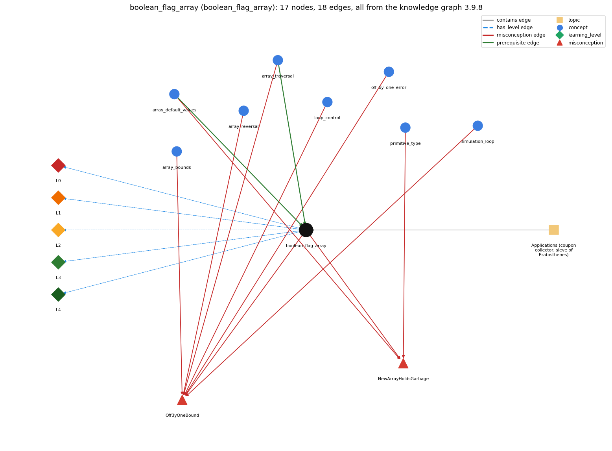

# boolean_flag_array (`boolean_flag_array`)

boolean[] used to mark which values are seen (coupon collector, sieve)

Section 1.4 Arrays, topic 1.4.f Applications (coupon collector, sieve of Eratosthenes).

## At a glance

- **Needs first:** `array_default_values`, `array_traversal`
- **Leads to:** nothing
- **Learned alongside:** nothing
- **Misconceptions:** `NewArrayHoldsGarbage`, `OffByOneBound`
- **Errors:** none
- **Levels:** L0, L1, L2, L3, L4

Everything below comes from the knowledge graph 3.9.8 (`data/raw/chapter1_kg_updated.json`): 18 edges around this concept, each explained in the graph's own words.

## What it needs first (2)

A prerequisite edge means the other concept has to be understood before `boolean_flag_array`.

### `array_default_values` comes before `boolean_flag_array`

*new slots start at 0 / false / null*

new boolean[n] starts every flag at false.

- **Grounding:** order only
- **How `boolean_flag_array` combines with `array_default_values`:** new boolean[n] starts every flag at false, which CouponCollector relies on; PrimeSieve needs true and so sets it with a loop.
- **How `array_default_values` combines with `boolean_flag_array`:** new boolean[n] starts every flag at false ('not seen yet'), so CouponCollector needs no initialization loop. PrimeSieve needs true as its start value and so must loop to set it.

### `array_traversal` comes before `boolean_flag_array`

*walking the array with an index loop*

The sieve traverses isPrime[] to set every flag to true and later traverses it again to count the flags that are still true.

- **Grounding:** book passage
- **How `boolean_flag_array` combines with `array_traversal`:** The sieve traverses isPrime[] to set every flag to true and later traverses it again to count the flags still true.
- **How `array_traversal` combines with `boolean_flag_array`:** The sieve traverses isPrime[] once to set every flag to true and again at the end to count the flags still true.

## What it leads to (0)

These concepts need `boolean_flag_array` first.

No concept has this one as a prerequisite.

## Learned alongside (0)

A parallel edge joins two concepts that sit side by side: neither is needed before the other.

No parallel edge touches this concept.

## Misconceptions (2)

A misconception edge states the wrong rule a student may hold about this concept, and the right rule.

### NewArrayHoldsGarbage

- **Wrong rule:** The slots of a new int[n] hold unpredictable values until assigned.
- **Right rule:** new fills every element with a default: 0 for numeric types, false for boolean, null for String and other non-primitive types.
- **Role of this concept:** context
- **Shows at level L0 as:** misconception: wrong rule: The slots of a new boolean[n] hold unpredictable values until assigned. Right rule: new boolean[n] starts every flag at false.
- **Also an edge from `array_default_values`:** The slots of a new int[n] hold unpredictable values until assigned.
- **Also an edge from `primitive_type`:** The slots of a new int[n] hold unpredictable values until assigned.

### OffByOneBound

- **Wrong rule:** &lt; vs &lt;= and 0..n vs 0..n-1 are interchangeable
- **Right rule:** for (i = 0; i &lt; n; i++) runs n times with i going up to n - 1; with &lt;= it runs n + 1 times and reaches i = n.
- **Role of this concept:** context
- **Shows at level L0 as:** misconception: wrong rule: &lt; vs &lt;= and 0..n vs 0..n-1 are interchangeable. Right rule: To use the value N itself as an index, the array must have length N+1 (new boolean[N+1]), and loops over values 2..N use i &lt;= N.
- **Shows at level L0 as:** inconsistent trace: Points to LT: for each new value, test found[val] and, only if it is false, count it and set the flag. Inconsistent application: the flag is set before the test on some passes, so a new value is counted as already seen. (here mixing in: "&lt; vs &lt;= and 0..n vs 0..n-1 are interchangeable")
- **Also an edge from `array_bounds`:** &lt; vs &lt;= and 0..n vs 0..n-1 are interchangeable
- **Also an edge from `array_reversal`:** &lt; vs &lt;= and 0..n vs 0..n-1 are interchangeable
- **Also an edge from `array_traversal`:** &lt; vs &lt;= and 0..n vs 0..n-1 are interchangeable
- **Also an edge from `loop_control`:** i &lt; n and i &lt;= n mean the same, so the loop runs until i equals n and the last pass can use a[n].
- **Also an edge from `off_by_one_error`:** &lt; vs &lt;= and 0..n vs 0..n-1 are interchangeable
- **Also an edge from `simulation_loop`:** t &lt; T and t &lt;= T give the same number of moves.

## Errors (0)

An error edge states the rule that gets broken in a program, and the right rule.

The graph has no error edge from this concept.

## Levels L0 to L4 (5 of 5)

Each level edge lists the ways a student shows that level, each with its exact rule.

### L0: Prestructural / sensorimotor

L0 for boolean flag array: the answer holds a rule that contradicts Java.

*Deciding question: Does every rule the answer applies to boolean flag array agree with the language rule? If it reads the code with everyday meanings, applies a wrong rule, or switches rules within one trace, it is L0. A slip in an otherwise rule-correct trace is L2 with an error, not L0.*

boolean flag array -&gt; L0 (Prestructural): the answer holds a rule that contradicts Java (4 ways).

- **everyday reading** (folk-meaning rule): Folk meaning: using a value (a card number) as a position is not how everyday checklists work; people search a list to see whether they have seen something. Java rule: found[val] is the flag stored at index val, so one indexed read answers 'seen val?'.
- **misconception** (wrong rule / right rule; shows `OffByOneBound`): wrong rule: &lt; vs &lt;= and 0..n vs 0..n-1 are interchangeable. Right rule: To use the value N itself as an index, the array must have length N+1 (new boolean[N+1]), and loops over values 2..N use i &lt;= N.
- **misconception** (wrong rule / right rule; shows `NewArrayHoldsGarbage`): wrong rule: The slots of a new boolean[n] hold unpredictable values until assigned. Right rule: new boolean[n] starts every flag at false.
- **inconsistent trace** (uneven-application rule; shows `OffByOneBound`): Points to LT: for each new value, test found[val] and, only if it is false, count it and set the flag. Inconsistent application: the flag is set before the test on some passes, so a new value is counted as already seen. (here mixing in: "&lt; vs &lt;= and 0..n vs 0..n-1 are interchangeable")

### L1: Unistructural / atom x text surface

L1 for boolean flag array: the answer states one correct rule without applying it.

*Deciding question: Does the answer cover every part of the code, in order, with the values (L2)? If it covers one part or only states the rule, it is L1.*

boolean flag array -&gt; L1 (Unistructural): the answer states one correct rule without applying it (2 ways).

- **names the element** (identity rule): Identity: a boolean array indexed by value, in which flag[v] records whether v has been seen or has a property.
- **states the rule** (declarative rule): Declarative: create boolean[] flags = new boolean[N] (all false); mark v with flags[v] = true; test with if (!flags[v]). Values must lie in 0..N-1.

### L2: Multistructural / block x execution / preoperational

L2 for boolean flag array: the answer applies these rules to every part of the code, in order.

*Deciding question: Is the answer many segments mapped onto lines (L2), or one segment stating the purpose of the whole (L3)? A correct output with no value-by-value justification is not levelled.*

boolean flag array -&gt; L2 (Multistructural): the answer applies the rules of boolean flag array to every part of the code, in order (3 ways).

- **line by line trace** (operational sequencing rule): Sequencing (CouponCollector): generate val, increment cardcnt, test found[val], and if it is false increment valcnt and set found[val] = true; repeat while valcnt &lt; N.
- **output prediction** (evaluation / result rule): Result: the count derived from the flags, e.g. CouponCollector prints the number of cards drawn, and PrimeSieve 25 prints 9; at the end of the collector found[] is all true.
- **one step execution** (state-transition rule): State transition: one step sets at most one flag from false to true and never back, so each element is a one-way flag.

### L3: Relational / relations x function (concrete operational begins)

L3 for boolean flag array: the answer relates the parts by these rules.

*Deciding question: Was the purpose deduced from the code, or only guessed from traced input/output pairs (then L2)? Does the answer stay within the given code (L3), or reason about changed code, an error class or a new program (L4)?*

boolean flag array -&gt; L3 (Relational): the answer relates the parts (3 ways).

- **relation to neighbour** (composition rule (with a neighbour)): new boolean[n] starts every flag at false, which CouponCollector relies on; PrimeSieve needs true and so sets it with a loop.
- **relation to neighbour** (composition rule (with a neighbour)): The sieve traverses isPrime[] to set every flag to true and later traverses it again to count the flags still true.
- **purpose of the whole** (plan / role rule): Plan/role: set membership by direct indexing. Each element is a one-way flag (Sajaniemi), and the array lets data index into the array, turning 'have I seen v?' into one step.

### L4: Extended abstract (concrete-operational reversibility and conservation)

L4 for boolean flag array: the answer reasons beyond the given code by these rules.

*Deciding question: Does the answer link the code to a broader context: a changed program, a class of inputs, an unseen problem? Re-tracing changed code value by value is L2; fixing one given failing case is L3.*

boolean flag array -&gt; L4 (Extended abstract): the answer reasons beyond the given code (5 ways).

- **predict a change** (conservation rule; shows `OffByOneBound`): Conservation: in CouponCollector, valcnt always equals the number of true entries in found[]. Enlarging the value range requires enlarging the array (N+1 when N itself is an index).
- **transfer to a new program** (applicability rule): Applicability: use a flag array when the values are small non-negative integers (card values, numbers up to N) and memory for N flags is affordable. Do not use one for huge, negative or non-integer keys.
- **diagnose an error** (error rule): rule broken: Values used as indices must lie in 0..length-1. Kind: run-time exception. Trigger class: new boolean[N] used with value N as an index (the sieve needs N+1), or a negative value (ArrayIndexOutOfBoundsException)
- **diagnose an error** (error rule): rule broken: A start value other than false must be set explicitly. Kind: silent logic error. Trigger class: PrimeSieve without its initial isPrime[i] = true loop: no number is ever prime, so it prints 0
- **diagnose an error** (error rule): rule broken: Test the flag before setting it. Kind: silent logic error. Trigger class: found[val] = true written before if (!found[val]), so valcnt never increases and the loop never ends

## Same topic

`boolean_flag_array` belongs to the topic **Applications (coupon collector, sieve of Eratosthenes)** (`topic1.4.f`). It is the only concept of that topic.

## Rules of the concept (17)

- **folk-meaning rule:** Folk meaning: using a value (a card number) as a position is not how everyday checklists work; people search a list to see whether they have seen something. Java rule: found[val] is the flag stored at index val, so one indexed read answers 'seen val?'.
- **wrong rule / right rule:** NewArrayHoldsGarbage: wrong: The slots of a new boolean[n] hold unpredictable values until assigned. \| right: new boolean[n] starts every flag at false.
- **wrong rule / right rule:** OffByOneBound: wrong: &lt; vs &lt;= and 0..n vs 0..n-1 are interchangeable. \| right: To use the value N itself as an index, the array must have length N+1 (new boolean[N+1]), and loops over values 2..N use i &lt;= N.
- **uneven-application rule:** Points to LT: for each new value, test found[val] and, only if it is false, count it and set the flag. Inconsistent application: the flag is set before the test on some passes, so a new value is counted as already seen.
- **identity rule:** Identity: a boolean array indexed by value, in which flag[v] records whether v has been seen or has a property.
- **declarative rule:** Declarative: create boolean[] flags = new boolean[N] (all false); mark v with flags[v] = true; test with if (!flags[v]). Values must lie in 0..N-1.
- **operational sequencing rule:** Sequencing (CouponCollector): generate val, increment cardcnt, test found[val], and if it is false increment valcnt and set found[val] = true; repeat while valcnt &lt; N.
- **evaluation / result rule:** Result: the count derived from the flags, e.g. CouponCollector prints the number of cards drawn, and PrimeSieve 25 prints 9; at the end of the collector found[] is all true.
- **state-transition rule:** State transition: one step sets at most one flag from false to true and never back, so each element is a one-way flag.
- **composition rule (with a neighbour):** with array\_default\_values: new boolean[n] starts every flag at false, which CouponCollector relies on; PrimeSieve needs true and so sets it with a loop.
- **composition rule (with a neighbour):** with array\_traversal: The sieve traverses isPrime[] to set every flag to true and later traverses it again to count the flags still true.
- **plan / role rule:** Plan/role: set membership by direct indexing. Each element is a one-way flag (Sajaniemi), and the array lets data index into the array, turning 'have I seen v?' into one step.
- **conservation rule:** Conservation: in CouponCollector, valcnt always equals the number of true entries in found[]. Enlarging the value range requires enlarging the array (N+1 when N itself is an index).
- **error rule:** rule broken: Values used as indices must lie in 0..length-1. (run-time exception)
- **error rule:** rule broken: A start value other than false must be set explicitly. (silent logic error)
- **error rule:** rule broken: Test the flag before setting it. (silent logic error)
- **applicability rule:** Applicability: use a flag array when the values are small non-negative integers (card values, numbers up to N) and memory for N flags is affordable. Do not use one for huge, negative or non-integer keys.

## The whole prerequisite chain

- **Everything it builds on (24):** `arithmetic_operators`, `array_creation`, `array_declaration`, `array_default_values`, `array_initializer`, `array_traversal`, `boolean`, `boolean_expression`, `comparison_operators`, `data_structure`, `data_type`, `do_while_loop`, `expression`, `for_loop`, `identifier`, `indexing`, `length_field`, `literal`, `logical_operators`, `loop_control`, `loop_variable`, `primitive_type`, `variable`, `while_loop`
- **Everything that builds on it (0):** nothing
