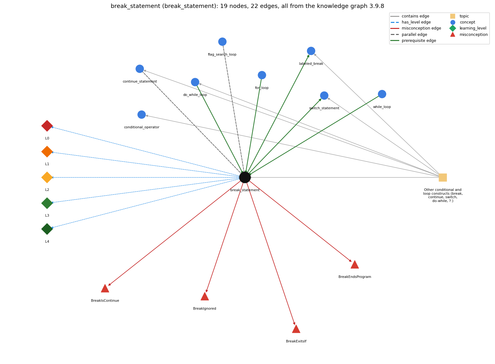

# break_statement (`break_statement`)

break -- immediately exits the innermost loop or switch

Section 1.3 Conditionals and Loops, topic 1.3.g Other conditional and loop constructs (break, continue, switch, do-while, ?:). From the knowledge graph 3.9.8 (`data/raw/chapter1_kg_updated.json`).

## Concepts associated with break\_statement (8)

| Concept | Description | How it is associated |
| --- | --- | --- |
| **conditional\_operator** | c ? a : b -- an expression that picks one of two values | same topic (topic1.3.g) |
| **continue\_statement** | continue -- skips to the next iteration of the innermost loop | parallel concept composition rule (R) with it same topic (topic1.3.g) |
| **do\_while\_loop** | do { body } while (c); -- body first, test after | prerequisite of it (it needs this) same topic (topic1.3.g) |
| **flag\_search\_loop** | a boolean flag that a loop sets once and never resets | parallel concept |
| **for\_loop** | a while with init/condition/update packaged together | prerequisite of it (it needs this) |
| **labeled\_break** | labeled break/continue exit or continue an outer loop | builds on it (needs it) composition rule (R) with it same topic (topic1.3.g) |
| **switch\_statement** | switch (x) { case v: ...; break; default: ... } | builds on it (needs it) composition rule (R) with it same topic (topic1.3.g) |
| **while\_loop** | repeat a block while a condition holds | prerequisite of it (it needs this) composition rule (R) with it |

## Every edge in this view and its full label (22)

| From | Edge | To | Full edge label |
| --- | --- | --- | --- |
| **break\_statement** | prerequisite | **labeled\_break** | Labeled break extends break to an outer loop. grounding: questionable composition rule (R) of break\_statement with labeled\_break: Plain break reaches only the innermost loop. In nested loops, ending the outer loop needs \`break label;\` on a labeled outer statement (or a flag tested by the outer loop). composition rule (R) of labeled\_break with break\_statement: An unlabeled break exits only the innermost loop or switch. Adding a label lets break exit any enclosing labeled statement, and so end several nested loops at once. |
| **break\_statement** | prerequisite | **switch\_statement** | Each case of a switch normally ends with break, which exits the switch body. grounding: book\_passage composition rule (R) of break\_statement with switch\_statement: In a switch, break ends the switch body; without it, execution falls through into the next case. A break inside a switch that is inside a loop exits only the switch, not the loop. composition rule (R) of switch\_statement with break\_statement: Each case is normally ended by break, which exits the switch body. Leaving it out makes that case fall into the next. Inside a loop, that break exits the switch, not the loop. |
| **do\_while\_loop** | prerequisite | **break\_statement** | break leaves the do-while loop at once, exactly as it leaves a while or for loop. grounding: spec\_passage |
| **for\_loop** | prerequisite | **break\_statement** | break leaves the for loop at once, without running the rest of the body or the remaining passes. grounding: book\_passage |
| **while\_loop** | prerequisite | **break\_statement** | break immediately exits a loop without letting it run to completion. grounding: book\_passage composition rule (R) of while\_loop with break\_statement: break exits the loop immediately, so a while loop can end either by a false test or by a break; while (true) needs a break (or is infinite). composition rule (R) of break\_statement with while\_loop: break gives a while loop a second exit, in the middle of the body. After the loop, the program has to tell which exit was taken by re-testing the state (as in \`if (i &gt; N/i)\`), so any variable used for that test must be declared before the loop. |
| **break\_statement** | parallel | **continue\_statement** | break ends the whole loop; continue ends only the current pass. grounding: book\_passage composition rule (R) of break\_statement with continue\_statement: Both skip the rest of the current body. break then leaves the loop (no increment, no further test); continue goes on to the increment and the next test. composition rule (R) of continue\_statement with break\_statement: Both abandon the rest of the body; continue proceeds to the next pass (increment and test), break leaves the loop with no increment or test. |
| **flag\_search\_loop** | parallel | **break\_statement** | Two ways to stop a search when the item is found: break leaves the loop at once, while a boolean flag is set and tested in the loop condition so the loop ends at its next test. After either, the code must tell the found case from the loop finishing normally. grounding: book\_passage |
| **break\_statement** | misconception | **BreakEndsProgram** | **wrong rule:** break ends the whole program. **right rule:** break ends only the innermost loop (or switch); execution continues after it. role: primary |
| **break\_statement** | misconception | **BreakExitsIf** | **wrong rule:** break leaves the if statement it is written in. **right rule:** break immediately exits a loop without letting it run to completion, and in a switch it exits the switch body. role: primary |
| **break\_statement** | misconception | **BreakIgnored** | **wrong rule:** break has no effect; the loop body just carries on. **right rule:** break leaves the innermost loop at once; the rest of the body and later passes do not run. role: primary |
| **break\_statement** | misconception | **BreakIsContinue** | **wrong rule:** break starts the next iteration of the loop. **right rule:** break exits the loop immediately; continue skips to the next iteration of the loop. role: primary |
| **break\_statement** | has\_level | **break\_statement@L0** | break statement -&gt; L0 (Prestructural): the answer holds a rule that contradicts Java (6 ways). **[0] everyday\_reading** (E): Folk meaning: in English 'break' means to pause, or to stop or break out of whatever you are in, so a novice reads it as leaving the enclosing if, as starting the next round, or as stopping the whole program. In Java, \`break;\` ends only the innermost enclosing loop or switch, and execution continues with the statement after it. **[1] misconception** (M) &rarr; BreakExitsIf: wrong rule: break leaves the if statement it is written in. Right rule: An if is not a break target: break immediately exits the innermost enclosing loop (or switch) without letting it run to completion. **[2] misconception** (M) &rarr; BreakIsContinue: wrong rule: break starts the next iteration of the loop. Right rule: break exits the loop immediately; continue is the statement that skips to the next iteration. **[3] misconception** (M) &rarr; BreakEndsProgram: wrong rule: break ends the whole program. Right rule: break ends only the innermost loop (or switch); execution continues with the statement after it. **[4] misconception** (M) &rarr; BreakIgnored: wrong rule: break has no effect; the loop body just carries on. Right rule: break leaves the innermost loop at once: the rest of the body, the increment, and all later passes are skipped. **[5] inconsistent\_trace** (T) &rarr; BreakExitsIf: Applies the LT rule unevenly: on some passes the trace continues the body after break, or runs the increment and the test once more after break, so the final loop variable is one too large (e.g. i = 4 instead of 3 when 3 divides N). (here mixing in: "break leaves the if statement it is written in") |
| **break\_statement** | has\_level | **break\_statement@L1** | break statement -&gt; L1 (Unistructural): the answer states one correct rule without applying it (2 ways). **[0] names\_the\_element** (N): Jump statement: \`break;\` immediately ends the innermost enclosing while, for, do or switch. **[1] states\_the\_rule** (S): \`break;\` may appear only inside a loop or switch. When executed, it completes that innermost loop or switch at once, and control passes to the statement after it. (Spec: JLS §14.15.) |
| **break\_statement** | has\_level | **break\_statement@L2** | break statement -&gt; L2 (Multistructural): the answer applies the rules of break statement to every part of the code, in order (3 ways). **[0] line\_by\_line\_trace** (LT): When \`break\` executes: the remaining statements of the body are skipped, the for-loop increment and the condition are not evaluated again, and control continues at the first statement after the loop. In \`for (i = 2; i &lt;= N/i; i++) if (N % i == 0) break;\` it runs right after the test that found a divisor. **[1] output\_prediction** (OP): break is a statement and produces no value. Its effect shows in the variables it leaves: after the primality loop for N = 15, i is 3 (the smallest divisor), so \`i &gt; N/i\` is false and 'is prime' is not printed. **[2] one\_step\_execution** (OS): One execution of break changes no variable. It changes only the point of control (to after the loop), so every variable keeps its value at the moment of the break. |
| **break\_statement** | has\_level | **break\_statement@L3** | break statement -&gt; L3 (Relational): the answer relates the parts (6 ways). **[0] relation\_to\_neighbour** (R): break gives a while loop a second exit, in the middle of the body. After the loop, the program has to tell which exit was taken by re-testing the state (as in \`if (i &gt; N/i)\`), so any variable used for that test must be declared before the loop. **[1] relation\_to\_neighbour** (R): Plain break reaches only the innermost loop. In nested loops, ending the outer loop needs \`break label;\` on a labeled outer statement (or a flag tested by the outer loop). **[2] relation\_to\_neighbour** (R): Both skip the rest of the current body. break then leaves the loop (no increment, no further test); continue goes on to the increment and the next test. **[3] relation\_to\_neighbour** (R): In a switch, break ends the switch body; without it, execution falls through into the next case. A break inside a switch that is inside a loop exits only the switch, not the loop. **[4] relation\_to\_neighbour** (R): Two ways to stop a search when the item is found: break leaves the loop at once, while a boolean flag is set and tested in the loop condition so the loop ends at its next test. After either, the code must tell the found case from the loop finishing normally. **[5] purpose\_of\_the\_whole** (P): Plan: early-exit search (Soloway 'loop-and-a-half' or exit-on-found). Stop scanning as soon as the answer is known, e.g. at the first divisor; the loop variable is a stepper whose value at exit reports the find. |
| **break\_statement** | has\_level | **break\_statement@L4** | break statement -&gt; L4 (Extended abstract): the answer reasons beyond the given code (6 ways). **[0] predict\_a\_change** (C) &rarr; BreakExitsIf: Removing the break keeps the loop finite but lets it run to completion. In the prime test, i then ends above N/i for every N, so composites are reported as prime. Invariant kept with break: after the loop, \`i &lt;= N/i\` holds exactly when the break was taken. **[1] transfer\_to\_a\_new\_program** (X): Use break when the reason to stop is discovered in the middle of a pass (first divisor, sentinel found) and folding it into the loop condition would be awkward. Prefer a plain loop condition when the exit can be stated up front. In a method, \`return\` is often clearer. S&amp;W use break rarely. **[2] diagnose\_an\_error** (D): rule broken: break must be inside a loop or switch. Kind: compile-time. Trigger class: \`break;\` inside an if that is not inside any loop or switch (break outside switch or loop). **[3] diagnose\_an\_error** (D): rule broken: Statements after break in the same block can never run. Kind: compile-time. Trigger class: Code written directly after \`break;\` in the same block (unreachable statement). **[4] diagnose\_an\_error** (D): rule broken: break exits only the innermost loop or switch. Kind: silent logic error. Trigger class: A break in an inner loop (or in a switch inside a loop) that was meant to end the outer loop: the outer loop keeps going. **[5] diagnose\_an\_error** (D): rule broken: A variable used after the loop to tell how it ended must be in scope. Kind: compile-time. Trigger class: Declaring the loop index in the for header (\`for (int i = 2; ...)\`) and then testing \`i\` after the loop (cannot find symbol). |
| **topic1.3.g** | contains | **break\_statement** | topic topic1.3.g contains break\_statement |
| **topic1.3.g** | contains | **conditional\_operator** | topic topic1.3.g contains conditional\_operator |
| **topic1.3.g** | contains | **continue\_statement** | topic topic1.3.g contains continue\_statement |
| **topic1.3.g** | contains | **do\_while\_loop** | topic topic1.3.g contains do\_while\_loop |
| **topic1.3.g** | contains | **labeled\_break** | topic topic1.3.g contains labeled\_break |
| **topic1.3.g** | contains | **switch\_statement** | topic topic1.3.g contains switch\_statement |
