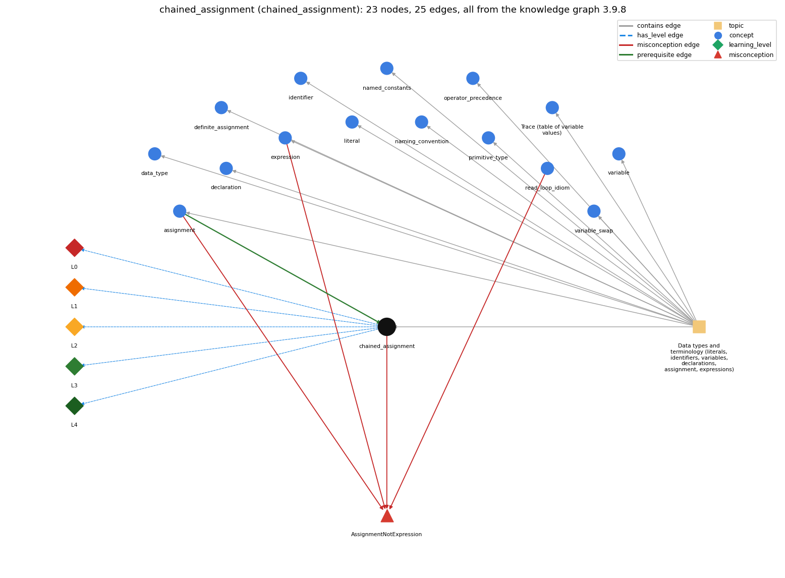

# chained_assignment (`chained_assignment`)

a = b = 0 assigns right to left

Section 1.2 Built-in Types of Data, topic 1.2.a Data types and terminology (literals, identifiers, variables, declarations, assignment, expressions).

## At a glance

- **Needs first:** `assignment`
- **Leads to:** nothing
- **Learned alongside:** nothing
- **Misconceptions:** `AssignmentNotExpression`
- **Errors:** none
- **Levels:** L0, L1, L2, L3, L4

Everything below comes from the knowledge graph 3.9.8 (`data/raw/chapter1_kg_updated.json`): 25 edges around this concept, each explained in the graph's own words.

## What it needs first (1)

A prerequisite edge means the other concept has to be understood before `chained_assignment`.

### `assignment` comes before `chained_assignment`

*= stores the computed value of the right side*

An assignment such as x = y is treated as an expression: it assigns the value of y to x and evaluates to that value.

- **Grounding:** questionable
- **How `chained_assignment` combines with `assignment`:** A chain works only because an assignment is itself an expression whose value is the value stored, so it can be the right side of another =.
- **How `assignment` combines with `chained_assignment`:** Because an assignment is an expression whose value is the value stored, and = groups right to left, a = b = 0 first stores 0 in b and then stores that 0 in a.

## What it leads to (0)

These concepts need `chained_assignment` first.

No concept has this one as a prerequisite.

## Learned alongside (0)

A parallel edge joins two concepts that sit side by side: neither is needed before the other.

No parallel edge touches this concept.

## Misconceptions (1)

A misconception edge states the wrong rule a student may hold about this concept, and the right rule.

### AssignmentNotExpression

- **Wrong rule:** an assignment cannot be used inside a larger expression
- **Right rule:** An assignment is an expression whose value is the value assigned, so (x = v) both stores v in x and gives v.
- **Role of this concept:** context
- **Shows at level L0 as:** misconception: wrong rule: an assignment cannot be used inside a larger expression. Right rule: An assignment is an expression whose value is the value assigned, so (x = v) both stores v in x and gives v.
- **Shows at level L0 as:** inconsistent trace: Points to LT (the rightmost assignment runs first, and its value feeds the next one to its left). Applied unevenly, a student evaluates a = b first and gives a the old value of b. (here mixing in: "an assignment cannot be used inside a larger expression")
- **Also an edge from `assignment`:** An assignment cannot be used inside a larger expression, so a condition like (x = read()) != v is not allowed.
- **Also an edge from `expression`:** An assignment cannot be used inside a larger expression, so a condition like (x = read()) != v is not allowed.
- **Also an edge from `read_loop_idiom`:** A read and a test cannot be combined, so while ((x = read()) != end) is not allowed.

## Errors (0)

An error edge states the rule that gets broken in a program, and the right rule.

The graph has no error edge from this concept.

## Levels L0 to L4 (5 of 5)

Each level edge lists the ways a student shows that level, each with its exact rule.

### L0: Prestructural / sensorimotor

L0 for chained assignment: the answer holds a rule that contradicts Java.

*Deciding question: Does every rule the answer applies to chained assignment agree with the language rule? If it reads the code with everyday meanings, applies a wrong rule, or switches rules within one trace, it is L0. A slip in an otherwise rule-correct trace is L2 with an error, not L0.*

chained assignment -&gt; L0 (Prestructural): the answer holds a rule that contradicts Java (3 ways).

- **everyday reading** (folk-meaning rule): In maths, a = b = 0 states that all three quantities are equal at once, in any reading order. In Java the = operators group right to left: b = 0 runs first, and its value 0 is then assigned to a.
- **misconception** (wrong rule / right rule; shows `AssignmentNotExpression`): wrong rule: an assignment cannot be used inside a larger expression. Right rule: An assignment is an expression whose value is the value assigned, so (x = v) both stores v in x and gives v.
- **inconsistent trace** (uneven-application rule; shows `AssignmentNotExpression`): Points to LT (the rightmost assignment runs first, and its value feeds the next one to its left). Applied unevenly, a student evaluates a = b first and gives a the old value of b. (here mixing in: "an assignment cannot be used inside a larger expression")

### L1: Unistructural / atom x text surface

L1 for chained assignment: the answer states one correct rule without applying it.

*Deciding question: Does the answer cover every part of the code, in order, with the values (L2)? If it covers one part or only states the rule, it is L1.*

chained assignment -&gt; L1 (Unistructural): the answer states one correct rule without applying it (2 ways).

- **names the element** (identity rule): Chained assignment: several = in one expression (a = b = c = 0) that assigns one value to several variables.
- **states the rule** (declarative rule): = is right-associative, and an assignment expression has the value that was stored, so a = b = 0 means a = (b = 0). Every target must be a variable whose type accepts the value.

### L2: Multistructural / block x execution / preoperational

L2 for chained assignment: the answer applies these rules to every part of the code, in order.

*Deciding question: Is the answer many segments mapped onto lines (L2), or one segment stating the purpose of the whole (L3)? A correct output with no value-by-value justification is not levelled.*

chained assignment -&gt; L2 (Multistructural): the answer applies the rules of chained assignment to every part of the code, in order (3 ways).

- **line by line trace** (operational sequencing rule): The innermost (rightmost) assignment runs first: evaluate 0, store it in b, and that assignment's value 0 is then stored in a.
- **output prediction** (evaluation / result rule): The whole expression's value is the value assigned. With int i and double d, d = i = 5 stores 5 in i and 5.0 in d.
- **one step execution** (state-transition rule): Every variable in the chain changes, right to left, to the same value (converted to its own type).

### L3: Relational / relations x function (concrete operational begins)

L3 for chained assignment: the answer relates the parts by these rules.

*Deciding question: Was the purpose deduced from the code, or only guessed from traced input/output pairs (then L2)? Does the answer stay within the given code (L3), or reason about changed code, an error class or a new program (L4)?*

chained assignment -&gt; L3 (Relational): the answer relates the parts (2 ways).

- **relation to neighbour** (composition rule (with a neighbour)): A chain works only because an assignment is itself an expression whose value is the value stored, so it can be the right side of another =.
- **purpose of the whole** (plan / role rule): Initializing several counters or accumulators to the same starting value in one line (sum = count = 0).

### L4: Extended abstract (concrete-operational reversibility and conservation)

L4 for chained assignment: the answer reasons beyond the given code by these rules.

*Deciding question: Does the answer link the code to a broader context: a changed program, a class of inputs, an unseen problem? Re-tracing changed code value by value is L2; fixing one given failing case is L3.*

chained assignment -&gt; L4 (Extended abstract): the answer reasons beyond the given code (4 ways).

- **predict a change** (conservation rule; shows `AssignmentNotExpression`): Reordering targets with different types can break the chain: d = i = 5 compiles, but i = d = 5 does not, because the double value of d = 5 cannot go into int i.
- **transfer to a new program** (applicability rule): Use a chain only to give several variables of the same type one simple starting value. Avoid chains inside conditions or with expressions that have side effects.
- **diagnose an error** (error rule): rule broken: Every value in the chain must be assignable to the next target's type. Kind: compile-time. Trigger class: A chain passing through a wider type into a narrower one (int i; double d; i = d = 2.5;): 'possible lossy conversion'.
- **diagnose an error** (error rule): rule broken: int a = b = 0; declares only a; b must already exist. Kind: compile-time. Trigger class: Using the chain in a declaration with an undeclared inner variable: 'cannot find symbol b'.

## Same topic

`chained_assignment` belongs to the topic **Data types and terminology (literals, identifiers, variables, declarations, assignment, expressions)** (`topic1.2.a`). The topic also contains: `assignment`, `data_type`, `declaration`, `definite_assignment`, `expression`, `identifier`, `literal`, `named_constants`, `naming_convention`, `operator_precedence`, `primitive_type`, `program_trace`, `variable`, `variable_swap`.

## Rules of the concept (14)

- **folk-meaning rule:** In maths, a = b = 0 states that all three quantities are equal at once, in any reading order. In Java the = operators group right to left: b = 0 runs first, and its value 0 is then assigned to a.
- **wrong rule / right rule:** AssignmentNotExpression: wrong: an assignment cannot be used inside a larger expression \| right: An assignment is an expression whose value is the value assigned, so (x = v) both stores v in x and gives v.
- **uneven-application rule:** Points to LT (the rightmost assignment runs first, and its value feeds the next one to its left). Applied unevenly, a student evaluates a = b first and gives a the old value of b.
- **identity rule:** Chained assignment: several = in one expression (a = b = c = 0) that assigns one value to several variables.
- **declarative rule:** = is right-associative, and an assignment expression has the value that was stored, so a = b = 0 means a = (b = 0). Every target must be a variable whose type accepts the value.
- **operational sequencing rule:** The innermost (rightmost) assignment runs first: evaluate 0, store it in b, and that assignment's value 0 is then stored in a.
- **evaluation / result rule:** The whole expression's value is the value assigned. With int i and double d, d = i = 5 stores 5 in i and 5.0 in d.
- **state-transition rule:** Every variable in the chain changes, right to left, to the same value (converted to its own type).
- **composition rule (with a neighbour):** with assignment: A chain works only because an assignment is itself an expression whose value is the value stored, so it can be the right side of another =.
- **plan / role rule:** Initializing several counters or accumulators to the same starting value in one line (sum = count = 0).
- **conservation rule:** Reordering targets with different types can break the chain: d = i = 5 compiles, but i = d = 5 does not, because the double value of d = 5 cannot go into int i.
- **error rule:** rule broken: Every value in the chain must be assignable to the next target's type. (compile-time)
- **error rule:** rule broken: int a = b = 0; declares only a; b must already exist. (compile-time)
- **applicability rule:** Use a chain only to give several variables of the same type one simple starting value. Avoid chains inside conditions or with expressions that have side effects.

## The whole prerequisite chain

- **Everything it builds on (7):** `assignment`, `data_type`, `declaration`, `identifier`, `literal`, `primitive_type`, `variable`
- **Everything that builds on it (0):** nothing
