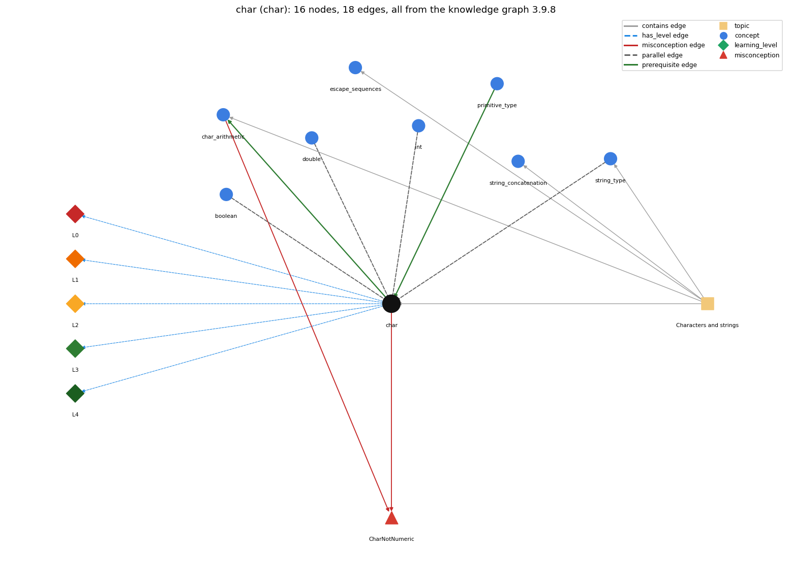

# char (`char`)

16-bit character primitive

Section 1.2 Built-in Types of Data, topic 1.2.b Characters and strings. From the knowledge graph 3.9.8 (`data/raw/chapter1_kg_updated.json`).

## Concepts associated with char (8)

| Concept | Description | How it is associated |
| --- | --- | --- |
| **boolean** | true/false primitive | parallel concept composition rule (R) with it |
| **char\_arithmetic** | a char is a 16-bit number, so 'a' + 1 is an int | builds on it (needs it) composition rule (R) with it shares misconception CharNotNumeric same topic (topic1.2.b) |
| **double** | 64-bit floating-point primitive | parallel concept composition rule (R) with it |
| **escape\_sequences** | backslash codes inside literals: '\t' tab, '\n' newline | same topic (topic1.2.b) |
| **int** | 32-bit integer primitive | parallel concept composition rule (R) with it |
| **primitive\_type** | int, double, boolean, char | prerequisite of it (it needs this) composition rule (R) with it |
| **string\_concatenation** | + with a String builds a new string | same topic (topic1.2.b) |
| **string\_type** | String -- a reference type, not a primitive | parallel concept same topic (topic1.2.b) |

## Every edge in this view and its full label (18)

| From | Edge | To | Full edge label |
| --- | --- | --- | --- |
| **char** | prerequisite | **char\_arithmetic** | Char arithmetic uses the numeric code stored for each char. grounding: book\_passage composition rule (R) of char with char\_arithmetic: Char arithmetic works on each char's numeric code and yields an int. A cast turns the result back into a character. composition rule (R) of char\_arithmetic with char: Char arithmetic uses each char's numeric code, so the result is an int, not a char, unless it is cast back. |
| **primitive\_type** | prerequisite | **char** | char is one of the eight primitive types, the one used for single characters. grounding: book\_passage composition rule (R) of primitive\_type with char: char is an integral primitive (16-bit unsigned UTF-16 code unit), so a char takes part in arithmetic as its numeric code. composition rule (R) of char with primitive\_type: char is one of the eight primitive types: the unsigned 16-bit integral one, used for single characters. |
| **boolean** | parallel | **char** | A boolean holds true or false; a char holds a single character such as 'c'. grounding: book\_passage composition rule (R) of boolean with char: char is a numeric (integral) type whose values can be compared ('a' &lt; 'b' is a boolean), whereas boolean is not numeric; neither converts to the other. composition rule (R) of char with boolean: char and boolean are unrelated: there is no conversion or cast between them, and 'c' is never true or false. |
| **char** | parallel | **string\_type** | 'a' is a char (one 16-bit character code, a primitive); "a" is a String (a sequence of characters, an object). 'a' + 'b' is the int 195, while "a" + "b" is "ab". grounding: book\_passage |
| **double** | parallel | **char** | A double holds a number with a fractional part; a char holds one character code, which is a whole number. grounding: book\_passage composition rule (R) of double with char: char is an integral numeric type, so a char widens automatically to double in arithmetic ('a' + 0.5 is 97.5), but a double needs an explicit cast to become a char. composition rule (R) of char with double: A char widens automatically to double (its code), but a double needs a cast to become a char. A char never holds a fractional part. |
| **int** | parallel | **char** | An int holds a whole number; a char holds one character, which Java stores as its numeric code. grounding: book\_passage composition rule (R) of int with char: In arithmetic a char is promoted to its int code. An int becomes a char only through a cast. composition rule (R) of char with int: A char is stored as an unsigned 16-bit code, so in arithmetic it acts as an int ('a' + 1 is 98). Going from int to char needs a cast. |
| **char** | misconception | **CharNotNumeric** | **wrong rule:** A char is only a letter, so c + k is an error. **right rule:** A char is encoded as a 16-bit integer, so arithmetic such as 'b' + 'c' or 'a' + 4 works on the character codes. role: primary |
| **char\_arithmetic** | misconception | **CharNotNumeric** | **wrong rule:** char is not a numeric type **right rule:** A char is encoded as a 16-bit integer, so arithmetic such as 'b' + 'c' or 'a' + 4 works on the character codes. role: context |
| **char** | has\_level | **char@L0** | char -&gt; L0 (Prestructural): the answer holds a rule that contradicts Java (3 ways). **[0] everyday\_reading** (E): In everyday life '7' and 7 are the same thing, and a character is a letter, not a number. A Java char is a 16-bit numeric code: '7' has code 55, and 'a' + 1 is the int 98. **[1] misconception** (M) &rarr; CharNotNumeric: wrong rule: char is not a numeric type. Right rule: A char is encoded as a 16-bit integer, so arithmetic such as 'b' + 'c' or 'a' + 4 works on the character codes. **[2] inconsistent\_trace** (T) &rarr; CharNotNumeric: Points to LT (a char in arithmetic becomes its int code). Applied unevenly, a student treats 'b' + 'c' as 197 in one exercise but prints it as "bc" in another. (here mixing in: "char is not a numeric type") |
| **char** | has\_level | **char@L1** | char -&gt; L1 (Unistructural): the answer states one correct rule without applying it (2 ways). **[0] names\_the\_element** (N): char: the primitive type for a single 16-bit Unicode character, such as 'a', '%' or '\n'. **[1] states\_the\_rule** (S): A char literal is exactly one character (or one escape sequence) in single quotes. Values range from '\u0000' to '\uffff' (0 to 65535), and char is an integral type. A char literal is one character in single quotes ('a'); a String literal is any sequence in double quotes ("a"), so 'a' and "a" have different types and 'ab' does not compile. |
| **char** | has\_level | **char@L2** | char -&gt; L2 (Multistructural): the answer applies the rules of char to every part of the code, in order (3 ways). **[0] line\_by\_line\_trace** (LT): When a char meets an arithmetic operator, it is first promoted to int (its code) and the operation runs in int. Storing the result back in a char needs an explicit cast. **[1] output\_prediction** (OP): System.out.println('b') prints b. 'b' + 'c' is the int 197. (char) ('a' + 4) is 'e'. **[2] one\_step\_execution** (OS): c++ on char c = 'A' makes c 'B', because increment works on chars directly. c = c + 1; does not compile, because the right side is an int. |
| **char** | has\_level | **char@L3** | char -&gt; L3 (Relational): the answer relates the parts (7 ways). **[0] relation\_to\_neighbour** (R): A char is stored as an unsigned 16-bit code, so in arithmetic it acts as an int ('a' + 1 is 98). Going from int to char needs a cast. **[1] relation\_to\_neighbour** (R): A char widens automatically to double (its code), but a double needs a cast to become a char. A char never holds a fractional part. **[2] relation\_to\_neighbour** (R): char and boolean are unrelated: there is no conversion or cast between them, and 'c' is never true or false. **[3] relation\_to\_neighbour** (R): Char arithmetic works on each char's numeric code and yields an int. A cast turns the result back into a character. **[4] relation\_to\_neighbour** (R): char is one of the eight primitive types: the unsigned 16-bit integral one, used for single characters. **[5] relation\_to\_neighbour** (R): 'a' is a char (one 16-bit character code, a primitive); "a" is a String (a sequence of characters, an object). 'a' + 'b' is the int 195, while "a" + "b" is "ab". **[6] purpose\_of\_the\_whole** (P): A char holds one character: processing text one character at a time (charAt), looping over 'A'..'Z', or shifting letters in a cipher. |
| **char** | has\_level | **char@L4** | char -&gt; L4 (Extended abstract): the answer reasons beyond the given code (5 ways). **[0] predict\_a\_change** (C) &rarr; CharNotNumeric: Changing 'A' to "A" changes the type to String, so + concatenates instead of adding. Changing a char variable to int keeps the arithmetic, but println then prints numbers instead of letters. **[1] transfer\_to\_a\_new\_program** (X): Use char for one character from a literal or from charAt, especially when the character's code matters (alphabet loops, ciphers). Use String for text of any length. **[2] diagnose\_an\_error** (D): rule broken: A char literal holds exactly one character. Kind: compile-time. Trigger class: Several characters in single quotes ('ab') or a word in single quotes: 'unclosed character literal'. **[3] diagnose\_an\_error** (D): rule broken: int arithmetic on chars yields an int, which cannot go into a char without a cast. Kind: compile-time. Trigger class: char c = 'a' + i; or c = c + 1; with variable i: 'possible lossy conversion from int to char'. **[4] diagnose\_an\_error** (D): rule broken: A char compares by its code, not by the digit or letter it shows. Kind: silent logic error. Trigger class: Comparing a char with an int as if it were a digit (seat &lt;= 3 for seat = 'A'), or printing c + 1 expecting a letter. |
| **topic1.2.b** | contains | **char** | topic topic1.2.b contains char |
| **topic1.2.b** | contains | **char\_arithmetic** | topic topic1.2.b contains char\_arithmetic |
| **topic1.2.b** | contains | **escape\_sequences** | topic topic1.2.b contains escape\_sequences |
| **topic1.2.b** | contains | **string\_concatenation** | topic topic1.2.b contains string\_concatenation |
| **topic1.2.b** | contains | **string\_type** | topic topic1.2.b contains string\_type |
