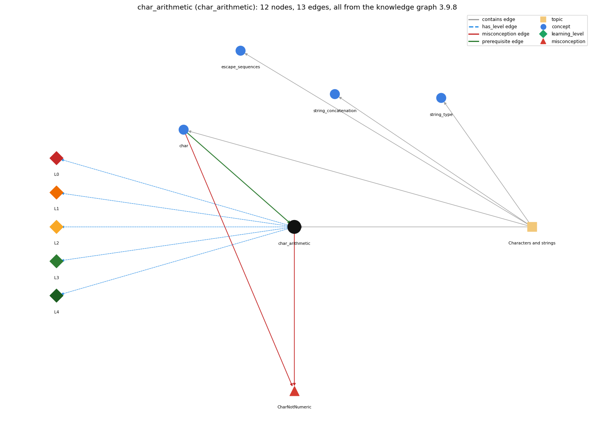

# char_arithmetic (`char_arithmetic`)

a char is a 16-bit number, so 'a' + 1 is an int

Section 1.2 Built-in Types of Data, topic 1.2.b Characters and strings.

## At a glance

- **Needs first:** `char`
- **Leads to:** nothing
- **Learned alongside:** nothing
- **Misconceptions:** `CharNotNumeric`
- **Errors:** none
- **Levels:** L0, L1, L2, L3, L4

Everything below comes from the knowledge graph 3.9.8 (`data/raw/chapter1_kg_updated.json`): 13 edges around this concept. The edge logic, the wrong and right rules and the exact rules of the ways are copied word for word from the graph.

## To work on (0)

Nothing is missing for this concept.

## What it needs first (1)

A prerequisite edge means the other concept has to be understood before `char_arithmetic`.

### `char` comes before `char_arithmetic`

*16-bit character primitive*

- **Edge:** `pre:char->char_arithmetic`
- **Exact edge logic:** Char arithmetic uses the numeric code stored for each char.
- **Grounding:** book\_passage
- **Composition rule (R) of `char_arithmetic` with `char`:** Char arithmetic uses each char's numeric code, so the result is an int, not a char, unless it is cast back.
- **Composition rule (R) of `char` with `char_arithmetic`:** Char arithmetic works on each char's numeric code and yields an int. A cast turns the result back into a character.

## What it leads to (0)

These concepts need `char_arithmetic` first.

No concept has this one as a prerequisite.

## Learned alongside (0)

A parallel edge joins two concepts that sit side by side: neither is needed before the other.

No parallel edge touches this concept.

## Misconceptions (1)

A misconception edge states the wrong rule a student may hold about this concept, and the right rule.

### CharNotNumeric

- **Edge:** `char_arithmetic` &rarr; `CharNotNumeric` (misconception)
- **Exact edge logic (the wrong rule):** char is not a numeric type
- **Twin logic (the right rule):** A char is encoded as a 16-bit integer, so arithmetic such as 'b' + 'c' or 'a' + 4 works on the character codes.
- **Wrong belief (on the node):** char is not a numeric type
- **Correct rule (on the node):** A char is encoded as a 16-bit integer, so arithmetic such as 'b' + 'c' or 'a' + 4 works on the character codes.
- **Provenance:** published
- **Role of this concept:** context
- **L0 way linked to it:** yes
- **L0 way [1] misconception, exact rule:** wrong rule: char is not a numeric type. Right rule: A char is encoded as a 16-bit integer, so arithmetic such as 'b' + 'c' or 'a' + 4 works on the character codes.
- **L0 way [2] inconsistent\_trace, exact rule:** Points to LT (chars become int codes before the operator is applied). Applied unevenly, a student converts to codes in one step but keeps letters in another, e.g. printing 'b' + 'c' as "bc". (here mixing in: "char is not a numeric type")
- **Edge `char` &rarr; `CharNotNumeric`, exact edge logic:** A char is only a letter, so c + k is an error. **Twin logic:** A char is encoded as a 16-bit integer, so arithmetic such as 'b' + 'c' or 'a' + 4 works on the character codes. (role: primary)

## Errors (0)

An error edge states the rule that gets broken in a program, and the right rule.

The graph has no error edge from this concept.

## Levels L0 to L4 (5 of 5)

Each level edge lists the ways a student shows that level, each with its exact rule.

### L0: Prestructural / sensorimotor

L0 for char arithmetic: the answer holds a rule that contradicts Java.

*Deciding question: Does every rule the answer applies to char arithmetic agree with the language rule? If it reads the code with everyday meanings, applies a wrong rule, or switches rules within one trace, it is L0. A slip in an otherwise rule-correct trace is L2 with an error, not L0.*

- **Edge:** `char_arithmetic` &rarr; `char_arithmetic@L0` (has_level)
- **Exact edge logic:** char arithmetic -&gt; L0 (Prestructural): the answer holds a rule that contradicts Java (3 ways).

Ways (3), each with its exact rule:

- **[0] everyday\_reading** (rule type E, folk-meaning rule): In everyday use letters are not numbers, so 'a' + 1 seems meaningless or should give "a1". Java promotes each char to its int code, so 'a' + 1 is 98.
- **[1] misconception** (rule type M, wrong rule / right rule) &rarr; `CharNotNumeric`: wrong rule: char is not a numeric type. Right rule: A char is encoded as a 16-bit integer, so arithmetic such as 'b' + 'c' or 'a' + 4 works on the character codes.
- **[2] inconsistent\_trace** (rule type T, uneven-application rule) &rarr; `CharNotNumeric`: Points to LT (chars become int codes before the operator is applied). Applied unevenly, a student converts to codes in one step but keeps letters in another, e.g. printing 'b' + 'c' as "bc". (here mixing in: "char is not a numeric type")

### L1: Unistructural / atom x text surface

L1 for char arithmetic: the answer states one correct rule without applying it.

*Deciding question: Does the answer cover every part of the code, in order, with the values (L2)? If it covers one part or only states the rule, it is L1.*

- **Edge:** `char_arithmetic` &rarr; `char_arithmetic@L1` (has_level)
- **Exact edge logic:** char arithmetic -&gt; L1 (Unistructural): the answer states one correct rule without applying it (2 ways).

Ways (2), each with its exact rule:

- **[0] names\_the\_element** (rule type N, identity rule): Char arithmetic: applying arithmetic or comparison operators to char values, which act on their Unicode codes.
- **[1] states\_the\_rule** (rule type S, declarative rule): char operands of arithmetic are promoted to int, so the result is an int. Casting an int to char gives the character with that code. ++, -- and comparisons work directly on chars.

### L2: Multistructural / block x execution / preoperational

L2 for char arithmetic: the answer applies these rules to every part of the code, in order.

*Deciding question: Is the answer many segments mapped onto lines (L2), or one segment stating the purpose of the whole (L3)? A correct output with no value-by-value justification is not levelled.*

- **Edge:** `char_arithmetic` &rarr; `char_arithmetic@L2` (has_level)
- **Exact edge logic:** char arithmetic -&gt; L2 (Multistructural): the answer applies the rules of char arithmetic to every part of the code, in order (3 ways).

Ways (3), each with its exact rule:

- **[0] line\_by\_line\_trace** (rule type LT, operational sequencing rule): Each char operand is replaced by its code (promoted to int) and the operation runs in int. A cast written outside the parentheses, as in (char) ('a' + 4), is applied last.
- **[1] output\_prediction** (rule type OP, evaluation / result rule): 'b' + 'c' is the int 197. 'a' + 4 is 101. (char) ('a' + 4) is 'e'. 'A' &lt; 'a' is true.
- **[2] one\_step\_execution** (rule type OS, state-transition rule): For char c = 'A', c++ sets c to 'B'. c = c + 1; is rejected, because the right side is an int.

### L3: Relational / relations x function (concrete operational begins)

L3 for char arithmetic: the answer relates the parts by these rules.

*Deciding question: Was the purpose deduced from the code, or only guessed from traced input/output pairs (then L2)? Does the answer stay within the given code (L3), or reason about changed code, an error class or a new program (L4)?*

- **Edge:** `char_arithmetic` &rarr; `char_arithmetic@L3` (has_level)
- **Exact edge logic:** char arithmetic -&gt; L3 (Relational): the answer relates the parts (2 ways).

Ways (2), each with its exact rule:

- **[0] relation\_to\_neighbour** (rule type R, composition rule (with a neighbour)): Char arithmetic uses each char's numeric code, so the result is an int, not a char, unless it is cast back.
- **[1] purpose\_of\_the\_whole** (rule type P, plan / role rule): Plans: shifting letters (Caesar cipher), turning a digit char into its value (c - '0'), looping over 'A'..'Z', and testing whether a char is in a range.

### L4: Extended abstract (concrete-operational reversibility and conservation)

L4 for char arithmetic: the answer reasons beyond the given code by these rules.

*Deciding question: Does the answer link the code to a broader context: a changed program, a class of inputs, an unseen problem? Re-tracing changed code value by value is L2; fixing one given failing case is L3.*

- **Edge:** `char_arithmetic` &rarr; `char_arithmetic@L4` (has_level)
- **Exact edge logic:** char arithmetic -&gt; L4 (Extended abstract): the answer reasons beyond the given code (5 ways).

Ways (5), each with its exact rule:

- **[0] predict\_a\_change** (rule type C, conservation rule) &rarr; `CharNotNumeric`: Adding or removing the (char) cast changes the output from a number to a letter. Changing 'a' + 4 to "a" + 4 makes it concatenation ("a4").
- **[1] transfer\_to\_a\_new\_program** (rule type X, applicability rule): Use char arithmetic when the computation depends on character order or codes (alphabet loops, ciphers, digit values). To join characters into text, use String + or a String instead.
- **[2] diagnose\_an\_error** (rule type D, error rule): rule broken: Arithmetic on chars yields an int, which needs a cast to go back into a char. Kind: compile-time. Trigger class: char next = c + 1; or char d = 'a' + k;: 'possible lossy conversion from int to char'.
- **[3] diagnose\_an\_error** (rule type D, error rule): rule broken: Without a cast the int code is printed, not the letter. Kind: silent logic error. Trigger class: Printing c + 1 or 'a' + i when a letter was expected.
- **[4] diagnose\_an\_error** (rule type D, error rule): rule broken: A char compares by its code, not by the digit it shows. Kind: silent logic error. Trigger class: Comparing a char with an int as if it were a digit (seat &lt;= 3 for seat = 'A').

## Same topic

`char_arithmetic` belongs to the topic **Characters and strings** (`topic1.2.b`). The topic also contains: `char`, `escape_sequences`, `string_concatenation`, `string_type`.

## Rules of the concept (15)

- **Book** (SW-1e, p. 40 (pdf 50)): "System.out.println((char) ('a' + 4))"
- **Book** (OT-Datatypes, ): "The char data type is a single 16-bit Unicode character."
- **E** (folk-meaning rule): In everyday use letters are not numbers, so 'a' + 1 seems meaningless or should give "a1". Java promotes each char to its int code, so 'a' + 1 is 98.
- **M** (wrong rule / right rule): CharNotNumeric: wrong: char is not a numeric type \| right: A char is encoded as a 16-bit integer, so arithmetic such as 'b' + 'c' or 'a' + 4 works on the character codes.
- **T** (uneven-application rule): Points to LT (chars become int codes before the operator is applied). Applied unevenly, a student converts to codes in one step but keeps letters in another, e.g. printing 'b' + 'c' as "bc".
- **N** (identity rule): Char arithmetic: applying arithmetic or comparison operators to char values, which act on their Unicode codes.
- **S** (declarative rule): char operands of arithmetic are promoted to int, so the result is an int. Casting an int to char gives the character with that code. ++, -- and comparisons work directly on chars.
- **LT** (operational sequencing rule): Each char operand is replaced by its code (promoted to int) and the operation runs in int. A cast written outside the parentheses, as in (char) ('a' + 4), is applied last.
- **OP** (evaluation / result rule): 'b' + 'c' is the int 197. 'a' + 4 is 101. (char) ('a' + 4) is 'e'. 'A' &lt; 'a' is true.
- **OS** (state-transition rule): For char c = 'A', c++ sets c to 'B'. c = c + 1; is rejected, because the right side is an int.
- **R** (composition rule (with a neighbour)): with char: Char arithmetic uses each char's numeric code, so the result is an int, not a char, unless it is cast back.
- **P** (plan / role rule): Plans: shifting letters (Caesar cipher), turning a digit char into its value (c - '0'), looping over 'A'..'Z', and testing whether a char is in a range.
- **C** (conservation rule): Adding or removing the (char) cast changes the output from a number to a letter. Changing 'a' + 4 to "a" + 4 makes it concatenation ("a4").
- **D** (error rule): rule broken: Arithmetic on chars yields an int, which needs a cast to go back into a char. (compile-time)
- **D** (error rule): rule broken: Without a cast the int code is printed, not the letter. (silent logic error)
- **D** (error rule): rule broken: A char compares by its code, not by the digit it shows. (silent logic error)
- **X** (applicability rule): Use char arithmetic when the computation depends on character order or codes (alphabet loops, ciphers, digit values). To join characters into text, use String + or a String instead.

## How it is found in code and answers (reader block)

- **Aliases:** char arithmetic, unicode, ascii
- **Code patterns:** `'(?:\\.|[^'\\])'\s*[+\-]\s*\w`, `\w\s*[+\-]\s*'(?:\\.|[^'\\])'`, `\(\s*char\s*\)\s*\(?\s*\w+\s*[+\-]`, `'(?:\\.|[^'\\])'\s*[+\-]\s*'(?:\\.|[^'\\])'`
- **Operator symbols:** none
- **Java types:** none
- **Signal char\_to\_int\_cast** (scope program, decisive): `\(\s*int\s*\)\s*\(?\s*'(?:\\.|[^'\\])'|\bchar\s+(\w+)[\s\S]{0,4000}?\(\s*int\s*\)\s*\(?\s*\b\1\b`
- **Signal char\_increment** (scope program, decisive): `\bchar\s+(\w+)\s*(?:=[^;]*)?;[\s\S]{0,4000}?\b\1\s*(?:\+\+|--|\+=|-=)`
- **Signal char\_variable\_arithmetic** (scope program, decisive): `\bchar\s+(\w+)\s*(?:=[^;]*)?;[\s\S]{0,4000}?(?:\b\1\s*[+\-]\s*[\w'(]|(?:\d+|'(?:\\.|[^'\\])')\s*[+\-]\s*\b\1\b)`

## The whole prerequisite chain

- **Everything it builds on (3):** `char`, `data_type`, `primitive_type`
- **Everything that builds on it (0):** nothing

## Every edge in this view and its exact edge logic (13)

All the edges drawn in the picture, in the order: prerequisite, parallel, misconception, error, has_level, contains.

**1. `char` &rarr; `char_arithmetic`** (prerequisite)

- **Exact edge logic:** Char arithmetic uses the numeric code stored for each char.
- **Grounding:** book\_passage
- **Composition rule (R) of `char` with `char_arithmetic`:** Char arithmetic works on each char's numeric code and yields an int. A cast turns the result back into a character.
- **Composition rule (R) of `char_arithmetic` with `char`:** Char arithmetic uses each char's numeric code, so the result is an int, not a char, unless it is cast back.

**2. `char_arithmetic` &rarr; `CharNotNumeric`** (misconception)

- **Exact edge logic (the wrong rule):** char is not a numeric type
- **Twin logic (the right rule):** A char is encoded as a 16-bit integer, so arithmetic such as 'b' + 'c' or 'a' + 4 works on the character codes.
- **Role:** context

**3. `char` &rarr; `CharNotNumeric`** (misconception)

- **Exact edge logic (the wrong rule):** A char is only a letter, so c + k is an error.
- **Twin logic (the right rule):** A char is encoded as a 16-bit integer, so arithmetic such as 'b' + 'c' or 'a' + 4 works on the character codes.
- **Role:** primary

**4. `char_arithmetic` &rarr; `char_arithmetic@L0`** (has_level)

- **Exact edge logic:** char arithmetic -&gt; L0 (Prestructural): the answer holds a rule that contradicts Java (3 ways).
  - **[0] everyday\_reading** (rule type E, folk-meaning rule): In everyday use letters are not numbers, so 'a' + 1 seems meaningless or should give "a1". Java promotes each char to its int code, so 'a' + 1 is 98.
  - **[1] misconception** (rule type M, wrong rule / right rule) &rarr; `CharNotNumeric`: wrong rule: char is not a numeric type. Right rule: A char is encoded as a 16-bit integer, so arithmetic such as 'b' + 'c' or 'a' + 4 works on the character codes.
  - **[2] inconsistent\_trace** (rule type T, uneven-application rule) &rarr; `CharNotNumeric`: Points to LT (chars become int codes before the operator is applied). Applied unevenly, a student converts to codes in one step but keeps letters in another, e.g. printing 'b' + 'c' as "bc". (here mixing in: "char is not a numeric type")

**5. `char_arithmetic` &rarr; `char_arithmetic@L1`** (has_level)

- **Exact edge logic:** char arithmetic -&gt; L1 (Unistructural): the answer states one correct rule without applying it (2 ways).
  - **[0] names\_the\_element** (rule type N, identity rule): Char arithmetic: applying arithmetic or comparison operators to char values, which act on their Unicode codes.
  - **[1] states\_the\_rule** (rule type S, declarative rule): char operands of arithmetic are promoted to int, so the result is an int. Casting an int to char gives the character with that code. ++, -- and comparisons work directly on chars.

**6. `char_arithmetic` &rarr; `char_arithmetic@L2`** (has_level)

- **Exact edge logic:** char arithmetic -&gt; L2 (Multistructural): the answer applies the rules of char arithmetic to every part of the code, in order (3 ways).
  - **[0] line\_by\_line\_trace** (rule type LT, operational sequencing rule): Each char operand is replaced by its code (promoted to int) and the operation runs in int. A cast written outside the parentheses, as in (char) ('a' + 4), is applied last.
  - **[1] output\_prediction** (rule type OP, evaluation / result rule): 'b' + 'c' is the int 197. 'a' + 4 is 101. (char) ('a' + 4) is 'e'. 'A' &lt; 'a' is true.
  - **[2] one\_step\_execution** (rule type OS, state-transition rule): For char c = 'A', c++ sets c to 'B'. c = c + 1; is rejected, because the right side is an int.

**7. `char_arithmetic` &rarr; `char_arithmetic@L3`** (has_level)

- **Exact edge logic:** char arithmetic -&gt; L3 (Relational): the answer relates the parts (2 ways).
  - **[0] relation\_to\_neighbour** (rule type R, composition rule (with a neighbour)): Char arithmetic uses each char's numeric code, so the result is an int, not a char, unless it is cast back.
  - **[1] purpose\_of\_the\_whole** (rule type P, plan / role rule): Plans: shifting letters (Caesar cipher), turning a digit char into its value (c - '0'), looping over 'A'..'Z', and testing whether a char is in a range.

**8. `char_arithmetic` &rarr; `char_arithmetic@L4`** (has_level)

- **Exact edge logic:** char arithmetic -&gt; L4 (Extended abstract): the answer reasons beyond the given code (5 ways).
  - **[0] predict\_a\_change** (rule type C, conservation rule) &rarr; `CharNotNumeric`: Adding or removing the (char) cast changes the output from a number to a letter. Changing 'a' + 4 to "a" + 4 makes it concatenation ("a4").
  - **[1] transfer\_to\_a\_new\_program** (rule type X, applicability rule): Use char arithmetic when the computation depends on character order or codes (alphabet loops, ciphers, digit values). To join characters into text, use String + or a String instead.
  - **[2] diagnose\_an\_error** (rule type D, error rule): rule broken: Arithmetic on chars yields an int, which needs a cast to go back into a char. Kind: compile-time. Trigger class: char next = c + 1; or char d = 'a' + k;: 'possible lossy conversion from int to char'.
  - **[3] diagnose\_an\_error** (rule type D, error rule): rule broken: Without a cast the int code is printed, not the letter. Kind: silent logic error. Trigger class: Printing c + 1 or 'a' + i when a letter was expected.
  - **[4] diagnose\_an\_error** (rule type D, error rule): rule broken: A char compares by its code, not by the digit it shows. Kind: silent logic error. Trigger class: Comparing a char with an int as if it were a digit (seat &lt;= 3 for seat = 'A').

**9. `topic1.2.b` &rarr; `char_arithmetic`** (contains)

- topic `topic1.2.b` contains `char_arithmetic`

**10. `topic1.2.b` &rarr; `char`** (contains)

- topic `topic1.2.b` contains `char`

**11. `topic1.2.b` &rarr; `escape_sequences`** (contains)

- topic `topic1.2.b` contains `escape_sequences`

**12. `topic1.2.b` &rarr; `string_concatenation`** (contains)

- topic `topic1.2.b` contains `string_concatenation`

**13. `topic1.2.b` &rarr; `string_type`** (contains)

- topic `topic1.2.b` contains `string_type`
