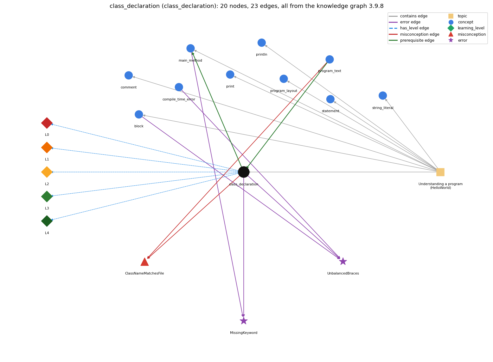

# class_declaration (`class_declaration`)

public class Name { ... } -- the outer container

Section 1.1 Your First Program, topic 1.1.b Understanding a program (HelloWorld). From the knowledge graph 3.9.8 (`data/raw/chapter1_kg_updated.json`).

## Concepts associated with class\_declaration (10)

| Concept | Description | How it is associated |
| --- | --- | --- |
| **block** | { ... } grouping statements | shares error UnbalancedBraces same topic (topic1.1.b) |
| **comment** | // and /\* \*/ text that the compiler ignores | same topic (topic1.1.b) |
| **compile\_time\_error** | an error javac reports before the program can run (syntax, types) | shares error UnbalancedBraces |
| **main\_method** | public static void main(String[] args) -- entry point | builds on it (needs it) composition rule (R) with it shares error MissingKeyword same topic (topic1.1.b) |
| **print** | System.out.print -- output with no newline | same topic (topic1.1.b) |
| **println** | System.out.println -- output with a trailing newline | same topic (topic1.1.b) |
| **program\_layout** | one statement per line and indentation that shows nesting | same topic (topic1.1.b) |
| **program\_text** | the source file; class name must match the filename | prerequisite of it (it needs this) composition rule (R) with it shares misconception ClassNameMatchesFile |
| **statement** | one step, terminated by ;, executed in sequence | same topic (topic1.1.b) |
| **string\_literal** | "Hello, World" -- the text being printed | same topic (topic1.1.b) |

## Every edge in this view and its full label (23)

| From | Edge | To | Full edge label |
| --- | --- | --- | --- |
| **class\_declaration** | prerequisite | **main\_method** | main is written inside the class's braces, so java Name looks inside the class Name to find main. grounding: book\_passage composition rule (R) of class\_declaration with main\_method: main must be declared inside the class's braces; java Name looks only inside class Name for main. composition rule (R) of main\_method with class\_declaration: main is declared inside the class's braces; java Name looks in class Name for main. |
| **program\_text** | prerequisite | **class\_declaration** | The source file Name.java holds the public class, and that class must be named Name. grounding: book\_passage composition rule (R) of program\_text with class\_declaration: The name after 'public class' constrains the file name: public class Name must be in Name.java, or javac rejects it. composition rule (R) of class\_declaration with program\_text: The name after 'class' must equal the file name without .java. |
| **class\_declaration** | misconception | **ClassNameMatchesFile** | **wrong rule:** The class can have any name; the file name does not need to match it. **right rule:** A public class Name must be saved in a file called Name.java. role: primary |
| **program\_text** | misconception | **ClassNameMatchesFile** | **wrong rule:** class name and filename are independent **right rule:** A public class Name must be saved in a file called Name.java. role: context |
| **block** | error | **UnbalancedBraces** | **wrong rule:** A missing { or } is harmless. **right rule:** Every { must be matched by a } so the class body and the method body are well formed. role: primary |
| **class\_declaration** | error | **MissingKeyword** | **wrong rule:** Leaves out a required keyword such as static or class. **right rule:** public class Name and public static void main(String[] args) need their keywords, which are required; omitting or misspelling one is an error, usually caught by the compiler as a syntax error. role: context |
| **class\_declaration** | error | **UnbalancedBraces** | **wrong rule:** A missing { or } is harmless. **right rule:** Every { must be matched by a } so the class body and the method body are well formed. role: context |
| **compile\_time\_error** | error | **UnbalancedBraces** | **wrong rule:** A missing { or } is harmless. **right rule:** Every { must be matched by a } so the class body and the method body are well formed. role: context |
| **main\_method** | error | **MissingKeyword** | **wrong rule:** Leaves out a required keyword such as static or class. **right rule:** public class Name and public static void main(String[] args) need their keywords, which are required; omitting or misspelling one is an error, usually caught by the compiler as a syntax error. role: primary |
| **class\_declaration** | has\_level | **class\_declaration@L0** | class declaration -&gt; L0 (Prestructural): the answer holds a rule that contradicts Java (3 ways). **[0] everyday\_reading** (E): Everyday meaning: a 'class' is a group of students or a category, and 'public' means open to everyone. Java rule: public class Name { ... } declares the named unit that holds the program's methods; for now S&amp;W say 'class' means 'program'. **[1] misconception** (M) &rarr; ClassNameMatchesFile: wrong rule: The class name and the file name are independent. Right rule: public class Name must be saved in a file named Name.java. **[2] inconsistent\_trace** (T) &rarr; ClassNameMatchesFile: Applies the containment rule unevenly: treats the class's closing brace as the end of main on one trace, or looks for main outside the class on another; the class body is everything between the outermost { and }. (here mixing in: "class name and filename are independent") |
| **class\_declaration** | has\_level | **class\_declaration@L1** | class declaration -&gt; L1 (Unistructural): the answer states one correct rule without applying it (2 ways). **[0] names\_the\_element** (N): A class declaration (public class Name { ... }) is the outer container of a Java program; in Chapter 1 each program is a single class with a single method main(). **[1] states\_the\_rule** (S): A program is written as public class Name { &lt;method declarations&gt; }; the outermost braces contain the class definition and the inner braces contain the method definitions, and the keywords public and class are required. |
| **class\_declaration** | has\_level | **class\_declaration@L2** | class declaration -&gt; L2 (Multistructural): the answer applies the rules of class declaration to every part of the code, in order (3 ways). **[0] line\_by\_line\_trace** (LT): The class declaration itself does not execute: java Name looks up the class Name and calls its main(); the class is just the container that is searched. **[1] output\_prediction** (OP): A class declaration produces no output; compiling it produces the file Name.class. **[2] one\_step\_execution** (OS): Declaring the class changes no variable at run time; it only defines the name (Name) that javac uses for Name.class and that java Name uses to find main. |
| **class\_declaration** | has\_level | **class\_declaration@L3** | class declaration -&gt; L3 (Relational): the answer relates the parts (3 ways). **[0] relation\_to\_neighbour** (R): The name after 'class' must equal the file name without .java. **[1] relation\_to\_neighbour** (R): main must be declared inside the class's braces; java Name looks only inside class Name for main. **[2] purpose\_of\_the\_whole** (P): Purpose: package and name a program so it can be compiled and run by name; copying HelloWorld.java and replacing the name on the first line is how a new program is started. |
| **class\_declaration** | has\_level | **class\_declaration@L4** | class declaration -&gt; L4 (Extended abstract): the answer reasons beyond the given code (5 ways). **[0] predict\_a\_change** (C) &rarr; ClassNameMatchesFile: Renaming the class requires renaming the file (and the java command) to keep it compiling and runnable; moving main outside the class braces breaks compilation. **[1] diagnose\_an\_error** (D): rule broken: public class Name needs the keyword class (and correct spelling). Kind: compile-time. Trigger class: omitting or misspelling class (or public) on the first line **[2] transfer\_to\_a\_new\_program** (X): In Chapter 1 every program is exactly one public class containing main; a separate class (and file) is needed for each separate program. Multiple classes and methods come only in Section 2.1. **[3] diagnose\_an\_error** (D): rule broken: Every { must be matched by a }. Kind: compile-time. Trigger class: a missing or extra brace around the class or method body **[4] diagnose\_an\_error** (D): rule broken: A public class must be in a file of the same name. Kind: compile-time. Trigger class: class name differs from file name |
| **topic1.1.b** | contains | **block** | topic topic1.1.b contains block |
| **topic1.1.b** | contains | **class\_declaration** | topic topic1.1.b contains class\_declaration |
| **topic1.1.b** | contains | **comment** | topic topic1.1.b contains comment |
| **topic1.1.b** | contains | **main\_method** | topic topic1.1.b contains main\_method |
| **topic1.1.b** | contains | **print** | topic topic1.1.b contains print |
| **topic1.1.b** | contains | **println** | topic topic1.1.b contains println |
| **topic1.1.b** | contains | **program\_layout** | topic topic1.1.b contains program\_layout |
| **topic1.1.b** | contains | **statement** | topic topic1.1.b contains statement |
| **topic1.1.b** | contains | **string\_literal** | topic topic1.1.b contains string\_literal |
