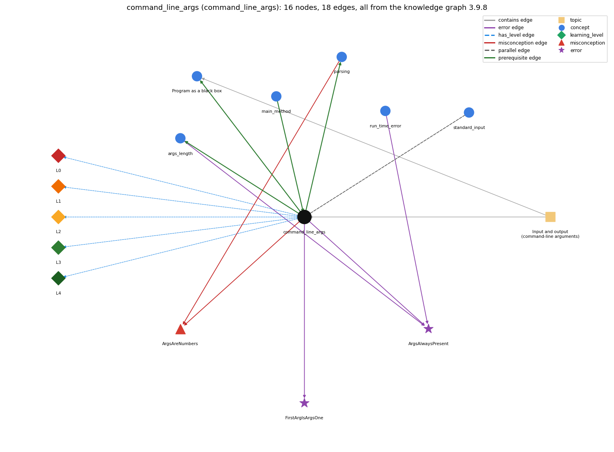

# command_line_args (`command_line_args`)

args[] -- strings passed at launch

Section 1.1 Your First Program, topic 1.1.d Input and output (command-line arguments).

## At a glance

- **Needs first:** `main_method`
- **Leads to:** `args_length`, `black_box_model`, `parsing`
- **Learned alongside:** `standard_input`
- **Misconceptions:** `ArgsAreNumbers`
- **Errors:** `ArgsAlwaysPresent`, `FirstArgIsArgsOne`
- **Levels:** L0, L1, L2, L3, L4

Everything below comes from the knowledge graph 3.9.8 (`data/raw/chapter1_kg_updated.json`): 18 edges around this concept. The edge logic, the wrong and right rules and the exact rules of the ways are copied word for word from the graph.

## To work on (0)

Nothing is missing for this concept.

## What it needs first (1)

A prerequisite edge means the other concept has to be understood before `command_line_args`.

### `main_method` comes before `command_line_args`

*public static void main(String[] args) -- entry point*

- **Edge:** `pre:main_method->command_line_args`
- **Exact edge logic:** The command-line arguments arrive in main's parameter args, an array of Strings.
- **Grounding:** book\_passage
- **Composition rule (R) of `command_line_args` with `main_method`:** The arguments arrive in main's parameter args (String[] args).
- **Composition rule (R) of `main_method` with `command_line_args`:** The command-line arguments arrive in main's parameter args, an array of Strings (args[0], args[1], ...).

## What it leads to (3)

These concepts need `command_line_args` first.

### `command_line_args` comes before `args_length`

*args.length gives the number of command-line arguments*

- **Edge:** `pre:command_line_args->args_length`
- **Exact edge logic:** args is the array of command-line arguments.
- **Grounding:** book\_passage
- **Composition rule (R) of `command_line_args` with `args_length`:** args.length is the number of arguments typed (0 if none), so valid indices are 0 to args.length-1.
- **Composition rule (R) of `args_length` with `command_line_args`:** args[i] may be read only for i &lt; args.length; with no arguments even args[0] is out of bounds.

### `command_line_args` comes before `black_box_model`

*Program as a black box: a program viewed as a black box that turns an input string (the command-line argument) into an output string*

- **Edge:** `pre:command_line_args->black_box_model`
- **Exact edge logic:** The black-box view treats the command-line argument as the input string and what the program prints as the output string.
- **Grounding:** book\_passage
- **Composition rule (R) of `command_line_args` with `black_box_model`:** In the black-box view the command-line argument is the input string and what the program prints is the output string.
- **Composition rule (R) of `black_box_model` with `command_line_args`:** The command-line argument is the box's input string, and what the program prints is its output string; parseInt lets the strings be read as numbers.

### `command_line_args` comes before `parsing`

*Integer.parseInt / Double.parseDouble turn text into numbers*

- **Edge:** `pre:command_line_args->parsing`
- **Exact edge logic:** args[k] is always a String, so Integer.parseInt(args[k]) is needed before it can be used as a number.
- **Grounding:** book\_passage
- **Composition rule (R) of `command_line_args` with `parsing`:** args[k] is always a String, so Integer.parseInt(args[k]) or Double.parseDouble(args[k]) must convert it before arithmetic.
- **Composition rule (R) of `parsing` with `command_line_args`:** Because args[k] is always a String, a numeric argument must be passed through a parse method before it can be used in arithmetic or comparisons.

## Learned alongside (1)

A parallel edge joins two concepts that sit side by side: neither is needed before the other.

### `command_line_args` alongside `standard_input`

*StdIn -- reading a stream of values*

- **Edge:** `par:standard_input~command_line_args`
- **Exact edge logic:** Command-line arguments are a fixed number of strings given once when the program starts (args[]); standard input is a stream of any length read while the program runs (StdIn.readInt()). Both arrive as text and must be parsed into numbers.
- **Grounding:** book\_passage

## Misconceptions (1)

A misconception edge states the wrong rule a student may hold about this concept, and the right rule.

### ArgsAreNumbers

- **Edge:** `command_line_args` &rarr; `ArgsAreNumbers` (misconception)
- **Exact edge logic (the wrong rule):** If a number is typed when the program is launched, args[0] is already an int and can be used in arithmetic.
- **Twin logic (the right rule):** args[0] is always a String, so Integer.parseInt(args[0]) is needed to get its number.
- **Wrong belief (on the node):** command-line args arrive already typed, no parsing needed
- **Correct rule (on the node):** args[0] is always a String, so Integer.parseInt(args[0]) is needed to get its number.
- **Provenance:** textbook
- **Role of this concept:** context
- **L0 way linked to it:** yes
- **L0 way [1] misconception, exact rule:** wrong rule: Command-line arguments arrive already typed as numbers, so no parsing is needed. Right rule: args[0] is always a String, so Integer.parseInt(args[0]) is needed to get its number.
- **L0 way [2] inconsistent\_trace, exact rule:** Applies the args rule unevenly: maps the first typed word to args[0] on one run but to args[1] on another, or treats a numeric argument as a String in one place and as an int in another. (here mixing in: "command-line args arrive already typed, no parsing needed")
- **Edge `parsing` &rarr; `ArgsAreNumbers`, exact edge logic:** If a number is typed when the program is launched, args[0] is already an int and can be used in arithmetic. **Twin logic:** args[0] is always a String, so Integer.parseInt(args[0]) is needed to get its number. (role: primary)

## Errors (2)

An error edge states the rule that gets broken in a program, and the right rule.

### ArgsAlwaysPresent

- **Edge:** `command_line_args` &rarr; `ArgsAlwaysPresent` (error)
- **Exact edge logic (the wrong rule):** args[0] can always be read.
- **Twin logic (the right rule):** If you run the program without typing the command-line argument it expects, reading args[0] fails with java.lang.ArrayIndexOutOfBoundsException: 0.
- **Wrong belief (on the node):** args[0] can always be read.
- **Correct rule (on the node):** If you run the program without typing the command-line argument it expects, reading args[0] fails with java.lang.ArrayIndexOutOfBoundsException: 0.
- **Provenance:** textbook
- **Role of this concept:** context
- **Edge `args_length` &rarr; `ArgsAlwaysPresent`, exact edge logic:** args[0] can always be read. **Twin logic:** If you run the program without typing the command-line argument it expects, reading args[0] fails with java.lang.ArrayIndexOutOfBoundsException: 0. (role: primary)
- **Edge `run_time_error` &rarr; `ArgsAlwaysPresent`, exact edge logic:** args[0] can always be read. **Twin logic:** If you run the program without typing the command-line argument it expects, reading args[0] fails with java.lang.ArrayIndexOutOfBoundsException: 0. (role: context)

### FirstArgIsArgsOne

- **Edge:** `command_line_args` &rarr; `FirstArgIsArgsOne` (error)
- **Exact edge logic (the wrong rule):** The first command-line argument is args[1].
- **Twin logic (the right rule):** Counting starts at 0: the first argument is args[0], the second args[1].
- **Wrong belief (on the node):** The first command-line argument is args[1].
- **Correct rule (on the node):** Counting starts at 0: the first argument is args[0], the second args[1].
- **Provenance:** textbook
- **Role of this concept:** primary

## Levels L0 to L4 (5 of 5)

Each level edge lists the ways a student shows that level, each with its exact rule.

### L0: Prestructural / sensorimotor

L0 for command line args: the answer holds a rule that contradicts Java.

*Deciding question: Does every rule the answer applies to command line args agree with the language rule? If it reads the code with everyday meanings, applies a wrong rule, or switches rules within one trace, it is L0. A slip in an otherwise rule-correct trace is L2 with an error, not L0.*

- **Edge:** `command_line_args` &rarr; `command_line_args@L0` (has_level)
- **Exact edge logic:** command line args -&gt; L0 (Prestructural): the answer holds a rule that contradicts Java (3 ways).

Ways (3), each with its exact rule:

- **[0] everyday\_reading** (rule type E, folk-meaning rule): Everyday/maths reading: '1234' typed on the command line is a number, and the first item in a list is item 1. Java rule: every command-line argument arrives as a String in args, and the first is args[0].
- **[1] misconception** (rule type M, wrong rule / right rule) &rarr; `ArgsAreNumbers`: wrong rule: Command-line arguments arrive already typed as numbers, so no parsing is needed. Right rule: args[0] is always a String, so Integer.parseInt(args[0]) is needed to get its number.
- **[2] inconsistent\_trace** (rule type T, uneven-application rule) &rarr; `ArgsAreNumbers`: Applies the args rule unevenly: maps the first typed word to args[0] on one run but to args[1] on another, or treats a numeric argument as a String in one place and as an int in another. (here mixing in: "command-line args arrive already typed, no parsing needed")

### L1: Unistructural / atom x text surface

L1 for command line args: the answer states one correct rule without applying it.

*Deciding question: Does the answer cover every part of the code, in order, with the values (L2)? If it covers one part or only states the rule, it is L1.*

- **Edge:** `command_line_args` &rarr; `command_line_args@L1` (has_level)
- **Exact edge logic:** command line args -&gt; L1 (Unistructural): the answer states one correct rule without applying it (2 ways).

Ways (2), each with its exact rule:

- **[0] names\_the\_element** (rule type N, identity rule): Command-line arguments are the strings typed after the class name in java Name a b c; they reach main as the String array args.
- **[1] states\_the\_rule** (rule type S, declarative rule): args[0] represents the first string typed on the command line, args[1] the second, and so on (counting starts at 0); every element is a String.

### L2: Multistructural / block x execution / preoperational

L2 for command line args: the answer applies these rules to every part of the code, in order.

*Deciding question: Is the answer many segments mapped onto lines (L2), or one segment stating the purpose of the whole (L3)? A correct output with no value-by-value justification is not levelled.*

- **Edge:** `command_line_args` &rarr; `command_line_args@L2` (has_level)
- **Exact edge logic:** command line args -&gt; L2 (Multistructural): the answer applies the rules of command line args to every part of the code, in order (3 ways).

Ways (3), each with its exact rule:

- **[0] line\_by\_line\_trace** (rule type LT, operational sequencing rule): At launch the JVM splits the words after java Name at spaces, stores them in order in args, then calls main(args); the program reads args[k] whenever that expression is evaluated.
- **[1] output\_prediction** (rule type OP, evaluation / result rule): args[k] evaluates to the k-th typed string, e.g. java UseArgument Alice gives args[0] = "Alice" and prints Hi, Alice. How are you?
- **[2] one\_step\_execution** (rule type OS, state-transition rule): Reading args[k] changes nothing; args is set once at launch and the same program gives different outputs only because different arguments were typed.

### L3: Relational / relations x function (concrete operational begins)

L3 for command line args: the answer relates the parts by these rules.

*Deciding question: Was the purpose deduced from the code, or only guessed from traced input/output pairs (then L2)? Does the answer stay within the given code (L3), or reason about changed code, an error class or a new program (L4)?*

- **Edge:** `command_line_args` &rarr; `command_line_args@L3` (has_level)
- **Exact edge logic:** command line args -&gt; L3 (Relational): the answer relates the parts (6 ways).

Ways (6), each with its exact rule:

- **[0] relation\_to\_neighbour** (rule type R, composition rule (with a neighbour)): args[k] is always a String, so Integer.parseInt(args[k]) or Double.parseDouble(args[k]) must convert it before arithmetic.
- **[1] relation\_to\_neighbour** (rule type R, composition rule (with a neighbour)): The arguments arrive in main's parameter args (String[] args).
- **[2] relation\_to\_neighbour** (rule type R, composition rule (with a neighbour)): args.length is the number of arguments typed (0 if none), so valid indices are 0 to args.length-1.
- **[3] relation\_to\_neighbour** (rule type R, composition rule (with a neighbour)): In the black-box view the command-line argument is the input string and what the program prints is the output string.
- **[4] relation\_to\_neighbour** (rule type R, composition rule (with a neighbour)): Command-line arguments are a fixed number of strings given once when the program starts (args[]); standard input is a stream of any length read while the program runs (StdIn.readInt()). Both arrive as text and must be parsed into numbers.
- **[5] purpose\_of\_the\_whole** (rule type P, plan / role rule): Purpose: give the program its input at launch so the same compiled program can be tailored to different data without editing or recompiling.

### L4: Extended abstract (concrete-operational reversibility and conservation)

L4 for command line args: the answer reasons beyond the given code by these rules.

*Deciding question: Does the answer link the code to a broader context: a changed program, a class of inputs, an unseen problem? Re-tracing changed code value by value is L2; fixing one given failing case is L3.*

- **Edge:** `command_line_args` &rarr; `command_line_args@L4` (has_level)
- **Exact edge logic:** command line args -&gt; L4 (Extended abstract): the answer reasons beyond the given code (6 ways).

Ways (6), each with its exact rule:

- **[0] predict\_a\_change** (rule type C, conservation rule) &rarr; `ArgsAreNumbers`: Changing the typed arguments changes the output but not the program; typing fewer arguments than the program reads causes ArrayIndexOutOfBoundsException; extra arguments are ignored unless read.
- **[1] diagnose\_an\_error** (rule type D, error rule): rule broken: Counting starts at 0: the first argument is args[0]. Kind: silent logic error. Trigger class: using args[1] for the first argument: wrong argument used, or ArrayIndexOutOfBoundsException: 1 if only one was typed
- **[2] transfer\_to\_a\_new\_program** (rule type X, applicability rule): Use command-line arguments for a few small inputs known at launch (sizes, names, seeds); use standard input for long or interactive input.
- **[3] diagnose\_an\_error** (rule type D, error rule): rule broken: args[k] exists only if at least k+1 arguments were typed. Kind: run-time exception. Trigger class: running without the expected argument: java.lang.ArrayIndexOutOfBoundsException: 0
- **[4] diagnose\_an\_error** (rule type D, error rule): rule broken: Arguments are Strings; numbers must be parsed. Kind: compile-time. Trigger class: int n = args[0]; incompatible types: String cannot be converted to int
- **[5] diagnose\_an\_error** (rule type D, error rule): rule broken: Integer.parseInt needs digits. Kind: run-time exception. Trigger class: java Prog five or 12.2 where an int is parsed: NumberFormatException

## Same topic

`command_line_args` belongs to the topic **Input and output (command-line arguments)** (`topic1.1.d`). The topic also contains: `black_box_model`.

## Rules of the concept (19)

- **Book** (SW-1e, p. 9 (pdf 19)): "In the meantime, you can use args[0] within your program's body to represent the string that you type on the command line when it is executed"
- **Book** (OT-CmdLine, ): "When an application is launched, the runtime system passes the command-line arguments to the application's main method via an array of Strings."
- **Book** (OT-CmdLine, ): "This is because the space character separates command-line arguments."
- **Book** (SW-1.5, ): "All of our classes have a main() method that takes a String array args[] as argument. That array is the sequence of command-line arguments that we type."
- **E** (folk-meaning rule): Everyday/maths reading: '1234' typed on the command line is a number, and the first item in a list is item 1. Java rule: every command-line argument arrives as a String in args, and the first is args[0].
- **M** (wrong rule / right rule): ArgsAreNumbers: wrong: Command-line arguments arrive already typed as numbers, so no parsing is needed. \| right: args[0] is always a String, so Integer.parseInt(args[0]) is needed to get its number.
- **T** (uneven-application rule): Applies the args rule unevenly: maps the first typed word to args[0] on one run but to args[1] on another, or treats a numeric argument as a String in one place and as an int in another.
- **N** (identity rule): Command-line arguments are the strings typed after the class name in java Name a b c; they reach main as the String array args.
- **S** (declarative rule): args[0] represents the first string typed on the command line, args[1] the second, and so on (counting starts at 0); every element is a String.
- **LT** (operational sequencing rule): At launch the JVM splits the words after java Name at spaces, stores them in order in args, then calls main(args); the program reads args[k] whenever that expression is evaluated.
- **OP** (evaluation / result rule): args[k] evaluates to the k-th typed string, e.g. java UseArgument Alice gives args[0] = "Alice" and prints Hi, Alice. How are you?
- **OS** (state-transition rule): Reading args[k] changes nothing; args is set once at launch and the same program gives different outputs only because different arguments were typed.
- **R** (composition rule (with a neighbour)): with parsing: args[k] is always a String, so Integer.parseInt(args[k]) or Double.parseDouble(args[k]) must convert it before arithmetic.
- **R** (composition rule (with a neighbour)): with main\_method: The arguments arrive in main's parameter args (String[] args).
- **R** (composition rule (with a neighbour)): with args\_length: args.length is the number of arguments typed (0 if none), so valid indices are 0 to args.length-1.
- **R** (composition rule (with a neighbour)): with black\_box\_model: In the black-box view the command-line argument is the input string and what the program prints is the output string.
- **P** (plan / role rule): Purpose: give the program its input at launch so the same compiled program can be tailored to different data without editing or recompiling.
- **C** (conservation rule): Changing the typed arguments changes the output but not the program; typing fewer arguments than the program reads causes ArrayIndexOutOfBoundsException; extra arguments are ignored unless read.
- **D** (error rule): rule broken: args[k] exists only if at least k+1 arguments were typed (run-time exception)
- **D** (error rule): rule broken: Counting starts at 0: the first argument is args[0] (silent logic error)
- **D** (error rule): rule broken: Arguments are Strings; numbers must be parsed (compile-time)
- **D** (error rule): rule broken: Integer.parseInt needs digits (run-time exception)
- **X** (applicability rule): Use command-line arguments for a few small inputs known at launch (sizes, names, seeds); use standard input for long or interactive input.

## How it is found in code and answers (reader block)

- **Aliases:** command line argument, command line arguments, args
- **Code patterns:** `\bargs\s*\[`, `\bargs\.length\b`
- **Operator symbols:** none
- **Java types:** none

## The whole prerequisite chain

- **Everything it builds on (3):** `class_declaration`, `main_method`, `program_text`
- **Everything that builds on it (11):** `accumulator_pattern`, `args_length`, `black_box_model`, `compound_assignment`, `explicit_cast`, `math_random`, `monte_carlo_simulation`, `parsing`, `sentinel_loop`, `type_conversion`, `widening_conversion`

## Every edge in this view and its exact edge logic (18)

All the edges drawn in the picture, in the order: prerequisite, parallel, misconception, error, has_level, contains.

**1. `command_line_args` &rarr; `args_length`** (prerequisite)

- **Exact edge logic:** args is the array of command-line arguments.
- **Grounding:** book\_passage
- **Composition rule (R) of `command_line_args` with `args_length`:** args.length is the number of arguments typed (0 if none), so valid indices are 0 to args.length-1.
- **Composition rule (R) of `args_length` with `command_line_args`:** args[i] may be read only for i &lt; args.length; with no arguments even args[0] is out of bounds.

**2. `command_line_args` &rarr; `black_box_model`** (prerequisite)

- **Exact edge logic:** The black-box view treats the command-line argument as the input string and what the program prints as the output string.
- **Grounding:** book\_passage
- **Composition rule (R) of `command_line_args` with `black_box_model`:** In the black-box view the command-line argument is the input string and what the program prints is the output string.
- **Composition rule (R) of `black_box_model` with `command_line_args`:** The command-line argument is the box's input string, and what the program prints is its output string; parseInt lets the strings be read as numbers.

**3. `command_line_args` &rarr; `parsing`** (prerequisite)

- **Exact edge logic:** args[k] is always a String, so Integer.parseInt(args[k]) is needed before it can be used as a number.
- **Grounding:** book\_passage
- **Composition rule (R) of `command_line_args` with `parsing`:** args[k] is always a String, so Integer.parseInt(args[k]) or Double.parseDouble(args[k]) must convert it before arithmetic.
- **Composition rule (R) of `parsing` with `command_line_args`:** Because args[k] is always a String, a numeric argument must be passed through a parse method before it can be used in arithmetic or comparisons.

**4. `main_method` &rarr; `command_line_args`** (prerequisite)

- **Exact edge logic:** The command-line arguments arrive in main's parameter args, an array of Strings.
- **Grounding:** book\_passage
- **Composition rule (R) of `main_method` with `command_line_args`:** The command-line arguments arrive in main's parameter args, an array of Strings (args[0], args[1], ...).
- **Composition rule (R) of `command_line_args` with `main_method`:** The arguments arrive in main's parameter args (String[] args).

**5. `standard_input` &harr; `command_line_args`** (parallel)

- **Exact edge logic:** Command-line arguments are a fixed number of strings given once when the program starts (args[]); standard input is a stream of any length read while the program runs (StdIn.readInt()). Both arrive as text and must be parsed into numbers.
- **Grounding:** book\_passage

**6. `command_line_args` &rarr; `ArgsAreNumbers`** (misconception)

- **Exact edge logic (the wrong rule):** If a number is typed when the program is launched, args[0] is already an int and can be used in arithmetic.
- **Twin logic (the right rule):** args[0] is always a String, so Integer.parseInt(args[0]) is needed to get its number.
- **Role:** context

**7. `parsing` &rarr; `ArgsAreNumbers`** (misconception)

- **Exact edge logic (the wrong rule):** If a number is typed when the program is launched, args[0] is already an int and can be used in arithmetic.
- **Twin logic (the right rule):** args[0] is always a String, so Integer.parseInt(args[0]) is needed to get its number.
- **Role:** primary

**8. `command_line_args` &rarr; `ArgsAlwaysPresent`** (error)

- **Exact edge logic (the wrong rule):** args[0] can always be read.
- **Twin logic (the right rule):** If you run the program without typing the command-line argument it expects, reading args[0] fails with java.lang.ArrayIndexOutOfBoundsException: 0.
- **Role:** context

**9. `command_line_args` &rarr; `FirstArgIsArgsOne`** (error)

- **Exact edge logic (the wrong rule):** The first command-line argument is args[1].
- **Twin logic (the right rule):** Counting starts at 0: the first argument is args[0], the second args[1].
- **Role:** primary

**10. `args_length` &rarr; `ArgsAlwaysPresent`** (error)

- **Exact edge logic (the wrong rule):** args[0] can always be read.
- **Twin logic (the right rule):** If you run the program without typing the command-line argument it expects, reading args[0] fails with java.lang.ArrayIndexOutOfBoundsException: 0.
- **Role:** primary

**11. `run_time_error` &rarr; `ArgsAlwaysPresent`** (error)

- **Exact edge logic (the wrong rule):** args[0] can always be read.
- **Twin logic (the right rule):** If you run the program without typing the command-line argument it expects, reading args[0] fails with java.lang.ArrayIndexOutOfBoundsException: 0.
- **Role:** context

**12. `command_line_args` &rarr; `command_line_args@L0`** (has_level)

- **Exact edge logic:** command line args -&gt; L0 (Prestructural): the answer holds a rule that contradicts Java (3 ways).
  - **[0] everyday\_reading** (rule type E, folk-meaning rule): Everyday/maths reading: '1234' typed on the command line is a number, and the first item in a list is item 1. Java rule: every command-line argument arrives as a String in args, and the first is args[0].
  - **[1] misconception** (rule type M, wrong rule / right rule) &rarr; `ArgsAreNumbers`: wrong rule: Command-line arguments arrive already typed as numbers, so no parsing is needed. Right rule: args[0] is always a String, so Integer.parseInt(args[0]) is needed to get its number.
  - **[2] inconsistent\_trace** (rule type T, uneven-application rule) &rarr; `ArgsAreNumbers`: Applies the args rule unevenly: maps the first typed word to args[0] on one run but to args[1] on another, or treats a numeric argument as a String in one place and as an int in another. (here mixing in: "command-line args arrive already typed, no parsing needed")

**13. `command_line_args` &rarr; `command_line_args@L1`** (has_level)

- **Exact edge logic:** command line args -&gt; L1 (Unistructural): the answer states one correct rule without applying it (2 ways).
  - **[0] names\_the\_element** (rule type N, identity rule): Command-line arguments are the strings typed after the class name in java Name a b c; they reach main as the String array args.
  - **[1] states\_the\_rule** (rule type S, declarative rule): args[0] represents the first string typed on the command line, args[1] the second, and so on (counting starts at 0); every element is a String.

**14. `command_line_args` &rarr; `command_line_args@L2`** (has_level)

- **Exact edge logic:** command line args -&gt; L2 (Multistructural): the answer applies the rules of command line args to every part of the code, in order (3 ways).
  - **[0] line\_by\_line\_trace** (rule type LT, operational sequencing rule): At launch the JVM splits the words after java Name at spaces, stores them in order in args, then calls main(args); the program reads args[k] whenever that expression is evaluated.
  - **[1] output\_prediction** (rule type OP, evaluation / result rule): args[k] evaluates to the k-th typed string, e.g. java UseArgument Alice gives args[0] = "Alice" and prints Hi, Alice. How are you?
  - **[2] one\_step\_execution** (rule type OS, state-transition rule): Reading args[k] changes nothing; args is set once at launch and the same program gives different outputs only because different arguments were typed.

**15. `command_line_args` &rarr; `command_line_args@L3`** (has_level)

- **Exact edge logic:** command line args -&gt; L3 (Relational): the answer relates the parts (6 ways).
  - **[0] relation\_to\_neighbour** (rule type R, composition rule (with a neighbour)): args[k] is always a String, so Integer.parseInt(args[k]) or Double.parseDouble(args[k]) must convert it before arithmetic.
  - **[1] relation\_to\_neighbour** (rule type R, composition rule (with a neighbour)): The arguments arrive in main's parameter args (String[] args).
  - **[2] relation\_to\_neighbour** (rule type R, composition rule (with a neighbour)): args.length is the number of arguments typed (0 if none), so valid indices are 0 to args.length-1.
  - **[3] relation\_to\_neighbour** (rule type R, composition rule (with a neighbour)): In the black-box view the command-line argument is the input string and what the program prints is the output string.
  - **[4] relation\_to\_neighbour** (rule type R, composition rule (with a neighbour)): Command-line arguments are a fixed number of strings given once when the program starts (args[]); standard input is a stream of any length read while the program runs (StdIn.readInt()). Both arrive as text and must be parsed into numbers.
  - **[5] purpose\_of\_the\_whole** (rule type P, plan / role rule): Purpose: give the program its input at launch so the same compiled program can be tailored to different data without editing or recompiling.

**16. `command_line_args` &rarr; `command_line_args@L4`** (has_level)

- **Exact edge logic:** command line args -&gt; L4 (Extended abstract): the answer reasons beyond the given code (6 ways).
  - **[0] predict\_a\_change** (rule type C, conservation rule) &rarr; `ArgsAreNumbers`: Changing the typed arguments changes the output but not the program; typing fewer arguments than the program reads causes ArrayIndexOutOfBoundsException; extra arguments are ignored unless read.
  - **[1] diagnose\_an\_error** (rule type D, error rule): rule broken: Counting starts at 0: the first argument is args[0]. Kind: silent logic error. Trigger class: using args[1] for the first argument: wrong argument used, or ArrayIndexOutOfBoundsException: 1 if only one was typed
  - **[2] transfer\_to\_a\_new\_program** (rule type X, applicability rule): Use command-line arguments for a few small inputs known at launch (sizes, names, seeds); use standard input for long or interactive input.
  - **[3] diagnose\_an\_error** (rule type D, error rule): rule broken: args[k] exists only if at least k+1 arguments were typed. Kind: run-time exception. Trigger class: running without the expected argument: java.lang.ArrayIndexOutOfBoundsException: 0
  - **[4] diagnose\_an\_error** (rule type D, error rule): rule broken: Arguments are Strings; numbers must be parsed. Kind: compile-time. Trigger class: int n = args[0]; incompatible types: String cannot be converted to int
  - **[5] diagnose\_an\_error** (rule type D, error rule): rule broken: Integer.parseInt needs digits. Kind: run-time exception. Trigger class: java Prog five or 12.2 where an int is parsed: NumberFormatException

**17. `topic1.1.d` &rarr; `command_line_args`** (contains)

- topic `topic1.1.d` contains `command_line_args`

**18. `topic1.1.d` &rarr; `black_box_model`** (contains)

- topic `topic1.1.d` contains `black_box_model`
