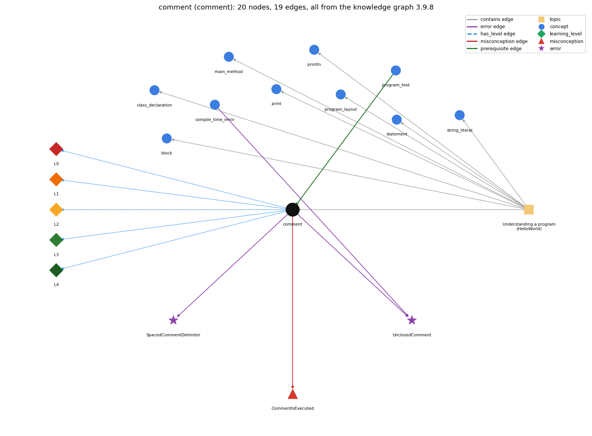

# comment (`comment`)

// and /\* \*/ text that the compiler ignores

Section 1.1 Your First Program, topic 1.1.b Understanding a program (HelloWorld).

## At a glance

- **Needs first:** `program_text`
- **Leads to:** nothing
- **Learned alongside:** nothing
- **Misconceptions:** `CommentIsExecuted`
- **Errors:** `SpacedCommentDelimiter`, `UnclosedComment`
- **Levels:** L0, L1, L2, L3, L4

Everything below comes from the knowledge graph 3.9.8 (`data/raw/chapter1_kg_updated.json`): 19 edges around this concept, each explained in the graph's own words.

## What it needs first (1)

A prerequisite edge means the other concept has to be understood before `comment`.

### `program_text` comes before `comment`

*the source file; class name must match the filename*

Comments are part of the program text in Name.java but are ignored when it is compiled.

- **Grounding:** book passage
- **How `comment` combines with `program_text`:** Comments are part of the program text in Name.java but are dropped when it is compiled, so they cannot affect Name.class's behaviour.
- **How `program_text` combines with `comment`:** Comments are part of the program text but are discarded when it is compiled: they may appear anywhere a whitespace may appear and never change Name.class's behaviour.

## What it leads to (0)

These concepts need `comment` first.

No concept has this one as a prerequisite.

## Learned alongside (0)

A parallel edge joins two concepts that sit side by side: neither is needed before the other.

No parallel edge touches this concept.

## Misconceptions (1)

A misconception edge states the wrong rule a student may hold about this concept, and the right rule.

### CommentIsExecuted

- **Wrong rule:** A comment line is run like a statement.
- **Right rule:** The compiler ignores comments: everything from // to the end of the line and everything between /\* and \*/.
- **Role of this concept:** primary
- **Shows at level L0 as:** misconception: wrong rule: A comment line is run like a statement. Right rule: The compiler ignores comments: everything from // to the end of the line and everything between /\* and \*/.
- **Shows at level L0 as:** inconsistent trace: Applies the skip rule unevenly: skips one comment while tracing but 'executes' another (e.g. a commented-out println), or forgets that // ends at the line break. (here mixing in: "A comment line is run like a statement")

## Errors (2)

An error edge states the rule that gets broken in a program, and the right rule.

### SpacedCommentDelimiter

- **Wrong rule:** Writes / \* comment \* / with spaces inside the delimiters.
- **Right rule:** The delimiters /\* and \*/ must be written without spaces.
- **Role of this concept:** primary

### UnclosedComment

- **Wrong rule:** Opens a comment with /\* and never closes it.
- **Right rule:** A /\* comment is the text between /\* and \*/, so the closing \*/ is required.
- **Role of this concept:** primary
- **Also an edge from `compile_time_error`:** Opens a comment with /\* and never closes it.

## Levels L0 to L4 (5 of 5)

Each level edge lists the ways a student shows that level, each with its exact rule.

### L0: Prestructural / sensorimotor

L0 for comment: the answer holds a rule that contradicts Java.

*Deciding question: Does every rule the answer applies to comment agree with the language rule? If it reads the code with everyday meanings, applies a wrong rule, or switches rules within one trace, it is L0. A slip in an otherwise rule-correct trace is L2 with an error, not L0.*

comment -&gt; L0 (Prestructural): the answer holds a rule that contradicts Java (3 ways).

- **everyday reading** (folk-meaning rule): Everyday reading: text written in a program is an instruction the computer reads and obeys. Java rule: comments (// to end of line, /\* ... \*/) are ignored by the compiler and have no effect on execution; they are for human readers.
- **misconception** (wrong rule / right rule; shows `CommentIsExecuted`): wrong rule: A comment line is run like a statement. Right rule: The compiler ignores comments: everything from // to the end of the line and everything between /\* and \*/.
- **inconsistent trace** (uneven-application rule; shows `CommentIsExecuted`): Applies the skip rule unevenly: skips one comment while tracing but 'executes' another (e.g. a commented-out println), or forgets that // ends at the line break. (here mixing in: "A comment line is run like a statement")

### L1: Unistructural / atom x text surface

L1 for comment: the answer states one correct rule without applying it.

*Deciding question: Does the answer cover every part of the code, in order, with the values (L2)? If it covers one part or only states the rule, it is L1.*

comment -&gt; L1 (Unistructural): the answer states one correct rule without applying it (2 ways).

- **names the element** (identity rule): A comment is explanatory text in the program that the compiler ignores.
- **states the rule** (declarative rule): A comment is either text between /\* and \*/ or text from // to the end of the line; the compiler ignores it. A comment that starts with /\*\* is a documentation (Javadoc) comment, written before a class or method; tools turn it into API documentation.

### L2: Multistructural / block x execution / preoperational

L2 for comment: the answer applies these rules to every part of the code, in order.

*Deciding question: Is the answer many segments mapped onto lines (L2), or one segment stating the purpose of the whole (L3)? A correct output with no value-by-value justification is not levelled.*

comment -&gt; L2 (Multistructural): the answer applies the rules of comment to every part of the code, in order (3 ways).

- **line by line trace** (operational sequencing rule): Comments are removed when the source is read by the compiler, so they never take part in execution order; tracing skips them.
- **output prediction** (evaluation / result rule): A comment produces no value and no output.
- **one step execution** (state-transition rule): A comment changes no state; adding one and recompiling leaves the program's behaviour identical.

### L3: Relational / relations x function (concrete operational begins)

L3 for comment: the answer relates the parts by these rules.

*Deciding question: Was the purpose deduced from the code, or only guessed from traced input/output pairs (then L2)? Does the answer stay within the given code (L3), or reason about changed code, an error class or a new program (L4)?*

comment -&gt; L3 (Relational): the answer relates the parts (2 ways).

- **relation to neighbour** (composition rule (with a neighbour)): Comments are part of the program text in Name.java but are dropped when it is compiled, so they cannot affect Name.class's behaviour.
- **purpose of the whole** (plan / role rule): Purpose: explain what the code does and why, for other programmers and your future self; also used to disable code temporarily.

### L4: Extended abstract (concrete-operational reversibility and conservation)

L4 for comment: the answer reasons beyond the given code by these rules.

*Deciding question: Does the answer link the code to a broader context: a changed program, a class of inputs, an unseen problem? Re-tracing changed code value by value is L2; fixing one given failing case is L3.*

comment -&gt; L4 (Extended abstract): the answer reasons beyond the given code (4 ways).

- **predict a change** (conservation rule; shows `CommentIsExecuted`): Adding, removing or editing a comment keeps behaviour unchanged, as long as the delimiters stay intact; deleting a closing \*/ or turning a statement into a comment changes the program.
- **diagnose an error** (error rule): rule broken: A /\* comment needs its closing \*/. Kind: compile-time. Trigger class: a /\* with no matching \*/: the rest of the file becomes comment, so javac reports an unclosed comment or reached end of file
- **diagnose an error** (error rule): rule broken: /\* and \*/ are two-character tokens with no space inside. Kind: compile-time. Trigger class: writing / \* ... \* /: the slashes and stars are read as operators, producing syntax errors
- **transfer to a new program** (applicability rule): Use comments to document intent where the code alone is unclear; do not rely on them to change what the program does, and keep them in step with the code.

## Same topic

`comment` belongs to the topic **Understanding a program (HelloWorld)** (`topic1.1.b`). The topic also contains: `block`, `class_declaration`, `main_method`, `print`, `println`, `program_layout`, `statement`, `string_literal`.

## Rules of the concept (14)

- **folk-meaning rule:** Everyday reading: text written in a program is an instruction the computer reads and obeys. Java rule: comments (// to end of line, /\* ... \*/) are ignored by the compiler and have no effect on execution; they are for human readers.
- **wrong rule / right rule:** CommentIsExecuted: wrong: A comment line is run like a statement. \| right: The compiler ignores comments: everything from // to the end of the line and everything between /\* and \*/.
- **uneven-application rule:** Applies the skip rule unevenly: skips one comment while tracing but 'executes' another (e.g. a commented-out println), or forgets that // ends at the line break.
- **identity rule:** A comment is explanatory text in the program that the compiler ignores.
- **declarative rule:** A comment is either text between /\* and \*/ or text from // to the end of the line; the compiler ignores it. A comment that starts with /\*\* is a documentation (Javadoc) comment, written before a class or method; tools turn it into API documentation.
- **operational sequencing rule:** Comments are removed when the source is read by the compiler, so they never take part in execution order; tracing skips them.
- **evaluation / result rule:** A comment produces no value and no output.
- **state-transition rule:** A comment changes no state; adding one and recompiling leaves the program's behaviour identical.
- **composition rule (with a neighbour):** with program\_text: Comments are part of the program text in Name.java but are dropped when it is compiled, so they cannot affect Name.class's behaviour.
- **plan / role rule:** Purpose: explain what the code does and why, for other programmers and your future self; also used to disable code temporarily.
- **conservation rule:** Adding, removing or editing a comment keeps behaviour unchanged, as long as the delimiters stay intact; deleting a closing \*/ or turning a statement into a comment changes the program.
- **error rule:** rule broken: /\* and \*/ are two-character tokens with no space inside (compile-time)
- **error rule:** rule broken: A /\* comment needs its closing \*/ (compile-time)
- **applicability rule:** Use comments to document intent where the code alone is unclear; do not rely on them to change what the program does, and keep them in step with the code.

## The whole prerequisite chain

- **Everything it builds on (1):** `program_text`
- **Everything that builds on it (0):** nothing
