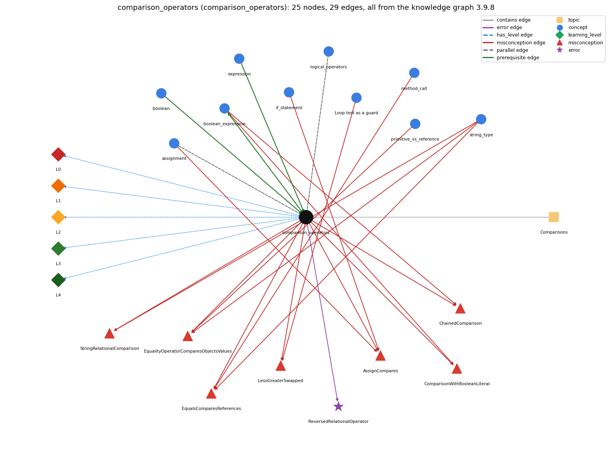

# comparison_operators (`comparison_operators`)

== != &lt; &gt; &lt;= &gt;=

Section 1.2 Built-in Types of Data, topic 1.2.f Comparisons.

## At a glance

- **Needs first:** `boolean`, `expression`
- **Leads to:** `boolean_expression`
- **Learned alongside:** `assignment`, `logical_operators`
- **Misconceptions:** `AssignCompares`, `ChainedComparison`, `ComparisonWithBooleanLiteral`, `EqualityOperatorComparesObjectsValues`, `EqualsComparesReferences`, `LessGreaterSwapped`, `StringRelationalComparison`
- **Errors:** `ReversedRelationalOperator`
- **Levels:** L0, L1, L2, L3, L4

Everything below comes from the knowledge graph 3.9.8 (`data/raw/chapter1_kg_updated.json`): 29 edges around this concept, each explained in the graph's own words.

## What it needs first (2)

A prerequisite edge means the other concept has to be understood before `comparison_operators`.

### `boolean` comes before `comparison_operators`

*true/false primitive*

A comparison such as a &lt; b takes two numbers and produces a boolean result.

- **Grounding:** book passage
- **How `comparison_operators` combines with `boolean`:** Comparisons take numbers and produce a boolean; boolean values themselves can be compared only with == and != (not &lt;), and testing them against true is unnecessary.
- **How `boolean` combines with `comparison_operators`:** Comparisons are the main producers of boolean values: they take two numbers and return true or false, which can then be stored in a boolean variable.

### `expression` comes before `comparison_operators`

*anything that evaluates to a value*

Comparison operators build expressions whose value is a boolean, so one must already know what an expression is to understand a &lt; b.

- **Grounding:** order only
- **How `comparison_operators` combines with `expression`:** A comparison is itself an expression whose value is a boolean, so it can appear anywhere a boolean is needed, including on the right of an assignment (boolean ok = x &gt; y;).
- **How `expression` combines with `comparison_operators`:** A comparison takes numeric expressions and yields a boolean expression, and it has lower precedence than arithmetic, so a + b &lt; c compares the sum.

## What it leads to (1)

These concepts need `comparison_operators` first.

### `comparison_operators` comes before `boolean_expression`

*an expression that evaluates to true/false*

A comparison such as x &lt; y produces a boolean result; comparisons together with boolean logic provide the basis for decision-making.

- **Grounding:** book passage
- **How `comparison_operators` combines with `boolean_expression`:** Comparisons are the building blocks of conditions: together with boolean logic they provide the basis for decision-making.
- **How `boolean_expression` combines with `comparison_operators`:** Comparisons are the atoms of boolean expressions; because they bind tighter than &amp;&amp; and \|\|, month &gt;= 1 &amp;&amp; month &lt;= 12 groups as (month &gt;= 1) &amp;&amp; (month &lt;= 12) without parentheses.

## Learned alongside (2)

A parallel edge joins two concepts that sit side by side: neither is needed before the other.

### `comparison_operators` alongside `assignment`

*= stores the computed value of the right side*

x = y stores the value of y in x (a statement with a side effect); x == y only tests whether the two values are equal and gives a boolean. Writing = where == is meant is a compile error with int operands and a silent bug with boolean operands.

- **Grounding:** book passage

### `comparison_operators` alongside `logical_operators`

*&amp;&amp; \|\| !*

Relational operators compare two numbers to give a boolean; logical operators combine booleans into one boolean.

- **Grounding:** book passage
- **How `comparison_operators` combines with `logical_operators`:** Comparisons bind tighter than &amp;&amp; and \|\|, so they are evaluated first and logical operators combine their boolean results.
- **How `logical_operators` combines with `comparison_operators`:** Comparisons bind tighter than &amp;&amp; and \|\|, so comparisons are evaluated first and their boolean results are then combined (month &gt;= 1 &amp;&amp; month &lt;= 12).

## Misconceptions (7)

A misconception edge states the wrong rule a student may hold about this concept, and the right rule.

### AssignCompares

- **Wrong rule:** = compares two values instead of assigning
- **Right rule:** x = y copies the value of y into x; x == y is what compares them.
- **Role of this concept:** context
- **Shows at level L0 as:** misconception: wrong rule: = compares two values instead of assigning. Right rule: x = y copies the value of y into x; x == y is what compares them and produces a boolean.
- **Also an edge from `assignment`:** x = y checks whether x and y are equal.
- **Also an edge from `if_statement`:** = compares two values instead of assigning

### ChainedComparison

- **Wrong rule:** 90 &lt;= grade &lt;= 100 tests whether grade is between 90 and 100.
- **Right rule:** a &lt; b &lt; c does not compile (a &lt; b is a boolean); a range test is written 90 &lt;= grade &amp;&amp; grade &lt;= 100.
- **Role of this concept:** primary
- **Shows at level L0 as:** misconception: wrong rule: 90 &lt;= grade &lt;= 100 tests whether grade is between 90 and 100. Right rule: a &lt; b &lt; c does not compile (a &lt; b is a boolean); a range test is written 90 &lt;= grade &amp;&amp; grade &lt;= 100.
- **Shows at level L0 as:** inconsistent trace: Points to LT (evaluate both operands, promote to a common type, then compare). Applied unevenly: the student treats &lt; as &lt;= on the boundary pass of a loop, or compares an int with a double as ints on one line and as doubles on another. (here mixing in: "90 &lt;= grade &lt;= 100 tests whether grade is between 90 and 100")
- **Also an edge from `boolean_expression`:** 90 &lt;= grade &lt;= 100 tests whether grade is between 90 and 100.

### ComparisonWithBooleanLiteral

- **Wrong rule:** you must write == true / == false to test a boolean
- **Right rule:** if (b) already tests b, so writing == true adds nothing.
- **Role of this concept:** context
- **Shows at level L0 as:** misconception: wrong rule: You must write == true / == false to test a boolean. Right rule: if (b) already tests b, so writing == true adds nothing.
- **Also an edge from `boolean_expression`:** To test a boolean b you must write if (b == true).

### EqualityOperatorComparesObjectsValues

- **Wrong rule:** s == t is true whenever the two Strings contain the same text.
- **Right rule:** s == t is true only when s and t refer to the same object; s.equals(t) compares the text.
- **Role of this concept:** primary
- **Shows at level L0 as:** misconception: wrong rule: == compares the contents of two Strings. Right rule: s == t is true only when s and t refer to the same object; "abc" == "ab" + x is false even when x is "c"; s.equals(t) compares the text.
- **Also an edge from `primitive_vs_reference`:** == compares contents (the String == bug)
- **Also an edge from `string_type`:** s == t is true whenever the two Strings contain the same text.

### EqualsComparesReferences

- **Wrong rule:** .equals() compares references, not contents
- **Right rule:** s.equals(t) checks whether the two Strings contain the same characters.
- **Role of this concept:** context
- **Shows at level L0 as:** misconception: wrong rule: .equals() compares references, not contents. Right rule: s.equals(t) checks whether the two Strings contain the same characters; it is == that compares references.
- **Also an edge from `method_call`:** .equals() compares references, not contents
- **Also an edge from `string_type`:** s.equals(t) checks whether s and t are the same object.

### LessGreaterSwapped

- **Wrong rule:** &lt; and &gt; mean the same thing (or a &lt; b means a is greater than b).
- **Right rule:** a &lt; b is true when a is smaller than b; a &gt; b when a is larger.
- **Role of this concept:** primary
- **Shows at level L0 as:** misconception: wrong rule: &lt; and &gt; mean the same thing (or a &lt; b means a is greater than b). Right rule: a &lt; b is true when a is smaller than b; a &gt; b when a is larger.
- **Also an edge from `loop_guard`:** &lt; and &gt; mean the same thing (or a &lt; b means a is greater than b).

### StringRelationalComparison

- **Wrong rule:** s &lt; t compares two Strings alphabetically.
- **Right rule:** &lt; and &gt; are defined only for primitive types; comparing Strings with them does not compile.
- **Role of this concept:** primary
- **Shows at level L0 as:** misconception: wrong rule: s &lt; t compares two Strings alphabetically. Right rule: &lt; and &gt; are defined only for primitive types; comparing Strings with them does not compile (use s.compareTo(t)).
- **Also an edge from `string_type`:** s &lt; t compares two Strings alphabetically.

## Errors (1)

An error edge states the rule that gets broken in a program, and the right rule.

### ReversedRelationalOperator

- **Wrong rule:** Writes =&lt; or =&gt; instead of &lt;= and &gt;=.
- **Right rule:** The operators are written &lt;= and &gt;=.
- **Role of this concept:** primary

## Levels L0 to L4 (5 of 5)

Each level edge lists the ways a student shows that level, each with its exact rule.

### L0: Prestructural / sensorimotor

L0 for comparison operators: the answer holds a rule that contradicts Java.

*Deciding question: Does every rule the answer applies to comparison operators agree with the language rule? If it reads the code with everyday meanings, applies a wrong rule, or switches rules within one trace, it is L0. A slip in an otherwise rule-correct trace is L2 with an error, not L0.*

comparison operators -&gt; L0 (Prestructural): the answer holds a rule that contradicts Java (9 ways).

- **everyday reading** (folk-meaning rule): Folk meaning: in maths = states that two things are equal, and inequalities can be chained (a &lt; b &lt; c) or spoken as 'equal or less than' (=&lt;). Java rule: = assigns while == compares; the operators are spelled &lt;= and &gt;= only; a &lt; b &lt; c does not compile; and on Strings == compares references.
- **misconception** (wrong rule / right rule; shows `ChainedComparison`): wrong rule: 90 &lt;= grade &lt;= 100 tests whether grade is between 90 and 100. Right rule: a &lt; b &lt; c does not compile (a &lt; b is a boolean); a range test is written 90 &lt;= grade &amp;&amp; grade &lt;= 100.
- **misconception** (wrong rule / right rule; shows `EqualityOperatorComparesObjectsValues`): wrong rule: == compares the contents of two Strings. Right rule: s == t is true only when s and t refer to the same object; "abc" == "ab" + x is false even when x is "c"; s.equals(t) compares the text.
- **misconception** (wrong rule / right rule; shows `StringRelationalComparison`): wrong rule: s &lt; t compares two Strings alphabetically. Right rule: &lt; and &gt; are defined only for primitive types; comparing Strings with them does not compile (use s.compareTo(t)).
- **misconception** (wrong rule / right rule; shows `LessGreaterSwapped`): wrong rule: &lt; and &gt; mean the same thing (or a &lt; b means a is greater than b). Right rule: a &lt; b is true when a is smaller than b; a &gt; b when a is larger.
- **inconsistent trace** (uneven-application rule; shows `ChainedComparison`): Points to LT (evaluate both operands, promote to a common type, then compare). Applied unevenly: the student treats &lt; as &lt;= on the boundary pass of a loop, or compares an int with a double as ints on one line and as doubles on another. (here mixing in: "90 &lt;= grade &lt;= 100 tests whether grade is between 90 and 100")
- **misconception** (wrong rule / right rule; shows `AssignCompares`): wrong rule: = compares two values instead of assigning. Right rule: x = y copies the value of y into x; x == y is what compares them and produces a boolean.
- **misconception** (wrong rule / right rule; shows `ComparisonWithBooleanLiteral`): wrong rule: You must write == true / == false to test a boolean. Right rule: if (b) already tests b, so writing == true adds nothing.
- **misconception** (wrong rule / right rule; shows `EqualsComparesReferences`): wrong rule: .equals() compares references, not contents. Right rule: s.equals(t) checks whether the two Strings contain the same characters; it is == that compares references.

### L1: Unistructural / atom x text surface

L1 for comparison operators: the answer states one correct rule without applying it.

*Deciding question: Does the answer cover every part of the code, in order, with the values (L2)? If it covers one part or only states the rule, it is L1.*

comparison operators -&gt; L1 (Unistructural): the answer states one correct rule without applying it (2 ways).

- **names the element** (identity rule): Comparison (relational) operators ==, !=, &lt;, &lt;=, &gt;, &gt;= are mixed-type operators: they take two operands of a numeric type and produce a boolean.
- **states the rule** (declarative rule): ==, !=, &lt;, &lt;=, &gt;, &gt;= are defined for each primitive numeric type and produce a boolean; they have lower precedence than arithmetic and higher than boolean operators; &lt; and &gt; are not defined for Strings, and == on non-primitive types compares identity.

### L2: Multistructural / block x execution / preoperational

L2 for comparison operators: the answer applies these rules to every part of the code, in order.

*Deciding question: Is the answer many segments mapped onto lines (L2), or one segment stating the purpose of the whole (L3)? A correct output with no value-by-value justification is not levelled.*

comparison operators -&gt; L2 (Multistructural): the answer applies the rules of comparison operators to every part of the code, in order (3 ways).

- **line by line trace** (operational sequencing rule): Evaluate the left operand (including its arithmetic), then the right operand; if their types differ, promote the narrower one (int to double); then compare and produce true or false.
- **output prediction** (evaluation / result rule): The result is a boolean: (2 &lt;= 2) is true, 2 &lt; 2 is false, (x &lt; 3.1) is true for int x = 3; any comparison involving NaN, even NaN == NaN, is false.
- **one step execution** (state-transition rule): A comparison changes no variable and only returns a boolean, unlike =, which changes the value of the variable on its left.

### L3: Relational / relations x function (concrete operational begins)

L3 for comparison operators: the answer relates the parts by these rules.

*Deciding question: Was the purpose deduced from the code, or only guessed from traced input/output pairs (then L2)? Does the answer stay within the given code (L3), or reason about changed code, an error class or a new program (L4)?*

comparison operators -&gt; L3 (Relational): the answer relates the parts (6 ways).

- **relation to neighbour** (composition rule (with a neighbour)): A comparison is itself an expression whose value is a boolean, so it can appear anywhere a boolean is needed, including on the right of an assignment (boolean ok = x &gt; y;).
- **relation to neighbour** (composition rule (with a neighbour)): Comparisons are the building blocks of conditions: together with boolean logic they provide the basis for decision-making.
- **relation to neighbour** (composition rule (with a neighbour)): Comparisons bind tighter than &amp;&amp; and \|\|, so they are evaluated first and logical operators combine their boolean results.
- **relation to neighbour** (composition rule (with a neighbour)): Comparisons take numbers and produce a boolean; boolean values themselves can be compared only with == and != (not &lt;), and testing them against true is unnecessary.
- **relation to neighbour** (composition rule (with a neighbour)): x = y stores the value of y in x (a statement with a side effect); x == y only tests whether the two values are equal and gives a boolean. Writing = where == is meant is a compile error with int operands and a silent bug with boolean operands.
- **purpose of the whole** (plan / role rule): Used to test a numeric condition: thresholds and sign checks, range tests, divisibility (n % k == 0), loop continuation (i &lt; N), sentinel checks, and running-extreme updates (if (x &gt; max) max = x).

### L4: Extended abstract (concrete-operational reversibility and conservation)

L4 for comparison operators: the answer reasons beyond the given code by these rules.

*Deciding question: Does the answer link the code to a broader context: a changed program, a class of inputs, an unseen problem? Re-tracing changed code value by value is L2; fixing one given failing case is L3.*

comparison operators -&gt; L4 (Extended abstract): the answer reasons beyond the given code (7 ways).

- **predict a change** (conservation rule; shows `ChainedComparison`): Changing &lt; to &lt;= (or &gt; to &gt;=) changes the result only at the boundary value, which in a loop guard means one more or one fewer iteration (off-by-one); mirroring the comparison (a &lt; b to b &gt; a) preserves the value; negating it gives the complementary operator (!(a &lt; b) is a &gt;= b).
- **diagnose an error** (error rule): rule broken: The operators are written &lt;= and &gt;=. Kind: compile-time. Trigger class: Writing =&lt; or =&gt; (e.g. if (x =&gt; 0)).
- **transfer to a new program** (applicability rule): Use comparison operators for numeric and char tests; for Strings use equals (or compareTo); for computed doubles use a tolerance; for booleans use the variable itself instead of == true.
- **diagnose an error** (error rule): rule broken: == compares, = assigns. Kind: compile-time. Trigger class: if (a = b) with int operands (with boolean operands it compiles and silently assigns).
- **diagnose an error** (error rule): rule broken: == on Strings compares references, not text. Kind: silent logic error. Trigger class: Comparing a String built at run time (input, concatenation) with a literal using ==.
- **diagnose an error** (error rule): rule broken: &lt; and &gt; are defined only for primitive types; comparisons cannot be chained; both operands must be compatible. Kind: compile-time. Trigger class: s &lt; t on Strings, a &lt; b &lt; c, or 5 &lt; "6".
- **diagnose an error** (error rule): rule broken: Computed doubles should not be compared with ==. Kind: silent logic error. Trigger class: == between doubles produced by arithmetic, e.g. (0.1 + 0.1 + 0.1 == 0.3).

## Same topic

`comparison_operators` belongs to the topic **Comparisons** (`topic1.2.f`). It is the only concept of that topic.

## Rules of the concept (26)

- **folk-meaning rule:** Folk meaning: in maths = states that two things are equal, and inequalities can be chained (a &lt; b &lt; c) or spoken as 'equal or less than' (=&lt;). Java rule: = assigns while == compares; the operators are spelled &lt;= and &gt;= only; a &lt; b &lt; c does not compile; and on Strings == compares references.
- **wrong rule / right rule:** AssignCompares: wrong: = compares two values instead of assigning. \| right: x = y copies the value of y into x; x == y is what compares them and produces a boolean.
- **wrong rule / right rule:** ChainedComparison: wrong: 90 &lt;= grade &lt;= 100 tests whether grade is between 90 and 100. \| right: a &lt; b &lt; c does not compile (a &lt; b is a boolean); a range test is written 90 &lt;= grade &amp;&amp; grade &lt;= 100.
- **wrong rule / right rule:** ComparisonWithBooleanLiteral: wrong: You must write == true / == false to test a boolean. \| right: if (b) already tests b, so writing == true adds nothing.
- **wrong rule / right rule:** EqualsComparesReferences: wrong: .equals() compares references, not contents. \| right: s.equals(t) checks whether the two Strings contain the same characters; it is == that compares references.
- **wrong rule / right rule:** EqualityOperatorComparesObjectsValues: wrong: == compares the contents of two Strings. \| right: s == t is true only when s and t refer to the same object; "abc" == "ab" + x is false even when x is "c"; s.equals(t) compares the text.
- **wrong rule / right rule:** StringRelationalComparison: wrong: s &lt; t compares two Strings alphabetically. \| right: &lt; and &gt; are defined only for primitive types; comparing Strings with them does not compile (use s.compareTo(t)).
- **wrong rule / right rule:** LessGreaterSwapped: wrong: &lt; and &gt; mean the same thing (or a &lt; b means a is greater than b). \| right: a &lt; b is true when a is smaller than b; a &gt; b when a is larger.
- **uneven-application rule:** Points to LT (evaluate both operands, promote to a common type, then compare). Applied unevenly: the student treats &lt; as &lt;= on the boundary pass of a loop, or compares an int with a double as ints on one line and as doubles on another.
- **identity rule:** Comparison (relational) operators ==, !=, &lt;, &lt;=, &gt;, &gt;= are mixed-type operators: they take two operands of a numeric type and produce a boolean.
- **declarative rule:** ==, !=, &lt;, &lt;=, &gt;, &gt;= are defined for each primitive numeric type and produce a boolean; they have lower precedence than arithmetic and higher than boolean operators; &lt; and &gt; are not defined for Strings, and == on non-primitive types compares identity.
- **operational sequencing rule:** Evaluate the left operand (including its arithmetic), then the right operand; if their types differ, promote the narrower one (int to double); then compare and produce true or false.
- **evaluation / result rule:** The result is a boolean: (2 &lt;= 2) is true, 2 &lt; 2 is false, (x &lt; 3.1) is true for int x = 3; any comparison involving NaN, even NaN == NaN, is false.
- **state-transition rule:** A comparison changes no variable and only returns a boolean, unlike =, which changes the value of the variable on its left.
- **composition rule (with a neighbour):** with expression: A comparison is itself an expression whose value is a boolean, so it can appear anywhere a boolean is needed, including on the right of an assignment (boolean ok = x &gt; y;).
- **composition rule (with a neighbour):** with boolean\_expression: Comparisons are the building blocks of conditions: together with boolean logic they provide the basis for decision-making.
- **composition rule (with a neighbour):** with logical\_operators: Comparisons bind tighter than &amp;&amp; and \|\|, so they are evaluated first and logical operators combine their boolean results.
- **composition rule (with a neighbour):** with boolean: Comparisons take numbers and produce a boolean; boolean values themselves can be compared only with == and != (not &lt;), and testing them against true is unnecessary.
- **plan / role rule:** Used to test a numeric condition: thresholds and sign checks, range tests, divisibility (n % k == 0), loop continuation (i &lt; N), sentinel checks, and running-extreme updates (if (x &gt; max) max = x).
- **conservation rule:** Changing &lt; to &lt;= (or &gt; to &gt;=) changes the result only at the boundary value, which in a loop guard means one more or one fewer iteration (off-by-one); mirroring the comparison (a &lt; b to b &gt; a) preserves the value; negating it gives the complementary operator (!(a &lt; b) is a &gt;= b).
- **error rule:** rule broken: The operators are written &lt;= and &gt;=. (compile-time)
- **error rule:** rule broken: == compares, = assigns. (compile-time)
- **error rule:** rule broken: == on Strings compares references, not text. (silent logic error)
- **error rule:** rule broken: &lt; and &gt; are defined only for primitive types; comparisons cannot be chained; both operands must be compatible. (compile-time)
- **error rule:** rule broken: Computed doubles should not be compared with ==. (silent logic error)
- **applicability rule:** Use comparison operators for numeric and char tests; for Strings use equals (or compareTo); for computed doubles use a tolerance; for booleans use the variable itself instead of == true.

## The whole prerequisite chain

- **Everything it builds on (8):** `arithmetic_operators`, `boolean`, `data_type`, `expression`, `identifier`, `literal`, `primitive_type`, `variable`
- **Everything that builds on it (52):** `accumulator_pattern`, `animation`, `array_copy`, `array_reversal`, `array_traversal`, `boolean_expression`, `boolean_flag_array`, `break_statement`, `conditional_operator`, `continue_statement`, `convergence_rate`, `convergence_test`, `counter_pattern`, `dangling_else`, `do_while_loop`, `else_if_chain`, `enhanced_for`, `fencepost_loop`, `flag_search_loop`, `for_loop`, `frequency_counting`, `function_plotting`, `if_else_statement`, `if_statement`, `increment_operators`, `infinite_loop`, `labeled_break`, `loop_body`, `loop_control`, `loop_invariant_reasoning`, `loop_performance`, `loop_scope`, `loop_variable`, `matrix_operations`, `monte_carlo_simulation`, `mouse_interaction`, `nested_conditionals`, `nested_loops`, `number_conversion`, `off_by_one_error`, `power_method`, `random_move`, `row_major_order`, `running_extreme`, `sentinel_loop`, `side_effect_order`, `simulation_loop`, `standard_audio`, `switch_statement`, `syntax_template`, `two_models`, `while_loop`
