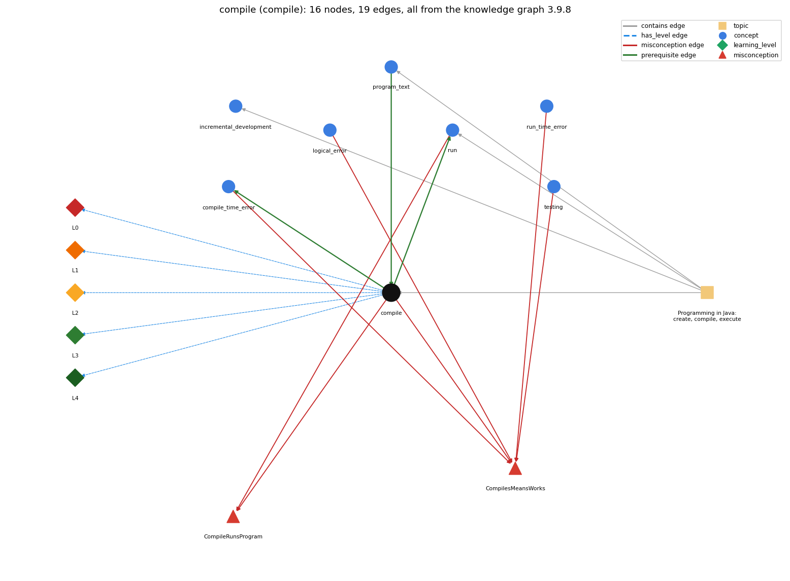

# compile (`compile`)

javac turns source into bytecode

Section 1.1 Your First Program, topic 1.1.a Programming in Java: create, compile, execute.

## At a glance

- **Needs first:** `program_text`
- **Leads to:** `compile_time_error`, `run`
- **Learned alongside:** nothing
- **Misconceptions:** `CompileRunsProgram`, `CompilesMeansWorks`
- **Errors:** none
- **Levels:** L0, L1, L2, L3, L4

Everything below comes from the knowledge graph 3.9.8 (`data/raw/chapter1_kg_updated.json`): 19 edges around this concept. The edge logic, the wrong and right rules and the exact rules of the ways are copied word for word from the graph.

## To work on (1)

- no code pattern or signal: the code cannot tag this concept

## What it needs first (1)

A prerequisite edge means the other concept has to be understood before `compile`.

### `program_text` comes before `compile`

*the source file; class name must match the filename*

- **Edge:** `pre:program_text->compile`
- **Exact edge logic:** javac takes the program file Name.java as input and translates it into Name.class.
- **Grounding:** book\_passage
- **Composition rule (R) of `compile` with `program_text`:** javac takes the program text Name.java as input; its file name must match the public class name.
- **Composition rule (R) of `program_text` with `compile`:** javac takes the text file Name.java as input and produces Name.class; the text must be lexically and syntactically legal for any .class to be produced.

## What it leads to (2)

These concepts need `compile` first.

### `compile` comes before `compile_time_error`

*an error javac reports before the program can run (syntax, types)*

- **Edge:** `pre:compile->compile_time_error`
- **Exact edge logic:** A compile-time error is reported while javac compiles Name.java, so no Name.class is produced.
- **Grounding:** book\_passage
- **Composition rule (R) of `compile` with `compile_time_error`:** A compile-time error stops the translation, so no Name.class is produced and there is nothing new to run.
- **Composition rule (R) of `compile_time_error` with `compile`:** A compile-time error is reported while javac compiles Name.java, so no new Name.class is produced.

### `compile` comes before `run`

*java executes main in the JVM*

- **Edge:** `pre:compile->run`
- **Exact edge logic:** java Name runs the Name.class file that javac produced, so compiling must succeed before the program can run.
- **Grounding:** book\_passage
- **Composition rule (R) of `compile` with `run`:** java Name loads the Name.class made by javac, so a successful compile must come before running, and edits take effect only after recompiling.
- **Composition rule (R) of `run` with `compile`:** java Name runs the Name.class that javac produced, so compiling must succeed first; the run reflects the source as of the last successful compile.

## Learned alongside (0)

A parallel edge joins two concepts that sit side by side: neither is needed before the other.

No parallel edge touches this concept.

## Misconceptions (2)

A misconception edge states the wrong rule a student may hold about this concept, and the right rule.

### CompileRunsProgram

- **Edge:** `compile` &rarr; `CompileRunsProgram` (misconception)
- **Exact edge logic (the wrong rule):** If javac Name.java finishes without errors, the program already works and has run.
- **Twin logic (the right rule):** javac only translates Name.java into Name.class; the program runs only with java Name, and run-time errors can still appear then.
- **Wrong belief (on the node):** compiling also executes the program
- **Correct rule (on the node):** javac only translates Name.java into Name.class; the program runs only with java Name, and run-time errors can still appear then.
- **Provenance:** derived
- **Role of this concept:** primary
- **L0 way linked to it:** yes
- **L0 way [1] misconception, exact rule:** wrong rule: Compiling also executes the program. Right rule: javac only translates Name.java into Name.class; the program runs only with java Name, and run-time errors can appear then.
- **L0 way [3] inconsistent\_trace, exact rule:** Applies the compile rule (LT) unevenly: expects output after javac on one try but not another, or runs java Name after a failed compile as if the old Name.class reflected the new edits. (here mixing in: "compiling also executes the program")
- **Edge `run` &rarr; `CompileRunsProgram`, exact edge logic:** If javac Name.java finishes without errors, the program already works and has run. **Twin logic:** javac only translates Name.java into Name.class; the program runs only with java Name, and run-time errors can still appear then. (role: context)

### CompilesMeansWorks

- **Edge:** `compile` &rarr; `CompilesMeansWorks` (misconception)
- **Exact edge logic (the wrong rule):** Code that compiles is code that works.
- **Twin logic (the right rule):** Code that compiles can still have run-time and logical errors.
- **Wrong belief (on the node):** Code that compiles is code that works.
- **Correct rule (on the node):** Code that compiles can still have run-time and logical errors.
- **Provenance:** published
- **Role of this concept:** primary
- **L0 way linked to it:** yes
- **L0 way [2] misconception, exact rule:** wrong rule: Code that compiles is code that works. Right rule: Code that compiles can still have run-time errors and logic errors.
- **Edge `compile_time_error` &rarr; `CompilesMeansWorks`, exact edge logic:** Code that compiles is code that works. **Twin logic:** Code that compiles can still have run-time and logical errors. (role: context)
- **Edge `logical_error` &rarr; `CompilesMeansWorks`, exact edge logic:** Code that compiles is code that works. **Twin logic:** Code that compiles can still have run-time and logical errors. (role: context)
- **Edge `run_time_error` &rarr; `CompilesMeansWorks`, exact edge logic:** Code that compiles is code that works. **Twin logic:** Code that compiles can still have run-time and logical errors. (role: context)
- **Edge `testing` &rarr; `CompilesMeansWorks`, exact edge logic:** Code that compiles is code that works. **Twin logic:** Code that compiles can still have run-time and logical errors. (role: context)

## Errors (0)

An error edge states the rule that gets broken in a program, and the right rule.

The graph has no error edge from this concept.

## Levels L0 to L4 (5 of 5)

Each level edge lists the ways a student shows that level, each with its exact rule.

### L0: Prestructural / sensorimotor

L0 for compile: the answer holds a rule that contradicts Java.

*Deciding question: Does every rule the answer applies to compile agree with the language rule? If it reads the code with everyday meanings, applies a wrong rule, or switches rules within one trace, it is L0. A slip in an otherwise rule-correct trace is L2 with an error, not L0.*

- **Edge:** `compile` &rarr; `compile@L0` (has_level)
- **Exact edge logic:** compile -&gt; L0 (Prestructural): the answer holds a rule that contradicts Java (4 ways).

Ways (4), each with its exact rule:

- **[0] everyday\_reading** (rule type E, folk-meaning rule): Everyday meaning: to 'compile' is to gather or put together (compile a list), and 'running' a program sounds like it starts on its own. Java rule: compiling with javac only translates Name.java into bytecode in Name.class; nothing executes until java Name is typed.
- **[1] misconception** (rule type M, wrong rule / right rule) &rarr; `CompileRunsProgram`: wrong rule: Compiling also executes the program. Right rule: javac only translates Name.java into Name.class; the program runs only with java Name, and run-time errors can appear then.
- **[2] misconception** (rule type M, wrong rule / right rule) &rarr; `CompilesMeansWorks`: wrong rule: Code that compiles is code that works. Right rule: Code that compiles can still have run-time errors and logic errors.
- **[3] inconsistent\_trace** (rule type T, uneven-application rule) &rarr; `CompileRunsProgram`: Applies the compile rule (LT) unevenly: expects output after javac on one try but not another, or runs java Name after a failed compile as if the old Name.class reflected the new edits. (here mixing in: "compiling also executes the program")

### L1: Unistructural / atom x text surface

L1 for compile: the answer states one correct rule without applying it.

*Deciding question: Does the answer cover every part of the code, in order, with the values (L2)? If it covers one part or only states the rule, it is L1.*

- **Edge:** `compile` &rarr; `compile@L1` (has_level)
- **Exact edge logic:** compile -&gt; L1 (Unistructural): the answer states one correct rule without applying it (2 ways).

Ways (2), each with its exact rule:

- **[0] names\_the\_element** (rule type N, identity rule): Compiling is translating the whole Java source file into a lower-level form (Java bytecode) before execution; javac is the Java compiler.
- **[1] states\_the\_rule** (rule type S, declarative rule): javac Name.java takes the file Name.java as input and, if there are no compile-time errors, produces Name.class (the bytecode version) with the same name.

### L2: Multistructural / block x execution / preoperational

L2 for compile: the answer applies these rules to every part of the code, in order.

*Deciding question: Is the answer many segments mapped onto lines (L2), or one segment stating the purpose of the whole (L3)? A correct output with no value-by-value justification is not levelled.*

- **Edge:** `compile` &rarr; `compile@L2` (has_level)
- **Exact edge logic:** compile -&gt; L2 (Multistructural): the answer applies the rules of compile to every part of the code, in order (3 ways).

Ways (3), each with its exact rule:

- **[0] line\_by\_line\_trace** (rule type LT, operational sequencing rule): The compiler first reads (parses) the entire file, then translates it; it does all this before the program starts running, and only if no errors were found does it write Name.class.
- **[1] output\_prediction** (rule type OP, evaluation / result rule): Result of javac Name.java: either a new file Name.class and no terminal output, or a list of error messages (file:line: message, then 'N errors') and no Name.class.
- **[2] one\_step\_execution** (rule type OS, state-transition rule): One compile changes only the file system: it creates or overwrites Name.class; it changes no program variable and prints no program output.

### L3: Relational / relations x function (concrete operational begins)

L3 for compile: the answer relates the parts by these rules.

*Deciding question: Was the purpose deduced from the code, or only guessed from traced input/output pairs (then L2)? Does the answer stay within the given code (L3), or reason about changed code, an error class or a new program (L4)?*

- **Edge:** `compile` &rarr; `compile@L3` (has_level)
- **Exact edge logic:** compile -&gt; L3 (Relational): the answer relates the parts (4 ways).

Ways (4), each with its exact rule:

- **[0] relation\_to\_neighbour** (rule type R, composition rule (with a neighbour)): java Name loads the Name.class made by javac, so a successful compile must come before running, and edits take effect only after recompiling.
- **[1] relation\_to\_neighbour** (rule type R, composition rule (with a neighbour)): A compile-time error stops the translation, so no Name.class is produced and there is nothing new to run.
- **[2] relation\_to\_neighbour** (rule type R, composition rule (with a neighbour)): javac takes the program text Name.java as input; its file name must match the public class name.
- **[3] purpose\_of\_the\_whole** (rule type P, plan / role rule): Purpose: check the program against the language rules and turn it into a form the JVM can execute, once, so it can then be run repeatedly with different inputs.

### L4: Extended abstract (concrete-operational reversibility and conservation)

L4 for compile: the answer reasons beyond the given code by these rules.

*Deciding question: Does the answer link the code to a broader context: a changed program, a class of inputs, an unseen problem? Re-tracing changed code value by value is L2; fixing one given failing case is L3.*

- **Edge:** `compile` &rarr; `compile@L4` (has_level)
- **Exact edge logic:** compile -&gt; L4 (Extended abstract): the answer reasons beyond the given code (4 ways).

Ways (4), each with its exact rule:

- **[0] predict\_a\_change** (rule type C, conservation rule) &rarr; `CompileRunsProgram`: Recompiling the same unchanged source gives the same Name.class; any edit to the source is invisible to java Name until recompiled; adding or deleting comments or whitespace changes nothing the program does.
- **[1] transfer\_to\_a\_new\_program** (rule type X, applicability rule): Compile after every change before running, and compile often while making small changes, so each error is found close to its cause; compiling cannot find run-time or logic errors.
- **[2] diagnose\_an\_error** (rule type D, error rule): rule broken: Source must obey Java's syntax and type rules. Kind: compile-time. Trigger class: any syntax error (missing ; or brace, misspelled keyword) or type error in Name.java
- **[3] diagnose\_an\_error** (rule type D, error rule): rule broken: javac needs the .java file name. Kind: launch error. Trigger class: typing javac Name (no .java) or the wrong file name / directory

## Same topic

`compile` belongs to the topic **Programming in Java: create, compile, execute** (`topic1.1.a`). The topic also contains: `incremental_development`, `program_text`, `run`.

## Rules of the concept (17)

- **Book** (SW-1e, p. 5 (pdf 15)): "The compiler takes a file with a .java extension as input (your program) and produces a file with the same name but with a .class extension (the computer-language version)."
- **Book** (SW-1.1, ): "Compile it by typing "javac MyProgram.java" in the terminal window."
- **E** (folk-meaning rule): Everyday meaning: to 'compile' is to gather or put together (compile a list), and 'running' a program sounds like it starts on its own. Java rule: compiling with javac only translates Name.java into bytecode in Name.class; nothing executes until java Name is typed.
- **M** (wrong rule / right rule): CompileRunsProgram: wrong: Compiling also executes the program. \| right: javac only translates Name.java into Name.class; the program runs only with java Name, and run-time errors can appear then.
- **M** (wrong rule / right rule): CompilesMeansWorks: wrong: Code that compiles is code that works. \| right: Code that compiles can still have run-time errors and logic errors.
- **T** (uneven-application rule): Applies the compile rule (LT) unevenly: expects output after javac on one try but not another, or runs java Name after a failed compile as if the old Name.class reflected the new edits.
- **N** (identity rule): Compiling is translating the whole Java source file into a lower-level form (Java bytecode) before execution; javac is the Java compiler.
- **S** (declarative rule): javac Name.java takes the file Name.java as input and, if there are no compile-time errors, produces Name.class (the bytecode version) with the same name.
- **LT** (operational sequencing rule): The compiler first reads (parses) the entire file, then translates it; it does all this before the program starts running, and only if no errors were found does it write Name.class.
- **OP** (evaluation / result rule): Result of javac Name.java: either a new file Name.class and no terminal output, or a list of error messages (file:line: message, then 'N errors') and no Name.class.
- **OS** (state-transition rule): One compile changes only the file system: it creates or overwrites Name.class; it changes no program variable and prints no program output.
- **R** (composition rule (with a neighbour)): with run: java Name loads the Name.class made by javac, so a successful compile must come before running, and edits take effect only after recompiling.
- **R** (composition rule (with a neighbour)): with compile\_time\_error: A compile-time error stops the translation, so no Name.class is produced and there is nothing new to run.
- **R** (composition rule (with a neighbour)): with program\_text: javac takes the program text Name.java as input; its file name must match the public class name.
- **P** (plan / role rule): Purpose: check the program against the language rules and turn it into a form the JVM can execute, once, so it can then be run repeatedly with different inputs.
- **C** (conservation rule): Recompiling the same unchanged source gives the same Name.class; any edit to the source is invisible to java Name until recompiled; adding or deleting comments or whitespace changes nothing the program does.
- **D** (error rule): rule broken: Source must obey Java's syntax and type rules (compile-time)
- **D** (error rule): rule broken: javac needs the .java file name (launch error)
- **X** (applicability rule): Compile after every change before running, and compile often while making small changes, so each error is found close to its cause; compiling cannot find run-time or logic errors.

## How it is found in code and answers (reader block)

- **Aliases:** compile, compiles, compiler, compiling, javac
- **Code patterns:** none
- **Operator symbols:** none
- **Java types:** none

## The whole prerequisite chain

- **Everything it builds on (1):** `program_text`
- **Everything that builds on it (12):** `compile_time_error`, `data_driven_code`, `debugging`, `filter`, `incremental_development`, `logical_error`, `piping`, `reading_error_messages`, `redirection`, `run`, `run_time_error`, `testing`

## Every edge in this view and its exact edge logic (19)

All the edges drawn in the picture, in the order: prerequisite, parallel, misconception, error, has_level, contains.

**1. `compile` &rarr; `compile_time_error`** (prerequisite)

- **Exact edge logic:** A compile-time error is reported while javac compiles Name.java, so no Name.class is produced.
- **Grounding:** book\_passage
- **Composition rule (R) of `compile` with `compile_time_error`:** A compile-time error stops the translation, so no Name.class is produced and there is nothing new to run.
- **Composition rule (R) of `compile_time_error` with `compile`:** A compile-time error is reported while javac compiles Name.java, so no new Name.class is produced.

**2. `compile` &rarr; `run`** (prerequisite)

- **Exact edge logic:** java Name runs the Name.class file that javac produced, so compiling must succeed before the program can run.
- **Grounding:** book\_passage
- **Composition rule (R) of `compile` with `run`:** java Name loads the Name.class made by javac, so a successful compile must come before running, and edits take effect only after recompiling.
- **Composition rule (R) of `run` with `compile`:** java Name runs the Name.class that javac produced, so compiling must succeed first; the run reflects the source as of the last successful compile.

**3. `program_text` &rarr; `compile`** (prerequisite)

- **Exact edge logic:** javac takes the program file Name.java as input and translates it into Name.class.
- **Grounding:** book\_passage
- **Composition rule (R) of `program_text` with `compile`:** javac takes the text file Name.java as input and produces Name.class; the text must be lexically and syntactically legal for any .class to be produced.
- **Composition rule (R) of `compile` with `program_text`:** javac takes the program text Name.java as input; its file name must match the public class name.

**4. `compile` &rarr; `CompileRunsProgram`** (misconception)

- **Exact edge logic (the wrong rule):** If javac Name.java finishes without errors, the program already works and has run.
- **Twin logic (the right rule):** javac only translates Name.java into Name.class; the program runs only with java Name, and run-time errors can still appear then.
- **Role:** primary

**5. `compile` &rarr; `CompilesMeansWorks`** (misconception)

- **Exact edge logic (the wrong rule):** Code that compiles is code that works.
- **Twin logic (the right rule):** Code that compiles can still have run-time and logical errors.
- **Role:** primary

**6. `compile_time_error` &rarr; `CompilesMeansWorks`** (misconception)

- **Exact edge logic (the wrong rule):** Code that compiles is code that works.
- **Twin logic (the right rule):** Code that compiles can still have run-time and logical errors.
- **Role:** context

**7. `logical_error` &rarr; `CompilesMeansWorks`** (misconception)

- **Exact edge logic (the wrong rule):** Code that compiles is code that works.
- **Twin logic (the right rule):** Code that compiles can still have run-time and logical errors.
- **Role:** context

**8. `run` &rarr; `CompileRunsProgram`** (misconception)

- **Exact edge logic (the wrong rule):** If javac Name.java finishes without errors, the program already works and has run.
- **Twin logic (the right rule):** javac only translates Name.java into Name.class; the program runs only with java Name, and run-time errors can still appear then.
- **Role:** context

**9. `run_time_error` &rarr; `CompilesMeansWorks`** (misconception)

- **Exact edge logic (the wrong rule):** Code that compiles is code that works.
- **Twin logic (the right rule):** Code that compiles can still have run-time and logical errors.
- **Role:** context

**10. `testing` &rarr; `CompilesMeansWorks`** (misconception)

- **Exact edge logic (the wrong rule):** Code that compiles is code that works.
- **Twin logic (the right rule):** Code that compiles can still have run-time and logical errors.
- **Role:** context

**11. `compile` &rarr; `compile@L0`** (has_level)

- **Exact edge logic:** compile -&gt; L0 (Prestructural): the answer holds a rule that contradicts Java (4 ways).
  - **[0] everyday\_reading** (rule type E, folk-meaning rule): Everyday meaning: to 'compile' is to gather or put together (compile a list), and 'running' a program sounds like it starts on its own. Java rule: compiling with javac only translates Name.java into bytecode in Name.class; nothing executes until java Name is typed.
  - **[1] misconception** (rule type M, wrong rule / right rule) &rarr; `CompileRunsProgram`: wrong rule: Compiling also executes the program. Right rule: javac only translates Name.java into Name.class; the program runs only with java Name, and run-time errors can appear then.
  - **[2] misconception** (rule type M, wrong rule / right rule) &rarr; `CompilesMeansWorks`: wrong rule: Code that compiles is code that works. Right rule: Code that compiles can still have run-time errors and logic errors.
  - **[3] inconsistent\_trace** (rule type T, uneven-application rule) &rarr; `CompileRunsProgram`: Applies the compile rule (LT) unevenly: expects output after javac on one try but not another, or runs java Name after a failed compile as if the old Name.class reflected the new edits. (here mixing in: "compiling also executes the program")

**12. `compile` &rarr; `compile@L1`** (has_level)

- **Exact edge logic:** compile -&gt; L1 (Unistructural): the answer states one correct rule without applying it (2 ways).
  - **[0] names\_the\_element** (rule type N, identity rule): Compiling is translating the whole Java source file into a lower-level form (Java bytecode) before execution; javac is the Java compiler.
  - **[1] states\_the\_rule** (rule type S, declarative rule): javac Name.java takes the file Name.java as input and, if there are no compile-time errors, produces Name.class (the bytecode version) with the same name.

**13. `compile` &rarr; `compile@L2`** (has_level)

- **Exact edge logic:** compile -&gt; L2 (Multistructural): the answer applies the rules of compile to every part of the code, in order (3 ways).
  - **[0] line\_by\_line\_trace** (rule type LT, operational sequencing rule): The compiler first reads (parses) the entire file, then translates it; it does all this before the program starts running, and only if no errors were found does it write Name.class.
  - **[1] output\_prediction** (rule type OP, evaluation / result rule): Result of javac Name.java: either a new file Name.class and no terminal output, or a list of error messages (file:line: message, then 'N errors') and no Name.class.
  - **[2] one\_step\_execution** (rule type OS, state-transition rule): One compile changes only the file system: it creates or overwrites Name.class; it changes no program variable and prints no program output.

**14. `compile` &rarr; `compile@L3`** (has_level)

- **Exact edge logic:** compile -&gt; L3 (Relational): the answer relates the parts (4 ways).
  - **[0] relation\_to\_neighbour** (rule type R, composition rule (with a neighbour)): java Name loads the Name.class made by javac, so a successful compile must come before running, and edits take effect only after recompiling.
  - **[1] relation\_to\_neighbour** (rule type R, composition rule (with a neighbour)): A compile-time error stops the translation, so no Name.class is produced and there is nothing new to run.
  - **[2] relation\_to\_neighbour** (rule type R, composition rule (with a neighbour)): javac takes the program text Name.java as input; its file name must match the public class name.
  - **[3] purpose\_of\_the\_whole** (rule type P, plan / role rule): Purpose: check the program against the language rules and turn it into a form the JVM can execute, once, so it can then be run repeatedly with different inputs.

**15. `compile` &rarr; `compile@L4`** (has_level)

- **Exact edge logic:** compile -&gt; L4 (Extended abstract): the answer reasons beyond the given code (4 ways).
  - **[0] predict\_a\_change** (rule type C, conservation rule) &rarr; `CompileRunsProgram`: Recompiling the same unchanged source gives the same Name.class; any edit to the source is invisible to java Name until recompiled; adding or deleting comments or whitespace changes nothing the program does.
  - **[1] transfer\_to\_a\_new\_program** (rule type X, applicability rule): Compile after every change before running, and compile often while making small changes, so each error is found close to its cause; compiling cannot find run-time or logic errors.
  - **[2] diagnose\_an\_error** (rule type D, error rule): rule broken: Source must obey Java's syntax and type rules. Kind: compile-time. Trigger class: any syntax error (missing ; or brace, misspelled keyword) or type error in Name.java
  - **[3] diagnose\_an\_error** (rule type D, error rule): rule broken: javac needs the .java file name. Kind: launch error. Trigger class: typing javac Name (no .java) or the wrong file name / directory

**16. `topic1.1.a` &rarr; `compile`** (contains)

- topic `topic1.1.a` contains `compile`

**17. `topic1.1.a` &rarr; `incremental_development`** (contains)

- topic `topic1.1.a` contains `incremental_development`

**18. `topic1.1.a` &rarr; `program_text`** (contains)

- topic `topic1.1.a` contains `program_text`

**19. `topic1.1.a` &rarr; `run`** (contains)

- topic `topic1.1.a` contains `run`
