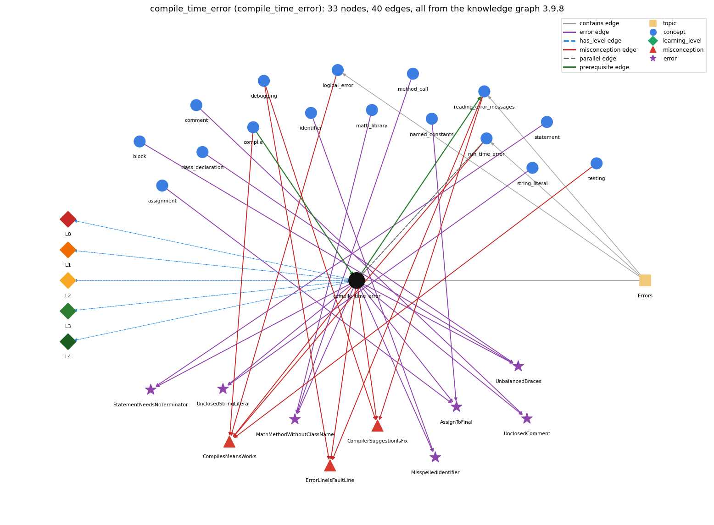

# compile_time_error (`compile_time_error`)

an error javac reports before the program can run (syntax, types)

Section 1.1 Your First Program, topic 1.1.c Errors.

## At a glance

- **Needs first:** `compile`
- **Leads to:** `reading_error_messages`
- **Learned alongside:** `run_time_error`
- **Misconceptions:** `CompilerSuggestionIsFix`, `CompilesMeansWorks`, `ErrorLineIsFaultLine`
- **Errors:** `AssignToFinal`, `MathMethodWithoutClassName`, `MisspelledIdentifier`, `StatementNeedsNoTerminator`, `UnbalancedBraces`, `UnclosedComment`, `UnclosedStringLiteral`
- **Levels:** L0, L1, L2, L3, L4

Everything below comes from the knowledge graph 3.9.8 (`data/raw/chapter1_kg_updated.json`): 40 edges around this concept. The edge logic, the wrong and right rules and the exact rules of the ways are copied word for word from the graph.

## To work on (0)

Nothing is missing for this concept.

## What it needs first (1)

A prerequisite edge means the other concept has to be understood before `compile_time_error`.

### `compile` comes before `compile_time_error`

*javac turns source into bytecode*

- **Edge:** `pre:compile->compile_time_error`
- **Exact edge logic:** A compile-time error is reported while javac compiles Name.java, so no Name.class is produced.
- **Grounding:** book\_passage
- **Composition rule (R) of `compile_time_error` with `compile`:** A compile-time error is reported while javac compiles Name.java, so no new Name.class is produced.
- **Composition rule (R) of `compile` with `compile_time_error`:** A compile-time error stops the translation, so no Name.class is produced and there is nothing new to run.

## What it leads to (1)

These concepts need `compile_time_error` first.

### `compile_time_error` comes before `reading_error_messages`

*how to read compiler error messages: first error first; reported line may follow the real fault*

- **Edge:** `pre:compile_time_error->reading_error_messages`
- **Exact edge logic:** Reading error messages is how compile-time errors are found and fixed.
- **Grounding:** book\_passage
- **Composition rule (R) of `compile_time_error` with `reading_error_messages`:** Each compile-time error comes with a message; reading it (first error first, line may be late) is how it is found and fixed.
- **Composition rule (R) of `reading_error_messages` with `compile_time_error`:** Compile-time errors are found and fixed by reading their messages; the message maps imperfectly to the fault.

## Learned alongside (1)

A parallel edge joins two concepts that sit side by side: neither is needed before the other.

### `compile_time_error` alongside `run_time_error`

*an error raised while the program executes (e.g. ArrayIndexOutOfBounds, NumberFormatException)*

- **Edge:** `par:compile_time_error~run_time_error`
- **Exact edge logic:** A compile-time error is found by javac before the program runs; a run-time error is found while it runs.
- **Grounding:** book\_passage
- **Composition rule (R) of `compile_time_error` with `run_time_error`:** A compile-time error is found by javac before the program runs; a run-time error only while it runs, so code that compiles can still crash.
- **Composition rule (R) of `run_time_error` with `compile_time_error`:** javac cannot detect it because it depends on run-time values (the argument typed, the divisor's value).

## Misconceptions (3)

A misconception edge states the wrong rule a student may hold about this concept, and the right rule.

### CompilerSuggestionIsFix

- **Edge:** `compile_time_error` &rarr; `CompilerSuggestionIsFix` (misconception)
- **Exact edge logic (the wrong rule):** Doing exactly what the compiler message suggests will fix the error.
- **Twin logic (the right rule):** An error message is evidence that something is wrong, but its suggested remedy may be wrong; find the actual cause.
- **Wrong belief (on the node):** Doing exactly what the compiler message suggests will fix the error.
- **Correct rule (on the node):** An error message is evidence that something is wrong, but its suggested remedy may be wrong; find the actual cause.
- **Provenance:** textbook
- **Role of this concept:** context
- **L0 way linked to it:** yes
- **L0 way [4] misconception, exact rule:** wrong rule: Doing exactly what the compiler message suggests will fix the error. Right rule: An error message is evidence that something is wrong, but its suggested remedy may be wrong; find the actual cause.
- **Edge `debugging` &rarr; `CompilerSuggestionIsFix`, exact edge logic:** Doing exactly what the compiler message suggests will fix the error. **Twin logic:** An error message is evidence that something is wrong, but its suggested remedy may be wrong; find the actual cause. (role: context)
- **Edge `reading_error_messages` &rarr; `CompilerSuggestionIsFix`, exact edge logic:** Doing exactly what the compiler message suggests will fix the error. **Twin logic:** An error message is evidence that something is wrong, but its suggested remedy may be wrong; find the actual cause. (role: primary)

### CompilesMeansWorks

- **Edge:** `compile_time_error` &rarr; `CompilesMeansWorks` (misconception)
- **Exact edge logic (the wrong rule):** Code that compiles is code that works.
- **Twin logic (the right rule):** Code that compiles can still have run-time and logical errors.
- **Wrong belief (on the node):** Code that compiles is code that works.
- **Correct rule (on the node):** Code that compiles can still have run-time and logical errors.
- **Provenance:** published
- **Role of this concept:** context
- **L0 way linked to it:** yes
- **L0 way [1] misconception, exact rule:** wrong rule: Code that compiles is code that works. Right rule: Compiling only checks the language rules; code that compiles can still have run-time and logic errors.
- **L0 way [3] inconsistent\_trace, exact rule:** Applies the 'javac checks before running' rule unevenly: predicts output for a program that would not compile, or expects a compile error from a fault (such as division by zero) that only shows at run time. (here mixing in: "Code that compiles is code that works")
- **Edge `compile` &rarr; `CompilesMeansWorks`, exact edge logic:** Code that compiles is code that works. **Twin logic:** Code that compiles can still have run-time and logical errors. (role: primary)
- **Edge `logical_error` &rarr; `CompilesMeansWorks`, exact edge logic:** Code that compiles is code that works. **Twin logic:** Code that compiles can still have run-time and logical errors. (role: context)
- **Edge `run_time_error` &rarr; `CompilesMeansWorks`, exact edge logic:** Code that compiles is code that works. **Twin logic:** Code that compiles can still have run-time and logical errors. (role: context)
- **Edge `testing` &rarr; `CompilesMeansWorks`, exact edge logic:** Code that compiles is code that works. **Twin logic:** Code that compiles can still have run-time and logical errors. (role: context)

### ErrorLineIsFaultLine

- **Edge:** `compile_time_error` &rarr; `ErrorLineIsFaultLine` (misconception)
- **Exact edge logic (the wrong rule):** The line number in a javac error is always the line that has the mistake.
- **Twin logic (the right rule):** The compiler reports where it noticed the problem, which can be after the real fault; for example, omitting the second left brace of HelloWorld produces errors reported on later lines.
- **Wrong belief (on the node):** The line number in a javac error is always the line that has the mistake.
- **Correct rule (on the node):** The compiler reports where it noticed the problem, which can be after the real fault; for example, omitting the second left brace of HelloWorld produces errors reported on later lines.
- **Provenance:** textbook
- **Role of this concept:** context
- **L0 way linked to it:** yes
- **L0 way [2] misconception, exact rule:** wrong rule: The line number in a javac error is always the line that has the mistake. Right rule: The compiler reports where it noticed the problem, which can be after the real fault (omitting HelloWorld's second left brace gives errors on later lines).
- **Edge `debugging` &rarr; `ErrorLineIsFaultLine`, exact edge logic:** The line number in a javac error is always the line that has the mistake. **Twin logic:** The compiler reports where it noticed the problem, which can be after the real fault; for example, omitting the second left brace of HelloWorld produces errors reported on later lines. (role: context)
- **Edge `reading_error_messages` &rarr; `ErrorLineIsFaultLine`, exact edge logic:** The line number in a javac error is always the line that has the mistake. **Twin logic:** The compiler reports where it noticed the problem, which can be after the real fault; for example, omitting the second left brace of HelloWorld produces errors reported on later lines. (role: primary)

## Errors (7)

An error edge states the rule that gets broken in a program, and the right rule.

### AssignToFinal

- **Edge:** `compile_time_error` &rarr; `AssignToFinal` (error)
- **Exact edge logic (the wrong rule):** Assigns a new value to a variable declared final.
- **Twin logic (the right rule):** A final variable cannot be reassigned after it is initialized; the compiler reports an error.
- **Wrong belief (on the node):** Assigns a new value to a variable declared final.
- **Correct rule (on the node):** A final variable cannot be reassigned after it is initialized; the compiler reports an error.
- **Provenance:** published
- **Role of this concept:** context
- **Edge `assignment` &rarr; `AssignToFinal`, exact edge logic:** Assigns a new value to a variable declared final. **Twin logic:** A final variable cannot be reassigned after it is initialized; the compiler reports an error. (role: context)
- **Edge `named_constants` &rarr; `AssignToFinal`, exact edge logic:** Assigns a new value to a variable declared final. **Twin logic:** A final variable cannot be reassigned after it is initialized; the compiler reports an error. (role: primary)

### MathMethodWithoutClassName

- **Edge:** `compile_time_error` &rarr; `MathMethodWithoutClassName` (error)
- **Exact edge logic (the wrong rule):** sqrt(x) calls the square-root method.
- **Twin logic (the right rule):** Library methods are called with the class name, e.g. Math.sqrt(x).
- **Wrong belief (on the node):** sqrt(x) calls the square-root method.
- **Correct rule (on the node):** Library methods are called with the class name, e.g. Math.sqrt(x).
- **Provenance:** published
- **Role of this concept:** context
- **Edge `math_library` &rarr; `MathMethodWithoutClassName`, exact edge logic:** sqrt(x) calls the square-root method. **Twin logic:** Library methods are called with the class name, e.g. Math.sqrt(x). (role: context)
- **Edge `method_call` &rarr; `MathMethodWithoutClassName`, exact edge logic:** sqrt(x) calls the square-root method. **Twin logic:** Library methods are called with the class name, e.g. Math.sqrt(x). (role: primary)

### MisspelledIdentifier

- **Edge:** `compile_time_error` &rarr; `MisspelledIdentifier` (error)
- **Exact edge logic (the wrong rule):** Writes Sytem.out.prinln or a misspelled variable name.
- **Twin logic (the right rule):** Every name must be spelled exactly, including capitalization.
- **Wrong belief (on the node):** Writes Sytem.out.prinln or a misspelled variable name.
- **Correct rule (on the node):** Every name must be spelled exactly, including capitalization.
- **Provenance:** textbook
- **Role of this concept:** context
- **Edge `identifier` &rarr; `MisspelledIdentifier`, exact edge logic:** Writes Sytem.out.prinln or a misspelled variable name. **Twin logic:** Every name must be spelled exactly, including capitalization. (role: primary)

### StatementNeedsNoTerminator

- **Edge:** `compile_time_error` &rarr; `StatementNeedsNoTerminator` (error)
- **Exact edge logic (the wrong rule):** a statement runs without the ;
- **Twin logic (the right rule):** Each statement must end with ;, otherwise javac reports ';' expected.
- **Wrong belief (on the node):** a statement runs without the ;
- **Correct rule (on the node):** Each statement must end with ;, otherwise javac reports ';' expected.
- **Provenance:** textbook
- **Role of this concept:** context
- **Edge `statement` &rarr; `StatementNeedsNoTerminator`, exact edge logic:** A statement still compiles and runs if the semicolon at its end is left out, or if a stray ; is put right after if (c) or for (...). **Twin logic:** Each statement must end with ;, otherwise javac reports ';' expected. (role: primary)

### UnbalancedBraces

- **Edge:** `compile_time_error` &rarr; `UnbalancedBraces` (error)
- **Exact edge logic (the wrong rule):** A missing { or } is harmless.
- **Twin logic (the right rule):** Every { must be matched by a } so the class body and the method body are well formed.
- **Wrong belief (on the node):** A missing { or } is harmless.
- **Correct rule (on the node):** Every { must be matched by a } so the class body and the method body are well formed.
- **Provenance:** published
- **Role of this concept:** context
- **Edge `block` &rarr; `UnbalancedBraces`, exact edge logic:** A missing { or } is harmless. **Twin logic:** Every { must be matched by a } so the class body and the method body are well formed. (role: primary)
- **Edge `class_declaration` &rarr; `UnbalancedBraces`, exact edge logic:** A missing { or } is harmless. **Twin logic:** Every { must be matched by a } so the class body and the method body are well formed. (role: context)

### UnclosedComment

- **Edge:** `compile_time_error` &rarr; `UnclosedComment` (error)
- **Exact edge logic (the wrong rule):** Opens a comment with /\* and never closes it.
- **Twin logic (the right rule):** A /\* comment is the text between /\* and \*/, so the closing \*/ is required.
- **Wrong belief (on the node):** Opens a comment with /\* and never closes it.
- **Correct rule (on the node):** A /\* comment is the text between /\* and \*/, so the closing \*/ is required.
- **Provenance:** textbook
- **Role of this concept:** context
- **Edge `comment` &rarr; `UnclosedComment`, exact edge logic:** Opens a comment with /\* and never closes it. **Twin logic:** A /\* comment is the text between /\* and \*/, so the closing \*/ is required. (role: primary)

### UnclosedStringLiteral

- **Edge:** `compile_time_error` &rarr; `UnclosedStringLiteral` (error)
- **Exact edge logic (the wrong rule):** A string literal can be left without its closing quote.
- **Twin logic (the right rule):** A String literal is enclosed in a pair of double quotes.
- **Wrong belief (on the node):** A string literal can be left without its closing quote.
- **Correct rule (on the node):** A String literal is enclosed in a pair of double quotes.
- **Provenance:** published
- **Role of this concept:** context
- **Edge `string_literal` &rarr; `UnclosedStringLiteral`, exact edge logic:** A string literal can be left without its closing quote. **Twin logic:** A String literal is enclosed in a pair of double quotes. (role: primary)

## Levels L0 to L4 (5 of 5)

Each level edge lists the ways a student shows that level, each with its exact rule.

### L0: Prestructural / sensorimotor

L0 for compile time error: the answer holds a rule that contradicts Java.

*Deciding question: Does every rule the answer applies to compile time error agree with the language rule? If it reads the code with everyday meanings, applies a wrong rule, or switches rules within one trace, it is L0. A slip in an otherwise rule-correct trace is L2 with an error, not L0.*

- **Edge:** `compile_time_error` &rarr; `compile_time_error@L0` (has_level)
- **Exact edge logic:** compile time error -&gt; L0 (Prestructural): the answer holds a rule that contradicts Java (5 ways).

Ways (5), each with its exact rule:

- **[0] everyday\_reading** (rule type E, folk-meaning rule): Everyday reading: 'error' means the program will do something wrong when used, and a message points exactly at the mistake. Java rule: a compile-time error is a breach of the language rules found by javac before any execution; no .class is produced, and the reported line is where javac noticed it.
- **[1] misconception** (rule type M, wrong rule / right rule) &rarr; `CompilesMeansWorks`: wrong rule: Code that compiles is code that works. Right rule: Compiling only checks the language rules; code that compiles can still have run-time and logic errors.
- **[2] misconception** (rule type M, wrong rule / right rule) &rarr; `ErrorLineIsFaultLine`: wrong rule: The line number in a javac error is always the line that has the mistake. Right rule: The compiler reports where it noticed the problem, which can be after the real fault (omitting HelloWorld's second left brace gives errors on later lines).
- **[3] inconsistent\_trace** (rule type T, uneven-application rule) &rarr; `CompilesMeansWorks`: Applies the 'javac checks before running' rule unevenly: predicts output for a program that would not compile, or expects a compile error from a fault (such as division by zero) that only shows at run time. (here mixing in: "Code that compiles is code that works")
- **[4] misconception** (rule type M, wrong rule / right rule) &rarr; `CompilerSuggestionIsFix`: wrong rule: Doing exactly what the compiler message suggests will fix the error. Right rule: An error message is evidence that something is wrong, but its suggested remedy may be wrong; find the actual cause.

### L1: Unistructural / atom x text surface

L1 for compile time error: the answer states one correct rule without applying it.

*Deciding question: Does the answer cover every part of the code, in order, with the values (L2)? If it covers one part or only states the rule, it is L1.*

- **Edge:** `compile_time_error` &rarr; `compile_time_error@L1` (has_level)
- **Exact edge logic:** compile time error -&gt; L1 (Unistructural): the answer states one correct rule without applying it (2 ways).

Ways (2), each with its exact rule:

- **[0] names\_the\_element** (rule type N, identity rule): A compile-time error (syntax error) is an error in the source code, caught by javac, that prevents the program from being translated.
- **[1] states\_the\_rule** (rule type S, declarative rule): Compile-time errors occur when the code violates the rules of the Java language (syntax, names, types); they are caught when you compile and prevent the translation.

### L2: Multistructural / block x execution / preoperational

L2 for compile time error: the answer applies these rules to every part of the code, in order.

*Deciding question: Is the answer many segments mapped onto lines (L2), or one segment stating the purpose of the whole (L3)? A correct output with no value-by-value justification is not levelled.*

- **Edge:** `compile_time_error` &rarr; `compile_time_error@L2` (has_level)
- **Exact edge logic:** compile time error -&gt; L2 (Multistructural): the answer applies the rules of compile time error to every part of the code, in order (3 ways).

Ways (3), each with its exact rule:

- **[0] line\_by\_line\_trace** (rule type LT, operational sequencing rule): javac reads the whole file, reports each error with file name, line number and message, tries to recover and continue, and prints a count; the first message is the most reliable.
- **[1] output\_prediction** (rule type OP, evaluation / result rule): Result: messages such as Bad.java:4: ';' expected ... 3 errors, and no Name.class; nothing of the program runs.
- **[2] one\_step\_execution** (rule type OS, state-transition rule): A failed compile leaves the file system without a new Name.class (an older one, if any, is not updated) and changes no program state.

### L3: Relational / relations x function (concrete operational begins)

L3 for compile time error: the answer relates the parts by these rules.

*Deciding question: Was the purpose deduced from the code, or only guessed from traced input/output pairs (then L2)? Does the answer stay within the given code (L3), or reason about changed code, an error class or a new program (L4)?*

- **Edge:** `compile_time_error` &rarr; `compile_time_error@L3` (has_level)
- **Exact edge logic:** compile time error -&gt; L3 (Relational): the answer relates the parts (4 ways).

Ways (4), each with its exact rule:

- **[0] relation\_to\_neighbour** (rule type R, composition rule (with a neighbour)): A compile-time error is reported while javac compiles Name.java, so no new Name.class is produced.
- **[1] relation\_to\_neighbour** (rule type R, composition rule (with a neighbour)): Each compile-time error comes with a message; reading it (first error first, line may be late) is how it is found and fixed.
- **[2] relation\_to\_neighbour** (rule type R, composition rule (with a neighbour)): A compile-time error is found by javac before the program runs; a run-time error only while it runs, so code that compiles can still crash.
- **[3] purpose\_of\_the\_whole** (rule type P, plan / role rule): Purpose (of the check): catch rule violations automatically before running, so they cannot cause wrong behaviour; S&amp;W say treat the compiler as a friend.

### L4: Extended abstract (concrete-operational reversibility and conservation)

L4 for compile time error: the answer reasons beyond the given code by these rules.

*Deciding question: Does the answer link the code to a broader context: a changed program, a class of inputs, an unseen problem? Re-tracing changed code value by value is L2; fixing one given failing case is L3.*

- **Edge:** `compile_time_error` &rarr; `compile_time_error@L4` (has_level)
- **Exact edge logic:** compile time error -&gt; L4 (Extended abstract): the answer reasons beyond the given code (10 ways).

Ways (10), each with its exact rule:

- **[0] predict\_a\_change** (rule type C, conservation rule) &rarr; `CompilesMeansWorks`: Fixing the first error and recompiling can remove many messages at once; a single missing brace or semicolon can cause several messages.
- **[1] diagnose\_an\_error** (rule type D, error rule): rule broken: Each statement must end with ;. Kind: compile-time. Trigger class: missing ; at the end of a statement: ';' expected
- **[2] diagnose\_an\_error** (rule type D, error rule): rule broken: Every { must be matched by a }. Kind: compile-time. Trigger class: missing or extra brace: '{' expected, 'class' or 'interface' expected, reached end of file while parsing
- **[3] diagnose\_an\_error** (rule type D, error rule): rule broken: A String literal is enclosed in a pair of double quotes. Kind: compile-time. Trigger class: missing closing quote: unclosed string literal, often with confusing follow-on errors
- **[4] diagnose\_an\_error** (rule type D, error rule): rule broken: Library static methods are called with the class name, e.g. Math.sqrt(x). Kind: compile-time. Trigger class: calling sqrt(x) without Math.: cannot find symbol
- **[5] diagnose\_an\_error** (rule type D, error rule): rule broken: Every name must be spelled exactly, including capitalization. Kind: compile-time. Trigger class: Sytem.out.prinln, Println, or a misspelled variable: cannot find symbol
- **[6] diagnose\_an\_error** (rule type D, error rule): rule broken: A /\* comment needs its closing \*/. Kind: compile-time. Trigger class: /\* with no \*/ swallows the rest of the file
- **[7] transfer\_to\_a\_new\_program** (rule type X, applicability rule): Expect compile-time errors for anything the compiler can check from the text alone (syntax, names, types, final); expect run-time or logic errors for faults that depend on input values or on what the program was meant to do.
- **[8] diagnose\_an\_error** (rule type D, error rule): rule broken: A final variable cannot be reassigned after it is initialized. Kind: compile-time. Trigger class: assigning a second value to a final variable
- **[9] diagnose\_an\_error** (rule type D, error rule): rule broken: Required keywords (class, static, void...) must be present and spelled right. Kind: compile-time. Trigger class: omitting or misspelling a keyword in public class Name or the main header

## Same topic

`compile_time_error` belongs to the topic **Errors** (`topic1.1.c`). The topic also contains: `logical_error`, `reading_error_messages`, `run_time_error`.

## Rules of the concept (24)

- **Book** (SW-1e, p. 8 (pdf 18)): "Some errors, known as compile-time errors, are caught when you compile the program, because they prevent the compiler from doing the translation."
- **Book** (SW-1.1, ): "These errors are caught by the system when we compile the program,"
- **E** (folk-meaning rule): Everyday reading: 'error' means the program will do something wrong when used, and a message points exactly at the mistake. Java rule: a compile-time error is a breach of the language rules found by javac before any execution; no .class is produced, and the reported line is where javac noticed it.
- **M** (wrong rule / right rule): CompilesMeansWorks: wrong: Code that compiles is code that works. \| right: Compiling only checks the language rules; code that compiles can still have run-time and logic errors.
- **M** (wrong rule / right rule): ErrorLineIsFaultLine: wrong: The line number in a javac error is always the line that has the mistake. \| right: The compiler reports where it noticed the problem, which can be after the real fault (omitting HelloWorld's second left brace gives errors on later lines).
- **M** (wrong rule / right rule): CompilerSuggestionIsFix: wrong: Doing exactly what the compiler message suggests will fix the error. \| right: An error message is evidence that something is wrong, but its suggested remedy may be wrong; find the actual cause.
- **T** (uneven-application rule): Applies the 'javac checks before running' rule unevenly: predicts output for a program that would not compile, or expects a compile error from a fault (such as division by zero) that only shows at run time.
- **N** (identity rule): A compile-time error (syntax error) is an error in the source code, caught by javac, that prevents the program from being translated.
- **S** (declarative rule): Compile-time errors occur when the code violates the rules of the Java language (syntax, names, types); they are caught when you compile and prevent the translation.
- **LT** (operational sequencing rule): javac reads the whole file, reports each error with file name, line number and message, tries to recover and continue, and prints a count; the first message is the most reliable.
- **OP** (evaluation / result rule): Result: messages such as Bad.java:4: ';' expected ... 3 errors, and no Name.class; nothing of the program runs.
- **OS** (state-transition rule): A failed compile leaves the file system without a new Name.class (an older one, if any, is not updated) and changes no program state.
- **R** (composition rule (with a neighbour)): with compile: A compile-time error is reported while javac compiles Name.java, so no new Name.class is produced.
- **R** (composition rule (with a neighbour)): with reading\_error\_messages: Each compile-time error comes with a message; reading it (first error first, line may be late) is how it is found and fixed.
- **R** (composition rule (with a neighbour)): with run\_time\_error: A compile-time error is found by javac before the program runs; a run-time error only while it runs, so code that compiles can still crash.
- **P** (plan / role rule): Purpose (of the check): catch rule violations automatically before running, so they cannot cause wrong behaviour; S&amp;W say treat the compiler as a friend.
- **C** (conservation rule): Fixing the first error and recompiling can remove many messages at once; a single missing brace or semicolon can cause several messages.
- **D** (error rule): rule broken: Library static methods are called with the class name, e.g. Math.sqrt(x) (compile-time)
- **D** (error rule): rule broken: Every name must be spelled exactly, including capitalization (compile-time)
- **D** (error rule): rule broken: Each statement must end with ; (compile-time)
- **D** (error rule): rule broken: Every { must be matched by a } (compile-time)
- **D** (error rule): rule broken: A /\* comment needs its closing \*/ (compile-time)
- **D** (error rule): rule broken: A String literal is enclosed in a pair of double quotes (compile-time)
- **D** (error rule): rule broken: A final variable cannot be reassigned after it is initialized (compile-time)
- **D** (error rule): rule broken: Required keywords (class, static, void...) must be present and spelled right (compile-time)
- **X** (applicability rule): Expect compile-time errors for anything the compiler can check from the text alone (syntax, names, types, final); expect run-time or logic errors for faults that depend on input values or on what the program was meant to do.

## How it is found in code and answers (reader block)

- **Aliases:** compile error, compile errors, compile time error, compile-time error, compiler error, compiler errors, syntax error, syntax errors
- **Code patterns:** none
- **Operator symbols:** none
- **Java types:** none
- **Signal missing\_semicolon** (scope , decisive): `None`
- **Signal statement\_without\_semicolon** (scope program, decisive): `^[ \t]*(?!(?:if|for|while|switch|else|do|return|public|private|protected|static|class|case|default)\b)(?:(?:int|double|boolean|char|long|String|float|short|byte)(?:\[\])*\s+)?[A-Za-z_][\w.\[\]]*\s*(?:=[^;{}\n]*[^;{}\s+\-*/%&|,(<>=?:]|\((?:[^()]|\([^()]*\))*\))[ \t]*$`
- **Signal type\_mismatch\_literal** (scope program, decisive): `\b(?:int|long|short|byte)\s+\w+\s*=\s*-?\d+\.\d*\s*;|\bint\s+\w+\s*=\s*\"|\bboolean\s+\w+\s*=\s*-?\d|\bString\s+\w+\s*=\s*-?\d+(?:\.\d+)?\s*;|\bchar\s+\w+\s*=\s*\"`
- **Signal assignment\_in\_condition** (scope program, decisive): `\b(?:if|while)\s*\(\s*\w+\s*=(?!=)\s*(?!true\b|false\b)[^=)][^)]*\)`

## The whole prerequisite chain

- **Everything it builds on (2):** `compile`, `program_text`
- **Everything that builds on it (2):** `debugging`, `reading_error_messages`

## Every edge in this view and its exact edge logic (40)

All the edges drawn in the picture, in the order: prerequisite, parallel, misconception, error, has_level, contains.

**1. `compile` &rarr; `compile_time_error`** (prerequisite)

- **Exact edge logic:** A compile-time error is reported while javac compiles Name.java, so no Name.class is produced.
- **Grounding:** book\_passage
- **Composition rule (R) of `compile` with `compile_time_error`:** A compile-time error stops the translation, so no Name.class is produced and there is nothing new to run.
- **Composition rule (R) of `compile_time_error` with `compile`:** A compile-time error is reported while javac compiles Name.java, so no new Name.class is produced.

**2. `compile_time_error` &rarr; `reading_error_messages`** (prerequisite)

- **Exact edge logic:** Reading error messages is how compile-time errors are found and fixed.
- **Grounding:** book\_passage
- **Composition rule (R) of `compile_time_error` with `reading_error_messages`:** Each compile-time error comes with a message; reading it (first error first, line may be late) is how it is found and fixed.
- **Composition rule (R) of `reading_error_messages` with `compile_time_error`:** Compile-time errors are found and fixed by reading their messages; the message maps imperfectly to the fault.

**3. `compile_time_error` &harr; `run_time_error`** (parallel)

- **Exact edge logic:** A compile-time error is found by javac before the program runs; a run-time error is found while it runs.
- **Grounding:** book\_passage
- **Composition rule (R) of `compile_time_error` with `run_time_error`:** A compile-time error is found by javac before the program runs; a run-time error only while it runs, so code that compiles can still crash.
- **Composition rule (R) of `run_time_error` with `compile_time_error`:** javac cannot detect it because it depends on run-time values (the argument typed, the divisor's value).

**4. `compile_time_error` &rarr; `CompilerSuggestionIsFix`** (misconception)

- **Exact edge logic (the wrong rule):** Doing exactly what the compiler message suggests will fix the error.
- **Twin logic (the right rule):** An error message is evidence that something is wrong, but its suggested remedy may be wrong; find the actual cause.
- **Role:** context

**5. `compile_time_error` &rarr; `CompilesMeansWorks`** (misconception)

- **Exact edge logic (the wrong rule):** Code that compiles is code that works.
- **Twin logic (the right rule):** Code that compiles can still have run-time and logical errors.
- **Role:** context

**6. `compile_time_error` &rarr; `ErrorLineIsFaultLine`** (misconception)

- **Exact edge logic (the wrong rule):** The line number in a javac error is always the line that has the mistake.
- **Twin logic (the right rule):** The compiler reports where it noticed the problem, which can be after the real fault; for example, omitting the second left brace of HelloWorld produces errors reported on later lines.
- **Role:** context

**7. `compile` &rarr; `CompilesMeansWorks`** (misconception)

- **Exact edge logic (the wrong rule):** Code that compiles is code that works.
- **Twin logic (the right rule):** Code that compiles can still have run-time and logical errors.
- **Role:** primary

**8. `debugging` &rarr; `CompilerSuggestionIsFix`** (misconception)

- **Exact edge logic (the wrong rule):** Doing exactly what the compiler message suggests will fix the error.
- **Twin logic (the right rule):** An error message is evidence that something is wrong, but its suggested remedy may be wrong; find the actual cause.
- **Role:** context

**9. `debugging` &rarr; `ErrorLineIsFaultLine`** (misconception)

- **Exact edge logic (the wrong rule):** The line number in a javac error is always the line that has the mistake.
- **Twin logic (the right rule):** The compiler reports where it noticed the problem, which can be after the real fault; for example, omitting the second left brace of HelloWorld produces errors reported on later lines.
- **Role:** context

**10. `logical_error` &rarr; `CompilesMeansWorks`** (misconception)

- **Exact edge logic (the wrong rule):** Code that compiles is code that works.
- **Twin logic (the right rule):** Code that compiles can still have run-time and logical errors.
- **Role:** context

**11. `reading_error_messages` &rarr; `CompilerSuggestionIsFix`** (misconception)

- **Exact edge logic (the wrong rule):** Doing exactly what the compiler message suggests will fix the error.
- **Twin logic (the right rule):** An error message is evidence that something is wrong, but its suggested remedy may be wrong; find the actual cause.
- **Role:** primary

**12. `reading_error_messages` &rarr; `ErrorLineIsFaultLine`** (misconception)

- **Exact edge logic (the wrong rule):** The line number in a javac error is always the line that has the mistake.
- **Twin logic (the right rule):** The compiler reports where it noticed the problem, which can be after the real fault; for example, omitting the second left brace of HelloWorld produces errors reported on later lines.
- **Role:** primary

**13. `run_time_error` &rarr; `CompilesMeansWorks`** (misconception)

- **Exact edge logic (the wrong rule):** Code that compiles is code that works.
- **Twin logic (the right rule):** Code that compiles can still have run-time and logical errors.
- **Role:** context

**14. `testing` &rarr; `CompilesMeansWorks`** (misconception)

- **Exact edge logic (the wrong rule):** Code that compiles is code that works.
- **Twin logic (the right rule):** Code that compiles can still have run-time and logical errors.
- **Role:** context

**15. `compile_time_error` &rarr; `AssignToFinal`** (error)

- **Exact edge logic (the wrong rule):** Assigns a new value to a variable declared final.
- **Twin logic (the right rule):** A final variable cannot be reassigned after it is initialized; the compiler reports an error.
- **Role:** context

**16. `compile_time_error` &rarr; `MathMethodWithoutClassName`** (error)

- **Exact edge logic (the wrong rule):** sqrt(x) calls the square-root method.
- **Twin logic (the right rule):** Library methods are called with the class name, e.g. Math.sqrt(x).
- **Role:** context

**17. `compile_time_error` &rarr; `MisspelledIdentifier`** (error)

- **Exact edge logic (the wrong rule):** Writes Sytem.out.prinln or a misspelled variable name.
- **Twin logic (the right rule):** Every name must be spelled exactly, including capitalization.
- **Role:** context

**18. `compile_time_error` &rarr; `StatementNeedsNoTerminator`** (error)

- **Exact edge logic (the wrong rule):** a statement runs without the ;
- **Twin logic (the right rule):** Each statement must end with ;, otherwise javac reports ';' expected.
- **Role:** context

**19. `compile_time_error` &rarr; `UnbalancedBraces`** (error)

- **Exact edge logic (the wrong rule):** A missing { or } is harmless.
- **Twin logic (the right rule):** Every { must be matched by a } so the class body and the method body are well formed.
- **Role:** context

**20. `compile_time_error` &rarr; `UnclosedComment`** (error)

- **Exact edge logic (the wrong rule):** Opens a comment with /\* and never closes it.
- **Twin logic (the right rule):** A /\* comment is the text between /\* and \*/, so the closing \*/ is required.
- **Role:** context

**21. `compile_time_error` &rarr; `UnclosedStringLiteral`** (error)

- **Exact edge logic (the wrong rule):** A string literal can be left without its closing quote.
- **Twin logic (the right rule):** A String literal is enclosed in a pair of double quotes.
- **Role:** context

**22. `assignment` &rarr; `AssignToFinal`** (error)

- **Exact edge logic (the wrong rule):** Assigns a new value to a variable declared final.
- **Twin logic (the right rule):** A final variable cannot be reassigned after it is initialized; the compiler reports an error.
- **Role:** context

**23. `block` &rarr; `UnbalancedBraces`** (error)

- **Exact edge logic (the wrong rule):** A missing { or } is harmless.
- **Twin logic (the right rule):** Every { must be matched by a } so the class body and the method body are well formed.
- **Role:** primary

**24. `class_declaration` &rarr; `UnbalancedBraces`** (error)

- **Exact edge logic (the wrong rule):** A missing { or } is harmless.
- **Twin logic (the right rule):** Every { must be matched by a } so the class body and the method body are well formed.
- **Role:** context

**25. `comment` &rarr; `UnclosedComment`** (error)

- **Exact edge logic (the wrong rule):** Opens a comment with /\* and never closes it.
- **Twin logic (the right rule):** A /\* comment is the text between /\* and \*/, so the closing \*/ is required.
- **Role:** primary

**26. `identifier` &rarr; `MisspelledIdentifier`** (error)

- **Exact edge logic (the wrong rule):** Writes Sytem.out.prinln or a misspelled variable name.
- **Twin logic (the right rule):** Every name must be spelled exactly, including capitalization.
- **Role:** primary

**27. `math_library` &rarr; `MathMethodWithoutClassName`** (error)

- **Exact edge logic (the wrong rule):** sqrt(x) calls the square-root method.
- **Twin logic (the right rule):** Library methods are called with the class name, e.g. Math.sqrt(x).
- **Role:** context

**28. `method_call` &rarr; `MathMethodWithoutClassName`** (error)

- **Exact edge logic (the wrong rule):** sqrt(x) calls the square-root method.
- **Twin logic (the right rule):** Library methods are called with the class name, e.g. Math.sqrt(x).
- **Role:** primary

**29. `named_constants` &rarr; `AssignToFinal`** (error)

- **Exact edge logic (the wrong rule):** Assigns a new value to a variable declared final.
- **Twin logic (the right rule):** A final variable cannot be reassigned after it is initialized; the compiler reports an error.
- **Role:** primary

**30. `statement` &rarr; `StatementNeedsNoTerminator`** (error)

- **Exact edge logic (the wrong rule):** A statement still compiles and runs if the semicolon at its end is left out, or if a stray ; is put right after if (c) or for (...).
- **Twin logic (the right rule):** Each statement must end with ;, otherwise javac reports ';' expected.
- **Role:** primary

**31. `string_literal` &rarr; `UnclosedStringLiteral`** (error)

- **Exact edge logic (the wrong rule):** A string literal can be left without its closing quote.
- **Twin logic (the right rule):** A String literal is enclosed in a pair of double quotes.
- **Role:** primary

**32. `compile_time_error` &rarr; `compile_time_error@L0`** (has_level)

- **Exact edge logic:** compile time error -&gt; L0 (Prestructural): the answer holds a rule that contradicts Java (5 ways).
  - **[0] everyday\_reading** (rule type E, folk-meaning rule): Everyday reading: 'error' means the program will do something wrong when used, and a message points exactly at the mistake. Java rule: a compile-time error is a breach of the language rules found by javac before any execution; no .class is produced, and the reported line is where javac noticed it.
  - **[1] misconception** (rule type M, wrong rule / right rule) &rarr; `CompilesMeansWorks`: wrong rule: Code that compiles is code that works. Right rule: Compiling only checks the language rules; code that compiles can still have run-time and logic errors.
  - **[2] misconception** (rule type M, wrong rule / right rule) &rarr; `ErrorLineIsFaultLine`: wrong rule: The line number in a javac error is always the line that has the mistake. Right rule: The compiler reports where it noticed the problem, which can be after the real fault (omitting HelloWorld's second left brace gives errors on later lines).
  - **[3] inconsistent\_trace** (rule type T, uneven-application rule) &rarr; `CompilesMeansWorks`: Applies the 'javac checks before running' rule unevenly: predicts output for a program that would not compile, or expects a compile error from a fault (such as division by zero) that only shows at run time. (here mixing in: "Code that compiles is code that works")
  - **[4] misconception** (rule type M, wrong rule / right rule) &rarr; `CompilerSuggestionIsFix`: wrong rule: Doing exactly what the compiler message suggests will fix the error. Right rule: An error message is evidence that something is wrong, but its suggested remedy may be wrong; find the actual cause.

**33. `compile_time_error` &rarr; `compile_time_error@L1`** (has_level)

- **Exact edge logic:** compile time error -&gt; L1 (Unistructural): the answer states one correct rule without applying it (2 ways).
  - **[0] names\_the\_element** (rule type N, identity rule): A compile-time error (syntax error) is an error in the source code, caught by javac, that prevents the program from being translated.
  - **[1] states\_the\_rule** (rule type S, declarative rule): Compile-time errors occur when the code violates the rules of the Java language (syntax, names, types); they are caught when you compile and prevent the translation.

**34. `compile_time_error` &rarr; `compile_time_error@L2`** (has_level)

- **Exact edge logic:** compile time error -&gt; L2 (Multistructural): the answer applies the rules of compile time error to every part of the code, in order (3 ways).
  - **[0] line\_by\_line\_trace** (rule type LT, operational sequencing rule): javac reads the whole file, reports each error with file name, line number and message, tries to recover and continue, and prints a count; the first message is the most reliable.
  - **[1] output\_prediction** (rule type OP, evaluation / result rule): Result: messages such as Bad.java:4: ';' expected ... 3 errors, and no Name.class; nothing of the program runs.
  - **[2] one\_step\_execution** (rule type OS, state-transition rule): A failed compile leaves the file system without a new Name.class (an older one, if any, is not updated) and changes no program state.

**35. `compile_time_error` &rarr; `compile_time_error@L3`** (has_level)

- **Exact edge logic:** compile time error -&gt; L3 (Relational): the answer relates the parts (4 ways).
  - **[0] relation\_to\_neighbour** (rule type R, composition rule (with a neighbour)): A compile-time error is reported while javac compiles Name.java, so no new Name.class is produced.
  - **[1] relation\_to\_neighbour** (rule type R, composition rule (with a neighbour)): Each compile-time error comes with a message; reading it (first error first, line may be late) is how it is found and fixed.
  - **[2] relation\_to\_neighbour** (rule type R, composition rule (with a neighbour)): A compile-time error is found by javac before the program runs; a run-time error only while it runs, so code that compiles can still crash.
  - **[3] purpose\_of\_the\_whole** (rule type P, plan / role rule): Purpose (of the check): catch rule violations automatically before running, so they cannot cause wrong behaviour; S&amp;W say treat the compiler as a friend.

**36. `compile_time_error` &rarr; `compile_time_error@L4`** (has_level)

- **Exact edge logic:** compile time error -&gt; L4 (Extended abstract): the answer reasons beyond the given code (10 ways).
  - **[0] predict\_a\_change** (rule type C, conservation rule) &rarr; `CompilesMeansWorks`: Fixing the first error and recompiling can remove many messages at once; a single missing brace or semicolon can cause several messages.
  - **[1] diagnose\_an\_error** (rule type D, error rule): rule broken: Each statement must end with ;. Kind: compile-time. Trigger class: missing ; at the end of a statement: ';' expected
  - **[2] diagnose\_an\_error** (rule type D, error rule): rule broken: Every { must be matched by a }. Kind: compile-time. Trigger class: missing or extra brace: '{' expected, 'class' or 'interface' expected, reached end of file while parsing
  - **[3] diagnose\_an\_error** (rule type D, error rule): rule broken: A String literal is enclosed in a pair of double quotes. Kind: compile-time. Trigger class: missing closing quote: unclosed string literal, often with confusing follow-on errors
  - **[4] diagnose\_an\_error** (rule type D, error rule): rule broken: Library static methods are called with the class name, e.g. Math.sqrt(x). Kind: compile-time. Trigger class: calling sqrt(x) without Math.: cannot find symbol
  - **[5] diagnose\_an\_error** (rule type D, error rule): rule broken: Every name must be spelled exactly, including capitalization. Kind: compile-time. Trigger class: Sytem.out.prinln, Println, or a misspelled variable: cannot find symbol
  - **[6] diagnose\_an\_error** (rule type D, error rule): rule broken: A /\* comment needs its closing \*/. Kind: compile-time. Trigger class: /\* with no \*/ swallows the rest of the file
  - **[7] transfer\_to\_a\_new\_program** (rule type X, applicability rule): Expect compile-time errors for anything the compiler can check from the text alone (syntax, names, types, final); expect run-time or logic errors for faults that depend on input values or on what the program was meant to do.
  - **[8] diagnose\_an\_error** (rule type D, error rule): rule broken: A final variable cannot be reassigned after it is initialized. Kind: compile-time. Trigger class: assigning a second value to a final variable
  - **[9] diagnose\_an\_error** (rule type D, error rule): rule broken: Required keywords (class, static, void...) must be present and spelled right. Kind: compile-time. Trigger class: omitting or misspelling a keyword in public class Name or the main header

**37. `topic1.1.c` &rarr; `compile_time_error`** (contains)

- topic `topic1.1.c` contains `compile_time_error`

**38. `topic1.1.c` &rarr; `logical_error`** (contains)

- topic `topic1.1.c` contains `logical_error`

**39. `topic1.1.c` &rarr; `reading_error_messages`** (contains)

- topic `topic1.1.c` contains `reading_error_messages`

**40. `topic1.1.c` &rarr; `run_time_error`** (contains)

- topic `topic1.1.c` contains `run_time_error`
