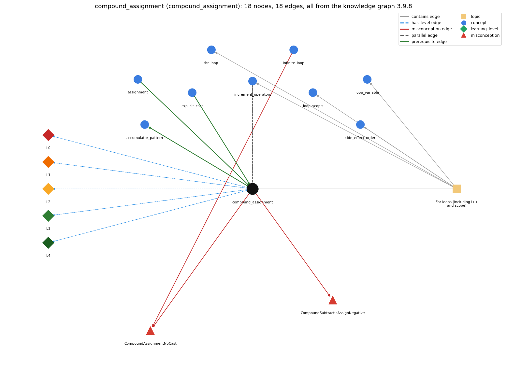

# compound_assignment (`compound_assignment`)

x += e, x -= e, ... include a hidden cast

Section 1.3 Conditionals and Loops, topic 1.3.d For loops (including i++ and scope).

## At a glance

- **Needs first:** `assignment`, `explicit_cast`
- **Leads to:** `accumulator_pattern`
- **Learned alongside:** `increment_operators`
- **Misconceptions:** `CompoundAssignmentNoCast`, `CompoundSubtractIsAssignNegative`
- **Errors:** none
- **Levels:** L0, L1, L2, L3, L4

Everything below comes from the knowledge graph 3.9.8 (`data/raw/chapter1_kg_updated.json`): 18 edges around this concept. The edge logic, the wrong and right rules and the exact rules of the ways are copied word for word from the graph.

## To work on (0)

Nothing is missing for this concept.

## What it needs first (2)

A prerequisite edge means the other concept has to be understood before `compound_assignment`.

### `assignment` comes before `compound_assignment`

*= stores the computed value of the right side*

- **Edge:** `pre:assignment->compound_assignment`
- **Exact edge logic:** x op= e is shorthand for the assignment x = x op e.
- **Grounding:** book\_passage
- **Composition rule (R) of `compound_assignment` with `assignment`:** x op= e is shorthand for the assignment x = x op e, so the new value depends on the old one (x is read, then written).
- **Composition rule (R) of `assignment` with `compound_assignment`:** x op= e is shorthand for x = x op e. The left variable's current value is fetched first and then combined with e.

### `explicit_cast` comes before `compound_assignment`

*(int) x -- converts between numeric types, truncating toward zero*

- **Edge:** `pre:explicit_cast->compound_assignment`
- **Exact edge logic:** x op= e means x = (T)(x op e), where T is the type of x, so the result is cast back to the type of x.
- **Grounding:** questionable
- **Composition rule (R) of `compound_assignment` with `explicit_cast`:** x op= e includes a hidden narrowing cast to the type of x: with int x = 1, x += 1.7 compiles (as x = (int)(x + 1.7), giving 2) while x = x + 1.7 does not.
- **Composition rule (R) of `explicit_cast` with `compound_assignment`:** x op= e contains an implicit cast back to the type of x, so with int x, x += 0.5 compiles (x = (int) (x + 0.5)) while x = x + 0.5 is a compile-time error.

## What it leads to (1)

These concepts need `compound_assignment` first.

### `compound_assignment` comes before `accumulator_pattern`

*building up a running total/result*

- **Edge:** `pre:compound_assignment->accumulator_pattern`
- **Exact edge logic:** sum += x is the usual way a running total is updated on each pass.
- **Grounding:** book\_passage

## Learned alongside (1)

A parallel edge joins two concepts that sit side by side: neither is needed before the other.

### `compound_assignment` alongside `increment_operators`

*++ / -- (and +=)*

- **Edge:** `par:increment_operators~compound_assignment`
- **Exact edge logic:** i++, ++i and i += 1 all add 1 to i; ++ and -- change a variable only by one and are normally used for integers, while i += k works for any amount and with any arithmetic operator (-=, \*=, /=, %=).
- **Grounding:** book\_passage

## Misconceptions (2)

A misconception edge states the wrong rule a student may hold about this concept, and the right rule.

### CompoundAssignmentNoCast

- **Edge:** `compound_assignment` &rarr; `CompoundAssignmentNoCast` (misconception)
- **Exact edge logic (the wrong rule):** x += 0.5 adds one half to an int x.
- **Twin logic (the right rule):** x += 0.5 is x = (int) (x + 0.5), so an int x does not change.
- **Wrong belief (on the node):** x += 0.5 adds one half to an int x.
- **Correct rule (on the node):** x += 0.5 is x = (int) (x + 0.5), so an int x does not change.
- **Provenance:** textbook
- **Role of this concept:** primary
- **L0 way linked to it:** yes
- **L0 way [1] misconception, exact rule:** wrong rule: x += 0.5 adds one half to an int x. Right rule: x += 0.5 means x = (int) (x + 0.5) for an int x, so the sum is cast back to int and truncated: x stays the same (x = 3 gives 3.5, cast to 3).
- **L0 way [3] inconsistent\_trace, exact rule:** Applies the compound-assignment rule (LT) unevenly: uses the current value of x on some passes but treats x -= y as x = -y on others, or forgets the implicit cast on some lines. (here mixing in: "x += 0.5 adds one half to an int x")
- **Edge `infinite_loop` &rarr; `CompoundAssignmentNoCast`, exact edge logic:** x += 0.5 adds one half to an int x. **Twin logic:** x += 0.5 is x = (int) (x + 0.5), so an int x does not change. (role: context)

### CompoundSubtractIsAssignNegative

- **Edge:** `compound_assignment` &rarr; `CompoundSubtractIsAssignNegative` (misconception)
- **Exact edge logic (the wrong rule):** x[i] -= y sets x[i] to -y (reads -= as assignment of a negated value).
- **Twin logic (the right rule):** x[i] -= y means x[i] = x[i] - y: it subtracts y from the current value.
- **Wrong belief (on the node):** x[i] -= y sets x[i] to -y (reads -= as assignment of a negated value).
- **Correct rule (on the node):** x[i] -= y means x[i] = x[i] - y: it subtracts y from the current value.
- **Provenance:** published
- **Role of this concept:** primary
- **L0 way linked to it:** yes
- **L0 way [2] misconception, exact rule:** wrong rule: x[i] -= y sets x[i] to -y (reads -= as assignment of a negated value). Right rule: x[i] -= y means x[i] = x[i] - y: it subtracts y from the current value.

## Errors (0)

An error edge states the rule that gets broken in a program, and the right rule.

The graph has no error edge from this concept.

## Levels L0 to L4 (5 of 5)

Each level edge lists the ways a student shows that level, each with its exact rule.

### L0: Prestructural / sensorimotor

L0 for compound assignment: the answer holds a rule that contradicts Java.

*Deciding question: Does every rule the answer applies to compound assignment agree with the language rule? If it reads the code with everyday meanings, applies a wrong rule, or switches rules within one trace, it is L0. A slip in an otherwise rule-correct trace is L2 with an error, not L0.*

- **Edge:** `compound_assignment` &rarr; `compound_assignment@L0` (has_level)
- **Exact edge logic:** compound assignment -&gt; L0 (Prestructural): the answer holds a rule that contradicts Java (4 ways).

Ways (4), each with its exact rule:

- **[0] everyday\_reading** (rule type E, folk-meaning rule): Folk meaning: x -= y reads as 'x equals minus y' and x += 0.5 as 'add a half' in arithmetic. In Java x op= e means x = (T) (x op e): it updates x from its current value and casts the result back to x's type.
- **[1] misconception** (rule type M, wrong rule / right rule) &rarr; `CompoundAssignmentNoCast`: wrong rule: x += 0.5 adds one half to an int x. Right rule: x += 0.5 means x = (int) (x + 0.5) for an int x, so the sum is cast back to int and truncated: x stays the same (x = 3 gives 3.5, cast to 3).
- **[2] misconception** (rule type M, wrong rule / right rule) &rarr; `CompoundSubtractIsAssignNegative`: wrong rule: x[i] -= y sets x[i] to -y (reads -= as assignment of a negated value). Right rule: x[i] -= y means x[i] = x[i] - y: it subtracts y from the current value.
- **[3] inconsistent\_trace** (rule type T, uneven-application rule) &rarr; `CompoundAssignmentNoCast`: Applies the compound-assignment rule (LT) unevenly: uses the current value of x on some passes but treats x -= y as x = -y on others, or forgets the implicit cast on some lines. (here mixing in: "x += 0.5 adds one half to an int x")

### L1: Unistructural / atom x text surface

L1 for compound assignment: the answer states one correct rule without applying it.

*Deciding question: Does the answer cover every part of the code, in order, with the values (L2)? If it covers one part or only states the rule, it is L1.*

- **Edge:** `compound_assignment` &rarr; `compound_assignment@L1` (has_level)
- **Exact edge logic:** compound assignment -&gt; L1 (Unistructural): the answer states one correct rule without applying it (2 ways).

Ways (2), each with its exact rule:

- **[0] names\_the\_element** (rule type N, identity rule): A compound assignment operator (+=, -=, \*=, /=, %=) is an assignment shorthand that combines a binary operation with storing the result back in the left-hand variable.
- **[1] states\_the\_rule** (rule type S, declarative rule): x op= e is equivalent to x = (T) ((x) op (e)) where T is the type of x, with x evaluated only once; it works for any arithmetic operator in any primitive numeric type. x op= e means x = (T)(x op e), with a hidden cast to the type T of x: with int x = 3, x += 0.5 compiles and leaves 3, while x = x + 0.5 does not compile.

### L2: Multistructural / block x execution / preoperational

L2 for compound assignment: the answer applies these rules to every part of the code, in order.

*Deciding question: Is the answer many segments mapped onto lines (L2), or one segment stating the purpose of the whole (L3)? A correct output with no value-by-value justification is not levelled.*

- **Edge:** `compound_assignment` &rarr; `compound_assignment@L2` (has_level)
- **Exact edge logic:** compound assignment -&gt; L2 (Multistructural): the answer applies the rules of compound assignment to every part of the code, in order (3 ways).

Ways (3), each with its exact rule:

- **[0] line\_by\_line\_trace** (rule type LT, operational sequencing rule): Evaluate x and save its value, then evaluate e, then compute x op e, cast to x's type, and store into x.
- **[1] output\_prediction** (rule type OP, evaluation / result rule): The new value of x is (T)(old x op e) and is also the expression's value: each starting from int x = 7: x += 3 gives 10, x /= 2 gives 3, and x += 0.5 gives 7 (7.5 truncated) instead of a compile error.
- **[2] one\_step\_execution** (rule type OS, state-transition rule): One execution changes exactly one variable, x, from its old value (sum += x[i] turns sum = 1 into 1 + 4 = 5).

### L3: Relational / relations x function (concrete operational begins)

L3 for compound assignment: the answer relates the parts by these rules.

*Deciding question: Was the purpose deduced from the code, or only guessed from traced input/output pairs (then L2)? Does the answer stay within the given code (L3), or reason about changed code, an error class or a new program (L4)?*

- **Edge:** `compound_assignment` &rarr; `compound_assignment@L3` (has_level)
- **Exact edge logic:** compound assignment -&gt; L3 (Relational): the answer relates the parts (4 ways).

Ways (4), each with its exact rule:

- **[0] relation\_to\_neighbour** (rule type R, composition rule (with a neighbour)): x op= e is shorthand for the assignment x = x op e, so the new value depends on the old one (x is read, then written).
- **[1] relation\_to\_neighbour** (rule type R, composition rule (with a neighbour)): x op= e includes a hidden narrowing cast to the type of x: with int x = 1, x += 1.7 compiles (as x = (int)(x + 1.7), giving 2) while x = x + 1.7 does not.
- **[2] relation\_to\_neighbour** (rule type R, composition rule (with a neighbour)): i++, ++i and i += 1 all add 1 to i; ++ and -- change a variable only by one and are normally used for integers, while i += k works for any amount and with any arithmetic operator (-=, \*=, /=, %=).
- **[3] purpose\_of\_the\_whole** (rule type P, plan / role rule): Plan/role: the update step of a gatherer (sum += a[i], product \*= i) or of a stepper with a step other than 1 (i += 2).

### L4: Extended abstract (concrete-operational reversibility and conservation)

L4 for compound assignment: the answer reasons beyond the given code by these rules.

*Deciding question: Does the answer link the code to a broader context: a changed program, a class of inputs, an unseen problem? Re-tracing changed code value by value is L2; fixing one given failing case is L3.*

- **Edge:** `compound_assignment` &rarr; `compound_assignment@L4` (has_level)
- **Exact edge logic:** compound assignment -&gt; L4 (Extended abstract): the answer reasons beyond the given code (4 ways).

Ways (4), each with its exact rule:

- **[0] predict\_a\_change** (rule type C, conservation rule) &rarr; `CompoundAssignmentNoCast`: For a variable of the same type as the result, replacing x op= e by x = x op e preserves behaviour; when x is narrower (int x, double e), x = x op e no longer compiles, so the two are not always interchangeable. Swapping += and -= reverses the effect of each pass.
- **[1] transfer\_to\_a\_new\_program** (rule type X, applicability rule): Use op= for in-place updates of accumulators, products and counters with steps other than 1; avoid it when x is int and e is fractional (silent truncation), and use explicit x = x op e when the cast should be visible.
- **[2] diagnose\_an\_error** (rule type D, error rule): rule broken: x op= e silently casts the result to the type of x. Kind: silent logic error. Trigger class: int total = 0; total += 0.5 \* k; or int avg = 7; avg /= 2.0;: fractional parts are discarded (avg becomes 3) without a compiler error.
- **[3] diagnose\_an\_error** (rule type D, error rule): rule broken: =- is assignment of a negated value, not -=. Kind: silent logic error. Trigger class: Typing x =- y for x -= y: compiles as x = -y.

## Same topic

`compound_assignment` belongs to the topic **For loops (including i++ and scope)** (`topic1.3.d`). The topic also contains: `for_loop`, `increment_operators`, `loop_scope`, `loop_variable`, `side_effect_order`.

## Rules of the concept (16)

- **Book** (TJ-2e, p. 92 (pdf 114)): "If you want to increment or decrement a variable by an amount other than 1, you can use += and -=."
- **Book** (SW-1.3, ): "The compound assignment statement x += 0.5 is equivalent to x = (int) (x + 0.5)."
- **E** (folk-meaning rule): Folk meaning: x -= y reads as 'x equals minus y' and x += 0.5 as 'add a half' in arithmetic. In Java x op= e means x = (T) (x op e): it updates x from its current value and casts the result back to x's type.
- **M** (wrong rule / right rule): CompoundAssignmentNoCast: wrong: x += 0.5 adds one half to an int x. \| right: x += 0.5 means x = (int) (x + 0.5) for an int x, so the sum is cast back to int and truncated: x stays the same (x = 3 gives 3.5, cast to 3).
- **M** (wrong rule / right rule): CompoundSubtractIsAssignNegative: wrong: x[i] -= y sets x[i] to -y (reads -= as assignment of a negated value). \| right: x[i] -= y means x[i] = x[i] - y: it subtracts y from the current value.
- **T** (uneven-application rule): Applies the compound-assignment rule (LT) unevenly: uses the current value of x on some passes but treats x -= y as x = -y on others, or forgets the implicit cast on some lines.
- **N** (identity rule): A compound assignment operator (+=, -=, \*=, /=, %=) is an assignment shorthand that combines a binary operation with storing the result back in the left-hand variable.
- **S** (declarative rule): x op= e is equivalent to x = (T) ((x) op (e)) where T is the type of x, with x evaluated only once; it works for any arithmetic operator in any primitive numeric type. x op= e means x = (T)(x op e), with a hidden cast to the type T of x: with int x = 3, x += 0.5 compiles and leaves 3, while x = x + 0.5 does not compile.
- **LT** (operational sequencing rule): Evaluate x and save its value, then evaluate e, then compute x op e, cast to x's type, and store into x.
- **OP** (evaluation / result rule): The new value of x is (T)(old x op e) and is also the expression's value: each starting from int x = 7: x += 3 gives 10, x /= 2 gives 3, and x += 0.5 gives 7 (7.5 truncated) instead of a compile error.
- **OS** (state-transition rule): One execution changes exactly one variable, x, from its old value (sum += x[i] turns sum = 1 into 1 + 4 = 5).
- **R** (composition rule (with a neighbour)): with assignment: x op= e is shorthand for the assignment x = x op e, so the new value depends on the old one (x is read, then written).
- **R** (composition rule (with a neighbour)): with explicit\_cast: x op= e includes a hidden narrowing cast to the type of x: with int x = 1, x += 1.7 compiles (as x = (int)(x + 1.7), giving 2) while x = x + 1.7 does not.
- **P** (plan / role rule): Plan/role: the update step of a gatherer (sum += a[i], product \*= i) or of a stepper with a step other than 1 (i += 2).
- **C** (conservation rule): For a variable of the same type as the result, replacing x op= e by x = x op e preserves behaviour; when x is narrower (int x, double e), x = x op e no longer compiles, so the two are not always interchangeable. Swapping += and -= reverses the effect of each pass.
- **D** (error rule): rule broken: x op= e silently casts the result to the type of x. (silent logic error)
- **D** (error rule): rule broken: =- is assignment of a negated value, not -=. (silent logic error)
- **X** (applicability rule): Use op= for in-place updates of accumulators, products and counters with steps other than 1; avoid it when x is int and e is fractional (silent truncation), and use explicit x = x op e when the cast should be visible.

## How it is found in code and answers (reader block)

- **Aliases:** compound assignment, +=, plus equals
- **Code patterns:** `[+\-*/%]=`
- **Operator symbols:** none
- **Java types:** none

## The whole prerequisite chain

- **Everything it builds on (16):** `arithmetic_operators`, `assignment`, `class_declaration`, `command_line_args`, `data_type`, `declaration`, `explicit_cast`, `identifier`, `integer_division`, `literal`, `main_method`, `parsing`, `primitive_type`, `program_text`, `type_conversion`, `variable`
- **Everything that builds on it (2):** `accumulator_pattern`, `sentinel_loop`

## Every edge in this view and its exact edge logic (18)

All the edges drawn in the picture, in the order: prerequisite, parallel, misconception, error, has_level, contains.

**1. `assignment` &rarr; `compound_assignment`** (prerequisite)

- **Exact edge logic:** x op= e is shorthand for the assignment x = x op e.
- **Grounding:** book\_passage
- **Composition rule (R) of `assignment` with `compound_assignment`:** x op= e is shorthand for x = x op e. The left variable's current value is fetched first and then combined with e.
- **Composition rule (R) of `compound_assignment` with `assignment`:** x op= e is shorthand for the assignment x = x op e, so the new value depends on the old one (x is read, then written).

**2. `compound_assignment` &rarr; `accumulator_pattern`** (prerequisite)

- **Exact edge logic:** sum += x is the usual way a running total is updated on each pass.
- **Grounding:** book\_passage

**3. `explicit_cast` &rarr; `compound_assignment`** (prerequisite)

- **Exact edge logic:** x op= e means x = (T)(x op e), where T is the type of x, so the result is cast back to the type of x.
- **Grounding:** questionable
- **Composition rule (R) of `explicit_cast` with `compound_assignment`:** x op= e contains an implicit cast back to the type of x, so with int x, x += 0.5 compiles (x = (int) (x + 0.5)) while x = x + 0.5 is a compile-time error.
- **Composition rule (R) of `compound_assignment` with `explicit_cast`:** x op= e includes a hidden narrowing cast to the type of x: with int x = 1, x += 1.7 compiles (as x = (int)(x + 1.7), giving 2) while x = x + 1.7 does not.

**4. `increment_operators` &harr; `compound_assignment`** (parallel)

- **Exact edge logic:** i++, ++i and i += 1 all add 1 to i; ++ and -- change a variable only by one and are normally used for integers, while i += k works for any amount and with any arithmetic operator (-=, \*=, /=, %=).
- **Grounding:** book\_passage

**5. `compound_assignment` &rarr; `CompoundAssignmentNoCast`** (misconception)

- **Exact edge logic (the wrong rule):** x += 0.5 adds one half to an int x.
- **Twin logic (the right rule):** x += 0.5 is x = (int) (x + 0.5), so an int x does not change.
- **Role:** primary

**6. `compound_assignment` &rarr; `CompoundSubtractIsAssignNegative`** (misconception)

- **Exact edge logic (the wrong rule):** x[i] -= y sets x[i] to -y (reads -= as assignment of a negated value).
- **Twin logic (the right rule):** x[i] -= y means x[i] = x[i] - y: it subtracts y from the current value.
- **Role:** primary

**7. `infinite_loop` &rarr; `CompoundAssignmentNoCast`** (misconception)

- **Exact edge logic (the wrong rule):** x += 0.5 adds one half to an int x.
- **Twin logic (the right rule):** x += 0.5 is x = (int) (x + 0.5), so an int x does not change.
- **Role:** context

**8. `compound_assignment` &rarr; `compound_assignment@L0`** (has_level)

- **Exact edge logic:** compound assignment -&gt; L0 (Prestructural): the answer holds a rule that contradicts Java (4 ways).
  - **[0] everyday\_reading** (rule type E, folk-meaning rule): Folk meaning: x -= y reads as 'x equals minus y' and x += 0.5 as 'add a half' in arithmetic. In Java x op= e means x = (T) (x op e): it updates x from its current value and casts the result back to x's type.
  - **[1] misconception** (rule type M, wrong rule / right rule) &rarr; `CompoundAssignmentNoCast`: wrong rule: x += 0.5 adds one half to an int x. Right rule: x += 0.5 means x = (int) (x + 0.5) for an int x, so the sum is cast back to int and truncated: x stays the same (x = 3 gives 3.5, cast to 3).
  - **[2] misconception** (rule type M, wrong rule / right rule) &rarr; `CompoundSubtractIsAssignNegative`: wrong rule: x[i] -= y sets x[i] to -y (reads -= as assignment of a negated value). Right rule: x[i] -= y means x[i] = x[i] - y: it subtracts y from the current value.
  - **[3] inconsistent\_trace** (rule type T, uneven-application rule) &rarr; `CompoundAssignmentNoCast`: Applies the compound-assignment rule (LT) unevenly: uses the current value of x on some passes but treats x -= y as x = -y on others, or forgets the implicit cast on some lines. (here mixing in: "x += 0.5 adds one half to an int x")

**9. `compound_assignment` &rarr; `compound_assignment@L1`** (has_level)

- **Exact edge logic:** compound assignment -&gt; L1 (Unistructural): the answer states one correct rule without applying it (2 ways).
  - **[0] names\_the\_element** (rule type N, identity rule): A compound assignment operator (+=, -=, \*=, /=, %=) is an assignment shorthand that combines a binary operation with storing the result back in the left-hand variable.
  - **[1] states\_the\_rule** (rule type S, declarative rule): x op= e is equivalent to x = (T) ((x) op (e)) where T is the type of x, with x evaluated only once; it works for any arithmetic operator in any primitive numeric type. x op= e means x = (T)(x op e), with a hidden cast to the type T of x: with int x = 3, x += 0.5 compiles and leaves 3, while x = x + 0.5 does not compile.

**10. `compound_assignment` &rarr; `compound_assignment@L2`** (has_level)

- **Exact edge logic:** compound assignment -&gt; L2 (Multistructural): the answer applies the rules of compound assignment to every part of the code, in order (3 ways).
  - **[0] line\_by\_line\_trace** (rule type LT, operational sequencing rule): Evaluate x and save its value, then evaluate e, then compute x op e, cast to x's type, and store into x.
  - **[1] output\_prediction** (rule type OP, evaluation / result rule): The new value of x is (T)(old x op e) and is also the expression's value: each starting from int x = 7: x += 3 gives 10, x /= 2 gives 3, and x += 0.5 gives 7 (7.5 truncated) instead of a compile error.
  - **[2] one\_step\_execution** (rule type OS, state-transition rule): One execution changes exactly one variable, x, from its old value (sum += x[i] turns sum = 1 into 1 + 4 = 5).

**11. `compound_assignment` &rarr; `compound_assignment@L3`** (has_level)

- **Exact edge logic:** compound assignment -&gt; L3 (Relational): the answer relates the parts (4 ways).
  - **[0] relation\_to\_neighbour** (rule type R, composition rule (with a neighbour)): x op= e is shorthand for the assignment x = x op e, so the new value depends on the old one (x is read, then written).
  - **[1] relation\_to\_neighbour** (rule type R, composition rule (with a neighbour)): x op= e includes a hidden narrowing cast to the type of x: with int x = 1, x += 1.7 compiles (as x = (int)(x + 1.7), giving 2) while x = x + 1.7 does not.
  - **[2] relation\_to\_neighbour** (rule type R, composition rule (with a neighbour)): i++, ++i and i += 1 all add 1 to i; ++ and -- change a variable only by one and are normally used for integers, while i += k works for any amount and with any arithmetic operator (-=, \*=, /=, %=).
  - **[3] purpose\_of\_the\_whole** (rule type P, plan / role rule): Plan/role: the update step of a gatherer (sum += a[i], product \*= i) or of a stepper with a step other than 1 (i += 2).

**12. `compound_assignment` &rarr; `compound_assignment@L4`** (has_level)

- **Exact edge logic:** compound assignment -&gt; L4 (Extended abstract): the answer reasons beyond the given code (4 ways).
  - **[0] predict\_a\_change** (rule type C, conservation rule) &rarr; `CompoundAssignmentNoCast`: For a variable of the same type as the result, replacing x op= e by x = x op e preserves behaviour; when x is narrower (int x, double e), x = x op e no longer compiles, so the two are not always interchangeable. Swapping += and -= reverses the effect of each pass.
  - **[1] transfer\_to\_a\_new\_program** (rule type X, applicability rule): Use op= for in-place updates of accumulators, products and counters with steps other than 1; avoid it when x is int and e is fractional (silent truncation), and use explicit x = x op e when the cast should be visible.
  - **[2] diagnose\_an\_error** (rule type D, error rule): rule broken: x op= e silently casts the result to the type of x. Kind: silent logic error. Trigger class: int total = 0; total += 0.5 \* k; or int avg = 7; avg /= 2.0;: fractional parts are discarded (avg becomes 3) without a compiler error.
  - **[3] diagnose\_an\_error** (rule type D, error rule): rule broken: =- is assignment of a negated value, not -=. Kind: silent logic error. Trigger class: Typing x =- y for x -= y: compiles as x = -y.

**13. `topic1.3.d` &rarr; `compound_assignment`** (contains)

- topic `topic1.3.d` contains `compound_assignment`

**14. `topic1.3.d` &rarr; `for_loop`** (contains)

- topic `topic1.3.d` contains `for_loop`

**15. `topic1.3.d` &rarr; `increment_operators`** (contains)

- topic `topic1.3.d` contains `increment_operators`

**16. `topic1.3.d` &rarr; `loop_scope`** (contains)

- topic `topic1.3.d` contains `loop_scope`

**17. `topic1.3.d` &rarr; `loop_variable`** (contains)

- topic `topic1.3.d` contains `loop_variable`

**18. `topic1.3.d` &rarr; `side_effect_order`** (contains)

- topic `topic1.3.d` contains `side_effect_order`
