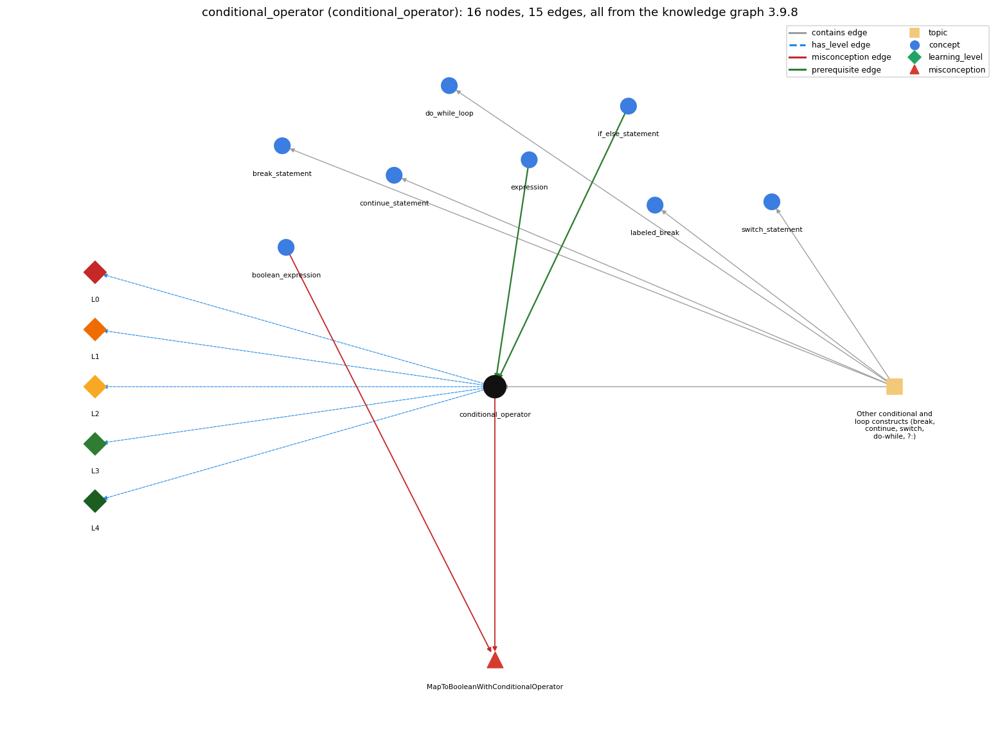

# conditional_operator (`conditional_operator`)

c ? a : b -- an expression that picks one of two values

Section 1.3 Conditionals and Loops, topic 1.3.g Other conditional and loop constructs (break, continue, switch, do-while, ?:). From the knowledge graph 3.9.8 (`data/raw/chapter1_kg_updated.json`).

## Concepts associated with conditional\_operator (8)

| Concept | Description | How it is associated |
| --- | --- | --- |
| **boolean\_expression** | an expression that evaluates to true/false | shares misconception MapToBooleanWithConditionalOperator |
| **break\_statement** | break -- immediately exits the innermost loop or switch | same topic (topic1.3.g) |
| **continue\_statement** | continue -- skips to the next iteration of the innermost loop | same topic (topic1.3.g) |
| **do\_while\_loop** | do { body } while (c); -- body first, test after | same topic (topic1.3.g) |
| **expression** | anything that evaluates to a value | prerequisite of it (it needs this) |
| **if\_else\_statement** | choose one of two blocks | prerequisite of it (it needs this) composition rule (R) with it |
| **labeled\_break** | labeled break/continue exit or continue an outer loop | same topic (topic1.3.g) |
| **switch\_statement** | switch (x) { case v: ...; break; default: ... } | same topic (topic1.3.g) |

## Every edge in this view and its full label (15)

| From | Edge | To | Full edge label |
| --- | --- | --- | --- |
| **expression** | prerequisite | **conditional\_operator** | c ? a : b is an expression: the boolean c decides which of the two other expressions gives the value. grounding: spec\_passage |
| **if\_else\_statement** | prerequisite | **conditional\_operator** | c ? a : b is the expression form of if (c) ... else .... grounding: questionable composition rule (R) of if\_else\_statement with conditional\_operator: c ? a : b is the expression form of if (c) v = a; else v = b;: it yields a value of one branch, evaluating only the selected operand. composition rule (R) of conditional\_operator with if\_else\_statement: \`v = c ? a : b;\` is the expression form of \`if (c) v = a; else v = b;\`. It can be used inside a larger expression (an argument or concatenation), but it cannot replace an if-else whose branches are statements without values. |
| **boolean\_expression** | misconception | **MapToBooleanWithConditionalOperator** | **wrong rule:** To get a boolean from x &gt; y you need ok = (x &gt; y) ? true : false;. **right rule:** ok = (x &gt; y); already gives the boolean, so the ? : is unnecessary. role: primary |
| **conditional\_operator** | misconception | **MapToBooleanWithConditionalOperator** | **wrong rule:** you need ? : to do the same **right rule:** ok = (x &gt; y); already gives the boolean, so the ? : is unnecessary. role: context |
| **conditional\_operator** | has\_level | **conditional\_operator@L0** | conditional operator -&gt; L0 (Prestructural): the answer holds a rule that contradicts Java (3 ways). **[0] everyday\_reading** (E): Folk meaning: in everyday text '?' marks a question and ':' introduces an explanation or list, so \`x &gt; y ? x : y\` reads as 'is x &gt; y? x, y' with no clear meaning, or as a statement that does something. In Java \`c ? a : b\` is an expression whose value is a if c is true and b otherwise. **[1] misconception** (M) &rarr; MapToBooleanWithConditionalOperator: wrong rule: To map a boolean expression to a boolean, a conditional operator is necessary (\`ok = (x &gt; y) ? true : false;\`). Right rule: A comparison already has type boolean, so \`ok = (x &gt; y);\` gives the same value; the ? : is redundant. **[2] inconsistent\_trace** (T) &rarr; MapToBooleanWithConditionalOperator: Applies the LT rule unevenly: on a trace, both the second and third operands are evaluated (so side effects like \`i++\` happen twice), or the operand chosen does not match the condition. (here mixing in: "you need ? : to do the same") |
| **conditional\_operator** | has\_level | **conditional\_operator@L1** | conditional operator -&gt; L1 (Unistructural): the answer states one correct rule without applying it (2 ways). **[0] names\_the\_element** (N): Operator: the conditional operator \`? :\`, Java's only ternary operator. \`c ? a : b\` is an expression that picks one of two values. **[1] states\_the\_rule** (S): The first operand must be boolean. If it is true the value is the second operand, otherwise the third. The two value operands must have compatible types; for numeric operands, binary numeric promotion applies. (Spec: JLS §15.25.) |
| **conditional\_operator** | has\_level | **conditional\_operator@L2** | conditional operator -&gt; L2 (Multistructural): the answer applies the rules of conditional operator to every part of the code, in order (3 ways). **[0] line\_by\_line\_trace** (LT): Order: evaluate the condition first; then evaluate exactly one of the other operands (the second if true, the third if false); the unchosen operand is never evaluated. ? : groups right to left and has lower precedence than + and the comparisons. **[1] output\_prediction** (OP): The result is a value, not an action. \`(x &gt; y) ? x : y\` with x = 3, y = 7 is 7. Numeric operands are promoted, so \`true ? 1 : 2.0\` is 1.0 (a double), and its type must fit the target of the assignment. **[2] one\_step\_execution** (OS): Evaluating ? : changes no variable itself; it returns the chosen operand's value. Only side effects inside the condition or the chosen operand happen (in \`c ? i++ : j++\`, exactly one of i, j changes). |
| **conditional\_operator** | has\_level | **conditional\_operator@L3** | conditional operator -&gt; L3 (Relational): the answer relates the parts (2 ways). **[0] relation\_to\_neighbour** (R): \`v = c ? a : b;\` is the expression form of \`if (c) v = a; else v = b;\`. It can be used inside a larger expression (an argument or concatenation), but it cannot replace an if-else whose branches are statements without values. **[1] purpose\_of\_the\_whole** (P): Plan: select-a-value. It picks one of two values in one expression: max/min (\`m = a &gt; b ? a : b\`, a most-wanted-holder update), absolute value, singular/plural wording, or a default for a missing value. |
| **conditional\_operator** | has\_level | **conditional\_operator@L4** | conditional operator -&gt; L4 (Extended abstract): the answer reasons beyond the given code (6 ways). **[0] predict\_a\_change** (C) &rarr; MapToBooleanWithConditionalOperator: Negating the condition and swapping the two value operands keeps the result. Changing a value operand's type can change the result type (int to double) and break an assignment to an int. Nesting ? : inside ? : keeps meaning but quickly harms readability. **[1] transfer\_to\_a\_new\_program** (X): Use ? : for a short choice between two values inside an expression (max, a label, a default). Use an if-else statement when the branches do actions, are long, or nest. Use the boolean expression itself when the choice is between true and false. **[2] diagnose\_an\_error** (D): rule broken: The first operand of ? : must be boolean. Kind: compile-time. Trigger class: An int or other non-boolean condition, e.g. \`n ? a : b\` with int n. **[3] diagnose\_an\_error** (D): rule broken: A conditional expression is not a statement. Kind: compile-time. Trigger class: Using it on its own for its side effects, e.g. \`x &gt; 0 ? a++ : b++;\` (not a statement). **[4] diagnose\_an\_error** (D): rule broken: The result type is the promoted type of both value operands. Kind: compile-time. Trigger class: \`int m = c ? 1 : 2.5;\` (possible lossy conversion from double to int). **[5] diagnose\_an\_error** (D): rule broken: ? : has lower precedence than + and comparisons. Kind: compile-time. Trigger class: \`"max " + x &gt; y ? x : y\` parses as \`("max " + x) &gt; y\`, comparing a String with an int; parenthesise the conditional. |
| **topic1.3.g** | contains | **break\_statement** | topic topic1.3.g contains break\_statement |
| **topic1.3.g** | contains | **conditional\_operator** | topic topic1.3.g contains conditional\_operator |
| **topic1.3.g** | contains | **continue\_statement** | topic topic1.3.g contains continue\_statement |
| **topic1.3.g** | contains | **do\_while\_loop** | topic topic1.3.g contains do\_while\_loop |
| **topic1.3.g** | contains | **labeled\_break** | topic topic1.3.g contains labeled\_break |
| **topic1.3.g** | contains | **switch\_statement** | topic topic1.3.g contains switch\_statement |
