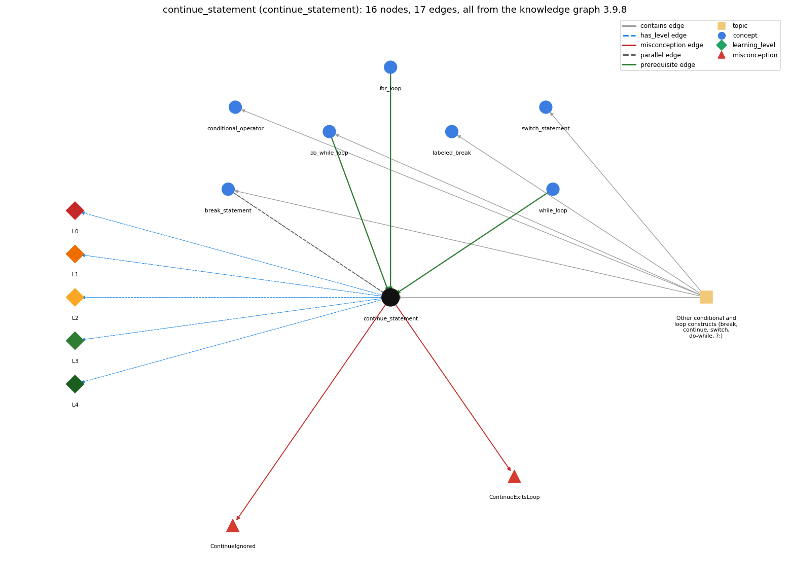

# continue_statement (`continue_statement`)

continue -- skips to the next iteration of the innermost loop

Section 1.3 Conditionals and Loops, topic 1.3.g Other conditional and loop constructs (break, continue, switch, do-while, ?:).

## At a glance

- **Needs first:** `do_while_loop`, `for_loop`, `while_loop`
- **Leads to:** nothing
- **Learned alongside:** `break_statement`
- **Misconceptions:** `ContinueExitsLoop`, `ContinueIgnored`
- **Errors:** none
- **Levels:** L0, L1, L2, L3, L4

Everything below comes from the knowledge graph 3.9.8 (`data/raw/chapter1_kg_updated.json`): 17 edges around this concept. The edge logic, the wrong and right rules and the exact rules of the ways are copied word for word from the graph.

## To work on (0)

Nothing is missing for this concept.

## What it needs first (3)

A prerequisite edge means the other concept has to be understood before `continue_statement`.

### `do_while_loop` comes before `continue_statement`

*do { body } while (c); -- body first, test after*

- **Edge:** `pre:do_while_loop->continue_statement`
- **Exact edge logic:** continue ends the current pass of the do-while loop and goes on to the loop test.
- **Grounding:** spec\_passage

### `for_loop` comes before `continue_statement`

*a while with init/condition/update packaged together*

- **Edge:** `pre:for_loop->continue_statement`
- **Exact edge logic:** continue skips the rest of the loop body; in a for loop control goes straight to the increment statement and then the next test.
- **Grounding:** book\_passage
- **Composition rule (R) of `continue_statement` with `for_loop`:** In a for loop the increment still runs after continue, so the loop always advances. This is why the for/while equivalence has an exception: in the rewritten while, a continue jumps past the \`&lt;increment&gt;;\` at the end of the body.
- **Composition rule (R) of `for_loop` with `continue_statement`:** In a for loop, continue skips the rest of the body and transfers control directly to the increment, then the next test; this is one of the few places where the for/while equivalence fails.

### `while_loop` comes before `continue_statement`

*repeat a block while a condition holds*

- **Edge:** `pre:while_loop->continue_statement`
- **Exact edge logic:** continue ends the current pass of the while loop and goes straight back to the loop test.
- **Grounding:** book\_passage

## What it leads to (0)

These concepts need `continue_statement` first.

No concept has this one as a prerequisite.

## Learned alongside (1)

A parallel edge joins two concepts that sit side by side: neither is needed before the other.

### `continue_statement` alongside `break_statement`

*break -- immediately exits the innermost loop or switch*

- **Edge:** `par:break_statement~continue_statement`
- **Exact edge logic:** break ends the whole loop; continue ends only the current pass.
- **Grounding:** book\_passage
- **Composition rule (R) of `continue_statement` with `break_statement`:** Both abandon the rest of the body; continue proceeds to the next pass (increment and test), break leaves the loop with no increment or test.
- **Composition rule (R) of `break_statement` with `continue_statement`:** Both skip the rest of the current body. break then leaves the loop (no increment, no further test); continue goes on to the increment and the next test.

## Misconceptions (2)

A misconception edge states the wrong rule a student may hold about this concept, and the right rule.

### ContinueExitsLoop

- **Edge:** `continue_statement` &rarr; `ContinueExitsLoop` (misconception)
- **Exact edge logic (the wrong rule):** continue ends the loop.
- **Twin logic (the right rule):** continue skips the rest of the current pass: control transfers directly to the increment statement for the next iteration of the loop.
- **Wrong belief (on the node):** continue ends the loop.
- **Correct rule (on the node):** continue skips the rest of the current pass: control transfers directly to the increment statement for the next iteration of the loop.
- **Provenance:** derived
- **Role of this concept:** primary
- **L0 way linked to it:** yes
- **L0 way [1] misconception, exact rule:** wrong rule: continue ends the loop. Right rule: continue skips only the rest of the current pass: in a for loop, control transfers directly to the increment and then the next test, and the loop goes on while the test is true.
- **L0 way [3] inconsistent\_trace, exact rule:** Applies the LT rule unevenly: on some passes the trace runs the statements after continue, or skips the for-loop increment, so the traced counts or outputs include items that should be skipped. (here mixing in: "continue ends the loop")

### ContinueIgnored

- **Edge:** `continue_statement` &rarr; `ContinueIgnored` (misconception)
- **Exact edge logic (the wrong rule):** continue means carry on with the rest of the loop body, so it has no effect.
- **Twin logic (the right rule):** continue skips the rest of the current iteration.
- **Wrong belief (on the node):** continue means carry on with the rest of the loop body, so it has no effect.
- **Correct rule (on the node):** continue skips the rest of the current iteration.
- **Provenance:** published
- **Role of this concept:** primary
- **L0 way linked to it:** yes
- **L0 way [2] misconception, exact rule:** wrong rule: continue means carry on with the rest of the loop body, so it has no effect. Right rule: continue skips every statement after it in the current pass.

## Errors (0)

An error edge states the rule that gets broken in a program, and the right rule.

The graph has no error edge from this concept.

## Levels L0 to L4 (5 of 5)

Each level edge lists the ways a student shows that level, each with its exact rule.

### L0: Prestructural / sensorimotor

L0 for continue statement: the answer holds a rule that contradicts Java.

*Deciding question: Does every rule the answer applies to continue statement agree with the language rule? If it reads the code with everyday meanings, applies a wrong rule, or switches rules within one trace, it is L0. A slip in an otherwise rule-correct trace is L2 with an error, not L0.*

- **Edge:** `continue_statement` &rarr; `continue_statement@L0` (has_level)
- **Exact edge logic:** continue statement -&gt; L0 (Prestructural): the answer holds a rule that contradicts Java (4 ways).

Ways (4), each with its exact rule:

- **[0] everyday\_reading** (rule type E, folk-meaning rule): Folk meaning: in English 'continue' means carry on with what you are doing, so a novice reads \`continue;\` as 'keep executing the rest of the body' (no effect) or as 'continue after the loop'. In Java it abandons the rest of the current pass and goes straight to the next iteration.
- **[1] misconception** (rule type M, wrong rule / right rule) &rarr; `ContinueExitsLoop`: wrong rule: continue ends the loop. Right rule: continue skips only the rest of the current pass: in a for loop, control transfers directly to the increment and then the next test, and the loop goes on while the test is true.
- **[2] misconception** (rule type M, wrong rule / right rule) &rarr; `ContinueIgnored`: wrong rule: continue means carry on with the rest of the loop body, so it has no effect. Right rule: continue skips every statement after it in the current pass.
- **[3] inconsistent\_trace** (rule type T, uneven-application rule) &rarr; `ContinueExitsLoop`: Applies the LT rule unevenly: on some passes the trace runs the statements after continue, or skips the for-loop increment, so the traced counts or outputs include items that should be skipped. (here mixing in: "continue ends the loop")

### L1: Unistructural / atom x text surface

L1 for continue statement: the answer states one correct rule without applying it.

*Deciding question: Does the answer cover every part of the code, in order, with the values (L2)? If it covers one part or only states the rule, it is L1.*

- **Edge:** `continue_statement` &rarr; `continue_statement@L1` (has_level)
- **Exact edge logic:** continue statement -&gt; L1 (Unistructural): the answer states one correct rule without applying it (2 ways).

Ways (2), each with its exact rule:

- **[0] names\_the\_element** (rule type N, identity rule): Jump statement: \`continue;\` ends the current iteration of the innermost enclosing loop and starts the next one.
- **[1] states\_the\_rule** (rule type S, declarative rule): \`continue;\` may appear only inside a loop. When executed, the rest of the body is skipped. In a for loop control goes to the increment; in a while or do-while it goes to the condition test. (Spec: JLS §14.16.)

### L2: Multistructural / block x execution / preoperational

L2 for continue statement: the answer applies these rules to every part of the code, in order.

*Deciding question: Is the answer many segments mapped onto lines (L2), or one segment stating the purpose of the whole (L3)? A correct output with no value-by-value justification is not levelled.*

- **Edge:** `continue_statement` &rarr; `continue_statement@L2` (has_level)
- **Exact edge logic:** continue statement -&gt; L2 (Multistructural): the answer applies the rules of continue statement to every part of the code, in order (3 ways).

Ways (3), each with its exact rule:

- **[0] line\_by\_line\_trace** (rule type LT, operational sequencing rule): Order after continue in \`for (init; test; inc) body\`: skip the remaining body statements, execute inc, evaluate test, and run the next pass if it is true. In a while loop there is no separate inc, so control goes directly to the test.
- **[1] output\_prediction** (rule type OP, evaluation / result rule): continue produces no value. Its effect is on what the loop outputs: \`for (int i = 0; i &lt; 5; i++) { if (i % 2 == 0) continue; System.out.print(i); }\` prints 13.
- **[2] one\_step\_execution** (rule type OS, state-transition rule): One execution changes no variable; it only moves control to the increment (for) or the test (while). The variables keep their values, and the statements skipped in this pass make no changes.

### L3: Relational / relations x function (concrete operational begins)

L3 for continue statement: the answer relates the parts by these rules.

*Deciding question: Was the purpose deduced from the code, or only guessed from traced input/output pairs (then L2)? Does the answer stay within the given code (L3), or reason about changed code, an error class or a new program (L4)?*

- **Edge:** `continue_statement` &rarr; `continue_statement@L3` (has_level)
- **Exact edge logic:** continue statement -&gt; L3 (Relational): the answer relates the parts (3 ways).

Ways (3), each with its exact rule:

- **[0] relation\_to\_neighbour** (rule type R, composition rule (with a neighbour)): In a for loop the increment still runs after continue, so the loop always advances. This is why the for/while equivalence has an exception: in the rewritten while, a continue jumps past the \`&lt;increment&gt;;\` at the end of the body.
- **[1] relation\_to\_neighbour** (rule type R, composition rule (with a neighbour)): Both abandon the rest of the body; continue proceeds to the next pass (increment and test), break leaves the loop with no increment or test.
- **[2] purpose\_of\_the\_whole** (rule type P, plan / role rule): Plan: skip/filter plan. It guards the rest of the body against items that should not be processed (e.g. skip non-matching or invalid entries), avoiding a deeply nested if.

### L4: Extended abstract (concrete-operational reversibility and conservation)

L4 for continue statement: the answer reasons beyond the given code by these rules.

*Deciding question: Does the answer link the code to a broader context: a changed program, a class of inputs, an unseen problem? Re-tracing changed code value by value is L2; fixing one given failing case is L3.*

- **Edge:** `continue_statement` &rarr; `continue_statement@L4` (has_level)
- **Exact edge logic:** continue statement -&gt; L4 (Extended abstract): the answer reasons beyond the given code (5 ways).

Ways (5), each with its exact rule:

- **[0] predict\_a\_change** (rule type C, conservation rule) &rarr; `ContinueExitsLoop`: Replacing \`if (c) continue; rest;\` with \`if (!c) { rest; }\` keeps the behaviour. Moving the continue below the update in a while loop, or the update below the continue, changes whether the loop advances.
- **[1] transfer\_to\_a\_new\_program** (rule type X, applicability rule): Use continue to skip items early in a long loop body when the alternative is a deeply nested if. Avoid it in while loops whose update is at the end of the body, and avoid it when a simple if around the work is clearer. S&amp;W rarely use it.
- **[2] diagnose\_an\_error** (rule type D, error rule): rule broken: continue must be inside a loop. Kind: compile-time. Trigger class: \`continue;\` in a switch or if that is not inside any loop (continue outside of loop).
- **[3] diagnose\_an\_error** (rule type D, error rule): rule broken: In a while loop continue goes straight to the test, skipping an update placed later in the body. Kind: silent logic error. Trigger class: \`while (i &lt; n) { if (skip(i)) continue; ...; i++; }\`: once a skipped i is reached, i never changes and the loop runs forever.
- **[4] diagnose\_an\_error** (rule type D, error rule): rule broken: Statements after continue in the same block can never run. Kind: compile-time. Trigger class: Code directly after \`continue;\` in the same block (unreachable statement).

## Same topic

`continue_statement` belongs to the topic **Other conditional and loop constructs (break, continue, switch, do-while, ?:)** (`topic1.3.g`). The topic also contains: `break_statement`, `conditional_operator`, `do_while_loop`, `labeled_break`, `switch_statement`.

## Rules of the concept (17)

- **Book** (SW-1e, p. 70 (pdf 80)): "When a continue is executed within a loop body, the flow of control transfers directly to the increment statement for the next iteration of the loop."
- **Book** (OT-Branch, ): "The continue statement skips the current iteration of a for, while , or do-while loop."
- **E** (folk-meaning rule): Folk meaning: in English 'continue' means carry on with what you are doing, so a novice reads \`continue;\` as 'keep executing the rest of the body' (no effect) or as 'continue after the loop'. In Java it abandons the rest of the current pass and goes straight to the next iteration.
- **M** (wrong rule / right rule): ContinueExitsLoop: wrong: continue ends the loop. \| right: continue skips only the rest of the current pass: in a for loop, control transfers directly to the increment and then the next test, and the loop goes on while the test is true.
- **M** (wrong rule / right rule): ContinueIgnored: wrong: continue means carry on with the rest of the loop body, so it has no effect. \| right: continue skips every statement after it in the current pass.
- **T** (uneven-application rule): Applies the LT rule unevenly: on some passes the trace runs the statements after continue, or skips the for-loop increment, so the traced counts or outputs include items that should be skipped.
- **N** (identity rule): Jump statement: \`continue;\` ends the current iteration of the innermost enclosing loop and starts the next one.
- **S** (declarative rule): \`continue;\` may appear only inside a loop. When executed, the rest of the body is skipped. In a for loop control goes to the increment; in a while or do-while it goes to the condition test. (Spec: JLS §14.16.)
- **LT** (operational sequencing rule): Order after continue in \`for (init; test; inc) body\`: skip the remaining body statements, execute inc, evaluate test, and run the next pass if it is true. In a while loop there is no separate inc, so control goes directly to the test.
- **OP** (evaluation / result rule): continue produces no value. Its effect is on what the loop outputs: \`for (int i = 0; i &lt; 5; i++) { if (i % 2 == 0) continue; System.out.print(i); }\` prints 13.
- **OS** (state-transition rule): One execution changes no variable; it only moves control to the increment (for) or the test (while). The variables keep their values, and the statements skipped in this pass make no changes.
- **R** (composition rule (with a neighbour)): with for\_loop: In a for loop the increment still runs after continue, so the loop always advances. This is why the for/while equivalence has an exception: in the rewritten while, a continue jumps past the \`&lt;increment&gt;;\` at the end of the body.
- **R** (composition rule (with a neighbour)): with break\_statement: Both abandon the rest of the body; continue proceeds to the next pass (increment and test), break leaves the loop with no increment or test.
- **P** (plan / role rule): Plan: skip/filter plan. It guards the rest of the body against items that should not be processed (e.g. skip non-matching or invalid entries), avoiding a deeply nested if.
- **C** (conservation rule): Replacing \`if (c) continue; rest;\` with \`if (!c) { rest; }\` keeps the behaviour. Moving the continue below the update in a while loop, or the update below the continue, changes whether the loop advances.
- **D** (error rule): rule broken: continue must be inside a loop. (compile-time)
- **D** (error rule): rule broken: In a while loop continue goes straight to the test, skipping an update placed later in the body. (silent logic error)
- **D** (error rule): rule broken: Statements after continue in the same block can never run. (compile-time)
- **X** (applicability rule): Use continue to skip items early in a long loop body when the alternative is a deeply nested if. Avoid it in while loops whose update is at the end of the body, and avoid it when a simple if around the work is clearer. S&amp;W rarely use it.

## How it is found in code and answers (reader block)

- **Aliases:** continue
- **Code patterns:** `\bcontinue\s*;`
- **Operator symbols:** none
- **Java types:** none

## The whole prerequisite chain

- **Everything it builds on (16):** `arithmetic_operators`, `boolean`, `boolean_expression`, `comparison_operators`, `data_type`, `do_while_loop`, `expression`, `for_loop`, `identifier`, `literal`, `logical_operators`, `loop_control`, `loop_variable`, `primitive_type`, `variable`, `while_loop`
- **Everything that builds on it (0):** nothing

## Every edge in this view and its exact edge logic (17)

All the edges drawn in the picture, in the order: prerequisite, parallel, misconception, error, has_level, contains.

**1. `do_while_loop` &rarr; `continue_statement`** (prerequisite)

- **Exact edge logic:** continue ends the current pass of the do-while loop and goes on to the loop test.
- **Grounding:** spec\_passage

**2. `for_loop` &rarr; `continue_statement`** (prerequisite)

- **Exact edge logic:** continue skips the rest of the loop body; in a for loop control goes straight to the increment statement and then the next test.
- **Grounding:** book\_passage
- **Composition rule (R) of `for_loop` with `continue_statement`:** In a for loop, continue skips the rest of the body and transfers control directly to the increment, then the next test; this is one of the few places where the for/while equivalence fails.
- **Composition rule (R) of `continue_statement` with `for_loop`:** In a for loop the increment still runs after continue, so the loop always advances. This is why the for/while equivalence has an exception: in the rewritten while, a continue jumps past the \`&lt;increment&gt;;\` at the end of the body.

**3. `while_loop` &rarr; `continue_statement`** (prerequisite)

- **Exact edge logic:** continue ends the current pass of the while loop and goes straight back to the loop test.
- **Grounding:** book\_passage

**4. `break_statement` &harr; `continue_statement`** (parallel)

- **Exact edge logic:** break ends the whole loop; continue ends only the current pass.
- **Grounding:** book\_passage
- **Composition rule (R) of `break_statement` with `continue_statement`:** Both skip the rest of the current body. break then leaves the loop (no increment, no further test); continue goes on to the increment and the next test.
- **Composition rule (R) of `continue_statement` with `break_statement`:** Both abandon the rest of the body; continue proceeds to the next pass (increment and test), break leaves the loop with no increment or test.

**5. `continue_statement` &rarr; `ContinueExitsLoop`** (misconception)

- **Exact edge logic (the wrong rule):** continue ends the loop.
- **Twin logic (the right rule):** continue skips the rest of the current pass: control transfers directly to the increment statement for the next iteration of the loop.
- **Role:** primary

**6. `continue_statement` &rarr; `ContinueIgnored`** (misconception)

- **Exact edge logic (the wrong rule):** continue means carry on with the rest of the loop body, so it has no effect.
- **Twin logic (the right rule):** continue skips the rest of the current iteration.
- **Role:** primary

**7. `continue_statement` &rarr; `continue_statement@L0`** (has_level)

- **Exact edge logic:** continue statement -&gt; L0 (Prestructural): the answer holds a rule that contradicts Java (4 ways).
  - **[0] everyday\_reading** (rule type E, folk-meaning rule): Folk meaning: in English 'continue' means carry on with what you are doing, so a novice reads \`continue;\` as 'keep executing the rest of the body' (no effect) or as 'continue after the loop'. In Java it abandons the rest of the current pass and goes straight to the next iteration.
  - **[1] misconception** (rule type M, wrong rule / right rule) &rarr; `ContinueExitsLoop`: wrong rule: continue ends the loop. Right rule: continue skips only the rest of the current pass: in a for loop, control transfers directly to the increment and then the next test, and the loop goes on while the test is true.
  - **[2] misconception** (rule type M, wrong rule / right rule) &rarr; `ContinueIgnored`: wrong rule: continue means carry on with the rest of the loop body, so it has no effect. Right rule: continue skips every statement after it in the current pass.
  - **[3] inconsistent\_trace** (rule type T, uneven-application rule) &rarr; `ContinueExitsLoop`: Applies the LT rule unevenly: on some passes the trace runs the statements after continue, or skips the for-loop increment, so the traced counts or outputs include items that should be skipped. (here mixing in: "continue ends the loop")

**8. `continue_statement` &rarr; `continue_statement@L1`** (has_level)

- **Exact edge logic:** continue statement -&gt; L1 (Unistructural): the answer states one correct rule without applying it (2 ways).
  - **[0] names\_the\_element** (rule type N, identity rule): Jump statement: \`continue;\` ends the current iteration of the innermost enclosing loop and starts the next one.
  - **[1] states\_the\_rule** (rule type S, declarative rule): \`continue;\` may appear only inside a loop. When executed, the rest of the body is skipped. In a for loop control goes to the increment; in a while or do-while it goes to the condition test. (Spec: JLS §14.16.)

**9. `continue_statement` &rarr; `continue_statement@L2`** (has_level)

- **Exact edge logic:** continue statement -&gt; L2 (Multistructural): the answer applies the rules of continue statement to every part of the code, in order (3 ways).
  - **[0] line\_by\_line\_trace** (rule type LT, operational sequencing rule): Order after continue in \`for (init; test; inc) body\`: skip the remaining body statements, execute inc, evaluate test, and run the next pass if it is true. In a while loop there is no separate inc, so control goes directly to the test.
  - **[1] output\_prediction** (rule type OP, evaluation / result rule): continue produces no value. Its effect is on what the loop outputs: \`for (int i = 0; i &lt; 5; i++) { if (i % 2 == 0) continue; System.out.print(i); }\` prints 13.
  - **[2] one\_step\_execution** (rule type OS, state-transition rule): One execution changes no variable; it only moves control to the increment (for) or the test (while). The variables keep their values, and the statements skipped in this pass make no changes.

**10. `continue_statement` &rarr; `continue_statement@L3`** (has_level)

- **Exact edge logic:** continue statement -&gt; L3 (Relational): the answer relates the parts (3 ways).
  - **[0] relation\_to\_neighbour** (rule type R, composition rule (with a neighbour)): In a for loop the increment still runs after continue, so the loop always advances. This is why the for/while equivalence has an exception: in the rewritten while, a continue jumps past the \`&lt;increment&gt;;\` at the end of the body.
  - **[1] relation\_to\_neighbour** (rule type R, composition rule (with a neighbour)): Both abandon the rest of the body; continue proceeds to the next pass (increment and test), break leaves the loop with no increment or test.
  - **[2] purpose\_of\_the\_whole** (rule type P, plan / role rule): Plan: skip/filter plan. It guards the rest of the body against items that should not be processed (e.g. skip non-matching or invalid entries), avoiding a deeply nested if.

**11. `continue_statement` &rarr; `continue_statement@L4`** (has_level)

- **Exact edge logic:** continue statement -&gt; L4 (Extended abstract): the answer reasons beyond the given code (5 ways).
  - **[0] predict\_a\_change** (rule type C, conservation rule) &rarr; `ContinueExitsLoop`: Replacing \`if (c) continue; rest;\` with \`if (!c) { rest; }\` keeps the behaviour. Moving the continue below the update in a while loop, or the update below the continue, changes whether the loop advances.
  - **[1] transfer\_to\_a\_new\_program** (rule type X, applicability rule): Use continue to skip items early in a long loop body when the alternative is a deeply nested if. Avoid it in while loops whose update is at the end of the body, and avoid it when a simple if around the work is clearer. S&amp;W rarely use it.
  - **[2] diagnose\_an\_error** (rule type D, error rule): rule broken: continue must be inside a loop. Kind: compile-time. Trigger class: \`continue;\` in a switch or if that is not inside any loop (continue outside of loop).
  - **[3] diagnose\_an\_error** (rule type D, error rule): rule broken: In a while loop continue goes straight to the test, skipping an update placed later in the body. Kind: silent logic error. Trigger class: \`while (i &lt; n) { if (skip(i)) continue; ...; i++; }\`: once a skipped i is reached, i never changes and the loop runs forever.
  - **[4] diagnose\_an\_error** (rule type D, error rule): rule broken: Statements after continue in the same block can never run. Kind: compile-time. Trigger class: Code directly after \`continue;\` in the same block (unreachable statement).

**12. `topic1.3.g` &rarr; `continue_statement`** (contains)

- topic `topic1.3.g` contains `continue_statement`

**13. `topic1.3.g` &rarr; `break_statement`** (contains)

- topic `topic1.3.g` contains `break_statement`

**14. `topic1.3.g` &rarr; `conditional_operator`** (contains)

- topic `topic1.3.g` contains `conditional_operator`

**15. `topic1.3.g` &rarr; `do_while_loop`** (contains)

- topic `topic1.3.g` contains `do_while_loop`

**16. `topic1.3.g` &rarr; `labeled_break`** (contains)

- topic `topic1.3.g` contains `labeled_break`

**17. `topic1.3.g` &rarr; `switch_statement`** (contains)

- topic `topic1.3.g` contains `switch_statement`
