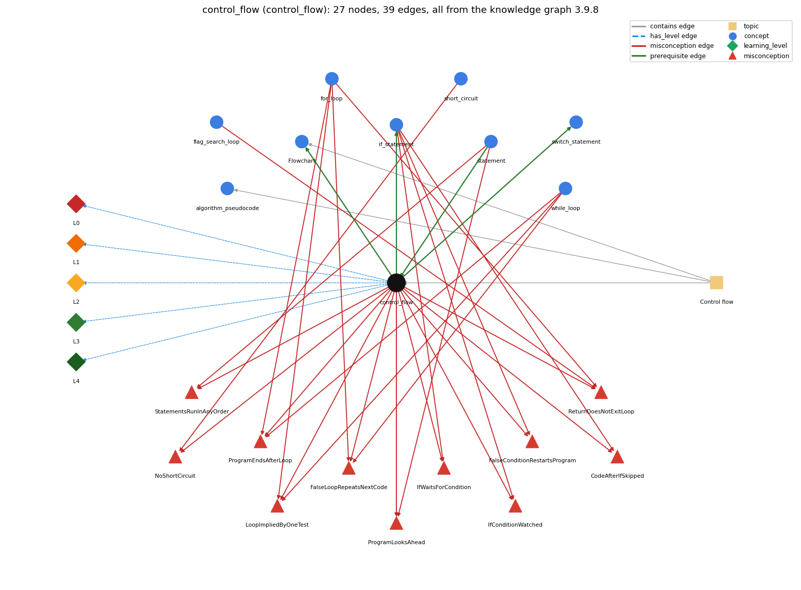

# control_flow (`control_flow`)

the order in which statements are executed

Section 1.3 Conditionals and Loops, topic 1.3.a Control flow. From the knowledge graph 3.9.8 (`data/raw/chapter1_kg_updated.json`).

## Concepts associated with control\_flow (9)

| Concept | Description | How it is associated |
| --- | --- | --- |
| **algorithm\_pseudocode** | an algorithm is a sequence of steps that solves a problem; pseudocode outlines it in English and Java before it is coded | same topic (topic1.3.a) |
| **flag\_search\_loop** | a boolean flag that a loop sets once and never resets | shares misconception ReturnDoesNotExitLoop |
| **flowchart** | a diagram whose paths correspond to the flow-of-control paths through a program | builds on it (needs it) composition rule (R) with it same topic (topic1.3.a) |
| **for\_loop** | a while with init/condition/update packaged together | shares misconception LoopImpliedByOneTest shares misconception ReturnDoesNotExitLoop shares misconception ProgramEndsAfterLoop shares misconception FalseLoopRepeatsNextCode |
| **if\_statement** | run a block only when the condition holds | builds on it (needs it) composition rule (R) with it shares misconception CodeAfterIfSkipped shares misconception IfWaitsForCondition shares misconception ProgramLooksAhead shares misconception FalseConditionRestartsProgram shares misconception IfConditionWatched |
| **short\_circuit** | &amp;&amp;/\|\| stop evaluating once the result is known | shares misconception NoShortCircuit |
| **statement** | one step, terminated by ;, executed in sequence | prerequisite of it (it needs this) composition rule (R) with it shares misconception StatementsRunInAnyOrder shares misconception ProgramLooksAhead |
| **switch\_statement** | switch (x) { case v: ...; break; default: ... } | builds on it (needs it) |
| **while\_loop** | repeat a block while a condition holds | shares misconception LoopImpliedByOneTest shares misconception ProgramEndsAfterLoop shares misconception FalseLoopRepeatsNextCode |

## Every edge in this view and its full label (39)

| From | Edge | To | Full edge label |
| --- | --- | --- | --- |
| **control\_flow** | prerequisite | **flowchart** | A flowchart draws the flow of control: each path through the diagram is a path the program can take. grounding: book\_passage composition rule (R) of control\_flow with flowchart: A flowchart draws control flow: each path through the diagram is a possible path of execution, with a decision box for each if or loop test. composition rule (R) of flowchart with control\_flow: The flowchart's arrows are the program's control flow: sequence = a straight chain, if = branch and rejoin, loop = a back arrow to the test. Nesting a loop draws a loop inside a loop, and the diagram quickly becomes complex. |
| **control\_flow** | prerequisite | **if\_statement** | An if changes the default top-to-bottom flow by running a block only when its condition is true. grounding: book\_passage composition rule (R) of control\_flow with if\_statement: An if changes the default top-to-bottom flow: its condition is tested once when control reaches it, its block runs only if true, and in both cases control then continues with the next statement. composition rule (R) of if\_statement with control\_flow: An if is a fork in the control flow: one path through the body, one around it, both rejoining at the next statement. |
| **control\_flow** | prerequisite | **switch\_statement** | switch directs the flow of control to one of several case labels, depending on the value of one expression. grounding: book\_passage |
| **statement** | prerequisite | **control\_flow** | Control flow is the order in which statements run. grounding: book\_passage composition rule (R) of statement with control\_flow: Control flow is the order in which statements run; without control statements it is straight-line, each once in order. composition rule (R) of control\_flow with statement: Control flow is defined over statements: statements are executed for their effect, and if/while/for are themselves statements that may be used wherever a statement is allowed, so they can nest. |
| **control\_flow** | misconception | **CodeAfterIfSkipped** | **wrong rule:** When the then branch runs, the code after the if is skipped. **right rule:** After the if finishes, execution continues with the next statement either way. role: context |
| **control\_flow** | misconception | **FalseConditionRestartsProgram** | **wrong rule:** When an if condition is false (and there is no else), control jumps back to the start of the program. **right rule:** A false condition skips the then branch and execution continues with the statement after the if statement. role: context |
| **control\_flow** | misconception | **FalseLoopRepeatsNextCode** | **wrong rule:** A loop is an iterative if-else: while the condition is true the body repeats, and when it is false the code after the loop repeats. **right rule:** Only the body is repeated; once the condition is false the code after the loop runs once. role: context |
| **control\_flow** | misconception | **IfConditionWatched** | **wrong rule:** An if statement watches its condition while the program runs and fires as soon as the condition becomes true (if = whenever). **right rule:** An if condition is tested once, when control reaches the if statement; later changes to the variables do not trigger the branch. role: context |
| **control\_flow** | misconception | **IfWaitsForCondition** | **wrong rule:** An IF statement earlier in the program stays active and fires later, e.g. inside a later loop, when its condition becomes true. **right rule:** An if is evaluated once when control reaches it; afterwards it is inactive unless control returns to it. role: context |
| **control\_flow** | misconception | **LoopImpliedByOneTest** | **wrong rule:** Testing one case is enough; Java will repeat the test for the other values by itself. **right rule:** A statement runs once each time control reaches it; repeating a test for many values needs a loop. role: context |
| **control\_flow** | misconception | **NoShortCircuit** | **wrong rule:** logical AND/OR always evaluate both sides (Java short-circuits them) **right rule:** In p &amp;&amp; q, q is evaluated only when p is true; in p \|\| q, q is evaluated only when p is false. role: context |
| **control\_flow** | misconception | **ProgramEndsAfterLoop** | **wrong rule:** When a loop finishes the program ends, so code after the loop never runs. **right rule:** When the loop condition becomes false, control continues with the first statement after the loop. role: context |
| **control\_flow** | misconception | **ProgramLooksAhead** | **wrong rule:** The program knows or sees what later lines will do and acts on those goals at the current line, e.g. it stops 'at ten' because it wants to draw a box. **right rule:** Each statement executes using only the current state; later lines have no effect until control reaches them. role: primary |
| **control\_flow** | misconception | **ReturnDoesNotExitLoop** | **wrong rule:** A return inside a loop does not end the loop; it sets a value each pass (the last one is returned) or returns several values. **right rule:** When return executes, the method ends at once, so the loop stops on that pass. role: primary |
| **control\_flow** | misconception | **StatementsRunInAnyOrder** | **wrong rule:** Statements in a program can run in any order. **right rule:** Without control statements, statements run once each, top to bottom. role: primary |
| **flag\_search\_loop** | misconception | **ReturnDoesNotExitLoop** | **wrong rule:** A return inside a loop does not end the loop; it sets a value each pass (the last one is returned) or returns several values. **right rule:** When return executes, the method ends at once, so the loop stops on that pass. role: context |
| **for\_loop** | misconception | **FalseLoopRepeatsNextCode** | **wrong rule:** A loop is an iterative if-else: while the condition is true the body repeats, and when it is false the code after the loop repeats. **right rule:** Only the body is repeated; once the condition is false the code after the loop runs once. role: primary |
| **for\_loop** | misconception | **LoopImpliedByOneTest** | **wrong rule:** Testing one case is enough; Java will repeat the test for the other values by itself. **right rule:** A statement runs once each time control reaches it; repeating a test for many values needs a loop. role: context |
| **for\_loop** | misconception | **ProgramEndsAfterLoop** | **wrong rule:** When a loop finishes the program ends, so code after the loop never runs. **right rule:** When the loop condition becomes false, control continues with the first statement after the loop. role: context |
| **for\_loop** | misconception | **ReturnDoesNotExitLoop** | **wrong rule:** A return inside a loop does not end the loop; it sets a value each pass (the last one is returned) or returns several values. **right rule:** When return executes, the method ends at once, so the loop stops on that pass. role: context |
| **if\_statement** | misconception | **CodeAfterIfSkipped** | **wrong rule:** When the then branch runs, the code after the if is skipped. **right rule:** After the if finishes, execution continues with the next statement either way. role: primary |
| **if\_statement** | misconception | **FalseConditionRestartsProgram** | **wrong rule:** When an if condition is false (and there is no else), control jumps back to the start of the program. **right rule:** A false condition skips the then branch and execution continues with the statement after the if statement. role: primary |
| **if\_statement** | misconception | **IfConditionWatched** | **wrong rule:** An if statement watches its condition while the program runs and fires as soon as the condition becomes true (if = whenever). **right rule:** An if condition is tested once, when control reaches the if statement; later changes to the variables do not trigger the branch. role: primary |
| **if\_statement** | misconception | **IfWaitsForCondition** | **wrong rule:** An IF statement earlier in the program stays active and fires later, e.g. inside a later loop, when its condition becomes true. **right rule:** An if is evaluated once when control reaches it; afterwards it is inactive unless control returns to it. role: primary |
| **if\_statement** | misconception | **ProgramLooksAhead** | **wrong rule:** The program knows or sees what later lines will do and acts on those goals at the current line, e.g. it stops 'at ten' because it wants to draw a box. **right rule:** Each statement executes using only the current state; later lines have no effect until control reaches them. role: context |
| **short\_circuit** | misconception | **NoShortCircuit** | **wrong rule:** In p &amp;&amp; q, both p and q are always evaluated. **right rule:** In p &amp;&amp; q, q is evaluated only when p is true; in p \|\| q, q is evaluated only when p is false. role: primary |
| **statement** | misconception | **ProgramLooksAhead** | **wrong rule:** The program knows or sees what later lines will do and acts on those goals at the current line, e.g. it stops 'at ten' because it wants to draw a box. **right rule:** Each statement executes using only the current state; later lines have no effect until control reaches them. role: context |
| **statement** | misconception | **StatementsRunInAnyOrder** | **wrong rule:** Statements in a program can run in any order. **right rule:** Without control statements, statements run once each, top to bottom. role: context |
| **while\_loop** | misconception | **FalseLoopRepeatsNextCode** | **wrong rule:** A loop is an iterative if-else: while the condition is true the body repeats, and when it is false the code after the loop repeats. **right rule:** Only the body is repeated; once the condition is false the code after the loop runs once. role: context |
| **while\_loop** | misconception | **LoopImpliedByOneTest** | **wrong rule:** Testing one case is enough; Java will repeat the test for the other values by itself. **right rule:** A statement runs once each time control reaches it; repeating a test for many values needs a loop. role: primary |
| **while\_loop** | misconception | **ProgramEndsAfterLoop** | **wrong rule:** When a loop finishes the program ends, so code after the loop never runs. **right rule:** When the loop condition becomes false, control continues with the first statement after the loop. role: primary |
| **control\_flow** | has\_level | **control\_flow@L0** | control flow -&gt; L0 (Prestructural): the answer holds a rule that contradicts Java (12 ways). **[0] everyday\_reading** (E): Folk meaning: in everyday instructions a listener reads the whole list at once, does steps in a sensible order and infers what the writer wants. Java instead executes statements one at a time, top to bottom, each only when control reaches it, and nothing later in the program has any effect earlier. **[1] misconception** (M) &rarr; StatementsRunInAnyOrder: wrong rule: Statements in a program can run in any order. Right rule: Without control statements, statements run once each, top to bottom. **[2] misconception** (M) &rarr; ProgramLooksAhead: wrong rule: The program knows or sees what later lines will do and acts on those goals at the current line, e.g. it stops 'at ten' because it wants to draw a box. Right rule: Each statement executes using only the current state; later lines have no effect until control reaches them. **[3] inconsistent\_trace** (T) &rarr; StatementsRunInAnyOrder: Applies the sequencing rule (LT) unevenly: e.g. runs a later line before an earlier one, lets an if that was already passed fire again later, or ends the program when a loop or a false if ends instead of continuing with the next statement. (here mixing in: "Statements in a program can run in any order") **[4] misconception** (M) &rarr; CodeAfterIfSkipped: wrong rule: When the then branch runs, the code after the if is skipped. Right rule: After the if finishes, execution continues with the next statement either way. **[5] misconception** (M) &rarr; NoShortCircuit: wrong rule: logical AND/OR always evaluate both sides (Java short-circuits them). Right rule: In p &amp;&amp; q, q is evaluated only when p is true; in p \|\| q, q is evaluated only when p is false. **[6] misconception** (M) &rarr; LoopImpliedByOneTest: wrong rule: Testing one case is enough; Java will repeat the test for the other values by itself. Right rule: A statement runs once each time control reaches it; repeating a test for many values needs a loop. **[7] misconception** (M) &rarr; IfWaitsForCondition: wrong rule: An IF statement earlier in the program stays active and fires later, e.g. inside a later loop, when its condition becomes true. Right rule: An if is evaluated once when control reaches it; afterwards it is inactive unless control returns to it. **[8] misconception** (M) &rarr; FalseConditionRestartsProgram: wrong rule: When an if condition is false (and there is no else), control jumps back to the start of the program. Right rule: A false condition skips the then branch and execution continues with the statement after the if statement. **[9] misconception** (M) &rarr; IfConditionWatched: wrong rule: An if statement watches its condition while the program runs and fires as soon as the condition becomes true (if = whenever). Right rule: An if condition is tested once, when control reaches the if statement; later changes to the variables do not trigger the branch. **[10] misconception** (M) &rarr; ProgramEndsAfterLoop: wrong rule: When a loop finishes the program ends, so code after the loop never runs. Right rule: When the loop condition becomes false, control continues with the first statement after the loop. **[11] misconception** (M) &rarr; FalseLoopRepeatsNextCode: wrong rule: A loop is an iterative if-else: while the condition is true the body repeats, and when it is false the code after the loop repeats. Right rule: Only the body is repeated; once the condition is false the code after the loop runs once. |
| **control\_flow** | has\_level | **control\_flow@L1** | control flow -&gt; L1 (Unistructural): the answer states one correct rule without applying it (2 ways). **[0] names\_the\_element** (N): Control flow is the order in which a program's statements are executed (statement sequencing); conditionals and loops are the statements that change it. **[1] states\_the\_rule** (S): Without control statements every statement executes once, in the order given; a block executes its statements in order from first to last; if/if-else choose between one or two alternatives and loops repeat statements depending on a condition. |
| **control\_flow** | has\_level | **control\_flow@L2** | control flow -&gt; L2 (Multistructural): the answer applies the rules of control flow to every part of the code, in order (3 ways). **[0] line\_by\_line\_trace** (LT): Execute the statement at the current point; when it completes normally, control passes to the next statement in the block. An if evaluates its condition once and then runs at most one branch; a loop evaluates its condition before each pass; after an if or a loop finishes, control continues with the statement after it. **[1] output\_prediction** (OP): The output is the sequence of print statements that control actually reaches, in the order reached: e.g. TenHellos prints 1st, 2nd, 3rd Hello once each, then 4th to 10th Hello from the loop. **[2] one\_step\_execution** (OS): One step executes the single statement at the current control point using the current values, updates at most the variables it assigns, and moves the control point to the next statement (or, for an if/loop test, to the chosen branch, back to the test, or past the statement). |
| **control\_flow** | has\_level | **control\_flow@L3** | control flow -&gt; L3 (Relational): the answer relates the parts (4 ways). **[0] relation\_to\_neighbour** (R): Control flow is defined over statements: statements are executed for their effect, and if/while/for are themselves statements that may be used wherever a statement is allowed, so they can nest. **[1] relation\_to\_neighbour** (R): An if changes the default top-to-bottom flow: its condition is tested once when control reaches it, its block runs only if true, and in both cases control then continues with the next statement. **[2] relation\_to\_neighbour** (R): A flowchart draws control flow: each path through the diagram is a possible path of execution, with a decision box for each if or loop test. **[3] purpose\_of\_the\_whole** (P): Plan: control flow lets one program do different things for different inputs (selection) and do a thing many times (repetition), so a short program can specify a potentially unlimited number of executed statements. |
| **control\_flow** | has\_level | **control\_flow@L4** | control flow -&gt; L4 (Extended abstract): the answer reasons beyond the given code (4 ways). **[0] predict\_a\_change** (C) &rarr; StatementsRunInAnyOrder: Reordering two statements generally changes the result whenever one reads a variable that the other writes (e.g. swapping x = x + 1 and print(x)); reordering is safe only for statements that touch disjoint variables. Moving a statement into or out of a branch or loop body changes how many times it runs (0, 1 or n). **[1] transfer\_to\_a\_new\_program** (X): Reason in terms of control flow whenever you must predict output or find why a statement did or did not run: trace which statement is reached next. Straight-line sequence suffices only when every input needs the same steps exactly once; otherwise add a conditional or a loop. **[2] diagnose\_an\_error** (D): rule broken: A local variable must be definitely assigned on every control-flow path before it is read. Kind: compile-time. Trigger class: A variable assigned only inside an if branch (or only in a loop body) and read after it: the compiler reports 'variable might not have been initialized'. **[3] diagnose\_an\_error** (D): rule broken: Statements run in the order written, so an update must come before the statement that needs the new value. Kind: silent logic error. Trigger class: Swapping two dependent statements (e.g. printing before updating, or incrementing the index before using it): output is shifted or off by one pass, with no error. |
| **topic1.3.a** | contains | **algorithm\_pseudocode** | topic topic1.3.a contains algorithm\_pseudocode |
| **topic1.3.a** | contains | **control\_flow** | topic topic1.3.a contains control\_flow |
| **topic1.3.a** | contains | **flowchart** | topic topic1.3.a contains flowchart |
