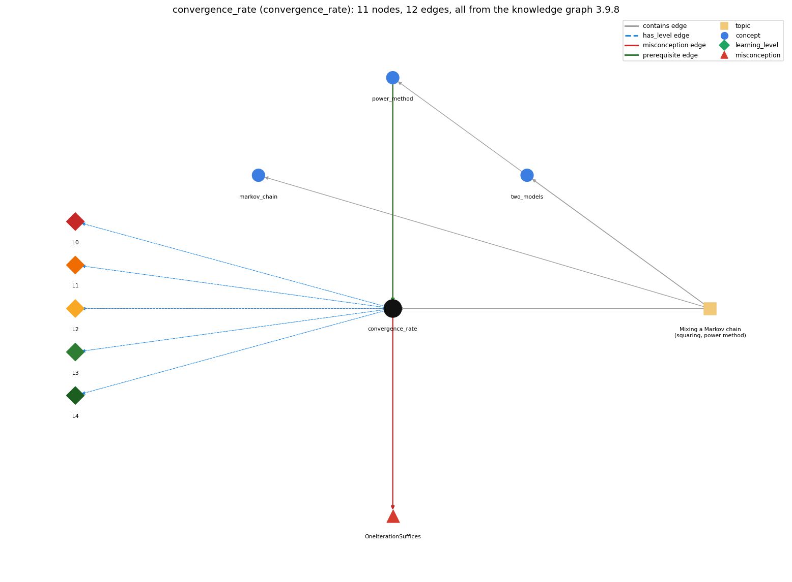

# convergence_rate (`convergence_rate`)

how many iterations the power method needs

Section 1.6 Case Study: Random Web Surfer, topic 1.6.c Mixing a Markov chain (squaring, power method).

## At a glance

- **Needs first:** `power_method`
- **Leads to:** nothing
- **Learned alongside:** nothing
- **Misconceptions:** `OneIterationSuffices`
- **Errors:** none
- **Levels:** L0, L1, L2, L3, L4

Everything below comes from the knowledge graph 3.9.8 (`data/raw/chapter1_kg_updated.json`): 12 edges around this concept. The edge logic, the wrong and right rules and the exact rules of the ways are copied word for word from the graph.

## To work on (1)

- no aliases: a student's words cannot name this concept

## What it needs first (1)

A prerequisite edge means the other concept has to be understood before `convergence_rate`.

### `power_method` comes before `convergence_rate`

*repeated vector-matrix multiplication to compute page ranks*

- **Edge:** `pre:power_method->convergence_rate`
- **Exact edge logic:** The convergence rate counts how many power-method multiplications are needed for a given accuracy: about 20 for two decimal places and 20 more for three.
- **Grounding:** book\_passage
- **Composition rule (R) of `convergence_rate` with `power_method`:** T in Markov is the iteration count whose size the convergence rate fixes: about 20 per decimal digit for tiny.txt.
- **Composition rule (R) of `power_method` with `convergence_rate`:** The number of iterations T controls accuracy: about 20 for two decimals and 20 more for three on tiny.txt.

## What it leads to (0)

These concepts need `convergence_rate` first.

No concept has this one as a prerequisite.

## Learned alongside (0)

A parallel edge joins two concepts that sit side by side: neither is needed before the other.

No parallel edge touches this concept.

## Misconceptions (1)

A misconception edge states the wrong rule a student may hold about this concept, and the right rule.

### OneIterationSuffices

- **Edge:** `convergence_rate` &rarr; `OneIterationSuffices` (misconception)
- **Exact edge logic (the wrong rule):** One vector-matrix multiplication gives the exact page ranks.
- **Twin logic (the right rule):** One multiplication gives only the probabilities after one move; the vector converges with repeated multiplication (for tiny.txt about 20 multiplications give two decimal places and about 40 give three).
- **Wrong belief (on the node):** One vector-matrix multiplication gives the exact page ranks.
- **Correct rule (on the node):** One multiplication gives only the probabilities after one move; the vector converges with repeated multiplication (for tiny.txt about 20 multiplications give two decimal places and about 40 give three).
- **Provenance:** derived
- **Role of this concept:** primary
- **L0 way linked to it:** yes
- **L0 way [1] misconception, exact rule:** wrong rule: One vector-matrix multiplication gives the exact page ranks. Right rule: Accuracy grows with iterations: about 20 multiplications give two decimal places for tiny.txt and 20 more give three.
- **L0 way [2] inconsistent\_trace, exact rule:** Applies LT (run with T, then with more T, compare digits) unevenly: e.g. comparing a run with T = 20 to one with T = 21 and concluding that unchanged digits are accurate. (here mixing in: "One vector-matrix multiplication gives the exact page ranks")
- **Edge `power_method` &rarr; `OneIterationSuffices`, exact edge logic:** One vector-matrix multiplication gives the exact page ranks. **Twin logic:** One multiplication gives only the probabilities after one move; the vector converges with repeated multiplication (for tiny.txt about 20 multiplications give two decimal places and about 40 give three). (role: context)

## Errors (0)

An error edge states the rule that gets broken in a program, and the right rule.

The graph has no error edge from this concept.

## Levels L0 to L4 (5 of 5)

Each level edge lists the ways a student shows that level, each with its exact rule.

### L0: Prestructural / sensorimotor

L0 for convergence rate: the answer holds a rule that contradicts Java.

*Deciding question: Does every rule the answer applies to convergence rate agree with the language rule? If it reads the code with everyday meanings, applies a wrong rule, or switches rules within one trace, it is L0. A slip in an otherwise rule-correct trace is L2 with an error, not L0.*

- **Edge:** `convergence_rate` &rarr; `convergence_rate@L0` (has_level)
- **Exact edge logic:** convergence rate -&gt; L0 (Prestructural): the answer holds a rule that contradicts Java (3 ways).

Ways (3), each with its exact rule:

- **[0] everyday\_reading** (rule type E, folk-meaning rule): Everyday "converge" means arrive at the answer; numerically the vector only gets closer with each iteration and stops changing in the printed digits, never reaching the limit exactly.
- **[1] misconception** (rule type M, wrong rule / right rule) &rarr; `OneIterationSuffices`: wrong rule: One vector-matrix multiplication gives the exact page ranks. Right rule: Accuracy grows with iterations: about 20 multiplications give two decimal places for tiny.txt and 20 more give three.
- **[2] inconsistent\_trace** (rule type T, uneven-application rule) &rarr; `OneIterationSuffices`: Applies LT (run with T, then with more T, compare digits) unevenly: e.g. comparing a run with T = 20 to one with T = 21 and concluding that unchanged digits are accurate. (here mixing in: "One vector-matrix multiplication gives the exact page ranks")

### L1: Unistructural / atom x text surface

L1 for convergence rate: the answer states one correct rule without applying it.

*Deciding question: Does the answer cover every part of the code, in order, with the values (L2)? If it covers one part or only states the rule, it is L1.*

- **Edge:** `convergence_rate` &rarr; `convergence_rate@L1` (has_level)
- **Exact edge logic:** convergence rate -&gt; L1 (Unistructural): the answer states one correct rule without applying it (2 ways).

Ways (2), each with its exact rule:

- **[0] names\_the\_element** (rule type N, identity rule): A performance measure: the number of iterations a method needs to reach a given number of accurate decimal places.
- **[1] states\_the\_rule** (rule type S, declarative rule): The power method needs about 20 multiplications for two decimal places and another 20 for three on tiny.txt, against tens of thousands and millions of moves for RandomSurfer; Brin and Page report 50 to 100 iterations for the web.

### L2: Multistructural / block x execution / preoperational

L2 for convergence rate: the answer applies these rules to every part of the code, in order.

*Deciding question: Is the answer many segments mapped onto lines (L2), or one segment stating the purpose of the whole (L3)? A correct output with no value-by-value justification is not levelled.*

- **Edge:** `convergence_rate` &rarr; `convergence_rate@L2` (has_level)
- **Exact edge logic:** convergence rate -&gt; L2 (Multistructural): the answer applies the rules of convergence rate to every part of the code, in order (3 ways).

Ways (3), each with its exact rule:

- **[0] line\_by\_line\_trace** (rule type LT, operational sequencing rule): Run Markov with increasing T (20, 40, ...) and compare the printed vectors; the digits that stop changing are the converged ones.
- **[1] output\_prediction** (rule type OP, evaluation / result rule): Markov 20 and 40 agree to two decimals (0.27245 vs 0.27303) and the 40-iteration vector is accurate to three.
- **[2] one\_step\_execution** (rule type OS, state-transition rule): Each additional iteration shrinks the error by roughly a constant factor determined by the second largest eigenvalue of P, so a fixed number of iterations adds about one digit.

### L3: Relational / relations x function (concrete operational begins)

L3 for convergence rate: the answer relates the parts by these rules.

*Deciding question: Was the purpose deduced from the code, or only guessed from traced input/output pairs (then L2)? Does the answer stay within the given code (L3), or reason about changed code, an error class or a new program (L4)?*

- **Edge:** `convergence_rate` &rarr; `convergence_rate@L3` (has_level)
- **Exact edge logic:** convergence rate -&gt; L3 (Relational): the answer relates the parts (2 ways).

Ways (2), each with its exact rule:

- **[0] relation\_to\_neighbour** (rule type R, composition rule (with a neighbour)): T in Markov is the iteration count whose size the convergence rate fixes: about 20 per decimal digit for tiny.txt.
- **[1] purpose\_of\_the\_whole** (rule type P, plan / role rule): Choose the stopping point (iteration count) for an iterative method so that results are accurate to the needed digits without wasted work.

### L4: Extended abstract (concrete-operational reversibility and conservation)

L4 for convergence rate: the answer reasons beyond the given code by these rules.

*Deciding question: Does the answer link the code to a broader context: a changed program, a class of inputs, an unseen problem? Re-tracing changed code value by value is L2; fixing one given failing case is L3.*

- **Edge:** `convergence_rate` &rarr; `convergence_rate@L4` (has_level)
- **Exact edge logic:** convergence rate -&gt; L4 (Extended abstract): the answer reasons beyond the given code (3 ways).

Ways (3), each with its exact rule:

- **[0] predict\_a\_change** (rule type C, conservation rule) &rarr; `OneIterationSuffices`: Doubling T from 20 to 40 keeps the first two digits and adds one; changing the leap probability or the graph changes the rate (it depends on lambda2).
- **[1] transfer\_to\_a\_new\_program** (rule type X, applicability rule): Use convergence measurements whenever an iterative or sampling method must be stopped; it explains why the power method (about 20 iterations per digit) is preferred to simulation (10x moves per digit).
- **[2] diagnose\_an\_error** (rule type D, error rule): rule broken: Enough iterations must be run for the required accuracy. Kind: silent logic error. Trigger class: T chosen too small (or a simulation with too few moves): printed digits look precise but are not accurate.

## Same topic

`convergence_rate` belongs to the topic **Mixing a Markov chain (squaring, power method)** (`topic1.6.c`). The topic also contains: `markov_chain`, `power_method`, `two_models`.

## Rules of the concept (13)

- **Book** (SW-1e, p. 172 (pdf 182)): "but with just 20 matrix-vector multiplications"
- **Book** (SW-1e, p. 168 (pdf 178)): "increasing the number of iterations gives increasingly accurate estimates"
- **Book** (SW-1.6, ): "Since 0.9^50 = 0.005153775207, we expect to have 2-3 digits of accuracy after 50 iterations."
- **E** (folk-meaning rule): Everyday "converge" means arrive at the answer; numerically the vector only gets closer with each iteration and stops changing in the printed digits, never reaching the limit exactly.
- **M** (wrong rule / right rule): OneIterationSuffices: wrong: One vector-matrix multiplication gives the exact page ranks. \| right: Accuracy grows with iterations: about 20 multiplications give two decimal places for tiny.txt and 20 more give three.
- **T** (uneven-application rule): Applies LT (run with T, then with more T, compare digits) unevenly: e.g. comparing a run with T = 20 to one with T = 21 and concluding that unchanged digits are accurate.
- **N** (identity rule): A performance measure: the number of iterations a method needs to reach a given number of accurate decimal places.
- **S** (declarative rule): The power method needs about 20 multiplications for two decimal places and another 20 for three on tiny.txt, against tens of thousands and millions of moves for RandomSurfer; Brin and Page report 50 to 100 iterations for the web.
- **LT** (operational sequencing rule): Run Markov with increasing T (20, 40, ...) and compare the printed vectors; the digits that stop changing are the converged ones.
- **OP** (evaluation / result rule): Markov 20 and 40 agree to two decimals (0.27245 vs 0.27303) and the 40-iteration vector is accurate to three.
- **OS** (state-transition rule): Each additional iteration shrinks the error by roughly a constant factor determined by the second largest eigenvalue of P, so a fixed number of iterations adds about one digit.
- **R** (composition rule (with a neighbour)): with power\_method: T in Markov is the iteration count whose size the convergence rate fixes: about 20 per decimal digit for tiny.txt.
- **P** (plan / role rule): Choose the stopping point (iteration count) for an iterative method so that results are accurate to the needed digits without wasted work.
- **C** (conservation rule): Doubling T from 20 to 40 keeps the first two digits and adds one; changing the leap probability or the graph changes the rate (it depends on lambda2).
- **D** (error rule): rule broken: Enough iterations must be run for the required accuracy. (silent logic error)
- **X** (applicability rule): Use convergence measurements whenever an iterative or sampling method must be stopped; it explains why the power method (about 20 iterations per digit) is preferred to simulation (10x moves per digit).

## How it is found in code and answers (reader block)

- **Aliases:** none
- **Code patterns:** none
- **Operator symbols:** none
- **Java types:** none
- **Signal rank\_update\_loop** (scope program): `\bnewRanks?\b[\s\S]{0,300}?\branks?\s*=\s*newRanks?\b`

## The whole prerequisite chain

- **Everything it builds on (31):** `arithmetic_operators`, `array_creation`, `array_declaration`, `array_initializer`, `boolean`, `boolean_expression`, `comparison_operators`, `data_structure`, `data_type`, `do_while_loop`, `expression`, `for_loop`, `identifier`, `indexing`, `input_graph`, `literal`, `logical_operators`, `loop_control`, `loop_variable`, `markov_chain`, `matrix_operations`, `nested_loops`, `power_method`, `primitive_type`, `standard_input`, `stream_model`, `teleportation`, `transition_matrix`, `two_dimensional_array`, `variable`, `while_loop`
- **Everything that builds on it (0):** nothing

## Every edge in this view and its exact edge logic (12)

All the edges drawn in the picture, in the order: prerequisite, parallel, misconception, error, has_level, contains.

**1. `power_method` &rarr; `convergence_rate`** (prerequisite)

- **Exact edge logic:** The convergence rate counts how many power-method multiplications are needed for a given accuracy: about 20 for two decimal places and 20 more for three.
- **Grounding:** book\_passage
- **Composition rule (R) of `power_method` with `convergence_rate`:** The number of iterations T controls accuracy: about 20 for two decimals and 20 more for three on tiny.txt.
- **Composition rule (R) of `convergence_rate` with `power_method`:** T in Markov is the iteration count whose size the convergence rate fixes: about 20 per decimal digit for tiny.txt.

**2. `convergence_rate` &rarr; `OneIterationSuffices`** (misconception)

- **Exact edge logic (the wrong rule):** One vector-matrix multiplication gives the exact page ranks.
- **Twin logic (the right rule):** One multiplication gives only the probabilities after one move; the vector converges with repeated multiplication (for tiny.txt about 20 multiplications give two decimal places and about 40 give three).
- **Role:** primary

**3. `power_method` &rarr; `OneIterationSuffices`** (misconception)

- **Exact edge logic (the wrong rule):** One vector-matrix multiplication gives the exact page ranks.
- **Twin logic (the right rule):** One multiplication gives only the probabilities after one move; the vector converges with repeated multiplication (for tiny.txt about 20 multiplications give two decimal places and about 40 give three).
- **Role:** context

**4. `convergence_rate` &rarr; `convergence_rate@L0`** (has_level)

- **Exact edge logic:** convergence rate -&gt; L0 (Prestructural): the answer holds a rule that contradicts Java (3 ways).
  - **[0] everyday\_reading** (rule type E, folk-meaning rule): Everyday "converge" means arrive at the answer; numerically the vector only gets closer with each iteration and stops changing in the printed digits, never reaching the limit exactly.
  - **[1] misconception** (rule type M, wrong rule / right rule) &rarr; `OneIterationSuffices`: wrong rule: One vector-matrix multiplication gives the exact page ranks. Right rule: Accuracy grows with iterations: about 20 multiplications give two decimal places for tiny.txt and 20 more give three.
  - **[2] inconsistent\_trace** (rule type T, uneven-application rule) &rarr; `OneIterationSuffices`: Applies LT (run with T, then with more T, compare digits) unevenly: e.g. comparing a run with T = 20 to one with T = 21 and concluding that unchanged digits are accurate. (here mixing in: "One vector-matrix multiplication gives the exact page ranks")

**5. `convergence_rate` &rarr; `convergence_rate@L1`** (has_level)

- **Exact edge logic:** convergence rate -&gt; L1 (Unistructural): the answer states one correct rule without applying it (2 ways).
  - **[0] names\_the\_element** (rule type N, identity rule): A performance measure: the number of iterations a method needs to reach a given number of accurate decimal places.
  - **[1] states\_the\_rule** (rule type S, declarative rule): The power method needs about 20 multiplications for two decimal places and another 20 for three on tiny.txt, against tens of thousands and millions of moves for RandomSurfer; Brin and Page report 50 to 100 iterations for the web.

**6. `convergence_rate` &rarr; `convergence_rate@L2`** (has_level)

- **Exact edge logic:** convergence rate -&gt; L2 (Multistructural): the answer applies the rules of convergence rate to every part of the code, in order (3 ways).
  - **[0] line\_by\_line\_trace** (rule type LT, operational sequencing rule): Run Markov with increasing T (20, 40, ...) and compare the printed vectors; the digits that stop changing are the converged ones.
  - **[1] output\_prediction** (rule type OP, evaluation / result rule): Markov 20 and 40 agree to two decimals (0.27245 vs 0.27303) and the 40-iteration vector is accurate to three.
  - **[2] one\_step\_execution** (rule type OS, state-transition rule): Each additional iteration shrinks the error by roughly a constant factor determined by the second largest eigenvalue of P, so a fixed number of iterations adds about one digit.

**7. `convergence_rate` &rarr; `convergence_rate@L3`** (has_level)

- **Exact edge logic:** convergence rate -&gt; L3 (Relational): the answer relates the parts (2 ways).
  - **[0] relation\_to\_neighbour** (rule type R, composition rule (with a neighbour)): T in Markov is the iteration count whose size the convergence rate fixes: about 20 per decimal digit for tiny.txt.
  - **[1] purpose\_of\_the\_whole** (rule type P, plan / role rule): Choose the stopping point (iteration count) for an iterative method so that results are accurate to the needed digits without wasted work.

**8. `convergence_rate` &rarr; `convergence_rate@L4`** (has_level)

- **Exact edge logic:** convergence rate -&gt; L4 (Extended abstract): the answer reasons beyond the given code (3 ways).
  - **[0] predict\_a\_change** (rule type C, conservation rule) &rarr; `OneIterationSuffices`: Doubling T from 20 to 40 keeps the first two digits and adds one; changing the leap probability or the graph changes the rate (it depends on lambda2).
  - **[1] transfer\_to\_a\_new\_program** (rule type X, applicability rule): Use convergence measurements whenever an iterative or sampling method must be stopped; it explains why the power method (about 20 iterations per digit) is preferred to simulation (10x moves per digit).
  - **[2] diagnose\_an\_error** (rule type D, error rule): rule broken: Enough iterations must be run for the required accuracy. Kind: silent logic error. Trigger class: T chosen too small (or a simulation with too few moves): printed digits look precise but are not accurate.

**9. `topic1.6.c` &rarr; `convergence_rate`** (contains)

- topic `topic1.6.c` contains `convergence_rate`

**10. `topic1.6.c` &rarr; `markov_chain`** (contains)

- topic `topic1.6.c` contains `markov_chain`

**11. `topic1.6.c` &rarr; `power_method`** (contains)

- topic `topic1.6.c` contains `power_method`

**12. `topic1.6.c` &rarr; `two_models`** (contains)

- topic `topic1.6.c` contains `two_models`
