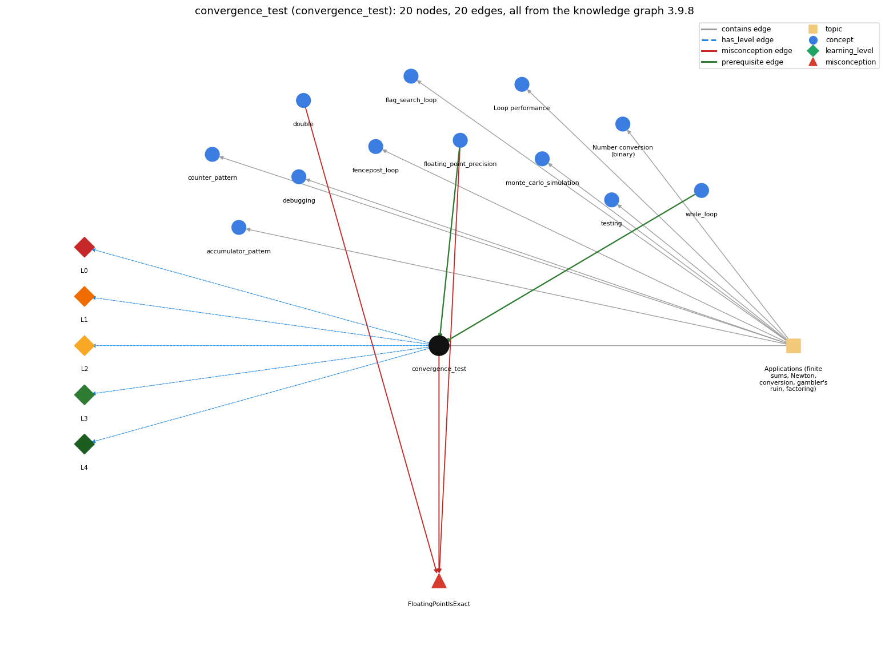

# convergence_test (`convergence_test`)

stopping a loop when a floating-point result is close enough

Section 1.3 Conditionals and Loops, topic 1.3.f Applications (finite sums, Newton, conversion, gambler's ruin, factoring).

## At a glance

- **Needs first:** `floating_point_precision`, `while_loop`
- **Leads to:** nothing
- **Learned alongside:** nothing
- **Misconceptions:** `FloatingPointIsExact`
- **Errors:** none
- **Levels:** L0, L1, L2, L3, L4

Everything below comes from the knowledge graph 3.9.8 (`data/raw/chapter1_kg_updated.json`): 20 edges around this concept. The edge logic, the wrong and right rules and the exact rules of the ways are copied word for word from the graph.

## To work on (1)

- no aliases: a student's words cannot name this concept

## What it needs first (2)

A prerequisite edge means the other concept has to be understood before `convergence_test`.

### `floating_point_precision` comes before `convergence_test`

*double values are approximations; == on doubles is unreliable*

- **Edge:** `pre:floating_point_precision->convergence_test`
- **Exact edge logic:** An equality test between double values may not give the result you expect, so Sqrt stops when t is within a relative error tolerance epsilon (Math.abs(t - c/t) &gt; epsilon \* t) rather than when t equals c/t.
- **Grounding:** book\_passage
- **Composition rule (R) of `convergence_test` with `floating_point_precision`:** Because doubles are approximate, the stopping condition has to be a tolerance test, and the tolerance has to be relative (\`epsilon \* t\`). An absolute 1e-15 is smaller than the spacing between doubles near large values such as 1595.16, so the test might never succeed (t and c/t can keep differing by one unit in the last place).
- **Composition rule (R) of `floating_point_precision` with `convergence_test`:** Because doubles are approximate, a loop that waits for exact equality may never stop; Sqrt therefore loops while Math.abs(t - c/t) &gt; epsilon \* t, a relative-tolerance test.

### `while_loop` comes before `convergence_test`

*repeat a block while a condition holds*

- **Edge:** `pre:while_loop->convergence_test`
- **Exact edge logic:** The convergence test is the condition of a while loop that keeps refining an estimate until the error is below a tolerance.
- **Grounding:** book\_passage
- **Composition rule (R) of `convergence_test` with `while_loop`:** The convergence test is the while condition, evaluated before every pass. The body must move the estimate closer (t = (c/t + t)/2.0), or the condition stays true and the loop never ends.
- **Composition rule (R) of `while_loop` with `convergence_test`:** A convergence test is the while condition that keeps refining an estimate until the error is within tolerance, e.g. while (Math.abs(t - c/t) &gt; epsilon \* t).

## What it leads to (0)

These concepts need `convergence_test` first.

No concept has this one as a prerequisite.

## Learned alongside (0)

A parallel edge joins two concepts that sit side by side: neither is needed before the other.

No parallel edge touches this concept.

## Misconceptions (1)

A misconception edge states the wrong rule a student may hold about this concept, and the right rule.

### FloatingPointIsExact

- **Edge:** `convergence_test` &rarr; `FloatingPointIsExact` (misconception)
- **Exact edge logic (the wrong rule):** Math.sqrt(2) \* Math.sqrt(2) == 2 is true.
- **Twin logic (the right rule):** A double is an approximation, so the product is close to 2 but not equal to 2.
- **Wrong belief (on the node):** Math.sqrt(2) \* Math.sqrt(2) == 2 is true.
- **Correct rule (on the node):** A double is an approximation, so the product is close to 2 but not equal to 2.
- **Provenance:** textbook
- **Role of this concept:** context
- **L0 way linked to it:** yes
- **L0 way [1] misconception, exact rule:** wrong rule: \`Math.sqrt(2) \* Math.sqrt(2) == 2\` is true. Right rule: A double is an approximation, so the product is close to 2 but not equal to it (the expression is false). Loop tests on doubles therefore compare an error against a tolerance instead of testing equality.
- **L0 way [2] inconsistent\_trace, exact rule:** Applies the LT rule (compute the error, compare it with the tolerance, then refine) unevenly: refines once more after the test has gone false, or tests the old estimate against the new c/t, so the traced number of iterations or the final t is wrong. (here mixing in: "Math.sqrt(2) \* Math.sqrt(2) == 2 is true")
- **Edge `double` &rarr; `FloatingPointIsExact`, exact edge logic:** Math.sqrt(2) \* Math.sqrt(2) == 2 is true. **Twin logic:** A double is an approximation, so the product is close to 2 but not equal to 2. (role: context)
- **Edge `floating_point_precision` &rarr; `FloatingPointIsExact`, exact edge logic:** Math.sqrt(2) \* Math.sqrt(2) == 2 is true. **Twin logic:** A double is an approximation, so the product is close to 2 but not equal to 2. (role: primary)

## Errors (0)

An error edge states the rule that gets broken in a program, and the right rule.

The graph has no error edge from this concept.

## Levels L0 to L4 (5 of 5)

Each level edge lists the ways a student shows that level, each with its exact rule.

### L0: Prestructural / sensorimotor

L0 for convergence test: the answer holds a rule that contradicts Java.

*Deciding question: Does every rule the answer applies to convergence test agree with the language rule? If it reads the code with everyday meanings, applies a wrong rule, or switches rules within one trace, it is L0. A slip in an otherwise rule-correct trace is L2 with an error, not L0.*

- **Edge:** `convergence_test` &rarr; `convergence_test@L0` (has_level)
- **Exact edge logic:** convergence test -&gt; L0 (Prestructural): the answer holds a rule that contradicts Java (3 ways).

Ways (3), each with its exact rule:

- **[0] everyday\_reading** (rule type E, folk-meaning rule): Folk meaning: in maths a converging sequence reaches its limit, and 'equal' means exactly equal, so a novice writes \`while (t != c/t)\` and expects it to stop at the root. Java doubles are approximations, so exact equality may never occur and the test has to be 'close enough': \`Math.abs(t - c/t) &gt; epsilon \* t\`.
- **[1] misconception** (rule type M, wrong rule / right rule) &rarr; `FloatingPointIsExact`: wrong rule: \`Math.sqrt(2) \* Math.sqrt(2) == 2\` is true. Right rule: A double is an approximation, so the product is close to 2 but not equal to it (the expression is false). Loop tests on doubles therefore compare an error against a tolerance instead of testing equality.
- **[2] inconsistent\_trace** (rule type T, uneven-application rule) &rarr; `FloatingPointIsExact`: Applies the LT rule (compute the error, compare it with the tolerance, then refine) unevenly: refines once more after the test has gone false, or tests the old estimate against the new c/t, so the traced number of iterations or the final t is wrong. (here mixing in: "Math.sqrt(2) \* Math.sqrt(2) == 2 is true")

### L1: Unistructural / atom x text surface

L1 for convergence test: the answer states one correct rule without applying it.

*Deciding question: Does the answer cover every part of the code, in order, with the values (L2)? If it covers one part or only states the rule, it is L1.*

- **Edge:** `convergence_test` &rarr; `convergence_test@L1` (has_level)
- **Exact edge logic:** convergence test -&gt; L1 (Unistructural): the answer states one correct rule without applying it (2 ways).

Ways (2), each with its exact rule:

- **[0] names\_the\_element** (rule type N, identity rule): Loop-termination idiom: a while condition that keeps refining a floating-point estimate until its error falls below a tolerance epsilon.
- **[1] states\_the\_rule** (rule type S, declarative rule): Stop on a relative-error tolerance, not on equality: \`while (Math.abs(t - c/t) &gt; epsilon \* t) t = (c/t + t) / 2.0;\` with \`epsilon = 1e-15\`.

### L2: Multistructural / block x execution / preoperational

L2 for convergence test: the answer applies these rules to every part of the code, in order.

*Deciding question: Is the answer many segments mapped onto lines (L2), or one segment stating the purpose of the whole (L3)? A correct output with no value-by-value justification is not levelled.*

- **Edge:** `convergence_test` &rarr; `convergence_test@L2` (has_level)
- **Exact edge logic:** convergence test -&gt; L2 (Multistructural): the answer applies the rules of convergence test to every part of the code, in order (3 ways).

Ways (3), each with its exact rule:

- **[0] line\_by\_line\_trace** (rule type LT, operational sequencing rule): Before each pass: evaluate c/t, then t - c/t, then Math.abs, then epsilon \* t, then compare. If the error is greater, run the body once (replace t) and test again. If it is not greater, leave the loop with the current t.
- **[1] output\_prediction** (rule type OP, evaluation / result rule): The loop leaves a double t whose relative error is at most epsilon. For Sqrt 2.0 it prints 1.414213562373095 after 5 iterations; the result is not exactly the mathematical value.
- **[2] one\_step\_execution** (rule type OS, state-transition rule): One pass changes only the estimate t, replacing it by (c/t + t)/2.0 (2.0 becomes 1.5, then 1.4166666666666665). c and epsilon stay fixed. The test itself changes nothing and yields a boolean.

### L3: Relational / relations x function (concrete operational begins)

L3 for convergence test: the answer relates the parts by these rules.

*Deciding question: Was the purpose deduced from the code, or only guessed from traced input/output pairs (then L2)? Does the answer stay within the given code (L3), or reason about changed code, an error class or a new program (L4)?*

- **Edge:** `convergence_test` &rarr; `convergence_test@L3` (has_level)
- **Exact edge logic:** convergence test -&gt; L3 (Relational): the answer relates the parts (3 ways).

Ways (3), each with its exact rule:

- **[0] relation\_to\_neighbour** (rule type R, composition rule (with a neighbour)): Because doubles are approximate, the stopping condition has to be a tolerance test, and the tolerance has to be relative (\`epsilon \* t\`). An absolute 1e-15 is smaller than the spacing between doubles near large values such as 1595.16, so the test might never succeed (t and c/t can keep differing by one unit in the last place).
- **[1] relation\_to\_neighbour** (rule type R, composition rule (with a neighbour)): The convergence test is the while condition, evaluated before every pass. The body must move the estimate closer (t = (c/t + t)/2.0), or the condition stays true and the loop never ends.
- **[2] purpose\_of\_the\_whole** (rule type P, plan / role rule): Plan: iterate-until-converged (Newton's method). The estimate t is repeatedly replaced by a better one until it is close enough. Used to compute functions like sqrt, kth roots and Taylor sums.

### L4: Extended abstract (concrete-operational reversibility and conservation)

L4 for convergence test: the answer reasons beyond the given code by these rules.

*Deciding question: Does the answer link the code to a broader context: a changed program, a class of inputs, an unseen problem? Re-tracing changed code value by value is L2; fixing one given failing case is L3.*

- **Edge:** `convergence_test` &rarr; `convergence_test@L4` (has_level)
- **Exact edge logic:** convergence test -&gt; L4 (Extended abstract): the answer reasons beyond the given code (5 ways).

Ways (5), each with its exact rule:

- **[0] predict\_a\_change** (rule type C, conservation rule) &rarr; `FloatingPointIsExact`: Making epsilon smaller adds a few iterations and keeps the answer; making it 0, or replacing the test with \`t != c/t\`, may stop the loop from ever ending. Switching the relative test \`epsilon \* t\` to an absolute \`epsilon\` keeps behaviour for small c but can hang for large c. Changing the starting t changes only the iteration count.
- **[1] transfer\_to\_a\_new\_program** (rule type X, applicability rule): Use a convergence test when an iterative numeric method has no fixed number of steps (Newton's method, series that are summed until \`sum == sum + term\`). For a known number of steps use a counted for loop, and in practice call the library method (Math.sqrt) when one exists.
- **[2] diagnose\_an\_error** (rule type D, error rule): rule broken: Do not test doubles for exact equality in a loop condition. Kind: silent logic error. Trigger class: A condition like \`while (t != c/t)\` or \`for (double x = 0.0; x != 1.0; x += 0.1)\`, where rounding means the values never match exactly: the loop runs forever or one time too many.
- **[3] diagnose\_an\_error** (rule type D, error rule): rule broken: The tolerance must be achievable at the magnitude of the result (relative error). Kind: silent logic error. Trigger class: An absolute tolerance much smaller than the spacing between doubles near the answer (e.g. \`&gt; 1e-15\` for c = 2544545): when t and c/t settle one unit in the last place apart, the loop never terminates.
- **[4] diagnose\_an\_error** (rule type D, error rule): rule broken: The iteration converges only for inputs that have a root. Kind: silent logic error. Trigger class: A negative argument to Sqrt: epsilon \* t is negative, so the condition stays true and the loop does not terminate.

## Same topic

`convergence_test` belongs to the topic **Applications (finite sums, Newton, conversion, gambler's ruin, factoring)** (`topic1.3.f`). The topic also contains: `accumulator_pattern`, `counter_pattern`, `debugging`, `fencepost_loop`, `flag_search_loop`, `loop_performance`, `monte_carlo_simulation`, `number_conversion`, `testing`.

## Rules of the concept (16)

- **Book** (SW-1e, p. 76 (pdf 86)): "The number of iterations depends on an equality test between double values, which may not always give the result that you expect."
- **Book** (SW-1.3, ): "If t is equal to x/t (up to machine precision)…"
- **E** (folk-meaning rule): Folk meaning: in maths a converging sequence reaches its limit, and 'equal' means exactly equal, so a novice writes \`while (t != c/t)\` and expects it to stop at the root. Java doubles are approximations, so exact equality may never occur and the test has to be 'close enough': \`Math.abs(t - c/t) &gt; epsilon \* t\`.
- **M** (wrong rule / right rule): FloatingPointIsExact: wrong: \`Math.sqrt(2) \* Math.sqrt(2) == 2\` is true. \| right: A double is an approximation, so the product is close to 2 but not equal to it (the expression is false). Loop tests on doubles therefore compare an error against a tolerance instead of testing equality.
- **T** (uneven-application rule): Applies the LT rule (compute the error, compare it with the tolerance, then refine) unevenly: refines once more after the test has gone false, or tests the old estimate against the new c/t, so the traced number of iterations or the final t is wrong.
- **N** (identity rule): Loop-termination idiom: a while condition that keeps refining a floating-point estimate until its error falls below a tolerance epsilon.
- **S** (declarative rule): Stop on a relative-error tolerance, not on equality: \`while (Math.abs(t - c/t) &gt; epsilon \* t) t = (c/t + t) / 2.0;\` with \`epsilon = 1e-15\`.
- **LT** (operational sequencing rule): Before each pass: evaluate c/t, then t - c/t, then Math.abs, then epsilon \* t, then compare. If the error is greater, run the body once (replace t) and test again. If it is not greater, leave the loop with the current t.
- **OP** (evaluation / result rule): The loop leaves a double t whose relative error is at most epsilon. For Sqrt 2.0 it prints 1.414213562373095 after 5 iterations; the result is not exactly the mathematical value.
- **OS** (state-transition rule): One pass changes only the estimate t, replacing it by (c/t + t)/2.0 (2.0 becomes 1.5, then 1.4166666666666665). c and epsilon stay fixed. The test itself changes nothing and yields a boolean.
- **R** (composition rule (with a neighbour)): with floating\_point\_precision: Because doubles are approximate, the stopping condition has to be a tolerance test, and the tolerance has to be relative (\`epsilon \* t\`). An absolute 1e-15 is smaller than the spacing between doubles near large values such as 1595.16, so the test might never succeed (t and c/t can keep differing by one unit in the last place).
- **R** (composition rule (with a neighbour)): with while\_loop: The convergence test is the while condition, evaluated before every pass. The body must move the estimate closer (t = (c/t + t)/2.0), or the condition stays true and the loop never ends.
- **P** (plan / role rule): Plan: iterate-until-converged (Newton's method). The estimate t is repeatedly replaced by a better one until it is close enough. Used to compute functions like sqrt, kth roots and Taylor sums.
- **C** (conservation rule): Making epsilon smaller adds a few iterations and keeps the answer; making it 0, or replacing the test with \`t != c/t\`, may stop the loop from ever ending. Switching the relative test \`epsilon \* t\` to an absolute \`epsilon\` keeps behaviour for small c but can hang for large c. Changing the starting t changes only the iteration count.
- **D** (error rule): rule broken: Do not test doubles for exact equality in a loop condition. (silent logic error)
- **D** (error rule): rule broken: The tolerance must be achievable at the magnitude of the result (relative error). (silent logic error)
- **D** (error rule): rule broken: The iteration converges only for inputs that have a root. (silent logic error)
- **X** (applicability rule): Use a convergence test when an iterative numeric method has no fixed number of steps (Newton's method, series that are summed until \`sum == sum + term\`). For a known number of steps use a counted for loop, and in practice call the library method (Math.sqrt) when one exists.

## How it is found in code and answers (reader block)

- **Aliases:** none
- **Code patterns:** `Math\.abs\s*\([^;]*\)\s*>\s*(?:\w*(?:eps|EPS|epsilon|EPSILON)\w*|\d*\.\d*0\d+|\d+[eE]-\d+)`, `\bwhile\s*\([^)]*(?:epsilon|EPSILON|\beps\b|[eE]-\d+)`
- **Operator symbols:** none
- **Java types:** none

## The whole prerequisite chain

- **Everything it builds on (14):** `arithmetic_operators`, `boolean`, `boolean_expression`, `comparison_operators`, `data_type`, `double`, `expression`, `floating_point_precision`, `identifier`, `literal`, `logical_operators`, `primitive_type`, `variable`, `while_loop`
- **Everything that builds on it (0):** nothing

## Every edge in this view and its exact edge logic (20)

All the edges drawn in the picture, in the order: prerequisite, parallel, misconception, error, has_level, contains.

**1. `floating_point_precision` &rarr; `convergence_test`** (prerequisite)

- **Exact edge logic:** An equality test between double values may not give the result you expect, so Sqrt stops when t is within a relative error tolerance epsilon (Math.abs(t - c/t) &gt; epsilon \* t) rather than when t equals c/t.
- **Grounding:** book\_passage
- **Composition rule (R) of `floating_point_precision` with `convergence_test`:** Because doubles are approximate, a loop that waits for exact equality may never stop; Sqrt therefore loops while Math.abs(t - c/t) &gt; epsilon \* t, a relative-tolerance test.
- **Composition rule (R) of `convergence_test` with `floating_point_precision`:** Because doubles are approximate, the stopping condition has to be a tolerance test, and the tolerance has to be relative (\`epsilon \* t\`). An absolute 1e-15 is smaller than the spacing between doubles near large values such as 1595.16, so the test might never succeed (t and c/t can keep differing by one unit in the last place).

**2. `while_loop` &rarr; `convergence_test`** (prerequisite)

- **Exact edge logic:** The convergence test is the condition of a while loop that keeps refining an estimate until the error is below a tolerance.
- **Grounding:** book\_passage
- **Composition rule (R) of `while_loop` with `convergence_test`:** A convergence test is the while condition that keeps refining an estimate until the error is within tolerance, e.g. while (Math.abs(t - c/t) &gt; epsilon \* t).
- **Composition rule (R) of `convergence_test` with `while_loop`:** The convergence test is the while condition, evaluated before every pass. The body must move the estimate closer (t = (c/t + t)/2.0), or the condition stays true and the loop never ends.

**3. `convergence_test` &rarr; `FloatingPointIsExact`** (misconception)

- **Exact edge logic (the wrong rule):** Math.sqrt(2) \* Math.sqrt(2) == 2 is true.
- **Twin logic (the right rule):** A double is an approximation, so the product is close to 2 but not equal to 2.
- **Role:** context

**4. `double` &rarr; `FloatingPointIsExact`** (misconception)

- **Exact edge logic (the wrong rule):** Math.sqrt(2) \* Math.sqrt(2) == 2 is true.
- **Twin logic (the right rule):** A double is an approximation, so the product is close to 2 but not equal to 2.
- **Role:** context

**5. `floating_point_precision` &rarr; `FloatingPointIsExact`** (misconception)

- **Exact edge logic (the wrong rule):** Math.sqrt(2) \* Math.sqrt(2) == 2 is true.
- **Twin logic (the right rule):** A double is an approximation, so the product is close to 2 but not equal to 2.
- **Role:** primary

**6. `convergence_test` &rarr; `convergence_test@L0`** (has_level)

- **Exact edge logic:** convergence test -&gt; L0 (Prestructural): the answer holds a rule that contradicts Java (3 ways).
  - **[0] everyday\_reading** (rule type E, folk-meaning rule): Folk meaning: in maths a converging sequence reaches its limit, and 'equal' means exactly equal, so a novice writes \`while (t != c/t)\` and expects it to stop at the root. Java doubles are approximations, so exact equality may never occur and the test has to be 'close enough': \`Math.abs(t - c/t) &gt; epsilon \* t\`.
  - **[1] misconception** (rule type M, wrong rule / right rule) &rarr; `FloatingPointIsExact`: wrong rule: \`Math.sqrt(2) \* Math.sqrt(2) == 2\` is true. Right rule: A double is an approximation, so the product is close to 2 but not equal to it (the expression is false). Loop tests on doubles therefore compare an error against a tolerance instead of testing equality.
  - **[2] inconsistent\_trace** (rule type T, uneven-application rule) &rarr; `FloatingPointIsExact`: Applies the LT rule (compute the error, compare it with the tolerance, then refine) unevenly: refines once more after the test has gone false, or tests the old estimate against the new c/t, so the traced number of iterations or the final t is wrong. (here mixing in: "Math.sqrt(2) \* Math.sqrt(2) == 2 is true")

**7. `convergence_test` &rarr; `convergence_test@L1`** (has_level)

- **Exact edge logic:** convergence test -&gt; L1 (Unistructural): the answer states one correct rule without applying it (2 ways).
  - **[0] names\_the\_element** (rule type N, identity rule): Loop-termination idiom: a while condition that keeps refining a floating-point estimate until its error falls below a tolerance epsilon.
  - **[1] states\_the\_rule** (rule type S, declarative rule): Stop on a relative-error tolerance, not on equality: \`while (Math.abs(t - c/t) &gt; epsilon \* t) t = (c/t + t) / 2.0;\` with \`epsilon = 1e-15\`.

**8. `convergence_test` &rarr; `convergence_test@L2`** (has_level)

- **Exact edge logic:** convergence test -&gt; L2 (Multistructural): the answer applies the rules of convergence test to every part of the code, in order (3 ways).
  - **[0] line\_by\_line\_trace** (rule type LT, operational sequencing rule): Before each pass: evaluate c/t, then t - c/t, then Math.abs, then epsilon \* t, then compare. If the error is greater, run the body once (replace t) and test again. If it is not greater, leave the loop with the current t.
  - **[1] output\_prediction** (rule type OP, evaluation / result rule): The loop leaves a double t whose relative error is at most epsilon. For Sqrt 2.0 it prints 1.414213562373095 after 5 iterations; the result is not exactly the mathematical value.
  - **[2] one\_step\_execution** (rule type OS, state-transition rule): One pass changes only the estimate t, replacing it by (c/t + t)/2.0 (2.0 becomes 1.5, then 1.4166666666666665). c and epsilon stay fixed. The test itself changes nothing and yields a boolean.

**9. `convergence_test` &rarr; `convergence_test@L3`** (has_level)

- **Exact edge logic:** convergence test -&gt; L3 (Relational): the answer relates the parts (3 ways).
  - **[0] relation\_to\_neighbour** (rule type R, composition rule (with a neighbour)): Because doubles are approximate, the stopping condition has to be a tolerance test, and the tolerance has to be relative (\`epsilon \* t\`). An absolute 1e-15 is smaller than the spacing between doubles near large values such as 1595.16, so the test might never succeed (t and c/t can keep differing by one unit in the last place).
  - **[1] relation\_to\_neighbour** (rule type R, composition rule (with a neighbour)): The convergence test is the while condition, evaluated before every pass. The body must move the estimate closer (t = (c/t + t)/2.0), or the condition stays true and the loop never ends.
  - **[2] purpose\_of\_the\_whole** (rule type P, plan / role rule): Plan: iterate-until-converged (Newton's method). The estimate t is repeatedly replaced by a better one until it is close enough. Used to compute functions like sqrt, kth roots and Taylor sums.

**10. `convergence_test` &rarr; `convergence_test@L4`** (has_level)

- **Exact edge logic:** convergence test -&gt; L4 (Extended abstract): the answer reasons beyond the given code (5 ways).
  - **[0] predict\_a\_change** (rule type C, conservation rule) &rarr; `FloatingPointIsExact`: Making epsilon smaller adds a few iterations and keeps the answer; making it 0, or replacing the test with \`t != c/t\`, may stop the loop from ever ending. Switching the relative test \`epsilon \* t\` to an absolute \`epsilon\` keeps behaviour for small c but can hang for large c. Changing the starting t changes only the iteration count.
  - **[1] transfer\_to\_a\_new\_program** (rule type X, applicability rule): Use a convergence test when an iterative numeric method has no fixed number of steps (Newton's method, series that are summed until \`sum == sum + term\`). For a known number of steps use a counted for loop, and in practice call the library method (Math.sqrt) when one exists.
  - **[2] diagnose\_an\_error** (rule type D, error rule): rule broken: Do not test doubles for exact equality in a loop condition. Kind: silent logic error. Trigger class: A condition like \`while (t != c/t)\` or \`for (double x = 0.0; x != 1.0; x += 0.1)\`, where rounding means the values never match exactly: the loop runs forever or one time too many.
  - **[3] diagnose\_an\_error** (rule type D, error rule): rule broken: The tolerance must be achievable at the magnitude of the result (relative error). Kind: silent logic error. Trigger class: An absolute tolerance much smaller than the spacing between doubles near the answer (e.g. \`&gt; 1e-15\` for c = 2544545): when t and c/t settle one unit in the last place apart, the loop never terminates.
  - **[4] diagnose\_an\_error** (rule type D, error rule): rule broken: The iteration converges only for inputs that have a root. Kind: silent logic error. Trigger class: A negative argument to Sqrt: epsilon \* t is negative, so the condition stays true and the loop does not terminate.

**11. `topic1.3.f` &rarr; `convergence_test`** (contains)

- topic `topic1.3.f` contains `convergence_test`

**12. `topic1.3.f` &rarr; `accumulator_pattern`** (contains)

- topic `topic1.3.f` contains `accumulator_pattern`

**13. `topic1.3.f` &rarr; `counter_pattern`** (contains)

- topic `topic1.3.f` contains `counter_pattern`

**14. `topic1.3.f` &rarr; `debugging`** (contains)

- topic `topic1.3.f` contains `debugging`

**15. `topic1.3.f` &rarr; `fencepost_loop`** (contains)

- topic `topic1.3.f` contains `fencepost_loop`

**16. `topic1.3.f` &rarr; `flag_search_loop`** (contains)

- topic `topic1.3.f` contains `flag_search_loop`

**17. `topic1.3.f` &rarr; `loop_performance`** (contains)

- topic `topic1.3.f` contains `loop_performance`

**18. `topic1.3.f` &rarr; `monte_carlo_simulation`** (contains)

- topic `topic1.3.f` contains `monte_carlo_simulation`

**19. `topic1.3.f` &rarr; `number_conversion`** (contains)

- topic `topic1.3.f` contains `number_conversion`

**20. `topic1.3.f` &rarr; `testing`** (contains)

- topic `topic1.3.f` contains `testing`
